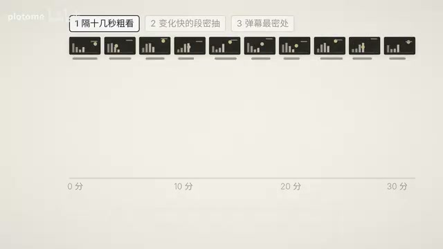
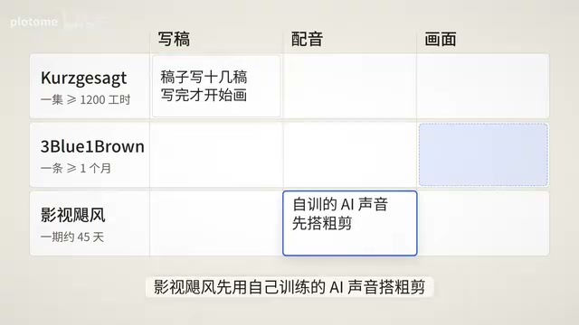
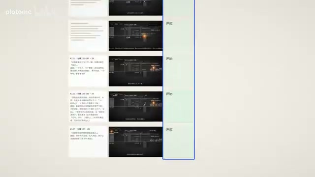
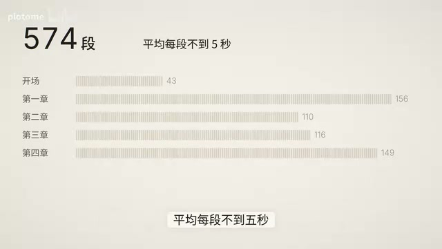
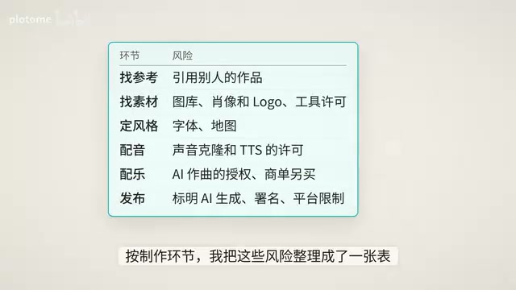

# 全网150万播放的AI动画，怎么做的？分享我的制作全流程

来源：[Bilibili 第 1P](https://www.bilibili.com/video/BV1xFnt6zE3K/?p=1) · 时间范围：00:00–32:08 · 清理后的忠实讲稿

上一条我和 AI 做的视频，片长 46 分钟，全网播放 150 万。很多人问我：怎么做的？要烧多少 token？花了多长时间？用的什么工具？这一条，我毫无保留地讲一遍。

你最近刷视频可能已经发现了，平台上冒出了大量做得很精美的科普动画，其中很大一部分是 AI 做的。有的账号一个月就涨到了几十万粉。今年诺贝尔奖公布后的半天里，AI 做的诺奖科普就刷屏了。以前要做几天的片子，现在被压缩到了几个小时。

这条视频分两部分：先讲一条科普短片怎么一句话做出来，再讲我那条 46 分钟的长片是怎么一步一步做出来的。不会剪辑、不会用 Blender 都没关系，因为我也不会。

## 科普为什么适合 AI 制作

先说短片。刚才那些爆款，AI 为什么做得又快又好？因为科普这类题正好落在 AI 擅长的地方：知识是现成的，它检索、整理得快；讲法有章可循，概念、例子、结论，它顺着就能讲成故事；画面多是图表、示意和数字，正是写代码最拿手的；对错可以核对，它还能自己查一遍。这几样全齐了，人要插手的地方就很少。所以一句话就能做出七八十分的片子。

当然，也有人愿意多花时间去打磨。制作人有自己的审美，想让片子更像自己想要的，就得多管一些环节，反复打磨到九十分。差别不在 AI 行不行，在人肯花多少心思。

那 AI 做的画面到底是怎么来的？最近火的这些科普动画，大多不是视频模型生成的，是 AI 写代码、一笔一笔画出来的。二维的有网页画布、Remotion、Manim；三维的有 Blender、Cinema 4D、Houdini。我用的是 Blender，免费开源，还能全用 Python 控制。

*二维动画工具示例，以网页画布展示科普动画画面。 · [原片 01:49](https://www.bilibili.com/video/BV1xFnt6zE3K/?p=1&t=109)*

## AI 如何写代码、拆参考与控制风格

## 动画工具与代码控制

这些工具我们都不用学，告诉 AI 目标，它自己挑工具、下载、安装、运行。上一条片子的 3D，就是 Claude 在后台写 Python，自己建模型、配材质、打灯、摆相机，再渲染出来。光动画引擎就有 1700 多行，各章的关键帧脚本加下来一万行出头，全是 AI 写的。

每个画面里方块多高、相机转几度、什么时候出现，在代码里都是一个具体的数。我说哪里要改，AI 就只改那几个数，别的地方不受影响。同一个时间点，每次渲染出来都是同一张图，所以试错很便宜：说完要改哪，过一会儿就能看到新画面。

AI 还能看自己渲染出来的图，先挑一遍毛病。很多地方我只说一次，它就自己改、自己看上几轮，交给我的已经是修好的版本。

## 参考片如何拆解风格

画面能做出来了，下一个问题是做成什么风格。一条科普片吸不吸引人，大致看三样：风格决定观众第一眼停不停下来；节奏决定他能不能看完；内容决定看完有没有收获。短片这点内容，AI 已经很拿手；风格和节奏都能从参考片里拆出来。

最省事的办法就是找参考：深色信息卡、工程蓝图、水墨、一笔画，现成的风格已经很多。你也可以给 AI 一条喜欢的片子，让它一帧一帧地拆：用了哪些动效、整体什么风格、配色和字体、镜头和节奏，然后照着这份拆解，做一条讲你自己内容的新片。

这里的关键在抽帧。Claude 看不了视频，只能看图，所以要先把视频变成一张张图片。参考片比较长的话，我分三步抽：先每隔十几秒抽一张，配着字幕粗看一遍；再让 AI 算相邻两帧差多少，把画面变化最快的几段密密地抽出来细看。

*参考视频抽帧分析的三步时间轴：十几秒粗看、抽变化快的片段、弹幕最密处。 · [原片 03:53](https://www.bilibili.com/video/BV1xFnt6zE3K/?p=1&t=233)*

## 拆解参考片与试用风格 Skill

有弹幕的话，再把弹幕最密的几处拉出来，那是观众反应最集中的地方。拆完，AI 能说出这些手法的名字。比如“引导物”：一个小光点带着视线换场景；“嵌套拉远”：上一幕缩小，变成下一幕的一个零件。还有节奏，多久换一个画面，哪里停下来留白。

我上一条视频的画面就是这么学来的。参考片里弹幕刷“这一段动画直接炸裂”的那几秒，AI 拆出了里面的转场，叫“3D 转 2D 对位转场”，再照着做出了我们自己的开场那一镜。

另一条常见的路是装 Skill，也就是别人打包好的一套画法。我拿同一套字幕，让 AI 讲“运气的形状”，换 6 种风格、7 个 Skill，再加一版不装的，一共 14 版。材料完全一样：11 条字幕、一张时间表、一段配乐。有些风格并不适合这个题，但差别一眼就能看出来。再看装了 Skill 的几版……

当然，其实我们不用记住这么多风格，只要知道 AI 能用代码做出各种风格，真做的时候现场找一套参考就行。我还试过只给一句话，让它自由发挥：一句是“做一支 30 秒的作品当简历”，一句是“讲清声音怎么把沙子拍成图案”。

## 从一句话到短片制作

同一句话，每次做出来都不一样。到这你会发现，一句话出片，效果已经很能看了。短片要的东西本来就不多：讲什么，加一个风格参考，剩下的它自己能做完。

那具体怎么动手？下面是我做一条短片的办法。需要的东西其实很少：一个会写代码的 AI 助手，我用 Claude Code，换成 Codex 也可以；再告诉它你想讲什么、想要什么样的画面。写文案、做画面、渲染成视频，它都能自己做完。要配音，直接问它怎么配，它会看你手上有什么，决定接哪个服务。

提需求有两种办法。第一种最简单，直接用提示词让它做。现在的 Claude 不装 Skill 也能做得不错，直接问就行。网上也有不少完整的提示词，可以拿去试。第二种，想要特定的风格，就挑一条喜欢的片子当参考；做出一条满意的以后，后面的片子都拿它当参考。

参考从哪找？最直接的是你平时刷到、觉得好看的。也有开源项目专门在收集，比如 Awesome AI Motion 就收了 1000 多条 AI 动画，并且按题材分好了类，不少还附着原作者的提示词，仓库链接放我的博客里。找到参考视频以后，把链接贴给 AI，让它照这个风格讲你的概念就行。这也是我比较推荐的办法：知道要什么样子，链接一贴，就等成片了。

想要更稳的画法，也可以装一个 Skill 当参考。比如专讲机械原理的 Anatomy，装上以后让它讲一台机器怎么运转。画面要用的素材也能交给 AI 去找。代码能做出来的多是图形、文字和图表；要人物和照片，就让它去能商用的图库里找；图库里没有，再给它接上生图、生视频的模型。代码管位置、结构和动效，生成模型管人物和质感。做完以后……

## 两种短片做法的实测

还有关键一步：让它自己先审一遍。AI 能看自己渲染的画面，也能请另一个模型来挑毛病。这样一遍下来，它就能交出一条效果还不错的片子。

先看第一种办法的实测。我只给了 Claude 一句话：“做一个 30 秒左右的科普动画，讲清楚地球上为什么会有四季。”它做完第一版，自己想到请 Gemini 审片、试听，前后改了四版，大约一个小时才交给我。我看到成片的时候已经没什么问题了：夏天热、冬天冷，是因为地球离太阳时近时远吗？并不是。地球一月初离太阳最近，那时北半球却是冬天。真正的原因是地轴倾斜了约 23.5 度，并且公转时始终只向同一方向。公转到这一边，北半球偏向太阳，阳光照得更直，白天更长，就是夏天；到了另一边，北半球偏离太阳，阳光斜照，热量更分散，白天变短，就是冬天。南半球正好相反，这就是四季的由来。

所以下任务时可以顺手加一句：“做完自己审一遍，有问题改完再给我。”这条片子按订阅算，大约 0.3 美元。Claude 前后调了 83 次模型，处理了约 1600 万 token，绝大部分是在重复读上下文；按 API 标价折算，约 12 美元。

第二种办法，找参考片，让 AI 拆了再做，我也实测了一次。参考的是开头那个一个月涨到几十万粉的账号。我找来他最近几条高播放的片子，先让 Claude 拆，拆出来的要点很具体：头两秒就是一个具体的人、一个反常的瞬间；一条片子只讲一个概念；用两三个递进的数字推着走；每两三秒一句字幕；没有旁白，只配一首氛围音乐。我把整份报告、四条原片和抽好的帧一起交给 Claude，让它边看原片边做。主题我选了投资里的“看得越勤，亏得越多”。它给片子起名叫《刷新》。

后来又加了一版配音，用的是我上一条视频的音色。

晚上 11 点，他第 27 次打开基金。今天负 1.2%。五年下来，这只基金涨了 60%，可他觉得自己一直在亏。每一个绿点，他都看见。赚钱的人，为什么一直在难过？

美股 100 年，26000 多个交易日，一天一格，涨是红，跌是绿。按天看，45% 的格子是绿的；拉远按月看，37%；按年看，24%；按 10 年看，不到 5%；按 20 年看，一次都没有。同一个市场，看得越近，绿的越多。

而亏一块钱的痛，大约要赚两块钱才抵得上。他每天看，五成多的日子在涨，四成多在跌；跌的那些要算两倍，痛比乐多。一年看一次，七成多的年份在涨，痛就盖不过乐了。同一笔钱，看得次数不同，感觉完全相反。难受就难受，钱又没少。

1997 年，几位经济学家做了一个实验：一只基金像股票，起伏大、长期赚得多；另一只像债券，平稳、赚得少。一组人频繁看到结果，一组人隔很久才看到。看得勤的那组，把钱从股票挪进了债券，最后赚得更少。

现实里也一样。截至 2024 年的十年，基金本身每年赚 8.2%，买基金的人平均只拿到 7%。差的那一截，多半花在了一买一卖上。看见亏损，就难受；难受，就想做点什么：卖掉，或者不敢再买。

## 短片与长片的差异

而第二天的红，他错过了。一圈又一圈，地铁到站了，他把 App 拖进了文件夹的最后一页。

市场每天都在涨跌，你不用每天都在涨。

我感觉还行，能给七八十分吧。从开头到配音版，AI 前后做了三个多小时，其中差不多一个小时花在等审片超时和返工上。按订阅算，《刷新》大约 1.3 美元。Claude 处理了约 5800 万 token，按 API 标价约 51 美元。

把三条片子按订阅放在一起看：30 秒的《四季》约 0.3 美元；两分半的《刷新》约 1.3 美元；46 分钟的长片约 50 美元，是 Claude 每月 200 美元套餐大约一周的额度。

所以现在做短片已经很简单了：拆解、模仿、试错，在一个对话里就能完成。把想讲的和想要的样子告诉 AI，再改上几轮就行。可要是片子长到几十分钟，事情就不一样了。长篇光耗几轮对话是做不出来的；内容越长，越需要人来把控。

比如一条 20 分钟的片子，文字稿就有 6000 字左右。我相信你应该也不会把 AI 直接生成的长文原样拿去工作汇报吧？好吧，确实不少人这么干。这种充满 AI slop 的文章现在随处可见：满屏的“不是……而是……”，说白了，“我稳稳地接住你”，还有一句接一句的破折号。字数是够了，但远不到让人满意的程度。所以这么长的稿子，我自己要改上很多轮的。想指望 AI 一口气帮你把稿子、视频一次做完做好，基本不可能。

上一条片子，正文的旁白有 162 句，分镜拆了 1134 格，关键镜头画了 500 多张，还配了 15 首曲子，很难单纯通过对话去反复改。得能借助工具，一段一段改稿子、一段一段审画面；改了什么、谁再改、改完没有，都得有地方记着。所以做长片先得有一个合适的工作流。

我所有的活都在 Obsidian 这个软件里做。最早我用 Typora 写博客，要用 Agent 得另开一个终端，两个窗口来回切，两边不互通。我得精确地描述：“有一段提到了两个数字，补一下出处。”要改的地方一多就很麻烦。

后来发现 Obsidian 有个插件，叫 Claudian，能在笔记旁边直接用本地的 Claude Code 和 Codex。选中一段文字就能跟它聊、让它改；它还能读写文件、跑命令，还能另开分身，专门去干一件事，也就是子代理。中间改稿子，右边给 Claude 派活。装上插件后，选中一段还能写评论。后面讲写稿时我们再细说。

复杂的画面可以放进 Obsidian 自带的画布里审。Obsidian 的插件市场很丰富，缺什么能力就让 AI 去里面找现成的；实在找不到，就让 Claude 自己写一个。

模型我主要用国外几家，主力是 Claude，还有 Codex 和 Gemini。做短片，最基础的订阅就够了；但长片很费 token，所以我让几家模型一起干活：代码、动效、派活和项目管理交给 Claude；审稿、挑错和调研派给 OpenAI 的 Codex，也就是 GPT，因为它给的额度比较多；Gemini 文字功底不错，有些初稿先让它写。它还能直接听音频，配音和视听也交给它。这里面最难搞到的，其实是 Claude……

### 长片制作：工作流与选题

很多人在国内订阅不了。不过各家模型都进步得很快，也许再过一段时间，国内模型也能做到这样。而我在里面的角色，更像导演加主编：讲什么、稿子怎么写、用什么风格、每个画面讲没讲对、声音顺不顺、最后发不发，都由我来拍板。

工具有了，那一条长片到底是怎么做出来的？做上一条之前，我对影视制作没有任何积累，所以我先让 AI 去调研专业团队是怎么做片子的。比如 Kurzgesagt（转写听作“库斯克萨特”），一个几十人的动画工作室，一集至少要 1200 工时；3Blue1Brown，一条片要一个月甚至更久；影视飓风内容团队 80 多人，一个频道约 45 天出一期。

细看他们的做法：Kurzgesagt 的稿子写十几稿，写完才开始画；影视飓风先用自己训练的 AI 声音搭粗剪，稿子定了再真人录；3Blue1Brown 自己写 Manim 代码，一镜一镜地选。过去，插画、动画、录音、剪辑、配乐各有专人；但做这种用代码画画面的科普视频，这些角色都可以交给 Agent，人只要守住几个关键节点：

*制作团队流程对照表：稿件、配音和画面由不同环节接力。 · [原片 16:59](https://www.bilibili.com/video/BV1xFnt6zE3K/?p=1&t=1019)*

- 立项：确认讲什么、给谁看。
- 脚本冻结：打磨出文字稿，定稿后不再大改。
- 风格冻结：定下风格和关键元素。
- 关键帧：看画面讲没讲对。
- 动画初版：看动作、节奏和旁白对不对得上。
- 成片放行：看最终成片、配音、配乐和发布。

夹在这些节点之间，下面就照着这张图，一个阶段一个阶段往下走。第一阶段是选题。选什么题，每个人看法都不一样：可以是自己的经历和困惑，可以是最近读到的东西，也可以是看别人做火了、评论区都在问，就赶紧跟上。实在没头绪，还可以问 AI。

告诉它你懂什么、想讲给谁听，让它列出这类观众常问又没人讲清的问题，你再挑。常见的选题来源我整理成了一张表。

我上一条主题选了“财务自由”，原因很简单：这个话题我关注得早。做互联网、做理财的人多少都听过 FIRE，就是攒够钱、提前退休。我之前也算过多少钱才算财务自由。讲什么、给谁看，一两句话能说清，立项就过了。

### 调研与写稿

接下来是整个过程里最花时间的一个阶段：稿子。稿子把控着整条片子的节奏；稿子的深度决定内容能做到什么程度，也决定别人愿不愿意往下听。画面再精美，内容空洞，也很少有人看完。

题目定了先调研，把材料和数据找齐；再写稿，我自然也在 Obsidian 里做。我先把能想到的都口述出来，跟 AI 一条条讨论，哪里还要调研就让它去找。数据类的尤其多。我和 AI 全程基本是语音输入，比打字省很多时间。我用的是豆包输入法，中英混着说也识别得比较准；就算转写有几个错字，AI 也能读懂原意。

另一方面，我平时读到的好文章都存进了 Readwise 和知识库，AI 用工具就能直接查到。连小红书上的帖子，我也给了它工具，让它自己去读。上一条片子，我是先写了三篇博客，再改成视频的；光小红书帖子就找了近百篇。三篇博客前后写了 16 天。

材料齐了，先磨出大纲，再一段段填、一段段改。我写的时候会遵守一条原则：读者读完上一段可能追问什么，下一段就回答他。调研加写稿花了我五六十个小时，比后面做视频的时间多出一倍还多。博客加配图我都一一把关，盯着 AI 改到满意。博客写好，还要改成旁白稿。

## 定稿、风格冻结与试镜

大表格、长公式、一串参考链接，视频里没法直接展示，就要和 AI 一起取舍，精简掉或者换成画面讲。三篇博客约 26000 字，照着念要 85 分钟以上；取舍完，成片是 46 分钟。

写稿、审稿时我最常用两个插件：评论和锁定。我在 Obsidian 里划线评论，全篇评论完，在右边说一句“处理下评论”，AI 就会一条条改完，并在每条下面回复。我满意的段落标上锁定，AI 就知道这里不能再动了。这样的评论要来回很多轮，直到稿子成了我想要的样子。

到这一步，稿子就冻结了，之后只做微调。因为配音多长、动效在哪一秒出，都是照着稿子排的；稿子一动，后面全要跟着动。

文字定了，下一步定这条片子长什么样。风格冻结这一阶段要定三样：整体是什么风格，常出现的东西长什么样，还有配什么音乐。我参考了两部片子：画面学有知有行的《投资是怎样赚钱的》，讲法学达利欧的《经济机器是怎样运行的》。拆完参考片，让 AI 对照我们的内容写出风格规范。

可规范写在纸上看不出好坏，所以要试镜：先做出开头一分钟，所有元素都得画出来看看。上一条的试镜走了三轮。第一轮，数据图怎么画？“4% 法则”那组历史数据先试了三种画法，三种都被我否了，最后退回一张平面折线图。

第二轮，用什么工具？我一开始只说要 3D，AI 自己挑了一个 ASR 听作“3GS”的工具，做了两天原型，质感一直差一截。换 Blender 跑了两小段，一比，当晚就改用了 Blender；前两天的原型基本推倒重来。所以试镜最好头一天就拿最难的镜头试。

第三轮，质感。同一个镜头一路改到中段……

## 关键帧审阅与画面元素规范

三轮下来，工具和方向定了，但开场离成品还差得远。接下来就是一版版往下磨。其实这期间我没有花很多时间，我只跟 AI 说了一句：“这一版做得不够精致，和有知有行差在哪？按照自己的理解，打磨好我们的风格，不要吝啬时间和 token。”剩下的全是 AI 自己干的。

Claude 把成片和有知有行并排，逐项找差距，再派一个独立的审片 Agent 专门挑毛病，一轮轮改。这一阶段我提的只有两类意见：哪里该用 2D，人物朝向不对。所以这一阶段，人只管两件事：告诉它对标哪部片子、要做到什么程度，然后放手让 AI 自己找差距、对着改。

打磨完以后，常出现的东西长什么样也就定了，一样样列出来做成元素表，后面每一张照着用。比如钱，100 万块画成 8 张薄片；人物试了 4 版，最后定成方块人；一格画面里只有一处用橙色。

在这一阶段改元素只会影响一张图；如果拖到全片做完再改，就得一个镜头一个镜头换。

*元素规范示例：100万元用八张薄片表示，并可叠成柱形。 · [原片 23:00](https://www.bilibili.com/video/BV1xFnt6zE3K/?p=1&t=1380)*
配乐方向也该跟试镜一起定：样片配上两三首候选，一起听一遍，就知道搭不搭。上一条的配乐我是拖到动画快做完才开始找，那就太晚了，没时间打磨。所以要趁早定下风格和音乐。

之后就是配音。配不配音要先想清楚，它决定了后面改稿的代价。有配音的片子，画面要跟着声音走：一句话念多久，这段画面就展开多久；念到哪个词，哪个元素就在那一刻出来。句子一改，长短和停顿都变，这段动效就得重做、重选。不配音的片子只有字幕和音乐，改一句，换一行字幕就行，所以很多讲解短片干脆不配音。

## 配音与逐句分镜审阅

要配音，最好等文案整个定型了再配。我选的是用 AI 配音，它对环境要求最低，花一点钱就能有不错的效果。自己配得有好麦克风、安静的环境，还要自己能掌控节奏。

选配音服务主要看三件事。第一，音色能不能固定：长篇要分很多次合成，每次都得是同一个声音。第二，能不能商用：免费版、克隆别人的声音、开源模型，常常不许商用。第三，能不能给出逐字时间，就是每个字在第几秒念出来；画面要踩在词上，全靠它。常见的几家配音服务，价格和区别都在这张表里。

我用的是 Gemini 的语音合成。我决定做视频的时候它刚好发布，评价也不错。我让 AI 生成了几种音色，挨个试听，选了现在这个。但是 Gemini 给不了逐字时间。要精确到字，就把音频再过一遍语音识别，对出每个字的时刻。不过上一个视频我其实只对齐了每句的起止，效果也过得去；有些动画本来就用不着精确到字。

在配音完成后，接下来就能按句出画面了。在这一阶段，AI 按句出关键帧：一句旁白一行，摆到画布上，每一句旁边都有一个评论框。我在里面写意见，AI 改完，在右边贴回复卡。比起在文档里说哪个画面有问题，方便太多了。

*逐句分镜审阅画布：旁白、画面与评论回复逐行对应。 · [原片 25:30](https://www.bilibili.com/video/BV1xFnt6zE3K/?p=1&t=1530)*

风格前面已经定了，这里只看一件事：每一格的意思和这一句稿子讲的内容是不是一致。意思对了，再去管它好不好看。动画是为了更好地呈现内容，要防着它喧宾夺主。我在画布上提得最多的是“换个表现方式”。AI 起手常常是 3D，空间感很足，可有些地方 3D 讲不清，或者讲得太绕……

## 动画、渲染与分段返工

我就提出换成 2D，或者把镜头推进某个东西里去。比如有一处我写的是：“从这里开始，是不是转成 2D 比较合适？”AI 回复：“同意镜头转 2D。柱子落下，压扁成横轴上的五小段。”方向是我定的，具体怎么动是 AI 先拟定的，比如柱子怎么压扁成横轴、前景怎么从屏幕里拉出来。

当每一格的画面都确认好了，接下来就该让画面动起来。关键帧审完，剩下的基本是 Agent 自己跑，我只需要按张审阅。AI 会按章节做动画、渲染，渲染好的整张排到画布上，每句一行，配一排抽帧。我在另一个屏幕上放视频，看到问题就找到那一行写批注；它改完再出下一版。每张三版就差不多了。

每审一轮往往都要改动效、重新渲染。一开始改一处就整张重渲，一次就是半个小时；评论只能攒很久才去处理一批，来回很慢。所以后来我让 AI 把动画引擎做了拆分：每两张关键帧之间算一段，段和段互不干扰；改一张关键帧，只重渲它两边那两段；一句旁白变长变短，就重渲它盖住的那几段，后面整体后移。

上一条 46 分钟被拆成了 574 段，平均每段不到 5 秒。

*46分钟长片拆成574个片段，按开场及章节分组，平均每段不到5秒。 · [原片 27:30](https://www.bilibili.com/video/BV1xFnt6zE3K/?p=1&t=1650)*
拆开还有一个好处，能并行渲染：两台电脑各渲一部分，渲完拼起来。上一条导出全片时，我的 Mac mini 和 MacBook Air 一起跑了 6 个多小时。发布前一晚，临时要修第二章的数据，两台机器分头重渲那几十段，一个小时左右就完了。当然，如果你设备够好的话，就不用折腾并行了。

画面动效衔接好后，接下来就该配上音乐和音效了。配乐和音效我也基本交给 AI，它按画面找曲子、排位置，按动作的时刻挂上音效。

## 配乐、审片与风险跟踪

其实最省事的是让 AI 自己做音效，大部分时候也够用；我听得不对，再提意见。这一步要留意用哪些曲库，版权处理不好可能被平台下架。大平台自己买过曲库，在平台里用一般没问题，但要看这首曲子许可的用途，商用和非商用是分开的。投稿时检测出没有授权，可能被静音，甚至封掉。

我一开始就打算多平台发，所以选了公用的免费曲库，只挑许可允许配进视频里的，再按许可在片尾署名。这些是我整理的一些曲库，也放在了博客里。配乐做完，所有章节就能拼成一条带配乐的全片。

其实审片散在前面每一阶段里：稿子、风格、关键帧、整张动画，每一阶段除了我，还有 AI 在审；审动效的、审事实的、听声音的，各管一摊。到最后这一阶段，AI 把所有章节拼成一条带旁白、音效和配乐的审阅版。我和 ChatGPT 各从头到尾看一遍，看整片顺不顺、前后对不对得上、有没有明显的渲染异常。没问题就可以发布了。

还有一点要注意，每一阶段审出来的问题都得有地方记下来，一直追到落地。我之前就踩过这个坑：成片都出完了，才发现第二章那个数据错误还没改，只好回头再改、再渲、再闪一遍。所以我用 Obsidian 的 Bases 搭了一张看板，一件事一条，谁在做、做完没有，一眼就能看到。AI 会自动登记、销项，保证每件事都落了地。片子做完，回头翻这张表，就知道走了哪些弯路、时间到底花在哪了。

全片审完，就到最后一步：发布。现在 AI 已经能直接操作电脑和浏览器了，所以上传多个平台这种繁琐的事……

## 发布与人机分工回顾

发布环节，我直接交给 AI 去各个平台上传视频，填好标题、描述和章节；封面我也直接交给 AI 来做。我只做最后的验收、修改和发布。

发之前还要过一遍版权和合规：参考片、图库、字体、地图、声音克隆、AI 作曲，每一步都有要留意的地方。发布时还要标明含 AI 生成内容。按制作环节，我把这些风险整理成了一张表；做片子时截个图交给 Agent，对一遍就行。

*按制作阶段整理的版权与发布风险清单。 · [原片 30:32](https://www.bilibili.com/video/BV1xFnt6zE3K/?p=1&t=1832)*

到这里，短片和长片的做法都讲完了。短片一句话就够；长片守住六个阶段，一个阶段一个阶段往下推。最后把整个过程放在一起，看每一环谁做什么：从调研、起草到出画面、渲染、上传，体力活都是 AI 干的。人要做的是定讲什么、挑风格、审画面、做取舍。

回到开头那几个问题。怎么做的？前面已经一个阶段一个阶段讲完了。要烧多少 token？先说花费，按订阅算，是 Claude 每月 200 美元的套餐大约一周的额度，约 50 美元；token 一共约 38.9 亿，绝大部分是在重复读上下文，这部分很便宜。但如果你想用 API，那就需要 2000 美元。

花了多长时间？不算写博客，做视频这一段我花了约 20 个小时，Claude 自己跑了约 90 个小时。这期间我发了约 294 条指令和批注，Claude 派出了 53 个子代理。

用什么工具？主力是 Obsidian 加 Claude Code，审稿和配音另用了 GPT 和 Gemini。总表里“人要做什么”那一列，就是我以后要把控的部分，其余的交给 AI。
