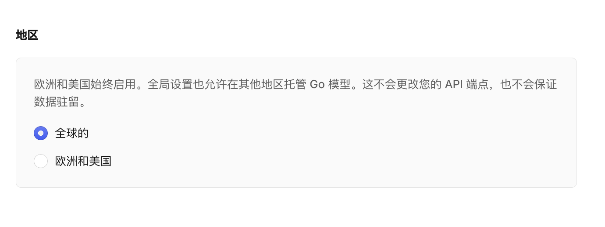
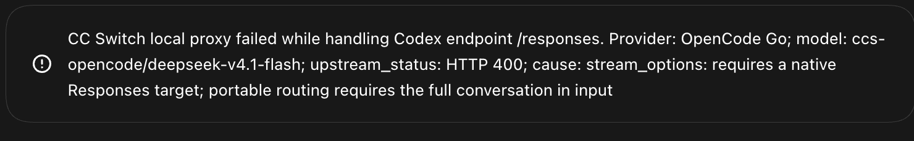

# 用 CC Switch 把 OpenCode Go 接入 Codex：配置、参数与故障排查

> 本文记录 2026 年 11 月在 macOS 上使用 CC Switch 4.0.25，将 OpenCode Go 的 DeepSeek V4.1 Flash 接入 Codex 的配置过程。模型目录和服务端接口可能变化，照做前请以 CC Switch 界面和 OpenCode 官方文档当前内容为准。

## 先看最终配置

Codex 使用 OpenAI Responses API；OpenCode Go 的 DeepSeek V4.1 Flash 原生使用 OpenAI Chat Completions。要让两端对话，需要 CC Switch 在中间转换请求格式：Codex 保持 Responses，CC Switch 的上游格式选择 **Chat Completions（需转换）**，再把请求发给 OpenCode Go。

**Codex（Responses）** → **CC Switch 本地转换** → **OpenCode Go `/chat/completions`** → **DeepSeek V4.1 Flash**

本案例最终使用 OpenCode 官方 Go 基础地址 `https://opencode.ai/inference/go/openai/v1`。日志确认 DeepSeek 和 MiMo 请求都到达该地址下的 `/chat/completions`；用户随后确认 Codex 已能正常使用。OpenCode Go 文档将 DeepSeek V4.1 Flash 列为 Chat Completions 接口，CC Switch 文档说明可以把 Codex 的 Responses 请求转换到上游 Chat Completions。[OpenCode Go 模型接口表](https://opencode.ai/v2/docs/console/go/) · [CC Switch：Codex 上游格式](https://github.com/farion1231/cc-switch/blob/main/docs/user-manual/en/2-providers/2.1-add.md)

## 配置步骤

### 1. 在 OpenCode Console 准备 Go 工作区

登录 OpenCode Console，确认当前 workspace 已订阅 OpenCode Go，并在这个 workspace 中创建 API Key。CC Switch 的 OpenCode Go provider 使用这把 Key 验证上游请求。不要把 Key 写入文档、截图、shell 命令或公开日志。

DeepSeek V4.1 Flash 和 V4 Pro 还要求 workspace owner 或 admin 在 **Settings → Privacy → Regions** 中选择 **Global**。这是模型可用区域设置，不是 API 地址或本机代理设置。截图里的“允许付费端点训练”开关与 DeepSeek 区域要求无关，保持原值即可。[OpenCode Go：受限模型设置](https://opencode.ai/v2/docs/console/go/)



*图 1：OpenCode Console → Settings → Privacy → Regions。截图已裁去浏览器地址栏和 workspace 标识。*

### 2. 在 CC Switch 的 Codex 页面添加 OpenCode Go

打开 CC Switch 左侧的 **Codex** 页面。本案例使用 **聚合（Aggregation）** 模式：OpenAI Official 仍是默认 provider，OpenCode Go 作为额外 provider 加入模型列表。选用 OpenCode Go 模型时，Codex 中会显示 `ccs-` 前缀；不带此前缀的默认模型仍走 OpenAI Official。

添加或编辑 OpenCode Go provider 时使用以下参数：

| CC Switch 参数 | 本案例的值 | 作用 |
| --- | --- | --- |
| 连接模式 | 聚合 | 让官方 provider 继续作为默认项，并把其他 provider 的模型加入 Codex 模型列表。也可以选择路由模式，将 Codex 的当前目标设为某个 provider。 |
| API Key | OpenCode Go workspace 创建的 Key | 用于 OpenCode Console 上游鉴权。只填在 CC Switch 的 Key 字段。 |
| API 请求地址 | `https://opencode.ai/inference/go/openai/v1` | 上游 API 基础地址。CC Switch 根据协议追加 `/chat/completions`。 |
| Full URL | 关闭 | 此服务使用标准 OpenAI-compatible 路径；不需要把 `/chat/completions` 手工写进基础地址。Full URL 用于服务商要求完整的非标准 endpoint。 |
| 上游格式 | **Chat Completions（需转换）** | Codex 发 Responses 请求；CC Switch 本地将请求转成上游 Chat Completions，并把响应转回 Codex 能读取的 Responses 格式。 |
| 菜单显示名 | `DeepSeek V4.1 Flash` | 给 Codex 模型选择菜单看的名称。 |
| 实际请求模型 | `deepseek-v4.1-flash` | CC Switch 发给 OpenCode Go 的模型 ID，需与 OpenCode 当前模型目录一致。 |
| 上下文窗口 | `1048576`（模型条目） | 模型目录中声明的上下文值；应以该模型上游当前支持值为准。CC Switch 还可设置 provider 级 `model_context_window` 覆盖值。 |
| 思考等级 | `low, high, max` | 让 Codex 菜单显示该模型支持的等级。请求转换时，CC Switch 会把 Codex 的 reasoning 设置映射到上游格式。 |
| 默认推理强度 | `low` | Codex 当前默认采用的推理强度；必须属于模型映射允许的等级。 |

本机配置同时记录了模型条目的 `1048576`、provider 级 `model_context_window = 1000000` 和自动压缩阈值 `900000`。provider 级窗口会覆盖模型目录中的值，因此不要把两组数字都当成彼此独立的生效上限；新配置应按上游限制设置 provider 级窗口和压缩阈值。CC Switch 文档解释了模型映射、上下文窗口和自动压缩字段的关系。[CC Switch：Codex 模型映射和上下文](https://github.com/farion1231/cc-switch/blob/main/docs/user-manual/en/2-providers/2.1-add.md)

**注意：**选择 Chat Completions 后，Codex 的请求必须经过 CC Switch 本地转换服务。保持 CC Switch 的 Codex 聚合/路由工作模式有效，不要切成绕过本地代理的直连模式。CC Switch 官方文档将 Chat Completions 标为需要本地路由的上游格式。[CC Switch：上游格式说明](https://github.com/farion1231/cc-switch/blob/main/docs/user-manual/en/2-providers/2.1-add.md)

### 3. 重启 Codex 并选择模型

保存后，完全退出并重开 Codex 桌面版（macOS 使用 **⌘Q**，只关闭窗口不够）。CC Switch 会提示 Codex 启动时读取模型目录；不重启时，新 provider 或模型可能不出现。

在 Codex 中选择 `ccs-opencode/deepseek-v4.1-flash`，发一条短消息验证。其他 Codex 会话仍可选默认 OpenAI Official，或选择聚合列表中的其他 `ccs-` 模型。

## 排障过程：症状、原因与修复

### 问题一：本地代理报 502，或界面反复重连

**现象。**Codex 连接 CC Switch 的 `http://127.0.0.1:15721/v1` 失败；请求本机 `/v1/models` 时出现 502。

**原因。**macOS 的 `http_proxy`、`https_proxy` 和 `all_proxy` 指向外部代理，但没有为 loopback 地址设置例外。Codex 访问 `127.0.0.1` 时也被送进外部代理，因此请求没有直达 CC Switch。

**修复。**在 shell 启动文件中设置回环地址例外；若 Codex 从 Finder 或 Dock 启动，还要给新的 GUI 进程设置 launchd 环境，并重启 Codex：

```sh
export no_proxy="localhost,127.0.0.1,::1"
export NO_PROXY="$no_proxy"

launchctl setenv no_proxy "localhost,127.0.0.1,::1"
launchctl setenv NO_PROXY "localhost,127.0.0.1,::1"
```

用不经过系统代理的本机请求检查 CC Switch 服务：

```sh
curl --noproxy '*' -i --max-time 3 http://127.0.0.1:15721/v1/models
```

本案例配置例外后，同一接口返回 HTTP 200。`NO_PROXY` 只让本机请求绕过系统代理；CC Switch 发往 OpenCode 的上游请求仍按其网络设置出站。新环境变量只会被之后启动的 GUI 进程继承，所以要完全退出并重开 Codex。

### 问题二：HTTP 400，提示 DeepSeek 需要 Global 区域

**现象。**上游返回：`This Go model requires Global regions. Select Global in your workspace's Privacy settings to use it.`

**原因。**请求已经到达 OpenCode Go；DeepSeek V4.1 Flash 对 workspace 区域有要求。它不是本地代理 502，也不是 Wi‑Fi、Full URL 或 `NO_PROXY` 问题。

**修复。**在与该 API Key 对应的 OpenCode workspace 打开 **Settings → Privacy → Regions → Global** 并保存。此项需要 owner/admin 权限。如果设置后仍收到同样提示，先确认 Key 和所改设置属于同一个 workspace。[官方受限模型说明](https://opencode.ai/v2/docs/console/go/)

### 问题三：HTTP 400，提示 `stream_options` 和 portable routing

**现象。**Codex 请求 `/responses` 时，OpenCode 返回：

```text
stream_options: requires a native Responses target;
portable routing requires the full conversation in input
```



*图 2：错误发生时，Codex 的 Responses 请求已到达上游，但 OpenCode 的兼容路径拒绝了这次请求。*

**排查和原因。**日志先后显示两个现象：旧的 `/zen/go/v1` 地址出现过 404/不可用；改用官方地址后，请求确实到达 `/inference/go/openai/v1/responses`，但仍收到上述 400。因此单改 URL 不够。结合错误内容和官方模型接口表，问题在于：Codex 的 Responses 请求被直接交给 OpenCode Console 的跨协议转换路径，而 DeepSeek V4.1 Flash 的原生接口是 Chat Completions。错误正文要求 portable 路径提供完整对话输入，但日志没有保存请求体，无法仅凭日志断定触发条件是 `stream_options`、会话状态，还是两者组合。

**修复。**最终配置同时满足两个条件：

1. 将地址从旧的 `/zen/go/v1` 改为官方 Go 基础地址 `https://opencode.ai/inference/go/openai/v1`。
2. 将 CC Switch 上游格式从 **Responses（原生）** 改为 **Chat Completions（需转换）**，让 CC Switch 本地完成协议转换。

之后的 CC Switch 日志显示，DeepSeek 与 MiMo 请求都发往 `https://opencode.ai/inference/go/openai/v1/chat/completions`；用户确认故障已解决。这里的成功依据是用户确认和路由目标日志；日志本身没有记录 HTTP 响应码。OpenCode 官方 Codex 示例仍使用 Responses wire API；在本方案中保持 Codex 的协议不变，由 CC Switch 处理上游转换。[OpenCode Codex 配置](https://dev.opencode.ai/v2/docs/console/harnesses/codex/) · [OpenCode Go 的 DeepSeek 接口](https://opencode.ai/v2/docs/console/go/) · [CC Switch 的转换行为](https://github.com/farion1231/cc-switch/blob/main/docs/user-manual/en/2-providers/2.1-add.md)

## Full URL 为什么保持关闭

CC Switch 默认把 API 请求地址当作基础前缀，再按上游协议追加接口路径。这个案例填写：

```text
基础地址：       https://opencode.ai/inference/go/openai/v1
上游格式：       Chat Completions（需转换）
最终上游请求：   https://opencode.ai/inference/go/openai/v1/chat/completions
```

如果把完整 `/chat/completions` 路径填进普通基础地址，CC Switch 仍可能继续拼接路径；如果启用 Full URL，CC Switch 则会把填写值原样使用。官方文档说明 Full URL 用于非标准 endpoint，且需要本地路由；本例遵循标准路径，因此关闭它。[CC Switch：Full URL 模式](https://github.com/farion1231/cc-switch/blob/main/docs/user-manual/en/2-providers/2.1-add.md)

## 参考资料

1. [CC Switch 用户手册：Codex 上游格式、模型映射和 Full URL](https://github.com/farion1231/cc-switch/blob/main/docs/user-manual/en/2-providers/2.1-add.md)
2. [OpenCode Go：模型目录、各模型原生接口和 Global 区域要求](https://opencode.ai/v2/docs/console/go/)
3. [OpenCode Console：Codex 使用 Responses API 与 Go 基础地址](https://dev.opencode.ai/v2/docs/console/harnesses/codex/)
