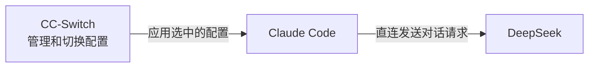
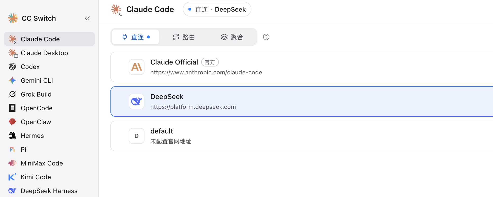
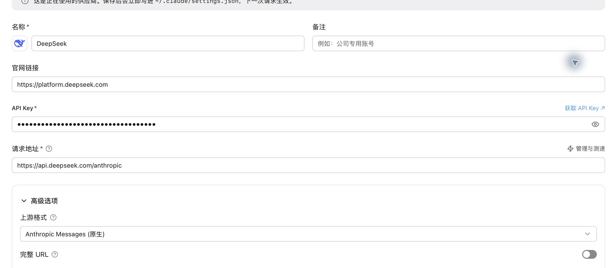
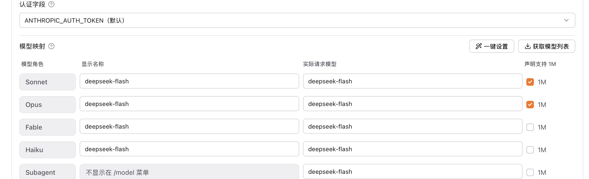
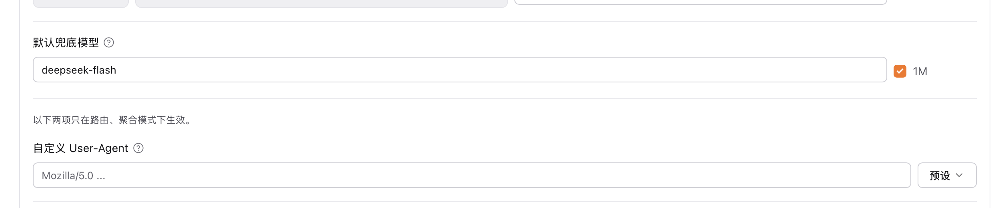
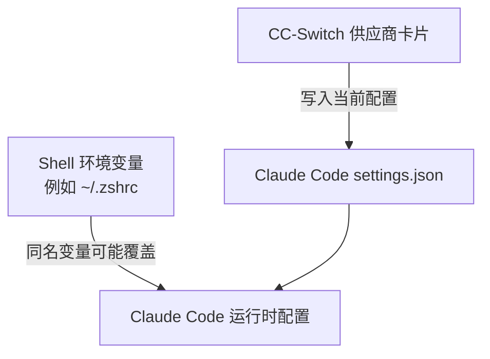

# 用 CC-Switch 将 Claude Code 接入 DeepSeek V4.1-Flash-1017

> 本文操作环境为 CC-Switch v4.0.24、Claude Code v2.1.316（2026-11-02）。截图中的 API Key 已遮蔽，账户余额区域已裁掉。

## CC-Switch 是什么，为什么这次用它

这次我想做的调整很具体：Claude Code 已经通过 CC-Switch 使用 DeepSeek，原来的主模型是 V4 Pro；现在我想切换到 DeepSeek V4.1-Flash-1017。[DeepSeek 官方发布说明](https://api-docs.deepseek.com/news/news261017/)

Claude Code 要连接一家 AI 服务，需要知道连接地址、API Key 和模型设置。CC-Switch 可以把这些配置整理成不同的供应商卡片。要换服务时，在界面里选对应卡片，CC-Switch 就会把那套配置交给 Claude Code 使用，省去每次手动编辑配置文件的麻烦。([CC-Switch 配置说明](https://github.com/farion1231/cc-switch/blob/main/docs/user-manual/zh/2-providers/2.3-edit.md))

这次使用的是“直连”模式。配置时，CC-Switch 把当前选中的设置写入 Claude Code；开始对话后，由 Claude Code 直接向 DeepSeek 发送请求：





*图 1：CC-Switch 的 Claude Code 页面。截图裁掉了账户余额区域。*

## 在 CC-Switch 中配置 Claude Code 的 DeepSeek 供应商

本文按 CC-Switch v4.0.24 的界面说明。已有 DeepSeek 配置卡时，先选中 Claude Code 页面，找到 DeepSeek 卡片并点“编辑”；第一次配置则点“添加供应商”，选择 DeepSeek 预设。DeepSeek 提供 Anthropic Messages 接口，所以这里使用“直连”模式和“Anthropic Messages（原生）”格式，不需要启动 CC-Switch 本地路由。([CC-Switch 添加供应商说明](https://github.com/farion1231/cc-switch/blob/main/docs/user-manual/zh/2-providers/2.1-add.md))

在表单里填写 DeepSeek API Key，并把请求地址设为：

```text
https://api.deepseek.com/anthropic
```



*图 2：DeepSeek 供应商表单。API Key 保持遮蔽。*

接下来在模型配置处填模型 ID。虽然模型版本的名称是 **DeepSeek V4.1-Flash-1017**，API 中实际使用的模型名是 `deepseek-flash`。DeepSeek 官方文档说明，这个模型名对应当前的 Flash 版本。([DeepSeek API 文档](https://api-docs.deepseek.com/quick_start/pricing-details-cny/))

在 Claude Code 的模型映射栏里，显示名称方便人在 `/model` 菜单中识别，实际请求模型填写 `deepseek-flash`。如果要使用 1M 上下文，在 CC-Switch 的对应选项中勾选“1M”。这个选项是告诉 Claude Code 模型支持的上下文长度；它不会改变 API 的模型名。([DeepSeek Claude Code 配置指南](https://api-docs.deepseek.com/quick_start/agent_integrations/claude_code/)、[Claude Code 上下文说明](https://code.claude.com/docs/en/model-config#correct-the-window-for-a-gateway-or-custom-model-id))

DeepSeek 的指南还区分了模型角色：主模型、Opus 和 Sonnet 使用 1M 设置；Haiku 和子代理使用普通的 `deepseek-flash`。指南另外建议设置 `CLAUDE_CODE_EFFORT_LEVEL=max`，并用 `CLAUDE_CODE_AUTO_COMPACT_WINDOW=786432` 指定自动压缩对话历史的窗口。DeepSeek 指南没有为 Fable 指定单独设置，因此这里不需要额外配置。

如果预设没有带上这两项，可以在该供应商的“配置 JSON”里，把缺少的键合并到现有 `env` 对象中；已有的键保留原值，不要用下面这段覆盖整份配置：

```json
{
  "env": {
    "CLAUDE_CODE_EFFORT_LEVEL": "max",
    "CLAUDE_CODE_AUTO_COMPACT_WINDOW": "786432"
  }
}
```



*图 3：模型映射表填写示例。按 DeepSeek 指南，主模型、Sonnet 和 Opus 使用 1M；Haiku 和 Subagent 不勾选。*

图 3 展示的是按 DeepSeek 指南调整后的表单示例，截图后取消了未保存的改动。当前保存的卡片把所有角色都勾选了 1M；本次实际请求只验证了主模型，不能据此说其他角色也已验证。

主模型对应表单下方的“默认兜底模型”。这里同样填写 `deepseek-flash` 并勾选 1M：



*图 4：默认兜底模型对应 Claude Code 启动时使用的主模型。*

检查配置后点“保存”，再确认 DeepSeek 卡片显示为当前供应商。

## 配置卡已经改了，为什么还会提示环境变量冲突

保存 DeepSeek 配置后，CC-Switch 仍显示环境变量冲突。我点开详情，发现同一组 Claude Code 设置既来自当前进程环境，也写在 `~/.zshrc` 里。因为同名环境变量可能覆盖设置文件中的值，CC-Switch 提示我检查变量来源。([CC-Switch 环境变量冲突说明](https://github.com/farion1231/cc-switch/blob/main/docs/user-manual/zh/5-faq/5.4-env-conflict.md))

我原先在 `~/.zshrc` 里设置了 API 地址、认证变量和模型变量，同时又在 CC-Switch 的 DeepSeek 卡片里管理这组供应商配置。既然决定用 CC-Switch 管理 Claude Code 的供应商，我就把 `.zshrc` 里重复的 Claude Code `export` 行删掉，保留代理等其他 shell 设置。这里不需要把整个 `.zshrc` 清空；只处理与供应商卡片重复、可能覆盖它的变量。

清理后，旧版 CC-Switch 仍显示当前进程继承来的环境变量。随后我升级并重新打开 CC-Switch v4.0.24，冲突横幅就不再出现。这是本机这次排查的结果；遇到类似提示时，先查看详情里的“来源”，再决定是否清理 shell 配置或重启应用、终端。CC-Switch 官方说明也建议按来源处理，并提醒环境变量可能覆盖应用配置。([环境变量冲突处理步骤](https://github.com/farion1231/cc-switch/blob/main/docs/user-manual/zh/5-faq/5.4-env-conflict.md)、[CC-Switch v4.0.24 发布说明](https://github.com/farion1231/cc-switch/releases))



*图 5：两个来源里有同名设置时，Shell 环境变量可能覆盖供应商卡片写入的值。*

## 验证是否真的接通

配置保存后，可以先在 CC-Switch 里检查 DeepSeek 地址是否可达。不过，v4.0.24 中的“检测连通”只检查网络是否能连到请求地址，不会验证 API Key 或模型名；即使检测显示可达，真实请求仍可能因认证、模型 ID 或接口格式不匹配而失败。([CC-Switch 连通检测说明](https://github.com/farion1231/cc-switch/blob/main/docs/user-manual/zh/4-proxy/4.5-model-test.md))

这次操作中，CC-Switch 最初是 v3.14.1，界面里的旧版“模型检查”会发起真实模型请求。升级到 v4.0.24 后，检测功能已经是网络连通性检查。两个版本的检测能力不同：旧版模型检查会真实发起模型请求；v4.0.24 的连通检测只验证请求地址是否可达。因此，不能把旧版的模型检查结果当作新版已经验证了模型。

为确保这次请求读取的是 CC-Switch 写入的设置，而不是测试进程继承来的旧变量，我先在该进程中取消相关环境变量，再发起最小请求：

```sh
env -u ANTHROPIC_BASE_URL \
  -u ANTHROPIC_AUTH_TOKEN \
  -u ANTHROPIC_MODEL \
  -u ANTHROPIC_DEFAULT_OPUS_MODEL \
  -u ANTHROPIC_DEFAULT_SONNET_MODEL \
  -u ANTHROPIC_DEFAULT_HAIKU_MODEL \
  -u ANTHROPIC_DEFAULT_FABLE_MODEL \
  -u CLAUDE_CODE_SUBAGENT_MODEL \
  claude -p --max-turns 1 \
  'Reply exactly: DEEPSEEK_V41_FLASH_1M_OK'
```

这条命令没有额外指定模型，使用的是 Claude Code 当前加载的供应商配置。实际返回了预期字符串，说明这一条请求从 Claude Code 到 DeepSeek 的基本调用链路成功。输出中也出现了 `unrecognized_model` 诊断信息：Claude Code 没有把这个第三方模型 ID 识别为内置模型，但本次请求仍然成功返回。

本次回显为：

```text
[claude-code:unrecognized_model] {"model":"deepseek-flash[1m]","query_source":"sdk"}
DEEPSEEK_V41_FLASH_1M_OK
```

这次冒烟验证只确认基础请求链路成功；它不能证明 1M 长上下文、工具调用、图像输入或模型性能表现，单次请求耗时也不足以形成性能结论。

如果 CC-Switch 显示可达，但 Claude Code 请求失败，先分别检查 API Key、实际模型名 `deepseek-flash`、Anthropic Messages 格式和当前选中的供应商；如果请求落到旧模型，再检查 Shell 环境变量是否覆盖了 CC-Switch 配置。
