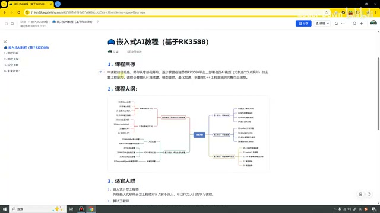
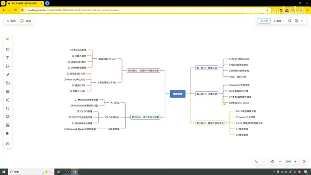
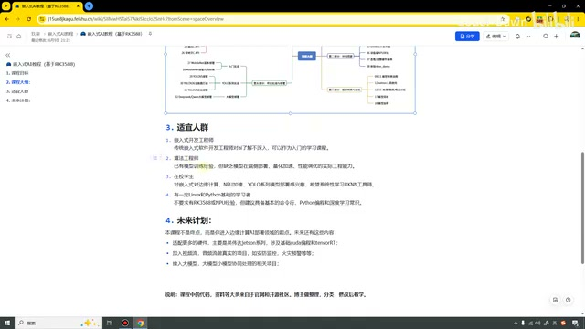
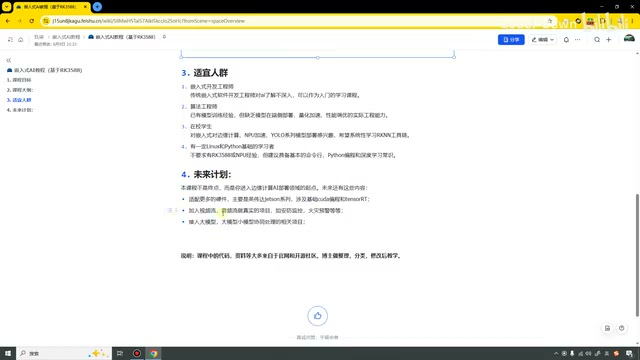

# P01｜00_导学：嵌入式 AI 教程（基于 RK3588）

> 来源：[B 站课程第一集](https://www.bilibili.com/video/BV11DjT6uEhc/?p=1) · 全片 6 分 42 秒
>
> 整理方式：忠实讲稿，不做摘要压缩。保留原讲述顺序、解释、例子和范围说明，仅清理无意义口头停顿、偶发结巴，补充标点与小标题。
>
> 文字来源：本地 Whisper large-v3-turbo 中文转写，经课件术语核对；讲师姓名无法可靠确认，已在正文标注。原始转写另存于 sources。末尾致谢后的越界识别项“alan”未纳入讲稿。
>
> 图片说明：4 张原视频截图，源画面 640×360；小字细节受原始画质限制，点击图片可查看原图。图注为编辑说明。

## 开场与开发板范围 · 00:00

哈喽，各位同学大家好，我是〔讲师姓名识别未确认〕。很开心又来给大家录制视频了。这次录制的视频是嵌入式 AI 教程，这个课程是基于 RK3588 这款开发板的。大家手上只要是瑞芯微家族具备 NPU 的开发板，都是可以进行学习的。

接下来，我从四个方面来对大家进行一个简单的介绍。

## 课程目标和课程定位 · 00:27

第一个是我们的课程目标和课程定位。我们的这门课是一个嵌入式 AI 的入门级教程，主要目标就是带着大家从零基础，逐步掌握在瑞芯微 RK3588 平台上部署各类 AI 模型，特别是 YOLO 系列。后面也会重点去讲好几个 YOLO 模型的部署。

我们这堂课会覆盖环境搭建、模型转换、量化加速，还有在 Windows 上面进行模型训练，然后到最终的工业落地。完整的生命周期都会进行讲解。好，这是我们的课程目标。

*课程页面展示课程目标与课程大纲入口。 · [原片 00:35](https://www.bilibili.com/video/BV11DjT6uEhc/?p=1&t=35)*

## 课程大纲：基础认知与环境搭建 · 01:16

第二个是我们的课程大纲，在这里我也打开一下。我们整个课程一共分成五个部分。

第一个部分是基础认知，就是了解我们的 3588 开发板，了解 NPU、RKNPU 的软件架构，还有原厂资料的介绍。

第二部分是环境搭建，就是去搭建我们的开发环境，调整硬件频率，然后体验一下我们的 demo。

*展开的课程大纲以五个部分组织学习路径。 · [原片 01:40](https://www.bilibili.com/video/BV11DjT6uEhc/?p=1&t=100)*

其中，这两个部分就比较偏理论。第二部分还好，有一些具体的操作，可能听上去会比较无聊。也是希望大家可以在前面的课程中耐住性子，
好好地了解一下，或者说至少也去看一下我们的文档。

## 课程大纲：模型转换与优化 · 02:05

第三部分是模型转换与优化。在这里就会介绍模型具体是怎么转换的，然后是模型剪枝、模型加密。只不过需要注意，这里的模型剪枝和模型加密，只是我们使用瑞芯微的 API 进行非常基础和简单的处理。

## 课程大纲：高级 API 与复杂场景 · 02:24

第四部分是高级 API 与复杂场景。在这里我们会看一下，多 Batch、多输入、动态 shape 是怎么进行操作的，还有怎样生成 C 代码，以及怎么样在开发板上面进行具体的部署。

开发板上面的部署会有 Python 语言的，也有 C 语言的。其中 C 语言又有通用 C 语言和零拷贝的——通用 C API 和零拷贝的 C API。这个就是我们的第四部分。

## 课程大纲：项目实战 · 02:54

第五部分就是我们的项目实战了。第一个，我们做一个最简单的部署：MobileNet。第二个就是 YOLO 系列，首先会部署一个 YOLOv5 模型，接下来会从零到一地部署一个 YOLOv26 模型。

这个“从零到一”指的是什么？就是我们在 Windows 上面搭建开发环境、训练模型、导出模型，转换为 ONNX 模型，再转换成 RKNN 模型，最终在开发板上面进行部署。其中，我们这个示例是一个头盔检测的模型，以它来做一个示例。

接下来会讲 YOLO 系列模型具体是怎么进行优化的。我们把一个原本只能跑 16 帧、17 帧的模型，通过一系列优化操作，最终把它跑到 100 帧、100 多帧。

最后的最后，还会带着大家去部署一个大模型，比如说像 DeepSeek、千问等等，
都可以进行部署。这个就是我们课堂的大纲。

## 适宜人群 · 04:04

第三部分是我们的适宜人群，它适合哪些人群呢？

第一个是嵌入式开发工程师。像我们做传统嵌入式软件开发，可能对 AI 的了解并不深入，但是现在工作中可能就会有一些部署 AI 模型的工作。这套课程就可以作为一个入门的学习课程。

第二个是针对算法工程师。我们很多算法工程师都是做纯软件、纯算法，并没有真正进行落地、进行部署。这就是第二类适宜的人群。

*课程文档列出的适宜人群及未来计划。 · [原片 04:40](https://www.bilibili.com/video/BV11DjT6uEhc/?p=1&t=280)*

第三个就是在校学生。在学校可能去参加一些比赛，或者简历上面写一写，也可以去学习。第四个就是感兴趣的学者了。

## 未来计划 · 04:57

接下来看一下第四点，就是未来计划。本课程并不是终点，而是你进入边缘 AI 部署领域的一个起点。未来，你们也需要学习这些内容；我也计划去学习和做这些内容。

第一个就是适配更多的硬件。我们不仅是瑞芯微上面要能跑得了，在英伟达系列、海思、全志这些开发板上面，都需要能够跑得了才行。在这里也会涉及到像 CUDA 编程和 TensorRT。

第二个，可能会加入音频流、视频流，做一些真正的工业项目，比如一些火灾的预测等等。

*未来计划包括扩展硬件平台、音视频项目和大模型协同。 · [原片 05:40](https://www.bilibili.com/video/BV11DjT6uEhc/?p=1&t=340)*

第三个就是接入大模型、小模型协同处理，去做这个方面。这个也是现在非常火的一个方面。

## 代码、资料来源与案例数量 · 05:56

最后的最后，也是做了一个说明。
课堂中使用的代码还有资料，大部分都来源于官网和开源社区，还有我在网上找的一些其他 UP 主、其他 CSDN 上面的博主提供的代码。

我在这里把这些代码做了整理、分类，然后修改，去进行课堂中的演示。

我们整个课程一共应该是有 22 个，会有 22 个代码，也就证明了会有 22 个案例。希望通过这些案例，大家可以更好地学习、更好地入门。

最后也是感谢大家的观看，谢谢大家。
