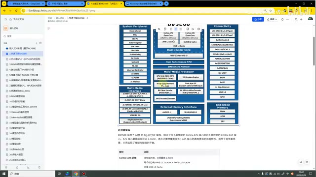
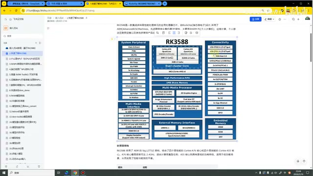
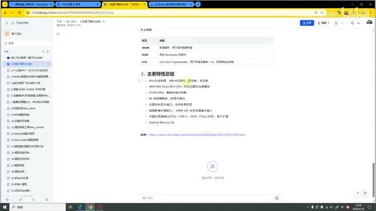
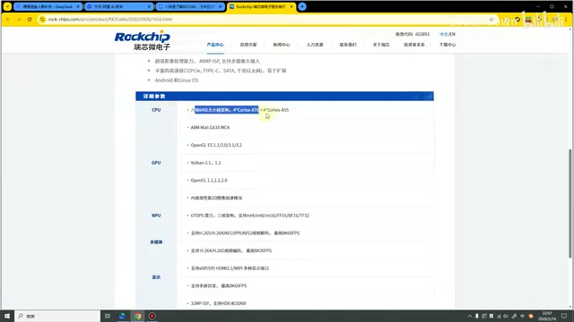

# P02｜01_快速了解 RK3588

> 来源：[B 站课程第二集](https://www.bilibili.com/video/BV11DjT6uEhc/?p=2) · 全片 9 分 9 秒
>
> 整理方式：忠实讲稿，不做摘要压缩。保留原讲述顺序、解释、例子和范围说明，仅清理无意义口头停顿、偶发结巴，补充标点与小标题。
>
> 文字来源：完整本地转写，并参考五段补充 ASR 与视频画面核对。补充 ASR 不等于人工核听；无法确认的个别词及识别差异就地标注，原始转写和补充证据另存于 sources。
>
> 图片说明：5 张原视频截图，源画面 640×360；小字细节受原始画质限制，点击图片可查看原图。图注为编辑说明。

## 开场与处理器架构 · 00:00

哈喽，各位同学大家好。从这节课开始，我们就正式进入课程的学习了。本节课我们要讲的主题是快速了解 RK3588。

第一个部分，就来了解一下 RK3588 的处理器架构，也就是下面的这幅图。我们第一眼看上去，这幅图好像还比较复杂，左边、右边、上面、下面，各处都有。这个大家不用担心，我来带着大家一个部分一个部分地进行分析。

首先，我们去看我鼠标转动的这一块。这一块是我们处理器的架构。RK3588 采用了大小核的架构，有四个高性能的 Cortex-A76 处理器，还有四个 Cortex-A55 处理器。其中，A76 处理器还带有 2 MB 的 L2 Cache；A55 带了一个 512 KB 的 L2 Cache〔缓存单位按画面术语修正〕。

*RK3588 架构图中央展示大小核 CPU 与缓存模块。 · [原片 01:00](https://www.bilibili.com/video/BV11DjT6uEhc/?p=2&t=60)*

其实，单单是我们这个四核 A76，它的性能就已经很强大了。我们 RK3588 这款处理器，像我们的小核，包括下面还有三个 MCU，整体来说，它的 CPU 性能是非常强的。这个也是我们的第一个部分，就是处理器的架构。

## NPU 与 AI 模型部署 · 01:37

第二个部分可以看到，就是这个 NPU。我们这门课要讲的，就是在 RK 板子上面去部署 AI 模型。部署 AI 模型最核心、最重要的，就是这个 NPU 的部分，它主要就是靠 NPU 去跑的嘛。然后，我们 3588 的 NPU，
它是具备 6T 的算力。然后，它支持 INT4、INT8、INT16，然后 FP16、〔此项未确认：完整转写为“EF16”，补充 ASR 为“DF16”；不据此断言具体字母〕、TF32〔完整转写“EF32”，补充 ASR 为“TF32”，与官网参数画面所列 TF32 相符，按此修正〕等等。

刚才我说的这个支持的数据类型，去哪里看呢？这个当然是去我们的官网上面，它也有。等会儿，我也会带着大家再来看一下。现在，我们主要就是先看这幅图。

## 多媒体处理器 · 02:29

在下面的一个部分，可以看到我们的多媒体处理器。我们 3588 的媒体处理也是非常强大的。

这里第一块就是 GPU。GPU 具体是干什么的，也就不需要再过多强调了。第二个是 2D 引擎的加速，这个主要就是快速地绘制文字、图标、UI 界面，就会用到这个东西。包括后面可能在我们去优化模型部署的时候，也会用到它。

第三块就是图像增强的处理器，包括我们图像的锐化、降噪、色彩校验等等，它就是用来处理这些功能的。这里还有一个双通道的 ISP，这个主要是摄像头相关的。

*架构图中央的多媒体处理器区包含图像增强、ISP 与编解码模块。 · [原片 03:25](https://www.bilibili.com/video/BV11DjT6uEhc/?p=2&t=205)*

然后，还有 8K 的视频编码、8K 的视频解码。主要编解码的，就是我们比较经典的 H.264、H.265。对于图片，它也具有编解码，主要是 JPEG 这个类型的。这个就是我们的媒体处理部分。

## 外部内存接口与片上内存 · 03:56

再下面这一块，就是我们的外部内存接口，有 eMMC、SD 卡，
〔此项未确认：完整转写与补充 ASR 都为“DDR2”；保留识别结果，未据技术常识替换型号〕，有 DDR4，也有 DDR5。这个是它的外部内存接口。

右边这里可以看到，这是我们的片上内存，还有 SRAM、ROM、OTP〔按图中 Embedded Memory 栏目核对术语〕。这一块就会比较小，然后一些特别核心的计算，可能会放在这里，它整体是比较小的。像这里 DDR4、DDR5、eMMC 这一块，它是比较大的。

## 系统外设 · 04:34

说完这个，我们再来到上面，看一下系统外设。系统外设也是比较丰富，其实也和其他的开发板都是差不多的，有这个时钟、〔此处缩写与顺序未确认：完整转写为“MU、PMU”，补充 ASR 为“PMU、PLL”；画面栏目为 Clock & Reset、PMU、18×PLL，不能据此确定原声逐词〕，然后有系统〔此项未确认：完整转写“系统器”，补充 ASR“系统计算器”；不补成精确术语〕，然后有 Timer、PWM、看门狗，然后加密、ADC，然后有中断处理的、DMAC，然后 PVTM 等等。

可以看到，前面标着这个 18〔此项原声未确认：完整转写“PLM”，补充 ASR“PLL”；图中可见 18×PLL，保留识别差异〕、30 个 Timer、16 个 PWM，可以看到它的数量也是比较丰富的。

## 多媒体接口与外设接口 · 05:16

再下面，就是我们的多媒体接口。可以注意一下，刚才讲到这里，它是多媒体的处理器；这里是多媒体的接口，大家需要注意区分一下。

多媒体接口这里可以看到，有四个 MIPI，有四个 MIPI CSI，然后有两个 MIPI DSI，然后有 HDMI，然后有 DP，然后有 HDR 的控制。这块就是我们的多媒体接口。

*架构图以不同栏目区分多媒体接口、外设接口与处理模块。 · [原片 06:03](https://www.bilibili.com/video/BV11DjT6uEhc/?p=2&t=363)*

到右侧这块，它是我们的外设接口。可以看到，有 USB，然后有 USB 的 OTG，
然后有 Host，然后 SATA、PCIe，然后串口、SPI、I²C 等等。就是该有的，它也都具备的。

这个就是我们 3588 处理器架构的一个简单介绍。在这里，大家主要还是了解一下就可以，就知道它具备哪些功能、具备哪些能力就可以了。这是我们的第一部分。

当然，在下面这里，也是给大家把每一个部分都比较具体地写了出来，包括这是什么东西，还有什么功能。在这里，也就不再去读它了。大家感兴趣的话，可以自己去看一下这个文档，这里有比较详细的介绍。

## 主要特性 · 06:59

再到第二个部分，我们可以对 3588 的主要特性做一个总结。也就是说，如果我们出去面试，或者出去干什么，别人问我们用什么处理器，我们说用了 3588。人家要问你，3588 它有什么特点，那我们就要说出来下面这些内容。

比如说，它是一个 8 nm 的〔此项名称未确认：完整转写“天际”，补充 ASR“天进”；不据工艺常识猜定制造商〕制造，它是八核、64 位的架构，高性能、低功耗。然后，它有一个 6T 的算力，它可以进行 2D 图形的加速、8K 的视频编解码、8K 的显示输出，然后它具备很多的显示接口，包括它可以进行多屏异显。

*课程文档列出 RK3588 的主要特性。 · [原片 07:30](https://www.bilibili.com/video/BV11DjT6uEhc/?p=2&t=450)*

我使用的是迅为的这个 RK3588，它上面也是可以接四个 MIPI 摄像头，可以进行多摄像头的显示。这个就是它的主要特性。

## 官网参数介绍 · 08:03

最后，我们来看一下它的官网介绍。在这里，我也提前已经打开了。这个主要特性，也就是刚才我第二部分写的那些，
那个部分也就来自于官网。下面，官网也是对它的详细参数做了解释，比如说它的 CPU，八核 64 位架构，这个 A76、这个 A55。包括它的 GPU 具体是什么，它的 NPU 支持什么，它的多媒体具备什么功能，然后它的视频输入接口、它的高速接口等等。

*瑞芯微产品官网展示 RK3588 的 CPU、GPU 与 NPU 参数栏目。 · [原片 08:31](https://www.bilibili.com/video/BV11DjT6uEhc/?p=2&t=511)*

大家可以看到，其实整个 RK 的官网写得还是比较简单的。当然，这个官网是它这个产品的官网。后面，我们还会具体地去介绍一下它的那个GitHub 的仓库〔完整转写为“GPU 的仓库”，补充 ASR 清楚给出“GitHub 的一个仓库”，据补充识别和仓库语境修正；未作人工听音确认〕。

好了，这节课我们就讲到这里，也是特别感谢大家的观看。

> 末尾 09:07.4–09:09.2 未确认：完整转写为“还 decir说 vas走”，补充 ASR 尾段仅为“o”（低识别置信度）。两次识别未形成可可靠辨认的语句，未补写内容，也不据 ASR 断言它只是噪声。
