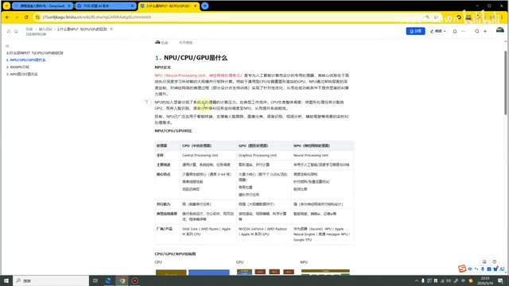
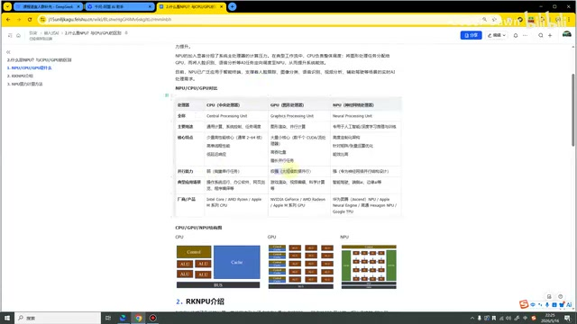
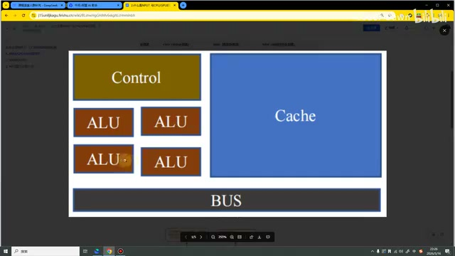
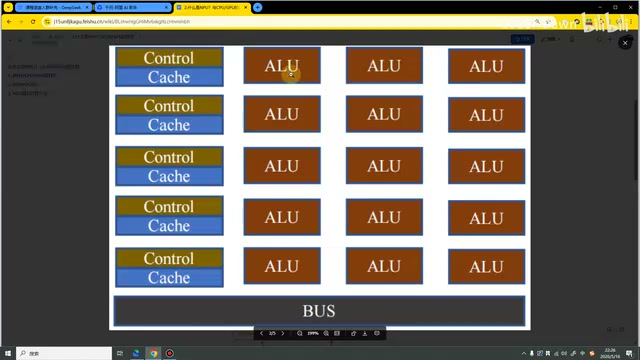
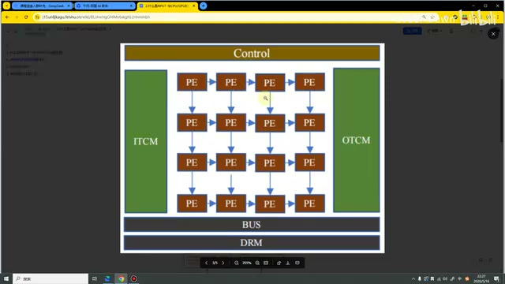
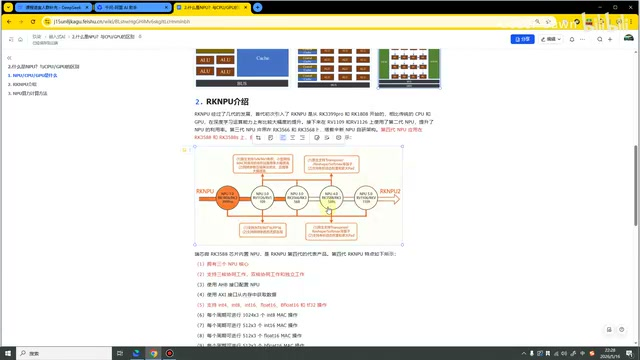
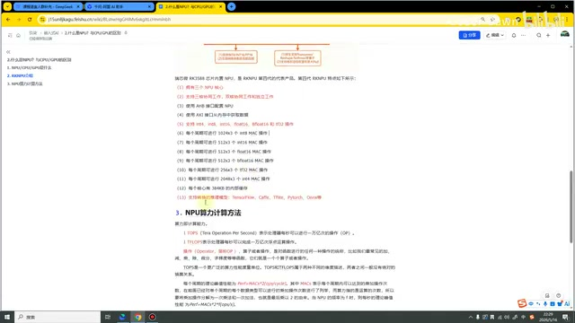
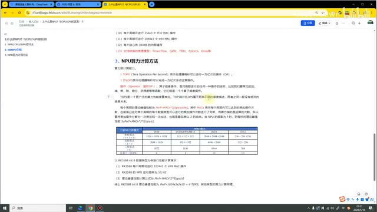
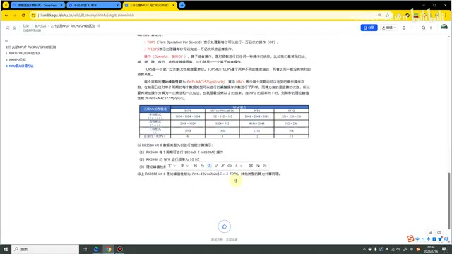

# P03｜02_NPU原理及对比

> 来源：[B 站课程第三集](https://www.bilibili.com/video/BV11DjT6uEhc/?p=3) · 全片 12 分 05 秒
>
> 整理方式：忠实讲稿，不做摘要压缩。保留原讲述顺序与第一人称表达，仅清理口头停顿、结巴，修正明确识别错误并补充标点。
>
> 图片说明：9 张原视频截图，源画面 640×360；课件小字细节受原始画质限制。图注为编辑说明。

## NPU 是什么 · 00:00

这节课我们主要要讲的内容是：NPU、CPU、GPU 是什么，以及介绍一下我们的 RKNPU、NPU 的算力计算。

前面的一节课我们提到了，我们 RK3588 想要进行模型的部署，主要依赖的就是我们的 NPU。那 NPU 它到底是什么呢？这节课我们就来看看。

首先我们来到第一个部分。我们来讲一下 NPU，它叫做神经网络处理单元，是专为人工智能计算而设计的专用处理器。它的核心优势在于高效执行深度学习所依赖的大规模并行矩阵运算。相较于传统通用型的 CPU 与侧重图形渲染的 GPU，NPU 通过架构层面的深度定制，对神经网络的推理过程实现了针对性的优化，它可以在低功耗的条件下提供显著的 AI 计算能力。

NPU 的加入显著分担了系统主处理器的计算压力。在我们典型的工作流中，CPU 主要负责整体调度，然后将图形处理任务分配给 GPU，将我们的人脸识别、语言分析等 AI 任务调度到我们的 NPU。这样我们就可以提升整个系统的性能。这个是 NPU 的基本概念。

*课件说明 NPU 的定义、工作流及三种处理器对比。 · [原片 01:20](https://www.bilibili.com/video/BV11DjT6uEhc/?p=3&t=80)*

## CPU、GPU 与 NPU 的区别 · 01:34

接下来我们看一下，NPU、CPU、GPU 到底有哪些不同，就是这个表格。首先我们的 CPU 叫做中央处理器，GPU 叫图形处理器，NPU 叫神经网络处理器。

主要用途：CPU 主要用于通用的计算、系统的控制、任务的调度。GPU 主要进行图形渲染、并行计算。NPU 就是专用于人工智能、深度学习、推理与训练的。

CPU 的核心特点就是单线程性能比较高，延迟比较低。GPU 就是具备有大量的小核心，有好几千个 CUDA 核心，这个具体数量跟我们的显卡型号有关系。然后 NPU 主要是进行我们的矩阵和张量运算的。

如果说大家对我们的深度学习算法有一些了解，就可以知道，我们深度学习算法在底层还是进行很多的张量运算，它的基本单位是张量。运算基本上都是矩阵运算，进行神经网络的正向传播、反向传播，来来回回地进行迭代和优化。所以说我们 NPU 主要就是针对张量和矩阵的运算进行了一些优化。

CPU 的并行能力是比较弱的，GPU 的并行能力是极强的，NPU 的并行能力是较强的，就介于它们之间。

CPU 的应用场景就是像我们操作系统的运行、办公软件的运行、网页浏览器等等，主要是依赖于 CPU。像游戏的渲染、视频剪辑，主要依赖于 GPU。像我们和 AI 相关的，它就依赖于我们的 NPU。下面也有它们主要的厂商。

*CPU、GPU、NPU 对比表与下方结构示意图。 · [原片 03:20](https://www.bilibili.com/video/BV11DjT6uEhc/?p=3&t=200)*

## 看三种处理器的结构图 · 03:50

在这里也是有三个结构图，我们也可以分别看一下。这个是我们 CPU 的结构图，可以看到这里这个控制模块就占了很大。ALU 是计算的模块。它是有比较……也不能说少吧，就是没有那么大。基于整个 CPU 的话，它也是具备计算能力的。然后右边可以看到这里有很大一块，都是这个 Cache，然后会有一个总线。

*放大的 CPU 结构图中可见 Control、ALU、Cache 和 BUS。 · [原片 04:10](https://www.bilibili.com/video/BV11DjT6uEhc/?p=3&t=250)*

第二个，我们来看一下 GPU。可以看到与 CPU 不同，GPU 就具备非常多的 ALU 这个计算单元。然后像这个 Control 和 Cache，相比之下就会少很多。

*GPU 结构图以大量 ALU 配合较少的 Control 与 Cache。 · [原片 04:35](https://www.bilibili.com/video/BV11DjT6uEhc/?p=3&t=275)*

第三个，我们来看一下 NPU。NPU 可以看到，它这就是定制化的一些计算单元，它就和我们的 CPU 和 GPU 差距会稍微大一些。这个是 CPU、NPU 和 GPU 的区别，也是我们这节课的第一个部分。

*NPU 的定制化计算单元结构示意图。 · [原片 04:50](https://www.bilibili.com/video/BV11DjT6uEhc/?p=3&t=290)*

## RKNPU 的发展 · 05:08

接下来，我们来看第二个部分，就是介绍一下这个 RKNPU。NPU 也是需要进行发展的。像我们现在使用的 3588，它采用的就是第四代的 NPU。

NPU 最早的第一代，主要是应用在像 RK1808、RK3399 这些开发板上面。然后到第三代，就是我们已经在市面上有比较多应用的，像 RV1106、RV1109，然后包括像 3566、3568，也都是第三代的 NPU。它能支持的功能也就会更多一些。第四代 NPU，像 RK3588，它支持的功能和能力就会更强一些。

*RKNPU 发展示意图与 RK3588 特性列表。 · [原片 05:55](https://www.bilibili.com/video/BV11DjT6uEhc/?p=3&t=355)*

接下来我们来看一下第四代的 NPU 主要有哪些特点。可以看到它的特点在这里列了很多，我们比较重点关注的就是：它有三个 NPU 的核心，然后它可以三核协同工作、双核协同，也可以独立工作。这也是我们在部署 AI 模型，可以对模型进行加速优化的一个重要支撑点。

正是因为它具备三个 NPU，并且三个 NPU 可以进行协同运算，我们才可以利用像线程池这些方式来进行优化。

接下来比较重要的特点就是，它可以支持这么多类型的操作，这个在前面也都已经讲过了。从第六点开始这里，主要就是描述它对于不同类型的一些操作的数量，就每个周期可以进行多少次操作。

最后一点就是它支持的推理模型。目前它支持像 TensorFlow、PyTorch 这些比较经典的模型，当然这些也还有一些其他的。在未来，随着瑞芯微的发展，它肯定也会支持更多的模型。当然现在最火的可能就是这个 PyTorch，包括老一点的还有这个 TensorFlow。以上就是我们第二部分。

*第四代 NPU 特性列表，包括三核心协同、数据类型及框架支持。 · [原片 07:10](https://www.bilibili.com/video/BV11DjT6uEhc/?p=3&t=430)*

## NPU 的算力是怎么计算的 · 07:42

第三个部分，我们来讲一下 NPU 的算力是怎么计算的。在前面都说了这么多，说这个 3588 具备 6T 的算力，它比较强大，可以部署我们的 AI 模型。这个 6T 到底是什么意思，以及它到底是怎么计算的？接下来我们就来看一看。

首先这个 1 TOPS，也就是我们平常简称的 1T，它表示的是处理器每秒可以进行一万亿次操作。这里进行的就是一个 INT 类型的操作。下面这个 1 TFLOPS，它表示的是处理器每秒可以完成一万亿次浮点类型的操作。

操作英文简称叫 OP，然后中文就叫做操作或者算子。其实现在叫操作可能听上去比较 low，现在一般喜欢叫算子操作。算子操作其实是对函数进行任何一种操作的统称。比如说我们常见的加减乘除、微分、积分等等，它们就是一个一个的操作。

其中这个 TOPS，它是一个非常广泛的算力性能的度量单位。TOPS 和 TFLOPS 其实是属于两种不同维度的描述，它们之间也没有绝对的换算关系。不能说这个 TFLOPS 就等于一点几，或者多少倍的 TOPS，它们是没有这种换算关系的。

*算力单位、理论峰值计算说明及不同数据类型的计算表。 · [原片 09:15](https://www.bilibili.com/video/BV11DjT6uEhc/?p=3&t=555)*

然后它每个周期的理论峰值性能是这么计算的：MACs 乘以 2。这个也是我们进行算力计算的公式。

这里需要注意一下，就是它叫理论峰值性能。什么意思呢？就是说像我们的 3588，它具备 6T 的算力，只是说它在理论上峰值可以达到 6T。实际上我们在使用的时候，可能就是一个五点几〔原转写单位为“G”，此处语境为理论与实际算力的对比，单位未可靠确认〕，就类似于我们手机这个流量套餐一样，说是 4G、5G 能达到多少兆，但其实我们日常使用中是并不能达到的。

接下来我们接着看，就是为什么这里它要乘一个 2 呢？就是因为我们算力指的是运算的次数。我们整个这个 3588，或者说我们这些 NPU 进行计算的时候，它本质上进行的是乘加操作。乘加操作其实是有一次乘法，还有一次加法的，本质上是两个操作，所以也就会乘以一个 2。

如果说，当我们 NPU 的频率是 F 的时候，它每秒的理论峰值计算就是 MACs × 2 再乘以一个 F。这个就是算力的计算公式。

当然在下面这里也有一个图，这个图我们就不看了，我们直接来看一下 3588 INT8 数据类型怎么来计算它的算力。

## 代入 RK3588 的 INT8 数据 · 11:13

首先 RK3588 每个周期可以进行 1024 乘三个 INT8 的操作，然后它的运行频率是 1 GHz。所以说它的公式就是 MACs 乘以 2 乘以 F。

将数据带进去，第一个部分 1024 乘以 3，然后再乘以 2，因为它是一个乘加操作，然后再乘以一个 1，它就等于一个 6T。这个就是我们 3588 NPU 算力的计算方式。

*课件底部给出 RK3588 INT8 算力计算的参数与代入公式。 · [原片 11:50](https://www.bilibili.com/video/BV11DjT6uEhc/?p=3&t=710)*

讲到这里，我们这节课也就讲完了。最后依旧还是感谢大家的观看。
