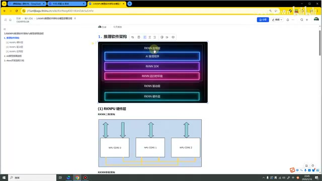
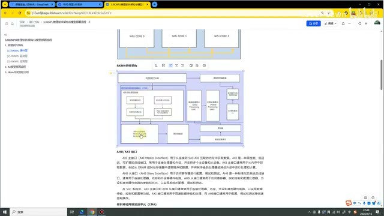
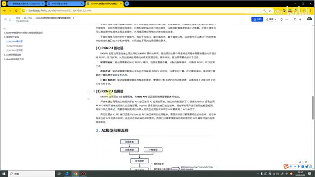
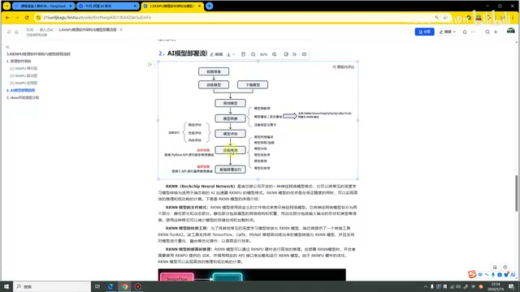
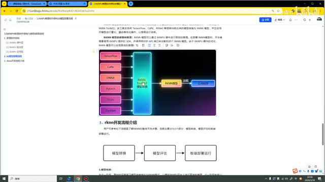
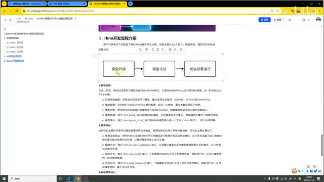

# P04｜03_RKNPU 推理软件架构与模型部署流程

> 来源：[B 站课程第四集](https://www.bilibili.com/video/BV11DjT6uEhc/?p=4) · 全片约 13 分 47 秒，讲述至 13 分 42 秒。
>
> 整理方式：忠实讲稿，不做摘要压缩；保留原讲述顺序、解释、例子与范围说明，仅清理口头停顿和结巴，补充标点与小标题。
>
> 文字来源：本地 Whisper 转写，经原视频课件术语核对；不能可靠辨认的局部词语已标注。原始转写保存在 sources。图片为原视频截图，原始画面 640×360，小字受源画质限制；图注为编辑说明。

## 本节内容与软件架构 · 00:00

这节课我们来讲 RKNPU 推理软件架构与模型部署的流程。这节课主要也是有三个大方面：第一个是推理软件架构，第二个是 AI 模型部署流程，第三个是 RKNN 的开发流程。

首先我们来看第一部分，推理软件架构。看这幅图，从下向上，依次就是 RKNN 的硬件层、RKNN 的驱动层，以及 RKNN 的应用层。这个不仅是在我们的 RK 是这样，其实绝大部分的开发板都是这样的架构。

*软件架构图从硬件层、驱动层向上连接应用层。 · [原片 00:30](https://www.bilibili.com/video/BV11DjT6uEhc/?p=4&t=30)*

## RKNPU 硬件层：三核与单核 · 00:40

接下来，我们来看一下 RKNN 的硬件层。硬件层这里主要会有三核架构，还有单核架构。这个主要是针对不同型号的开发板，它就会有不同的架构。比如说像我们的 RK3588，它是有三个 NPU 核心的，那它就是三核架构；像 RV1126，它就是单核的架构。

单核架构和三核架构的区别就是多了两个嘛，然后它的功能或者是这些东西乘以三就可以了。所以说，接下来我们就来分析一下单核架构的内容。

我们也是来看这幅图。第一个部分是内存接口 AXI。其实 AXI 和 AHB，它们也是一起使用的。什么叫 AXI，什么叫 AHB 呢？AXI 叫做主接口，AHB 叫做从接口。它的功能其实可以合在一起说，就是用于连接我们的处理器、内存、外设，还有其他的硬件电路。通过这个 AXI 和 AHB，

它就可以实现数据的传输、控制，还有配置这样的功能。这个就是我们的第一个部分，就是我鼠标转动的这一块。

## 卷积神经网络加速单元 · 02:17

第二个，可以看到这个蓝框，放了下面很大的一个部分。这是第二部分，叫做卷积神经网络加速单元 CNA。在它里面又分成了好几个部分：卷积预处理控制器、NPU 的内部缓存、序列控制器、乘加运算单元，还有累加器。接下来我们也一个一个进行看一下。

*单核架构图展示 CNA 及数据、平面处理等模块。 · [原片 03:00](https://www.bilibili.com/video/BV11DjT6uEhc/?p=4&t=180)*

卷积预处理器，它就是对输入的模型权重进行解压缩之后，然后加载到我们 NPU 的内部缓冲里面。可以看到这里面有一些步骤，就是模型权重的解压，然后加载，然后跳过，然后将这个加入内部缓存。总之，它的功能就是把这个权重参数进行解压缩，然后输入到内存中。

内存缓冲主要用于存储我们的中间计算结果。听这个名字，也是可以听出来的嘛。再到下一个部分，就到序列控制器。它主要是用于控制卷积计算序列的硬件单元。它可以根据卷积神经网络的结构和参数，自动地配置和控制对应各个硬件单元的工作模式和参数。总之，它就是一个序列化配置的控制器。

接下来就是进行我们的乘加运算了。在上节课我们计算 3588 算力的时候，

那个部分我们也有讲过，就是说，这个 NPU 其实就是进行无数次的乘加操作的嘛，所以它一定是具备这个乘加运算单元的。最后就是有一个累加器，将这些计算的结果进行累加。

## 数据处理与平面处理单元 · 04:29

累加完了之后，就到我们的数据处理单元。数据处理单元主要就是处理数据的详细计算，可以看到这里。比如说像我们的 ReLU、Sigmoid、Tanh 等等，这些操作就是在这一块进行计算的。

再到下一个部分，就是平面处理单元。它主要提供对数据处理单元的输出数据进行平面的操作。比如说像我们的平均池化、最大值池化、最小值池化等等，这些操作就是在我们这个单元里面来进行实现的。

可以看到这一块的分支〔此处局部术语识别未确认，转写为“i-pies”〕，也是我们这个 AXI 相关的，去读取寄存器的配置。然后包括还有 AHB 配置接口，这个也是一开始就有讲过了。这个就是我们的单核架构的内容。

其实在下面这里，有些会比较详细，也都是有写每个部分模块具体的功能。大家下来如果感兴趣，也是可以看看这个文档。其实整个这个部分，都是属于一个了解性的内容。大家听我讲解，有一个大概的了解，其实也就可以了。

## RKNPU 驱动层 · 06:02

第二个部分，就是 NPU 的驱动层。

驱动就是连接上层应用和下层 NPU 硬件的桥梁。驱动层的主要作用，就是将应用程序需要推理的内容提交给 NPU 进行计算。

具体来说，NPU 驱动层主要进行以下几个任务。第一个是进行硬件的初始化，驱动层需要初始化 RKNPU 的硬件，设置一些寄存器、分配内存等等。第二个就是进行数据传输，将数据从主机传输到 RKNPU 内存中，便于计算。第三个就是进行任务调度，也就是说，我们的应用程序和底层硬件之间的交互，也是通过这个驱动层来进行支持的。

*文档中的驱动层任务与应用层说明。 · [原片 07:00](https://www.bilibili.com/video/BV11DjT6uEhc/?p=4&t=420)*

## RKNPU 应用层 · 06:59

第三个是我们的应用层。应用层主要就是像我们的 AI 应用、我们的 API，以及运行时所需要的库，这些东西组成了我们 RKNPU 的应用层。

在我们开发的过程中，主要也是使用 C 语言或者 Python。像我们进行模型转换、模型评估、调优的这些操作，主要使用的就是 Python 语言。最终进行真正的 AI 落地、工程部署的时候，就使用 C 语言、C++。瑞芯微也是给我们提供了 C 语言和 Python 的接口。这个就是我们第一部分推理软件架构的内容。

## AI 模型部署流程：前期准备 · 07:48

第二个部分，我们来看一下 AI 模型部署的流程，也就是我这里画的流程图。我们首先需要进行一些前期的准备，比如说，我们需要准备各种各样的数据，准备好我们的框架代码等等，

包括数据集等等，这个部分就属于前期准备。

## 训练、转换、评估与部署 · 08:16

准备好这些数据之后，我们就需要开始进行模型的训练。比如说，我们要部署一个 YOLO26 的模型，就使用 PyTorch 这个框架来进行训练。训练的目的，就是为了得到这个 .pt 格式的模型。如果说部署的是 TensorFlow 或者其他的，当然这个后缀就会有点不同。在这里，我以 PyTorch 为例，它得到的就是一个 .pt 模型。

得到这个模型之后，我们就需要对模型进行转换，转换为我们瑞芯微所支持的 RKNN 模型。转换完这个模型之后，我们需要评估一下：这个模型它到底好不好呀？是不是比较差的模型？如果模型比较差，对我们的准确率、精度等等都会有影响。接下来，我们就会进行模型评估。

*AI 模型部署流程图包含转换、评估、连板推理和板端部署。 · [原片 09:30](https://www.bilibili.com/video/BV11DjT6uEhc/?p=4&t=570)*

模型评估完之后，觉得这个模型还不错，我们就可以进行连板推理，对模型进行简单的推理，看看模型在板子上面到底怎么样。最终的部署，就是进行板端的部署。

其实连板推理和板端部署，它们都属于做的是同一件事情。只不过连板推理会更加方便、更加简单，就是我们进行一个快速的验证。验证没问题之后，我们就可以进行比较复杂的、比较工程化的板端部署，或者说板端应用的开发吧。

这个就是我们 AI 模型部署的整体流程。

在这里其实可以看到，也写了很多。在模型转换的时候，我们可能会对模型进行量化，〔随后短语识别未确认，原转写为“然后又成功”〕。这种量化有常规的量化，有混合的量化。

我们在进行连板推理的时候，就是使用 Python API 进行初步的部署。板端部署的时候，就是使用 C API 进行最终的部署。在连板推理的时候，就可以评估我们的精度、性能、内存等等。这个就是我们 AI 模型部署的整个流程。在下面，也是有做一个更加详细的描述吧。

## RKNN 模型格式与应用 · 11:02

RKNN 是我们瑞芯微公司开发的一种神经网络模型格式。所有瑞芯微的开发板，它都只支持 RKNN 的模型进行部署。

在这里也是画了一个图。现在像 PyTorch、TensorFlow，包括 ONNX、Darknet 等等，这些模型都可以通过 RKNN〔画面为 RKNN Toolkit2 模型转换工具〕进行转换。转换完之后，就可以得到 RKNN 模型。加载这个 RKNN 模型到我们的应用程序里面去，就可以进行我们的 AI 应用开发。比如说像人脸识别，〔其后两个应用例子识别未确认，原转写为“转换点资”“转换分类”〕。

*多种模型经 RKNN Toolkit2 转换为 RKNN，再加载至应用。 · [原片 11:30](https://www.bilibili.com/video/BV11DjT6uEhc/?p=4&t=690)*

## 通用部署流程与 RKNN 开发流程的区别 · 11:49

接下来，我们来看第三部分 RKNN 的开发流程。这是什么意思呢？和上面又有什么区别呢？注意，在这里我说的是 AI 模型部署流程。就是说，除了我们的瑞芯微开发板，比如说我们使用的是全志的开发板、

海思的开发板，它整体的流程都是这样子：前期准备、训练模型、得到模型、模型转换、评估、连板推理、板端部署。可能部分厂商并不支持这个连板推理，但是就是说，AI 模型部署的整个流程是这样。

## RKNN 的三个开发阶段 · 12:31

接下来，我们来看一下 RKNN 的开发流程。这个是从官网截的图，就是说，在官网上，它对它进行了三个部分的划分：第一个就是模型转换，第二个是模型评估，第三个是板端部署。

这里是比较具体的描述，就是获取模型、模型加载、模型构建、模型导出。模型评估的时候，可以评估它的精度、性能，还有内存。板端部署的话，也是包括了模型的初始化、前处理、后处理、模型的推理，以及模型的释放。总之，这个就是我们的开发流程。

*RKNN 开发流程图分为模型转换、模型评估、板端部署运行。 · [原片 13:30](https://www.bilibili.com/video/BV11DjT6uEhc/?p=4&t=810)*

在后续我们具体到代码部分的时候，也是按照这个流程来进行操作的。包括我们讲课的时候，我们的顺序也是会先讲模型怎么转换、模型怎么评估，最后模型怎么样进行部署。以上就是本节课的内容，感谢大家的观看。
