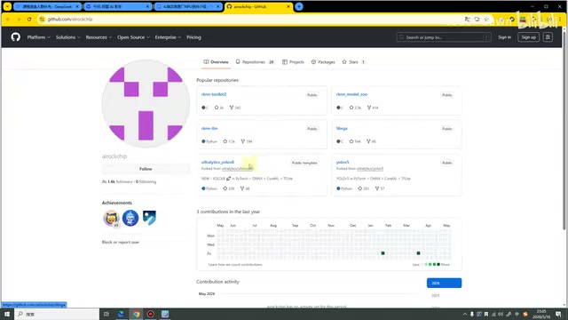
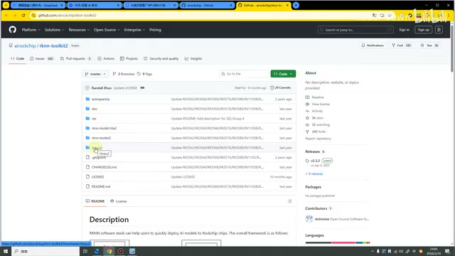
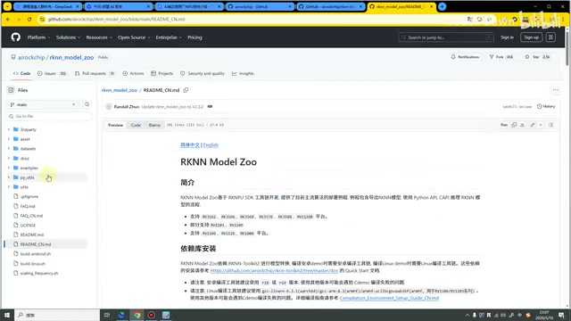
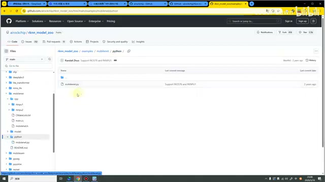
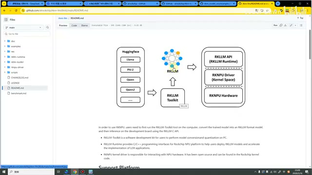
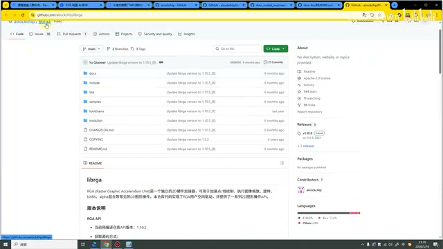
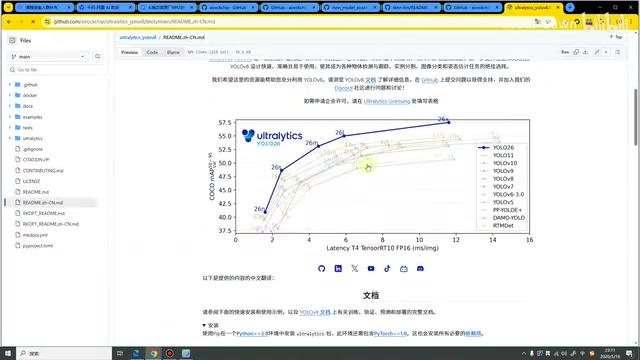
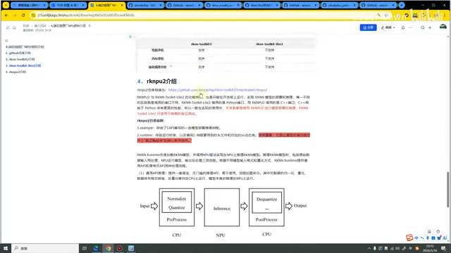

# P05｜04_瑞芯微 GitHub 仓库介绍

> 来源：[B 站课程第五集](https://www.bilibili.com/video/BV11DjT6uEhc/?p=5) · 全片 8 分 21 秒
>
> 整理方式：忠实讲稿，不做摘要压缩。保留原讲述顺序、解释、例子和范围说明，仅清理口头停顿、偶发结巴并补充标点。原始转写保存在 sources。
>
> 图片说明：原视频截图，源画面 640×360，小字细节受原始画质限制；图注为编辑说明。套件名称按画面核对。个别不能确认的识别项在正文保留标记。

## 六个仓库与 RKNN-Toolkit2 · 00:00

这节课我们来讲瑞芯微原厂 NPU 的资料介绍。首先，我们打开它的 GitHub 官网地址。打开之后，可以看到里面有六个部分：RKNN-Toolkit2、Model Zoo、LLM，还有 RGA、YOLOv8、YOLOv5。其实从这些名字上面，我们可能也能听出来一些它的功能。接下来，我来一个一个讲一下。

*GitHub 主页展示六个常用仓库。 · [原片 00:20](https://www.bilibili.com/video/BV11DjT6uEhc/?p=5&t=20)*

我们首先打开这个，可以看到，RKNN-Toolkit2 里面还有三个比较重要、比较核心的套件。第一个还是我们的 RKNN-Toolkit2。这里大家需要注意和区分一下，这个 Toolkit2 是包含在它之内的。它里面还有一个 RKNN-Toolkit-Lite2，还有一个 RKNPU2。

*RKNN-Toolkit2 仓库中的三个套件目录。 · [原片 01:00](https://www.bilibili.com/video/BV11DjT6uEhc/?p=5&t=60)*

那这三个套件到底是什么功能呢？这个 RKNN-Toolkit2 就是进行模型转换的。其中，它是在我们 PC 上面运行和转换的，使用的也是 Python 代码。

那 Lite2 还有这个 RKNPU2，它们两个可以归为一类，它们都只能在开发板上面运行。其中，上面这个 Lite 调用的是 Python，下面这个 NPU 调用的是 C 语言、C++ 的接口。这个就是它的功能。

上面这个就可以用于我们简单的测试验证，下面这个我们可以对它进行工程部署。因为大家也知道，像这个 C 语言，它的性能是比 Python 好一些的。

这个就是 RKNN-Toolkit2 的一个简单介绍。

## Model Zoo：模型与部署例程 · 02:05

接下来，我们来看第二个，就是 RKNN Model Zoo。Model Zoo 也是我们官方把市面上一些常见模型进行了整理。在这里，我可以点一下这个“简体中文”，看一下它的 README。

可以看到，包含了目前主流算法的部署例程，C 语言的、Python 的也都有。它像有 MobileNet，然后 ResNet、YOLO 系列，包括还有下面的人脸检测、车牌识别、文字检测，包括还有一些语音相关的模型。这个库是瑞芯微自己做好了，供大家进行学习和使用的。

*Model Zoo 的中文 README 与模型目录。 · [原片 03:00](https://www.bilibili.com/video/BV11DjT6uEhc/?p=5&t=180)*

在这里，我也是点开一个，比如说，点开这个 MobileNet。可以看到，它也是有 C++ 版本的，也有 Python 版本的。

但是它的一个缺点就是，你看这个 Python，它就一个文件；像这个 C++，其实它也就加上这个 main，加上 .h，也就是两三个文件，它就搞定了。那这种其实就是适合我们快速验证，适合我们学习。我们在真正的项目开发当中，肯定是需要进行封装这些操作和处理的。

*MobileNet 的 Python 目录中展示单个脚本文件。 · [原片 03:20](https://www.bilibili.com/video/BV11DjT6uEhc/?p=5&t=200)*

这个就是我们的 Model Zoo。如果说大家有一款开发板，然后我想试一试这些模型，学习一些模型，那这个也是一个非常不错的平台。

## RKLLM：大模型转换与部署 · 04:03

第三个，我们来看一下这个 LLM，也是看一下它的 README。这个和我们前面的 AI 部署也是类似的，也就是它是针对我们的大模型进行部署的。

比如说像千问、DeepSeek、Llama〔此处模型名原转写为“连网”，结合画面中的 Llama 核对〕等等，这些模型它也可以进行转换。使用 RKLLM Toolkit 进行转换，转换成我们瑞芯微支持的大模型格式，然后就可以进行部署了。

*RKLLM README 中的大模型转换与板端运行架构图。 · [原片 04:40](https://www.bilibili.com/video/BV11DjT6uEhc/?p=5&t=280)*

在我们这套课程的最后，也会带着大家去部署一个 DeepSeek 的模型。其中，我们这个 RK3588 的话，4B、7B 模型其实都是可以部署的。这个就是这个仓库。

## RGA：2D 硬件加速 · 04:57

接下来，我们再看一下这个 RGA 仓库。这个仓库的话，是一个独立的 2D 硬件加速器，可以用于加速点线绘制、图像的缩放、旋转等等，就是进行一些常见的 2D 操作。

*librga 仓库的目录与中文功能简介。 · [原片 05:40](https://www.bilibili.com/video/BV11DjT6uEhc/?p=5&t=340)*

它的主要功能有两个方面吧。一个可能是在我们进行一些媒体、音视频媒体方面处理，会用它进行一些处理和加速。第二个就是我们在进行 AI 部署的时候，也是可以采用 RGA 的方式去进行加速的。

如果说我们的某一个模型，在它里面涉及到了比较多的，像这些图像的旋转、缩放，然后点线的绘制等等，也就是说模型和它的相关度比较高的话，我们使用 RGA 加速，可能也会有一个比较好的效果。这个就是 RGA。

## YOLOv8、YOLOv5 与资料阅读 · 06:01

后面两个也是瑞芯微，

因为官方对它进行了一些适配，就是做了一个 demo，给我们学习去使用的。看一下这个〔原转写“V型V”所指名称未确认；画面打开 ultralytics_yolov8 仓库〕，这是有中文的。它简单地介绍了一下这个 YOLO，当然现在已经有 26 了。

就是有这些模型性能的图片，包括怎么样快速去使用这个东西。当然，这个也是来自于它这个 Ultralytics 官网的。

*YOLO 中文 README 展示模型性能曲线。 · [原片 06:20](https://www.bilibili.com/video/BV11DjT6uEhc/?p=5&t=380)*

但是它的这些方法，其实比较适合我们的快速验证。可能大家照着官网去做的时候，会出一些问题，小的问题可能还需要去手动修改一下。这个是 YOLOv8 的。这个 v5 的，它应该也差不多吧？可以看到也差不多，都是这么一个形式。

这个就是我们官方资料的介绍。在下面也是写得比较详细，就是它里面每个部分的功能，在下面也都有描述。这个内容，我就不再给大家去读了，大家下来可以看看这个文档，了解一下就可以了。

*课程文档继续说明 RKNPU2 及推理处理流程。 · [原片 07:40](https://www.bilibili.com/video/BV11DjT6uEhc/?p=5&t=460)*

直到这节课为止，和大家讲的这些东西都是理论上面的一些东西，可能也比较枯燥、比较无聊。大家可以快速地听一下，了解一下，或者说直接看看这个文档。如果说具备一定基础，直接跳过其实也都是不影响我们的学习的。

说完这个，这节课我们也就讲完了，也是感谢大家的观看。

> 识别说明：末尾 08:20 附近“至于据看看”为无法确认的零散识别项，未据此补写讲述；末尾感叹号及孤立停顿未作为正文。4B、7B 与“现在已经有 26”保留讲师原转写表述，未作为独立技术事实改写。
