# P06｜05_搭建 rknn_toolkit2 开发环境

> 来源：[B 站课程第六集](https://www.bilibili.com/video/BV11DjT6uEhc/?p=6) · 全片 25 分 12 秒。
>
> 整理方式：忠实讲稿，保留第一人称、原讲述顺序、解释及操作中的纠正，仅清理停顿与无意义重复。文字使用本课指定的完整规范化转写，术语和命令参照原视频画面核对。部分原转写损坏，正文明确标记待补查原声，不宣称这些话语已经恢复。
>
> 图片说明：原视频为 640×360，截图小字受源画质限制。图注与“编辑核对”均是编辑说明；未能清楚确认的字符串不作精确抄录。原始与规范化转写保存在 sources 中。

## VMware 与 Ubuntu 20 · 00:00

这节课我们来看一下如何搭建 RKNN Toolkit2 开发环境。在这里一共分为五个步骤。

第一个步骤是安装 VMware 和 Ubuntu 20。VMware 就是我们虚拟机安装的一个工具，Ubuntu 20 就是我们具体的环境、具体的系统。在这里，这两个我就不再给大家进行演示，相信大家电脑上应该也都有，我就进行简单的说明。

第一个是安装 VMware。大家通过我的这个链接去下载，下载完成之后就一直点击安装就好。中间它会弹出来让我们输入密钥，就是去激活它。在这里我已经给大家提供好了，大家可以直接下载。如果电脑上面有，这个步骤就可以直接跳过。

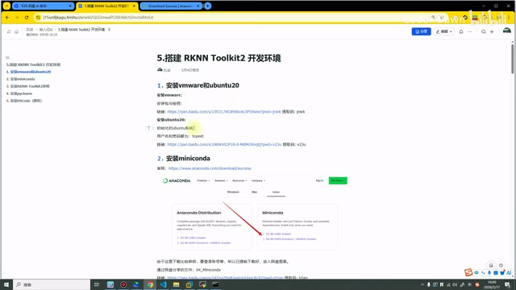

*课件给出的 VMware、Ubuntu 20 与 Miniconda 安装入口。 · [原片 00:24](https://www.bilibili.com/video/BV11DjT6uEhc/?p=6&t=24)*

第二个是安装 Ubuntu 20。Ubuntu 现在比较主流的系统可能有 14、18、20、22、24。我们这个课程使用的都是 Ubuntu 20。大家如果担心自己遇到一些问题没搞定，最好也是跟我保持一致。

至于使用哪个 Ubuntu 20，是空白的还是某一个厂商的，都可以。在这里我使用的是迅为的，因为我买的也是迅为的开发板，使用它的系统会更方便一点。如果使用迅为的，用户名和密码都是 `topeet`。我也是给大家提供好了网盘链接，可以直接去下载。使用他们提供好的一个好处，就是他们把最基础的……


基本的一些插件都已经集成到里面了，我们用起来会比较方便。这也就是第一步。可以看到，在这里我也已经安装好了。

## 下载 Miniconda 与传输准备 · 02:15

接下来我们到第二步，就是安装 Miniconda。首先打开它的官网地址。打开之后可以看到，就是这么一个界面，有 Windows 的，有 Mac 的，也有 Linux 的。我们这节课要使用的是 Linux 的。

它也有两个，一个是 x86 的，一个是 ARM64 的。这两个我们后面都会用，这节课使用的是 x86 的。可以看到左边叫 Anaconda，它和 Miniconda 对我们来说其实没什么区别，就是为了搭建一个环境。Anaconda 会更大、更重一些，工具也更全，不过我们用不上，使用 Miniconda 就好了。直接点击这里就可以下载。

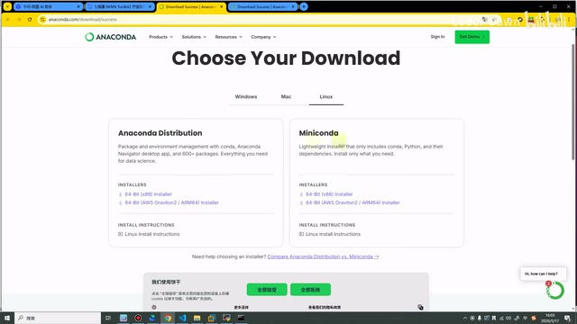

*Miniconda 下载页选择 Linux，提供 x86 与 ARM64 安装器。 · [原片 03:00](https://www.bilibili.com/video/BV11DjT6uEhc/?p=6&t=180)*

回到课件，这里我也进行了说明：下载的时候可能需要登录账号，没有账号还需要注册账号；下载的速度可能也比较慢。所以我已经提前下载好了，大家直接去下载就好。在这里我已经放在桌面了，放在这里。

接下来我们要做的，就是把它传到 Ubuntu 主机上面。至于怎么传，方法特别特别多。在这里我只给大家介绍两种我个人比较常用的方法：第一种使用这个工具，第二种使用命令。我来演示一下。

首先需要知道它的 IP 地址。可以看到，我的 IP 地址是 `192.168.137.47`。

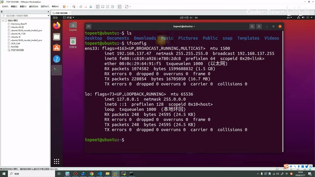

*ifconfig 输出中虚拟机地址为 192.168.137.47。 · [原片 04:00](https://www.bilibili.com/video/BV11DjT6uEhc/?p=6&t=240)*

> 编辑核对：此处 Ubuntu 终端实际使用 `ifconfig` 查看地址；远程工具的窗口标题为 MobaXterm。


## Windows 网络共享与远程目录 · 04:07

就是这么一个 IP 地址。大家可能也觉得比较奇怪，我为什么是这个 137 网段？我也说一下。因为我这个房间里面没有路由器，为了让虚拟机、Windows，还有开发板可以在同一个网段，我采用了 Windows 网络共享的方法。

大家如果有路由器，直接插上去是最方便的。如果没有路由器，为了三端可以互相传东西、在同一个网段，也可以参考我这种方法。

先找到我们的上网口，比如我的是 Wi-Fi。打开这个网络设置，选择更改网络适配器，选中它，点击鼠标右键的属性。在这里点“共享”。大家打开的时候应该是没有勾的，就把它勾起来，然后在这里选择以太网。这个配完之后，我们再看，就可以看到它的地址是 137 网段的了。

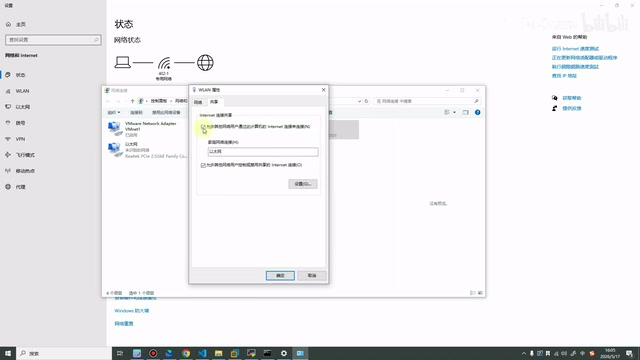

*Windows 网络共享设置操作所在界面。 · [原片 05:05](https://www.bilibili.com/video/BV11DjT6uEhc/?p=6&t=305)*

我将它复制一下，然后打开这个工具，在这里也来复制一下，再输入用户名。可以看到，这样就已经进来了。

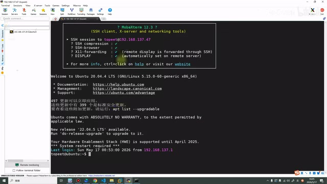

*MobaXterm 已通过 SSH 登录 Ubuntu。 · [原片 05:30](https://www.bilibili.com/video/BV11DjT6uEhc/?p=6&t=330)*

进来之后，我们也是先创建一个 `rknn` 目录。后续我们所有项目的一些代码，包括环境，包括交叉工具，都会放在这个目录下。然后在它下面再创建一个 `01_miniconda`。我们进入它，可以看到目前都是空的。在这里也可以看一下，它和我们 Ubuntu 上面都是一模一样的。我们也进入它，进入 01……

> 编辑核对：画面使用 `mkdir rknn`、`mkdir 01_miniconda`、`cd` 和 `ls` 操作目录；此时第二个目录的创建位置有误，讲师随后现场纠正，保留在下文。


没有，它没有吗？好，在这里，刚才我们创建的时候有一点问题，并没有在这个 `rknn` 目录下创建。我们回退一下，可以看到把目录创到这里了，删除一下。

然后进入 `rknn` 目录，在它下面创建 `01_miniconda`。可以看到，现在就在这个目录下了。在这里我们再次重新进一下，就可以进来了。我们获取一下目录，然后在这里搜索一下，这样就代表进入这个目录了。

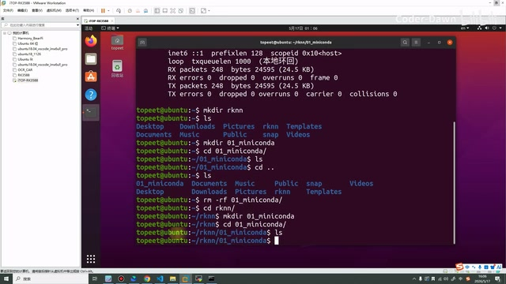

*纠正目录位置后，在 rknn 下进入 01\_miniconda。 · [原片 06:48](https://www.bilibili.com/video/BV11DjT6uEhc/?p=6&t=408)*

> 编辑核对：原操作先在用户主目录误建 `01_miniconda`，随后删除该误建目录，再 `cd rknn/`、`mkdir 01_miniconda`、`cd 01_miniconda/`。终端用 `pwd` 得到 `/home/topeet/rknn/01_miniconda`，复制到 MobaXterm 的文件路径栏。

将刚才的这个文件拖进来就可以。可以看到下面有一个进度条，等进度条走完之后，就可以看到这个东西已经传过来了。这是第一种方法，也是我使用最多的方法。

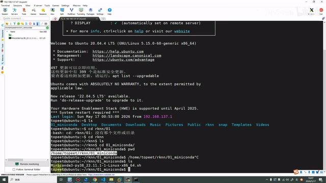

*MobaXterm 文件栏中出现上传的 Miniconda 安装脚本。 · [原片 07:18](https://www.bilibili.com/video/BV11DjT6uEhc/?p=6&t=438)*

我们先将它删除，再来演示第二种方法。第二种方法就是使用命令的方式。我已经提前打开了，就使用 `scp` 命令。同样，我们输入这个地址、这个用户名，再输入 IP 地址。然后把目录复制一下，复制一下这个目录，点击回车，输入密码。这样也可以传过来。

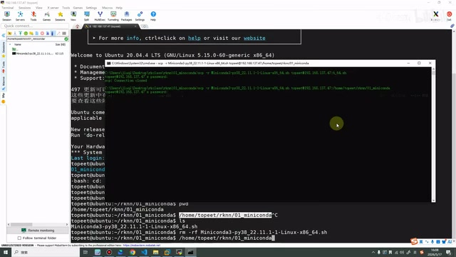

*Windows 命令窗口执行 scp 上传安装脚本。 · [原片 08:06](https://www.bilibili.com/video/BV11DjT6uEhc/?p=6&t=486)*

> 编辑核对：Windows 命令窗口从本地 Miniconda 脚本所在文件夹执行上传，目标用户名是 `topeet`，地址是 `192.168.137.47`，目标目录是 `/home/topeet/rknn/01_miniconda`。该帧完整命令较小，未把无法逐字确认的本地路径写成可复制命令。


## 执行 Miniconda 安装与换源 · 08:09

这两种方式都是我个人比较常用的。在这里也可以看一下，就已经有了。但因为它是白色的，就不具备可执行权限，我们给它改一下权限。可以看到，现在这样就可以执行它了。我们执行一下。

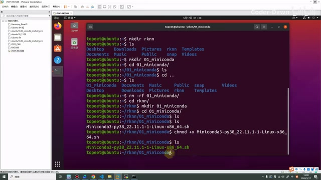

*chmod +x 后，安装脚本在终端列表中显示为绿色。 · [原片 08:24](https://www.bilibili.com/video/BV11DjT6uEhc/?p=6&t=504)*

> 编辑核对：终端可见安装脚本名为 `Miniconda3-py38_22.11.1-1-Linux-x86_64.sh`，先执行 `chmod +x Miniconda3-py38_22.11.1-1-Linux-x86_64.sh`，再执行 `bash Miniconda3-py38_22.11.1-1-Linux-x86_64.sh`。使用的是本课准备的 Python 3.8、Linux x86_64 安装器。

它提示我们点击回车，就点回车。然后到这里，我们就输入 `yes`，它提示让我们输入 `yes`，再点回车，然后再输入 `yes`。这样就已经进入到这里了。

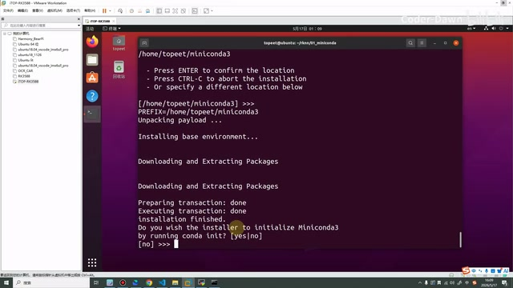

*Miniconda 安装完成后出现 conda init 确认提示。 · [原片 09:00](https://www.bilibili.com/video/BV11DjT6uEhc/?p=6&t=540)*

在课件里面也已经写了：之后需要对它进行换源。将这个复制过来，再将这个复制过来。这里还是需要注意格式，如果空格什么对得不齐，也可能出问题。

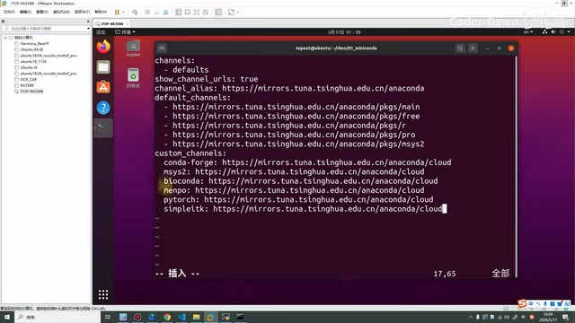

*在 .condarc 中粘贴镜像源配置。 · [原片 09:36](https://www.bilibili.com/video/BV11DjT6uEhc/?p=6&t=576)*

执行完之后，也可以对 pip 进行换源的操作。好，执行完之后，我们再执行一下它。可以看到执行之后，我们这里出现了一个 `base`……

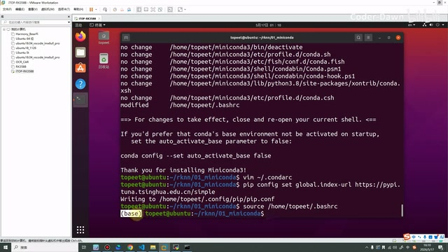

*配置 pip 镜像并 source .bashrc，提示符出现 base。 · [原片 10:12](https://www.bilibili.com/video/BV11DjT6uEhc/?p=6&t=612)*

> 编辑核对：画面先 `vim ~/.condarc` 编辑 Conda 镜像配置，再执行 `pip config set global.index-url https://pypi.tuna.tsinghua.edu.cn/simple`，终端显示写入用户的 pip 配置文件；随后执行 `source /home/topeet/.bashrc`。`.condarc` 中可见清华镜像及 YAML 缩进；完整配置细字不在此凭记忆补齐。


如果大家跟着我到这里，提示了 `base`，就证明我们的 Conda 环境已经搭建好了。我们将屏幕清理一下，到这里就没问题了，可以进行下面一个步骤。

在这里也提示了更新一下 Python 的一些环境。这个是可选的，我就不更新了，如果后面遇到问题，我们再来更新。

## 创建 rknn-toolkit2 环境 · 10:40

接下来就是第三步，安装 RKNN Toolkit2 的环境。我们直接使用 Conda 这个命令去创建就行。我解释一下：这里就是 `conda create -n`，固定参数；创建的名称叫 `rknn-toolkit2`，使用的 Python 版本是 Python 3.8。建议大家也是跟我一致。我们耐心等待一下。

```bash
conda create -n rknn-toolkit2 python=3.8
```

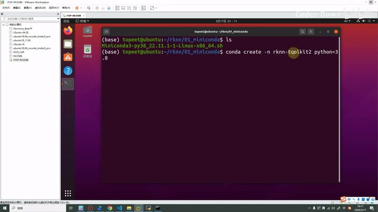

*创建 rknn-toolkit2 环境并指定 Python 3.8。 · [原片 11:00](https://www.bilibili.com/video/BV11DjT6uEhc/?p=6&t=660)*

我们来到课件。创建完之后，进入它就可以了。我们等待一会。可以看到这里也有提示，直接复制。可以看到前面的 `base` 就变成它了，也就代表已经进入。

我们也可以看一下，现在都有哪些环境。可以看到，现在其实就两个环境：一个是 `base`，一个是刚才创建的。我们目前就在这个环境下，而且都是没问题的，就接着到下一步。

```bash
conda activate rknn-toolkit2
conda env list
```

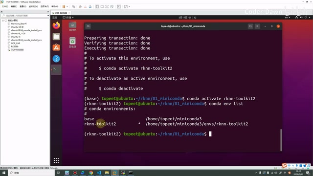

*激活 rknn-toolkit2 后列出两个 Conda 环境。 · [原片 12:00](https://www.bilibili.com/video/BV11DjT6uEhc/?p=6&t=720)*

下一步就是创建一个 02 的目录……


## 上传官方工具包 · 12:12

然后将我们需要使用到的这些包都放进来就可以。按照课件，我们也回退一下，到这里，然后创建一个 02 的目录。名称也跟它保持一致吧。我们进入 02，进入之后，就需要把这个包放进来。

这个包是什么包呢？在前面的课程中也讲过，就是瑞芯微官方仓库有一个 `rknn-toolkit2`，不知道大家还有没有印象。如果忘了，在这里有，我也来带着大家再看一下。

> 补充核对：局部再次转写保留了“这个包是什么包”“前面的课程”“官方仓库”“有没有印象”“如果忘了，在这里有”的连续讲述，没有确认原始转写中的整段重复循环。以上按该连续内容整理，原始识别仍保存。

就是它的官方地址，然后有一个 `rknn-toolkit2`，这里有一个 `packages`，就是将这个目录移过来就可以。接下来同样这么做吧。当然，在这里我也已经提前准备好了。直接进入这个目录下，然后使用 `scp -r`，我们复制一下这个目录。

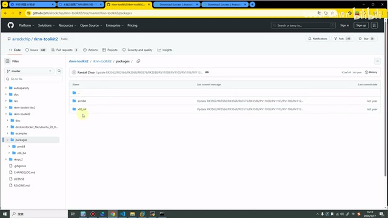

*官方仓库的 packages 下区分 arm64 与 x86\_64。 · [原片 13:36](https://www.bilibili.com/video/BV11DjT6uEhc/?p=6&t=816)*

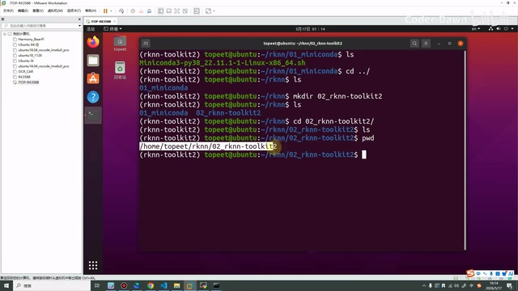

*终端用 pwd 确认工具包上传目标为 /home/topeet/rknn/02\_rknn-toolkit2。 · [原片 14:12](https://www.bilibili.com/video/BV11DjT6uEhc/?p=6&t=852)*

> 编辑核对：Ubuntu 终端创建的是 `02_rknn-toolkit2`；官方仓库中进入 `rknn-toolkit2/packages`，能看到 `arm64` 与 `x86_64`。讲师在 Windows 本地已有 `rknn-toolkit2-master`，用带 `-r` 的 `scp` 传输目录；完整本地路径不够清晰，未臆造。


## 进入 x86_64 并选择 Python 版本 · 14:13

现在这个目录已经上传完毕了。上传完毕之后，我们就打开，然后进入它。在这里，我是把整个目录都传过来的，大家其实也可以只传刚才我说的那一个。然后进入它……哦，少了一个。这样，然后进入这个 `packages`。

> 补充核对：局部再次转写能确认“目录上传完毕”“整个目录都传过来”“也可以只传刚才说的”“少了一个”“我们这样”“进入 packages”。上文保留这些实际讲述；原转写夹杂的外语没有可靠的新话语证据，不补写。
>
> 编辑核对：终端依次进入 `rknn-toolkit2-master/`；一次 `cd` 输入的目录名漏字，返回“没有那个文件或目录”，随后重新输入进入 `rknn-toolkit2/`，再进入 `packages/`。这是现场纠错，不能省成一次成功操作。

它里面有一个 x86，我们现在使用的是 `x86_64`，所以进入它里面就可以。

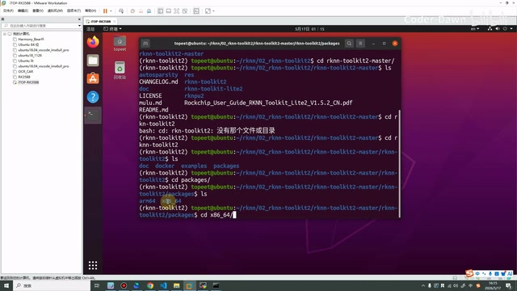

*进入 packages 后选择 x86\_64 目录。 · [原片 15:24](https://www.bilibili.com/video/BV11DjT6uEhc/?p=6&t=924)*

因为我们使用的是 Ubuntu 20，它对应的是 Python 3.8 版本，也就是这一个 Python 3.8 的。大家也可以这样看一下：Ubuntu 20 默认就是 Python 3.8，我们装跟它对应的版本。其实从 3.6 到〔末尾版本号转写为“3.1”，无法据原声可靠确认〕都有，大家的虚拟机应该也都是这些版本的。

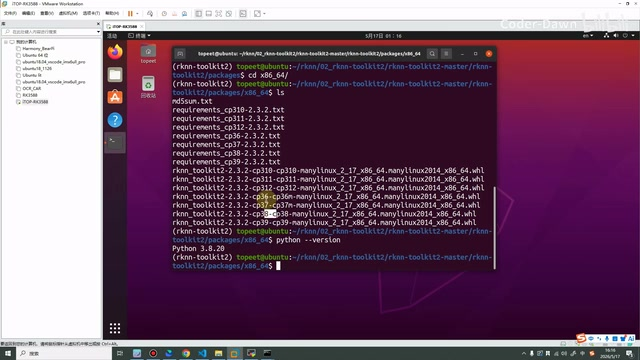

*x86\_64 包目录列出 requirements 和不同 Python 版本的 wheel。 · [原片 16:00](https://www.bilibili.com/video/BV11DjT6uEhc/?p=6&t=960)*

> 编辑核对：画面使用 `python --version`，输出 `Python 3.8.20`；目录中有 `requirements_cp38-2.3.2.txt`，以及文件名含 `cp38-cp38` 的 RKNN Toolkit2 wheel。目录还列出其他 Python 版本的文件，不能把转写中的“3.1”直接作为准确版本号。

所以在这里我们就安装一下，安装的时候可能等待的时间会稍微久一点。


## 安装依赖与等待 · 16:17

然后我们先安装它。可以看到速度其实还是挺快的，我们也是等待一下。

```bash
pip install -r requirements_cp38-2.3.2.txt
```

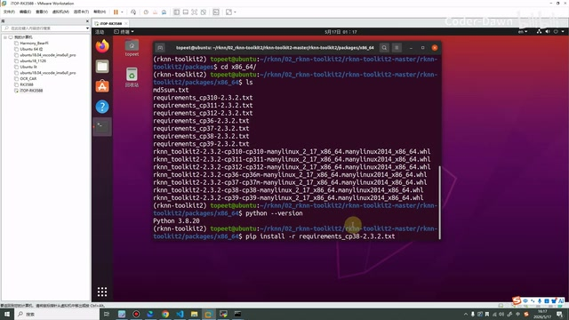

*终端输入与 Python 3.8 对应的 requirements 安装命令。 · [原片 16:36](https://www.bilibili.com/video/BV11DjT6uEhc/?p=6&t=996)*

可以看到速度其实还是挺快的，我们也是等待一下。在课件这里也有写到：第一步是安装它，需要的时间会稍微久一点；然后再去安装它的软件包。

如果安装完之后，我们就来验证一下。输入这个命令发现没有错——这也不是命令，就是输入这行代码，这个 RKNN 包没有错的话，就代表安装成功了。我们来看一下，还没有安装完。没有安装完，就再等一会吧。

> 编辑核对：此时课件指向的是 Python 中的 `from rknn.api import RKNN`。讲师先说明后面的验证方法，实际验证仍在安装结束之后进行。
>
> 等待区间核对 · 17:39–17:56：局部再次转写在“没有安装完，就再等一会”之后仍产生外语噪声，低能量检测也提示此处有较长等待。画面仍是依赖下载进度，未将噪声变成讲师话语。低能量检测不等于人工逐句听音。

在这里可能要等的时间非常长……


所以我还是先暂停一下。

好了，经过一段时间的等待，这个也是终于安装好了。可以看到其实还挺大的，里面有好几个好几百兆的东西，平均速度也就是十兆左右，所以下载还是有点时间的。

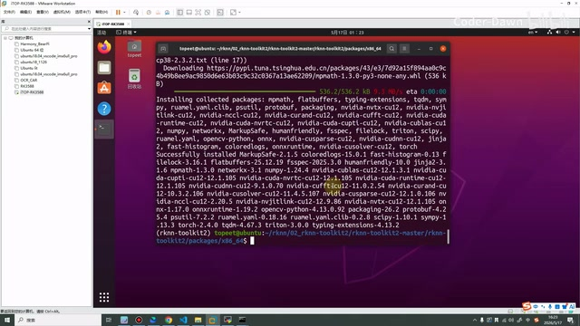

*依赖安装完成，终端显示 Successfully installed。 · [原片 18:48](https://www.bilibili.com/video/BV11DjT6uEhc/?p=6&t=1128)*

安装完这个依赖之后，我们就来安装它。同样还是 `pip install`，然后我们 `-r`，输入这个 RKNN……我们将它复制一下吧。我们可以复制一下，不需要这个 `-r`。

```bash
pip install rknn_toolkit2-2.3.2-cp38-cp38-manylinux_2_17_x86_64.manylinux2014_x86_64.whl
```

可以看到，这里出现了一个……我们可以看到里面已经有非常多的东西了。这样我们就已经将它的环境搭建好了，然后来验证一下。

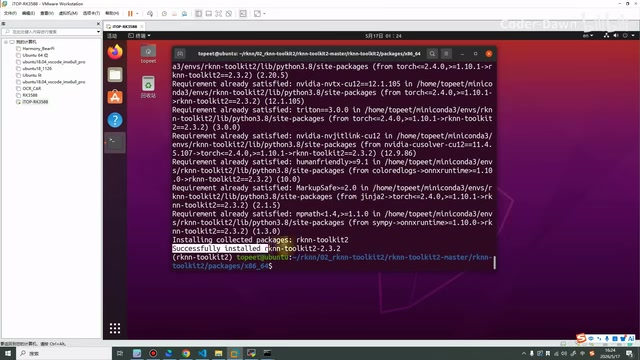

*RKNN Toolkit2 wheel 安装后的成功输出。 · [原片 19:36](https://www.bilibili.com/video/BV11DjT6uEhc/?p=6&t=1176)*

> 编辑核对：画面中的 wheel 文件名如上。`-r` 用在前一步读取 requirements 文件，讲师在安装 wheel 时现场去掉了 `-r`。终端随后显示 `Successfully installed rknn-toolkit2-2.3.2`，并展示已装包列表。
>
> 补充核对：局部再次转写恢复的这段讲述是：“现在就证明已经安装好了。安装好了之后，我们就来看一下。可以看到里面已经有非常多的东西了。这样我们就已经将它的环境搭建好了，然后来验证一下。这里怎么这样，应该是……也是卡了，这个电脑。直接放一个全屏了吧。”这些话语与前面可确认的安装完成内容有重叠；其中操作电脑卡顿与放全屏的话保留如下。

这里怎么这样，应该是……也是卡了，这个电脑。直接放一个全屏了吧。

然后我们直接来和刚才一样，来验证一下。


## Python 中验证导入 · 20:25

我们输入 `python3`，就是进入 Python 的交互页面。我们复制一下……好像没复制上。没复制上的话，我就手动输入一下吧。可以看到，它并没有进行报错。

```python
from rknn.api import RKNN
```

如果我们导入一个不存在的东西，比如说 `RKNN234`，就会直接报错。如果没报错，就证明安装是没问题的。

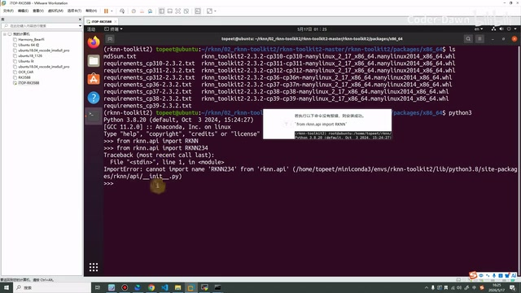

*成功导入 RKNN 后，故意导入 RKNN234 触发 ImportError。 · [原片 21:18](https://www.bilibili.com/video/BV11DjT6uEhc/?p=6&t=1278)*

> 编辑核对：画面中的反例是 `from rknn.api import RKNN234`，返回 `ImportError: cannot import name 'RKNN234' from 'rknn.api'`。原转写把反例名字识别成“Rython234”，这里按可见代码校正。

没问题之后，我们将它退出。到这一步，其实已经搭建好了 RKNN Toolkit2 开发环境。下面第四步和第五步，就是安装一个编辑器了。

## PyCharm 的安装与解释器选择 · 21:38

我们先来看第四步。如果大家是学 Python 的，或者搞算法、深度学习的，可能使用得会特别多。在这里看一下，就是进入它的官网，然后去下载它。下载之后，将它传到 Ubuntu 中，然后解压，再进入它的 `bin` 目录，输入 `./pycharm` 就可以打开。

打开之后，可以在这里选择。在这里我也已经标上了 1、2、3、4、5：就是选择代码，选择一个位置，选择是什么环境，然后选择类型，选择具体的环境。然后到这里……

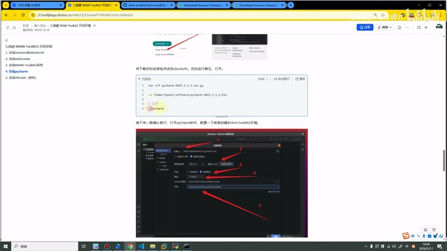

*课件展示 PyCharm 项目与解释器配置的五处标注。 · [原片 22:06](https://www.bilibili.com/video/BV11DjT6uEhc/?p=6&t=1326)*

> 编辑核对：本段是课件讲解，并未重新现场安装 PyCharm。课件截图有五处红色编号，显示项目创建与解释器选择。安装包的完整版本路径及细小选项文字受原视频分辨率限制，未推测补齐。


进来之后，如果发现终端是这样的，就也证明已经安装成功了。这个步骤我就不再给大家演示，相信大家都会。

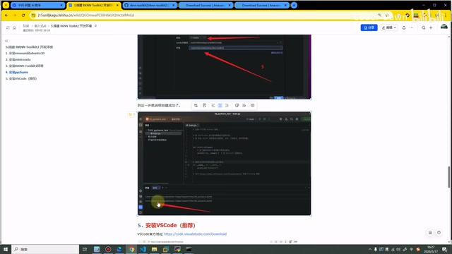

*课件展示 PyCharm 项目终端中的环境提示符。 · [原片 22:30](https://www.bilibili.com/video/BV11DjT6uEhc/?p=6&t=1350)*

## VS Code 与远程连接 Ubuntu · 22:37

我个人其实不太喜欢使用 PyCharm，因为打开它的时候速度太慢。我个人更喜欢使用 VS Code。如果我们是偏向于嵌入式开发的这些程序员，可能也是使用它更多一些。

和上面的 PyCharm 一样，也是进入官方地址，然后去下载，像 Windows 的、Linux 的、Mac 的都有。然后也是去进行安装。在 Ubuntu 上面就使用这些命令，在 Windows 上面就使用这些命令，在这里就不再演示了。然后装一些必要的插件。我在这里已经提前安装好了。

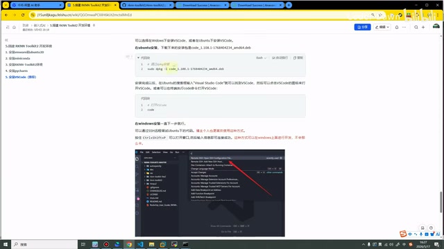

*课件展示 VS Code 的安装与启动命令。 · [原片 23:12](https://www.bilibili.com/video/BV11DjT6uEhc/?p=6&t=1392)*

> 编辑核对：课件的 Ubuntu 安装使用 `sudo dpkg -i` 加下载的 `.deb` 包，启动使用 `code`；完整 `.deb` 版本字符串小字难以可靠确认。Windows 部分是下载安装与远程连接说明，未出现可清楚逐字抄录的另一套终端安装命令。

安装好之后，我安装的是 Windows 的版本，我们可以去远程连接 Ubuntu 主机。在这里可以看到左下角有这样的一个小按钮，点击它，选择“连接到主机”，然后选择 Ubuntu，再输入〔提示内容转写为“命令”，此处不能可靠确认〕，然后输入密码。可以看到，就已经进来了。

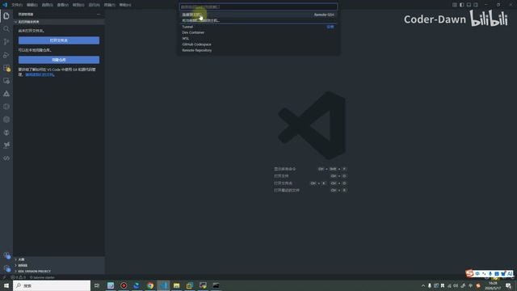

*VS Code 通过远程连接入口选择 SSH 主机。 · [原片 23:42](https://www.bilibili.com/video/BV11DjT6uEhc/?p=6&t=1422)*

然后打开文件夹，选择刚才的 `rknn`，选择 OK，然后再次输入密码，再次输入密码。可以看到，这样我们就已经进入 Ubuntu 主机了。

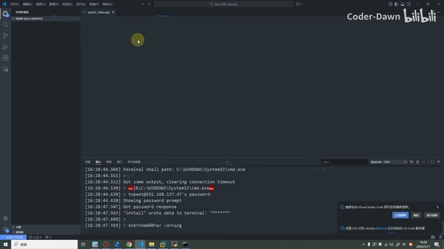

*VS Code 远程打开 rknn 文件夹后的目录与提示。 · [原片 24:06](https://www.bilibili.com/video/BV11DjT6uEhc/?p=6&t=1446)*

> 编辑核对：远程文件夹选择框显示 `/home/topeet/rknn/`，打开后左侧出现 `01_miniconda` 和 `02_rknn-toolkit2`。同时画面中央有文件加载失败/重试提示；这与讲师“已进入主机”的口述同时存在，不能把该画面描述为所有界面均已无错误。

大家可能比较好奇，我刚才直接点“连接到主机”，选择 Ubuntu，就直接进来了。这个也是因为我已经配置了。大家如果没有配置，就点击这个……


## SSH 主机配置与结束 · 24:27

配置 SSH 主机，然后选择第一个。在这里，我刚才就是定制了这个 `ubuntu`，然后输入它的 IP 地址、它的用户名。大家如果是其他的，也可以在这里配置。

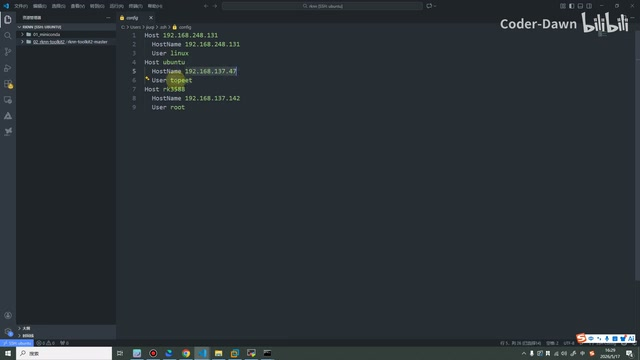

*SSH 配置中 ubuntu 主机的 HostName 与 User。 · [原片 24:38](https://www.bilibili.com/video/BV11DjT6uEhc/?p=6&t=1478)*

> 编辑核对：SSH 配置中本课连接为：
>
> ```sshconfig
> Host ubuntu
>     HostName 192.168.137.47
>     User topeet
> ```
>
> 同一文件还显示其他主机配置，它们不是本次 Ubuntu 环境的目标；这里仅抄录讲师指向的 ubuntu 段。

或者说直接在上面进行输入，不进行配置，直接输入也可以。这个就看大家喜欢使用哪种方式了。

讲到这里，我们这节课的内容就已经全部讲完了。希望大家也可以跟着我，一步一步将开发环境配置好。最后也是感谢大家的观看。

> 片尾识别说明：25:11 后的最后一个转写片段含混杂外语字符，没有可可靠确认的新中文讲解，未据此补写结束语。待补查原声的区间另记在本次处理的 source-issues.json。
