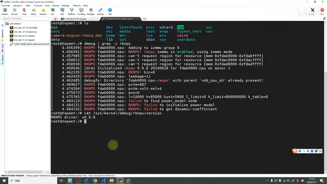
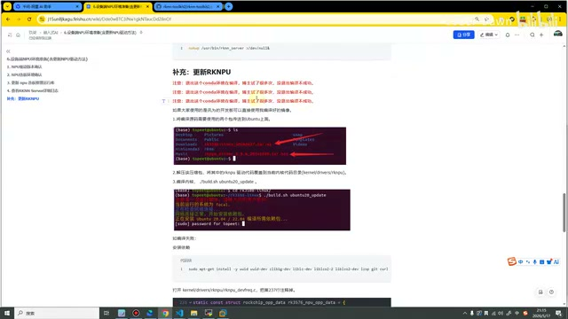
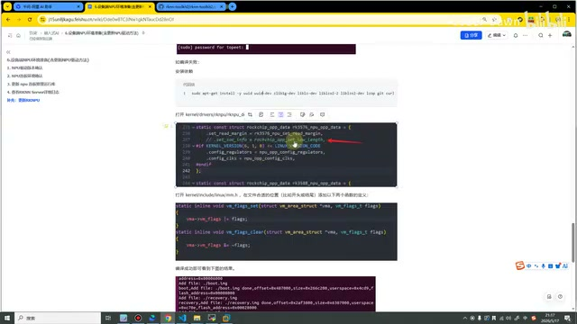
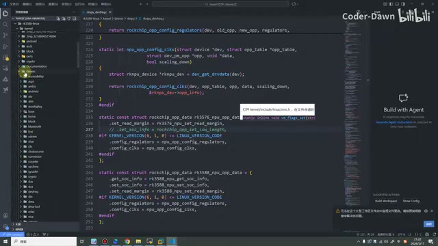
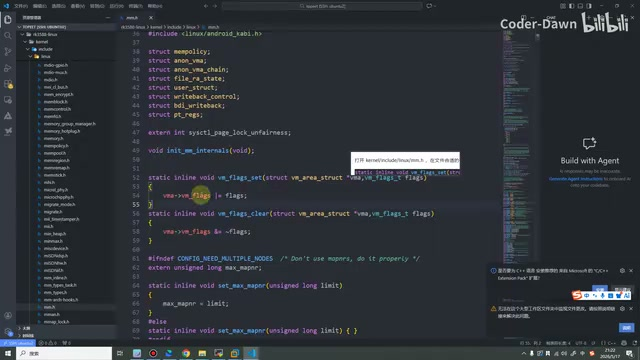
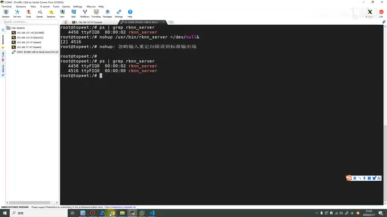
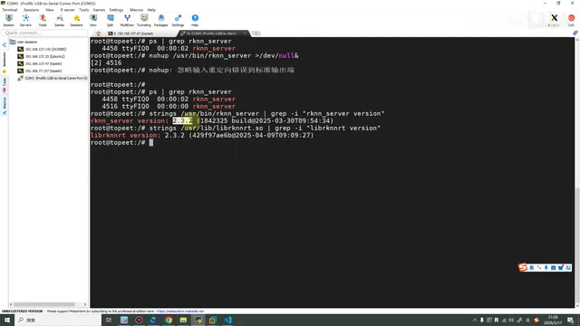
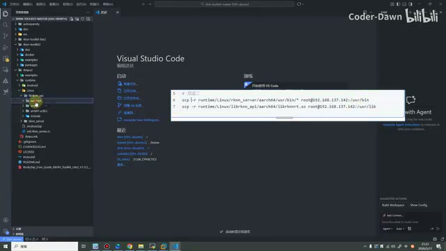
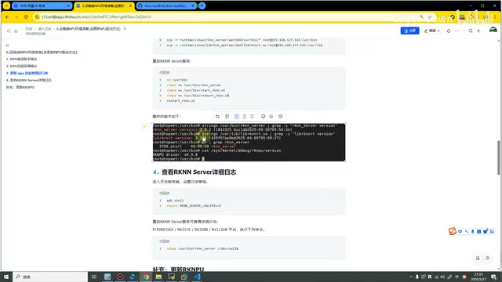

# P07｜06_设备端 NPU 环境搭建与 NPU 驱动更新

> 来源：[B 站课程第七集](https://www.bilibili.com/video/BV11DjT6uEhc/?p=7) · 全片约 22 分 9 秒
>
> 整理方式：忠实讲稿，不做摘要压缩。保留原讲述顺序、解释、操作和限定，仅清理无意义停顿、结巴并核对明显识别错误。原始转写保存在 sources。
>
> 图片说明：原视频 640×360 截图，小字受源画质限制；图注是编辑说明。

## 设备端准备与驱动版本确认 · 00:00

在上节课，我们讲了在 Ubuntu 虚拟机上面怎么搭建 RKNN-Toolkit2 的开发环境。这节课，我们就准备好设备端的环境，也就是说，我们 3588 开发板上要做哪些准备。其中，这节课还包含了更新 NPU 驱动的方法。这节课一共也是分为五个部分。

我们先来看第一个部分，就是 NPU 驱动版本的确认。在这里有四条命令，这四条命令也是来自官网，基本上市面上所有厂商都可以通过这四条命令来查询到它的版本。我们来查一下。

```sh
dmesg | grep -i rknpu
cat /sys/kernel/debug/rknpu/version
cat /sys/kernel/debug/rknpu/driver_version
cat /proc/debug/rknpu/driver_version
```

在这里，我已经通过串口登录上了我的 RK3588 开发板。接下来我们就来看一下，执行它之后，可以看到这里有一个 RKNPU，0.9.8 这么一个版本，也就代表我的开发板 NPU 的版本是 0.9.8，这个也是现在最新的版本了〔原讲述时点〕。

同样，下面还有三条命令，我们也来试一下。通过这条命令，可以非常清楚地看到，这个 RKNPU 的驱动是 0.9.8。



*串口终端查询 RKNPU 驱动，结果为 v0.9.8。 · [原片 01:36](https://www.bilibili.com/video/BV11DjT6uEhc/?p=7&t=96)*

下面这两条命令，其实之前我也试过了，就是不适用于我们迅为的这个版本。如果你是其他厂商，可能通过这两条命令是可以查到的。总之，我们通过上面这两条命令，已经查到了它的版本。

在这里可以先和大家讲一下，如果大家买的板子比较久远了，或者自己没有更新过系统，几乎不太可能是 0.9.8 这个版本，可能是比较早的，可能是 0.8.8、0.8.2 等等。如果大家的版本比较旧，还是建议大家更新一下。在这里可以看一下课件，这里建议我们的 NPU 驱动版本大于等于 0.9.2。

## 补充：更新 RKNPU 驱动 · 02:32

在这里，也是顺便来讲一下怎么样更新这个驱动。可以看到，我特意写了这么三行：我们在编译系统的时候，一定要退出这个 Conda 环境。我之前在编译这个系统的时候，因为没有退出 Conda 环境，它就一直失败。具体原因我也不是很明白，反正我退出之后，一次就成功了。我没有退出的时候编译了五六次，花了三四个小时，但是一直都没有成功。

下面截图这里稍微有一点点不准确。不准确的地方在哪里呢？这里可以看到有个 `base`，大家在编译的时候，是需要把它退出的。



*课件强调编译前退出 Conda；下方旧截图仍有 base 提示。 · [原片 03:02](https://www.bilibili.com/video/BV11DjT6uEhc/?p=7&t=182)*

如果大家使用的是迅为的开发板，也可以直接使用我编译好的镜像。这个镜像我也会放到百度网盘的资料里面，大家到时候需要的话，直接下载就行。

我来讲一下编译流程。如果使用的是其他厂商的开发板，整个流程都是一模一样的。第一步，就是将编译的源码、所需要用到的这些包，都传到 Ubuntu 上面去。一个要传的就是这个 Linux 内核的包，还有一个就是 RKNPU 驱动。这个驱动，我也在百度网盘里面放好了。如果大家想去找它，它在哪呢？它其实就在瑞芯微 GitHub 仓库里面，在那个仓库里面就可以找得到〔仓库名此处识别不清〕。这里就不再演示了，大家知道传这两个包就行。

第二步，就是将它解压掉。解压之后，我们要使用 RKNPU 这个包，覆盖掉 `kernel/drivers/rknpu`，需要覆盖掉它。然后我们直接去编译就行，加上编译命令，开始耐心等待。

〔画面核读说明：课件展示了 `build.sh` 编译命令，但原片为 640×360，完整命令及参数未能可靠逐字确认，此处未完整转录；请核对原课程课件，勿将这里的脚本名当作完整可执行命令。〕

如果编译失败，我之前试了，编译失败是有一些依赖没有装，一共就是需要这么多依赖，也是直接复制这条命令就行。当然，这个非常长，直接复制它就行。

〔画面核读说明：以上“直接复制”指讲者课件中的长依赖安装命令。原片 640×360 小字无法可靠逐字核对，本文未能完整转录该命令；对应截图保留供定位，完整命令需核对原课程课件，不能直接从本文复制，亦未猜补参数或包名。〕

如果还失败，如果使用的是 3588 开发板，就去把第 237 行这个注释掉。然后在这个文件下，也是加上这两个函数的定义，然后就可以编译成功了。编译成功之后，就可以看到 `successful`，最终再把它烧录一下就行。



*更新驱动课件展示依赖安装、237 行修改与补充函数的位置。 · [原片 05:26](https://www.bilibili.com/video/BV11DjT6uEhc/?p=7&t=326)*

在这里还是看一眼吧。就是在这里，我之前使用的是这个环境。

直接看一下它的 IP，137.229。我们使用 VS Code 打开一下。在这里，其实我们就可以复制，然后点“连接到主机”，点到 Ubuntu，然后将它打开，选择 Linux。然后继续，输入密码。

我们打开文件。这个文件在这里，也是 RKNPU。这里没有，换个目录吧，打开根目录吧，就是在这个目录下。

我们第一步，回到课件，RKNPU，第一步是找到它，就是我们将解压出来的这个 RKNPU 驱动，解压、改名字之后，我们找到 `kernel`，`kernel` 下面有个 `drivers`，在这里整体进行一个覆盖。找 `rknpu`，把它覆盖掉就行了。或者说，把原本的删掉，然后把这个新的放进去。找一下，对，就是它，就是把它放进去就可以了。这是第一步。

然后到第二步，最好先把依赖安装好。安装完之后，在之前我编译的时候是有报错的。找到这个目录，RKNPU，然后找到 `rknpu_devfreq.c`，找到第 237 行，就是需要将它注释掉。



*VS Code 展示 rknpu\_devfreq.c 中的 237 行注释。 · [原片 09:40](https://www.bilibili.com/video/BV11DjT6uEhc/?p=7&t=580)*

然后再打开这个目录，`include/linux`，然后 `mm.h`。

这个文件也比较多，我们慢慢找一下吧。`mm.h`，就是在这里。我们加上这两条，这四行代码就可以了。

```c
static inline void vm_flags_set(struct vm_area_struct *vma, vm_flags_t flags)
{
    vma->vm_flags |= flags;
}
static inline void vm_flags_clear(struct vm_area_struct *vma, vm_flags_t flags)
{
    vma->vm_flags &= ~flags;
}
```



*VS Code 展示 kernel/include/linux/mm.h 中补充的 vm\_flags\_set 和 vm\_flags\_clear。 · [原片 10:22](https://www.bilibili.com/video/BV11DjT6uEhc/?p=7&t=622)*

做完这些之后，我们再去编译，基本上就不会有问题了。编译完之后，就是最新的 0.9.8 的驱动版本。这就是更新 NPU。因为我已经更新过了，这个板子我也不想再重新装了，大家参考文档这个步骤就可以了。

## NPU 连板环境确认 · 10:46

接下来，我们看第二部分，就是 NPU 连板环境的确认。RKNN-Toolkit2 连板调试功能，依赖板端的 `rknn_server` 程序。这个程序是运行在开发板上的后台代理服务，用于接收 PC 通过 USB 传输过来的命令和数据，然后调用相应的运行时接口，并返回相应的结果给 PC。

这个连板推理的意思，就是我们的代码什么的，都是在虚拟机里面点，但是它本质上调用了开发板来进行推理。推理完之后，它再把结果返回给 PC，返回给我们的虚拟机。如果想实现这个功能，想这样用，就比较依赖 `rknn_server` 这个程序。

这里就是需要检查一下，我们板子上面是否有运行这个进程。当然，这里是在我们的 Ubuntu 里面，通过 `adb shell`，就可以进入这个板。我们其实也可以直接在板子上面输入。

我个人其实不是特别喜欢用 ADB。我感觉都在同一个终端里面，可能切来切去会有点影响大家观看。所以在虚拟机里面写代码的时候，我就直接打开虚拟机；在板子上面，我就全部打开它。最终写代码，会在 VS Code 里面写，就这样一个流程。

我们复制这条命令，然后去让它清理一下。我们来看一下，可以看到，在这里我们可以查到 RKNN 的服务，它的一些信息我们也都能看得到。这样和这里类似，就证明我们这个是完好的。

```sh
ps | grep rknn_server
```

如果大家没查到，也可以先输入这条命令，这也是官网建议我们使用的命令。使用完它之后，我们再去查询，就可以看到，现在相当于启动了两个吧，就是这样一个操作流程。

```sh
nohup /usr/bin/rknn_server > /dev/null &
```



*运行 nohup 后再次查询，终端显示两个 rknn\_server 进程。 · [原片 13:18](https://www.bilibili.com/video/BV11DjT6uEhc/?p=7&t=798)*

## 更新 NPU 连板推理运行库 · 13:21

接下来我们看第三点。有可能大家在进行第二步的时候，并没有启动得了，包括输入下面这条命令之后，也没有启动成功，或者大家的版本特别旧，也是建议大家去更新这个连板推理运行库。

这里说一下，为什么要更新它呢？就是我们使用 RK 的板子进行操作的时候，一定要保证我们所有的版本都是一致的。所以其实不管大家现在板子上是什么样的版本，我都建议大家去更新。因为如果采用的是我给大家的压缩包，或者大家现在去官网里面下载的，看一眼，如果大家现在去官网上面下载，它都是 2.3.2 的版本，这是现在最新的版本〔原讲述时点〕。所以大家就把版本都保持一致，这一步也是必须要完成的，一定要去更新。

这里会涉及两个概念。前面也提到了这个 `rknn_server`，它是运行在开发板上的后台代理服务，主要就是接收 USB 传过来的数据，然后执行运行时接口，把结果返回 PC。

然后，这个 Runtime 库，它里面主要有这么两个东西：一个是 `librknnrt.so`，还有一个是 `librknnmrt.so`。这两个分别对应我们不同型号的开发板。我们是 3588，这里我也加粗一下，所以我们就是需要使用这个 `librknnrt.so`。

这里也有一些注意事项，就是建议它的版本大于哪些版本、版本怎么样。这里也是说了，不管之前的版本是什么，如果没有装过，我们都按照下面的方法来进行更新。

第一步，我们可以查询一下它的版本。可以看到，我的版本是 2.3.2。接下来，再查一下这个 `.so` 的版本，可以看到，我的 `.so` 版本也是 2.3.2。

```sh
strings /usr/bin/rknn_server | grep -i "rknn_server version"
strings /usr/lib/librknnrt.so | grep -i "librknnrt version"
```



*终端显示 rknn\_server 和 librknnrt.so 均为 2.3.2。 · [原片 16:06](https://www.bilibili.com/video/BV11DjT6uEhc/?p=7&t=966)*

大家如果这里并不是这个版本，就一定更新一下。更新的方法非常简单，这里我也写了有两种方法。第一个方法就是通过 ADB，将这个东西传到我们开发板上，就是一共有两个，传过去就行。第二个就是我个人比较常用的，通过 SCP 的方法传过去。

其实，接下来传的是哪几个东西呢？还是在这里，我想一下，我就打开它吧，打开它来看会方便一点。先到我们的虚拟机，打开它。我们再点一下。好，这个东西在哪里呢？可以看，我们打开它，打开这个 `rknpu2`。

然后有个 `runtime`，下面有个 `Linux`，就可以看到一个叫作 `rknn_server`，还有这个叫 `librknn_api`。

我们先来看 `rknn_server`，打开它，然后我们的 `aarch64`，到 `usr`、到 `bin`，将下面的这些内容，全部传到我们的开发板上面。那就是这条命令，有鼠标光标这里。

第二个，就是需要把这个，同样也是打开它，`aarch64`，这里有个 `.so`，也将它传到开发板上面。

```sh
scp -r runtime/Linux/rknn_server/aarch64/usr/bin/* root@192.168.137.142:/usr/bin
scp -r runtime/Linux/librknn_api/aarch64/librknnrt.so root@192.168.137.142:/usr/lib
```



*资源树展示 runtime/Linux 下的 aarch64 文件及 SCP 拷贝命令。 · [原片 18:44](https://www.bilibili.com/video/BV11DjT6uEhc/?p=7&t=1124)*

可以在这里，我们也直接进入开发板，就是 `usr` 这个。这里内容特别多，特别多的话，我们就直接来看一下，跟它一样的吧，直接来看它的这几个名字。

`ls`，可以看到，就是有 `restart` 这个脚本。也可以看一下 `rknn`，有 `rknn_server`。再看一下 `start`，可以看到，也有 `start_rknn.sh`。就是通过这两条命令，总之，将我们的运行时库拷过来就行。

这里我们也是看一下，到这个 `lib` 目录下。

将这个库传过来之后，我们就进行下一步，就是给它执行权限，要给它执行权限。然后进行一个 `restart` 就可以。`restart` 完成之后，我们再来查询。这个时候大家就可以看到，我们的版本已经查到了。然后使用 `ps`、`grep`、`rknn_server`，也就可以查到了。这个驱动的版本，也是刚才第一步那里说过了，就可以查到它的版本。

```sh
cd /usr/bin
chmod +x /usr/bin/rknn_server
chmod +x /usr/bin/start_rknn.sh
chmod +x /usr/bin/restart_rknn.sh
restart_rknn.sh
```



*课件展示赋予执行权限、重启服务与版本检查。 · [原片 20:32](https://www.bilibili.com/video/BV11DjT6uEhc/?p=7&t=1232)*

这就是我们第三部分的内容，就是更新这个运行库。在这里，我并没有把之前的删掉，一点一点重新来。因为之前已经更新过了，可能也看不出来很明显的效果。大家只要按照这个步骤来做，是一定没有问题的。如果有问题，大家也可以在评论区留言，或者私信我，我也可以来给大家看一眼，这是怎么做的。

## RKNN Server 日志与课程结束 · 21:15

第四个，就是看一下 `rknn_server` 的一些日志。当然，这个就是设置一个日志等级，然后通过它去看一下，这个我们就不看了。

总之，这节课，我们就是带着大家在设备端，把 NPU 的环境给准备好。可能到这里，大家还是有一点懵，就是一行代码还没有写呢，反正就“夸夸夸”，不停地给这儿输这个命令，输这个命令，说这个、说那个，可能也有点不太明白。大家也不要担心，随着课程的深入，大家也都会逐步理解它。在这里，就暂时知道它就是去搭建这个环境，就可以了。

以上就是本节课的内容，谢谢大家的观看。

<!-- 22:08.82–22:09.27：无所属转写段；画面停留课程首页，无新增讲述。 -->
