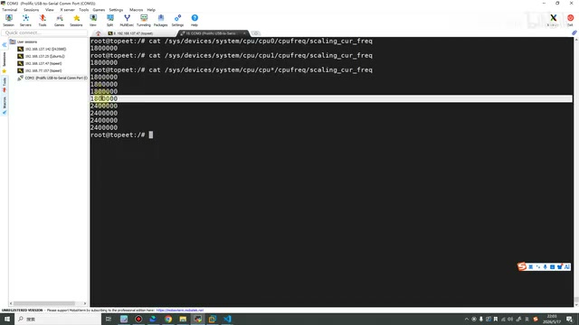
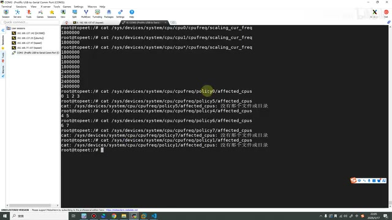
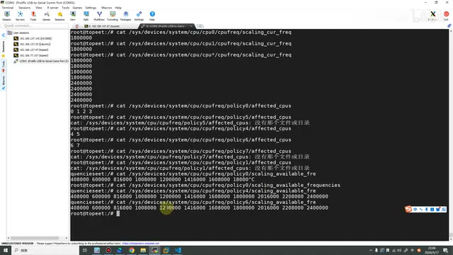
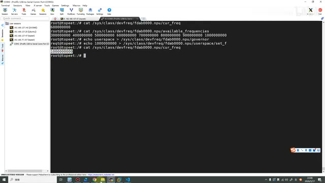
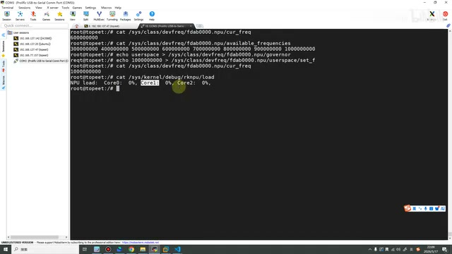
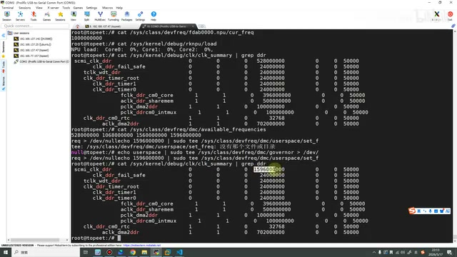
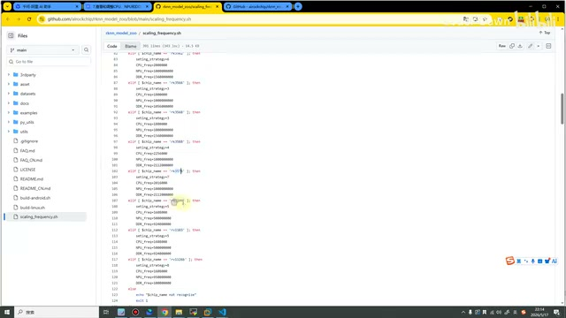

# P08｜07_查看和调整 CPU、NPU 和 DDR 频率

> 来源：[B 站课程第八集](https://www.bilibili.com/video/BV11DjT6uEhc/?p=8) · 全片 11 分 25 秒
>
> 整理方式：忠实讲稿，不做摘要压缩。保留原讲述顺序、解释、例子和操作过程，清理停顿、结巴，补充标点与小标题。命令依原片终端和课件核对，未在本机执行。
>
> 文字来源：本地 Whisper 转写，保留任务指定输入及规范化审计；明确识别错误依画面校正。少量无法可靠辨认的词语在相应位置标注。末尾孤立的“没有”保留为不确定识别说明。
>
> 图片说明：7 张原视频截图，源画面 640×360，小字受原始画质限制。图注为编辑说明。浏览器 file 协议预览受限，未绕过；已做静态结构、全文及实际图片检查，桌面与窄屏交互未实测。

## 为什么要调整频率 · 00:00

这节课我们来看怎么样查看和调整 CPU、NPU 和 DDR 的频率。在正式讲之前，我们先来讲一下，为什么需要去查看和调整它们的频率呢？

理论上，当我们把 CPU、NPU，还有 DDR 的频率调到最高的时候，也就是我们开发板性能最好的时候。我们为了部署模型的时候，让推理的速度更快，让推理的视频更加流畅，就可以去进行这样的操作。

这节课主要也是分为五个部分的内容，接下来我们就一个一个看。

## 查看 CPU 当前频率 · 00:42

第一个是查看和固定 CPU 的频率。我们先来看一下，当前 CPU 运行的频率到底是什么。我们输入这条命令：

```sh
cat /sys/devices/system/cpu/cpu0/cpufreq/scaling_cur_freq
```

这条命令可以看到，是系统下的设备，然后是 CPU 设备，然后是 CPU0 的频率。可以看到是 1800000，就是这么多。〔原话口头读作“1800K”，这里依终端保留完整数值。〕

当然，如果说我们查看 CPU1，就把这里改成 CPU1。一共就是从 CPU0 到 CPU7。这个也是前面都讲过的，我们的 RK3588 是大小核的架构，一共有八个核，四个大核、四个小核。这里就是它的 CPU 编号，0 到 7。

```sh
cat /sys/devices/system/cpu/cpu1/cpufreq/scaling_cur_freq
```

为了查起来方便一点，也可以将这个 `1` 改成一个星号：

```sh
cat /sys/devices/system/cpu/cpu*/cpufreq/scaling_cur_freq
```

我们就可以看到，前面一、二、三、四这四项，是 180 开头的，后面是 240 开头的。这个就是我这台设备上面 CPU 的频率。



*终端一次列出八个 CPU 的当前频率，前四项为 1800000，后四项为 2400000。 · [原片 01:50](https://www.bilibili.com/video/BV11DjT6uEhc/?p=8&t=110)*

这个是查看我们当前的运行频率。

## 按 policy 管理和修改 CPU · 02:00

如果说我们想要去修改它呢？我们就可以使用下面的这些命令来进行修改。在修改之前，我们先讲一下：虽然说有八个 CPU，但它是通过三个组来进行管理的。这三个组分别就是 policy0、policy4 和 policy6。

我们也可以查看一下，每个 policy 管理哪些 CPU：

```sh
cat /sys/devices/system/cpu/cpufreq/policy0/affected_cpus
```

这个 policy0 管理的是四个 CPU：CPU0、CPU1、CPU2、CPU3。下面我们也来输入一下 policy4。出错了，刚才输入的是 policy5，改成 4。

```sh
cat /sys/devices/system/cpu/cpufreq/policy5/affected_cpus
cat /sys/devices/system/cpu/cpufreq/policy4/affected_cpus
```

它管理的是 CPU4 和 CPU5。最后还有一个 policy6，它管理的就是 6 和 7，一共管理我们的八个 CPU。

```sh
cat /sys/devices/system/cpu/cpufreq/policy6/affected_cpus
```

刚才在这里我不小心输错了，输错之后大家也可以看到，它直接就提示我们没有这个文件夹。如果我们想看看还有没有别的，也是没有的；比如小一点，我们想要看 1，它也是没有的。

```sh
cat /sys/devices/system/cpu/cpufreq/policy7/affected_cpus
cat /sys/devices/system/cpu/cpufreq/policy1/affected_cpus
```

在我们去修改频率的时候，也是按组来进行修改。如果我们修改 policy0，就把 0、1、2、3 修改了；如果修改 policy4，就把 4 和 5 这两个 CPU 修改了。同理，policy6 也就是修改 CPU6 和 CPU7。



*终端显示 policy0、policy4、policy6 对应的 CPU，以及尝试不存在的 policy 时的报错。 · [原片 03:20](https://www.bilibili.com/video/BV11DjT6uEhc/?p=8&t=200)*

知道这些之后，我们来看一下，它到底支持哪些频率。我们的频率是它支持什么频率，我们才能修改什么频率，我们也不能乱修改嘛。比如我修改成一个亿，那这样我的板子效能就最好了，但实际上是不可以的，因为它根本就不支持这个频率嘛。

## 可用频率与 CPU 性能模式 · 04:01

```sh
cat /sys/devices/system/cpu/cpufreq/policy0/scaling_available_frequencies
```

可以看到，我们的 policy0 支持的是这么多频率，其中最大的就是这个 1800000。在这里我其实也已经设置过了，就是最大的频率。同样，我们其他两个，也还是复制一下吧。

```sh
cat /sys/devices/system/cpu/cpufreq/policy4/scaling_available_frequencies
cat /sys/devices/system/cpu/cpufreq/policy6/scaling_available_frequencies
```

可以先看一下，它最大支持的就是 2400000。然后最后一个，它支持的最大的也是 2400000。



*终端显示三个 policy 的可用频率，policy0 最高为 1800000，另外两组最高为 2400000。 · [原片 04:40](https://www.bilibili.com/video/BV11DjT6uEhc/?p=8&t=280)*

如果大家想要把它修改成比较低的，比如说 1200 的，然后 408000 的，这些也都是可以的。〔这里保留讲师口头的“1200”；画面对应的可选项为 1200000。〕在这里，我还是建议大家直接跟我一样，把它性能拉满。

去修改它性能的时候，有一个比较方便的方式，就是直接把它调为性能模式。官方是这么叫名字的，或者说，我觉得更准确的应该叫它“最高性能模式”。其实就是输入这个：

```sh
echo performance > /sys/devices/system/cpu/cpufreq/policy0/scaling_governor
echo performance > /sys/devices/system/cpu/cpufreq/policy4/scaling_governor
echo performance > /sys/devices/system/cpu/cpufreq/policy6/scaling_governor
```

输入了它之后就可以去调整它了，它调整到最高的频率。这里我就不再演示了，大家就这样输一下，调成最高的就可以了。这个就是我们 CPU 相关的。

## 查看 NPU 频率与可用值 · 05:24

第二个部分，我们来看 NPU 的频率。第一步，我们先来看一下当前 NPU 的频率。先将这一屏清空一下。

```sh
cat /sys/class/devfreq/fdab0000.npu/cur_freq
```

当前我的 NPU 的频率是……一、二、三、四，一、二、三、四，就是 6 亿，是这么高。这个是我当前的 NPU 频率，终端显示的是 `600000000`。

第二步，我们查看一下 NPU 到底都有哪些可用的频率：

```sh
cat /sys/class/devfreq/fdab0000.npu/available_frequencies
```

可以看到，它有这个 3 开头的，

3、4、5、6、7、8、9，最大的就是这个。〔终端依次显示 300000000、400000000、500000000、600000000、700000000、800000000、900000000、1000000000。〕

## 固定 NPU 频率 · 06:05

我们也把它调成这个最大的频率。这个是我之前不小心修改了，修改得比较小。

第一步，我们先输入它，转换成用户的空间；然后第二步，我们输入它，就是最高的这个频率：

```sh
echo userspace > /sys/class/devfreq/fdab0000.npu/governor
echo 1000000000 > /sys/class/devfreq/fdab0000.npu/userspace/set_freq
```

输入完之后，我们再来查看一下：

```sh
cat /sys/class/devfreq/fdab0000.npu/cur_freq
```

再查看，我们可以看到，现在的频率已经改成了最高的这个频率了，是 `1000000000`。大家也跟我一样，去修改一下 NPU 的。



*NPU 从 600000000 调整后，再次查询返回 1000000000。 · [原片 06:40](https://www.bilibili.com/video/BV11DjT6uEhc/?p=8&t=400)*

## 查看 NPU 占用率 · 06:45

看完这个之后，我们再来看第三部分。第三部分就是查看 NPU 的占用率，是通过这条命令去查询的：

```sh
cat /sys/kernel/debug/rknpu/load
```

可以看到，我们查完之后，有一个 Core0、Core1，还有 Core2。这是为什么呢？这个也是在前面已经讲过了，我们的 RK3588 是三核架构，它一共会有三个 NPU 的核心。

这也是我们在后面做性能优化的时候，非常重要的一个基石吧。就是因为它有三个 NPU 内核，我们才能使用〔这里的方法名称转写为“变成值了”，无法可靠确认〕这些方法来进行优化。



*NPU load 返回 Core0、Core1、Core2，此时占用率均为 0%。 · [原片 07:20](https://www.bilibili.com/video/BV11DjT6uEhc/?p=8&t=440)*

当然，现在因为我们什么也没干，它的占用率就是 0%。后面我们也会去跑一个模型，跑起来之后，我们再看看它到底占了多少。这个我们就讲到这里。

## 查看 DDR 当前频率 · 07:44

接下来我们看第四步，就是 DDR 的频率。同样，我们先来查看一下当前运行的频率：

```sh
cat /sys/kernel/debug/clk/clk_summary | grep ddr
```

这个就是查出来我们当前运行的频率了。查完之后，我们

和刚才这些步骤其实都是一样的。我们看一下，它可以设置哪些频率：

```sh
cat /sys/class/devfreq/dmc/available_frequencies
```

可以设置到最高的就是……这里好像，我看一下，一、二、三、四、五、六，这个是 528；然后这个也是，一、二、三、四、五、六，1068。这个就更大，这里最高的频率就是 1596 的这个。〔画面完整数值依次为 528000000、1068000000、1560000000、1596000000。〕

我们当前这里其实并不是 1596。大家可以把它也设置一下，设置成最高的频率。

## 设置 DDR 与现场纠错 · 08:47

设置频率也和上面 NPU、CPU 都是类似的，我们直接输入这条命令就行。输入一下：

```sh
echo 1596000000 | sudo tee /sys/class/devfreq/dmc/userspace/set_freq > /dev/null
```

它提示我们没有这个文件。这样应该是，我们需要先进入它。哦，就是这样。

它直接设置的时候总是……〔此处语句识别不完整；从下方终端可见第一次写入失败〕。说我们没有权限，就先执行一下它，然后再来。

〔编辑核对：这里保留讲师现场解释；终端实际提示是“没有那个文件或目录”。后面先向 governor 写入 userspace，再次写入 set_freq。原片画面中的两条命令为：〕

```sh
echo userspace | sudo tee /sys/class/devfreq/dmc/governor > /dev/null
echo 1596000000 | sudo tee /sys/class/devfreq/dmc/userspace/set_freq > /dev/null
```

可以看到，现在就没有提示这个问题了。没有提示之后，我们再来查看一下，看看有没有修改成功。

```sh
cat /sys/kernel/debug/clk/clk_summary | grep ddr
```

可以看到，我们的 DDR 频率就已经修改成功了，已经修改为 1596 这个开头的。这个就是我们修改 DDR 频率的方式了。



*DDR 重查结果中 scmi\_clk\_ddr 已显示 1596000000，终端也保留先前写入失败的信息。 · [原片 10:10](https://www.bilibili.com/video/BV11DjT6uEhc/?p=8&t=610)*

## 用 Model Zoo 脚本快速定频 · 10:18

最后一个就是快速定频。这个脚本来自于 Model Zoo，在它里面是有这么一个文件的。

〔画面中的文件是 `rknn_model_zoo/scaling_frequency.sh`，讲师从课件中的链接打开 GitHub 文件页面。〕

这个文件的功能就是，可以看，如果你是 3588，或者你是 3576，或者你是 1106 等等……可以看到，其实它这里的命令和我们说的也差不多，需要进入这个空间，然后再去进行一些设置。



*GitHub 中打开 rknn\_model\_zoo 的 scaling\_frequency.sh，画面显示芯片分支和频率配置。 · [原片 10:40](https://www.bilibili.com/video/BV11DjT6uEhc/?p=8&t=640)*

这个脚本我们就不再详细看了。大家可以直接从这里下载，或者从这里复制。我也把刚才这里的内容都复制过来了，然后直接去执行这个脚本，就可以快速定频。

因为我这里都已经设置过了，我设置好了，我就不再去执行这个脚本了。

以上就是本节课的全部内容了，最后也是感谢大家的观看。

〔末尾 11:22 后转写有孤立的“没有”，没有可可靠衔接的课程内容，作为不确定识别项保留在原始转写中。〕
