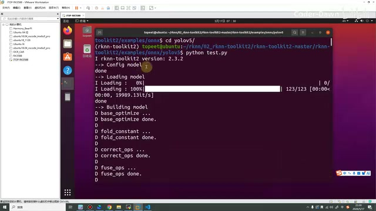
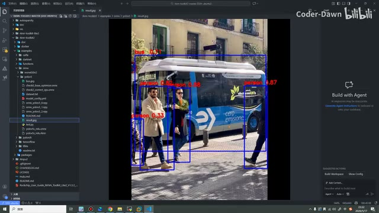
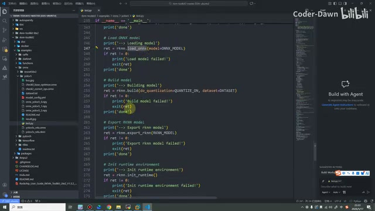
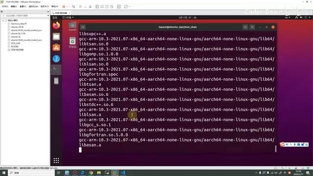
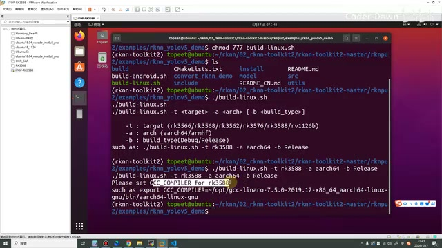
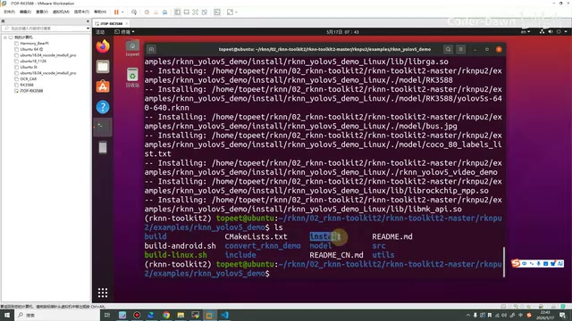
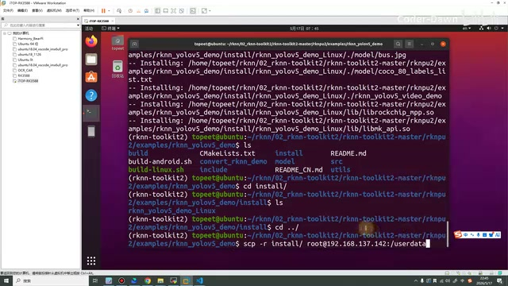
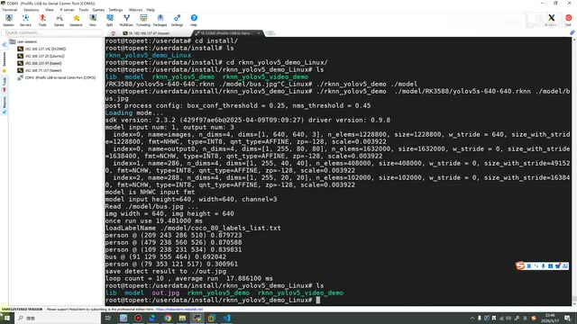
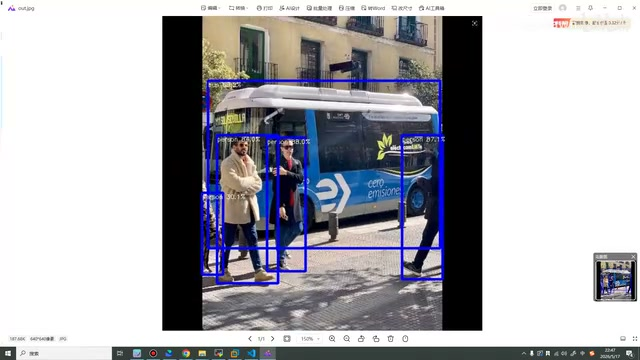

# P09｜08_快速体验 rknn_demo

> 来源：[B 站课程第九集](https://www.bilibili.com/video/BV11DjT6uEhc/?p=9) · 全片 19 分 54 秒。
>
> 整理方式：忠实讲稿，保留原讲述顺序、第一人称、解释、操作、报错与纠正，仅清理无意义停顿、结巴和无新增含义的即时重复。原始转写保存在 sources；术语依据原视频画面核对。
>
> 图片为原片截图，源分辨率 640×360，小字受原始画质限制；图注是编辑说明。完整命令能从画面确认的已写入正文，仍不能确认的字串在对应处注明。

## 先把 demo 跑起来 · 00:00

这节课我们来看一下，怎么样快速把这个 RKNN 的模型跑起来。前面我们已经花了七节课的时间，讲的都是一些理论和环境方面的内容。按道理来说，这节课开始我们就应该正式进入写代码的环节了。但是在写代码之前，也是为了让大家有一个更清晰的了解，我们先来把 demo 跑起来。跑起来之后让大家看一看效果，知道这个效果之后，从下节课开始，我们再逐步实现这些代码，所以也就有了这节课。

这节课主要分为两个部分。第一个部分，将模型跑在虚拟机上面，就是跑在我们的 Ubuntu 里面；第二个，将模型运行在我们的 RK3588 开发板上面。我们先进行上面的演示。

首先来看流程，流程其实非常简单。我们进入之前创建的 `02_rknn-toolkit2` 目录，然后在里面一直进入到 `examples`。这也是官方自带的，下面会有很多 demo，我们选择一个。在这里我选择进入 `onnx`，然后在里面直接执行 `test.py` 就行。执行完成之后，它会提示结果保存在这里，我们就可以查看结果。这个流程其实特别简单，我们来演示一下。

首先也进入 `02_rknn-toolkit2`，进入 `rknn-toolkit2-master`，再进入 `rknn-toolkit2`。这个之前也介绍过，是我们进行模型转换、〔此处转写“凝固”，具体术语未能确认〕等这些操作的重要套件。它里面有非常多例子，可以看到有很多。我们进入 `examples/onnx`，进入之后里面还有两个，我们就跑一下 YOLOv5 吧，也就是进入 `yolov5`。

这里大家需要注意，最好将虚拟环境切换到我们之前创建的这个环境。画面终端前缀显示的是 `(rknn-toolkit2)`。然后直接执行：

```bash
python test.py
```

稍等一下，可以看到现在已经跑起来了。在这里我们可以简单看一眼日志：我们的版本是 `2.3.2`。第一步是配置模型，然后加载模型，这里都提示了 `done`，然后进行模型构建。滑一滑，这个滚轮好像有点不好用，那我点它吧。



*虚拟机中运行 test.py，日志显示 RKNN Toolkit2 版本 2.3.2，并开始配置、加载和构建模型。 · [原片 02:50](https://www.bilibili.com/video/BV11DjT6uEhc/?p=9&t=170)*

一直到最后这里，它也导出了 RKNN 模型，然后去跑这个 RKNN 模型，最终将结果保存到 `result.jpg`，保存到了这里。我们来看一下，图片已经生成了，但是在 Ubuntu 上面有点不方便看，我们就打开 VS Code，打开这个目录。在这里我已经通过 SSH 连接好了。同样进入刚才这个目录，进入 `examples/onnx`，这是生成的图片，我将它放大，可以看到这是我们非常经典的一张图片。

里面有一个公交车，有两个比较完整的人，还有两个不太完整的人。大家可以看到，它已经将它识别出来了，而且识别率总体也还行，这个框画得也比较 OK。到这里，我们就快速体验了一下在虚拟机上面跑这个模型。



*VS Code 打开的 result.jpg：公交车和行人已经绘制检测框。 · [原片 04:20](https://www.bilibili.com/video/BV11DjT6uEhc/?p=9&t=260)*

## 大概看一眼代码 · 04:41

至于代码，也很简单，我们也可以大概看一眼。上面是导入一些包，这里是这些模型的名称，像 ONNX 模型、RKNN 模型，然后是图片的路径。这个是数据集，接下来是是否进行量化、它的一些阈值、图片尺寸大小，这是 YOLO 系列的 80 个分类。

这里是一些处理代码，我们先不看，直接去看主函数就行。主函数里面，第一步创建一个 RKNN 实例，然后对它进行一些配置。配置完之后，去加载 ONNX 模型，然后对模型进行构建，将模型导出，然后进行运行库的初始化。这里也是一些预处理和后处理代码。最后将它跑起来，运行 RKNN。



*test.py 主函数中的模型加载、构建、导出与运行环境初始化代码。 · [原片 05:40](https://www.bilibili.com/video/BV11DjT6uEhc/?p=9&t=340)*

这些代码在这里我们就大概看一眼，然后到后面，这些代码也都会带着大家去讲，大家也不要担心。这个就是第一部分。接下来我们看第二步，第二步就是将模型运行在 RK3588 开发板上面。

## 开发板运行的三步和交叉工具链 · 06:12

它跑在 3588 开发板上面，整体思路有三步。第一步，在虚拟机上面进行交叉编译；第二步，把这个东西移到开发板上面；第三步，运行 demo。

其实第一步，我们也可以直接在开发板上面编译，这个比较灵活；也可以在虚拟机上面交叉编译。在前面的课程里面，我都会使用交叉编译的方法；到后面，也会带着大家直接在开发板上面进行编译，这个大家也不要担心。接下来我们继续向下看。

想要在虚拟机里面进行交叉编译，我们就必须有交叉编译工具链。我们迅为提供的 Ubuntu 系统里面默认没有这个东西，所以需要自己进行一下操作。第一步，先把这个东西下载了，下载之后挪到虚拟机上面。我们也跟文档里面的步骤一致，先创建一个 `03_gcc` 目录，然后把它挪上去，复制到这个路径下，再进行操作。

我们来直接演示吧。到 `rknn` 这个目录下，现在有两个目录，我们创建一下，现在就有了。接下来需要把这个工具链挪到我们的 Ubuntu 系统上。之前也讲过有两种方式，在这里我就直接使用拖拽的方法，拖拽进来就可以。下面在走进度条，等它到百分之百就上传完毕了。

上传完毕之后，这里其实只是我的个人习惯，我习惯每个东西就创建一个目录放进来，也比较好管理。其实在这个目录下好像也并没有用到，还是会去后面这个目录下用。在这里也建议大家跟我路径保持一致，因为后面如果不修改代码，直接跑我的代码，这些路径也都是比较有用的。我个人习惯每个东西就创建一个目录放进来，也比较好管理。

这里是说复制一份到 `/opt/tool_chain` 目录下。我们也看一下，执行 `ls /opt/`，其实这下面什么都没有，所以还需要创建一下。先创建，提示权限不够，然后我们给它加一个 `sudo`：

```bash
sudo mkdir /opt/tool_chain
```

这样我们再看一看，就有这个目录了。然后将它复制过去。这个步骤好像有那么一点多此一举，可以挪到这个目录下面。大家其实也可以直接放进这个目录，直接放到这个目录里面。

同样还是提示没有权限，再 `sudo` 一下。然后进入这个目录，将它进行解压。因为它其实一直在报错，权限不够。这样我们就给它进行一个解压，等它完成之后，就会得到这么一个目录。

画面中的操作依次为：

```bash
sudo cp /home/topeet/rknn/03_gcc/gcc-arm-10.3-2021.07-x86_64-aarch64-none-linux-gnu.tar.gz /opt/tool_chain/
cd /opt/tool_chain
sudo tar -xvf gcc-arm-10.3-2021.07-x86_64-aarch64-none-linux-gnu.tar.gz
```



*使用 sudo 解压工具链，终端输出解压的文件路径。 · [原片 10:43](https://www.bilibili.com/video/BV11DjT6uEhc/?p=9&t=643)*

现在已经走完了，我们来看一眼。这里有一个目录，里面就会有我们需要用到的工具了。我们跟文档一样，直接开始进入这里。可以注意一下，这次进入的就不再是 `rknn-toolkit2`，而是 `rknpu2` 目录，因为这个目录下存放的是我们用 C 写的程序，是可以在开发板上部署的。

我们也在这里看一眼里面的程序，同样也是跑 YOLOv5。它里面这些程序使用 C 写的，适合跑在开发板上面。

## 编译脚本、漏掉的环境设置和报错 · 12:08

所以在这里就直接到这里，也就是 `rknpu2/examples/rknn_yolov5_demo`。到这里之后，第一步，我们需要先给它执行权限。这个 `build-linux.sh` 现在是白色的，也是不能执行的。我们先给它权限，完成之后就可以执行了：

```bash
chmod 777 build-linux.sh
./build-linux.sh
```

然后它提示需要输入 `-t`，后面是平台；`-a` 是〔讲述停在“这个”，画面 usage 显示 arch，支持 aarch64/armhf〕；`-b` 参数是可选的，画面中是 `build_type(Debug/Release)`。

我们在这里就可以直接复制它。但是在复制之前，有一个步骤差点漏掉了：刚才前面是在解压交叉编译工具。如果我们不进行这个设置，它就会默认采用官方自带这里面的路径、这些方法去做。我们下面可能根本没有这些东西，没有这些东西就会报错。所以在进行它之前，还是需要先设置一下环境。

或者我们先不设置，我直接演示一下：

```bash
./build-linux.sh -t rk3588 -a aarch64 -b Release
```

可以看到直接就报错了。它说 `Please set GCC_COMPILER for rk3588`，去设置一下，比如 `export GCC_COMPILER=...` 这个编译器，它也这样提示了我们。所以官方的这个程序还是比较友好的。



*未设置 GCC\_COMPILER 时，编译脚本提示为 rk3588 设置交叉编译器。 · [原片 13:56](https://www.bilibili.com/video/BV11DjT6uEhc/?p=9&t=836)*

## 设置工具链并重新编译 · 14:08

所以我们先来设置一下。这个路径就是刚才那里的路径，所以也是让大家跟我保持一致，就是 `/opt/tool_chain` 目录下的。如果大家采用的是别的目录，在这里需要注意，要改一下。画面设置的是：

```bash
export GCC_COMPILER=/opt/tool_chain/gcc-arm-10.3-2021.07-x86_64-aarch64-none-linux-gnu/bin/aarch64-none-linux-gnu
```

设置完之后，我们再执行这条命令：

```bash
./build-linux.sh -t rk3588 -a aarch64 -b Release
```

可以看到，现在就在编译了，编译到了百分之百。百分之百就是编译成功了。编译成功之后，再看文档，它会生成一个 `install` 这样的目录。

这个目录好像我之前传的这份课件原本就有，我们把它删除。看到现在没有了，没有之后再重新编译一下。编译完之后，可以看到有 `install` 目录了。然后我们将这个目录直接传到开发板上面。



*删除旧 install 后重新编译，终端再次输出安装到 install 的文件列表。 · [原片 15:16](https://www.bilibili.com/video/BV11DjT6uEhc/?p=9&t=916)*

我们也可以先进去看一眼，下面有一个 `rknn_yolov5_demo_Linux`，这么一个编译出来的东西。我们在 VS Code 里面看吧：可以看到，在 `install` 目录下有 `rknn_yolov5_demo_Linux`，还有 `lib`，这里面是它需要的库；这里是模型，还有图片；这里是可执行脚本，有一个带 `video` 的，还有一个不带 `video` 的。接下来我们就是把 `install` 这个目录传到开发板上面就可以了。在这里我就采用 `scp` 来传，`scp -r`，然后是 `install` 目录，到开发板 `root@192.168.137.142`。传到开发板哪个目录呢？看一下，有一个 `userdata`。先进入 `userdata`，这里面现在也有很多东西，直接把里面的全部删除掉吧。现在里面是干净的了，我们测试一下路径，画面中用 `pwd` 看到了 `/userdata`。

这个命令在前面的课程中也已经和大家讲过，在这里我就不再说了。传输命令是：

```bash
scp -r install/ root@192.168.137.142:/userdata
```



*scp -r 将 install 目录传到 192.168.137.142 的 /userdata 路径。 · [原片 17:10](https://www.bilibili.com/video/BV11DjT6uEhc/?p=9&t=1030)*

然后我们输入 `yes`，输入密码，等待一下，现在就完成了。进入 `userdata`，然后进入 `install`，下面还有一个 `rknn_yolov5_demo_Linux`，再进入它。进入之后就可以执行了。

我也是直接把命令复制过来了。有点混乱，算了，我在这里还是输入一下吧。`model` 下面有一个 `RK3588`，它里面有我们的一个 RKNN 模型，然后再来识别一下这张照片。

可以看到，输入这条命令之后，这个是我们的可执行程序，这个是调用的模型，这个是检测这张图片：

```bash
./rknn_yolov5_demo ./model/RK3588/yolov5s-640-640.rknn ./model/bus.jpg
```

执行之后下面就开始执行了。我们可以看一下，它会生成一张 `out.jpg`，然后预览这张照片就可以。



*板端执行 YOLOv5 demo 后打印检测结果，并保存 out.jpg。 · [原片 18:38](https://www.bilibili.com/video/BV11DjT6uEhc/?p=9&t=1118)*

我们这样预览：`137.142`，这是它的 IP〔画面完整地址为 `192.168.137.142`〕。我们使用这个窗口打开〔转写为“串口”，画面此处新开的是 MobaXterm 的 SSH 会话及文件栏〕。进入刚才的目录，`userdata`、`install`，然后这是刚才的图片。

好，在这里已经打开了，我们就可以预览。可以看到这个，84、88、87，然后是 69。这个就是在 RK3588 开发板上面进行了演示。把它删除掉。



*开发板生成的 out.jpg 已打开，画面显示公交车与行人检测框。 · [原片 19:24](https://www.bilibili.com/video/BV11DjT6uEhc/?p=9&t=1164)*

如果大家到这里和我跑的结果一样，也就证明大家在这个开发板上面把它跑成功了。跑成功之后，我们这节课的内容就全部讲完了。最后也感谢大家的观看，谢谢大家。
