# P10｜09_rknn模型转换

> 来源：[B 站课程第十集](https://www.bilibili.com/video/BV11DjT6uEhc/?p=10) · 全片 26 分 52 秒
>
> 整理方式：忠实讲稿，不做摘要压缩。保留原讲述顺序、解释、例子、操作、纠正及范围说明，仅清理无意义停顿、偶发结巴并补充标点与小标题。
>
> 文字来源：本地 Whisper 转写，经对应画面术语核对；原始与规范化转写保存在 sources。08:41 的同起点重叠字幕已串接全部内容，疑点在相邻正文注明。片尾不可辨识的短促识别项未编造成正文。
>
> 图片说明：12 张原视频截图，源画面 640×360；小字受源画质限制，点击可查看原图。图注为编辑说明。无法逐字符可靠确认的命令字符串在相邻操作处标明。

## 模型转换的流程 · 00:00

这节课我们来讲如何进行 RKNN 模型转换。在前面的课程中我们也已经提过了，我们如果想要将我们的模型部署到开发板上面，那我们就需要一个 RKNN 格式的模型。我们默认进行深度学习模型训练的时候，比如说使用的是 PyTorch 框架，它训练出来的模型是 `.pt` 格式的，并不是我们 RKNN 的这个格式，所以我们就必须要对它进行模型格式的转换。这节课，我们就来看一下怎么样进行这个模型转换。

这节课一共分为三个部分：第一个部分是模型转换的流程，第二个部分是模型转换过程中我们需要使用的一些 API，第三个部分就是代码测试。

接下来，我们先来看第一个部分，模型转换的流程。在这里我也画了一个图，我打开，我们一起来看一下。

第一步，我们需要创建一个 RKNN 对象。有了这个对象之后，先看一下我右边的这个提示，就是我们导入这个包，然后创建这样的一个 RKNN 对象。

有了这个对象之后，接下来我们就可以对它进行配置。在配置的过程中，我们主要会进行输入的预处理、量化类型、量化参数、优化算法等等，进行一系列配置。

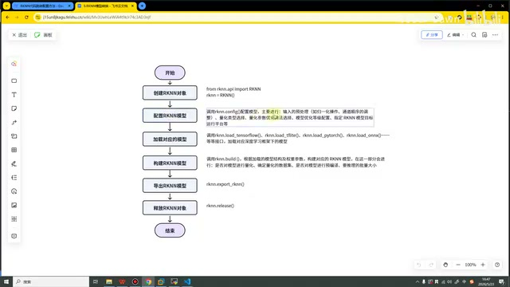

*模型转换的完整流程。 · [原片 01:35](https://www.bilibili.com/video/BV11DjT6uEhc/?p=10&t=95)*

接下来，我们会加载对应的模型。为什么有这一步呢？比如说，我们原本的模型是 TensorFlow 的，还是 PyTorch 的，还是 ONNX 的，或者是其他类型的模型，那我们就要调用对应的接口，来加载对应的模型。

接下来，我们就可以开始构建我们的 RKNN 模型了。也就是说，我们准备好了 RKNN 对象，也对它配置好了，也把我们想要转化的模型加载进来了，接下来就可以对它进行构建了，也就是去创造这个 RKNN 模型。

这个模型构建完了之后，后面为了在开发板上面部署这个模型，我们就需要将这个模型导出出来。有了这个模型之后，我们后面才可以拿着它去进行部署，所以就有了导出 RKNN 模型的这个步骤。

进行完这个步骤之后，最后我们也需要释放一下 RKNN 的这样一个对象。这个就是我们进行模型转换的流程。

在下面这里，我也进行了一些补充，就是说，我们这个 RKNN-Toolkit2 支持多个主流深度学习框架的模型转换，包括像 Caffe、TensorFlow、TensorFlow Lite、ONNX、PyTorch 这些。后面也列举了它推荐的版本，这个版本我就不再给大家照着去读了，大家看一下就可以了。

## RKNN-Toolkit2 API 介绍 · 03:33

前面介绍完第一部分，接下来我们就来看第二部分。第二部分主要就是来介绍 RKNN-Toolkit2 里面，我们在进行模型转换的时候会使用到哪些 API。其实我们使用的 API 也比较少，一共就是有五类，2.3 这里面可能有好几个，但本质上都很简单。接下来，我们就一个一个看一下。

刚才流程中我们也提到了，第一步就需要进行一个——这个我把它写下来，这样我们对照着看。第一步，我们就需要去创建这样一个对象。创建这个对象，其实我们也叫做它的初始化。最后一步，我们需要对它进行释放，也就是 RKNN 对象释放。

在这里，我们来看一下它的 API。我把它放到右边一点。我们在进行初始化的时候，就是 `rknn = RKNN(...)` 这样的一个 API。里面可以看到有好几个参数。`verbose=True` 就是将我们的日志信息输出到终端；这个 `verbose_file` 文件参数，就是我们也可以将日志保存到指定的目录里面。

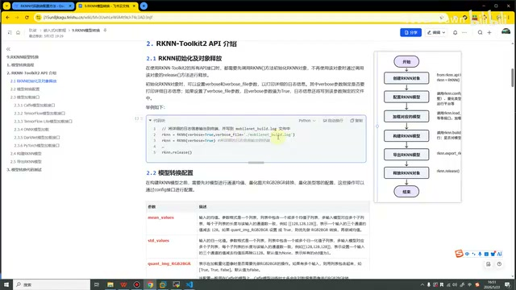

*初始化示例中的日志参数。 · [原片 05:15](https://www.bilibili.com/video/BV11DjT6uEhc/?p=10&t=315)*

同样，我们还可以一个参数都不传，这样也是可以的。如果说我们需要释放，我们就直接调用这个 `release`，对它进行释放了。

在这里，我是把这个 API 进行了简单的讲解。其实在我们瑞芯微官方的 API 里面，也都是有这些内容的。我写的也和官方的基本都差不多，大家看哪个都行。

接下来，我们来看第二个 API。这个 API 也是最复杂的一个 API，包括在后面的课程中，包括一些比较复杂的功能，都会用到这个 API。

### 模型转换配置与模型加载 · 06:04

这个 API 叫做模型转换配置。我们也看一下它，这里也没什么特别的，就是我们会调用 `rknn.config` 这个接口。这个接口里面有非常多的参数，我们可以先看一下，有这么多参数。

我们大概看一下，比如说有这个 `mean_values`，我们的均值，还有归一化，还有是否需要进行格式的转换；然后量化的类型，包括量化的算法，还有量化的方式、类型等等，特别特别多。在这里，我把比较重要的用红色给标记出来了；不那么重要的，可能是黑色，就是没有对它进行红色标记。

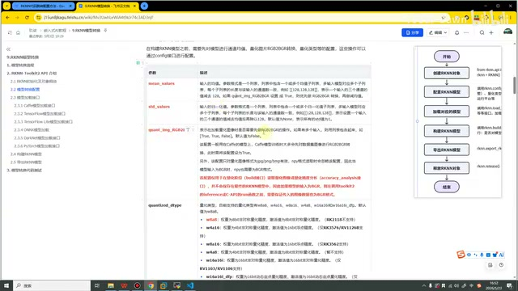

*模型配置参数表及红色标注。 · [原片 06:45](https://www.bilibili.com/video/BV11DjT6uEhc/?p=10&t=405)*

这会儿我们就大概看一下，一会儿到代码的部分，我们还会具体讲解。这个也对应我们流程中的第二步，就是配置模型这一步。

到第三步，就是模型加载接口，我们就要将模型给加载进来。加载的时候，因为我们原本的框架、原本的模型可能会有这么多种不同的，所以对应地，我们在进行加载的时候，也会有这样的区分。

如果说这个接口想要做得更加简单、更加方便，那它可能可以做成这样的，比如说 `.load`，然后在里面我们写一个模型，第二个参数，我们可能比如说可以传一个它是什么类型的，比如说传一个 Caffe、传一个 PyTorch 等等。这样可能会更简单，接口也会更少。但是瑞芯微官方在做的时候，可能也是为了方便理解，它把这些接口都分开做了。

我们也简单看一下，比如说加载这个 Caffe，这是它的 API。里面第一个就是传入模型的路径，第二个就是需要它的二进制数据文件。`input1`、`input3`，这个就是 Caffe。接下来，这个就是 Caffe。通过这个输入名称参数，如果存在多输入，可以指定输入层名称的顺序，比如说 `input1`、`input2`、`input3`。这个就是 Caffe。

> 此处保留规范化转写中 08:41 同起点重叠字幕合并后的全部内容；其中 `input1`、`input3` 的先后关系识别不够稳定，后续讲述明确补全为三个输入层名称的例子。

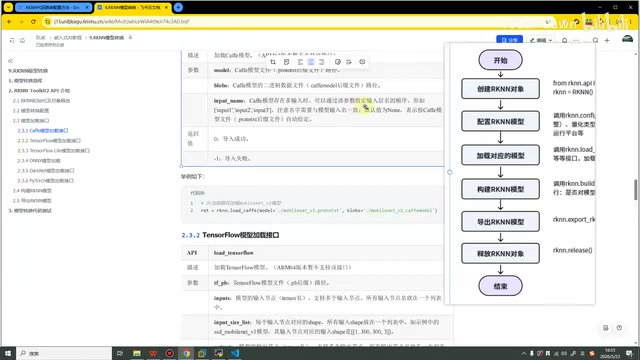

*Caffe 加载接口和输入层名称。 · [原片 09:00](https://www.bilibili.com/video/BV11DjT6uEhc/?p=10&t=540)*

接下来，我们再看一下 TensorFlow。TensorFlow 的参数也会更多一点。它的这个名称，大家都这样，就都很简单。它的参数会更多，像模型文件的路径、模型输入的节点、对应输入节点的 shape，包括输出节点，包括它是否已经是 NCHW 这个类型了。

接下来，我们再看一下 ONNX。ONNX 也会传入一、二、三、四、五，五个参数。其实这些参数，每一个都和前面的类似，就是传路径，然后传输入节点名称、形状、输出，基本上都大差不差。我们最后再来看一下这个 PyTorch，因为这个也是后面我们用得最多的。PyTorch 主要传两个参数，第一个参数同样也是传一个路径，第二个参数是传输入节点的形状。下面也举了一个例子，比如说我们传了它，我们的形状是这样的一个形状。这个也就是我们的第三步，进行加载对应的模型。

### 构建和导出 RKNN 模型 · 10:39

第四步，也就是构建 RKNN 模型。构建我们使用的是 `build`，可以将它加粗一下，就使用 `build` 这样的一个接口。同样，它里面的参数也有好几个。第一个就是我们是否需要对它进行量化，默认是 `True`，就是需要量化。第二个是量化校正的数据集。

第三个是模型输入 batch 参数调整，默认值是 `None`，就表示不调整。这个参数是什么意思呢？就是说，我们可以给里面传一个值，如果这个值大于 1，就可以在一次推理中同时推理多帧输入图像，或者输入的数据。这个就是 batch，这个 batch size 参数。

最后一个就是是否开启自动混合量化，调整精度或溢出。这个参数我们后面也会用到；这个参数可能就暂时也用不到。同样，下面也举了一个例子，就是是否量化我们设为 `True`，然后传入这个数据、这个量化校正集的路径就可以了。

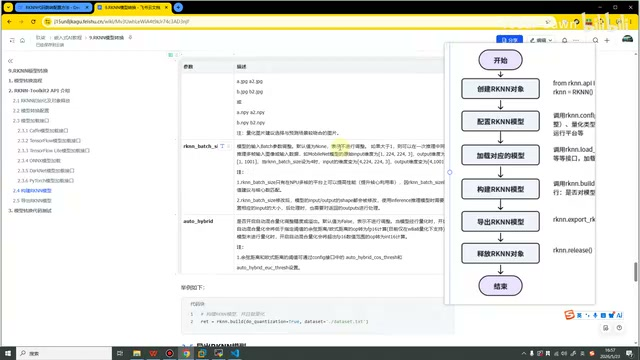

*build 接口的参数说明。 · [原片 11:15](https://www.bilibili.com/video/BV11DjT6uEhc/?p=10&t=675)*

接下来的一步，就是导出 RKNN 模型。导出也很简单，就是使用 `export_rknn`，使用这个接口就可以导出，然后我们直接传入一个路径就可以了。

这个就是我们对 API 进行的简单讲解。可能听到这里，大家还有点混乱，觉得这个东西讲得也不是很清楚，就是这样过了一下。接下来，我们就来看一下具体的代码。

## 对照流程分析代码 · 12:36

在这里，我就直接打开 VS Code，然后我们从代码中再来看。首先，我们第一步，这个步骤叫导包。在这里我没有一行一行地手写代码，主要原因是这个代码简直是太简单了，可能没有直接来手写它的意义吧。所以我就之前写好了，我带着大家来分析一下。

第一步，我们进行导包。还是一样，我还是将这个流程截下来，截下来之后，我们对应着看。我们的第一步，这个就叫创建 RKNN 模型——哦，创建 RKNN 对象。然后这个叫第二步，就用它的配置接口。第三步是加载模型，第四步是构建 RKNN，第五步是导出，这个是第六步，叫释放 RKNN 对象。和我们的流程图也是一一对应的。

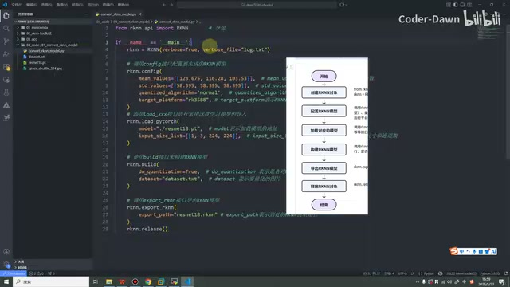

*对照流程图标注模型转换代码。 · [原片 13:30](https://www.bilibili.com/video/BV11DjT6uEhc/?p=10&t=810)*

然后我把它就关掉了。我们具体再来看，创建 RKNN 的时候，就将我们导出的这个 RKNN，直接这样 `rknn = RKNN(...)` 就可以了。

里面我们可以看一下，可以跳过来看。它有这样一个 RKNN 的类，这个类里面，其实——哦，在这里，叫 RKNN。然后它里面，我们来看一下它核心的地方吧。

我们这样看一下，首先来看，这个类里面有非常多的内容，可以折叠一下，从第 19 行到第 427 行都是这个类。一个是它进行了初始化，你可以看到，这里就有我们前面这么两个参数。这个就是我们是不是要在终端显示日志，这个就是我们要不要把日志保存到某个路径。它写在 `__init__` 这个方法里面。

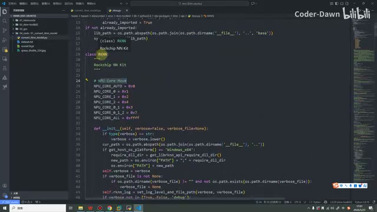

*RKNN 类与初始化方法源码。 · [原片 15:00](https://www.bilibili.com/video/BV11DjT6uEhc/?p=10&t=900)*

接下来，这个就是我们的 `config`；然后是加载，就是加载各种各样的模型；下面是进行构建。这里有一些其他的，我们后面讲到的时候再说。这里就是模型的导出，这里也是这节课暂时用不到的，那我们就先不看。我们大概注意，它里面可以看到有很多，所有的内容都是定义在这个 RKNN 类里面的。

### 初始化日志与配置参数 · 16:11

其中，我们初始化、进行传参的时候，有这么两个参数可以传递。这个参数默认也是一个 `False`，一个 `None`。在这里，我是将它进行了传递，就是在终端会进行输出，并且会把它保存在 `log.txt` 这样的路径。

第二个就是调用 `rknn.config` 接口，配置我们要生成的 RKNN 模型。在这里我主要就写了四个参数。第一个参数叫 `mean_values`，它表示的是预处理的时候要减去的均值化参数。第二个参数叫 `std_values`，它表示的是要除去、要进行除法的标准化参数。第三个是量化的算法，第四个是我们要运行的平台。平台是 3588，算法是 `normal`。

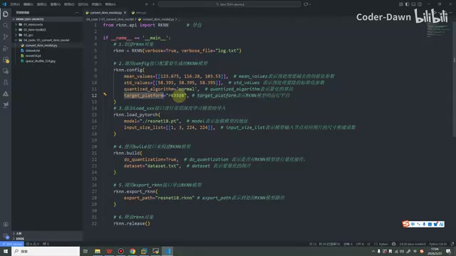

*均值、标准化值、算法和目标平台配置。 · [原片 17:15](https://www.bilibili.com/video/BV11DjT6uEhc/?p=10&t=1035)*

这个接口我们也可以点进来看一下，你可以看到它有非常非常多的参数。前面我们讲这个 API 的时候，大概也瞅了一眼，就是它有很多。我们必须要使用的——虽然它的参数有很多，但并不是说所有的参数都要用。相反，绝大部分参数我们都是不用的。我们必须要用的参数，就是这个均值，然后标准值，然后就是目标平台。这个推荐的算法也是建议去使用的。好，就是这么几个参数。

下一个就是加载我们的模型，在这里我加载的是一个 PyTorch 模型。

可以看到模型的路径就是在当前目录下，也就是说我们加载了它，就下载了这个模型。然后它输入的形状是这个，1、3、224、224，这个就是它的形状。

第四步，就是对这个 RKNN 模型进行构建。第一个就是我们是否要进行量化，我们通常都是需要进行量化。并且在官方的这个里面，它默认也是把它写了一个 `True`，就是默认也会对它进行量化。第二个是我们要量化校正的数据集。

第五步就是导出 RKNN 模型，我就把它导出在当前目录下，和它是同名的，`resnet18.rknn`。最后一步就是释放这个对象。

相信这些代码非常简单，大家应该也没有不太明白的地方。如果非要说，大家不太清楚的地方可能就是这两个参数，里面 123.675、116.28、103.53，然后 58.395，这些值到底是怎么来的？为什么要这样的值？这个大家不太清楚。

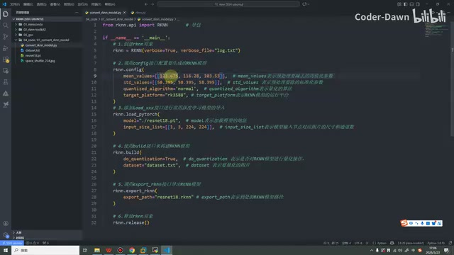

*示例中的预处理参数。 · [原片 19:30](https://www.bilibili.com/video/BV11DjT6uEhc/?p=10&t=1170)*

这个我在下一节课会专门把它挑出来，给大家进行详细讲解。这节课大家就知道，我们至少是要传递这四个参数的，或者说，我们至少应该传递——它也可以不传，因为它也有默认值——至少我们是要传递这三个参数的。如果像这个，我们也可以看一下这个 target。

### 目标平台与运行测试 · 20:16

这个参数默认是 `None`。`None` 就表示我们可以在模拟器，在我们的 Ubuntu 虚拟机里面，就是这样的一个格式、一个模型。如果说我们传一个 3588，就代表它未来可以跑在我们 3588 开发板上面了。如果我们使用的是 3576、1126 开发板，就在这里对应改成相应的值就可以了。

最后，我来这里把代码运行一下。在这里首先我们要进入虚拟环境，然后进入 `04_code`，再进入 `01`，然后去执行这个 Python 程序就可以。我们 Python，后面跟代码〔该处口述未完整报出文件名，终端小字也不足以逐字符可靠确认，按画面中当前示例文件操作〕。

我们需要稍微等待一会儿，然后这个我也进行一个放大。可以看到这里它已经写了一个 `rknn building done`。输出这个，就说明我们的模型已经构建成功了。我们也看一下，也确实生成了这么一个模型。这样就证明我们的代码没有问题，也已经成功了。

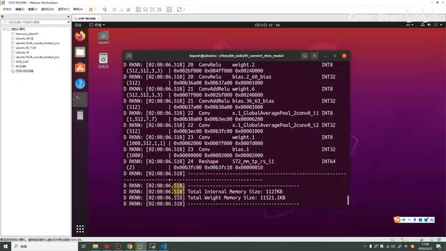

*运行模型转换的终端输出。 · [原片 21:30](https://www.bilibili.com/video/BV11DjT6uEhc/?p=10&t=1290)*

接下来，还有一个地方想要演示一下。刚才我说了，传入这两个参数之后，它会在终端进行输出，并且会保存一个日志。日志在这里已经保存了，我们也可以看到。接下来，我就在这里将这两个参数也先删除。

我将这两个参数进行删除，然后我们再来运行一下。可以看到，我们好像终端还是有输出。那怎么，是不是说我们讲得不对，或者官方文档不对呢？这里并不是这样，我们可以对比一下。

你看，刚才我们传入这个参数的时候，这里有非常详细的过程，就是它每一步是怎么转换的。你看，可以看到，在这里它全部都会列出来，包括像这里执行了什么样的算子的操作，包括使用了什么、什么样的激活函数等等，它都会有。

但是刚才下面这个，我们明显可以看到日志很简单，就是这里走了一个进度条，然后其实就没有了。这里只是告诉我们在进行量化操作。所以说，其实这个参数是有用的，如果加上它，就可以看到比较具体和详细的过程。

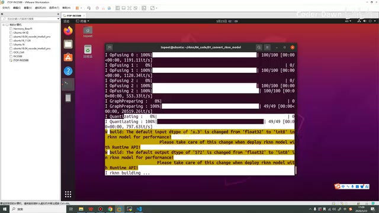

*量化运行进度与终端输出。 · [原片 22:35](https://www.bilibili.com/video/BV11DjT6uEhc/?p=10&t=1355)*

同样，这次运行完之后，我们也可以看到，这里并没有生成这个 `log.txt` 文件。我们也是同样的，打开这个 log 文件，也来分析一下。

在分析它之前，我们再看一下，对比我们原本的目录，还生成了这么几个东西，就是这个后缀 `.onnx`。这是什么意思呢？就是说，我们 PyTorch，就是 `.pt` 的这个模型，其实它是不能直接转换成我们的这个RKNN 模型的，它必须进行中间的这样一个步骤。中间的这个步骤就是 ONNX，就是它会先转换成 ONNX 模型。转换成这个模型之后，接下来它再把这些模型进行分析，然后进行融合或者怎么样的操作，最终再给我们生成用的这个 RKNN 模型。所以说在这里，我们也会看到这个中间状态。

讲完这个之后，最后我们再来看一下日志，看一下这个日志是什么意思。首先上面告诉我们，RKNN-Toolkit2 的版本是 2.3.2。然后它说进行了 `base_optimize`，就是进行一些基础优化。然后又进行了折叠，常量的折叠；接下来，它进行了这个叫 `correct_ops`，op 就叫作算子或者操作，就是它进行了一些算子的修正。

接下来叫 `fuse`，就是进行了算子的融合。这里叫作权重的稀疏化。后面又进行了量化优化，最后进行了构建。

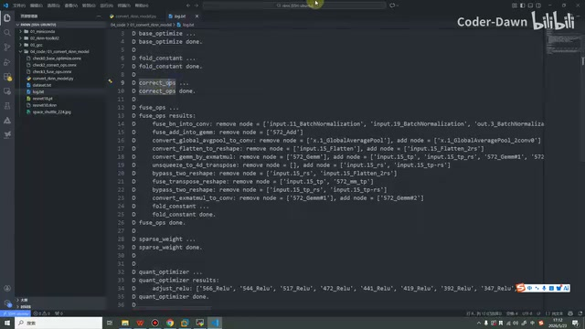

*日志中的优化、常量折叠、算子修正和融合。 · [原片 25:30](https://www.bilibili.com/video/BV11DjT6uEhc/?p=10&t=1530)*

在这里我也就跟大家简单提一下。我们主要是从使用模型这个角度、这个方面，来学习这门课。

所以在这里，我不会特别深入地去讲这些操作。包括这里面特别细节的操作，可能我自己也都不是特别清楚。

所以说，在这里大家对日志这些文件做到能看懂，知道它每一步是什么意思，万一说我们后面需要进行一些比较具体的优化的时候，我们有这样的一个参考，就可以了。

以上就是本节课的内容。最后也是感谢大家的观看。

> 片尾 26:48 后的短促识别项“LAisa / dugits / 挤”无法可靠辨识为有效讲述，未编造为正文；原始项保留于随附转写。
