# 10_均值和标准差

> P11 · [原视频](https://www.bilibili.com/video/BV11DjT6uEhc/?p=11) · 00:00—22:58
>
> 按原顺序整理的忠实讲稿，保留讲述中的举例、计算、操作和观点；仅清理无意义停顿与口吃。原始转写保存在 sources。
>
> 图片说明：12 张原视频截图，源画面 640×360；小字细节受原始画质限制，点击图片可查看原图。图注为编辑说明。

## 为什么要讲均值和标准差

这节课我们来讲均值和标准差。其实这节课的内容，也是上节课内容的一个延续。上节课我讲到这个 API 的时候，说这个 API 里面有非常多的参数，我们也可以看到，非常非常多。但是有这么三个参数，我们是一定要去传的。既然这三个参数一定要传，也就证明这三个参数非常重要。

上节课我说，里面有这些值，这些值是怎么来的，我们还不清楚，我说下节课再讲。所以这节课我们就来分析一下：为什么这些参数重要，以及这些参数是怎么来的。

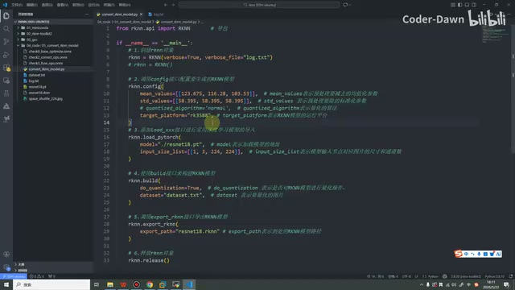

*rknn.config 中的 mean\_values、std\_values 与 target\_platform · [原片 00:30](https://www.bilibili.com/video/BV11DjT6uEhc/?p=11&t=30)*

接下来我们继续回到这里。这里分成三个部分来讲，我们先看第二部分，叫做“标准化和归一化”。如果大家之前学过和深度学习相关的知识，可能对这两个东西比较熟悉。如果大家和我一样，是嵌入式出身，可能对这些东西没有那么了解，所以这里我还是给大家讲解一下。

首先，它们的作用都是对数据进行特征缩放，可以对数据进行线性变换。我先举一个最简单的例子。比如我们做了一个模型，想预测一下这个人的身体状况，身体健不健康，预测他的身体健康状态。那我们就会得到这个人的身高，还会得到这个人的体重。在这里我来写一下。

比如第一个人的身高是 1 米 5——1 米 5 太矮了，改成 1 米 88。他的体重是 142。第二个人的身高是 1 米 78，体重是 190〔此处 ASR 为“199”，画面填写的是 190〕。我们基于这两个人的身高和体重，做一个模型来预测健康状态。可能有一个“××”公式，这个模型用这个公式来计算里面的一些东西。

我们看一下，身高是 1 米 88、1 米 78，我们大部分人都是 2 米以内的；但是我们大部分人的体重，可能都是超过 100 公斤的〔保留原讲述中的单位说法〕。这两个东西量级相差很大，我们就很难用这个数值直接进行比较。

比如可能还有性别问题，性别有男，也有女。男和女与这些身高、体重，就更不能直接比较了。所以我们需要一种方法，能不能把它们映射成同一类东西，同一类且同一个维度的东西？这样我们就可以使用某一个公式来计算了。

比如 1.88，然后 142，性别男，我们通过某种方法，把这个人映射成 0.1、0.3、0.5。第二个人通过某种方法，变成 0.3、0.2、0.4。比如把它们映射成这种形式，我们就可以代入某一个公式，对它进行计算。

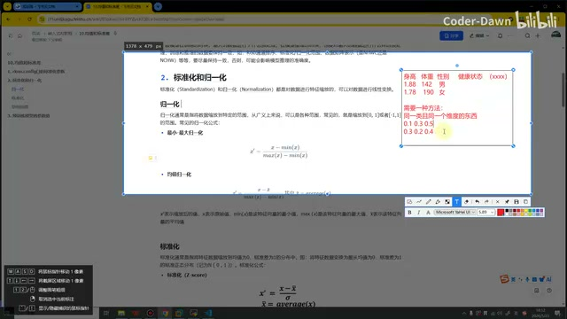

*手写身高、体重、性别及映射后的数值例子 · [原片 04:30](https://www.bilibili.com/video/BV11DjT6uEhc/?p=11&t=270)*

这种方法比较多，也有各种各样比较复杂的算法。在这里，我们就只看标准化和归一化，这两个也是最常见的。

## 归一化与标准化的公式

知道刚才说的那些之后，我们来具体看。归一化通常是指将数据缩放到特定范围。从广义上来说，可以是各种范围，常见的就是缩放到 0 到 1，或者 −1 到 1。这里需要注意，广义上它可以缩放到任何范围，各种各样的范围都可以，就看我们怎么设置它；只是我们常用的是这么两个区间。

接下来再看公式，它有两类。第一类叫“最小—最大归一化”。看一下这个公式：

`x′ = (x − min(x)) / (max(x) − min(x))`

这个 x′ 就是我们缩放后的特征。x 是我们当前这个值，减去最小值，再比上“最大值减去最小值”，这就叫最小—最大归一化。

第二个叫“均值归一化”。x′ 同样是缩放后的值，x 是当前值。它把前面那个最小的 x，换成了 x̄，就是 x 的平均值，

然后再除以最大值减去最小值。这就是均值归一化的公式：

`x′ = (x − x̄) / (max(x) − min(x))`，其中 `x̄ = average(x)`。

接下来我们看标准化。同样，它也是将特征数据缩放到均值为 0、标准差为 1 的分布中。这里需要注意，它缩放的是一个“分布”。笔记中写的是：将特征数据变换为服从均值为 0、标准差为 1 的标准正态分布〔保留原课件与讲述表述〕。

它的公式同样用 x′ 表示缩放后的值，上面和刚才相同，是当前值减去平均值，然后除以 σ：

`x′ = (x − x̄) / σ`

这个 σ 就是标准差。标准差的计算公式，是把每个值减去平均值之后带个平方，再求和、除以 N、开根号：

`σ = √[(1/N) × Σᵢ₌₁ᴺ(xᵢ − μ)²]`

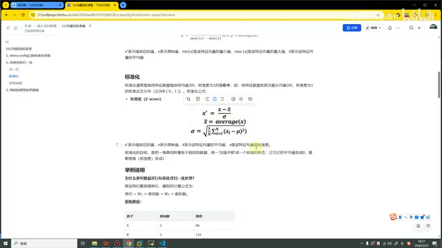

*标准化公式以及均值、标准差的定义 · [原片 06:50](https://www.bilibili.com/video/BV11DjT6uEhc/?p=11&t=410)*

相信大家都了解，我们初高中就学过这些东西，这里我就不再做过多阐述了。这就是标准化的公式和概念。

听完之后，可能大家还是有那么一点不清楚：我也知道它就是缩放的，也知道公式了，那它具体应用在什么场景？具体有什么好处？我们选择标准化，还是选择归一化？这些可能并不是很清楚。接下来，我们就通过一个例子说明这些问题。

## 用房价预测来看计算过程

现在我们先假设，我们要预测房价。这个预测房价的模型，计算公式是：

`房价 = W₁ × 房间数 + W₂ × 面积数`

W 就是一个权重。原始数据假设有四套房子，

A、B、C、D。A 房子有两个房间，面积 80 平；B 有三个房间，面积 110 平；C 是五个房间、150 平；D 是七个房间、200 平。这是原本的数据。

如果我们不进行归一化或者标准化操作，直接计算的时候，房间数是 2、面积是 80，我们就发现它们两个体量差得很大，也可能导致误差比较大。所以，我们需要对它进行一些处理。

假设我们先进行归一化处理，采用最小—最大值的方法。我把这个公式截过来，截到这里。我们看一下，这组房子数据里面，房间数的最小值是 2，最大值是 7。然后我们来计算：当前是 2，`(2−2)/(7−2)`，归一化之后是 0。第二个是三个房间，把数据代进来，是 0.2；五个房间代进来，是 0.6；七个房间代进来，是 1。就是把数据代进这个公式，这个很简单，大家都明白。

我们可以看到，这个数据其实还是比较均匀的，从 0 到 1。这里差 0.2，这里差 0.4，这里也差 0.4。这就说明，这种数据已经被映射到这个区间内，并且差值还比较均匀，没有那么大，大家看上去还比较好。

接下来看面积数。最小是 80，最大是 200。同样把数据代进来，`(80−80)/(200−80)`，是 0。然后这样算完之后，我们最终发现，它也被映射到了 0 到 1 这个区间内。

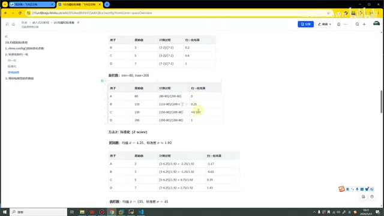

*四套房子的面积归一化计算及房间数标准化计算 · [原片 10:00](https://www.bilibili.com/video/BV11DjT6uEhc/?p=11&t=600)*

然后这里是 0.25，这里是 0.583。它们的差值，这里是 0.25，这里是 0.333，对，然后这里的差值是 0.417。可以看到，这个数据也是比较均衡的。这是经过归一化之后的情况。

接下来我们看标准化。同样，我把这个公式截过来。我们先计算平均值，是 4.25；然后标准差是 1.92。把值代到这里来，算出来之后，是 −1.17、−0.65、0.39、1.43，这是计算出来的值。

大家可能会好奇：它怎么还有负数？这里我也可以和大家说一下，我们这个标准差〔这里沿用讲述的叫法，所指为标准化后的范围〕，通常是把它的范围映射到 −3 到 3 之间。前面也读了一下，它是均值为 0、标准差为 1 的一个分布中，它看的是一个分布。所以，这是房间数计算出来之后，标准化之后的值。

接下来我们看面积。同样，有个均值，有个标准差，把数据代进来。代进来之后——这里写得不对，我填一下，这个叫“标准化”。这里是我从上面复制的时候忘记修改了，我在这里修改一下。

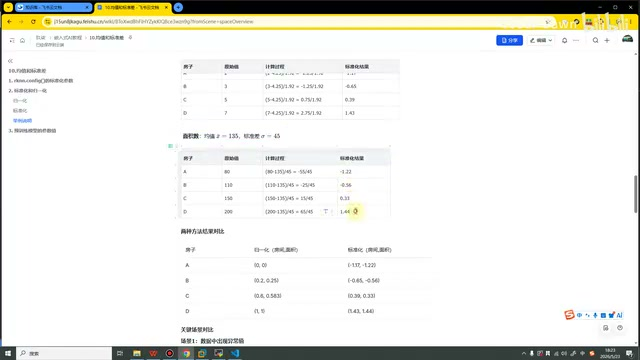

*面积数标准化表，课件中将复制的表头改为标准化 · [原片 12:10](https://www.bilibili.com/video/BV11DjT6uEhc/?p=11&t=730)*

这个面积数标准化之后，它的值也是这样的一个区间。面积的均值是 135，标准差是 45，课件中代入公式得到 −1.22、−0.56、0.33、1.44。我们可以看一下，差值什么的都还可以，都比较均衡。这就是我们进行标准化之后的结果。

可以看到，不管是经过标准化，还是进行归一化，房间数在这个区间，面积数在这个区间；标准化后的房间数在这个区间，面积数在这个区间，它们就可以进行计算了。可以看到，它们就被变成了相同体量、相同维度的东西。这就是进行标准化和归一化的好处。这里也做了一个结果对比。

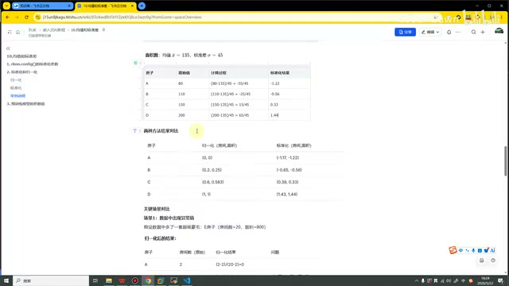

*房间数、面积归一化和标准化的成对结果对比 · [原片 13:00](https://www.bilibili.com/video/BV11DjT6uEhc/?p=11&t=780)*

在这里就涉及一个问题：标准化也可以用，归一化也可以用，那我们是采用标准化，还是采用归一化？这里我可以直接告诉大家，我们使用标准化更多。为什么？就是因为归一化有两个比较致命的缺点。接下来，我们看这两个场景。

## 异常值和新数据两个场景

第一个场景，假设数据中出现了异常值。比如还是刚才这些房子，我们现在多了一套豪宅，多了一套别墅。这套别墅有 20 个房间，面积是 800。这个别墅和其他房子相比，其实就是一个异常值。在现实生活中，大多数人也都是住普通房间，像这种豪宅还是比较少的，所以在这里，我们把豪宅理解为一个异常的房子数据。

如果同样对它进行归一化，它是 0，然后 0.056、0.167、0.278。可以看到，

最后一个是 1。可以看到，这套豪宅、这个别墅，也就是这个异常值，反而占了更大的空间。我们这些正常的值，范围反而被压缩得特别小。所以，这就是归一化的一个缺点。

如果进行标准化，可以看到前面是 −0.78，这样这样。我们就关注这个区间，这个区间的值都是比较正常的。然后它算完之后是 1.81，是一个很异常的区间，我们就可以不太关注它。因为前面也说了，我们标准化主要是进行一个区间。

这里我简单画一下。可能我们是这样的，我们一般就关注这些数据，现在有个异常值，就是它跑到这边去了，那我们就可以不那么关注它，或者比较方便地对它做一些调整和修改。这就是标准化的一个好处，它不会影响我们这些正确的值。所以这里也做了一个结论：标准化对异常值不敏感，正常数据不会被压缩〔保留讲者观点〕。

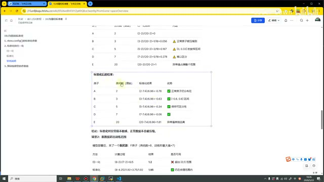

*加入豪宅后，归一化和标准化的结果对比 · [原片 15:25](https://www.bilibili.com/video/BV11DjT6uEhc/?p=11&t=925)*

接下来我们看第二个场景。假如模型已经训练好了，现在来了一个新房子，这个新房子有八个房间。刚才上面的数据，正常情况下最多只有七个房间。如果现在来了一个有八个房间的，

那我们就不能用之前的东西了。把它代进之前的东西，发现归一化之后，结果是 1.2，直接超出了这个范围，会直接造成非常大的影响。标准化算完之后是 1.95，它其实还在我们的这个范围内，所以对我们的影响就会小很多。这就是标准化的一个优势，也是我们后面更多采用标准化的原因。

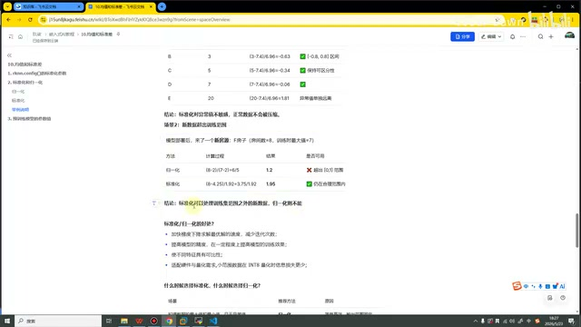

*新房子有八个房间时，归一化结果1.2、标准化结果1.95 · [原片 16:40](https://www.bilibili.com/video/BV11DjT6uEhc/?p=11&t=1000)*

知道这些之后，我们来总结一下，标准化和归一化有哪些共同的好处。第一个，它们可以加快梯度下降求解最优解的速度，可以减少迭代次数，这也是比较显而易见的。第二个，可以提高模型精度，一定程度上提高训练效果。第三个，使不同特征具有可比性，比如面积和房间，让它们有了可比性。最后一个，它也能适配硬件和量化需求；我们进行量化的时候，可以让信息损失得更少。这就是它们的好处。

知道好处之后，接下来就要看一下：什么时候选择标准化，什么时候选择归一化？下面列了很多情况，我们来看一下。

假设我们知道数据的最大值、最小值，而且没有异常值，那就使用归一化。因为归一化的公式更简单，所以用起来也更方便，输出范围也是固定的。第二种情况，如果数据量比较庞大，特征的最大值、最小值也不知道，就用标准化。如果数据中存在，

极端的最大值、最小值，我们用标准化；存在孤立点、异常值，用标准化；深度学习模型中，基本也都是使用标准化。如果需要把输出固定到某一个范围内，我们就可以用归一化。最后一种情况，我们也不知道到底该用什么，那就用标准化。这就是怎么选择标准化和归一化。

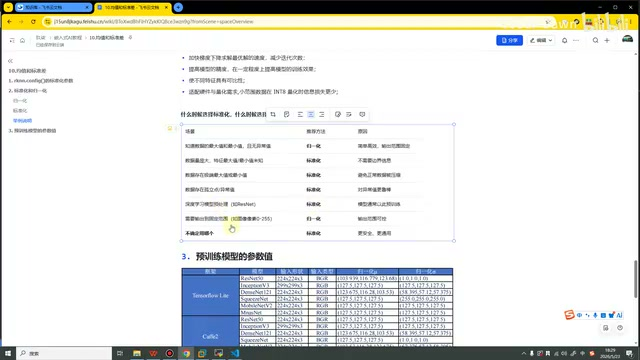

*标准化与归一化的适用场景表 · [原片 18:20](https://www.bilibili.com/video/BV11DjT6uEhc/?p=11&t=1100)*

## 回到 rknn.config 的参数

知道这个之后，我们再回头看第一个部分。第一个部分就是 RKNN 这个 API 里面有两个参数，第一个参数叫“均值”，第二个参数叫“标准差”。现在再听这个名字，是不是觉得特别耳熟？我们看一下公式，这个 x̄ 是不是就叫均值？这个 σ 是不是就叫标准差？说明什么？说明它就是想让我们进行一个标准化操作，所以让我们传入这两个值。这就是为什么有三个参数很重要。

第三个重要参数是平台。平台当然重要！你到底是 3588 的，还是 3576 的，还是 1126 的，还是其他平台的？这个必须说清楚。然后这两个也很重要。在这里，相信已经和大家解释清楚了。

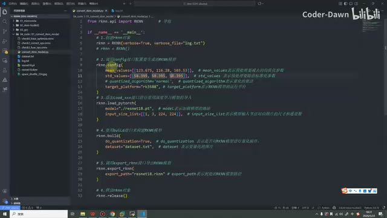

*程序中的标准化参数及模型加载代码 · [原片 20:00](https://www.bilibili.com/video/BV11DjT6uEhc/?p=11&t=1200)*

现在我们知道为什么要传它了，可能还不知道这个值是怎么来的，为什么传这种数。如果我这里传 1、2、3，下面传 4、5、6，行不行？那是不行的。

为什么不行？我们来看下面这段话。一般模型在训练的时候，需要对输入数据进行预处理；进行模型推理的时候，也要进行预处理。我们推理时的预处理，需要和训练时尽可能进行相同的操作。

什么意思？比如训练的时候是 RGB 排列，然后标准化、归一化给了一些值，那进行模型推理的时候，也要尽可能保持一致。比如训练时是 RGB，推理时如果是 BGR，那颜色不就乱了吗？如果训练时归一化的范围是 0 到 1，推理时把范围变成了 5 到 10，这样可能也会导致特别大的误差。

所以，训练时进行什么样的预处理，推理时也要进行什么样的预处理。我们这两个值，其实就是训练时候的值。

训练的这个值是怎么来的？这里我做了一个总结，有两个表格。像 TensorFlow、Caffe、PyTorch 这些框架，对应的这些模型，什么形状，它的值是什么样的，这里有列出来。下面什么系列，也有列出来。这些也是从网上收集到的。

知道这个之后，我们来看代码，我把它写出来、写下来，再把模型也写下来。

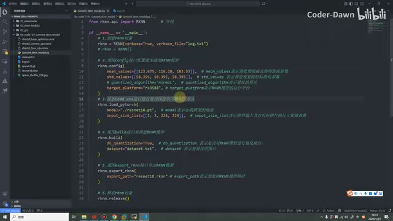

*代码使用 resnet18.pt，输入形状为1、3、224、224 · [原片 22:00](https://www.bilibili.com/video/BV11DjT6uEhc/?p=11&t=1320)*

然后我们再回到课件来看一下。我们的模型是 ResNet，ResNet 系列。它的均值就是这个，然后标准差就是这个，我们的数据就是这样代进来的。

```python
mean_values=[[123.675, 116.28, 103.53]]
std_values=[[58.395, 58.395, 58.395]]
```

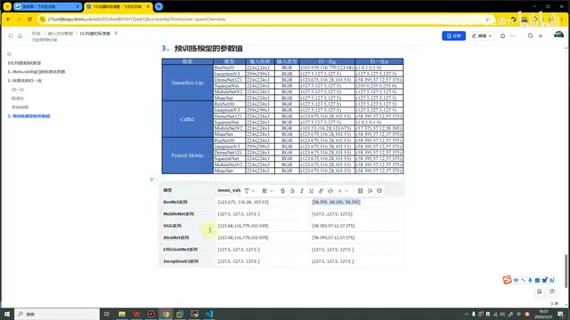

*各框架预训练模型与常用模型系列的均值、标准差表 · [原片 22:30](https://www.bilibili.com/video/BV11DjT6uEhc/?p=11&t=1350)*

如果后面，我们也会用到这个模型——MobileNet〔此处语音转写破碎，结合课件所示系列识别〕。用到这两个模型的时候，我们就代这两组值就可以了。课件中 MobileNet 系列的 `mean_values` 是 `[127.5, 127.5, 127.5]`，`std_values` 也是 `[127.5, 127.5, 127.5]`。

讲到这里，就给大家讲明白了，这两个值为什么重要，以及它们的值是怎么来的。相信到这里，大家也都应该听明白了。最后，感谢大家观看，谢谢大家。
