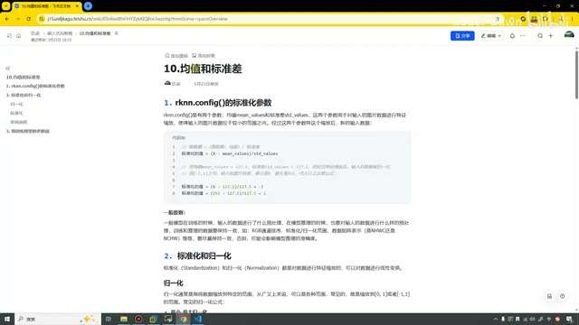
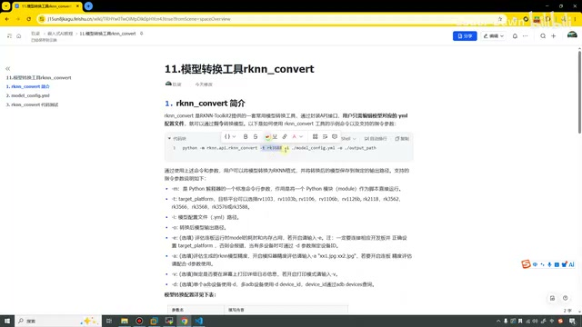
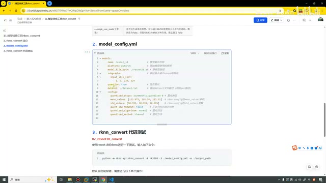
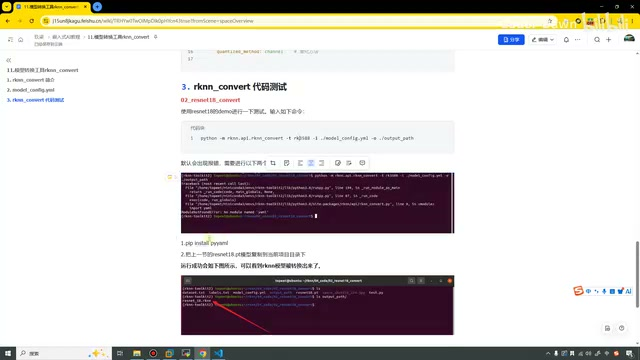
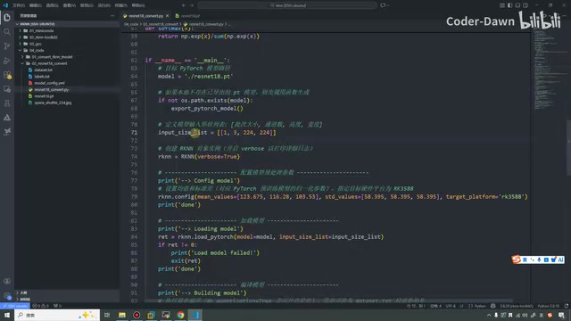
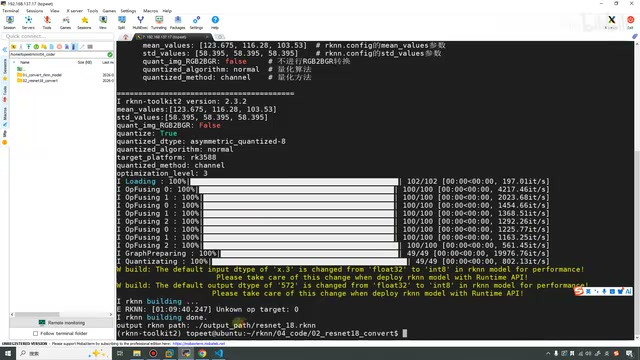
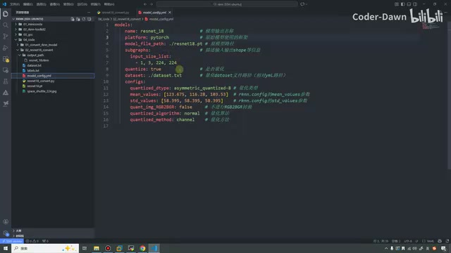

# P12｜11_模型转换工具 rknn_convert

> 来源：[B 站课程第十二集](https://www.bilibili.com/video/BV11DjT6uEhc/?p=12) · 全片 9 分 44 秒
>
> 整理方式：忠实讲稿，不做摘要压缩。保留原讲述顺序、解释、操作、例子和范围说明，仅清理停顿、偶发结巴与无意义重复，补充标点和小标题。
>
> 文字来源：本地 Whisper 转写，结合原视频画面核对术语。图片为 7 张原视频截图，原始分辨率 640×360，小字受源画质限制；图注是编辑说明。末尾异常识别及核对限制见 sources/review-notes.md。

## 先解释上节课的标准化与归一化 · 00:00

这节课我们来看第 11 讲：模型转换工具 rknn_convert。在讲这个之前，有一个内容还是有必要解释一下。就是在上节课——我打开上节课——我们在讲均值和标准差的时候，我在说这个使用的是什么标准化，这个样子。这个可能也会对大家造成一点点小的误解。



*上节课的均值、标准差与标准化参数页面。 · [原片 00:20](https://www.bilibili.com/video/BV11DjT6uEhc/?p=12&t=20)*

它的数学公式，确实是标准化的公式。在数学上，我们就是这么定义标准化、这么定义归一化的。但是在我们深度学习当中，我们可能并不区分，或者没有特别详细地区分这些。很多时候，就把这些前置的预处理操作都叫做归一化。这个大家只需要明白，这些参数是什么意思，到底是怎么来的，就可以了。

说完这个，我们就继续回到这节课。这节课要讲的是模型转换工具 RKNN。在前面，上上节课，我们其实已经讲过了如何通过代码去进行 RKNN 模型的转换。

如果大家也使用过其他厂商的开发板，可以知道很多厂商可能没有很丰富的 API，让我们去调用、去执行这样或者那样的操作。它就是给了我们一个命令，我们通过这个命令去转换模型，通过这个命令去对模型进行加密、进行剪枝等等。瑞芯微这边，其实也是有命令行的方式，

直接就可以进行模型的转换。这节课同样分为三个部分，我们每个部分、每个部分地来看。

## rknn_convert 简介与命令参数 · 02:11

第一个部分是工具的简介。这里我就不念了，它就是一套常用的转换工具，怎么怎么样。要记住的是这里：用户只需要编辑模型对应的 YAML 配置文件，就可以通过指令来转换模型了。

比如说下面这条命令：

```bash
python -m rknn.api.rknn_convert -t rk3588 -i ./model_config.yml -o ./output_path
```

看这条命令，相信大家应该也不是那么陌生。这个 `-t` 就是 target，我们是什么开发板，后面就写什么。`-i` 就是输入文件的 input；`-o` 就是 output。后面这里，就是输入我们对应的 YAML 文件，输出我们模型保存的一个路径。



*rknn\_convert 命令示例及常用选项。 · [原片 03:00](https://www.bilibili.com/video/BV11DjT6uEhc/?p=12&t=180)*

这个 `-m` 是什么意思呢？在 Python 中，`-m` 是 Python 解释器的一个标准命令行参数。它的作用是将一个 Python 模块作为脚本直接运行，也就是说，我们直接就可以调用它里面的工具。这个就是 `-m` 的含义。

包括下面还会有一些常用的 `-e`、`-a`、`-v`、`-d`，这些大家也都可以看一下。比如说 `-e`，它是评估连板时模型的耗时和内存的占用。如果需要，我们就加入这个 `-e`。这里也写了一些注意：我们一定要连接开发板，然后设置 target。

有多设备的时候，我们也要指定设备的一个 ID。`-a` 是评估模型精度的，我们也可以通过这样的方式去使用它。`-v` 就是是否打印详细的日志。`-d`，就是是不是有多个设备〔画面中该选项用于指定 device_id；讲述保留原意〕。这个是我们命令工具的一个解释。

除了这些之外，其实它还有非常非常多的内容。可以看，在这里我已经从官网截图下来了，就是模型转换配置参数表。可以看到有 `name`、`platform`，然后还会有各种各样的参数名，就很多很多。知道这些之后，知道这些名字、知道这些平台之后，我们就可以去写 YAML 文件了，也就是我们的第二部分。

## model_config.yml 怎么写 · 05:02

我们看一下。在前面我们已经说了，我们可以不写代码，只需要编辑这个文件，就可以通过指令转换模型。这个文件怎么写呢？

首先就是一个 `models`，代表它是个模型。然后里面 `name` 是模型输出名称，`platform` 是它使用什么样的框架。`model_file_path` 是原模型的地址。这个 `input_size_list`，其实一看就是它的形状；`quantize` 是是否量化，然后 `dataset` 是它的量化校正集。这是它的一些配置。



*model\_config.yml 的模型字段和量化配置。 · [原片 05:40](https://www.bilibili.com/video/BV11DjT6uEhc/?p=12&t=340)*

配置里面有量化类型，然后 `mean_values`、`std_values`，然后是否进行这个格式的转换，量化的算法、量化的方法，等等。还有更多的参数，就在上面。

一般来讲，我们使用下面这些参数，就已经足够了。如果大家感兴趣，也可以把上面这些拿出去试一试。

## 代码测试与缺库报错 · 06:20

知道这个之后，我们就到第三部分：具体的代码测试。直接输入这条命令，就可以使用官方的工具来进行模型转换。

大家在第一次输入它的时候，可能会遇到跟我一样的问题。如果大家是跟着我一步一步到这里的，可能也是一样，没有去安装这个库。所以大家需要安装一下这个库，不然它会报上面这个错。

```bash
pip install pyyaml
```



*课件展示缺少 YAML 库的报错及 pip install pyyaml 修复步骤。 · [原片 06:50](https://www.bilibili.com/video/BV11DjT6uEhc/?p=12&t=410)*

安装好库之后，我们就可以去执行它，可以看到它会转换成功。

说完这个之后，我们就来测试一下。首先，这是 01、02，我把代码还有这些内容都已经复制过来了。复制过来之后，大家可以看一下，这里就和刚才课件里面是一模一样的。

这里，像这个是一个参考图片，这是它的 labels，这是量化校正集。然后 `resnet18.pt`，就是原本的 PyTorch 模型。这里还有一个 Python 文件，我们就大概瞅一眼。

我们同样从 `main` 函数看。第一个，就是我们目标模型的路径，然后这个是判断模型存不存在。接下来是输入的形状。其实下面就是创建 RKNN 的一个对象，然后进行它的配置，



*Python 脚本从 main 入口检查模型路径、设置输入形状并配置 RKNN。 · [原片 08:00](https://www.bilibili.com/video/BV11DjT6uEhc/?p=12&t=480)*

然后去加载 PyTorch 的模型，进行模型构建，构建完之后，让它进行导出。到这些，和我们上次课的内容都是一样的。

下面这里就是进行一些预处理，然后进行了一个简单的推理和保存。这个我们暂时先不看，我们后面也都会讲，到后面我们再去看这些内容。

## 在 Ubuntu 主机执行并查看输出 · 08:35

我们就直接到这里。在这里，我已经通过 SSH 连接到 Ubuntu 的主机，并且已经进入了这个环境，然后也进入了这个文件夹下。我们在这里就直接执行一下，测试一下就可以了。

我将它复制一下，然后在这里执行一下。可以看到，终端也提示了一些输出。转换完之后，它告诉我们，已经保存在了这个路径下：`./output_path/resnet_18.rknn`。



*终端显示模型转换输出与保存路径。 · [原片 09:10](https://www.bilibili.com/video/BV11DjT6uEhc/?p=12&t=550)*

我们打开它看一下。这里确实就已经保存好了我们的模型，也就证明了，我们使用指令的方式是没问题的。可以看到，就是在这里，我们也都进行了这个文件的配置。



*编辑器中的 model\_config.yml 与转换后的输出目录。 · [原片 09:40](https://www.bilibili.com/video/BV11DjT6uEhc/?p=12&t=580)*

讲到这里，本节课的内容就已经全部讲完了。最后也是感谢大家的观看，谢谢大家。
