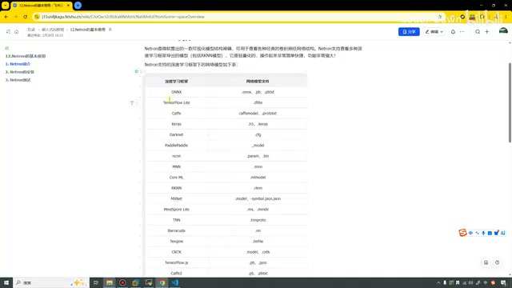
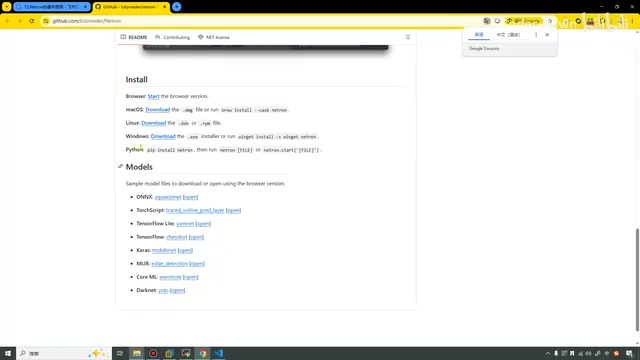
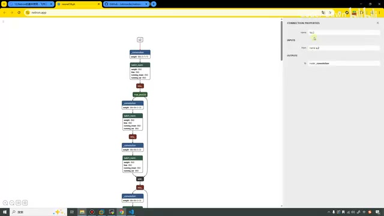
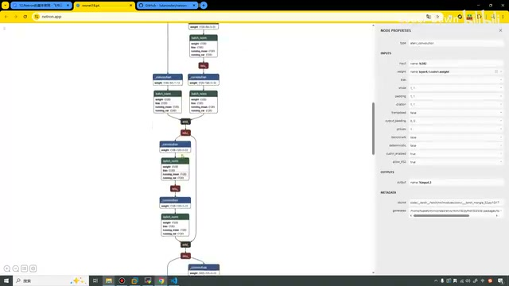
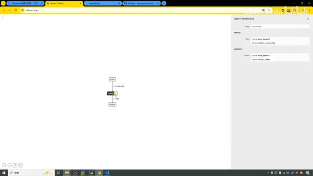
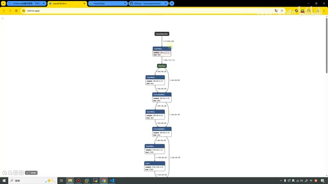
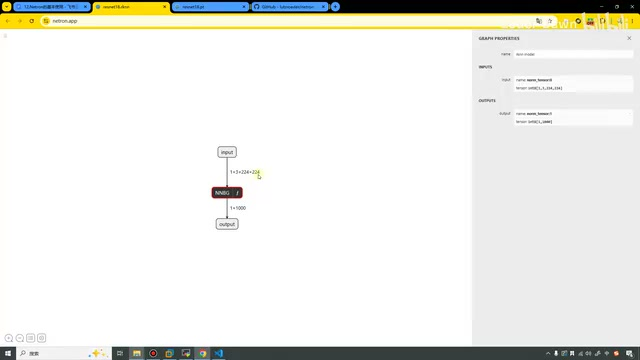
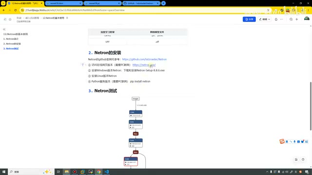

# P13｜12_Netron 的基本使用

> 来源：[B 站课程 P13](https://www.bilibili.com/video/BV11DjT6uEhc/?p=13) · 全片约 8 分 25 秒。
>
> 整理方式：忠实讲稿，不做摘要压缩，保留原讲述顺序、解释、例子、操作和课程范围说明。仅清理停顿、结巴与无意义重复，依画面校正明显识别错误。
>
> 图片说明：8 张原视频截图，原始画面为 640×360，小字受源画质限制。图注为编辑说明。无法可靠确认的语词在相邻正文标注，原始转写保存在 sources。

## 为什么介绍 Netron · 00:00

这节课我们来看第 12 讲，Netron 的基本使用。随着课程的不断深入，在后面我们也是会去看模型的结构，所以很有必要向大家介绍一下这个工具。

如果说大家本身就是对深度学习比较熟悉的人，那这个工具肯定使用得特别溜了，可能比我使用得还要溜。如果说大家是嵌入式的从事者或者学习者，可能对这些东西就没那么清楚了，所以这节课我也带着大家来看一下。一共也是分为三个部分。

## Netron 简介 · 00:39

第一个是 Netron 的简介。它是由微软推出的一款可视化模型结构的神器，用于查看各种经典的卷积神经网络的结构。它支持查看多种深度学习框架导出的模型，其中就包括我们的 RKNN 模型。它是轻量化的，操作起来也是非常简单快捷，功能也是非常强大。

它支持的深度学习框架的网络模型有这些，就特别多。几乎可以说，我们能用到的，它都已经支持了。比如说像 ONNX、TensorFlow，还有常用的像 ncnn，还有像 Caffe 等等，基本上大家能用的，它都可以进行模型的查看。

*课件列出 ONNX、TensorFlow Lite、Caffe、ncnn、RKNN 等支持格式。 · [原片 01:20](https://www.bilibili.com/video/BV11DjT6uEhc/?p=13&t=80)*

这个是非常有必要的。我们进行了模型转换，到底转换成功了没有？我们对模型进行了优化，修改了它的某些网络，那我们到底修改了没有？如果说只是像之前一样，我们只能看到一个 `.pt`，或者一个 `.rknn`。

一般来讲，我们可能都还打不开它。像 VS Code 里面就直接显示的是这么个东西。我们修改了，可能也不知道到底成功没有。有了它之后，我们就可以看，到底修改成功没有，到底有没有对里面进行优化，优化成功没有。

## 安装与网页版入口 · 02:20

做完简介之后，接下来我们来看第二部分，就是它的安装。这是它官方的教程，在 GitHub 上面，这是官方的地址。这里也是写了怎么安装 Windows、Mac，然后 Python，包括可以直接在 Python 的终端里面去进行安装，也可以直接进行打开，这样就会非常方便。

*官方仓库的 Install 区展示浏览器、macOS、Linux、Windows 和 Python 安装方式。 · [原片 02:40](https://www.bilibili.com/video/BV11DjT6uEhc/?p=13&t=160)*

这里是它模型的支持，上面就是它做了一个展示。使用这个工具之后，就可以打开、可以看到是这样子的。好，这个是它的仓库。如果说需要下载，我们就去刚才那里进行下载。

我在这里就直接给大家展示一下网页版。其实我觉得网页版也是很好用的，也很方便。我们直接来打开一下。在这里，我们就打开像之前的模型，比如说这个 ResNet 的 `.pt`〔画面标签为 `resnet18.pt`〕。我们来看，这就是它的网络结构。

## 查看 PT 模型的结构与节点 · 03:36

然后我们可以点它，点击之后可以在右边看到，这是它的输入，就是 `x.2`，然后这是它的输入。包括里面的每一步，你看像它的 weight 权重，然后 bias 这个偏置，包括激活函数——

*点击模型连线后，右侧 Connection Properties 显示 x.2 输入名称。 · [原片 03:50](https://www.bilibili.com/video/BV11DjT6uEhc/?p=13&t=230)*

ReLU，然后最大池化层等等，就是一些 AI 的、叫算子操作。它里面的每一个步骤、每一个过程，其实我们都可以看到。

假如说我们需要对它进行一些优化，比如说我们觉得这个 ReLU，在这一步我们觉得 ReLU 激活函数的效果不怎么好，想换一个激活函数，那更改完之后，我们就可以使用 Netron 打开它，来看一下到底有没有换。

可以看到，这个模型结构其实也没有特别复杂，就是看上去有点长。但其实，因为它是竖着的，如果说在我们深度学习里面把它画成横向的，那它可能……这个模型其实也比较简单，可能就是有几个池化层，对，这样子就有些连接层。

*PT 模型纵向展示卷积、批归一化、ReLU 和连接关系，右侧显示节点属性。 · [原片 04:40](https://www.bilibili.com/video/BV11DjT6uEhc/?p=13&t=280)*

在这里，我就不再带着大家细节地去纠结里面每一步是什么意思了。这个可能就是，如果说我们做得要深入了，去进行算子优化的时候，可能才去做这些。我们这个课程主要就是一个入门课程，主要教大家如何快速地把模型跑起来就可以了。

## 打开 RKNN 模型 · 05:26

这个是我们的 PT 模型。刚才在前面，我们也转换了 RKNN 模型，那在这里也打开这个 RKNN 模型，我们来看一下。

可以看到，如果说大家打开 RKNN 模型，第一眼可能有点懵：这什么玩意儿呀？就单独一个输入、一个输出，中间写个“牛逼”啊，NNB〔讲师的口头玩笑；画面节点实际标为 `NNBG`〕，然后就没了。

这里大家其实不要着急。你看看这里有个……看鼠标经过这里。

*RKNN 初始视图显示 input、NNBG、output 三个节点与图属性。 · [原片 06:00](https://www.bilibili.com/video/BV11DjT6uEhc/?p=13&t=360)*

大家看到没有？我放大一点。鼠标经过的时候，它是有一个高亮的，就是这个黑白的高亮。然后我们点这个 f〔控件字样无法从原画面可靠辨清；此处指中间节点旁高亮的展开入口〕，可以看到，这样我们就进来了。

*进入中间节点后，显示 RKNN 内部的转换后算子网络。 · [原片 06:20](https://www.bilibili.com/video/BV11DjT6uEhc/?p=13&t=380)*

这个就是真实的 RKNN 模型里面的内容了。可以看到，我们可以和它进行对比：你发现它其实很长，然后它其实要短很多。为什么会有这种现象呢？就是因为我们在进行模型转换的时候，其实也是对它进行了像一些量化等等，是有一些操作在里面的。这个其实就是会减小我们模型的体积。

所以说，我们这个 RKNN 模型看起来就会比原版稍微简单那么一点。然后这里其实也是很多的这个〔原转写为“床位”，语词无法可靠确认〕操作。看一下。

在这里我们也可以跳回去，就是刚才下面，点了之后这里有一个返回。回去之后我们来看一下总体的。就是说，我们输入的是这个，形状是 `1×3×224×224`，然后返回的输出是 `1×1000`〔依图中形状标签校正原转写的“24”“12000”〕。这个就是我们 ResNet 的模型。

*返回总体视图，输入形状为 1×3×224×224，输出为 1×1000。 · [原片 07:30](https://www.bilibili.com/video/BV11DjT6uEhc/?p=13&t=450)*

## 安装方式补充与结束 · 07:37

说完这个之后，其实我们第三部分，就是 Netron 的测试，也顺带讲完了。这节课只是给大家说了一下有这么个工具。它可以安装 Windows 的，可以安装 Linux、安装 Mac，也可以直接在命令行终端……那在这里我也直接写一下吧，`pip install netron`。这样就可以直接在终端进行使用了。

*讲师在课件中补写 pip install netron，并展示网页版入口。 · [原片 08:10](https://www.bilibili.com/video/BV11DjT6uEhc/?p=13&t=490)*

我一般就比较习惯进行网页的使用。你下载的话，感觉要多下载个软件，可是感觉会有点麻烦。讲到这里，本节课也就全部讲完了。最后也是感谢大家的观看，谢谢大家。
