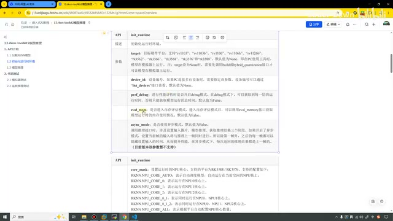
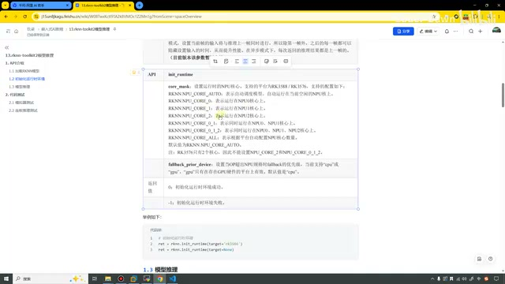
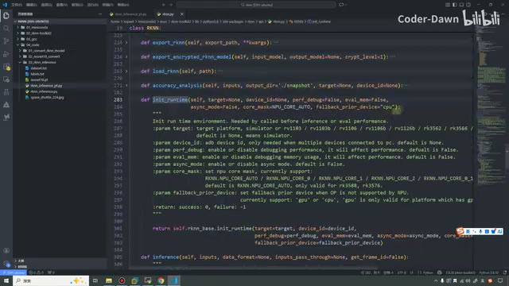
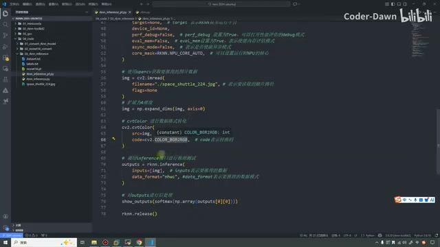
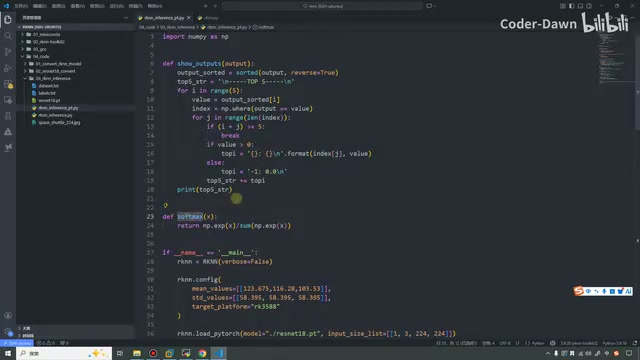
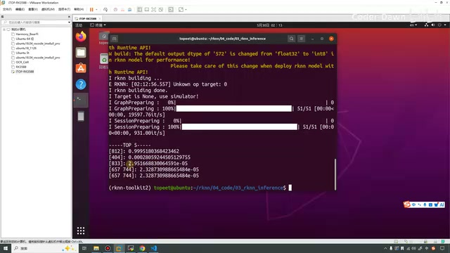
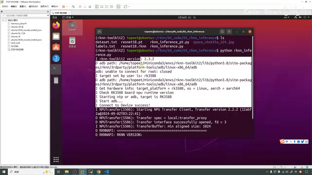
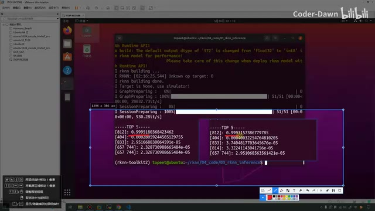
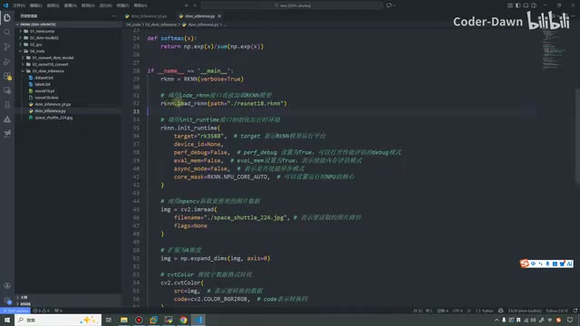

# P14｜13_rknn-toolkit2模型推理

> 来源：[B 站课程第 14 集](https://www.bilibili.com/video/BV11DjT6uEhc/?p=14) · 全片约 26 分 14 秒
>
> 整理方式：清理后的忠实讲稿，不做摘要压缩；保留原顺序、第一人称讲述、解释、例子、操作、现场纠正与结论。仅清理停顿、结巴及无新增含义的紧邻重复，并补标点和少量小标题；并非逐字音频校订稿。
>
> 文字来源：本地 Whisper large-v3-turbo 中文转写，按原视频界面核对术语；不清楚的短词、犬种及未完整读出的数字在相邻正文标注。课程中的“目前版本”指录制当时。原始转写及全部规范化段落保存在 sources 中。
>
> 图片说明：9 张实际原片截图，640×360，小字受源画质限制；图注是编辑说明。浏览器 file 协议预览受到限制，未绕过限制，未声称完成桌面/窄屏交互测试；已完成图像逐张查看和本地 HTML、资源及时间链接结构检查。

## 模型推理的三个步骤 · 00:00

这节课我们来看第 13 讲：RKNN-Toolkit2 模型推理。前面几节课，我们已经讲完了 RKNN 模型的转换。转换完之后，我们就得到了 RKNN 模型；得到这个模型之后，我们就需要用这个模型进行推理。

推理的时候，大概分成三个步骤。第一个步骤，就是这里 2.1 写的模拟器测试。什么意思呢？我们将模型转换完之后，就可以在 Ubuntu 主机上面直接测试一下，看看这个模型的性能到底怎么样。比如做一个人脸识别，它到底能不能识别出来人脸？做一个水果分类，它到底能不能正确地把水果进行分类？我们就可以在 Ubuntu 主机上面进行测试。这个测试也是非常方便的，可以进行一个快速的测试。

在 Ubuntu 主机上面测试完之后，发现没问题，我们就可以进行连板推理测试。就是快速连接开发板，调用开发板的 NPU，测一下推理结果有没有问题。在这里大家一定需要注意：使用模拟器测试的时候，效果如果还不错、还比较好，我们再去使用连板推理测试，效果不一定会好。可能调用开发板来测试的时候，效果反而更差了，是有这种可能性的。这就是前两步。

第三步，就是真正的代码落地、工业部署。我们可能会使用 C 或者 C++ 代码，进行真正的部署。讲完这个之后，

我们就来看这节课的核心部分。这节课也是分为两个部分，第一个是 API 介绍。除了前面已经学过的 API 之外，这节课还需要新学三个 API，或者说也就两个吧。我们一个一个来看一下。

## 加载模型与初始化运行时 · 02:19

第一个 API 叫加载 RKNN 模型，`load_rknn`。其实之前也简单介绍过，这节课再来看一下。调用这个 API，一共需要传入一个参数，就是 RKNN 模型的路径。返回值是 0 加载成功，-1 加载失败。下面也举了一个例子，直接把模型的地址丢进去就 OK 了，这个非常简单。

第二个 API 叫初始化运行时环境。什么意思呢？我们不是加载完模型之后，正常就该进行模型推理了吗？为什么还需要这个呢？这里大家需要注意，瑞芯微官方特意把 API 封装得更加简单、更加清晰，避免一个 API 有非常多的参数，导致一些歧义，所以特意增加了一个初始化运行时环境的 API。就是说，在进行推理之前，还需要做一些初始化工作。

比如，到底要使用的是 3588 开发板，还是 3576、1126，还是其他型号的开发板呢？如果电脑连接了多个设备，到底应该选择哪一台设备进行测试呢？比如在进行推理的时候，

我们使用的是 3588 开发板，它会有好几个 NPU 核心。到底怎么样调用它的 NPU 核心？怎么进行初始化？这些都是这个 API 要做的事情。推理的 API 就只管推理，别的事情就不管了。

讲清楚这个之后，我们具体来看一下这个 API。初始化运行时环境的 API 叫 `init_runtime`，里面应该有六个，还是六七个吧，应该是七个参数。我们来看一下。

第一个参数叫 `target`，让我们说明到底是哪个平台。第二个是 `device_id`，就是设备编号。第三个是 `perf_debug`，是否需要进行性能评估。再下一个叫 `eval_mem`，是否需要进行内存评估。这两个在后面也都会用到。

*初始化运行时参数表展示 target、设备编号、评估与异步设置。 · [原片 05:00](https://www.bilibili.com/video/BV11DjT6uEhc/?p=14&t=300)*

再下一个叫 `async_mode`，是否使用异步模式，默认值是 `False`。这个我们可以看一下，因为还是很有用的。调用推理接口的时候，涉及设置输入——输入图片、模型推理、获取推理结果三个阶段。如果开启异步模式，设置当前帧的输入将与推理上一帧同时进行。所以除了第一帧之外，之后每一帧都可以隐藏设置输入的时间，提升性能。在异步模式下，每次返回的推理结果都是上一帧的。

这是什么意思呢？有点类似于我们计算机工作流水线的方式。除了第一帧之外，后面在输入图片的时候，同时就可以进行模型推理、

获取推理结果这样的事情，可以节省时间的等待。但是很可惜，它虽然很厉害，这里也已经写了：目前版本该参数暂不支持。目前官网最新的版本还是 2.3.2，就期待一下后面支持这个参数吧。

再下一个参数叫 `core_mask`，设置运行时 NPU 的核心，支持的平台是 3588 和 3576。支持的配置有非常多。`AUTO` 表示自动模式，哪个 NPU 空闲就运行在哪里。这个 1……这个 0 是运行在 NPU0，1 是运行在 NPU1，2 是运行在 NPU2。包括也可以运行在 0、1，0、1、2，或者所有核心上，这个也是比较灵活的。如果是 3576，它只有两个，就不能设置像 3588 这么多了。

*core\_mask 配置表列出 NPU 核心选择与回退设备参数。 · [原片 07:00](https://www.bilibili.com/video/BV11DjT6uEhc/?p=14&t=420)*

最后一个参数叫 `fallback_prior_device`，就是当我们的 OP，也就是算子操作，超出 NPU 规格的时候，就可以使用它。当前支持的是 CPU 或 GPU，GPU 只有在存在 GPU 硬件的平台上面才有效，默认是 CPU。这就是初始化运行时 API 接口里面的所有参数。

## 模型推理接口 · 07:47

接下来再来看模型推理，叫 `inference`。也是为了简单，把这两个接口隔离开了。里面有三个参数，第一个是待推理的输入列表，第二个是数据格式，

第三个是透传列表，默认值表示不透传。像这个 API，包括上面那个 API，参数很多，但实际使用过程中，并不需要把这些参数都使用到，我们只会使用里面的一部分。在这里也说了这么多、这么久，讲了这么多的……〔此处一个短词转写为“CVT”，无法可靠确认〕。接下来我们就来实战演练一下，一起看一下。

## 模拟器推理代码 · 08:42

在这里打开代码，就是 `03_rknn_inference`。我介绍一下：这个还是校正集，这是 ImageNet 标签，这是默认模型，这是推理的图片。我们先来看第一个文件。同样从 main 函数开始看吧。相信到这里也弄了好几遍，大家应该已经开始有点感觉、有点熟悉了。

这个是初始化一个 RKNN 对象，这个是对它进行一些配置。在这里只进行最简单的配置，它的参数有很多，这些都使用默认值就可以，只要将它配置为 3588 就可以了。

接下来是加载 PyTorch 模型，传入它的形状。再进行模型构建，构建的时候对它进行量化，也将量化校正集传进来。接下来就可以进行 RKNN 模型的输出。这段代码，我觉得实在太简单了，所以就没有带着大家去写，相信大家也都看得明白。

到这里之后，就可以看到下一个部分。从这里开始，就是进行推理时所用的 API 了。第一个叫 `init_runtime`。因为需要先进行模拟器的推理，所以将平台设置为 `None`；只有一个设备，也设置为 `None`。性能模式、内存模式，这节课都先不使用，所以都先设置为 `False`。然后异步模式，其实也都不支持。这个是 NPU 运行的核心，设置这些就可以了。

前面我们也点进来过，就是这些。大家可以看到，这里都有默认值。所以其实就算在这里把它们全部删掉，一个参数都不写，也都是可以的，直接使用默认值也行。

*源码中的 init\_runtime 定义展示各参数默认值。 · [原片 11:00](https://www.bilibili.com/video/BV11DjT6uEhc/?p=14&t=660)*

下面这些内容先跳过，先到这里，就是 `rknn.inference`，进行模型推理。第一个是要推理的数据，传进来的是 `img`。第二个是要推理的数据格式。我们重新到这里，刚才好像没有详细说：要传的数据格式主要有两种，一个叫 NCHW，还有一个叫 NHWC。默认值为 `None`，表示所有输入的 layout 都是 NHWC。这也是瑞芯微要求的这种方式。

在这里也写了 NHWC，其实不写也是没问题的。这个 `img` 我们来看一下，就在这里。我们使用 OpenCV，获取要推理的图片数据。`cv2.imread` 这个 API 就是加载图片。我们的图片就是这个，可以看到是宇宙飞船。然后 `flags`，我们需要这个图片〔原讲述未进一步说明这个参数；画面传入 `None`〕。

设置完之后，它是一个三维的。什么意思呢？在这里叫 NHWC，我在这里写一下。N 的话，它叫做批次；H 叫 height，我们的高度；W 是 width，宽度；C 是 channel，就代表通道。这个 N 其实代表 batch，是批次的意思。然后我们的图片，大家应该都知道，一般都是 RGB、BGR，是一个三通道的。所以在这里，

我们需要对它手动升维，扩展为四维，不然这个 RKNN 的 `inference` 接口是不认识的。知道这个之后，我们继续看下一步操作：进行数据格式转换。

什么意思呢？你看这个叫 BGR、RGB，我们需要把格式转换成 RGB，这样瑞芯微的接口才认识。因为 OpenCV 默认是 BGR，所以需要进行格式转换，不然色彩就会出一些问题。总之，这就是我们的基本代码。

*预处理代码读取图片、增加维度，并将 BGR 转为 RGB。 · [原片 15:00](https://www.bilibili.com/video/BV11DjT6uEhc/?p=14&t=900)*

对，下面还有一个，最后这个叫后处理。前面这一块可以把它叫作预处理，这一块叫后处理。后处理可以看到，调用了 `show_outputs`，里面又调用了 `softmax`，又进行了 `np.array`，将 `outputs` 传进去。

我们看一下这个 `show_outputs`，其实非常简单：先进行排序，排序完之后提示一个字符串，然后下面进行遍历，进行比较、排序。什么意思呢？

就是说，推理完之后，你像我们的模型，比如有 100 个 label，我们的图片是这 100 个 label 中哪一个，它的概率都会预测。如果一些概率比较低，我们其实是不需要的，也就没有必要显示它。全显示出来，看上去会很乱，也没什么用。所以这里进行了 Top 5 排序，相当于只打印准确率、识别率最高的前五个。

这样说不知道大家有没有明白。如果没明白，我再举一个具体例子。比如现在预测一张狗的照片，大家知道狗的种类特别多，这个狗到底是萨摩耶，还是金毛，或者说它是……〔此处另一犬种名称转写不清〕，等等，到底是哪一个类别？就需要进行排序。比如它是萨摩耶的概率是 0.9，它是这个的概率是 0.1，它是另一个的概率是 0.01。可能还有很多其他狗的种类。最终显示的时候，可能只需要前三类，所以就有了这么一个函数。当然，在这里是前五类。

下面这个函数叫 Softmax。怎么说呢？刚才在解释这个函数的时候，说是前五类的概率，但它本质上，

还不能转换成一个概率，通过 Softmax 这个函数之后，才能真正转化成概率。如果大家对深度学习比较了解，这些东西就太常见了，Softmax。如果不了解，大家就暂时记住：这个是进行排序，这个是映射成概率。这是它的公式，就是什么 e 的 x 次方，就是这种。最后就是使用了它。〔原转写在 18:42—18:45 夹有与后文相同的“模拟器端执行”短句，疑似重复识别；此处保留本段后处理衔接，完整识别原文另存。〕

*show\_outputs 与 softmax 定义用于排序和概率映射。 · [原片 18:00](https://www.bilibili.com/video/BV11DjT6uEhc/?p=14&t=1080)*

最后的最后，进行接口释放。这就是在模拟器端执行推理。然后我们就来执行一下吧。前面我忘了，还是和之前一样，像这种在模拟器端执行的操作，我都尽量在 Ubuntu 虚拟机里面直接进行。如果是开发板的，我再在这里去执行。上节课有点忘了。

先把终端放大一点，进入我们的环境。到 RKNN 上，OK。然后进入 RKNN，这节课……看一下，这节课就是这个。进入这个目录，刚才的代码文件是它，我们就在这里执行一下：`python`

〔画面中先运行 `conda activate rknn-toolkit2`；第一次尝试进入 `~/rknn/04_code/03`，终端报“没有那个文件或目录”。随后进入 `~/rknn/04_code/`，用 `ls` 查看目录，再进入 `03_rknn_inference/`。这些是本次演示实际出现的路径修正。〕

`rknn_inference.py`。我们耐心等一下，可以看到还是比较快的。会不会有点太大了？稍微缩小一点点。执行之后先打印版本，然后进行一些加载，我们直接来看结果。

可以看到，这里打印出来 Top 5 的类别。其中 812 这个类别，概率是 0.999……这么长。下面 404 的是这么……这个显示好像还有点问题，再看它这里。哦，没有问题，这里是科学计数法，是 2.95……然后是……〔讲师口述数字及指数未清晰读完，以截图中的结果为准，不补写口述未明确的完整数值〕，所以它的小数是更多的。这里就是其他类别，总之打印出来的就是前五个类别的概率。

*模拟器推理打印的 Top 5 分类结果。 · [原片 21:00](https://www.bilibili.com/video/BV11DjT6uEhc/?p=14&t=1260)*

我们也看一下，812 到底是什么。进入 label 标签，然后 Ctrl+G，F 旁边的这个 G，就是 VS Code 里面跳转的快捷键，跳到 812 号。我们看 812，它就是宇宙飞船。上一页……反应不了，那算了。总之，就是宇宙飞船的含义。其实我们的图片也叫这个名字，也就证明在这里推理是正常的。推理正常，也代表模拟器端测试已经 OK 了。这里之前也截过图，和它是一致的。

## 连板推理与结果比较 · 22:09

接下来我们就来看连板推理。首先需要接这个接口，就是插 USB，插到主机上面。然后需要将开发板——这个就是开发板——全程能进来、能启动它。准备好这个环境之后，才能进行代码测试。

我们直接执行一下〔所执行文件为 `rknn_inference_rk.py`，以画面为准〕，也是稍微等一下。如果大家眼比较尖，可以看到这里的日志与刚才已经有点不一样了。你看这里已经有 `adb path`，然后连接，目标平台是什么，NPU 的 runtime 版本，这里都有，大家在日志里都能看到。对，都是我们的 2.3.2。

*连板运行日志展示 ADB 连接与 RK3588 目标信息。 · [原片 23:00](https://www.bilibili.com/video/BV11DjT6uEhc/?p=14&t=1380)*

可以看到，最终结果也是它。在这里截个图，再执行一下这个，来对比板端推理和模拟器端推理。它们会略微有一点点差距。我们来对比一下，你看，用它吧，0.999518，0.999315；第二个是 0.000280，这是 0.000400；然后 2.95、2.32，

3.9、3.9……〔这段口头比较未读全尾数，完整结果请结合截图查看。〕可以看到，板端推理和模拟器端的结果并不完全一致。所以在这节课刚开始，我就和大家说过：不要在模拟器端推理成功，就觉得板端一定可以，一定要亲自进行测试。

*讲师并排比较模拟器与板端的 Top 5 输出。 · [原片 24:00](https://www.bilibili.com/video/BV11DjT6uEhc/?p=14&t=1440)*

讲完这个之后，突然想起来，刚才好像忘了讲这个文件。这个文件其实和它没有什么区别，快速看一下。上面这两个一样，一个排序，一个映射概率。这里初始化它的对象，然后没有再进行模型配置、模型导出这些操作，直接加载 RKNN 模型，这是第一个不一样的地方。

第二个不一样的地方在这里，将 `target`，也就是目标平台，改成 3588。上一个文件这里是 `None`，因为要在模拟器端推理；这个需要进行连板推理，就改成 3588。剩下的东西一模一样，也没有进行任何修改。

*连板脚本直接加载 RKNN 模型并将 target 设置为 rk3588。 · [原片 25:00](https://www.bilibili.com/video/BV11DjT6uEhc/?p=14&t=1500)*

在这里，结果也都已经跑出来了。不然我再试一下，再看一眼。在这里也需要稍微等一下，可以看到，结果又再次跑出来了，也就证明板端推理也是 OK 的。

讲到这里，本节课就已经全部讲完了。最后还是感谢大家的观看，

谢谢大家。
