# 14. 模型量化精度分析

> 来源：[B站课程P15](https://www.bilibili.com/video/BV11DjT6uEhc/?p=15) · 全片42分54秒。
>
> 整理方式：忠实讲稿，不做摘要压缩。保留原讲述顺序、第一人称、解释、操作、例子和限定；仅清理无意义停顿、偶发结巴并补充标点与轻量小标题。
>
> 图片说明：16张原视频截图，源画面640×360，小字受原始画质限制；图注是编辑说明。原始转写与复核记录随附于 sources。33:31附近原转写异常已根据局部重新识别修订；末段部分小数无法可靠确认，均在相应位置注明。

[00:00](https://www.bilibili.com/video/BV11DjT6uEhc/?p=15&t=0)

这节课我们来看第14讲，模型量化精度分析。这节课内容会稍微有点多，这里一共有四个部分：第一个是量化的基本介绍，第二个是常规量化，第三个是混合量化，第四个是量化结果分析。其中第四个量化结果分析，是包含于第二个和第三个部分中的。接下来我们就一个一个逐个来看。

## 量化的基本介绍

第一个我们要看的是量化的基本介绍。首先这里有一个定义：模型量化，是指深度学习模型中的浮点参数和操作转换为定点表示。什么意思呢？举个例子，我们可以把 float32 转换为 int8。float32 转换为 int8，很明显这个数据是变小的。变小之后，它就能降低内存的占用，实现模型的压缩或者推理的加速。但是因为它变小了，所以它的精度也会造成一定程度上的损失。这就是量化的定义。

接下来我们来看量化的计算原理。这里一共有五个公式，这个也是我从官网上面截下来的。在这里我就不再带着大家去看这个公式了，大家感兴趣的话，可以看看我的这个文档，或者直接去官网上面看，也都是一样的。其实这个原理是非常简单的，这个量化、反量化，我还是建议大家去看一看。虽然我们写代码其实不用考虑这些，但还是建议大家去看一看。

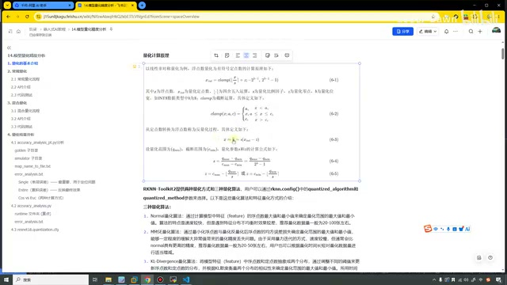

*量化计算原理：讲师展示官方文档中的五个公式。 · [原片 01:36](https://www.bilibili.com/video/BV11DjT6uEhc/?p=15&t=96)*

接下来我们来看，瑞芯微 RKNN-Toolkit2 提供了两种量化方式，还有三种量化算法，是通过 `config` 这个接口去进行配置的。我们可以在这里打开前面的……

[02:03](https://www.bilibili.com/video/BV11DjT6uEhc/?p=15&t=123)

第9节，有一个构建——点错了，是这个转换，`config`。它里面我们找一找，在这里，当时我也都进行标红了。这个就是量化算法，这个就是方式，叫 method；这个 algorithm，是算法。

我们重新回到这篇文档，就不在刚才那里去看了，我们在这里来看。三种量化算法分别是 Normal、MSE，还有 KLD。

Normal 算法的原理，是通过计算模型中特征的浮点数最大值和最小值，来确定量化范围的最大值和最小值。算法的特点是速度比较快，但是遇到特征分布不均衡的时候，效果就会比较差。推荐的量化数据一般是20到100张左右。

第二个 MSE 算法，是通过最小化浮点数据量化、反量化后浮点数的均方误差损失，确定量化范围的。它在一定程度上能缓解大异常值带来的量化精度损失问题。它的核心就是这个，叫什么，均方误差。这个在我们机器学习当中，包括深度学习、PyTorch 当中，也都会经常提 MSE。在这里我就不给大家讲这个，大家知道有这三种算法就可以了。

第三个是 KLD 算法。刚才这里还有一点漏讲：MSE 采用的是暴力迭代的方式，所以它的速度会很慢，但它的精度是这三种算法里面最高的。它推荐的量化数据量是20到50张左右，用户也可以根据时间长短，去进行适当的增加或者减少。

[04:11](https://www.bilibili.com/video/BV11DjT6uEhc/?p=15&t=251)

那都是废话。第三个是 KLD，它是将模型特征中的浮点数和定点数抽象成两个分布，然后通过调整阈值来调整这个分布，通过这个分布确定量化范围的最大值和最小值。它用的时间，还有它的精度，都是介于 Normal 和 MSE 之间的。它推荐的数据量也是20到100张，和我们的 Normal 是一样的。这是三种量化算法。

两种量化方式，一个叫 Layer，一个叫 Channel。Layer 量化方式这里有很多文字，我们就不看了，直接看这幅图。Layer 可以看到这个红、绿、蓝，它们都共用 s 和 z 这个参数，也就是共享相同的量化参数。Channel 这个通道的方式，每一层都会有自己独立的量化参数。所以从这个图，我们也能想得到，Channel 这种方式计算量会更大，复杂度会更高，相应的精度也会更好。这就是两种量化方式。

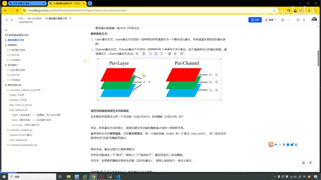

*Per-Layer 共用 s、z；Per-Channel 图中分别标出各通道的量化参数。 · [原片 05:12](https://www.bilibili.com/video/BV11DjT6uEhc/?p=15&t=312)*

看完这个之后，我们再来看下面这里。有这么多算法、方式等等，这些算法到底是怎么样把浮点数变成整数的？也就是前面我们这里的计算原理，只不过前面是数学公式，可能看上去有点不好理解，有点烦。在这里，我用文字来给大家做一个简单的解释。

所有量化方法的核心，都是在建立浮点值和整数值之间的一种映射关系。这个很明显，比如说把18.888映射成一个——1点……映射成一个2，映射成一个3或者4等等。其实它们之间就是在找一种映射关系。

[06:16](https://www.bilibili.com/video/BV11DjT6uEhc/?p=15&t=376)

最常用的方式叫做线性量化，它的基本思想是用一个缩放系数和一个零点，把一段浮点范围线性地压缩到整数范围内。具体来说，它的过程可以简单理解为：先减去一个零点，再除一个缩放因子，最后再四舍五入，变成一个整数。反过来，把整数还原成浮点数，就叫做反量化。这就是它最简单的思想。

在这里，我们也可以根据零点是不是固定为0，把线性量化又分成两种方式，一个叫对称量化，一个叫非对称量化。对称量化就强制零点是0，可以看到这幅图里0就在中间。非对称量化，0就可以不在中间，可以动态地进行计算、动态地进行分布。你看，左边有5个，1、2、3、4、5，5个空点；右边也有1、2、3、4、5，5个空点，就是采用这种方法进行计算的。在我们瑞芯微这里面，采用的就是非对称量化方式。

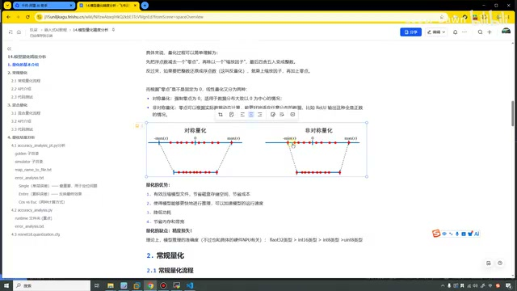

*对称量化与非对称量化的映射示意图。 · [原片 07:16](https://www.bilibili.com/video/BV11DjT6uEhc/?p=15&t=436)*

这里也写了一下量化的优势：可以有效地压缩模型文件，节省磁盘存储空间，节省成本，能够更快地进行推理，限制功耗，节省内存。缺点是精度损失，这个显而易见，都能想得明白。理论上，模型推理的准确度，就是我们的这个数据，越小它越不精准，数据越大越精准。

上面讲的这些内容，就是量化的基本介绍。讲完这些之后，上面这些都是理论，接下来我们来看一下，我们在写代码的过程中，到底应该怎么样来写。写代码的时候……

## 常规量化

[08:16](https://www.bilibili.com/video/BV11DjT6uEhc/?p=15&t=496)

我们也有两种方式，一个叫常规量化，一个叫混合量化。我们先来看常规量化，第一个是常规量化的流程。我把它直接点进来，看上去会大一些。

首先和之前一样，创建 RKNN 对象，配置 RKNN 模型，加载对应的浮点模型，构建 RKNN 对象，导出对象。然后在这里进行量化精度分析，调用的是这个 API。它可以逐层对比浮点模型和量化模型的输出结果，输出余弦距离和欧氏距离，可以分析精度下降的原因。最后一步就是释放 RKNN 对象。

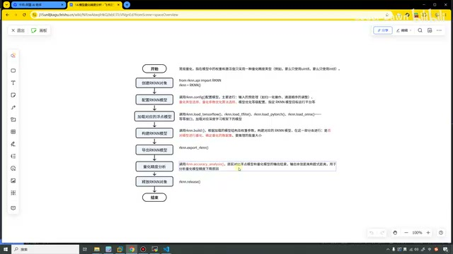

*常规量化流程中，在导出模型之后进行量化精度分析。 · [原片 08:52](https://www.bilibili.com/video/BV11DjT6uEhc/?p=15&t=532)*

在这里，知道流程之后，可能大家还没看到具体代码，还不太理解。我们先知道这个流程，一会儿在代码中具体来看。

看完流程之后，在看代码之前，我们先来看一下它的 API。它调用的 API 叫做 `accuracy_analysis`。这个口语比较差，所以我就不再给大家读这个单词了，总之就是这个 API。

它里面有1、2、3、4，有4个参数。第一个参数是输入的图像，第二个是输出的目录，默认值叫这么个名字，它里面还会生成好多目录。我看看，这个还有这个……这个我们不在这里看，一会儿直接看代码就行了。第三个参数是 `target`，是具体的平台。最后一个是设备的 ID。

同样，在这里也写了一下注意事项：精度分析的时候，可能因为模型太大了，开发板容量不够……

[10:16](https://www.bilibili.com/video/BV11DjT6uEhc/?p=15&t=616)

就会失败。我们就使用这个命令去查一下，查完之后确保它有足够大的空间，然后再来进行量化分析。

> 画面中的检查命令为 `df -h`。

第二个，我们加载 RKNN 模型的时候，这个 RKNN 模型如果缺失原始模型的信息，可能就没有办法进行精度分析了。第三个，在 ARM64 版本中，可以不加 `device_id`。我们之前写了那么多代码，都没加过这个东西。

再下面就是一个举例，还有代码测试，有 PC 端模拟器里面的，有连板推理的。这些我们在代码中来看，一会儿直接看代码里面。

首先打开04这个目录。因为这节课前面忘了，漏掉了，忘了录这节课了，所以下面都已经到14了，我又回过头来录制这节课。

我们来看一下，首先是这个带下划线、跟 pt 的文件（`accuracy_analysis_pt.py`），这个文件是在模拟器里面执行，所以我们来看具体代码。第一个是创建对象，第二个是进行配置。这些我们在代码中来看，我们一会儿直接看代码里面。首先打开04这个目录，就是进行配置。第三个是加载 PyTorch 的模型，第四个是进行 build 构建，然后导出。然后在这里面，就是进行量化精度分析。

第四个参数，设备 ID，直接就没写。第一个是输入的图片，第二个是输出的目录，就是我们一会儿进行量化分析，会生成一大堆文件，这些文件就保存在这个目录下面。第三个是平台，因为我们现在想要看的是模拟器上面的，所以直接把它设置为 `None`。

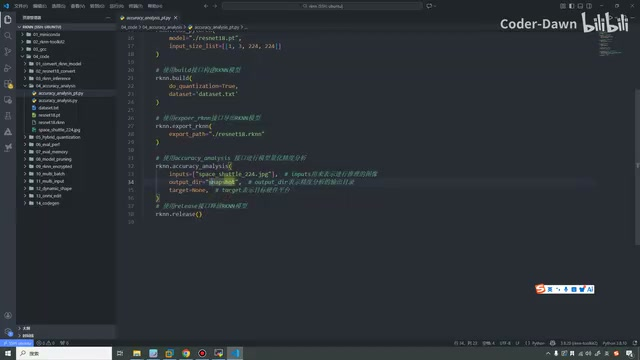

*模拟器精度分析代码：输入图片、snapshot 输出目录与 target=None。 · [原片 11:56](https://www.bilibili.com/video/BV11DjT6uEhc/?p=15&t=716)*

接下来打开 Ubuntu。在这里，我们先跳到04这个文件，我先清一下屏，然后在这里来执行一下，它就是这个。

> 画面所在目录为 `04_accuracy_analysis`，执行的脚本是 `accuracy_analysis_pt.py`。

[12:17](https://www.bilibili.com/video/BV11DjT6uEhc/?p=15&t=737)

好，我们稍微等待一会儿。等待完之后可以看到，现在说就保存在这个里面，一个什么映射文件，还有一个什么 error 这个文件。我们不管它，直接打开代码，打开 VS Code。可以看到，在这里我们确确实实就生成了这些文件。

这些文件到底是什么意思、什么功能呢？在文档中，我也给大家写得很详细。其实在这里我也截图了，我在这里也再贴一下。

首先第一个目录叫做 `golden`。Golden 这个名字叫很珍贵，就是黄金。这什么意思呢？就是说我们把这个目录叫做真实目录，我们认为这个目录下面的值就是标准值。所以它里面保存的是未量化的原始浮点模型，没有量化之前的数据，就是最开始、最真实的数据。

第二个是我们模拟器。模拟器量化之后的值就保存在这里（`simulator`）。你想一下，我们从 float 模型转变成一个 int 模型，一定会有精度的损失。上面这里就相当于保存的是原本的值，下面这里保存的是模拟器上面精度损失之后、量化过之后的值。就是这两个文件。

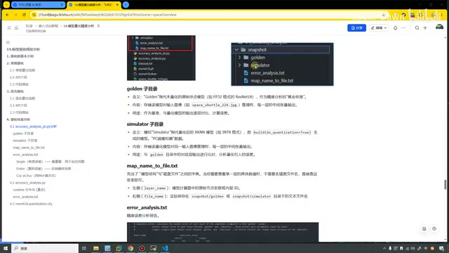

*分析输出目录与 golden、simulator、映射文件和 error\_analysis.txt 的说明。 · [原片 13:40](https://www.bilibili.com/video/BV11DjT6uEhc/?p=15&t=820)*

实际上，这两个文件我们也可以点开看一下，它里面内容特别特别多。我们一般情况下，其实也不看这些文件，包括还有很多 npy，就是文件特别多。这个文件和它其实是对应的，也是这些内容。我们一般会看的，主要还是下面这个文件。

## 量化结果分析：映射文件与误差报告

[14:20](https://www.bilibili.com/video/BV11DjT6uEhc/?p=15&t=860)

就是 error 这个文件。在 error 文件之前，我们先说一下，还有一个文件叫做 `map_name_to_file.txt`。从这个名字也能听到，就是映射，这个东西到这个 file 里面。我们打开这个文件，瞅一眼，把它贴个图放到这里，来看一下它的解释。

你看，左侧叫做 layer_name，就是每一层这些层的名字；file_name 就是这些层对应的具体文件。这个 `input.11`，它对应的文件叫 `input_11.txt`。在这里，我们可以看特别具体、详细的信息，也就是建立了一个映射关系，为了方便我们去看。但一般情况下，我们也不看这个。

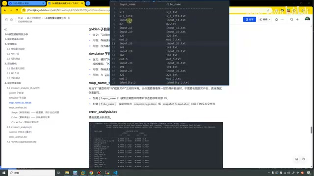

*map\_name\_to\_file.txt 中 layer\_name 与 file\_name 两列的对应关系。 · [原片 14:56](https://www.bilibili.com/video/BV11DjT6uEhc/?p=15&t=896)*

我们一般会看它，`error_analysis.txt`，我点击查看，叫做精度误差分析报告。这里我截的一张图是这样的，我们打开它，可以看到，就是这个图和我这里截的其实是一样的。

我们来看一下，我想一下，还是把它……这样吧，我还是贴一张图，贴一张图好说一点。可以看到，这个图里面分成这么几个部分。我鼠标这里叫做 layer_name，就是层的名称。这里叫 simulator_error，就是模拟器上面的一个分析。它的下面又分成两个，一个叫 entire，一个叫 single。英语好一点，这两个单词也能知道含义。single 就是单层误差，entire 是累积误差。单层误差就代表……

[16:20](https://www.bilibili.com/video/BV11DjT6uEhc/?p=15&t=980)

我们这一层有多少误差，这一层有多少。entire 就是累积有多少误差，就这个意思。我们重点关注的其实是 single，就是单层。因为我们去优化的时候，这层我们发现它不太好，我们就优化这一层，是这样去做的。

它下面还有两个东西，一个叫 cos，一个叫 euc。cos 叫做余弦相似度，euc 叫做欧氏距离。这两个东西，一些特别细节的概念，我们也不需要深入研究。我们要记住的是，cos 越接近1，就代表效果越好。euc 的话，它其实很难接近0，可能从几，2到20之间都会有。

其实我们重点关注的也不是 euc，需要重点关注的是 cos。就是看它，我们可以近似地把 cos 当成准确率吧，可以这样理解吧，也不能这么理解。我们可以近似地把 cos 当成准确率吧，可以这样理解吧，近似地这样看。1就代表百分之百好，0.999 就代表损失了一点点，0.999……就又损失得多了一点点，我们就近似地这样去理解。

> 此处第二个小数的转写同样为0.999，画面未给出讲师口中第二个示例的独立标注，暂保留原转写，不推定其小数位数。

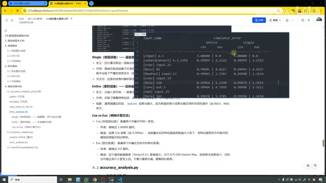

*误差报告包含 entire、single 两组，每组下有 cos、euc 两列。 · [原片 17:32](https://www.bilibili.com/video/BV11DjT6uEhc/?p=15&t=1052)*

当然，它的一些定义、作用，在这里我也都写了下来，这些文字大家可以自己看一下，我就不再读这些文字了。大家记住我刚才说的，我们要尽可能让 cos 这个值接近1。你像这种，我们这里都是999开头的，我们的效果可以说是非常哇塞，所以其实就没什么太多好优化的地方。这个文件分析完之后……

[18:20](https://www.bilibili.com/video/BV11DjT6uEhc/?p=15&t=1100)

我们第一个代码就全部看完了。接下来，我们来看第二个代码，把它折叠起来，就是这个不带 pt 的（`accuracy_analysis.py`）。可以看到，其实这些地方都一样：创建 RKNN 对象，进行配置，然后加载、构建、导出。在这里，唯一不一样的是，我把 `target` 改成了 `rk3588`，用开发板做精度分析。这个目录，我也是为了区分，叫了一个2，随便起了一个名字，多叫了一个名字。

好，在这里我们就再执行一下这个文件，来看一下。我们每次用开发板、连板推理这种方式，有这个“小手机”这种（该口述词转写未确认），速度就会慢一些，因为它要建立一个连接，和去使用这个板子推理。在这里也能看到，就是之前说过很多次的 API 版本，有 server 版本、tool 版本，都是2.3.2。

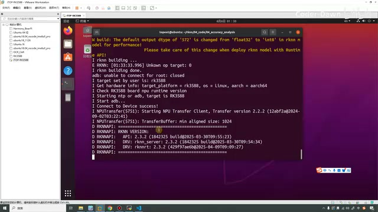

*连板分析建立连接后，终端显示 API、rknn\_server 与工具版本信息。 · [原片 19:20](https://www.bilibili.com/video/BV11DjT6uEhc/?p=15&t=1160)*

等待一会儿之后，现在就执行好了。执行好之后，我们看它又保存到这里了。然后打开它，点哪去了？这个，有这个。可以看到，就在这里，我们多生成了一个 runtime 目录。之前只有这两个，现在多了一个 runtime，下面别的文件其实都是一样的。

这个 runtime 文件是什么意思呢？在这个4.2这里，我也有记录。这个意思，就是我们设置了 RK3588 这个平台之后……

[20:20](https://www.bilibili.com/video/BV11DjT6uEhc/?p=15&t=1220)

在这里我们设置了它之后，就会生成它。simulator 是模拟器端量化后的数据，runtime 就是我们开发板端的数据。所以说，这就是和 simulator 不一样的地方。这个是模拟器端，下面这个 simulator 是模拟器端，runtime 是开发板端。具体在这里也写了一些文字，文字就不看了。

我们来看它，这个文件和前面一样，没什么区别，你看，都是这样左右的。然后这个文件，它就有一点区别了，我们来看一下。

之前我们是没有这边这些信息的，只有左边的。我也再说一点，这是层，这是什么余弦距离、欧氏距离，这是累积误差，这是单层误差，是这样的。在右边这里，这个东西就是我们 NPU 上面的量化误差。同样，这也是累积的，这也是单层的；这是余弦距离，这是欧氏距离，余弦距离、欧氏距离，就是这么个意思。

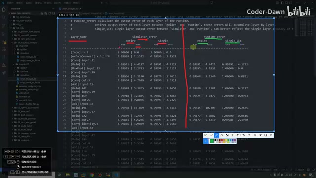

*报告左侧为 simulator\_error，右侧为 runtime\_error，两边均有累积与单层指标。 · [原片 21:44](https://www.bilibili.com/video/BV11DjT6uEhc/?p=15&t=1304)*

我们看一下最终的结果，到最后这里。可以看到，其实确实，我们看这个累积的，就是左侧的，我们可以看到，最终这里好像右边的值，确实总是比左边的值会大一点，比左边的值好一点。也就是什么意思呢？

[22:21](https://www.bilibili.com/video/BV11DjT6uEhc/?p=15&t=1341)

就是说，我们开发板端可能推理的时候效果会更好。但是也不一定，应该也有右边比左边小的，这里就小了。另外的含义和刚才一样，也就不再多讲。

什么时候我们需要特别关注呢？这个值突然发现，这里还是0.999，下面一层降得特别厉害，那可能这一层会有一些问题，我们就需要重点关注。

如果一些眼尖的同学会发现，这边上面怎么空空的？这里有数据，这里怎么没有？这里有数据，这里怎么没有？好像右边的数据比左边少。产生这个的原因是什么？就是说，左边这个我们叫模拟器，模拟器端精度损失的效果。在模拟器处理的时候，它会把这些层，每一层都进行严格的处理。而我们这边叫 NPU 端，开发板端处理。开发板在处理的时候，可能我们也可以叫它更聪明一点，它觉得这两个操作、这个算子可以融合，它就融合到一起了。融合到一起之后，它的步骤就变少了，所以这也是它这里步骤、数据会少一点的原因。

如果大家真的去看，也会发现 runtime 里面的文件，比 simulator 里面的文件数量要少。simulator 文件数量和 golden，也就是未进行量化之前，它们的数据是一样的。对，它俩数量一样多，runtime 数量会少。这个大家自己可以去查一查，使用一条命令查一查文件数量，我在这里就不再给大家查了。

我想一下，说到这里，第一个步骤……

[24:21](https://www.bilibili.com/video/BV11DjT6uEhc/?p=15&t=1461)

也就是我们04这个代码就看完了。这个代码看完之后，我们常规量化也就讲完了。讲完常规量化之后，接下来来讲混合量化。

## 混合量化

为什么会有混合量化这个东西的存在呢？在前面我们进行常规量化，就是把所有的层，这个网络中每一层，采用的都是相同的方式去进行量化。第一层、第二层、第三层，我们每一层采用的方式都是相同的。

但是可能会有这种情况：某一层，我们想要把它使用 int8 类型去进行量化；还有一些层，我们并不想 int8，我们觉得精度下降得太厉害了，就要用浮点型来进行表示。这个时候，采用刚才常规量化就做不到了，就需要使用混合量化来做。混合量化的功能，也就是这个作用。上面这段字也就是解释我刚才说的东西。

我们来看它的用法。第一个，将指定的量化层可以改成非量化层，比如用 float16 进行计算。但是因为我们这个 NPU，它的非量化算力比较低，所以推理速度就会比较慢。第二个，每一层的量化参数都可以进行修改，一般也不建议修改。

在这里，我们就看一下它的流程。量化一共分为两个部分，我们先来看量化第一步。第一步同样，先创建对象、配置对象，然后加载模型……

[26:21](https://www.bilibili.com/video/BV11DjT6uEhc/?p=15&t=1581)

加载模型，然后生成量化配置文件。调用这个 API 之后，会生成三个文件：第一个叫临时模型文件，就是 `.model`；第二个是权重数据文件，`.data`；第三个是量化配置文件，`.cfg`。在这里我们可以进行一些配置，最后释放对象，这是量化的第一步。

量化第二步在这里，同样前面都是一样的。不一样的地方就在第三步，构建混合量化 RKNN 模型，就是调用混合量化 step2 这个接口，把第一步生成的这些文件传进来，然后生成我们要的模型，再把模型导出就可以了。这是混合量化第二步。

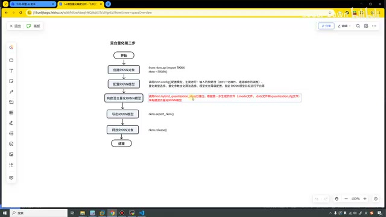

*混合量化第二步流程：将第一步的模型、权重和量化配置传给 step2，再导出模型。 · [原片 26:57](https://www.bilibili.com/video/BV11DjT6uEhc/?p=15&t=1617)*

我们看一下 API。第一个 API 叫 `hybrid_quantization_step1`，传入这么几个参数：`dataset`，然后有个 `rknn_batch_size`，这个 `proposal`，这个就是产生混合量化配置的建议值。瑞芯微很贴心，它帮我们加了这么个参数。把这个参数开启之后，它就会建议我们哪些层可以做量化，哪些层可以不用做量化，通过这个参数进行控制。

下面这个 `proposal_dataset_size`，就是它使用的 dataset 的张数，默认值是1。因为这个功能比较耗时，所以默认就用一张，也就是 dataset 里面的第一张。最后一个是自定义的（`custom_hybrid`），如果有多组输入和输出名，就使用这种方式，我们一般也不太用得到。这是第一步的 API。

接下来看第二步的 API，`hybrid_quantization_step2`。它的参数就是三个，上面生成了三个文件，在这里我们就传入三个文件，之后再生成 RKNN 模型，导出 RKNN 模型就可以了。

[28:21](https://www.bilibili.com/video/BV11DjT6uEhc/?p=15&t=1701)

这是它的 API。接下来就是具体代码，我们直接在这里来看。打开05，我把之前这些文件，刚才测试的文件都删掉。好，我们就打开它，`step1.py`，第一步。

我们构建 RKNN 对象，进行 `config` 配置，然后加载模型。很关键的，就是调用这个 API。第一个是传入 `dataset`，然后这个是批次（`rknn_batch_size`），我们3588的话，要不就不设置，要不就设置为3。这个是否开启混合量化建议的参数值，我们先把它设置为 `False`，默认值也是 `False`。最后一个就是用几张图片，一般我们就采用一张图片，默认值也是1。我们可以点过来看一下，就是这个，这是它的默认值。好，看一下，默认值也是1。

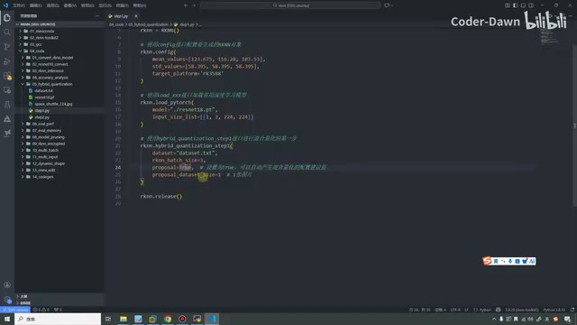

*step1.py 中的 dataset、rknn\_batch\_size、proposal 与 proposal\_dataset\_size 参数。 · [原片 29:12](https://www.bilibili.com/video/BV11DjT6uEhc/?p=15&t=1752)*

把它关掉，关掉之后，到 Ubuntu 里面。我们到05目录下，清一下屏，然后 `ls` 一下，再执行一下。好，执行完了。执行完之后可以看到，我们就生成了三个文件，比如说数据文件，比如说 `.model` 临时模型文件，第三个就是这个 config。

config 的核心就是两部分。你看，第一个部分叫做 custom，自定义的量化层；第二个就是具体的量化参数。自定义的量化层是什么意思？

[30:21](https://www.bilibili.com/video/BV11DjT6uEhc/?p=15&t=1821)

比如说，我们觉得 `input.11` 这一层不好。我想一下怎么讲，我们先说下面吧，先来看量化参数。`x.3` 这个是输入的，下面就是具体的层。

我们来看 `qtype`，就是采用的类型。这个 `asym`，就是非对称量化。这个方式叫 Layer，你看，就和我们前面讲这里的时候一样，这一项有 Layer、有 Channel，这里是 Layer。量化的类型叫 int8。然后 min 和 max 就是量化之后，它把这个值映射到“0、0.000……”（此处数值转写未确认），最小值是这个，最大值是这个。这个是原始值，原始值最小是它、最大是它。这个叫做缩放因子，这个是零点。

就在前面我们做这一课的时候也讲了，你看，先把浮点数减去一个零点，除一个缩放因子，四舍五入变成整数。你看，这是原始值，这是缩放因子，这是零点值，最终它就能计算出这两个值。这就是我们的量化参数。下面虽然很多，但都是这个格式。

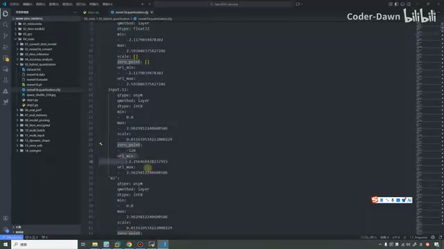

*量化配置包含 qtype、qmethod、dtype、min/max、scale、zero\_point 和原始范围。 · [原片 31:33](https://www.bilibili.com/video/BV11DjT6uEhc/?p=15&t=1893)*

做完这个之后，我们再讲上面这个。上面自定义的，比如说我们觉得这一层，使用 int8 不好，会影响我们的精度，我们就在上面可以这样，用一个 float16。这样一写，就代表这一层采用 float16，我们就不用 int8 了，就是这个意思。我们觉得这一层不好，就把这一层加上去；这层不好，都加上去。

[32:21](https://www.bilibili.com/video/BV11DjT6uEhc/?p=15&t=1941)

我先删掉。这就是这个参数的作用，我们可以手动进行配置。配置完之后，就进入第二步。第二步，你看，我们调这个 API，把前面生成的这三个东西传进来。传进来之后，我们就可以重新进行分析，再把它导出就可以了。

同样，我们把它也执行一下，在这里直接来做 step2。稍微等待一会儿，因为每次用这种方式去执行，其实就是稍微有一点点慢。

然后其实这里特别地慢，刚才看这个文档，记得在哪里好像也看到了，是这个混合量化，应该是 API 吧。然后就是这里……我忘了。反正就是刚才在哪里已经看到了，就是速度会比较慢。

> [33:20–34:10 局部转写修订](https://www.bilibili.com/video/BV11DjT6uEhc/?p=15&t=2000)：原始转写在33:31–33:59出现乱码和重复“通过”。此处依据协调器提供的2000–2050秒音频局部重新识别及原片时间映射恢复语句，并结合已查看画面核对场景；不是人工听音确认。原始与补充识别均保留在 sources。

当然，这会儿也已经好了，好了就行。那好了之后我们看一下，它同样地也生成了这些值，和刚才也都是一样的，这里也是量化。我想一下，那就这样，我把它保存下来。

[34:21](https://www.bilibili.com/video/BV11DjT6uEhc/?p=15&t=2061)

总之，这就是我们完成的混合量化过程。有一个地方，就是刚才在这里把它设置成 `False`，它没有给我们建议值，所以需要我们自己手动在这里进行修改。

现在我们把它设置为 `True`。设置为 `True`，再看一眼，现在我们再执行一下。这次设置为 `True` 之后，我们再打开，还是这个文件，可以看到比刚才多了很多信息。多了哪些信息呢？就是 custom 这里，它告诉我们，可以把这些层，我截下来，就是叫 `input.11`，然后82、572、572……它在这些层使用 float 类型会更好，我们的精度会更高。它给出了这些建议，这就是刚才那个参数的作用。

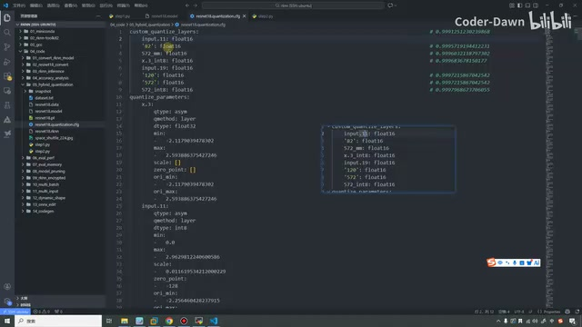

*proposal=True 后，custom\_quantize\_layers 出现 float16 建议层和旁侧数值注释。 · [原片 35:33](https://www.bilibili.com/video/BV11DjT6uEhc/?p=15&t=2133)*

其实我们一般来讲，怎么看呢？来看一下，就是它为什么会给我们这些建议。首先来看，就是 `input.11` 这里，你看，从这里都是999，然后到下面 `input.11`，到这里输出的时候，它变成了0.9991。它觉得这里精度下降得比较多，所以建议你把这一层用这个 float 的……你看，它后面也写了0.9991。我把它写得全一点，然后接下来是这个82。

[36:24](https://www.bilibili.com/video/BV11DjT6uEhc/?p=15&t=2184)

82在这里。这里你看，0.9991。我再看一眼，它这个是怎么对的。它这里没写，那不管它，就是它觉得从这里，从这个0.9991这里，然后到下面这里……反正它觉得这里不好，然后它就给了一些，就这里，它觉得这里不好，就给了一些建议值。包括还有这些，像572，这些572在最下面。

好，反正总之就是它觉得这里不好，就给了建议值。但其实我们效果已经足够好了。总之它是这样的，它给了这些，然后我们把这个代码也改，把它改成……我们也去执行一下。执行完之后，可以稍微进行一个对比。

在这里执行的时候会比较慢，还是稍微等一会儿吧。好，现在还没生成完，还是一些中间的，我们再等一会儿吧。好，现在已经生成完了，生成完了。

[38:24](https://www.bilibili.com/video/BV11DjT6uEhc/?p=15&t=2304)

生成完之后，我们再打开，这样。现在已经生成完了，生成完之后再打开，这样，上面这里这样。我们来看一下，它刚才建议的这个，折叠起来，这是它建议的这些。

我们再来看一下，不看那么多了，就看572这里。572在最下面，你看它原本的……算了，还是这样看吧，好像有点小。上面，现在打开的是上面这个，就是第一次没有使用建议值的。我们看一下572这里，就是这里，“99937，99937”，然后“913、913、913”，是这么一串。单层的话，是什么“919393”。然后我们再看刚才使用了这个之后的，可以看到刚才那个……

> [39:54–40:14 数字待确认](https://www.bilibili.com/video/BV11DjT6uEhc/?p=15&t=2394)：原转写将连续小数识别为上述数字串；源画面只有640×360，不能把这些字串可靠还原为完整小数。保留讲师比较的顺序与原串，具体报告请结合截图查看。

[40:24](https://www.bilibili.com/video/BV11DjT6uEhc/?p=15&t=2424)

那个“13”，我们在这里其实都明显有提升。这样对比吧，你看，原本没有使用建议值去优化之前，这里都是“913、913”。现在这里，这个变成了一个效果，这里整体的效果也是有变好的。然后单层的效果，看，也是从原本的，你看是999，然后现在变成了“1.6”（此处原转写如此，画面对应的 cos 显示为1.00000）。当然这里是一样。左边，你看，累积的也是有变好。

总之是什么意思呢？采用了那个参数值进行优化之后，不管是左边累积的，还是右边单层的，我们效果确实变好了。

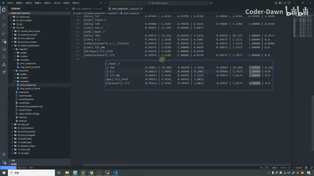

*572附近结果对照：讲师将未采用建议的报告截图贴到新报告下方比较。 · [原片 40:48](https://www.bilibili.com/video/BV11DjT6uEhc/?p=15&t=2448)*

我们再看一个别的层吧，还有，我们再看一下这个，看上面一个。先看没有优化之前，`input.11`、82这个，你看它总体是这样，单层也是这样，这是之前的。然后我们看之后的，之后的在这里，你看这些全都是一点，1.0。所以说，它确实精度变得更高了，但是速度也会变得更慢。因为确实把 int 类型又改回去，改回 float 类型了。

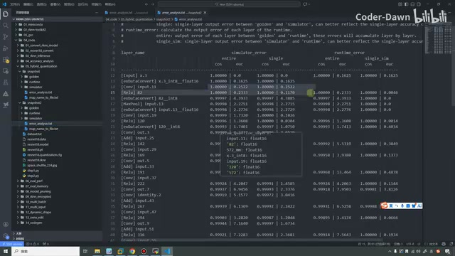

*采用 float16 建议后的前部层报告，若干 cos 单层指标显示1.00000。 · [原片 41:52](https://www.bilibili.com/video/BV11DjT6uEhc/?p=15&t=2512)*

总之，大家知道这个就可以了。我们在做的时候，如果明显像这种，其实都已经很好了，不需要进行优化。实际过程中，发现有哪些确实不好的时候，我们就进行这些优化……

[42:24](https://www.bilibili.com/video/BV11DjT6uEhc/?p=15&t=2544)

那就可以了。讲完这个，其实我们第三个混合量化也已经讲完了，代码也分析了。第四点，前两个我们已经看过了，这里其实就是解释了一下这个，这个我们其实也已经说过了。

说完这些，本节课就都已经讲完了。这节课我看一下，也都42分钟了，我们这个视频就到这里。最后也是感谢大家的观看，谢谢大家，谢谢大家。
