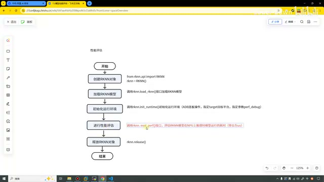
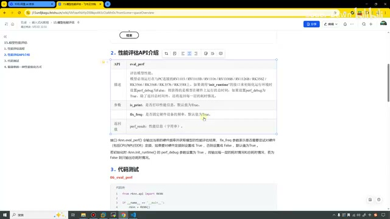
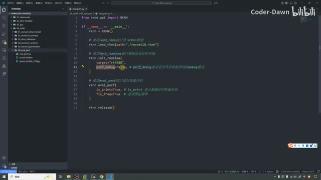
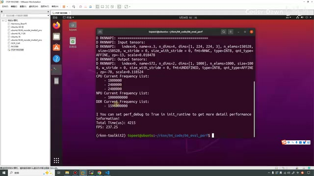
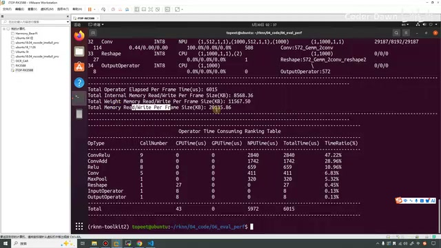
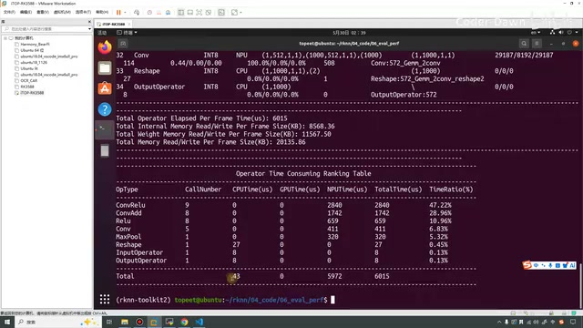
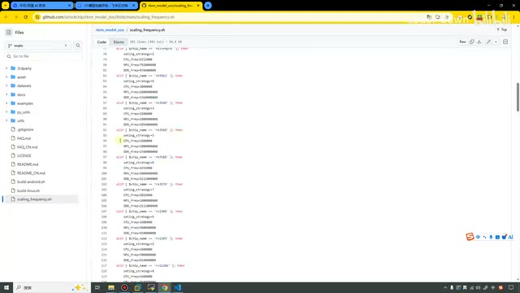

# P16｜15_模型性能评估

> 来源：[B 站课程第 16 集](https://www.bilibili.com/video/BV11DjT6uEhc/?p=16) · 全片 12 分 12 秒。
>
> 整理方式：忠实讲稿，保留原讲述顺序、解释、例子、操作和限定，仅清理停顿、结巴与无新增含义的即时重复。转写及恢复记录保存在 sources；局部不确定处就地标注。原画面 640×360，小字受源清晰度限制；图注为编辑说明。

## 性能评估流程 · 00:00

这节课我们来看第 15 讲，模型性能评估。同样，这节课分为四个部分来说明。第一个部分叫作性能评估的流程，我们直接将它打开，可以放大。

这怎么是混合量化呢？好，这个是从上节课那里复制过来的，忘了修改了，我来让它修改一下。那就这样吧，这个就是性能评估。

我们一开始需要创建 RKNN 对象，然后加载 RKNN 模型，然后初始化运行环境。在这里我们需要注意：初始化运行环境之后，我们就可以进行性能评估了。进行性能评估的时候，使用的是 `eval_perf` 这个接口。用这个接口，我们就可以评估 RKNN 模型在 NPU 上推理模型的耗时。最后就是释放，和上节课那个其实也类似，都非常简单。



*修改标题后的性能评估流程，包含创建对象、加载模型、初始化、评估与释放。 · [原片 01:00](https://www.bilibili.com/video/BV11DjT6uEhc/?p=16&t=60)*

这个流程图，在最开始进行模型转换这里的时候是没有画的。后面也是为了更加清晰一点，就开始把这个流程图加了上来，大家可以参考一下这个流程图。

## 性能评估 API · 01:35

第二个部分就是 API 的介绍，我们来看一下这个评估的 API。里面第一个是它的描述，我们看一下：用 `init_runtime` 的时候，需要将它设置为 `True`〔这里指 `perf_debug`，见后续代码〕，设置为 `True` 之后才能开启。

如果设置为 `False`，它获得的是模型在硬件上运行的总时间；设为 `True`，就可以返回每一层的耗时了。

参数有两个，第一个是是否打印性能信息，第二个是是否固定频率。在这里同样有一个简单的说明：是否打印性能信息，我们一般都是需要打印的，不打印我们怎么看呢？打印了，我们才能看到这些参数、这些数据到底怎么样。

第二个是是否需要固定硬件的频率。我们正常也需要固定，如果不固定，这个数据就不好比较了。比如说这会儿它的负载比较大，性能可能就比较差；如果这会儿负载比较小，性能可能就比较好。这样就会给数据带来不确定性。所以正常我们也是需要对它进行固定的。

当然瑞芯微在这里也很贴心，帮我们把这两个参数默认值都设置为了 `True`，其实我们也都可以不设置。



*eval\_perf 的参数说明与默认值。 · [原片 03:00](https://www.bilibili.com/video/BV11DjT6uEhc/?p=16&t=180)*

## 代码测试：先关闭详细评估 · 03:19

说完这个之后，第三部分就是代码测试，这个代码非常简单，我们直接过来看吧。在这里我已经提前将代码传过来了，就是这个 `06`〔画面目录 `06_eval_perf`〕。

这个代码，初始化 RKNN 对象，然后加载 RKNN 模型。这里需要注意，就是 `init_runtime`，要在里面设置我们的 `perf_debug`。我们先将它设置为 `False`，先来看一下。然后这两个，就是使用它进行性能评估。我们先将它设置为 `False`，来执行一下。



*测试代码在 init\_runtime 中先设置 perf\_debug=False，并调用 eval\_perf。 · [原片 03:48](https://www.bilibili.com/video/BV11DjT6uEhc/?p=16&t=228)*

在这里先进行一下〔此处操作口述不完整，画面随后切换到终端〕，然后我们直接来执行它。我看一下现在，这是是否……我们稍微等一下。同样，这里我们也是进行了连板推理，大家一定要识别出这个像数据一样的接口才行〔原话指代不清，未据此补写接口型号〕。

画面中执行的是：

```bash
python eval_perf.py
```

我们可以看到，这里打印的信息比较重要：CPU 的频率、NPU 的频率、DDR 的频率，这个也是在很早之前，我已经带大家设置过了。这里 CPU 也是按组进行设置的，所以这里输出也直接就是三个组。NPU 这些我们之前也都设置过了。

比较重要的是这行信息，也就是它的总时间是“4251”〔口述转写；屏幕实际打印 `Total Time(us): 4215`〕，就是推理一帧图像，它总的耗时时间是这么多。然后它的 FPS 是 `237.25`，这个就是它的频率值〔沿用讲师表述〕。



*关闭详细评估后的频率打印、总时间 4215 us 和 FPS 237.25。 · [原片 05:00](https://www.bilibili.com/video/BV11DjT6uEhc/?p=16&t=300)*

接下来我们把它打开，设置为 `True`，然后我们再来进行一下，这里也是稍微等待一会儿。可以看到，我直接将它放到最大，这次输出的信息就比刚才多了一些。上面这些我们就不看了，从这里开始看比较重要的信息。

首先第一个信息是什么？我这一帧……〔转写在 05:54—05:58 对“我这一帧”连续重复，未作为新的内容重复排版〕这个信息就比刚才多了一些。

上面这些我们就不看了，我们从这里开始看比较重要的信息。首先第一个信息，`Total Operator Elapsed Per Frame Time`，什么意思呢？这个也是我们每一帧图像推理的总耗时，是这么多〔屏幕值 `6015 us`〕。

第二个叫作内部内存读取，我们读或者写，每帧……这里这个英文，我们翻译过来看，就是总的内部内存读写每帧的大小，也是这个 `8568.36`。然后这个叫权重，权重的内存是这么大。然后这个是它们的总和，其实就是这两个数字相加。

可以看到，这个“36 加 5，86；7 加 8，15；6 加 6，12，13”〔原口述心算较碎，保留读数；画面为 `8568.36 + 11567.50 = 20135.86 KB`〕，就是将它俩加起来，这个是总的大小。



*开启详细评估后的每帧时间、内存读写和算子耗时表。 · [原片 07:00](https://www.bilibili.com/video/BV11DjT6uEhc/?p=16&t=420)*

然后下面这里，就是我们开启这个之后，就可以看到每一层详细的信息。首先 `OpType` 就是算子操作的类型，这个是它的次数，就是调用了几次。然后这是 CPU 的时间、GPU 的时间、NPU 的时间、总时间，还有占有率。这里是具体的算子操作。

第一个算子就是卷积加 ReLU 这个激活；第二个是卷积加这个 Add，加法或者叫残差连接。这个是 ReLU 激活函数，这是一个普通的卷积，这是最大池化层。就是 ReLU 激活，就是……〔讲师此处语句未完，接着转向下面的格式转换〕

进行格式的转换，然后输入、输出，这个是它的类型。

接下来我们来看调用的次数。可以看到，我们这个调用了“八次……九次、八次”〔口述边指边读；画面 `ConvRelu` 为 9 次，`ConvAdd` 为 8 次，`Relu` 为 8 次〕。这是我们的输入、输出，然后什么转换都是一次。

CPU 也是这个 Reshape 的操作，还有输入、输出，这三个操作是我们 CPU 来进行的。GPU 就没用到，其他这些卷积、这些操作，是由我们的 NPU 来执行的。

这里是它总的时间，还有占有率。可以看到，像这个算子，它的总耗时时间是最长的，占据了 `47.2%`〔屏幕 `ConvRelu` 的 `TimeRatio(%)` 为 `47.22%`〕。然后以此类推，下面的都会少一些。



*算子耗时占比与 CPU、GPU、NPU 的汇总行。 · [原片 09:00](https://www.bilibili.com/video/BV11DjT6uEhc/?p=16&t=540)*

最后还有一个总的，就是 CPU，它一共进行了这么多，它的总耗时 `6015`，这 `6015` 怎么来的？就是这样来的。然后 NPU 用了这么多，CPU 其实就是它减掉，用得比较少，或者就是这么三个一加，`43`〔讲师此处先说 CPU，画面 `Total` 行 `CPUTime=43`、`GPUTime=0`、`NPUTime=5972`、`TotalTime=6015`，单位均为 us；保留原先的口述指代，不改成另一种结论〕。

那知道这个有什么用呢？就是说，在本节课，好像没什么用，我们就是用了一个 API，然后我们能看到这些信息。但这个对于我们真正工作当中还是非常有用的。

就是我们的模型，如果推理的时候发现它很卡，速度很慢，画面非常不流畅，我们就可以对它进行一些优化。具体要进行哪些优化呢？我们就可以看这个，这个也算是一个表格，就可以来看这个表格。是不是我们输入、输出，

然后我们 Reshape，花的时间比较长呢？如果是这样，我们就可以在这里进行一些优化。如果说是我们卷积方面某一些不合理的方式，导致卷积耗时比较长，那我们就去优化这里。

知道这个，就会在我们进行模型优化的时候，给我们提供一个方向。这个也是非常有用的，怎么说呢，到后面大家真正用起来的时候就知道了。

包括后面我们也会讲 YOLO 系列的部署，像我们的某些后处理，就需要把它修改。我们不让 NPU 去执行，我们让 CPU 去执行等等，这个后面再说。

讲完这个，代码测试这个部分也就已经做完了。包括这里其实还有很多字段，在这里我也都给大家列出来了。

## 最简单的一种性能优化方式 · 11:10

最后第四点，就是有一个最简单的性能优化方式。其实之前我们也已经说过，就是直接把 CPU、DDR、NPU 的频率搞到最高。一般来讲，只要它们的频率是最高的，性能也是最好的。

在一开始，我其实已经带着大家设置过了。这节课我们再打开一下，这个 Model Zoo 上面也有一个一键执行的脚本。但这个脚本，我不知道你们用起来好不好用。我用它的时候，好像它并不是很好用。大家也可以试一下，试完之后也可以告诉我这个好不好用。



*Model Zoo 的 scaling\_frequency.sh 脚本页面。 · [原片 11:48](https://www.bilibili.com/video/BV11DjT6uEhc/?p=16&t=708)*

那这个就不多说了，因为前面也已经说过。

说完这个之后，本节课的内容就已经全部讲解完了。最后也是感谢大家的观看，谢谢大家。

> 尾部识别说明：致谢后转写含“在那上”“我既历 我既好”“我既好”，没有形成可确认的课程内容，未改写为讲师结语。恢复记录中 731.6 秒同起点非空项已合并保留；732.42 秒以后的反复“我既好”超出 732.408 秒媒体范围，保留原始 ASR 与恢复记录供核查。
