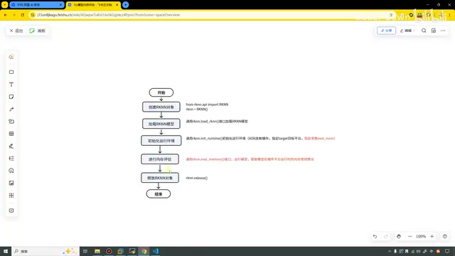
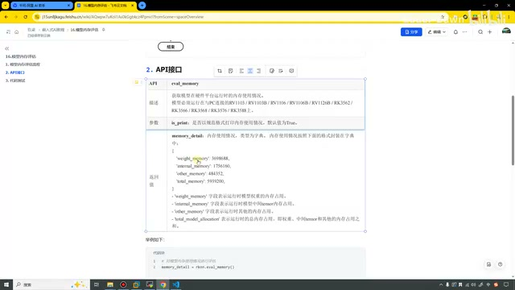
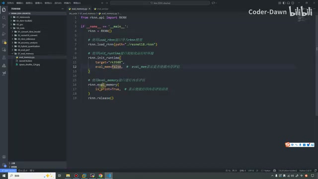
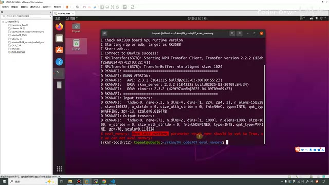
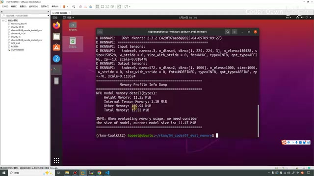
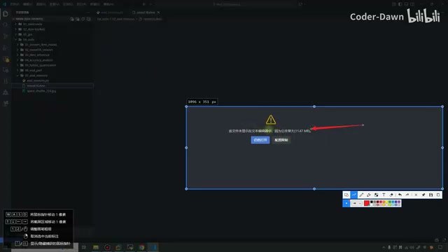

# P17｜16_模型内存评估

> 来源：[B 站课程第 17 集](https://www.bilibili.com/video/BV11DjT6uEhc/?p=17) · 全片 5 分 28 秒。
>
> 整理方式：忠实讲稿，不做摘要压缩。保留原讲述顺序、解释、操作与等待过程，仅清理停顿、结巴和无意义即时重复。文字以本地转写为基础，接口术语经画面核对；不能确认的读数另作标注。
>
> 图片说明：6 张原视频截图，源画面 640×360，小字受源画质限制。图注为编辑说明。原始转写中超出实际片长的重复致谢及“我知道大家”未纳入正文，详见 sources 中的归一化审计。

## 流程与反复讲解的原因 · 00:00

这节课我们来看第 16 讲，模型内存评估。这节课也是分为三点来讲，第一个是流程，第二个是 API，第三个是代码测试。

我们首先……这里也忘了改了，那算了，直接把它删掉了。它的流程和上面的几乎都是一样的，也是非常简单：创建 RKNN 对象，加载模型，初始化运行环境，进行内存评估。进行内存评估的时候调用的是这个接口，`rknn.eval_memory()`。然后释放对象，最后是结束。

*模型内存评估的流程与 eval\_memory 接口。 · [原片 00:40](https://www.bilibili.com/video/BV11DjT6uEhc/?p=17&t=40)*

这个很简单。为什么我在一遍一遍地画这个流程图，然后也一遍一遍地去讲这个东西呢？就是为了让大家在脑子里面对它有一个深刻的印象。我相信大部分人在看这个课程的时候，可能也没有跟着去写代码。那我说得多了，大家可能印象也就更深刻了。

## API 的参数与返回值 · 01:00

看完这个之后，我们接下来就看第二步，第二步就是 API 的介绍。这节课主要用的就是这个 API：`eval_memory`。

它的参数只有一个，就是是否以规范的格式去打印它的内存使用情况。`is_print` 默认值是 `True`，就是要打印。

它的返回值有好几个，可以看到有四个。这个 Weight Memory 就是权重的内存占用；Internal Memory，就是模型中间 Tensor 的内存占用；Other Memory 就是其他的内存；Total 是总的，把它们都加起来。

*eval\_memory 的参数与四类返回内存数据。 · [原片 01:30](https://www.bilibili.com/video/BV11DjT6uEhc/?p=17&t=90)*

然后这里有个示例代码，示例这个都有。好，这个看完之后，我们直接就来看代码。这里需要注意一下，它和上节课的这个
性能评估一样。如果说我们想要使用这个接口，我们必须在 `init_runtime` 当中将它开启。

## 在初始化时开启评估，先试 False · 02:12

这是上节课的这个 `perf_debug`，我们想要将它设置为 `True`。那这一课是这个——这个我也不会读它，`eval_mem`，这么读吧。也是需要在 `init_runtime` 中先将它开启，然后下面我们再用。

*示例代码在 init\_runtime 中设置 eval\_mem，并调用 eval\_memory。 · [原片 02:30](https://www.bilibili.com/video/BV11DjT6uEhc/?p=17&t=150)*

我们现在这里先假设我不开启它，把它设置为一个 `False`，然后我们来执行它。在这里，我们执行一下。我们执行一下，然后也稍微等待一会儿。

和之前一样，我们需要有这个小手机图标。因为我们现在进行的都是一个连板推理，所以需要有它。

可以看到，直接出了一行多的红字。就说这个内存评估，`init_runtime` 的这个参数应该被设置为 `True`。

*未开启 eval\_mem 时的红色错误提示。 · [原片 03:10](https://www.bilibili.com/video/BV11DjT6uEhc/?p=17&t=190)*

哦，它居然是个 `or`。哦，或者我们……它这句话的意思，就是我们想要进行它，我们就把它设置为 `True`；或者我们就不要再进行这个内存评估了。

接下来我们将它设置为 `True`。设置为 `True` 之后我们再来执行一下，也是稍微地等待一会儿。这个连板推理其实有时候感觉它还挺慢的。它建立这个连接的时候，也是需要一些时间的。

## 查看内存结果与模型文件大小 · 04:02

我们来看一下，这个 Memory Profile Info 就打印出来了。这是它的一个细节，details，然后它的单位……叫什么，data〔此处英文口述识别未能确认；画面写的是 `NPU model memory detail(bytes)`〕。

这个是 Weight Memory，权重的这个内存是 11.25 兆。然后 Internal，这个内部的 Tensor，张量，它的内存是 1.10 兆。然后其他的是 169.94 K。总的就是把它们都加起来，加起来是 12.52 兆。

*内存评估输出的各项内存与当前模型大小。 · [原片 04:30](https://www.bilibili.com/video/BV11DjT6uEhc/?p=17&t=270)*

> 画面读数：Weight Memory 11.25 MiB，Internal Tensor Memory 1.10 MiB，Other Memory 169.94 KiB，Total Memory 12.52 MiB。正文保留讲述时“兆”“K”的表达。

然后下面还有一个信息，就是当这个内存评估使用的时候，我们需要知道这个模型的大小。我们当前这个模型的大小是 11.17〔此处转写读数为 11.17，无法仅凭转写确定口述；同一画面显示 `current model size is: 11.47 MiB`，不将两者静默合并〕。

这个我们来看一下，可以看到，这里也是有显示的，这个非常好。就是你看它说，在这个 VS Code 中显示不出来，因为它非常大，它是 11.47 兆。

*VS Code 提示模型文件过大，显示文件大小。 · [原片 05:05](https://www.bilibili.com/video/BV11DjT6uEhc/?p=17&t=305)*

好，所以说，用这个接口之后，除了能看到 NPU，就是这里执行的这个细节之外，我们也是能获取到这个模型具体有多大。

讲到这里的话，我们这节课就已经讲完了。最后还是感谢大家的观看，谢谢大家。
