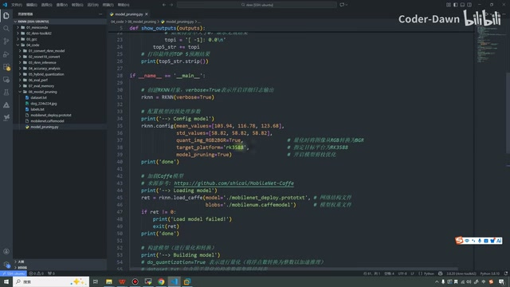
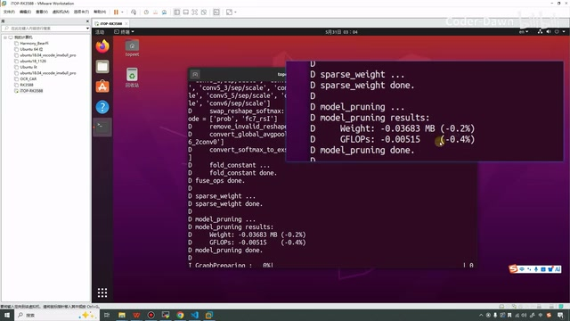
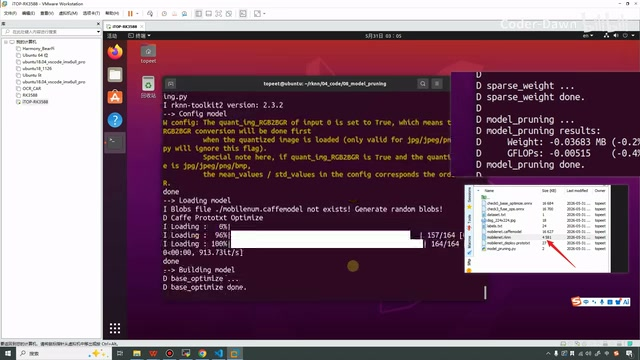

# P18｜17_模型剪枝

> 来源：[B 站课程 P18](https://www.bilibili.com/video/BV11DjT6uEhc/?p=18) · 全片 11 分 40 秒
>
> 整理方式：忠实讲稿，不做摘要压缩。保留原讲述顺序、解释、例子、操作及限定，仅清理停顿与无意义重复，补充标点。术语按画面校正；无法确认的识别在原处标注。原始与规范化转写保存在 sources。
>
> 图片说明：6 张原视频截图，原始画面 640×360，小字受源画质限制；图注为编辑说明。

## 模型剪枝的介绍 · 00:00

这节课我们来看第 17 讲，模型剪枝。从左侧也可以看到，这节课也是分为三个部分来进行说明：第一个是模型剪枝的简单介绍，第二个是 API 的介绍，第三个是代码测试。接下来我们就一个部分一个部分地来看吧。

首先我们来看模型剪枝的介绍。模型剪枝一般可以分为有损剪枝和无损剪枝两种方式。瑞芯微这个工具，它提供的这种剪枝方式是无损剪枝，也就是可以在减少模型大小和计算量的前提下，不会降低模型的浮点精度，甚至可以提高模型的量化精度。

这句话什么意思呢？就是说我们瑞芯微采用的是无损剪枝，它几乎不太会影响我们的精度。但是下面还有一句话也很重要，就是不是所有的模型都可以进行无损剪枝。无损剪枝是根据模型权重的稀疏化程度，来去除一些对模型结果不造成影响的权重和特征通道，以这种方式来减少模型的大小和模型的计算量。

*模型剪枝介绍与官方示例日志。 · [原片 01:00](https://www.bilibili.com/video/BV11DjT6uEhc/?p=18&t=60)*

这个就是我们瑞芯微模型剪枝的一个简单介绍。它非常非常非常简单，它其实就是在我们的配置、模型配置的这个 API 里面，将 `model_pruning` 这个参数设置为 `True` 就可以了。这样模型就会自动进行剪枝。如果说剪枝成功，它会输出剪枝的相关信息；如果说不能剪枝，也就不会打印任何信息。

它不会影响我们模型的转换。这个是简单的介绍。

## 与训练阶段剪枝、微调的区别 · 02:07

在这里有一点需要区分一下。大家如果稍微了解一点，经常就能在网上听到：我们做模型部署，很重要的一点是做模型剪枝、什么蒸馏，然后什么〔原转写“复处理”，具体词未确认〕等等，听上去还挺复杂的。但是这里其实只是改了一个 API 的参数，为什么会有这种情况呢？

就是我们平常说的模型剪枝，可能是下面这种情况：它是一种结构化的剪枝加微调的方式。比如说以 PyTorch 为例，它是需要在 PyTorch 训练阶段主动介入的。它的逻辑是什么呢？就是移除整个卷积通道或者网络层，让剪枝后的模型依然保持规整的结构。这样 NPU 才能利用 DMA 连续读取和编译器优化，去实现真正的加速。这个是我们说的那种在训练阶段进行的剪枝。

标准化的流程就是，使用一个预训练的基线模型，比如我们去那个〔原转写“Transformer”，此处所说的模型来源未确认〕上面去找一个。然后我们使用第三方的库，比如这个 Torch-Pruning，执行结构化剪枝，然后再进行微调，恢复我们的精度，然后再去进行量化。大概这么一、二、三、四，四个步骤，我们就可以去进行剪枝和微调，减小体积的同时提升我们的精度。

经过一些人的测试，像这个 YOLOv8，它将参数量缩小 30%，然后推理速度提升两到三倍。这个数据真不真实，我们就先不考虑它，它是有这样的一个操作的。我们可以区分一下：一个是在训练阶段去进行剪枝加微调，一个是通过 API 的参数去减小模型体积、去进行的剪枝，这是两种不同的方法。

## 这节课用到的 API · 04:36

看完这个之后，我们再来看一下这节课要用到的 API。第一个就是在这个 `config` 的，就是鼠标这里，在它里面将它设置为 `True` 就可以了。第二个就是，我们这节课使用的是 Caffe 的模型。Caffe 模型加载的时候，它的参数就会稍微多一点。

第一个是 `model`，Caffe 模型文件的路径；第二个是 `blobs`，然后是它的二进制数据文件的路径；第三个是，如果说有多个，我们需要给它找这个名字〔画面为 `input_name`，即输入名〕。这个是第二部分。

*load\_caffe 的模型文件、权重数据与输入名参数。 · [原片 05:00](https://www.bilibili.com/video/BV11DjT6uEhc/?p=18&t=300)*

## 剪枝代码测试 · 05:18

第三部分就是代码的测试了，接下来我们就直接来到代码这里。在这里我已经提前写好了，和之前也是类似的。有一个这个函数，就是为了显示这个 Top-5 的标题。然后在里面，现在的话应该非常熟悉了：创建 RKNN 对象，进行配置。

在这里要注意的，第一个是我们需要将它设置为 `True`〔画面为 `quant_img_RGB2BGR=True`〕。这是因为这个 Caffe 模型，我们使用的是这个模型〔画面中为 MobileNet Caffe〕。这个模型，它要求的就是它在做的时候，它是需要 BGR 的，所以说我们在这里就给它转，这个类型一致就可以了。然后比较重要的就是这个参数，我们需要将它设置为 `True`〔`model_pruning=True`〕。然后我们加载模型，构建模型，将模型导出，最终释放这个资源。这个代码其实非常简单，和我们之前看的代码也没什么本质上的区别。

*配置中开启 quant\_img\_RGB2BGR 和 model\_pruning。 · [原片 06:30](https://www.bilibili.com/video/BV11DjT6uEhc/?p=18&t=390)*

接下来我们就把这个代码运行一下，我们来看一下。在这里我们打开虚拟机，输密码，然后进入这里，刚卡了。那我重新一下，我们先进入我们的环境里面。

好，现在我们已经进入了，然后我们执行一下，我将它放大一点。可以看到，现在就已经执行成功了，所以我们 RKNN 模型导出成功。我们可以在这里看一下，已经导出成功了。〔终端操作的完整命令未能从本次源画面可靠辨清，此处保留讲述的操作过程，不补写命令。〕

然后我们怎么看到底有没有进行剪枝成功呢？有两个方法。第一个方法是，刚才这里是我们开始执行的，它在这个日志里面，我们可以看到……这里，我将它……接下来，模型，就在这里。〔这一段为寻找并切换日志的位置，原转写“手挖手”等零散词无法可靠确认。〕

我将它切到这里，可以看到，它这里已经输出这个打印信息了。你看，它说开始进行模型剪枝了，模型的剪枝结果是：这个权重少了 0.03683 兆，大概减少了 0.2%；然后这个运算减少了 0.4%〔画面日志为 `Weight: -0.03683 MB (-0.2%)`，`GFLOPs: -0.00515 (-0.4%)`〕。

*终端显示 model\_pruning 的权重与 GFLOPs 减少结果。 · [原片 08:30](https://www.bilibili.com/video/BV11DjT6uEhc/?p=18&t=510)*

总之，虽然说它可能减少得比较少，但是它还是减少了。只要有减少，我们就会有一定的提升。这是我们看它有没有剪枝的第一种方式。

第二种方式，我们可以这样去看。就是说在这里先刷新一下，我用 SSH 连接上来，然后也打开了这个目录，这里有这个模型，我将它也截下来。可以看到它的 size，它是 4581〔这里保留讲师读数；文件列表的小字和单位未能可靠辨清〕。

接下来我们在代码里面进行一点修改，我们将它改成 `False`，然后我们再来运行一下。然后我们重新打开它，我们刷新一下。来，我们对比一下：现在的话它是一个“458”〔原转写如此，完整读数未确认〕，刚才的话是一个“4581”。比如说我们开启这个剪枝之后，它是减少了一点点，是真的只有一点点。

*关闭剪枝后重新构建，画面保留前次日志及文件大小对比。 · [原片 09:30](https://www.bilibili.com/video/BV11DjT6uEhc/?p=18&t=570)*

然后我们也可以再看一下这个终端的打印，我们是在这里执行的，我们看一下，刚才就是在这个稀疏权重的下面，你看，现在在这里，就已经没有模型剪枝的信息了，直接就是其他的打印信息了。可以看到，我们找不到了。所以也就是说……〔10:18—10:29 原转写反复出现“吃饭的一个信息”，结合前后操作只能确认仍在查找日志；具体语句无法可靠确认，原文保留于 sources。〕可以看到，我们找不到了。所以也就是说，只要我们设置了这个参数，它就可以自动进行模型剪枝。

## 剪枝幅度与结束 · 10:40

虽然说这个模型它剪枝的效果也就那样，也就减少了 0.2%，就很小。但是如果说我们的一个模型特别大，有百分之零点几或者几点几，它其实就已经很多了。

然后在它官方的说明里面，我看一下，也不知道它是用哪个模型测试的，它是有减少 6.9% 的，运算量减少 13.4% 的。这个数据其实就是非常好的一个数据了。

*回到官方示例，展示权重和运算量的减少幅度。 · [原片 11:30](https://www.bilibili.com/video/BV11DjT6uEhc/?p=18&t=690)*

总之，这个模型剪枝、自动剪枝的方法特别简单，大家下去也可以试一试。讲到这里，这节课就已经全部讲完了。最后也是感谢大家的观看，谢谢大家。

