# 18_模型加密

> 原视频：[P19 · 18_模型加密](https://www.bilibili.com/video/BV11DjT6uEhc/?p=19)｜范围 00:00–16:56。按原顺序整理的忠实讲稿，保留讲述者的测试、重复验证与纠正。

## 模型加密与 API

[00:00](https://www.bilibili.com/video/BV11DjT6uEhc/?p=19&t=0)

这节课我们来看第18讲，模型加密。这节课分为三个部分来进行说明：第一个部分是模型加密介绍，第二个部分是 API 介绍，第三个部分是代码测试。其中在代码测试这个过程中，我们会测试多种情况和多个代码，大家到时候一定要注意地去看。接下来我们就逐个来进行讲解。

第一个是模型加密介绍。模型加密指的是生成完 RKNN 模型后，再重新对其做进一步的处理。使用 RKNN 的 `export_rknn` 生成的模型，是可以通过第三方工具查看它的结构的；加密后的模型是不能看这个结构的。不管加密还是不加密，我们在进行推理的时候，代码不需要做任何的修改，我们的代码是通用的。这就是我们模型加密的简单介绍。

第二个部分是 API 的介绍。在进行模型加密的时候，我们主要使用的就是这个 API，`export_encrypted_rknn_model`。我们先看一下它的描述：像 RV1103、RV1103B，还有 RV1106 等等，在这些平台上是不支持的。如果大家手上用的是这些板子，就不要再用这个 API 了。

它的参数有三个。第一个是待加密的 RKNN 模型，第二个是加密完之后 RKNN 模型的路径，第三个是加密的等级。它一共分为三个等级，等级越高，安全性越高，解密也就越耗时。

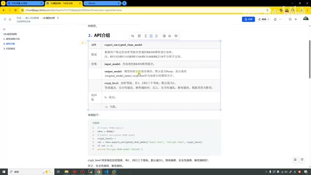

*模型加密 API 的参数与等级说明 · [原片 01:30](https://www.bilibili.com/video/BV11DjT6uEhc/?p=19&t=90)*

接下来就是代码的测试了。我们就一个一个看，第一个文件是加密的文件。我们来看一下代码：第一个是我们原本的模型路径，第二个是我们加密后的路径。

[02:02](https://www.bilibili.com/video/BV11DjT6uEhc/?p=19&t=122)

然后第三个是加密等级。在这里我们就先使用这个 `1`，就是默认的加密等级。在下面，我们就使用这个函数、这个 API，把这些参数传进去。最后我们将这个 RKNN 释放一下就可以了。

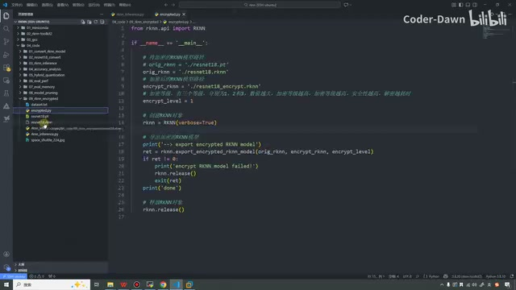

*加密脚本：输入 RKNN 路径、输出路径和等级1 · [原片 02:30](https://www.bilibili.com/video/BV11DjT6uEhc/?p=19&t=150)*

画面中这段代码对应的是：

```python
orig_rknn = './resnet18.rknn'
encrypt_rknn = './resnet18_encrypt.rknn'
encrypt_level = 1
rknn = RKNN(verbose=True)
ret = rknn.export_encrypted_rknn_model(orig_rknn, encrypt_rknn, encrypt_level)
# 画面还检查 ret；失败时打印提示并释放，成功时打印 done。
rknn.release()
```

在这里为了不影响，我先把之前的这个删掉。删掉之后，我们就只有一个 RKNN 模型了。然后我们去打开它。好，在这里我们执行一下，看一下。执行完之后可以看到，我们现在就已经执行成功了。执行成功之后，它在这里也生成了。

那我们就先来看这个操作吧：我在 SSH 这里刷新一下。刷新一下，然后我将刚才的这两个模型进行一个下载。我下载到桌面的这个 `model` 文件夹下，然后将这个加密的也进行一个下载。等待一下，好，下载完成了。下载完成之后我们就打开 Netron 这个工具。

在这里我们先来看一下第一个，就是没有加密的这个模型，`resnet18.rknn`。可以看到，它可以使用这个第三方工具进行查看。我们也可以点一点，看它输出的信息。这个之前也讲过了，点这个 F 就可以直接看到它具体的模型结构，像这种卷积加激活，然后最大池化。

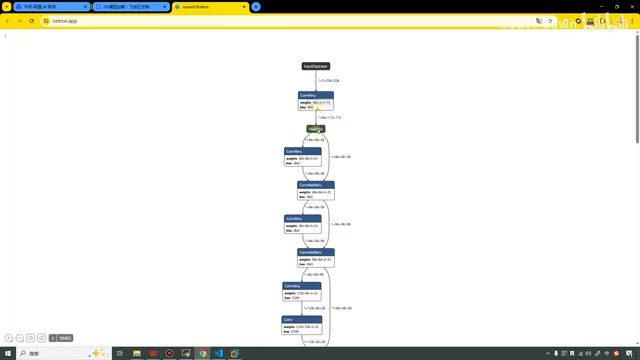

*Netron 可显示未加密模型的结构 · [原片 04:00](https://www.bilibili.com/video/BV11DjT6uEhc/?p=19&t=240)*

[04:02](https://www.bilibili.com/video/BV11DjT6uEhc/?p=19&t=242)

好，等等，总之我们是可以看到它的这个结构图的。那接下来我们刷新一下，然后我们再来打开刚才这个加密后的模型。

可以看到，这次我们打开的话，它直接就在这里对我们进行了一个提示。它说这是一个无效的文件，然后这个包含了一个——你看，它可以识别出来，叫加密的 RKNN 的 data。所以它就用不了了，就看不了了。不是用不了了，我们看不了它具体的配置、里面的一些细节内容了。

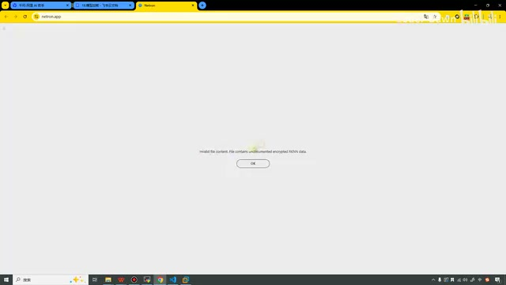

*Netron 提示文件包含加密 RKNN 数据 · [原片 04:30](https://www.bilibili.com/video/BV11DjT6uEhc/?p=19&t=270)*

说到这里，也就证明了我们这个东西是完全成功的，就是可以进行加密了。

验证完它之后，我们就来推理一下，就是这个文件。这个其实也是从我们第三讲这里复制过来的。我们来看一下，上面还是一样，就是进行一个排序的显示。在这里不一样：我们把这个模型替换成了加密的模型。

在这里我们把性能评估的这个也打开了。之前我们是设置了一个 `False`，打开它之后，在下面我们也是将这个打开了，就是看一看它的打印信息，然后将它的频率固定。别的代码我们都没有进行修改。

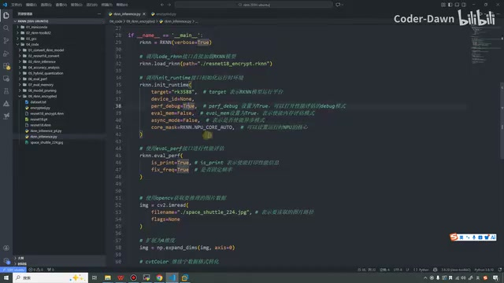

*推理代码打开性能评估和固定频率 · [原片 05:30](https://www.bilibili.com/video/BV11DjT6uEhc/?p=19&t=330)*

这里画面可见的设置是加载 `./resnet18_encrypt.rknn`，初始化运行时的 `target='rk3588'`、`perf_debug=True`，以及在 `rknn.eval_perf` 中设置 `is_print=True`、`fix_freq=True`。

接下来我们就在这里测试一下。[画面终端执行推理脚本，命令为 `python rknn_inference.py`；说话间夹杂的短英文识别片段不能单独确定，不据此补造其它参数。] 然后我们稍微等一下，这个我感觉它还有点慢。首先……

## 加密与未加密模型的推理测试

[06:11](https://www.bilibili.com/video/BV11DjT6uEhc/?p=19&t=371)

首先我们看它推理的结果，它推理是成功的。我们这个连板推理是没有任何问题的，还是识别到这个宇宙飞船。

在上面这里，刚才是因为已经开启了性能评估，可以看到它总的耗时时间是 5675。可以看到它每个部分的时间。这个我也经过了一些测试，就是它的这个时间稍微有那么一点不固定。第一次执行的时候，它其实会稍微慢一点；如果多执行几次之后，它的时间会进行一个平衡吧，大概会固定到一个时间。

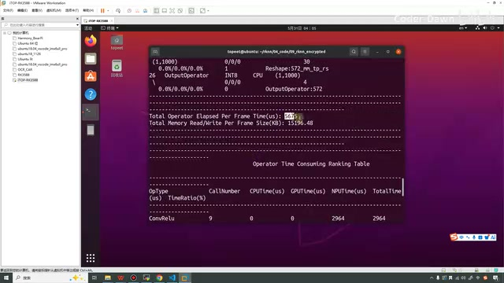

*性能评估打印每帧总耗时5675微秒 · [原片 06:30](https://www.bilibili.com/video/BV11DjT6uEhc/?p=19&t=390)*

我们再执行两次看看。现在它的总耗时是 5675，再看，这次是 4748。[此处 ASR 识别为“1748”，后面的终端画面显示 `Total Operator Elapsed Per Frame Time(us): 4748`，据此更正。] 然后我们再来一次。

其实刚才我测试了好几次，它每次都是5000多，还没到过4000多，刚好这次它就4000多了。反正我们不管它，我们就算一下。你看，现在是5300，我们再来最后一次吧。

这次的话是5000一……[末位口述识别不清；随后画面总耗时显示约 5104 μs，此处保留读数不确定性。] 总之大概就是这么一个耗时时间。

[08:03](https://www.bilibili.com/video/BV11DjT6uEhc/?p=19&t=483)

然后这里我们将它替换一下，我们换成这个没有加密的模型，来看一下。我们接着再来进行测试。

在这里做这个测试，就是为了对比我们的模型进行加密之后和不加密，到底会不会增加这个推理的时间。我们来看一下。当然，现在我们在这里的加密等级是一级。

你看这里，它好像反而时间更长了。我们再执行一次，再看看。这次又变成4600了。那我们再看，再执行一下看看，主要就是为了看看是不是第一次时间比较长，后面它的时间会短一点。

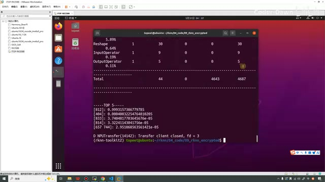

*切换未加密模型后再次打印性能与TOP5 · [原片 09:00](https://www.bilibili.com/video/BV11DjT6uEhc/?p=19&t=540)*

刚才我记得，那个加密的模型第一次也是5000多，第二次有一个四千七，后面两次都是5000多一点的时间。可以看到，它的时间又变成五千八了。[这一句 ASR 为“50008”，画面与口述的精确末位未能可靠对应，保留为五千八这一数量级。]

这里其实可能还有点不是很好演示。在这里我主要想演示的是什么内容呢？就是说，如果我们进行了模型加密，按道理来讲，它的推理时间会变得稍微长一点。但其实经过我们几次测试，好像也没看出来，也没有直接看到这个现象。这个就不管它了，大家就记住它就行。

演示完这个之后，也说明了，即使是我们加密的模型，我们也可以不改之前的代码，

[10:03](https://www.bilibili.com/video/BV11DjT6uEhc/?p=19&t=603)

我们是可以直接进行推理的。

## 直接加密 PT 模型的测试

然后还有几点是需要大家注意的。第一个地方是这个，就是我经过了一个测试。我将它打开：即使我们不传入 RKNN 模型，我们就把这个原模型、原本的模型给它，它也能帮我们生成这个加密的模型。

我将它删掉，我们来演示一下。可以看到，它又生成出来了。在生成出来之后，这个东西它就是有问题了。我们来进行一下推理。

我们再看一下这个代码：我们直接把这个 `.pt`，直接转换成这个加密后的 RKNN，然后在这个推理程序里面，我们直接推理它。我们来看一下，稍微等一下。

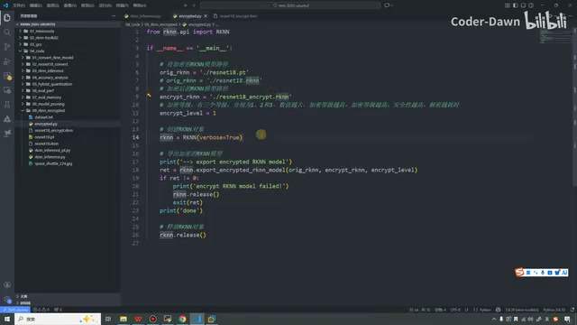

*将输入改为PT文件，仍生成加密输出 · [原片 11:00](https://www.bilibili.com/video/BV11DjT6uEhc/?p=19&t=660)*

其实这里我还发现一个细节，就是瑞芯微的这个打印。你看，它说它检测到这个模型是一个加密的模型，然后请确定这个模型是在匹配的平台上。

它这个单词是不是拼错了？M、A……E、K？这是什么意思？它不应该是 `make sure` 吗？就是这个单词，我们是不是可以给瑞芯微提一下，让它把这个改一改，这显得太不专业了。

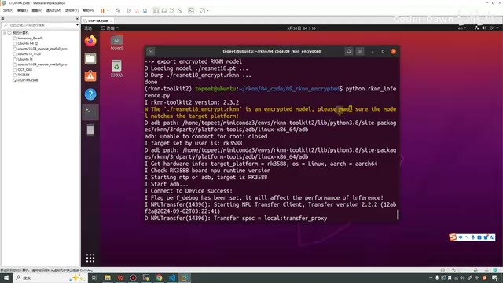

*终端提示检测到加密模型并要求匹配平台 · [原片 11:30](https://www.bilibili.com/video/BV11DjT6uEhc/?p=19&t=690)*

[屏幕黄色日志中可辨认出 `please … sure`，中间单词被光标部分遮挡；讲述者逐字念到 M、A、E、K；这里保留讲述者对拼写的质疑，不替日志悄悄改字。]

这一下滑了好多，这一下滑了好多。那就还是刚才这里，`make sure`，它这是什么，M、A……然后我们看一下。

[12:04](https://www.bilibili.com/video/BV11DjT6uEhc/?p=19&t=724)

就是我们直接把 `.pt` 转换成加密后的 RKNN，它这里其实就会给我们报错，其实它是用不了的。你看，它就说失败了，这个模型是不可用的。所以在这里大家就需要注意：虽然我们可以直接转，那这样转了之后它不能用。这是第一个要注意的地方。

## 平台不匹配的测试

第二个要注意的地方就是我们的模型。现在我们这个模型是可以用的，就是我们一定要设置：在进行模型转换的时候，一定要设置它的平台是3588的。如果不是3588，那这个也是不能用的，即使它是 RKNN。

在这里我们也做一个简单的演示。我想一下，我直接将这个 RKNN 删掉。我们执行这个文件，这个文件在之前也是从第3讲这里复制过来的，就是把这个 `.pt` 模型转换成 RKNN 模型。下面是一些推理，那这些推理其实都可以不要，我们直接把它都删掉吧。删掉执行得还快一点。

在这里我们执行一下。执行完之后，我们就生成这个 RKNN 模型了。然后生成完之后，我们就需要再进行一下转换，就是转换成这个加密的模型！我们也先将之前的这个加密的删除掉，我们再来执行一下。可以看到，这个加密的就已经生成了。最后我们再来进行一下推理。

[这一段是在演示“转换目标平台不匹配”的情况；源画面只有640×360，具体改成了哪个非3588目标、终端中转换脚本的完整文件名未能可靠读出，因此不补写猜测值。]

[14:23](https://www.bilibili.com/video/BV11DjT6uEhc/?p=19&t=863)

可以看到，它还是报错了，这个模型是不可用的，和刚才的错误是一样的。

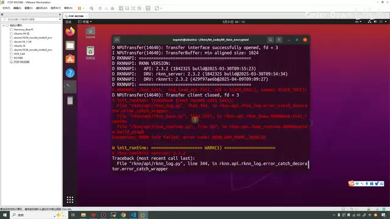

*平台测试后推理报模型不可用错误 · [原片 14:25](https://www.bilibili.com/video/BV11DjT6uEhc/?p=19&t=865)*

这里我操作的，不知道大家有没有看明白。就是我先演示了一下，也当是做一个总结：我先演示了一下，我们将这个 RKNN 模型转换成加密后的 RKNN 模型，是可以进行推理的，而且推理是可以成功的。

然后第二次，我演示了一下，就是在这里我改成原始的 RKNN 模型，看它的推理速度到底有没有提升。经过几次实测，好像发现它的速度也没有提升。理论上，加密过后的模型，它的推理速度正常来讲是会慢一点的，只不过我们没看到这个现象。

然后第三次，就是我告诉大家，我们可以直接把这个 PT 模型转换成加密后的 RKNN 模型，就不经过中间 RKNN 模型的步骤了。经过测试，直接转换的这个它是不可以用的，就不能进行正常的推理。

然后最后一次演示的就是，如果我们这些模型转换的时候，平台不对，我们的平台如果不是3588，即使在这里我们用了 RKNN 的模型，转成了这个加密后的模型，也是会推理失败的。

最后总结一下，一句话就是——我写在这里吧，五个文字，总结……

[16:08](https://www.bilibili.com/video/BV11DjT6uEhc/?p=19&t=968)

就是我们的平台，然后我们的原始模型，加密后的模型，我们必须严格匹配。在这里就是 RK3588……[此处接续短句 ASR 为“就入口了”，无法可靠确定，未将它解释成额外操作。] 就是我们必须严格进行一个匹配。

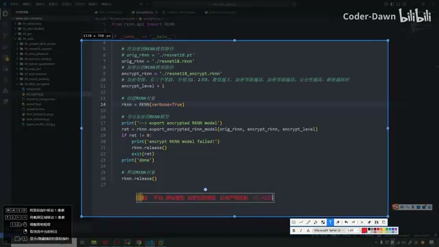

*讲述者写出平台、原始模型、加密模型必须严格匹配 · [原片 16:30](https://www.bilibili.com/video/BV11DjT6uEhc/?p=19&t=990)*

而且我们还发现了一个有意思的现象，因为居然它把这个单词写错了。

好了，讲到这里，我们这节课的内容就都已经讲完了。最后也是感谢大家的观看，谢谢大家。

> 校对说明：以上依据完整时间戳转写与原视频画面逐窗整理，未声称逐字听校。源视频为640×360，局部小字与口述读数的不确定性已就地标出。尾部转写另有“过来”这一孤立片段，无法确认其语义；原始 ASR 还产生了媒体结束之后的12条混语低置信片段，时间从16:57.08起，超出本视频16:56.74，故未编入讲述内容，原文及归档说明保存在 sources 中。浏览器 file 协议预览受限，未绕过限制；HTML只完成离线结构、资源与样式检查，桌面/窄屏交互未实测。
