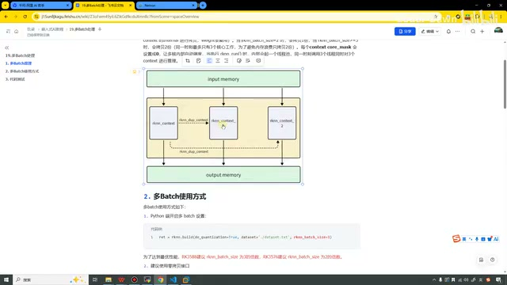
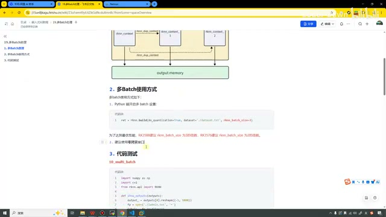
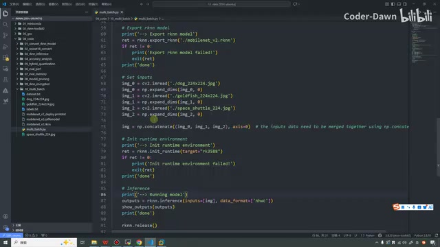
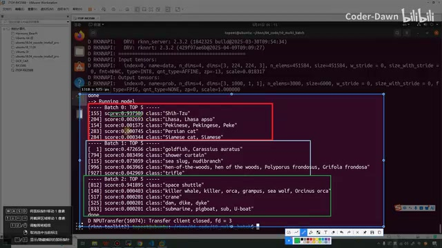
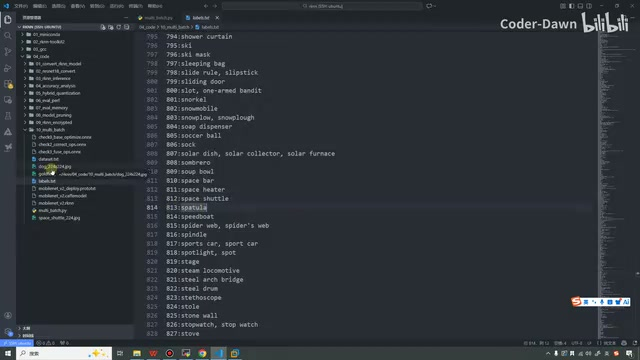

# P20｜19_多 Batch 处理

> 来源：[B 站课程第 20 集](https://www.bilibili.com/video/BV11DjT6uEhc/?p=20) · 全片 8 分 18 秒
>
> 整理方式：忠实讲稿，不做摘要压缩。保留原讲述顺序、解释、操作和结果，仅清理无意义停顿、结巴与即时重复。文字依据本地 Whisper 转写与画面术语核对；原始转写另存于 sources。
>
> 图片说明：5 张原视频截图，源画面 640×360；小字受原始画质限制。图注为编辑说明。

## 多 Batch 的原理 · 00:00

这节课我们来看第 19 讲，多 Batch 处理。一共分为三个部分：第一个是多 Batch 的原理，第二个是多 Batch 的使用方式，第三个是代码测试。我们逐个来进行讲解。

第一个，多 Batch 的原理。RK3588 NPU 内部有三个核心，RK3576 内部有两个核心。为了更高效利用多核的性能，提供了多 Batch 的推理功能。多 Batch，其实意思就是多 Batch 嘛。

当开始多 Batch 推理的时候，内部会调用这个 `rknn_dup_context`，将这个 context 进行拷贝，拷贝其实就是为了进行复用。当这个 size 的值是 2 的时候，就拷贝一份；大于等于 3 的时候，会拷贝两份。因为同一个时刻，它最多只有三个核心工作，拷贝多了，内存也就浪费了。

那为什么最多有三个核心工作呢？因为我们瑞芯微系列目前为止，最强大的就是这个 3588 的三核心。然后每个 context 的 `core_mask` 会被设置成 0，让内部自动调度。当运行 `rknn_run` 时，内部会起一个线程池，同一时刻调用三个线程，同时对三个 context 进行推理。

接下来我们看一下这个图。这个是输入 input memory，下面是 output memory。中间我们看一下，就是鼠标这里，它是一个 RKNN 的上下文。它通过这个 dup context 会进行拷贝。你看这个 1，就是拷贝一个；然后再拷贝一个，就是 context 2。它们可以复用这个权重，这样就可以起到多 Batch 的效果了。这个就是它的原理，其实是非常简单和好理解的。

*多 Batch 原理图：输入、输出内存与三个可复用权重的上下文。 · [原片 02:00](https://www.bilibili.com/video/BV11DjT6uEhc/?p=20&t=120)*

## 多 Batch 的使用方式 · 02:22

第二个部分就是它的使用方式。我们只需要在 Python 端进行这个 build 的时候——在这里我加粗一下——将这个 `rknn_batch_size` 设置为 3，这样就可以了。

为了达到最优的性能，我们 3588 建议设置为 3 的倍数，3576 建议设置为 2 的倍数。同样这里说，建议使用零拷贝接口。这句话什么意思呢？就是我们这个多 Batch，主要还是用我们的 C API 接口的时候，它的效果会比较明显、比较清楚。

C API 接口就分为零拷贝和正常的，就是正常的内存，还有零拷贝内存，会有两种方式。这个在后面我们也会去讲。这节课在这里，为了简单起见，我们还是使用 Python 代码进行演示，主要就是看一下效果，看它是不是真的能一次处理多张图片，达到多 Batch 的效果。

*课件展示 build 的 rknn\_batch\_size 设置、倍数建议与零拷贝接口建议。 · [原片 03:00](https://www.bilibili.com/video/BV11DjT6uEhc/?p=20&t=180)*

## 代码测试：构建模型 · 03:35

好，说完这些之后，接下来就到代码测试环节了。在这里我们就直接打开代码。其实这个代码和之前的代码都一样，看到这里，可能大家都已经看腻了，我就快速地带着大家看一下。

前面这两个就不用再说了。这里创建对象，进行配置，然后加载模型。这里是进行一个构造，一个 build。在这里就把它传进来就行了，就是等于 3，因为我们是 3588。下面就还是导出模型，然后进行初始化环境，然后进行推理。

这里相当于是预处理，在之前也已经说过了。我们一次处理三张照片，第一张图片传了一个狗，然后一个金鱼，还有一个宇宙飞船。每次都要进行升维，因为现在是 NHWC。做完之后，我们将它们进行拼接，拼起来之后合成一个 image，然后把 image 传进来就行了。

其实这个代码很简单，和之前也差不多，没有什么本质的区别。

*代码将狗、金鱼和宇宙飞船图片升维，再沿 batch 维拼接后传入推理。 · [原片 05:00](https://www.bilibili.com/video/BV11DjT6uEhc/?p=20&t=300)*

## 执行程序，查看三个 Batch · 05:00

看完这个代码之后，接下来我们就来看一下效果。在这里我已经提前进入了这个目录，先看一下。然后我们接着就去执行这个文件，执行它就行，然后也是稍微等待一会儿。〔执行命令在源画面中的小字不能可靠辨认，这里不补写具体命令。〕

现在就执行完了。执行完之后，我们看一下最终的效果。这个就是 Batch 0，我把它框一下。下面这个是 Batch 1，然后给它换个颜色。最下面这个就是 Batch 2，给它也换个颜色。

可以看到，我们第一张图片就对它进行了推理，可以看到是 155。第二个是金鱼，是 1。第三个是我们的宇宙飞船，宇宙飞船其实已经看过很多次了。这个金鱼是 1 号，还有这个狮子狗，是 155 号。

其实可以看到，我们这个金鱼，它的准确率没有那么高，就是一个 47%，然后这两个会稍微高一些。

*终端分别列出 Batch 0、1、2 的 Top 5，三组首项为狮子狗、金鱼和 space shuttle。 · [原片 06:30](https://www.bilibili.com/video/BV11DjT6uEhc/?p=20&t=390)*

我们也看一眼吧。这个 1 号，可以看到，它就是这个金鱼。然后还有一个 155，这是一个狮子狗。然后还有一个 812，看一眼，是这个宇宙飞船。

*标签文件显示 812 对应 space shuttle，讲师据此核对第三张图的识别结果。 · [原片 07:30](https://www.bilibili.com/video/BV11DjT6uEhc/?p=20&t=450)*

我们看一眼这三张图片，这是一个狗，然后这是金鱼，这个是我们的宇宙飞船。

## 使用 C API 的建议 · 07:38

到这里，其实代码就已经讲完了。这里还是需要再说一下，其实这个功能更建议我们使用 C 的 API 接口去进行调用。使用 C API 接口的话，因为它不是三个核心也可以起一个线程池工作嘛，核心也可以起一个线程池工作嘛。〔此处转写中的线程池与核心关系表述不够清晰，保留原讲述含义，不据此补写线程配置。〕

这样我们也更方便在开发板上面去监控它的 NPU 使用率。用这个 Python 代码的话，我们就简单看一下效果就行。那好，本节课我们就讲到这里，谢谢大家观看，谢谢大家。
