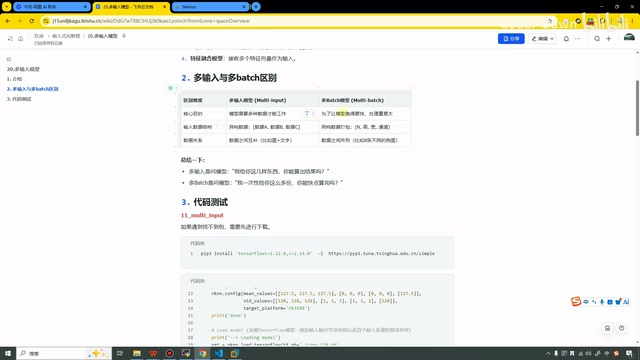
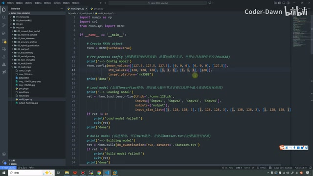
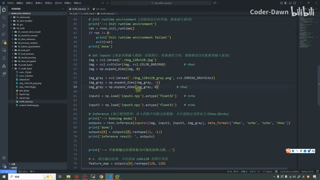
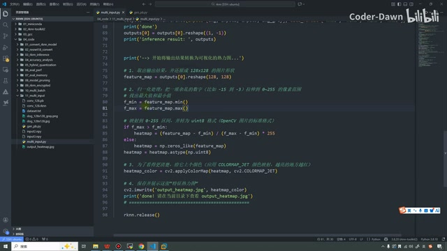
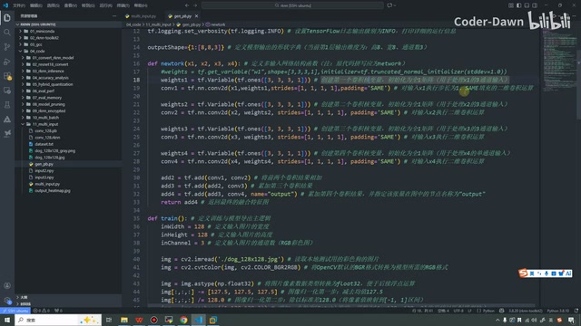
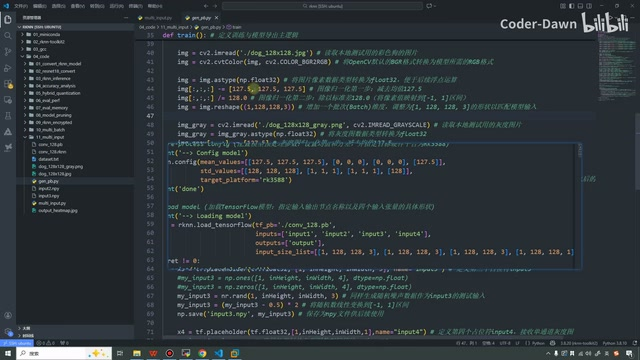
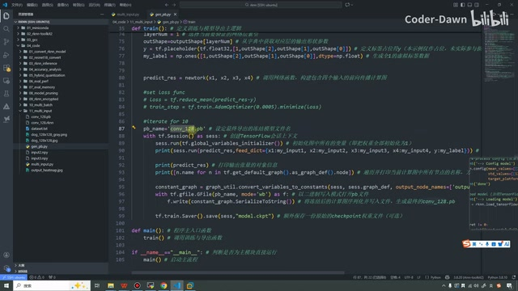
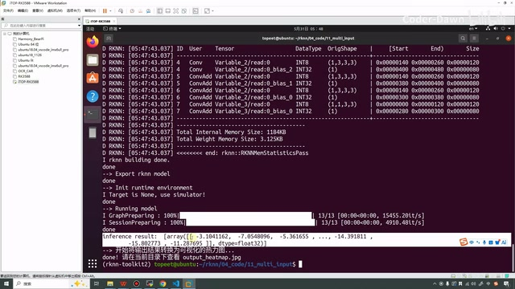
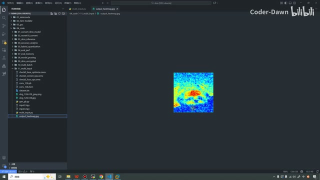
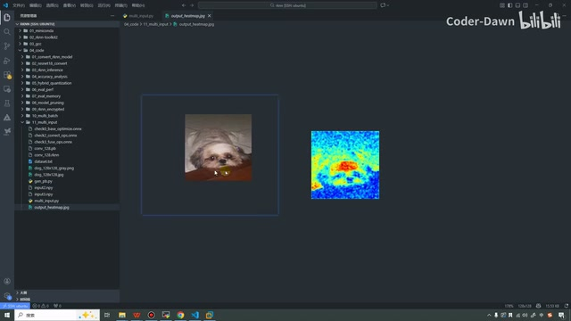

# P21｜20_多输入模型

> 来源：[B 站课程第二十一集](https://www.bilibili.com/video/BV11DjT6uEhc/?p=21) · 全片 13 分 12 秒
>
> 整理方式：忠实讲稿，不做摘要压缩。保留原讲述顺序、第一人称、解释、例子、操作及结论，仅清理口头停顿、结巴与无实义重复，补充标点与小标题。
>
> 文字来源：本地时间戳转写及恢复稿，结合原视频课件和代码画面核对术语；无法确认的局部代码在相邻正文标注。未以技术常识改写讲师原有表述。原始转写与审查说明见 sources。
>
> 图片说明：10 张原视频截图，源画面 640×360；小字及右端截断内容受原始画质限制，点击图片查看原图。图注为编辑说明。

## 多输入模型与多 Batch · 00:00

这节课我们来看第二十讲，多输入模型。在上节课，我们讲了多 Batch，也就是多批次。这节课讲的是多输入。我们同样分为三个部分来进行说明：第一个是介绍，第二个是多输入与多 Batch 的区别，第三个是代码测试。接下来我们逐个来进行讲解。

多输入神经网络是一种能够同时处理多个不同来源、不同模态或不同特征的数据输入的深度学习模型框架。在这里我把这个加粗一下，就是都是“不同”的。与传统的单输入不同，多输入模型可以融合多种信息源，充分利用数据的互补性，提高模型的性能和鲁棒性。

在 RKNN 框架中，多输入模型的典型应用包括双输入模型，然后图像加文本模型、多模态模型、特征融合模型等等。这个是对它简单的介绍。

第二个是多输入与多 Batch 的区别。在这里，我也是列了一个表格。多输入的核心目的，就是模型可能需要多种数据才能进行工作。我们多 Batch，只是为了让模型跑得更快，处理量更大，就是为了充分利用我们 NPU 的核心。

*课件表格对照多输入与多 Batch 的核心目的、数据结构和数据关系。 · [原片 01:30](https://www.bilibili.com/video/BV11DjT6uEhc/?p=21&t=90)*

第二个区别是输入数据结构的区别。多输入模型是一个异构数据，它有数据 A、数据 B、数据 C，而且还可以是不同来源、不同模态或者不同特征的。我们多 Batch，其实本质上是同构数据类型，它还是这个 NHWC，是这个类型。在上节课，我们虽然输入了三个图片，但其实还是将它进行了拼接。

最后一个是数据关系。多输入模型，数据之间是互补的；多 Batch，它们之间是并列的。总结一下，多输入数据模型：“我给你这几样东西，你能算出来结果吗？”多 Batch 是问模型：“我一次性给你这么多份，你能快点算完吗？”大家可以体会一下这两句话，体会一下它们的区别。

## 看多输入转换脚本 · 02:27

第三个部分是代码测试。代码测试，我们就不看这个了，直接来打开 VS Code，直接在这里看它的代码，就可以了。大家看一下，在这里其实有两个 Python 文件。我们先来看这个文件，就是多输入的这个文件。其实代码和我们之前非常类似，稍微有一点点不同。我们也可以就来看一下吧。

第一步依旧是创建 RKNN 的对象，第二步是进行配置。这里就需要注意了，和我们之前会略微有一点不一样。可以看到，我们在这个 `mean_values` 和 `std_values` 里面，传入了一个、两个、三个、四个，四个数字——这里应该叫它列表，就是四个列表。然后你看，就是 127.5，然后这个、这个，还有这个，这什么意思呢？

*多输入转换脚本中，预处理配置含四组 mean\_values 和 std\_values。 · [原片 03:30](https://www.bilibili.com/video/BV11DjT6uEhc/?p=21&t=210)*

其实在之前我们学习的时候也有讲过：如果是我们单张的、单个的处理，我们就传一组，就它传一个、它传一个就可以了。现在我们是多输入，而且从这个代码也可以看出来，我们其实是一个、两个、三个、四个，我们是四输入的处理。所以在这里就传入了四组。这个相信也比较好理解。

看完这个之后，再下一步，也就是第三步，它就是加载一个模型了。

当然，在这里加载的是一个 TensorFlow 的模型，传入它的模型路径，然后传入 input、output，还有它的形状。这里同样有四个形状，我们把它传进来就可以了。画面里使用的是 `rknn.load_tensorflow`，模型为 `./conv_128.pb`，输入名是 `input1`、`input2`、`input3`、`input4`，输出名是 `output`。〔输入形状列表的最右端在当前画面中被截断，完整逐项值不能仅凭此画面确认。〕

第四步是进行模型的构建，第五步就是我们保存 RKNN 模型，然后初始化它运行时的库，然后对它进行推理。在推理之前，我们需要进行一些预处理，也就是这一块代码。可以看到，这个代码很简单，之前也都有说过，就是加载图像，然后这里转了一下格式，然后进行了升维。

第二个，这是一个 JPG，然后第二个是一个 PNG，当然在这里还搞了一个灰度图，是这样的。第三个就直接加载了一个 `.npy` 这种格式的。在这里也是故意的，就是有 JPG，有 PNG，然后还会有这种不同的格式。

*转换脚本读取彩色图片、灰度图片和 NPY 输入，随后调用推理。 · [原片 05:00](https://www.bilibili.com/video/BV11DjT6uEhc/?p=21&t=300)*

至于说，为什么我们拿这几张图片去拼，还有上面这些值到底是怎么来的，我们一会儿再说。现在大家先看到，就是我们现在这个文件里面，我们看流程。这个流程和之前的流程也差不多，也没啥本质上的区别。

在最后这里，因为它的结果是不明显的，所以在这里我先打印了一下它的结果，然后我将这个结果转化成了一个可视化的热力图。这段代码，其实大家看不看都行，我简单说一下。转化成热力图，第一步是取出这个结果，然后进行归一化的处理，然后把它进行映射。

*输出特征图经过归一化、颜色映射后保存为热力图。 · [原片 06:00](https://www.bilibili.com/video/BV11DjT6uEhc/?p=21&t=360)*

最终就给它上了个颜色。这个其实都属于 OpenCV 上面的知识，和我们 RKNN 的模型部署其实也没太大的关系，大家了解一下。

## 看模型构建与训练，理解参数由来 · 06:20

看完这个文件之后，我们再来看一下这个文件，也就是我们这些值的由来。这个文件其实就是我们利用 TensorFlow 进行了一个模型的构建。上面是导入的一些包，在这里是设置它的输出日志级别，然后这里是模型的形状。

在下面这里，也就是我们自定义了一个多输入的网络结构。其实很简单，这个很简单。你看，这是权重一，然后第一层；权重二，第二层；权重三，第三层；权重四，第四层。我们看一下，在这里其实就是……我想一下，如果大家对深度学习有所了解，可能看起来会更加清楚吧。

就是创造一个卷积核，然后定义了一个全一矩阵，然后处理的是一乘三……就处理了一个三通道的输入。第二个和它其实一样，第三个也和它一样，第四个也和它一样。创建完之后，就把它加进来，加进来之后就返回一个最终的结果。〔此处保留讲师对四路结构的原说明；画面第四路权重形状与前三路有差异，不据此改写讲师原话。〕

*TensorFlow 网络定义四路卷积，再将各路结果相加。 · [原片 07:30](https://www.bilibili.com/video/BV11DjT6uEhc/?p=21&t=450)*

第二个步骤是进行训练。训练可以看到，它其实就是三乘 128 乘 128，就是三通道，长、宽和高都是 128 的。〔讲师此处如此表述；画面可见宽、高为 128、通道为 3。〕在这里也是加载这个图片，然后对它进行了一个……

格式的转换。第二个的话，也是，就是加载了，就是搞了一个这个 `astype`，就是把它的数据类型转换成这个 float32，然后在里面又输入了这些值。这个就相当于是第一组。

可以看一下，我想一下，我把这边截过来吧。这样截刚刚好。可以看到，这些值其实都是对应的。这个就是 127.5，这里也是 127.5。这个之前也有讲过：我们在进行模型推理的时候，其实是要和训练的时候这些参数保持一致的。

*讲师并排对照训练预处理与 RKNN 配置中的数值和输入形状。 · [原片 09:00](https://www.bilibili.com/video/BV11DjT6uEhc/?p=21&t=540)*

在这节课，你就有了一个比较清楚的感受吧。你看，这是 127.5，这 128；你看下面这里是形状，一，一乘 128、128、3，然后这里也是，这些其实都是互相对应的。然后我把它缩小，放这边。

这个是第二个图片，也是一样的，就是一个灰度图，然后在它里面进行一个归一化的处理，上面也类似。后面还有这个 input，然后我还有，这个是 input2，然后还有一个 input3。我这里注释都是写得很清楚，过程也都是类似的。

总之，这个就是进行训练，然后它的名字就叫这个名，`conv_128.pb`。〔模型文件名据画面核对。〕然后在这个 main 函数里面，就进行了一个……

就进行了一个 `train`，然后训练。这里其实就是创建了一个上下文。这个代码大家了解一下就行，注释也都已经写好了，大家可以直接看。我们正常在进行模型部署的时候，其实拿到的就是最终的这个模型。

*训练脚本调用四输入网络并保存模型。 · [原片 10:00](https://www.bilibili.com/video/BV11DjT6uEhc/?p=21&t=600)*

就和之前都是类似的，可能就是输入多了一点，输入的值多了一点，形状多了一点，别的其实没什么区别。包括这个热力图，也只是为了方便地显示这个结果，我加上去了。其实加不加也都可以。这个就是我们所有的代码。

## 运行、看输出和热力图 · 10:53

看完代码之后，我们就来运行一下，具体看一下它的效果。我已经提前进入这里了，我们在这里直接执行 `python multi_input.py` 这个就可以了。〔命令据 11:06 终端画面核对。〕然后我们稍微等一下。

可以看到，这里它就说推理的结果是这个东西。这个东西，大家可能看着有点看不明白。其实你非要说，我也看不……这个就是它的执行，就是没有进行……

*终端显示 RKNN 构建、模拟器推理和热力图保存结果。 · [原片 11:30](https://www.bilibili.com/video/BV11DjT6uEhc/?p=21&t=690)*

其实包括我们之前的那些代码，我们可能显示的是一个 TOP5，什么什么值，哪个概率排第一、哪个概率排第二，显示的是这样的结果。但是在显示那个结果之前，其实也是这样的数据，只是我们把这个数据映射成了那个概率。

在这节课，这个模型因为是在这里简单进行构造的，所以其实不太好映射那个结果，所以在这里我也就没有映射结果了。我直接把这个热力图绘制出来。

我们可以直接看一下这个热力图，看一下在这里能看到不。这个有点小，放大一点。如果大家仔细看，应该能看出来，就是那个狮子狗的轮廓。

*编辑器打开输出热力图，可见输入狗图的轮廓。 · [原片 12:18](https://www.bilibili.com/video/BV11DjT6uEhc/?p=21&t=738)*

我找一下，其实就是这个。我把它俩放一起，大家看一看。你看，就是这个图，然后颜色深的地方就让它加了一点颜色，应该也是可以看到轮廓的。

*讲师切换查看原始狗图，与刚才的热力图比较。 · [原片 12:36](https://www.bilibili.com/video/BV11DjT6uEhc/?p=21&t=756)*

总之，这个结果不管是哪种形式的展示，我们这节课讲的内容已经结束了，我们的效果也已经实现了。就是我们的这个 RKNN，这个瑞芯微，它确实是支持我们进行这种多输入的操作的。

好，讲到这里，我们这节课已经全部讲完了。最后，也就感谢大家的观看，谢谢大家。
