# P22｜21_动态 shape 输入

> 来源：[B 站课程 P22](https://www.bilibili.com/video/BV11DjT6uEhc/?p=22) · 全片约 13 分 56 秒。
>
> 整理方式：忠实讲稿，保留原讲述顺序、第一人称、解释、例子与操作，仅清理停顿、结巴和无意义重复。根据可见课件与代码校正 shape、RKNN 等识别错误；局部无法可靠辨认的内容在原处标注。原始转写与规范化审计保留在 sources。
>
> 图片为原视频截图，原始画面 640×360，小字清晰度受源画质限制。图注为编辑说明。浏览器 file 协议访问被拒，未进行浏览器桌面、窄屏和图片缩放交互验证。

## 补充上节课的四输入模型 · 00:00

这节课我们来看第 21 讲，动态 shape 输入。在开始这讲之前，我突然想到上节课我们还漏了一个东西。其实课件上面也都有写，就是还看了一下这个输入的模型。可以看到，它确实就是一个四输入的。你看，一、二、三、四，四输入，然后每个都是 3×3×1×1，然后两两相加，两两相加的。

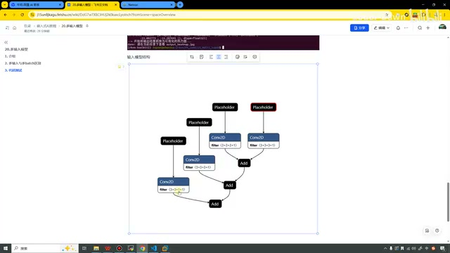

*上节课的四输入结构，四路卷积后由 Add 节点连接。 · [原片 00:30](https://www.bilibili.com/video/BV11DjT6uEhc/?p=22&t=30)*

这个大家感兴趣也去看一下，我就不再打开这个文件了，还得下载一下，有点麻烦。大家自己感兴趣的话，可以自己看一下。

好，说完这个之后，我们继续回到这节课的内容，就是动态 shape 的输入。这个和上节课、上上节课听上去也有点类似：一个是多输入，一个是多批次，一个是动态类型，大家要注意区分一下。

主要从三个方面来讲：第一个是动态 shape 功能介绍，第二个是生成动态 shape RKNN 模型的步骤，第三个是代码测试。

## 动态 shape 功能介绍 · 01:19

接下来我们先来对它介绍一下。动态 shape 是指模型输入数据的形状在运行时可以改变。它有什么用呢？它可以帮助处理输入数据大小不固定的情况，增加模型的灵活性。

在之前仅支持静态 shape RKNN 模型的情况下，如果用户需要输入多个模型〔此处原转写如此；可见课件讲的是多个输入 shape〕，传统的做法就得生成多个 RKNN 模型。部署的时候，就需要初始化多个上下文，分别进行推理。这样就会很麻烦，而且会影响我们的性能。


在引入动态 shape 后，我们就可以只保留一份与静态 shape RKNN 模型大小接近的动态 shape RKNN 模型，并且用一个上下文就可以进行推理，从而节省我们的 Flash 占用和 DDR 占用，而且我们的性能大概率也会变得更好。

应用场景主要包括序列长度改变的模型，比如 NLP 模型中的，18 年出的这个 BERT，还有 GPT。然后是空间维度变化的，比如一些分割模型。还有在 Batch 维度进行变化的一些模型，以及一些可变输出数量的目标检测模型，都可以使用动态 shape。

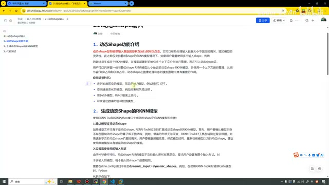

*动态 shape 功能、应用场景以及生成模型的步骤。 · [原片 02:30](https://www.bilibili.com/video/BV11DjT6uEhc/?p=22&t=150)*

## 生成动态 shape RKNN 模型 · 02:53

第二个是生成动态 shape 模型的步骤，或者说一个介绍。

第一步，我们要先确认模型是否支持动态 shape。如果模型本身并不是动态 shape 的，瑞芯微的 RKNN-Toolkit2 支持扩展成动态 shape 的 RKNN 模型。首先用户要确认模型不存在限制动态 shape 的算子或子图结构，例如常量的形状无法改变，工具在转换的过程中会报错，等等。

这句话什么意思呢？给了一大堆，就是说，如果这个模型本身不是动态的，我们这个瑞芯微的 RKNN-Toolkit2 工具可以帮你把它转成动态的，但是它也不是什么模型都能帮你转成功。比如你里面的好多算子就是常量的一些操作，常量是不能被改变的，所以它帮你强制转成动态的时候，

就会报错。这个大家需要注意一下。其实一般情况下我们也不会遇到这种情况，一般几乎都可以避免。

第二个就是设置需要使用的输入形状。由于 NPU 硬件的特性，我们这个动态 RKNN 模型不支持输入形状任意改变，而且要求用户设置有限个输入形状。对于多输入模型，每个输入的 shape 个数要相同。

它的使用方法就是需要在这个接口中开启。在 `rknn.config` 里设置 `dynamic_input=dynamic_shapes`。前面我们也讲过，它的参数特别多，其实有很多都没用到。随着我们不断学习，我们已经用到了越来越多的参数，这次就是需要用它。

下面举了一个例子。我们首先自己定义一下这个输入的形状，然后在这个配置里面需要把它开启。上面配置完之后，我们就支持了这三种形状的模型推理。其实这三个形状也是我们自己在这里写好的。课件画面列的是 `[1,3,224,224]`、`[1,3,192,192]` 和 `[1,3,160,160]`。

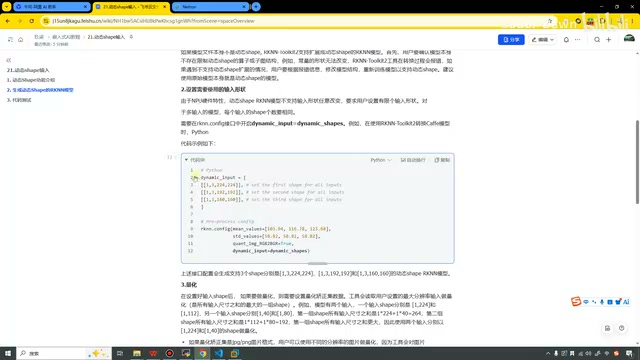

*课件中的 dynamic\_input 配置与三组预设形状。 · [原片 05:00](https://www.bilibili.com/video/BV11DjT6uEhc/?p=22&t=300)*

第三点就是量化。设置好这个形状之后，如果我们要做量化，需要设置量化校正集的数据。工具会读取用户设置的最大分辨率输入做量化。

举个例子，模型有两个输入，一个输入的 shape 是 `[1,224]` 和 `[1,112]`，另一个输入是这样的一组值：`[1,40]`、`[1,80]`。第一组的尺寸之和是这么大，第二组的尺寸之和是这么大，第一组的尺寸之和更大。课件这里写的是第一组 `1×224+1×40=264`，第二组 `1×112+1×80=192`。我们如果去做量化的时候，

就会使用这个更大的，也就是第一组输入 `[1,224]` 和 `[1,40]` 的 shape 做量化。

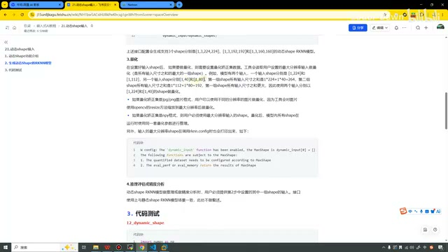

*量化说明中的双输入示例与 MaxShape 提示。 · [原片 05:50](https://www.bilibili.com/video/BV11DjT6uEhc/?p=22&t=350)*

如果量化校正集是 JPG 或者 PNG 格式的，我们就可以使用不同分辨率的图片做量化，因为工具会对这些图片用 OpenCV 的 `resize` 方法做一个缩放。如果是 NPY 格式的，我们就必须使用最大分辨率输入。量化后，模型内所有的 shape 在运行时使用同一套量化参数进行推理。

巴拉巴拉说了这么多，这么多啥意思呢？我在这里做一个总结：如果我们设置了多个输入，我们会选用最大的那一组输入去进行量化。然后我们量化的时候是共享一套量化参数的，使用的是同一套量化参数，而且用的是最大的输入的那一套量化参数。

在这里我们使用的时候，其实它也会进行打印。这也是官方写的，就是我们一会儿测试代码的时候也可以看一下。

第四步就是进行模型推理或者精度分析了。我们必须使用的就是第二步，也就是这里我们去定义的模型形状进行测试。

## 看代码：配置三组输入形状 · 07:36

好，讲完这些之后，可能这些文字有点多。这节课我们还是直接来看代码，在代码中可能看得更清楚。直接搞代码，看结果。

这里代码和之前也类似，上面就不看了。这里是初始化一个 RKNN 对象，然后在这里定义三组形状。大家看到，我这里是 `[1,3,256,256]`、

`[1,3,160,160]`、`[1,3,224,224]`。你看，这就是它的三组形状。代码里的 `dynamic_input` 是这样定义的：

```python
dynamic_input = [
    [[1, 3, 256, 256]],
    [[1, 3, 160, 160]],
    [[1, 3, 224, 224]]
]
```

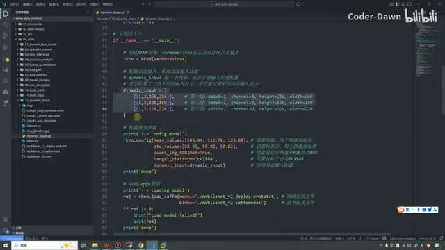

*代码中定义 256、160、224 三组动态输入形状。 · [原片 08:00](https://www.bilibili.com/video/BV11DjT6uEhc/?p=22&t=480)*

然后在这里进行配置。配置这里别的都一样，比较重要的就是要开启这个。开启之后，也就代表我们应用了动态输入，不然默认是不开启的。我们这里传的是 `dynamic_input=dynamic_input`。

这个我们也可以跳过来看一遍，这个参数我们看看在哪。量化……就是这个。可以看到，我们默认只是一个 `None`，所以需要把它开启，而且传入的是我们的这个形状。

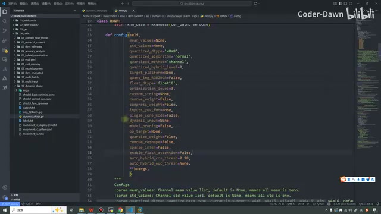

*config 函数参数列表中 dynamic\_input 默认值为 None。 · [原片 08:45](https://www.bilibili.com/video/BV11DjT6uEhc/?p=22&t=525)*

再下一步就是加载模型，然后构建模型，然后进行模型导出，再初始化运行环境。画面这里依次是 `rknn.load_caffe`、`rknn.build`、`rknn.export_rknn` 和 `rknn.init_runtime`。

再下一步就是进行推理。在推理之前，要进行一些简单的预处理。我们看一下这个运行：首先加载出这个图像，就是 dog 这张图像，画面里读的是 `./dog_224x224.jpg`。加载完之后，我们对它的尺寸进行缩放，缩放完之后进行第一次推理。第二个也是对它进行缩放，然后进行推理，第三次缩放再推理。

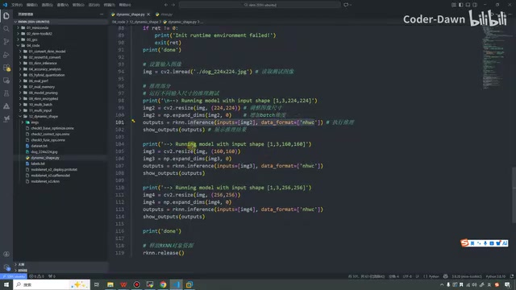

*同一张 dog 图片分别缩放并执行三次推理。 · [原片 09:30](https://www.bilibili.com/video/BV11DjT6uEhc/?p=22&t=570)*

什么意思呢？默认这张狗的照片是 224×224 的，我们可以给它缩放成 224×224、160×160，还有 256×256。这三个其实也都是我们前面在这里定义好的。定义完之后，我们就可以测试了。

这个版面我们还是留着吧，留着，我们直接来测试一下。


## 执行测试与三组结果 · 10:05

我们直接执行，然后这个叫……〔口述脚本名识别不清；终端可见文件名是 `dynamic_shape.py`〕。在终端里使用：

```bash
python dynamic_shape.py
```

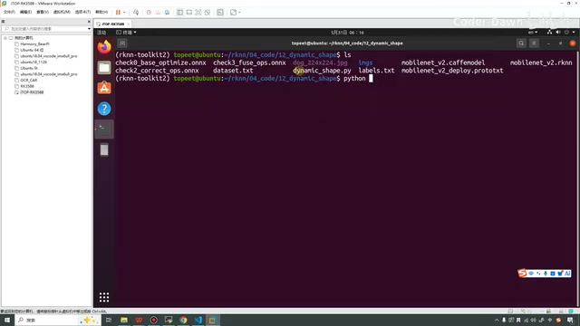

*终端文件列表含 dynamic\_shape.py，准备执行 Python 脚本。 · [原片 10:10](https://www.bilibili.com/video/BV11DjT6uEhc/?p=22&t=610)*

可以看到，我们这里就输出了它的结果。你看，这是第一组，我在这里还是框一下，这是第一组，然后这个是第二组，下面这个是第三组。可以看到，我们只用了一张图片，就测试了三组。

这里打印第一组是 `[1,3,224,224]`，第二组是 160 的，第三组是 256 的。可以看到，它都帮我们预测出来了，就是这个狮子狗，已经看过很多次了。

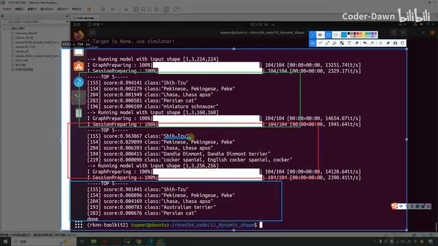

*三组输入的 Shih-Tzu 分类结果及不同 score。 · [原片 11:00](https://www.bilibili.com/video/BV11DjT6uEhc/?p=22&t=660)*

但是大家在这里可以注意一下，我们的准确率还略微有一点区别。你看，它是 0.99，这个是 0.96，这个是 0.98。我们形状不一样的时候，它预测的结果也会有一点差别。画面中这三组第一名都为 `Shih-Tzu`，相应 score 分别显示 `0.994141`、`0.963867`、`0.981445`。

这里我还想演示一个东西。刚才我们在课件中有提到，如果采用了量化，它会使用最大的这个作为它的量化参数。我们来找一下，这个结果太多了。如果结果太多，我们直接在这里给它改成 `False`，然后重新执行一下。这里对应前面创建对象时的 `verbose` 参数。

这次我们的输出结果就比较少了，就方便我们来看了。看一下，就在这里，它已经提示了：

这个动态输入已经被开启，最大的尺寸是 `[1,3,256,256]`，所以这个函数就会使用这个去进行量化参数的设置〔后接一处词语识别不清，原转写为“chociaż”〕，也是和我们课件中说的一致。

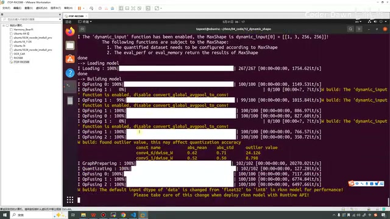

*终端显示 dynamic\_input 已启用，MaxShape 为 1×3×256×256。 · [原片 12:00](https://www.bilibili.com/video/BV11DjT6uEhc/?p=22&t=720)*

终端提示中可以看到 `The 'dynamic_input' function has been enabled`，以及 `MaxShape is dynamic_input[0] = [[1, 3, 256, 256]]`。下面列出量化数据集需要按 MaxShape 配置，`eval_perf` 或 `eval_memory` 返回的是 MaxShape 的结果。

## 改为未配置的 512 输入并观察报错 · 12:30

在这里我想再测试一个东西。你看，我们在代码上面设置了三组，就是 256、160，还有 224。然后在下面我们也是这么缩放、这么使用的。假如我在这里把它改成 512，把它也改成 512，大家可以先猜一下，到底能不能成功，可不可以？我们来看一下。

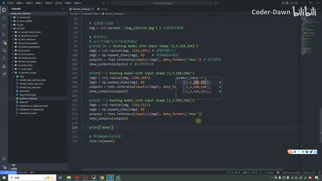

*将第三次推理的缩放尺寸改成 512×512。 · [原片 13:00](https://www.bilibili.com/video/BV11DjT6uEhc/?p=22&t=780)*

画面中第三次推理前的缩放被改成了 `cv2.resize(img, (512,512))`。可以看到，我们就直接报错了，所以说就是不可以了。上面我们设置了什么，下面我们就用什么。

可以看一下报错信息，它就说这个形状是 `[1,3,512,512]`，它不在这三个范围内，所以就不可以。这里大家需要注意一下。画面中的 `ValueError` 明确显示这个输入 shape 不在已配置的 `[[1,3,256,256], [1,3,224,224], [1,3,160,160]]` 中。

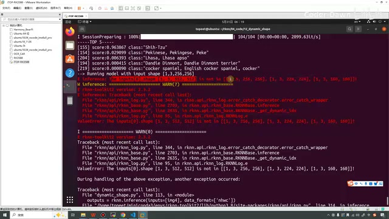

*512 输入不在三组预设形状内，终端抛出 ValueError。 · [原片 13:30](https://www.bilibili.com/video/BV11DjT6uEhc/?p=22&t=810)*

我在这里将代码改回来。好，这里的这个打印其实也没有用，可能反而有一些干扰，我也把它进行一个去除。

讲到这里，本节课的内容也就讲完了。最后也是感谢大家的观看，谢谢大家。
