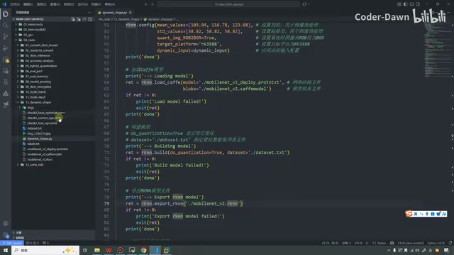
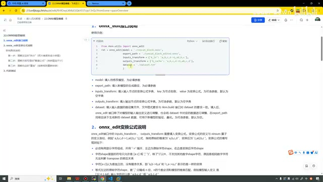
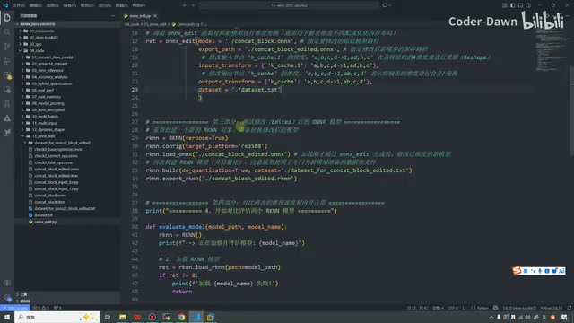
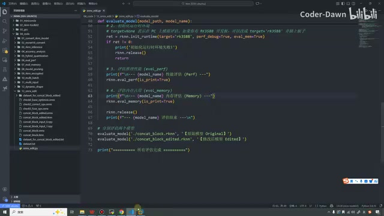
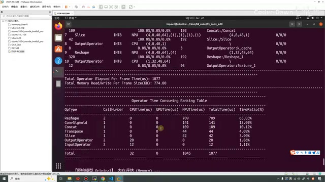
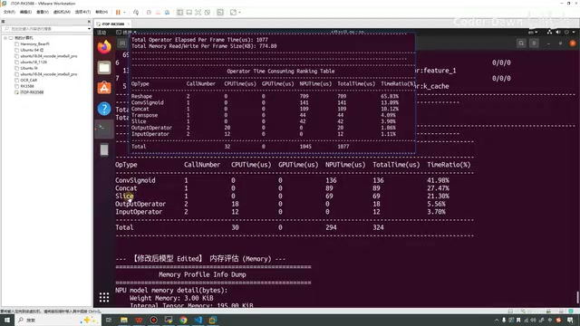
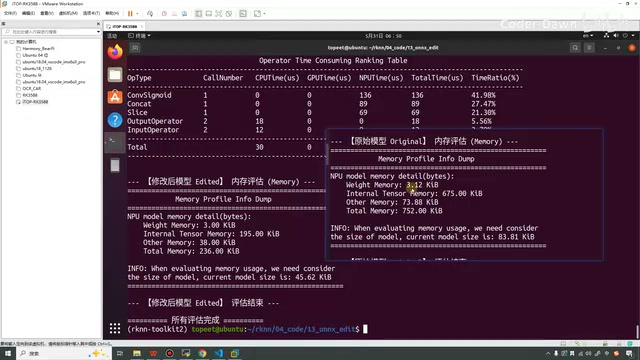
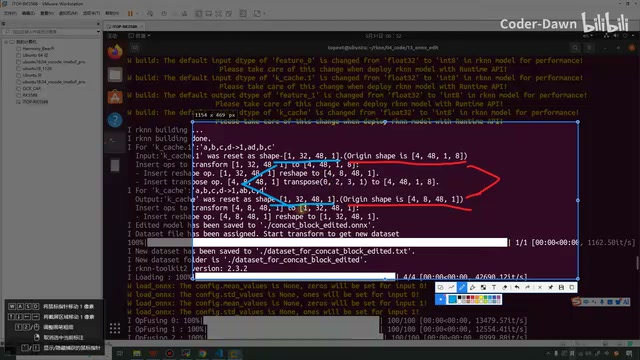
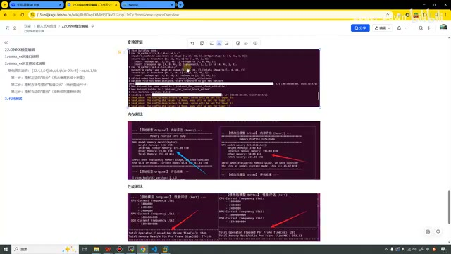

# P23｜22_ONNX模型编辑

> 来源：[B 站课程第 23 集](https://www.bilibili.com/video/BV11DjT6uEhc/?p=23) · 全片 23 分 34 秒
>
> 整理方式：忠实讲稿，保留原讲述顺序、第一人称、解释、例子、操作与结果，仅清理无意义口头停顿与结巴。文字依据本地转写和对应画面核对；识别不清或口述与画面不一致处就地标注。未逐字听音复核。
>
> 图片说明：原视频截图，源画面 640×360，小字受原始画质限制；图注为编辑说明。原始转写、恢复转写和规范化记录保留于来源资料。浏览器预览因 file 协议访问限制未执行，不宣称完成浏览器交互检查。

## 为什么要编辑 ONNX 模型 · 00:00

这节课我们来看 ONNX 模型编辑。为什么要讲这节课呢？它的一个作用是什么呢？就是在前面的时候，我打开一下之前的代码。如果大家仔细观察的话，都可以看到，像这份代码，我们本质上是将——我看看——是将这样一个 Caffe 的模型转换成 RKNN 的模型。

在它中间，可以看到它会生成中间的 ONNX，就会生成这个模型。它会先转换成 ONNX，然后再把 ONNX 转换成我们的 RKNN 模型。这个其实在最开始的时候也和大家有提过，就是会有这么一个东西。



*VS Code 展示 Caffe 模型的加载、build 和 RKNN 导出代码。 · [原片 00:35](https://www.bilibili.com/video/BV11DjT6uEhc/?p=23&t=35)*

知道这个之后，我们再来看 ONNX 模型编辑的价值所在。就是我们的模型在转 RKNN 模型后，可能会存在冗余的算子操作。特别常见的，就是在我们输入、输出的节点处，会存在冗余的 reshape、transpose op。这样的话，就会影响我们 RKNN 模型的推理性能。

所以瑞芯微就提供了 `onnx_edit` 的接口，让我们用来修改 ONNX 模型输入、输出的维度定义，使得调整后的 ONNX 模型能够转出性能更好的 RKNN 模型，可以减少这些冗余的操作。这个就是我们为什么要学它，以及它存在的价值。

接下来，我们就从三个大的方面，来逐个进行讲解。第一个是它的接口说明。

## onnx_edit 接口与变换公式 · 02:00

它比起我们之前，就多引入了一个包。它是来自于 `rknn.utils` 那边的，然后从这里面导出这个接口：

```python
from rknn.utils import onnx_edit
```

它的参数有五个：第一个是待修改的模型，第二个是导出之后的模型，第三个是输入，第四个是输出，第五个是量化校正集。

其中这个输入、输出这里，可以看到也还有点奇怪。它是一个字典，就是一个键值对，左边是键，右边是值。然后其中这个值这里，它还有一个什么三角、箭头，就是这么个东西。它什么意思呢？我们来看一下，就是输入节点，这个叫作变换公式字典。左边是我们的 key，节点名称；右边是我们的变换公式，就是这个。output 和 input 是一样的，不过一个是输入，一个是输出。



*onnx\_edit 接口示例与五个参数的说明。 · [原片 02:20](https://www.bilibili.com/video/BV11DjT6uEhc/?p=23&t=140)*

看完这个之后，大家可能还有点懵，不知道这些是啥意思。所以我们接着就来看第二部分，变换公式的说明。就是 `onnx_edit` 接口中，这两个需要填入变换公式，然后变换公式和这个算子的定义是类似的。

比如说我这里，就是箭头的左边 `a,b,c,d` 变换成右边 `a,d,b,c` 这个公式。它的含义，就是把原始维度的 `a,b,c,d` 转换成这个。这个转换公式，它到底是怎么转换的？它有什么规则呢？我们来具体再看。

就是我们的公式是不能乱写的，不能 `a,b,c,d` 这边直接来个 `e,f,g`，那就废了，直接就废了。我们来看一下它的规则。第一个规则是，必须有两个部分组成，并且用间隔隔开，就是箭头。它有左边，有右边，左边是原始的形状，右边是变化后的形状，这是第一个。

第二个规则是，这个 shape 里面只允许是 a 到 z 的字母，或者 1，就是只能是 a 到 z 还有 1 组成，它是不支持其他数字的这个 shape 的。

第三个是，字符 a 到 z 是独立的，没有顺序关系。就比如说 a、b，你把它变成 b、a，或者说 c、a 变成 a、c，它觉得你这个东西就没做一样，它觉得是相同的，没有进行变化。〔画面写作 `a,b->b,a` 与 `c,a->a,c`，将两种字母命名的换位视作同一种变换；“没做一样”按讲师原有说法保留。〕

第四点是，箭头左边原始字符 shape 被逗号分隔成了 n 份，然后 n 的个数必须和模型的维度匹配。比如说我们模型输入的定义是这样：`[32, 4, 1, 64]`。输入字符可以是 `a,b,c,d`，也可以是 `a,b,1,d`。什么意思呢？你看这里有一、二、三、四，有四个数字，所以说这里也得输入四个。你要是输个 `a,b,c`，那就不行，它就会报错，就是必须严格一致。〔原转写把方括号附近识别成“3、32”；画面形状为四个维度。〕

![变换公式规则及原始形状 \[32,4,1,64\] 的说明。](images/f003.jpg)

*变换公式规则及原始形状 \[32,4,1,64\] 的说明。 · [原片 05:15](https://www.bilibili.com/video/BV11DjT6uEhc/?p=23&t=315)*

再下一个规则是，原始字符 shape 的每一个符号，除了 1，都必须存在于变换后的字符。比如 `a,1,cd->a,c,d,1` 是有效的，`a,1,cd->a,c,1` 是无效的，缺少了 d。啥意思呢？就是左边出现了 a、c、d 三个字符，那你变换之后，右边也必须有 a、c、d 这三个字符。它可以是 ac，或者 ad，但是左边有啥，右边也得有啥，你不能给人家缺东西，缺东西就有问题了。〔这里“ac、ad”按原讲述保留；仍须结合前句“所有字母都要保留”理解，不能单独省掉其他字母。〕

再下一个规则是，允许插入任意个 1，达成扩维的效果。比如说 `a,b,c`，我们可以插入很多 1，你看这里我们就插入了三个 1，达成了扩维的效果，画面例子是 `a,b,c->a,1,bc,1,1`。

在这里，大家一定要注意，这句话和上面这句话，它是不冲突的。大家不要有这个误解。我在这里加粗一下，给大家再做一个额外的解释。这里啥意思呢？你看，它说这里都四个，你这里也得四个。这个是啥？这个是箭头左边的数据，箭头左边代表原始数据，原始是这个形状，那你就能用四个字母，或者加 1 的这种符号来进行表示。原始是四个，那你就必须也是四个。

那下面这是啥意思呢？就是你这个右边，你可以对它进行升维。就是我们在之前的代码中，我找一下，首先找一个，随便……你看，在这里其实我们不也进行了一个升维吗？就是和它类似，道理是类似的。就是箭头右边，我们可以对它进行升维；那左边，必须和原本的输入保持严格一致。这是这一条规则。

最后一条规则也比较长，我们来看一下。就是原始字符 shape，它允许用多个字母以及赋值公式来表示，对 shape 进行拆分。比如说原始的是 `[32, 4, 1, 64]`，然后可以使用这个公式。大家可以看一下，你看这里是四个数字，所以这里也是一、二、三、四，它也是四个。

然后这个箭头的右边，也都包含了左边的一个数字。但是这里有点特别，你看，多出了一个 `a=2`、`k=8`。啥意思？就相当于它给了一个默认值。

我们这个 ab，你看 ab 代表的就是 32，c 代表的就是 4，然后这个 d 代表的是 1，这个 qk 代表的就是 64。其中 a 是 2，我们也可以推理：ab 是 32，a 是 2，那 b 就是 16，它是一个乘法。那 qk，这里 k 是 8，我们也能推出来，q 也是 8。

后面的这段文字也是解释的，也就是这句话。然后最后这里有一个特别的地方，比如说我们 ab 是 32，如果我们赋值 a 是 5，那 b 就是 6.4。这样是不可以的，因为我们要求它必须是整数。所以如果出现了小数，就会产生一个异常错误。

说完这个之后，也是担心大家可能有点不理解，所以在这里，我把刚才上面的过程进行了一个具体的拆分。其实还是这个，我应该把它也复制过来。好，`[32, 4, 1, 64]`。然后这个变换公式，我把它也复制过来：

```text
ab,c,d,qk(a=2,k=8)->aq,cd,1,kb
```

![示例拆分、给定尺寸及重组后 \[16,4,1,128\] 的说明。](images/f004.jpg)

*示例拆分、给定尺寸及重组后 \[16,4,1,128\] 的说明。 · [原片 10:30](https://www.bilibili.com/video/BV11DjT6uEhc/?p=23&t=630)*

那这个 ab 是 32，然后 c 是 4，d 是 1，qk 是 64，这是第一步。第二步的话，我们已经给它 `a=2`、`k=8` 了，那在这里，我们就能推出来这个 b，还有这个 q 是多少了。

第三步就是进行了重组。我把它这样贴过来吧。贴过来之后，我们右边变成了 aq，那就 aq，它就是 16。

然后 cd，它变成了 4；1 用来扩维；kb，它变成了 128。也就是说，我们把原本的 `[32, 4, 1, 64]`，把它变成了 `[16, 4, 1, 128]`。〔转写中有“118”和漏读单独的 1，按同屏公式与四维结果核对。〕

通过这个 `onnx_edit` 接口，我们就可以对它进行一些自定义的变换。这样的话，其实我们就改变了它的形状，甚至我们把它的维度也进行了交换，这个就是变换公式。

这个部分的话，其实就会稍微有一点复杂了，就比较考验我们的功底了：就是我们能不能找出来有效的——一开始说了，就是冗余的这些算子操作；找出来之后，我们怎么样对它进行变换，它的性能会更好。这个就需要大家去尝试和积累了。在这里，我只是把方法给到大家，大家知道可以这样去做就可以了。后续在工作中遇到了，就具体再去尝试，再去修改就可以了。

## 在 VS Code 中看代码测试 · 11:18

第三个部分就是代码测试。这个代码也会相对长一点，我们就不在这里看代码，直接在 VS Code 里面看代码。然后把它关掉，就是它。在这里我们来看这个代码。

代码一共分成了四个部分。第一个部分，就是我们需要测试这个原始的 ONNX。因为我们不是对它进行了这个变换吗？那我们不能白变换呀，我们变换的目的，是为了让它的性能更好、效果更好。所以我们第一部分是原始的。我们看一下，就创建一个 RKNN 对象，然后进行这个 3588 的设置，然后我们加载 ONNX 的模型，进行 build，顺便我们也把它进行一个导出，这是第一部分。

第二部分的话，我们就是引入它，然后进行变换。这是原始路径，这是指定修改后的路径，然后这里是它具体的操作。这个操作，在前面也都有说过。你看，就是把这个 `a,b,c,d` 变成 `1,ad,b,c`；下面是 `a,b,c,d` 变成 `1,ab,c,d`，就进行了这样的变换。〔原转写的公式有缺字，这里按代码画面补正；输入节点名为 `k_cache.1`，输出节点名为 `k_cache`。〕



*原始模型转换、onnx\_edit 的输入输出公式及修改后模型转换代码。 · [原片 12:50](https://www.bilibili.com/video/BV11DjT6uEhc/?p=23&t=770)*

```python
ret = onnx_edit(model='./concat_block.onnx',
                export_path='./concat_block_edited.onnx',
                inputs_transform={'k_cache.1': 'a,b,c,d->1,ad,b,c'},
                outputs_transform={'k_cache': 'a,b,c,d->1,ab,c,d'},
                dataset='./dataset.txt')
```

这个就是我们的第二部分。第三部分的话，就是测试修改后的模型，和第一部分的代码其实是一样的，也是创建对象、进行配置、加载模型、进行 build，然后还有一个导出，这个是第三部分。

第四部分是进行对比。如果说大家眼比较尖，你就发现，之前我们都是说了至少要传三个参数，在这里怎么就传了一个呢？这个原因是啥？就是之前我们使用的是 RKNN 模型，在这里我们使用的是 ONNX。我发现在这里，其实可以省略那两个参数，就是传这个平台，它就可以。〔保留讲师对前后调用差别的说明；本处代码配置行为 `rknn.config(target_platform='rk3588')`。〕

第四部分，就是对比两者的推理速度还有内存。在这里，我看一下，就是我定义了一个函数。在下面，因为上面不是把 RKNN 模型也进行了导出吗？导出之后，就直接在这里进行推理，然后看对比。

具体这里面做了哪些事情呢？第一步，还是初始化 RKNN 对象；第二步是加载它的 RKNN 模型。

第三步是初始化它的运行时环境。在这里，为了对比，所以就是把内存评估、性能评估都进行了开启。在这里也是，就是把内存评估和性能评估进行了打印，最后进行了释放。



*评估函数开启性能和内存评估，打印结果后释放 RKNN 对象。 · [原片 14:35](https://www.bilibili.com/video/BV11DjT6uEhc/?p=23&t=875)*

这个代码，虽然看着长，但其实还是挺简单的，前面也说过很多次了。最后，我们就来执行看一下效果。这个怎么每次都会这样？我们这个代码应该是第 13 了。我先清一下屏，然后在这里，我们来执行一下。

在这里我们稍等一下，看一下结果。这个数据还有点多，我想一下。在这里，我们这样干吧，像上面这个，我们都把它设成 false，这也设置成 false，这里没设置就是 false。〔转写为“boss”，结合前后 `verbose=True` 的配置位置，应为 `False`；本次未逐字听音，按画面操作语境标注。〕

好，然后我们再重新执行一下，我们稍微等一会。因为进行这个连板推理的时候，它其实速度会有一点点慢。

等一会。好，到这里其实就已经全部执行完成了，我们来看一下效果吧。

我们就从这上面一点一点看吧，这里执行，然后这里就是开始对比和评估两个模型。我们就把它截下来，这是原始模型。这个，一按这个快捷键，它就跑了。我这样截吧。原始模型性能评估，这里是 CPU、NPU，它们的频率，然后下面就是它的……把这个截下来。

这个是原始模型的性能评估。我们看一下，就是修改之后的，在这里可以做一个对比。你看原始它的时间是 1077，然后它的大小是 774。〔画面分别为 `Total Operator Elapsed Per Frame Time(us): 1077` 和 `Total Memory Read/Write Per Frame Size(KB): 774.80`；原转写“10774”按同屏结果核对为 1077。〕



*原始模型性能表显示总耗时 1077 μs、每帧内存读写量 774.80 KB。 · [原片 15:45](https://www.bilibili.com/video/BV11DjT6uEhc/?p=23&t=945)*

这个是我们进行变换之后的。变换之后，它变成了 324 和 293，可以看到这个提升是非常非常大的。〔画面对应为 324 μs、293.23 KB。〕

然后我们来看一下这里，它为什么会有那么大的提升。你看，首先它的这些 CPU 的时间就提升，NPU 提升得最多，所以总时间也会有提升。主要是它的次数，还有一些变换。你看，原本这里它有 reshape 两次，你看这里，它直接就没有这个过程了。

然后别的，我看一下，这个 con……然后还有这个 transpose，这个操作也已经被优化掉了。剩下的其实就没啥变化。总之这个性能我们可以看到，就明显变快了，刚才一千多，现在只需要三百多，这是第一个。



*画面上下并列展示原始模型与修改后模型的算子耗时表。 · [原片 18:40](https://www.bilibili.com/video/BV11DjT6uEhc/?p=23&t=1120)*

第二个，我们看一下这个内存评估。这是原始的内存，然后我们再到下面，下面这里是我们修改后的。可以看到原始的这个权重是 3.12，然后这里是 3.00，少了一点。然后这个内部张量是 675，现在变成了 195，还有一些其他的也进行了优化。总的原本是 752，现在是 236。可以看到这个优化是非常非常大的。〔这些内存数值的画面单位为 KiB：原始总内存 752.00，修改后 236.00。〕



*原始与修改后模型的内存评估对比，画面总内存分别为 752.00 与 236.00 KiB。 · [原片 19:15](https://www.bilibili.com/video/BV11DjT6uEhc/?p=23&t=1155)*

所以说，我们在这个领域就业的话，其实就是会有算子优化这方面的岗位。如果说这方面做得比较好，那也是非常厉害的。

看完这个之后，还有一个信息，我也来给大家找一下，我看一下在哪里。

看一下，这里，就在这里。这里其实就是我们刚才形状的变化，它说形状是这样，然后原始形状是这样。这里是我们进行 ONNX 变换的时候，它具体的过程，就是怎么变的，就可以在这里看，主要看这个就可以，这个是最清楚的。看，它把原本的这样转化成了这样。

在这里，我们也可以进行简单的分析，就是它为啥会提升呢？你看它原本的形状是这个，然后这个原始的形状是这个。你看，它们两个形状其实是不一样的：它是 `[4, 48, 1, 8]`，它是 `[4, 8, 48, 1]`。它们的形状不一样，所以形状不匹配，所以在进行推理的时候，速度就会比较慢。



*终端变换日志及讲师批注展示输入输出形状的调整过程。 · [原片 21:35](https://www.bilibili.com/video/BV11DjT6uEhc/?p=23&t=1295)*

然后我们转换之后，我换一个颜色。你看，我们转换完之后，通过那个 a、b、c、d 换位置，转换完之后，其实都把它变成了 `[1, 32, 48, 1]`。这两个，就输入、输出，它是很匹配的，那它速度就会快了。

其实大家应该能想明白这个道理，原本它不一致，内部就需要进行一些转换，进行一些处理。现在你直接把它变得一致了，那它速度理所应当就更快了，性能也就会更好了。这个我觉得大家应该也是可以理解的。

然后这个公式，其实你看，这个我们也分析一下吧。

你看公式是这个。它首先都加了一个 1，这个 1，也就是这个 1、这个 1。然后它变成了 ad，你看 ad 就是 4 乘 8，就是这个 32。然后 c 和 d 保留，那 c 是 48，然后 d 的话……然后是这个 1，进行保留。〔此处口述字母与输入式不完全一致：画面输入公式为 `a,b,c,d->1,ad,b,c`，其中 b 对应 48、c 对应 1；此处保留讲述并就地说明，不默改为讲师说了另一套字母。〕

这边也是一样，第一个 1 保留下来，然后是 ab，ab 的话是 4 乘 8，32。然后这个 48 保留，这个 1 保留。就是这样的变换，把它变得形状一致了。一致之后，它速度就快了，性能就好了，内存也减少了。这就是我们这个 `onnx_edit` 接口的价值所在。

最后，其实我把这些也是截了下来，就是为了大家看得更清楚一些，在这里我也有做截图。大家也可以试一试，如果之前有一些自己的模型，我们可以看一下，这个形状是不是不一样？能不能通过一些公式，把它形状变得一样？变得一样之后，我们再看一下，效果是不是会变得更好。



*课程文档留存了变换控制台、内存对比和性能对比截图。 · [原片 23:20](https://www.bilibili.com/video/BV11DjT6uEhc/?p=23&t=1400)*

好，讲到这里，我们这节课的内容也就已经全部讲完了。最后也是感谢大家的观看，谢谢大家。
