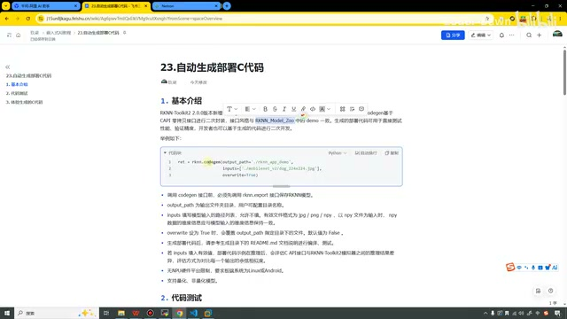
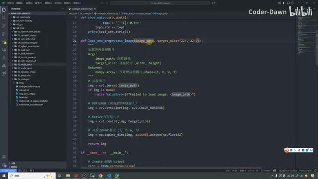
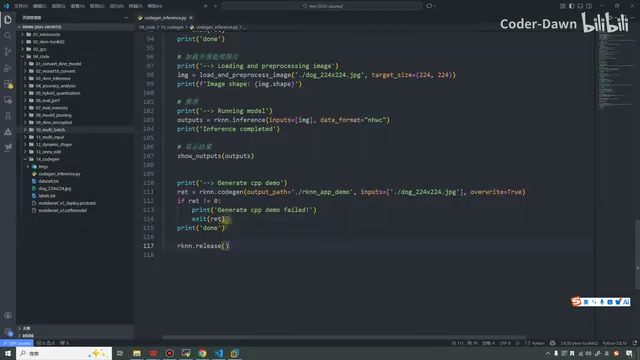
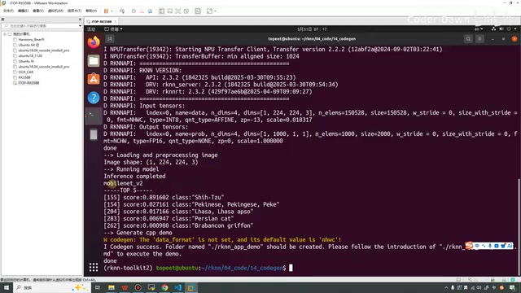
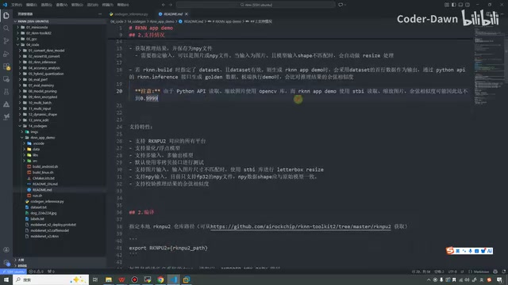
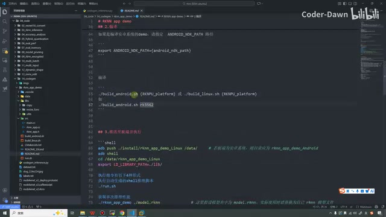
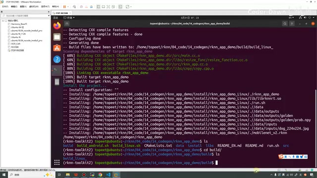
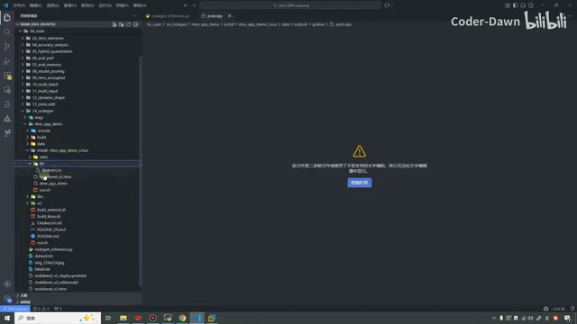
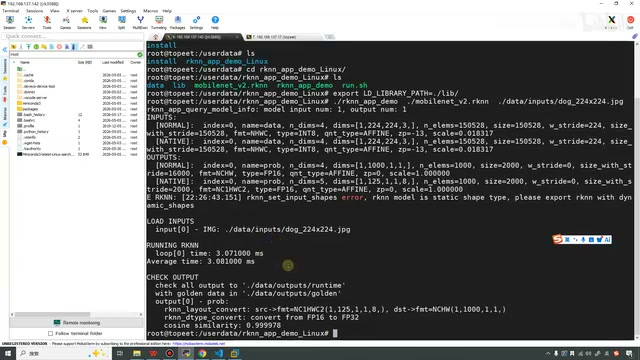
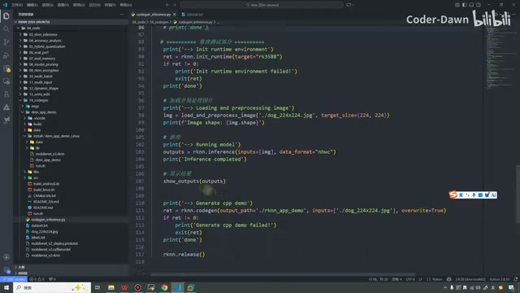

# P24｜23_自动生成部署 C 代码

> 来源：[B 站课程 P24](https://www.bilibili.com/video/BV11DjT6uEhc/?p=24) · 全片约 19 分 34 秒。
>
> 整理方式：忠实讲稿，保留第一人称、原顺序、理由、操作和讲师的结果解释，清理停顿、结巴及无意义连续重复。原始转写保存在 sources；术语依据原视频画面核对。未进行音频回听。
>
> 图片为原片 640×360 截图，细小代码受原始画质限制；图注为编辑说明。局部无法可靠辨认的参数或讲述已在邻近位置注明，不补写猜测的命令。

## 基本介绍 · 00:00

这节课我们来看第 23 讲，自动生成部署 C 代码。同样分为三个部分来进行讲解：第一个是基本介绍，第二个是代码测试，第三个是体验生成的 C 代码。我们一个一个来看，第一个叫基本介绍。

在前面的学习当中，我打开我们之前的代码，我们一共已经有了 13 个代码文件。但这 13 个代码文件，基本上都是 Python 的，我们都是用 Python 去写的。之前我也和大家讲过，我们最终在进行真正的工业部署的时候，都会选择 C 代码或者 C++ 代码，会选择这两种代码来部署，不会使用 Python 代码。而且 Python 代码去开发板上面部署的时候，它的性能会比较差。

如果说我们进行一些 Python 代码的修改，有一些想法，因为 Python 代码写起来比较方便，包括前面的一些评估，其实都比较方便。如果我们有一些小的修改，就对应地写一套 C 的代码，那其实是非常麻烦的，也会大大增加我们的工作量。

瑞芯微就非常贴心，它给我们提供了一个 API，一键直接自动生成 C 代码。这样我们就可以快速验证我们的想法。甚至有时候，如果我们的要求不高，做一个 demo，我们甚至都可以直接使用生成的 C 代码进行部署。这个就是它的基本介绍。

再看一下这段文字，它是在这个版本中新增的，它的接口风格和 Model Zoo 是一样的。它就是这么一个 API。

〔画面核对：课件写的是 RKNN-Toolkit2 2.0.0 版本新增 codegen 接口，生成代码基于 C API，接口风格与 RKNN Model Zoo 的 demo 一致。〕



*课件展示 codegen 的参数与生成说明。 · [原片 02:00](https://www.bilibili.com/video/BV11DjT6uEhc/?p=24&t=120)*

它一共有三个参数，分别是这三个。第一个参数是输出的文件夹目录，用户可以配置目录的名称。第二个是 inputs，就是模型输入的路径列表，允许我们不填，有效格式是这么多种。第三个是 overwrite，就是是否覆盖。如果设置为 True，已经有这个文件了，它就会重新进行覆盖。这就是这三个参数的解释。

〔画面可辨认参数名为 `output_path`、`inputs`、`overwrite`。inputs 说明处列出 jpg、png、npy；更细的格式与形状约束受画面小字限制，请以生成的 README 为准。〕

生成完之后，它还会帮我们生成一个 README 文件，我们可以参考它进行编译和测试。如果这个 inputs 填入了有效值，那么部署代码示例在推理后，还会评估和模拟器之间的结果差异。评估方式是对比每一个输出的余弦相似度。最后这两个就不用再看了。

## 代码测试：预处理与模型流程 · 03:04

接下来到第二部分，就是代码测试。我们直接来到 VS Code 里面，我把它划到最上面。这个代码其实和之前的代码没什么区别，第一个还是一个排序。

第二个是新增的。之前也不知道大家还有没有印象，我们总是在模型推理之前进行预处理。预处理其实就是读这个图片，然后可能改变它的格式，给它升个维。每次我们都是在 main 函数里面写的。在这个代码中，我就特意将它封装了一下，让它写在外面。

我们可以看一下，它接受两个参数：第一个是路径，第二个是目标尺寸。

其中这个目标尺寸也给了一个我们测试要用的，就是 224×224。具体看代码，真的是非常简单，和之前没什么区别。第一步加载，这里只是判断了一下；然后这里把它转换了一下。是否要转，其实是看我们的模型，有的模型就不需要转，像 PyTorch 的模型就不用转。但是像 Caffe，我们用的这个 Caffe 模型就需要转。然后这个设置一下它的尺寸，设置到这个；最后就是进行升维，然后把这个图片返回就行了。这个相当于两个辅助函数。



*预处理函数将读图、格式转换、缩放与升维封装在一起。 · [原片 04:00](https://www.bilibili.com/video/BV11DjT6uEhc/?p=24&t=240)*

〔画面可辨认的预处理代码如下；保留课堂中的转换方式与顺序。〕

```python
def load_and_preprocess_image(image_path, target_size=(224, 224)):
    img = cv2.imread(image_path)
    if img is None:
        raise ValueError(f"Failed to load image: {image_path}")
    img = cv2.cvtColor(img, cv2.COLOR_BGR2RGB)
    img = cv2.resize(img, target_size)
    img = np.expand_dims(img, axis=0).astype(np.float32)
    return img
```

看完辅助函数之后，我们继续看我们的流程。第一步创建对象，第二步进行配置，第三步加载 Caffe 模型，第四步进行 build 构建，第五步把它导出。第六步，这里初始化运行时环境。第六——我们这里应该叫第七步吧，第七步就是进行模型推理。但是推理之前，我们需要对图片进行一些预处理，预处理就直接用这个函数。可以看到，鼠标放在它上面，也能看到下面的注释、返回值等等。

做完这些之后，最后我们其实就加了这么一行代码。这个判断也可以不加，或者直接写成更复杂的方式，可以一行解决。这里就是生成我们的 C 代码，这里是输出路径、输入，还有是否覆盖。这就是所有的代码，非常简单。



*推理和 Top-5 输出之后调用 codegen，传入输出目录与狗图片。 · [原片 06:00](https://www.bilibili.com/video/BV11DjT6uEhc/?p=24&t=360)*

```python
ret = rknn.codegen(output_path='./rknn_app_demo',
                   inputs=['./dog_224x224.jpg'], overwrite=True)
```

〔截图中的调用后接返回值判断：失败时打印 `Generate cpp demo failed!` 并退出；最后调用 `rknn.release()`。〕

我们就在 Ubuntu 里面来执行一下。

这里我清一下屏，然后在这里执行这个 codegen 的示例，我们稍微等待一下。〔执行命令的脚本全名在当前采样画面中未可靠辨认，这里不猜写。〕

如果大家每次看这些终端打印有点烦，其实可以设置一下这个参数。其实已经设置过了，现在都已经是必要打印。〔前面代码画面可见 `RKNN(verbose=False)`。〕

可以看到，在这里有一个结果，就是我们推理的结果，是狮子狗，然后是 0.89。这里也还有输出，这里是我们函数里面的内容，它的形状。最后这里可以看到 codegen success，就是生成成功了。它的名称叫这个，已经创建了。



*终端输出狗图片的 Top-5 结果，并提示 codegen 成功。 · [原片 07:00](https://www.bilibili.com/video/BV11DjT6uEhc/?p=24&t=420)*

〔终端画面中 Top-5 第一项显示 `score:0.891602 class:"Shih-Tzu"`；图片形状为 `(1, 224, 224, 3)`。成功提示指向 `./rknn_app_demo`。〕

我把它先拉一点，就说 please follow 这个 README 的介绍，去执行这个 demo。那我们来这里看一眼，可以看到现在多出来了一个 rknn_app_demo。在里面，它还支持 Android，也支持 Linux，这就和我们之前官方的也都差不多。这里面是它自动生成的，README 也可以说非常贴心，有英文的，还有中文的。还有一个 run，是一键执行的。

我们看一下，它说这个 demo 是由这个接口生成的，主要作用就是快速验证它的 API 推理。

它主要支持下面这些功能：一个是获取推理性能，获取推理结果。结果是保存为 NPY 文件的。如果这个构建的时候指定了这个校准集，而且它是有效的，它也会使用它的〔原转写“守皇数据”，依画面为 golden 参考数据〕做一个输出。

这里有一个注意事项，就是 Python API 中用 OpenCV 库，但是在我们这个里面，它调用的是 stb 这一层来缩放图片，所以相似度达不到最高值。



*生成的中文 README 说明功能与 OpenCV、stb 图片处理差异。 · [原片 08:30](https://www.bilibili.com/video/BV11DjT6uEhc/?p=24&t=510)*

〔README 画面说明 Python API 读取、缩放图片使用 OpenCV，而 rknn app demo 使用 stb 读取、缩放图片，因此结果比较可能无法达到 0.9999。此处保留课堂解释，不把该数值当成每次运行的保证。〕

这里可以看到，这么几个库，大家可以看看，这些也都是它帮我们生成的，所以它会用这些。看，有 NPY 的，然后有 resize，还有一些路径的、类型的。也可以点进来随便瞅瞅。这是头文件，我们直接来看，还挺复杂的，用了很多模板函数，一个 C++ 的。这里是它的 resize，这里是一些工具函数，我们就不看它了。

然后 src 里面，这里就是头文件里的代码。我们可以看一看，它加载输入数据，然后这里直接进行了一个 run，进行了对比。这里是获取其形状，然后是主函数，在这里。〔这一段转写多次出现“让”“孟寒舟”等识别错误，按画面只确认输入加载、运行、输出对比和形状获取这些动作，不补写不清晰的实现细节。〕

总之这个我们现在暂时看一眼，后面我们也会专门讲 C、C++ 的代码。你看它帮我们生成得还挺好，什么都有，这里包括这些函数等等，写得都挺好的。包括这个我们也看一眼，大量地使用这个东西，有一个上下文。总之这是它帮我们生成的。

然后我们再看它的第二部分，就是编译。我们要指定一个本地仓库，然后设置一下环境变量，直接进行编译就行，支持 Android，也支持 Linux。编译完之后，把它推送到开发板端。

执行的时候也是支持这么多种。你看，可以执行自动生成的 shell 脚本；这个是获取推理结果的；这个是获取单次推理性能的，后面也可以加参数获取多次。第四点还打印一些信息，总之也挺全的。



*README 列出直接运行、获取结果和性能测试等调用形式。 · [原片 11:00](https://www.bilibili.com/video/BV11DjT6uEhc/?p=24&t=660)*

〔README 画面可辨认 `./run.sh`；获取结果使用 `./rknn_app_demo ./model.rknn`，性能测试示例在模型参数后加 `100`。这些为 README 中的通用示例，下面实际课堂执行使用生成的 mobilenet_v2.rknn 文件。〕

## 体验生成的 C 代码：交叉编译 · 11:26

在这里，我把最简单的方法写在这里，大家可以直接复制。我们来试一下，按照这个步骤，首先需要进入这个 app 里面。把这……我不能输入了，就是进入到这个目录里面。

第一步我们设置一下，导出一下这个东西，其实也是按照 README 里面来说的。这里就是，导出这个 RKNPU2，然后我们执行。

第二个就是设置一下我们的交叉工具链。我们的交叉工具链放在 /opt。

然后我们执行。第二个就是设置交叉工具链，我们的交叉工具链放在 /opt。然后我们就可以进行编译，稍微等一下。可以看到它现在就已经编译完了。

〔屏幕命令中可核对的配置和编译如下。RKNPU2 指向讲师机器已有的仓库目录；交叉工具链路径也是讲师机器路径。〕

```sh
export RKNPU2=/home/topeet/rknn/02_rknn-toolkit2/rknn-toolkit2-master/rknpu2
export GCC_COMPILER=/opt/tool_chain/gcc-arm-10.3-2021.07-x86_64-aarch64-none-linux-gnu/bin/aarch64-none-linux-gnu-
./build_linux.sh rk3588
```



*交叉编译完成，安装日志列出可执行程序、库、模型和输入输出目录。 · [原片 13:00](https://www.bilibili.com/video/BV11DjT6uEhc/?p=24&t=780)*

编译完之后我们来看一下，现在有一个 build 目录，我们进入这个目录。哦，对。〔这一段源转写从约 12:34 到 13:28 连续重复大量“对”，未提供新解释；画面实际显示编译安装日志、查看 build 后返回上一级，再进入 install，并开始准备 scp。这里保留动作，清理无意义重复。〕

这样吧，这个东西有点碍事，把它挪一挪，先打开。可以看到，这个命令之前也说过，所以我们把这个文件传到开发板。我的开发板现在就是这个 IP，142，传到这里面。然后根目录这里有一个 userdata，我们先进来，现在里面只有一个这个。

〔传输画面可辨认的命令如下，课堂开发板 IP 为 `192.168.137.142`，目标为 `/userdata`。〕

```sh
scp -r rknn_app_demo_linux/ root@192.168.137.142:/userdata
```

我们现在就是把它传到这个 userdata。然后它要我们输入密码，就输一下，输以后耐心等待就好。等待完之后，可以看到它就生成了这个。

刚才也是忘了看，我们在这里也看一看。它生成 install 目录之后，里面有这个 rknn_app_demo。里面这个 data 就是输入输出，这里就是我们可以用的图片。这里在 VS Code 里面打不开，就是我们刚才已经设置过了。然后 lib 下面就是我们要用的库，这里是可执行文件，还有模型。run 的话，直接执行。



*生成目录中的输出文件在 VS Code 中无法按文本直接打开。 · [原片 15:00](https://www.bilibili.com/video/BV11DjT6uEhc/?p=24&t=900)*

在开发板端想执行，我们同样先要设置一下动态库路径，就在当前目录下，可以用这条命令。设置完之后，我们复制这条命令。这条命令其实就是执行这个可执行程序，然后调用这个 RKNN 模型，推理的数据就是刚才那个狗。

```sh
export LD_LIBRARY_PATH=./lib/
./rknn_app_demo ./mobilenet_v2.rknn ./data/inputs/dog_224x224.jpg
```

〔执行位置为开发板 `/userdata/rknn_app_demo_linux`。画面先 `cd userdata/`，再进入 `rknn_app_demo_linux/`，通过 `ls` 查看 data、lib、模型、可执行程序和 run.sh。〕

然后我们等一下，看一下结果。这样其实已经推理成功了，这就是我们最终的结果。包括这里，我们可以简单看一下打印信息。

## 开发板运行结果与提示 · 16:10

这里你看，它说输入是一个，输出也是一个。这里是 input，它的形状就是 1、224、224、3。这个是输出，输出是这么一个形状。

这里这个 error 并不是真正的报错，它其实只是一个提示，就是说我们这个模型是静态的。〔这是讲师对本次已完成推理日志的解释。屏幕原文为 `rknn_set_input_shapes error, rknn model is static shape type`，后面提示导出动态形状模型；当前结果仍继续产生。不要据此泛化为所有 error 均可忽略。〕

然后这个 input[0] 就是我们刚才输入的这个。它开始执行，它的时间用了一个三秒钟——三毫秒钟，就是这么一个东西。



*开发板完成推理，显示输入输出形状、耗时和余弦相似度。 · [原片 16:00](https://www.bilibili.com/video/BV11DjT6uEhc/?p=24&t=960)*

〔画面日志显示：`model input num: 1, output num: 1`；输入 NORMAL 形状 `[1,224,224,3]`，输出 NORMAL 形状 `[1,1000,1,1]`；`loop[0] time: 3.071000 ms`，`Average time: 3.081000 ms`。讲师口述“秒钟”后立即更正为“毫秒钟”，这里保留这一更正。〕

包括下面也可以看到一些打印，就是它的格式，然后目标是这个。这个格式其实就是我们的 NHWC，然后加了 C1 和 C2，这在瑞芯微官方手册上面其实是有的，大家感兴趣可以去看一下。在这里我就不再讲这个东西。

〔相邻日志的实际布局转换名称是 `NC1HWC2` 到 `NCHW`，以及 `FP16` 到 `FP32`；讲师此处口述以 NHWC 加 C1/C2 说明，保留讲述，同时给出画面文字便于核查。〕

总之你看，还有余弦相似度。刚才也说了，会达不到全部 9，但是也差不多了，所以略微有一点不一样的地方在。

〔画面本次 `cosine similarity: 0.999978`，输出检查将结果写入 `./data/outputs/runtime`，与 `./data/outputs/golden` 中的参考数据比较。〕

## 生成接口的范围与 Top-5 · 17:58

总之到这一步就证明，我们使用 codegen 这个接口，它确实可以帮我们生成 C 环境下推理的代码。而且在开发板上面，确实可以把它跑出来，确实可以跑出效果。

虽然说这个效果可能并不是我们想要的那样子。它不像我们在这里跑的时候，会直接输出那个 Top 什么什么的。这个其实它并没有帮我们做，我们还是需要自己做。

我在这里其实有一段代码注释了，这个代码什么意思呢？之前我是在这里，在推理之前去生成 C 代码，我就是想看一下，验证一下它到底会不会帮我们把刚才说的 Top-5 这个操作都做出来。



*Python 示例中当前生成调用位于推理与 show\_outputs 之后。 · [原片 19:00](https://www.bilibili.com/video/BV11DjT6uEhc/?p=24&t=1140)*

我在推理之前试了一下，它没有。所以我放在推理之后试了一下，它还是没有。所以这部分其实还是需要我们自己进行编写的。

〔画面保留了前方被注释的生成调用；当前执行的 `rknn.codegen(...)` 位于 `rknn.inference(...)` 和 `show_outputs(outputs)` 之后。讲师用这两个位置测试生成器是否连同 Python 的 Top-5 后处理一起生成，结果都没有。这里的生成成功与 C demo 可运行，并不表示已生成 Python 的全部业务后处理。〕

好，这节课讲到这里也就已经给大家讲完了。我就是告诉大家，这个接口可以生成 C 代码，其实很简单，就一行代码，然后也简单实践了。那我们这节课就到这里，谢谢大家的观看，谢谢大家。
