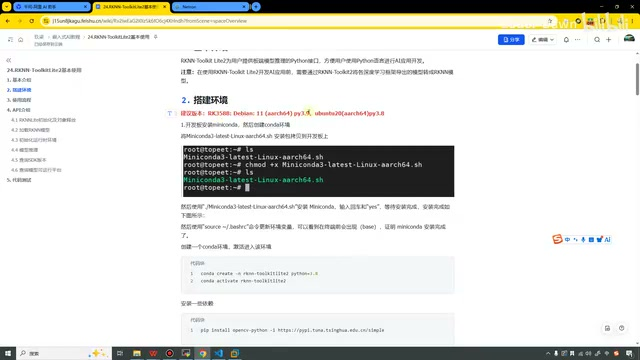
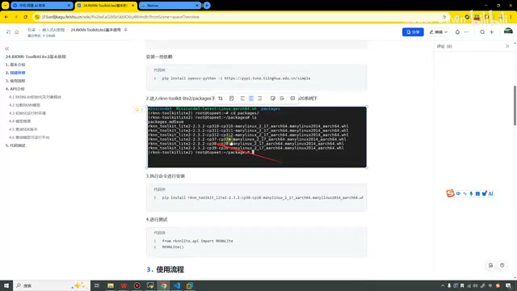
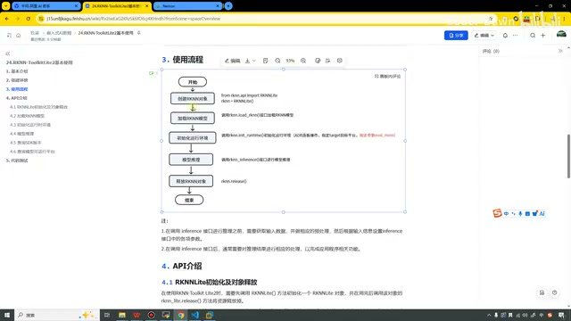
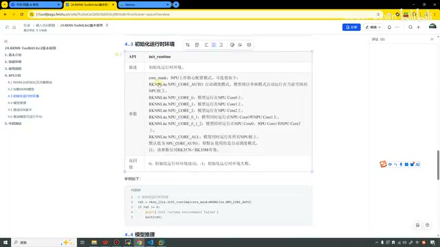
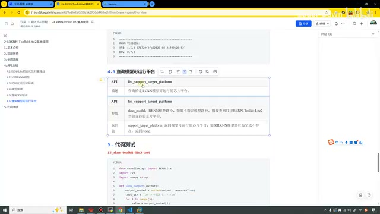
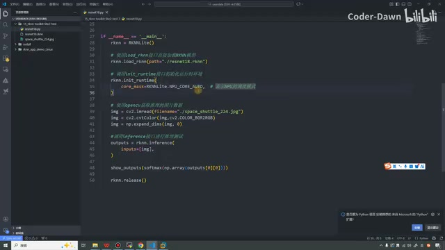
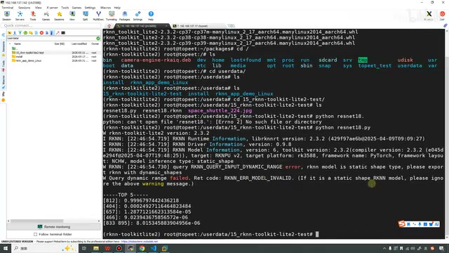

# P25｜24_RKNN-ToolkitLite2 基本使用

> 来源：[B 站课程 P25](https://www.bilibili.com/video/BV11DjT6uEhc/?p=25) · 全片约 13 分 55 秒。
>
> 整理方式：忠实讲稿，不做摘要压缩。保留第一人称、原讲述顺序、解释、操作、纠错和结果；清理停顿和无意义重复，补充标点。文字来自本地 Whisper 转写，结合实际课件与代码画面核对术语；局部无法确认的识别项在正文标注。
>
> 图片说明：7 张原视频截图，源画面 640×360；小字受原始画质限制。图注为编辑说明。原始转写及规范化审计另存于 sources。

## 基本介绍 · 00:00

这节课我们来看第 24 讲，RKNN-ToolkitLite2 基本使用。我们这节课一共分成五个部分来进行说明：第一个部分是基本介绍，第二个是搭建环境，第三个是使用流程，第四个是 API 介绍，第五个是代码测试。

我们先来看一下这个基本介绍。RKNN-ToolkitLite2 是为用户提供板端模型推理的 Python 接口，方便用户使用 Python 语言进行 AI 应用开发。然后注意，在使用它之前，就要通过 RKNN-Toolkit2，将各深度学习框架导出的模型转换成 RKNN 模型。

这个其实在很早之前，在前面的理论课程当中，也是有和大家讲过的。在这里我带着大家回忆一下：我们的 RKNN-Toolkit2，它的主要作用，最最核心的作用就是进行模型转换，然后它可以进行一些模型的性能评估、内存评估等等，它主要是做这个作用。

我们的 RKNN-ToolkitLite2，包括我们的 C demo 的 RKNPU〔此处原转写为“KDEMO的RKNPO”，按讲述上下文保留这一指称〕，它主要就是做板端部署的。只不过这个 ToolkitLite2，它的部署比起来我们的 C 语言、C++ 的那个版本会更简单，所以它起到的作用也是一个快速验证的作用。在我们真实的企业开发中，我们不太会采用这种方式。所以这个方式大家了解即可，主要也是为了进行快速验证嘛。

## 搭建板端环境 · 01:46

讲完这个之后，我们就来看第二部分，搭建环境。搭建环境的话，在这里写了一下建议版本，RK3588 它建议的是这个系统，然后这是官方建议的系统。



*环境建议版本与 Miniconda 安装说明。 · [原片 02:00](https://www.bilibili.com/video/BV11DjT6uEhc/?p=25&t=120)*


从官方的那个手册里面可以找到。然后我的开发板就是 Ubuntu 20，用这个 Python 3.8，其实也是没问题的，这两个系统本质上也没差太多。

〔画面版本说明：课件写有 RK3588、Debian 11（aarch64）py3.9、ubuntu20（aarch64）py3.8；这里保留讲师对建议版本和自用系统的说明。〕

我们搭建环境的时候，第一步需要在开发板端装这个 Miniconda，搭建这个 Conda 环境。其实这个在很久之前，我们在那个虚拟机上面已经搭建了。其实在开发板端搭建环境，步骤、过程都是一模一样的，只不过当时我们的这个 shell 文件是一个 x86 的。现在只要使用 aarch64 的。

在这里我也可以带着大家复习一下。你看，之前我们安装的时候，这个是 x86 的。现在到第 24 讲，把它折叠起来，我们在这里使用的是 aarch64 的，因为我们这个 3588 也是这个 64 位架构的。

我们使用的方法和之前一样，给它一个可执行权限，然后直接执行就可以了。装完之后，我们需要 source 一下，这样的话就可以看到前面有一个 base。然后我们就可以创建它的虚拟环境，激活它的环境，然后安装一些必要的依赖。最好直接把这个 OpenCV 装上，后续我们也会去使用。

```bash
chmod +x Miniconda3-latest-Linux-aarch64.sh
./Miniconda3-latest-Linux-aarch64.sh
source ~/.bashrc
conda create -n rknn-toolkitlite2 python=3.8
conda activate rknn-toolkitlite2
pip install opencv-python -i https://pypi.tuna.tsinghua.edu.cn/simple
```

〔以上命令按课件画面可辨内容排录；安装脚本运行后，画面说明按提示输入 yes，等待安装完成。〕

这里有一个截图，就是这样的。然后我们同样需要把这个东西，就是这个 packages 里面的——



*板端安装 RKNN-ToolkitLite2 的 wheel 包及测试入口。 · [原片 04:00](https://www.bilibili.com/video/BV11DjT6uEhc/?p=25&t=240)*


里面有一个这个 RKNN-ToolkitLite2，把它给安装一下。就直接 pip install，最后进行一下测试。其实和前面 x86 的这个过程是一模一样的。

〔课件操作顺序：进入 `rknn-toolkit-lite2/packages`，选相应 Python 版本的 wheel 包安装。截图显示包名带 `rknn_toolkit_lite2-2.3.2`，有 cp310、cp311、cp312、cp37、cp38、cp39 等版本；长文件名不在这里凭识别补全。安装命令以 `pip install` 后接画面中匹配版本的 `.whl` 文件。测试代码为：〕

```python
from rknnlite.api import RKNNLite
RKNNLite()
```

因为我已经装过了，然后我也不想把它卸载了或者重新刷了，所以我直接给大家就刚才那个文档说一下就行。至于这些安装包，也都有给大家准备好。你看这里，就是进入这个里面，我们还需要去安装一下它就可以了。这里都写得很清楚了，和前面也一样。

我想一下，也没有什么特别的。那就是执行它，然后再去安装它，测一下环境就行。我们看一下我们现在都有啥环境。

〔编者据原视频画面补记操作：05:10 的终端显示输入 `conda env` 后出现帮助信息；至 05:33，终端显示已执行 `conda env list`，列出已有的 `base` 和 `rknn-toolkitlite2` 环境。下方已输入 `conda activate rknn-toolkitlite2`，衔接后面的切换环境讲解。〕

〔口述辨识保留：约 05:11–05:14 的原转写为“按到／因为”，没有可确认的完整语义；不将残词编成命令。〕

这样吧，哦，对，你看，其实我之前已经创建了一个它的环境，那我直接切换过来。OK，那现在的话，其实我就已经切换到这个环境下面了。

## 使用流程 · 05:44

我们再来看后面的步骤。这个第三步是使用流程。流程就是创建 RKNN 对象，加载 RKNN 模型，然后初始化运行环境，模型推理，释放对象。可以看到，和我们之前是非常非常非常类似的，只是它少了那个 config，然后少了那个——



*创建对象、加载模型、初始化运行环境、推理、释放对象的流程。 · [原片 06:00](https://www.bilibili.com/video/BV11DjT6uEhc/?p=25&t=360)*


build，然后少了那个 export。因为我们在 RKNN-Toolkit2 这个工具里面，已经把这些东西做好了。我们这个加了 Lite 后缀，就是一个部署，所以也不需要那些步骤了。直接就从加载模型这里到后面这些推理，就这么一个步骤。

这里也写了一个注意事项：在调用 inference 接口进行推理之前，要获取输入数据，做相应的预处理，然后根据输入信息设置它的各项参数。调用它之后，对推理结果进行处理。其实和之前也是一样的。

## API 介绍 · 06:48

第四点是 API 的介绍。这个 API 说实话也都可以不用〔逐个展开看〕，因为和我们这个 Toolkit2 的 API 几乎是一样的，而且它的数量会更少，接口里面的参数也会更少。相比之下，它其实是更简单了。我们也过一遍。

我们先看第一个接口，就是它的初始化。曾经我们使用 RKNN，现在我们使用 RKNNLite，然后里面的参数都是一样的。如果想要打印信息，把它设置为 True；如果我们释放它，我们就使用 RKNNLite 的这个〔release〕，和之前是一样的。

〔画面初始化示例展示 `RKNNLite(verbose=True, verbose_file='./inference.log')`、`RKNNLite(verbose=True)`；释放示例为 `rknn_lite.release()`。变量名只是课件示例，关键是对象初始化与 release 的对应。〕

第二个是加载 RKNN 模型。之前我们还有很多模型，我们可以加载 Caffe，还可以加载 TensorFlow，还有 PyTorch。那在这里，我们已经在板端部署了，板子只认 RKNN 模型，所以我们只有一个接口，就是 load_rknn，然后它的路径就可以了。

〔画面接口名为 `load_rknn`，参数是 RKNN 模型路径。〕

第三个接口就是初始化运行时环境，也和之前类似。它的参数就是——



*初始化运行时的 core\_mask 参数与核心选择。 · [原片 08:00](https://www.bilibili.com/video/BV11DjT6uEhc/?p=25&t=480)*


这个 core_mask，配置它工作的模式，可以把它设置在哪个核心上，第一个、第二个、第三个，还是两个都用，等等。这个参数也仅对我们的 3576 和 3588 有效。我们一般都会选择 AUTO，让它自动去选。那等会儿的话……算了，大家感兴趣的话也可以改一改，点到别的上面，看一下它的 NPU 使用率。

〔课件 `init_runtime` 表格列出 `RKNNLite.NPU_CORE_AUTO`、`NPU_CORE_0`、`NPU_CORE_1`、`NPU_CORE_2`、`NPU_CORE_0_1`、`NPU_CORE_0_1_2`、`NPU_CORE_ALL`；示例使用 `rknn_lite.init_runtime(core_mask=RKNNLite.NPU_CORE_AUTO)`，并检查返回值，失败时输出初始化失败信息后退出。〕

第四个接口就是模型推理，inference。也是一个输入数据，还有一个数据排列。数据排列也是 NHWC 或者 NCHW，就是这么一个数据。

〔课件画面对应输入参数 `inputs`、`data_format`，返回 `outputs`。示例沿用读图片、颜色转换、增加维度后，调用 `rknn_lite.inference(inputs=[img])` 的流程。〕

第五个接口是可以查询版本，就是 get_sdk_version，这个可以查询它的版本。这里也有一个实例，会输出它的 API 版本，然后 Driver 版本。

然后 4.6 是查询模型可运行的平台，叫 list_support_target_platform。和这个名字，简直就是英语、汉语直接翻译过来。里面就传一个模型的路径，然后它就可以返回这个模型可以运行的平台。



*查询 SDK 版本和模型支持平台的 API。 · [原片 09:20](https://www.bilibili.com/video/BV11DjT6uEhc/?p=25&t=560)*

## 代码测试 · 09:33

最后我们就来进行一下代码测试吧。这个代码，我看一下我的板子上面有没有。如果没有的话，就还需要再传一下。

〔讲师在终端查看目录并回到根目录；约 09:50–10:00 的“查询／实际为／码界／Clay／Troy”等原识别残词，无法可靠还原为口令。画面可见他进行目录查看、清理终端显示等操作，命令细节以截图为准。〕

然后打开这个 userdata——


这里也没有这个代码，那我就先把代码传一下。那代码我就给大家看了，先〔此处原识别“评论一下”，上传操作衔接语未确认〕。现在代码就已经传完了。我还是存在了这个目录下，就是有一个这个 `15_rknn-toolkit-lite2-test`。

我们这里看代码不方便，那我们还是打开 VS Code，点击这里，有连接。这个之前其实也有给大家介绍过，我们就连接 3588。然后在这里输入密码，我们稍微等一会儿。也可以看到它已经成功了，我们打开文件夹。这个应该是在根目录下的斜杠下面，我们就选这个 userdata，然后再输入一下密码。

这里还有一些之前的代码，我们把这些都关掉，直接看这个 15〔目录〕。可以看到，其实代码很简单。〔约 11:04 原识别“roz Fest��”无法确认；画面打开的是 `resnet18.py`。〕一张图片，一个模型，然后一个它〔Python 脚本〕。

这个代码只是这里不一样，然后这个也是。所以这三个，就是这是排序，这是映射概率，只是这里是一样，然后这个也是。这三个就是，这是排序，这是映射概率，然后这个是性能计数，这个都没用到，直接删掉。

〔这里保留讲师两次指向辅助函数说明的顺序；指示语“这里／这个”对应屏幕代码，原转写没有可靠函数名。画面可辨主程序调用 `show_outputs(softmax(np.array(outputs[0])))`。不把未确认的辅助函数内容补写成完整实现。〕

然后主函数里面可以看到，第一步进行一个初始化，第二步加载一个模型，第三步使用这个初始化运行时环境。这里就是一个 AUTO，这个也都可以不设置，它默认的话也会设置在 AUTO。然后接下来的话就是进行一个图——



*ResNet18 示例的模型加载、初始化与图片预处理代码。 · [原片 12:00](https://www.bilibili.com/video/BV11DjT6uEhc/?p=25&t=720)*


图片的预处理。就把这个图片传进来，然后把这个格式转换为 RGB，然后对它升个维。然后在这里，把它 inference 传过来，以后映射一下。其实和之前这个 RKNN-Toolkit2 代码一模一样，或者说名字，第一个名字不一样，别的都一样。

〔下列代码按 12:00 的实际单帧中可辨主程序排录。模型路径、图片名、核心选择和维度参数均来自该画面；辅助函数不在此截图完整展示，因此只保留调用，不补造定义。〕

```python
if __name__ == '__main__':
    rknn = RKNNLite()

    rknn.load_rknn(path='./resnet18.rknn')

    rknn.init_runtime(
        core_mask=RKNNLite.NPU_CORE_AUTO,
    )

    img = cv2.imread('./space_shuttle_224.jpg')
    img = cv2.cvtColor(img, cv2.COLOR_BGR2RGB)
    img = np.expand_dims(img, 0)

    outputs = rknn.inference(
        inputs=[img],
    )

    show_outputs(softmax(np.array(outputs[0])))

    rknn.release()
```

好，看完代码之后，我们就在这里进入目录里面，然后直接执行一下。你看，现在我们就相当于是在板子上，这个叫 Python，直接进行一个推理了。

〔实际终端操作可见：从根目录进入 `userdata`，进入 `15_rknn-toolkit-lite2-test`，`ls` 显示 `resnet18.py`、`resnet18.rknn`、`space_shuttle_224.jpg`。第一次输入 `python resnet18.` 后，终端提示无法打开文件、`[Errno 2] No such file or directory`；随后补完整为 `python resnet18.py`，运行成功。这里保留演示中这个文件名输入不完整及修正的过程。〕



*板端执行后的静态模型警告与 Top 5 分类结果。 · [原片 13:20](https://www.bilibili.com/video/BV11DjT6uEhc/?p=25&t=800)*

你看，它这里有一些报错。第一眼看到，我也有点吓人，但其实这个没关系，大家看一下，它这个其实是一个警告。就是说，当前这个模型是一个静态的，要导出 RKNN 模型这个动态的。然后下面这个，什么 error model 是无效的，如果它是一个静态的模型，你就可以忽略这条信息。其实它俩是一回事，大家也不用担心。

〔终端画面可辨警告关键词为 `RKNN_QUERY_INPUT_DYNAMIC_RANGE error`，说明 `rknn model is static shape type`，提示导出带动态 shape 的模型；下一段为 `Query dynamic range failed`、`RKNN_ERR_MODEL_INVALID`，并写明静态 shape 模型可以忽略以上警告。这是讲师正在解释的两条信息，未改写成执行失败。〕

可以看到我们的结果出来了，这个就可以了。就是我们，推理出来它概率最高的还是 812，0.99，还是我们的那个宇宙飞船。

〔此处结合 13:10–13:55 的自动局部重新识别恢复了原全片转写在 804–815 秒反复识别“这个模型”的异常段，未进行人工听音。补充转写保留了“其实它俩是一回事”“大家也不用担心”“结果出来了”“这个就可以了”等讲述；类别名在补充转写中仍误识别为“宇宙黑传”，这里结合原转写的“宇宙飞船”和前面的输入图片核对。截图 Top 5 第一项可辨为 `[812]: 0.9996797442436218`。原全片转写和局部识别均保存在 sources。〕

就证明我们在这个板端使用 Python 代码进行推理，也是 OK 的。讲到这里，我们这节课的内容就已经讲完了。最后也就感谢大家的观看，谢谢大家。
