# P26｜25_RKNPU2—通用 C API

> 来源：[B 站课程 P26](https://www.bilibili.com/video/BV11DjT6uEhc/?p=26) · 全片约 44 分钟。
>
> 整理方式：忠实讲稿，保留原讲述顺序、第一人称、解释和操作过程，仅清理停顿、结巴和无意义的即时重复。图片为原视频截图，源画面 640×360，小字受原始清晰度限制；图注为编辑说明。无法可靠辨识的代码细节在相邻正文中标注。

## 进入 C/C++ 部分 · 00:00

各位同学大家好，这节课我们来看第 25 讲，通用 C API 的使用方法。

在前面我们讲了很多很多的内容，但这些内容几乎都是使用 Python 来进行编写。在一开始也有和大家提过，我们真正在工业上面做部署的时候，肯定使用的是 C 系列的语言。Python 主要用于我们的快速验证，还有前期的一些模型转换、模型处理。从这节课开始，我们就正式进入 C 语言或者 C++ 部分的学习了。

这节课我们要看的是通用 C API。看到这个名字，大家应该也能想到，是不是还会有一个不通用的 C API 呢？答案是有的，那个东西我们下节课再讲。

这节课要讲的内容主要包含三个部分：第一个部分是通用 C API 的调用流程；第二个是它的环境怎么搭建；第三个是进行一些代码测试，真正把这个代码搞在我们的开发板上面。

## 通用 C API 的调用流程 · 01:21

说完这个之后，我们就来每个部分逐个讲解。第一个是它的调用流程，我直接把它点开，点进来。可以看到，之前的流程都非常简单，基本上就是从上到下挨个读一下，也没有什么颜色的区分。这次我特意将这个流程图做了颜色区分，代表它的三个阶段：前面这个颜色是初始化阶段，然后是循环推理阶段，最后是后处理和资源释放阶段。我们逐个来看一下。

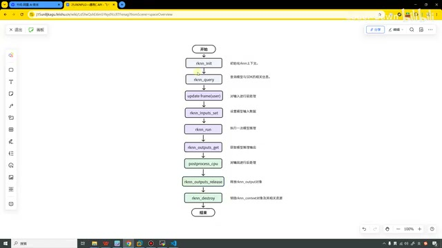

*流程图用三种颜色区分初始化、循环推理、后处理及资源释放。 · [原片 01:48](https://www.bilibili.com/video/BV11DjT6uEhc/?p=26&t=108)*

在看这个图之前，我再插一句话。虽然说我们在写一个代码，它里面有非常多的函数都要用，但是大家一定要记住：我们在进行 NPU 推理的时候，只有一个核心逻辑，就是我们把数据给 NPU，NPU 把数据返回给我们。记住这个核心思想之后，我们再来逐个看。

第一个是 `rknn_init`，它的作用就是初始化 RKNN 的上下文。在这里，它会分配 NPU 的内部资源，返回给我们一个上下文的句柄。这个东西是非常重要的，后面的所有操作都需要带上它。

它就和我们前面在 Python 代码里面创建一个 RKNN 对象，价值是一样的。我们后面进行模型的配置、模型的构建、模型的导出，包括进行性能分析、量化、内存评估等等，都是需要带上这个 RKNN 的。在这里，我们返回的是一个上下文的句柄，它和那个东西的作用是一样的。

第二个叫 `rknn_query`，它的含义就是查询模型，还有 SDK 相关的信息。什么意思呢？就是说，在我们推理之前，需要知道模型的特点：它需要输入多大的图片呢？需要的是 RGB 还是 BGR 呢？它输出的是多少个类别呢？在这个函数这里，我们就可以进行查询。查询到这些消息之后，我们就到了下一个步骤。

这个步骤其实也叫前处理，或者预处理。我们查到这些信息之后，就知道该怎么预处理了。我举个例子，比如这个模型要的就是 640×640 的，我们查到了这个信息，就在这里处理成它想要的信息，包括颜色等等，都是在这一刻去做的。这个也是第二部分，就是第二个小阶段刚开始就需要做的：做这个预处理。

这个做完之后，我们是不是就需要做输入了？前面已经把所有东西、把菜都准备好了，我们现在是不是就需要把菜放进去了？所以我们就需要进行输入数据的设置，图里这里是 `rknn_inputs_set`。设置完输入数据之后，就可以进行模型的推理了，这个也是非常自然而然的事情。推理完之后，就把推理的结果进行输出。这个就是我们的第二阶段，就是紫色部分。

第三个部分，第一个叫作后处理。我们模型推理输出的结果，人可能看不懂。啥意思？比如它可能给我们一组向量，那种奇怪的数据，或者归一化、或者怎么样进行的一组数据，或者一些坐标。这些值其实是不利于我们去看的，甚至很多人都看不懂这些坐标的含义到底是啥意思。所以说，我们要对输出后的结果进行后处理。比如说，我们通过 Softmax，把它变成概率值，然后对它进行一些 NMS 的操作，进行 Top N 的排序等等。这些操作我们就把它叫作后处理，也就是在这个阶段去进行的。

等这些东西都做完之后，我们已经得到了想要的结果，接着就需要去释放这些对象。包括需要先释放 output 的对象，因为在前面我们相当于有创建，后面就需要有释放。包括这个 `rknn_destroy`，也是一样的道理。这个就是我们的整体流程。

## 数据在 CPU 与 NPU 之间的流向 · 06:53

看完流程之后，我们下面还画了一个表格。这个表格其实就是说的上面我刚才所讲的流程，但是它多了一点，叫作数据流程。

在我们进行预处理的时候，这个操作是由 CPU 完成的。大家一定要记住。如果有印象的话，在前面看内存评估还是性能评估那一块，我们在讲那一块的时候，就是有三个地方，可以看到它是 CPU 操作的，有一些 CPU 的耗时，然后其他大部分地方是 NPU 去做的。所以说，大家要记住，预处理这一块基本都是我们的 CPU 去完成的。

然后这个叫拷贝输入。在这一块，我们的数据流向是把 CPU 的数据拷给 NPU。这就是我们这节课讲的通用 API 的一个特性，就是我们要把数据拷到 NPU 上面去。然后推理是由我们的 NPU 推理的。

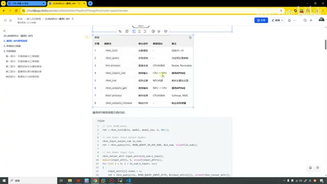

*数据流程表标出预处理使用 CPU、输入从 CPU 拷贝到 NPU，以及输出反向拷贝。 · [原片 07:54](https://www.bilibili.com/video/BV11DjT6uEhc/?p=26&t=474)*

当推理完之后，输出的时候，我们的数据流向是从 NPU 到 CPU 的。大家一定要记住，就是这么一个流向。最终进行后处理的时候，也是在 CPU 的内存内进行操作的。

大家看到这里，可能心里也会有这么一个疑问：我们为什么不把数据直接放到 NPU 上面去做呢？还要增加这么一些来回拷贝的操作，那不是很浪费性能吗？如果大家能想到这里，那证明你已经非常哇塞了。这个确实是有这样一个问题，这也是我们通用 API 的一个小缺点吧。因为它增加了两次拷贝，所以性能就会稍微差一点。

我们在下一节课会讲一个东西，叫零拷贝。听这个名字也就知道了，它没有进行这个拷贝，那性能就会好一点了。同样，零拷贝也会有它的缺点，它的 API 或者流程就会比我们这个通用的更加复杂。

讲完这个之后，我们第一部分的调用流程就讲完了。下面还举了一个简单的例子，这个我们就不看了，后面直接看整体的代码就行。

## 环境搭建与代码测试入口 · 09:40

接下来是第二步，环境搭建。这里我也写了，参考前面第八节。我看一下第八节是啥，我都有点忘了。哦，就是这些。好，我再返回来。其实在这里，我也已经写好了所有的流程。

我们一会儿将这个代码做完之后，编译的时候就按照这个流程来，那是更后面的一个操作了。

接下来我们就看代码测试部分。代码测试部分，其实在这里，我把每一块比较核心、比较重点的部分也都有贴出来，包括它的一些内容也都有写在这里。大家下来的话也可以看这个课件。我们在这里就不看这个东西，直接打开 VS Code，在这里面看代码。

首先，我们这个代码文件是 16，叫作 common test。好，这些东西我想一下，我把它先删掉。因为后面我们都会讲 C 代码，在这里是第一个和 C 代码相关的，所以我就说得稍微详细一点点。

## 工程目录 · 11:24

我就这样说吧，我们打开它的目录，可以看到里面的核心目录就是有这么几个东西。第一个叫第三方库，我们用到什么第三方库，就可以把它放到这里。

第二个部分叫作 `librknn_api`。什么意思呢？就是说，我们要用的 C 的这些 API，其实都是包含在这个里面的。可以看到，它里面还有一个 so 文件。你看，每一个其实都是有 so，但我们也不是每个都用，还是根据我们不同的架构。我们要用的 3588，用的是这个。

第三个就是模型。就是我们瑞芯微进行推理的，像 3568、3588、〔后一个型号语音识别为“7662”，当前画面小字无法可靠核实，暂保留此处不确定性〕——

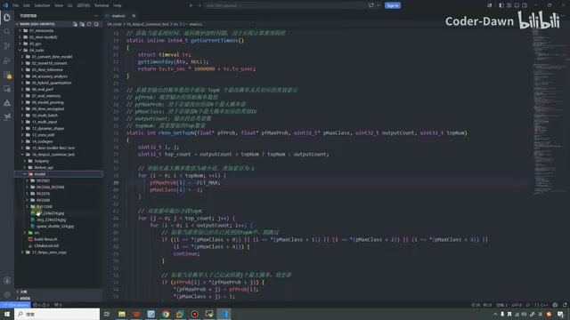

*VS Code 工程树展开 API 库和模型目录，右侧为主程序辅助函数。 · [原片 12:07](https://www.bilibili.com/video/BV11DjT6uEhc/?p=26&t=727)*

〔紧接前面的型号说明，转写“这个叫 26B”仍无法可靠辨识；截图中的目录名小字不能充分支持逐字还原。〕这些模型都在里面，这个也是官方的一些模型的东西，我都放到这里了。

然后第三个是 `src`，这里面只有一个文件，就是我们核心的推理文件。下面有一个 build，这个就是可以把它编译成 Linux 上面的。当然还会有个 build 的 Android，Android 的我没有弄上来，因为我们也用不到。最后有一个 CMake，里面会写一些编译规则。这个就是它的目录。

包括大家可以看到，这个文件的名称叫 `.cc`，里面是这种风格的。我个人是不太喜欢这种风格的代码，但是我为什么还要去讲呢？就是说，我们瑞芯微官方的 RKNN Toolkit2，官方里面的代码风格是这样的，包括我们的 Model Zoo 里面的代码风格也是这样的。所以在这里，前面几个文件，我也是这种风格。

但是到后面，像我们 YOLO26、YOLOv8 等等，到那一刻，我的代码就不是这种风格了。也没有说这种风格不好，人家平台的参考代码也都是这种风格，说明这种风格也是没有问题的。所以我也是给大家讲讲这种风格的代码。

## 编译脚本 build-linux.sh · 13:57

我们在看代码之前，先看一下这个编译文件，就是知道这些编译文件里面的作用是啥。第一个是 `build-linux.sh`。

它里面可以看到，这一块内容就是想看我们有哪些操作，它支持的操作有什么：t、a，还有 b。如果是 t，我们就去执行它；是 a 就执行它；是 b 就去执行它，等等。

这一刻啥意思呢？我们先提前看一下，最终在编译的时候，我们会这样去编译，它会有 `-t`、`-a`、`-b`。其实在前面第八节课的时候，也有和大家演示过。它为什么能支持这样的操作呢？其实也是因为这里有写，这是第一块。

〔画面可辨的编译调用：〕

```sh
./build-linux.sh -t rk3588 -a aarch64 -b Release
```

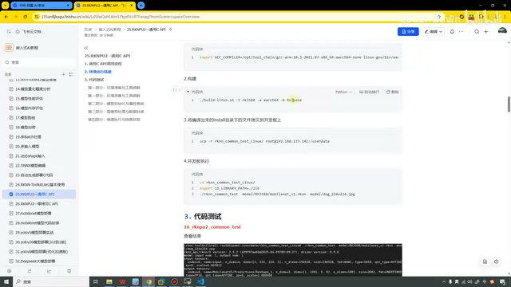

*课件中的编译调用包含 -t rk3588、-a aarch64 和 -b Release。 · [原片 14:51](https://www.bilibili.com/video/BV11DjT6uEhc/?p=26&t=891)*

第二个就是具体的，你看这个是 target，里面会有提醒。如果你没这样做，它就给你一些打印信息，怎么怎么样，这是第二小块。

这里是设置我们的编译器，这里是把编译器再进行拼接，然后这里是进行了检查。那这块就是看我们输出的是 Debug 还是 Release，它默认输出的是一个 Release。

再到下面这一块，就是看我们是哪个平台。它支持这么多平台，我们的话就是 3588。这块完了之后再到下面这一块，主要就是进行了拼接，而且它会构建一个 build 目录。如果这个 build 目录不存在的话，它还会自己去创建。总之这一块就是去拼接、去构建的一个目录。最下面这一块，它是 CMake，然后就会调用编译的这个东西，最终进行编译。

## CMakeLists.txt 的路径、链接与安装配置 · 16:31

好，看完这个之后，然后我们再来看一下 CMake 的这个 CMakeLists 文件。第一个是这个版本，然后这里是项目，叫这个名字；这一块是开启 C++ 的编译器。

看完这个之后，就需要配置 RKNN API 的路径，直接使用的是同级的这个路径。如果大家的这个东西放在别的地方了，就需要修改一下路径。然后这里是根据交叉工具链，自动判断我们的目标架构，看是不是 64 位的，或者怎么样的。

再下面这一块，是我们运行时的库的路径，就是要找这个 so 文件。这里是添加头文件的路径。在这里，因为进行预处理的时候，我们有用到 OpenCV，所以也会找一下 OpenCV 的路径。

在下面，这里就是生成可执行的程序。你看，我们是把 `src` 里面的 `main.cc`，最终编译的名字叫 `rknn_common_test`。它需要链接这些库。

最后这里是我加的，一般很多地方可能没有这个，我加了一个安装配置。首先就是设置安装的目录和前缀，就是建到 install 这个目录下。

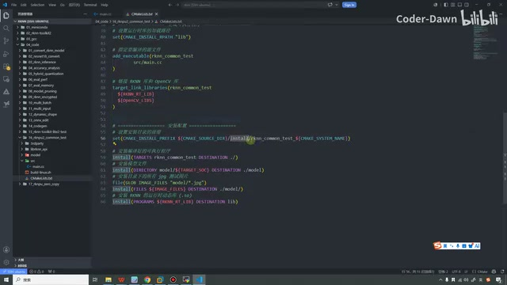

*CMakeLists.txt 下半部分显示链接、安装前缀和模型、图片、运行库的安装配置。 · [原片 18:15](https://www.bilibili.com/video/BV11DjT6uEhc/?p=26&t=1095)*

包括把这些模型、这些 lib 库、这些可执行程序，都放到这里面。这个就是 CMake 这个文件的内容。这样听上去有点无聊，大家其实直接让 AI 帮你写一个，或者把我这个拿去，复制给 AI，让 AI 帮你修修改改，基本都能跑得起来。这个就当了解一下。

## 辅助函数：时间、Top N 与张量属性 · 18:45

看完这个之后，接下来我们就正式看这个 C 代码是怎么写的。首先第一块，就是导入各种各样的头文件。导入头文件之后，正常来讲，我们应该就看 main 函数了。在这里，因为上面内容比较少，所以我们就提前看一下。

第一块，我们把这些函数都叫作辅助函数。啥意思呢？就是说，我们后面会用到这些函数去做一些辅助，所以就把这些都叫辅助函数。

第一个叫作获取当前的系统时间，返回微秒级的时间数。为什么要有这样一个函数？就是正常我们的时间数到不了微秒级，它是毫秒级；为了让它更加精准，所以我们会封装这么一个函数。这是第一个函数。里面具体内容也很简单，就是创建一个结构体，把它放进来，调用这个函数，然后乘一下时间，加一加，就这样返回了，就是它。

〔画面可辨的计时代码：〕

```cpp
static inline int64_t getCurrentTimeUs()
{
    struct timeval tv;
    gettimeofday(&tv, NULL);
    return tv.tv_sec * 1000000 + tv.tv_usec;
}
```

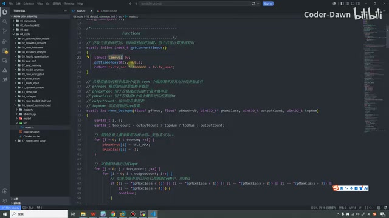

*计时辅助函数创建 timeval，调用 gettimeofday 并组合微秒时间。 · [原片 20:03](https://www.bilibili.com/video/BV11DjT6uEhc/?p=26&t=1203)*

第二个函数，这个 `rknn_GetTopN`，其实就是获取我们一般要的前 Top 3，或者前 Top 5。比如我们算一个东西，它的概率，可能有成千上万的类别，我们可能不需要那么多类，只需要前三名，就是它到底是不是狗、是不是猫，那也就会封装这么一个函数。

这个其实在前面代码推理的时候，也都看过很多遍了，就是有这么个东西。这里面有这么多参数，就是这些概率数组，然后给它进行了一个双重的 for 循环。这块代码我就不再细讲了，其实非常简单，就是一个 for 循环。我们学那种什么排序算法的时候，就是这么做的。

第三个辅助函数，就是打印张量属性信息，用于调试和查看模型输入输出的规格。可以看到这里打印了非常非常多的信息。它的作用就是，后面我们想要看一下到底是哪里有问题，想看它，就是方便我们调试用的，就会找这么一个函数。

## main 函数的输入参数 · 21:42

看完这些辅助函数之后，我们就正式进入 main 函数里面。第一个部分就是判断它需要输入这么几个参数，如果参数不够，就提示一个使用信息。

第一个参数是我们的可执行程序，叫 `argv[0]`。第二个参数 `argv[1]`，就是获取模型的文件路径。第三个就是获取输入图片的路径。我在这里也打开它，就是我们后面在进行推理的时候，我们输入的是这行指令。第一个是可执行程序，第二个是模型路径，第三个是需要推理的图片，在这里就是使用它来去做的。同样，这里还会获取循环测试次数，默认是 1。

## 初始化 RKNN，并对照官方 API 手册 · 22:40

这里就是我们刚才提到的，需要有一个上下文的句柄。在 `rknn_init` 这个操作，我在这里把它写个图，我们对照着代码看。

这个相当于是我们的第一步，就是需要对 RKNN 模型进行初始化。对它进行初始化的时候，需要这个上下文的句柄，还需要一些其他参数。这些参数怎么看呢？就是在这里，我打开我们的说明文档。这个就是瑞芯微官方的 API 手册，而且是有中文版的。

你看，第一个就需要传入一个上下文指针，第二个是模型的二进制数据。当模型是路径的时候，这里就设置为 0。第四个是初始化的标志，默认需要设置为 0。最后一个是扩展信息，我们也用不到，所以就设置为 NULL。这是我们的第一步。

〔主程序画面中可辨的初始化调用；完整手册文字仍受 640×360 原画面限制：〕

```cpp
rknn_context ctx = 0;
int ret = rknn_init(&ctx, model_path, 0, 0, NULL);
```

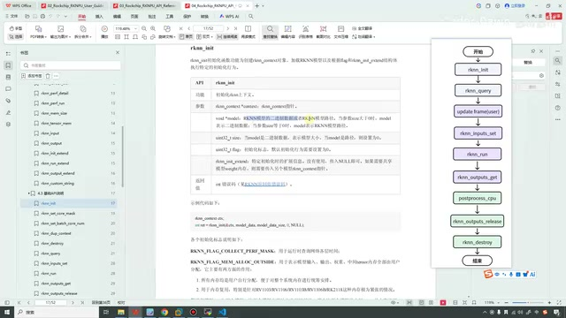

*官方中文 API 手册的 rknn\_init 参数说明，右侧保留调用流程图。 · [原片 23:42](https://www.bilibili.com/video/BV11DjT6uEhc/?p=26&t=1422)*

接下来我们来看第二步，就是我们的 `rknn_query`。在这里就可以传入很多信息了，同样，我也打开这个 API。可以看到，它需要传入一个上下文指针，然后需要我们的查询命令。第三个参数是存放返回结果的结构体，最后一个是大小。

如果大家是嵌入式的，其实对这些东西非常熟悉，C 语言里面就是这种风格：一个是上下文，这个是命令，有点类似于我们的 ioctl，然后这个是存放结果的，最后需要一个大小。

在这里，这一步查询的是 SDK 的信息，版本信息，所以传入的是它，最终把它进行了打印。可以看到，到底能传哪些东西，在这里也都有列出来：什么输入输出的个数，什么属性，包括版本，这里有列出来，写得也很详细。包括几乎每个常用的，也都有举例。大家一定要把官方这个手册好好看一看。在这里我就不带着大家看了，就带着大家看看这个代码就行。

接下来很重要的、我们一定要去做的，就是需要查询模型输入和输出的张量数量。所以在这个 query 里面，查询的就是它的信息，使用的也是它。这个怎么来的？同样就是查这里，可以看得到。

大家记住这个流程。首先，上面这个 SDK 其实是非必须的，我在这里也加一下，它其实是非必须的。但是这个是我们一定要去做的，就是查询模型输入和输出的张量数量。查询到这个信息之后，在这里，这种代码这一块，它是遍历并打印所有输入张量的属性信息。可以看到，首先是一个 printf，就是提示信息，然后我们定义一下 `rknn_tensor_attr` 这个属性，把它叫这个名字。刚才上面这个叫输入输出，它里面的 input 就是输入。获取到这个内容之后，就给它分配一个，用 memset 相当于初始化一下。初始化完之后，对它进行一个 for 循环的遍历，把里面的信息进行打印。最终打印的时候，调用的就是刚才上面这里的输出函数。

这里就是遍历并打印所有输入的属性信息。输入的搞完之后，接下来就搞输出的。输出和上面的代码几乎一模一样，只是一个是 `n_input`，一个是 output。就把我们输入和输出的信息进行打印、进行查看。

〔画面可辨的查询与打印调用，摘录对应输入属性的部分：〕

```cpp
rknn_input_output_num io_num;
ret = rknn_query(ctx, RKNN_QUERY_IN_OUT_NUM, &io_num, sizeof(io_num));
rknn_tensor_attr input_attrs[io_num.n_input];
memset(input_attrs, 0, io_num.n_input * sizeof(rknn_tensor_attr));
for (uint32_t i = 0; i < io_num.n_input; i++) {
    input_attrs[i].index = i;
    ret = rknn_query(ctx, RKNN_QUERY_INPUT_ATTR, &(input_attrs[i]), sizeof(rknn_tensor_attr));
    // 此处省略画面中可见、正文已说明的错误返回分支。
    dump_tensor_attr(&input_attrs[i]);
}
```

〔上段是带明确省略标记的画面摘录，未补写省略分支。〕

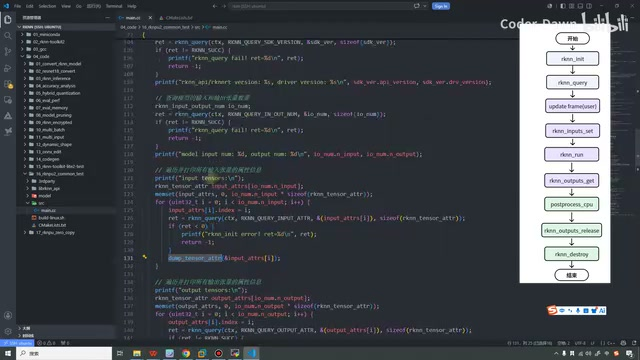

*输入与输出张量属性分别查询，并调用 dump\_tensor\_attr 打印。 · [原片 27:06](https://www.bilibili.com/video/BV11DjT6uEhc/?p=26&t=1626)*

接下来就到再下一步，就是查询并打印模型附带的自定义信息。这里其实和上面是一样的。

看完它之后，接下来在这里其实定义了很多数据。看到这是定义输入数据的默认类型和内存布局：它的数据是 NULL，类型是 UINT8，布局是 NHWC。N 的话代表〔此处转写为“第4”，无法可靠辨认该词，保留未确认〕，H、W 就是它的大小，C 的话是通道。

然后这里也是对这些值进行了初始化。我们去刚才输入的属性里面找，找到之后，把这些值赋给这些，就是目标的宽、高，还有通道，给它赋进来。如果是 NHWC，就这样赋值；如果是 NCHW，就这样赋值。如果是 default 的话，就是提示一个打印信息，就是这么个东西。

## OpenCV 预处理与输入设置 · 28:52

接下来这一刻，看我们的流程图，就该到 update frame，就是前处理，或者叫预处理。预处理对应的代码就是这一刻，使用 OpenCV 获取我们的原始图片。先把图片读进来，读进来之后，对格式进行转换，把 BGR 转换为 RGB，其实和前面 Python 代码那里是一样的，就是用它转一转。

如果图片的尺寸和模型尺寸大小要求不符合，在这里就对图片大小也进行缩放。那最后，就是这个缩放。最后我们去判断一下，如果它不一样的话，就接着进行缩放。最终把处理好的值赋给我们的输入。好，那就是这一块。这里整个对应的，就是我们图示第一块预处理的操作。

〔画面中的读图、颜色转换与缩放调用可辨为：〕

```cpp
cv::Mat orig_img = imread(input_path, cv::IMREAD_COLOR);
cv::Mat orig_img_rgb;
cv::cvtColor(orig_img, orig_img_rgb, cv::COLOR_BGR2RGB);
cv::Mat img = orig_img_rgb.clone();
if (orig_img.cols != req_width || orig_img.rows != req_height) {
    cv::resize(orig_img_rgb, img, cv::Size(req_width, req_height), 0, 0, cv::INTER_LINEAR);
}
input_data = img.data;
```

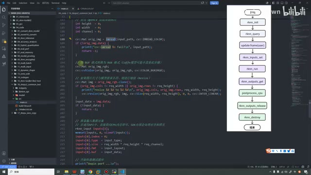

*预处理代码先读图，再用 cvtColor 转换颜色，并按模型尺寸 resize。 · [原片 29:20](https://www.bilibili.com/video/BV11DjT6uEhc/?p=26&t=1760)*

预处理做完之后，接下来就该做输入的设置了。所以也就对应到这一块，我们需要去做输入的设置。在这里也写得很清楚：在通用 API 中，我们直接指向 CPU 内存即可，SDK 内部会做对齐和拷贝的操作。所以在这里，我们把数据该赋值的赋值，像这些大小、格式，这个 buf，还有索引什么的，都赋值过来就可以了。

接下来，在这里就开始进行性能测试的循环，把数据都放进来。像刚才，我们已经准备好了，这里 input 准备好了，我们把数据放进来。数据放进来之后，下一步就是需要进行推理了，就触发 NPU 去进行推理。

在这里没有再去看这些很具体的 API 了。这个 API 其实看手册就可以。你看，它就是要一个上下文对象，然后输入数据的个数，输入数据的数组，要求这个是什么结构体对象，在这里把对应的都传进来就行。

## 运行推理与获取输出 · 31:39

我们接着讲，进行完这个 `rknn_run` 推理之后，接下来就是到输出了。输出在这里，同样就是要调用这个 API，做输出的处理。在这里也已经写好了，就是我们再去做输出的时候，内存是从 NPU 拷贝回 CPU 的。

〔画面可辨的输入设置、推理和取输出调用；这里按讲述顺序摘录调用行，未把错误分支拼成新示例：〕

```cpp
ret = rknn_inputs_set(ctx, io_num.n_input, inputs);
ret = rknn_run(ctx, NULL);
rknn_output outputs[io_num.n_output];
memset(outputs, 0, sizeof(outputs));
for (uint32_t j = 0; j < io_num.n_output; ++j) {
    outputs[j].want_float = 1;
}
ret = rknn_outputs_get(ctx, io_num.n_output, outputs, NULL);
```

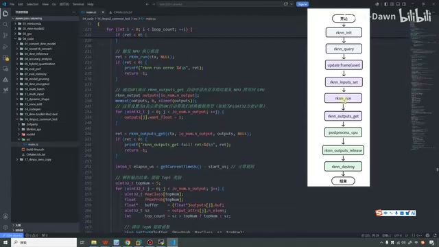

*rknn\_run 之后配置输出数组并调用 rknn\_outputs\_get。 · [原片 31:44](https://www.bilibili.com/video/BV11DjT6uEhc/?p=26&t=1904)*

到这一刻，我们就已经全部走完第二部分的所有流程了。其实可以看到，虽然我们在说数据流向是从 CPU 到 NPU，然后又从 NPU 到 CPU，但好像我们并没有去做这些操作，为什么呢？因为这个 SDK，就是上面写的 SDK，其实内部也会自动帮我们做所有这些操作，包括内存对齐等等。所以我们只需要用就行了。

在这里还多了一个步骤，把它设置为 1，表示希望 SDK 自动帮我们处理数据，就是这里，`want_float`，有个这个参数。这个参数大家也是可以去看一下我们的手册。〔画面注释写明：设置为 1，让 SDK 自动把输出量化数据转换为 Float32 浮点数。〕

## Top 5 后处理与讲解范围 · 33:04

做完这些之后，就该到后处理部分了。其实我们也没什么特别需要做后处理的，要做的就是把结果进行排序，只要概率最大的前五个类别。我们就在这里定义一个 5，把这些数据放进来，调用前面封装好的这个函数就可以了，就是这个。

这里代码我没有讲得很详细，也没有每个 API 去带着大家看，为什么呢？因为现在已经是 AI 时代了，这些代码就是让 AI 帮你翻译都非常简单。我主要是给大家讲一讲总体的思路和流程，特别特别细节的代码，也没有必要这样说了。

而且其实仔细看，这就是几百行代码，里面都是一些非常基本的 C 语言操作，也没什么好说的。非要详细讲的话，其实也就是带着大家去看 API 的手册，把 API 再贴过来，告诉你 API 里面要这么几个参数，我们准备这几个参数，再把参数传进来，无非也就是这样。所以在这里，也是希望大家自己下来，如果这行代码没看懂，可以自己再仔细研究一下，实在看不懂就让 AI 帮你翻译一下，这个都很简单。

## 释放资源，并再对一遍整体流程 · 34:40

说完这个之后，我们接着讲。在这边，调用完辅助函数，把结果排序之后，接下来就开始释放资源了。就这一块，我们先把它释放，然后再把它进行释放，这样整个流程就对应完了。其实仔细来看，也是非常简单的。

〔画面可辨的释放调用：〕

```cpp
rknn_outputs_release(ctx, io_num.n_output, outputs);
rknn_destroy(ctx);
```

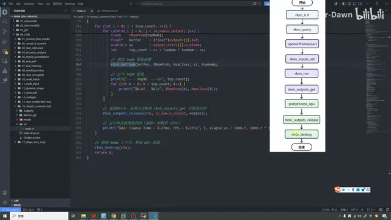

*后处理排序之后调用 rknn\_outputs\_release，最后调用 rknn\_destroy。 · [原片 35:00](https://www.bilibili.com/video/BV11DjT6uEhc/?p=26&t=2100)*

说完之后，我们再把整个流程给大家对一遍。你看，第一步就要进行初始化，`rknn_init`。初始化完了之后，就得到了一个非常有价值的、贯穿整个全文的句柄，就是 `ctx`，这个上下文的句柄。

做完它之后，就开始查询模型的一些相关信息，调用的就是 `rknn_query`。这个函数我们调用了好几次，包括输入也有，输出也有，输入输出也有。查询完信息之后，就能获取到想要的信息。

获取到想要的信息之后，就该进行输入的设置。但是在进行输入设置之前，因为输入也不是啥数据都能接收、啥数据都能要的，包括模型也有自己的能力，所以需要进行一些预处理。我们在这里就进行一些预处理，像这个 RGB 到 BGR——〔此处复述沿用讲述方向；前面的实际转换代码是 BGR 到 RGB。〕

这些转换，然后图片尺寸大小的处理，对应的就是这一步。这步做完之后，就真正进行输入设置了。输入设置好之后，我们就进行推理；推理之后，获取输出结果；输出完结果之后，进行后处理，把结果处理成想要的样子。处理完之后，就释放资源，对应最后的释放资源。这个就是整体流程。代码也不长，就两百多行。

流程看完之后，如果大家还想再看一些其他说明，刚才也说了，在这里也都有。最重要的就是我们把代码跑起来。

## 虚拟机中设置工具链并编译 · 37:16

接下来就来演示代码怎么跑起来。首先打开虚拟机，到我们的这个 16 文件里面。这次需要调用执行的时候，就使用它进行编译，所以在这里我直接复制了。

哦，对，在进行编译之前，还有很重要的一步。就是刚才带着大家看这两个文件内容的时候，也是需要去找交叉工具链的。所以第一步我们先这样，这样它就能找到交叉工具链了。设置好它之后，就开始进行编译。好，这样你看，看到没有？百分之百，就编译成功了。

〔终端可辨的设置和编译命令如下。工具链路径是讲师本机路径，按原画面保留：〕

```sh
export GCC_COMPILER=/opt/tool_chain/gcc-arm-10.3-2021.07-x86_64-aarch64-none-linux-gnu/bin/aarch64-none-linux-gnu
./build-linux.sh -t rk3588 -a aarch64 -b Release
```

〔终端随后显示 `[100%] Built target rknn_common_test`，并安装到 `install/rknn_common_test_Linux` 下。〕

![虚拟机终端显示 \[100%\] Built target rknn\_common\_test 和安装输出。](images/f012.jpg)

*虚拟机终端显示 \[100%\] Built target rknn\_common\_test 和安装输出。 · [原片 38:24](https://www.bilibili.com/video/BV11DjT6uEhc/?p=26&t=2304)*

在这里有一个地方需要提醒一下大家：你看在前面的课程中，我前面都是进入了那个虚拟环境，Conda 的虚拟环境。但是在进行我们这一步的时候，就没有进入那个环境，这是很重要的。如果你进了那个环境里面，其实它找不到你的工具链那些东西了，编译不了，所以要把那个环境退出来。

## 查看安装目录，推送开发板 · 38:46

好，这样就已经编译完了。编译完之后，我们看一下，就是多生成了两个目录：一个叫 build 目录，一个叫 install 目录。build 目录其实就是我们这个文件里面在这一刻去做的事情。我个人喜欢直接在 install 里面啥都封装好，所以我加了下面这一块的内容，大家也可以像我这样用。

我们就到 install 目录里面去看一下。可以看到，里面有了我们编译出来的、要送到开发板上去执行的所有程序。再点进去，我们再看一下，里面有库，有模型，有可执行程序。所以说，我个人就是喜欢这样把它都封装到这里面，最终进行测试的时候也会更方便。

也就到下面这一步，就是把这个程序、这个东西推送到我们的开发板上。推送的方式有很多很多，之前也有讲过，比如下载到 Windows，然后再移到开发板，通过 ADB 直接推送，或者怎么样，怎么样都可以。

我个人喜欢使用 scp，觉得一行命令更简单，而且也不需要像 ADB 那样切换终端什么的，所以我就这样去做了。好，然后输入密码。这样就把这个东西推送到我们开发板的——

〔画面可辨的推送命令在 install 目录下执行：〕

```sh
scp -r rknn_common_test_Linux/ root@192.168.137.142:/userdata
```

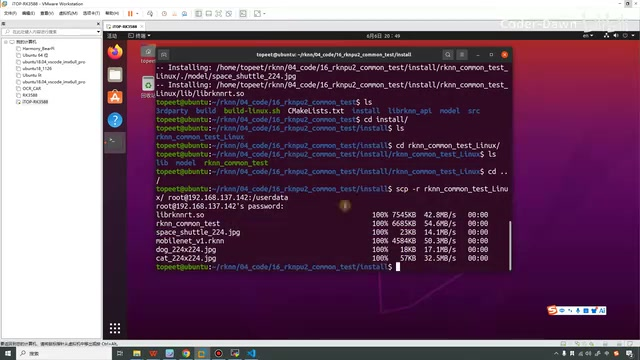

*scp 推送显示运行库、模型、可执行程序及图片传输完成。 · [原片 40:24](https://www.bilibili.com/video/BV11DjT6uEhc/?p=26&t=2424)*

你看，这是开发板的名称、开发板的 IP 地址，然后推送的路径，它就在这个 `/userdata` 下面。我们就打开开发板看一下，这是我开发板的 IP，直接通过 SSH，然后进一下，到 `/userdata` 目录下。这里就有刚才推送过来的。

我看一下，这里能不能看时间，应该可以。我在这里……我这样吧，就是它，我单词拼错了。看到，你看，这个就是今天，26 年 6 月 7 号，就是刚刚推送过来的，所以在这里也是有了。

有了它之后，我们就进入这个目录下。进去之后可以看到有个 lib，我们看里面，ls 一下 lib，里面就有我们的 so 文件。〔画面保留了操作修正：先输入 `cat lib/`，终端提示“是一个目录”，随后改用 `ls lib/`，看到 `librknnrt.so`。〕

然后再 ls 看一眼这个 model，可以看到里面有三张图片。再看下面的 RK3588，你看，里面有我们的模型。还有它，它就是我们的可执行文件。

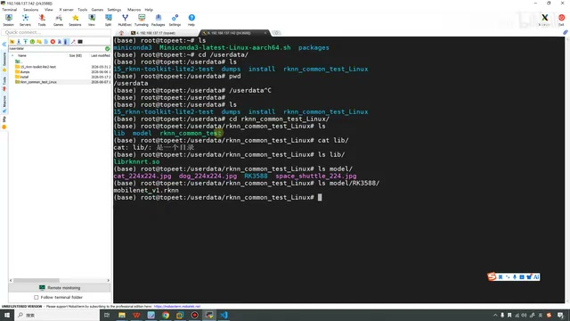

*开发板终端列出 lib、模型图片和 RK3588 下的 mobilenet\_v1.rknn。 · [原片 42:02](https://www.bilibili.com/video/BV11DjT6uEhc/?p=26&t=2522)*

接下来就可以执行测试了。我们先执行它，然后第二个参数就是要用的模型，它里面有个 MobileNet，然后要推理的图片是——

哦，对，这里还忘掉了一件事，就是在进行推理之前，还需要设置一下这个 lib。大家也像我一样，就这样设置一下，这个东西也就设置一次。接下来就可以进行测试了。

## 设置库路径并运行测试 · 42:28

还是刚才的，下面有个模型，然后再试一下图片。图片我们试一下这个，什么，航天飞船。

〔终端中可以辨认的命令如下；先前尚未填完图片参数的命令已用 Ctrl+C 取消，再设置库路径并重输：〕

```sh
export LD_LIBRARY_PATH=./lib
./rknn_common_test model/RK3588/mobilenet_v1.rknn model/space_shuttle_224.jpg
```

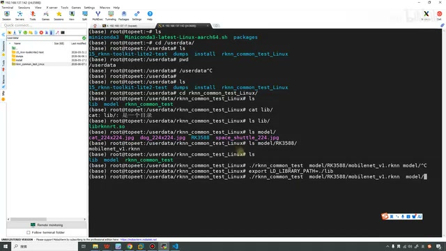

*开发板终端先取消未完成的运行命令，再设置 LD\_LIBRARY\_PATH=./lib，重新输入测试命令。 · [原片 43:02](https://www.bilibili.com/video/BV11DjT6uEhc/?p=26&t=2582)*

可以看到，这里就输出了测试结果，还有我们的时间。你看，推理起来其实是很快的，就这么一会儿，就把这个推理好了。这个就是我们整个流程。

〔截图中的本次输出显示 `rknn_api/rknnrt version: 2.3.2`、`driver version: 0.9.8`；模型输入和输出数量均为 1。Top 5 第一项可辨为概率 `0.940430`、类别索引 `813`。本次打印 `Elapse Time = 3.49ms, FPS = 286.20`。这些是视频演示结果。〕

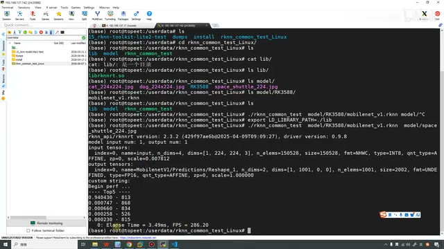

*开发板输出 RKNN 版本、张量属性、Top 5 结果及推理耗时。 · [原片 43:14](https://www.bilibili.com/video/BV11DjT6uEhc/?p=26&t=2594)*

当然，这里的代码可以看到，只有一个代码文件，里面把前处理、后处理都写到里面。在后面，到最后几节课再讲的时候，我们会对代码进行封装，把这些东西一个一个处理出来，那样就会更方便去修改和调试。

好，到这里我们这节课就已经讲完了。最后也是感谢大家的观看，谢谢大家的观看，谢谢大家。
