# P27｜26_RKNPU2—零拷贝 C API

> 来源：[B 站课程第 27 集](https://www.bilibili.com/video/BV11DjT6uEhc/?p=27) · 全片 29 分 16 秒。
>
> 整理方式：忠实讲稿，不做摘要压缩。保留原讲述顺序、第一人称解释、对比、操作与限定，仅清理停顿、结巴和无新增意义的即时重复，补充标点与小标题。
>
> 文字来源：本地 Whisper 中文转写，结合原视频画面核对术语。未实际进行音频回听；无法可靠辨认处在相邻正文标注。原始及规范化转写、规范化审计另存于 sources。
>
> 图片说明：20 张原视频截图，源画面 640×360，小字受原始画质限制；图注为编辑说明，点击可查看原图。代码块只摘录画面可辨认部分，不是完整源码。

## 从通用 API 的两次搬运说起 · 00:00

这节课我们来看第 26 讲，零拷贝 C API。在上节课，我们已经学习过了通用 API，但是在学习通用 API 的过程中，我们发现了一个问题。我在这里打开上节课，也带着大家回忆一下。

就在上节课的这个表格，第四步这里，我们需要把数据从 CPU 拷贝到 NPU 上面；然后到第六步这里，我们需要再把数据从 NPU 拷贝到 CPU 里面。这样的话，其实我们有了两次这样的拷贝工作。

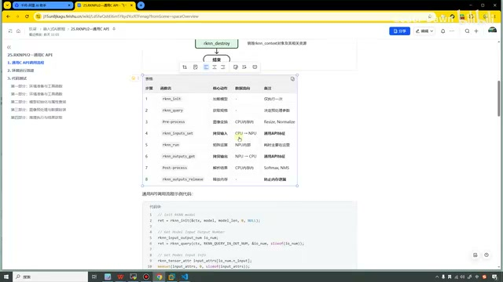

*回顾通用 API 表格：输入设置和输出获取涉及 CPU 与 NPU 之间的数据搬运。 · [原片 00:30](https://www.bilibili.com/video/BV11DjT6uEhc/?p=27&t=30)*

如果说我们想要推理的是一个高清视频，这种频繁的搬运，不仅浪费我们 CPU 的资源，还会产生一个非常大的延时。所以基于这个原因，我们就有了这样一种解决办法。从这个名字也能听出来，它叫零拷贝。零拷贝，顾名思义，我们就不需要再去进行这样的拷贝了，我们的效率就会变得更高，性能就会变得更好。

好，复习完上节课的内容，以及零拷贝诞生的原因之后，我们再来看看这节课具体要讲的内容。从左侧可以看到，一共分为五个小节：第一个是零拷贝的介绍，第二个是它的调用流程，第三个是它的简单示例的用法，第四个——其实这个也不应该叫它环境搭建吧，这就是我们执行的方法。第五个是代码测试。

## 通用 API 与零拷贝 API 的数据处理流程 · 02:00

看完这个目录之后，我们一个一个来看。第一个是零拷贝的介绍。在推理 RKNN 模型的时候，原始数据要经过输入处理、NPU 运行模型、输出处理三大流程。目前根据不同模型输入格式和量化方式，接口内部会存在通用 API 和零拷贝 API 两种处理流程。在这里也是把两种流程的具体情况用图形来表示。上面这些文字我们就不看了，我们直接来看这两幅图。

第一幅图叫做通用 API 的数据处理流程。可以看到，最左侧是输入，最右侧是输出，中间就是我们进行的一系列操作，包括我们的预处理、后处理，还有我们 NPU 的推理。

我们具体来看一下，先看我鼠标一直在转的这一块。你看这一块，像数据的归一化、数据的量化，包括数据排布格式的转换，像我们瑞芯微要的是 NHWC 转成 NC1HWC2 这种，包括还有反量化等等。这些操作主要是在我们 CPU 上执行的。如果我们的输入符合零拷贝的要求，它也可以运行在 NPU 上面。这是这一块。

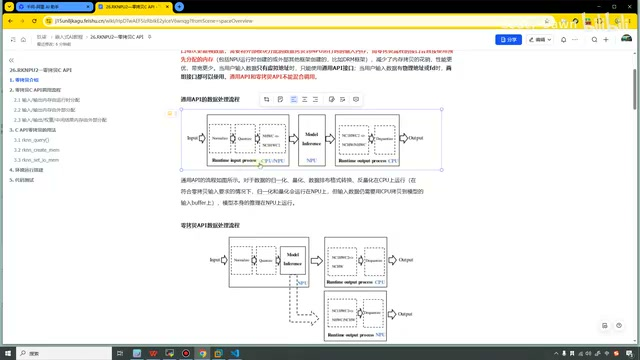

*课件对照通用 API 与零拷贝 API 的数据处理框图。 · [原片 03:30](https://www.bilibili.com/video/BV11DjT6uEhc/?p=27&t=210)*

中间进行模型推理的时候，这块全部都是在我们 NPU 上进行处理的。再到右边，同样像格式的转换，还有反量化，这个是在我们 CPU 上执行的。

可以看到，我们这个通用 API 的流程中，真真正正完全在 NPU 上执行的只有这一块，它其实就比较消耗我们 CPU 的资源。好，这是通用 API 的数据处理流程。

看完它之后，我们再来看一下零拷贝 API。同样的，最左侧是输入，最右侧是输出，只不过这个输出它有两个分支。同样这里，像归一化和量化，和上面这里都是一样的。然后包括模型推理，它把这一块加了进来，把数据排列这一块转了出去。

它把数据的归一化、量化，还有推理，全部都放在 NPU 上面去执行。然后它把像反量化、数据格式的排列，放在 CPU 或 NPU 上面进行处理。

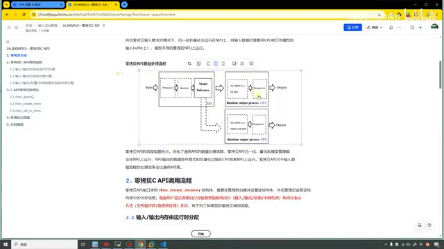

*零拷贝框图把归一化、量化和推理放在 NPU 一侧，输出有两条处理分支。 · [原片 05:00](https://www.bilibili.com/video/BV11DjT6uEhc/?p=27&t=300)*

这样的话，我们就少了像这里，把数据从 CPU 拷到 NPU，再把数据从 NPU 拷到 CPU 这样的处理。对于零拷贝 API 的这种流程来说，它就要比通用 API 的这种调用方式，性能会更好。在下面这里文字上也有描述，就是它对输入数据的处理效率会更高。

好，这就是对零拷贝的简单介绍。其实大家也不需要记得那么复杂，总结一下就是一句话：通用 API 会把数据进行两次拷贝，零拷贝 API 不需要频繁地进行拷贝。好，就这么简单。

## 三种零拷贝调用流程 · 06:01

接下来我们来看第二部分，就是它这个调用流程的流程图。在看流程图之前，我们需要知道，零拷贝 API 接口其实使用的是 `rknn_tensor_mem` 这个结构体。这个结构体需要在推理前创建，并且设置；在推理结束之后，读取这些结构体中的内存信息。

根据用户是否需要自行分配模型的模块内存，包括输入、输出、权重、中间结果，还有内存表示的方式，像文件描述符或者物理地址等这些差异，下面有三种经典的零拷贝调用流程。

第一个叫做输入、输出内存由运行时分配〔此处转写为“拷贝”，按画面小节标题核对为“分配”〕。我们来看一下它的流程。第一步同样是进行初始化，第二步是查询它的信息、它的能力。这个和我们前面的通用 API 是一样的。

接下来这里就是 `rknn_create_mem`，用这个 API 可以创建刚才所描述的结构体，并且分配内存。接下来就是设置包含模型输入、输出内存信息的结构体。然后再到下一步，这里多了一步，叫 RGA 接口前处理，就是可以调用它去进行预处理。然后进行模型推理、后处理，最终再销毁。

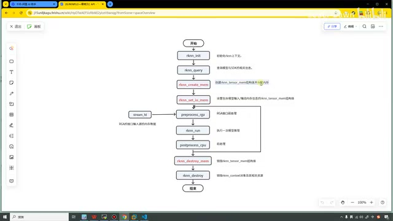

*第一种调用流程：rknn\_create\_mem、rknn\_set\_io\_mem、前处理、推理、后处理及释放。 · [原片 07:30](https://www.bilibili.com/video/BV11DjT6uEhc/?p=27&t=450)*

可以看到，整个流程和我们前面的通用 API 是很类似的。我想一下，我在这里——

我把它也截过来做一个对比。重新回到第 26 讲，可以这样左右排列看一下，其实是很类似的。

之前我们通用 API 这里，不需要自己去分配这个内存，我们直接对它进行设置，设置我们的输入数据就可以了。然后推理完了之后，我们直接就从这里读取数据就可以了。在这个零拷贝 API 这里，我们都是需要自己手动去进行分配的，分配的就是这么一个结构体。这是它的第一种情况。

接下来我们来看第二种情况，叫做输入、输出内存由外部分配。可以看到，我同样地把它点进来，然后……那就这样吧。前面同样都是一样的，在这里就发生了一些变化，我也都已经标红了。

它是通过文件描述符或者物理地址来创建这个结构体，并分配内存吧。可以看到，它的 API 上面叫 `from_fd` 或者 `from_phys`，就是物理的那个单词。这里同样是去对它进行设置。

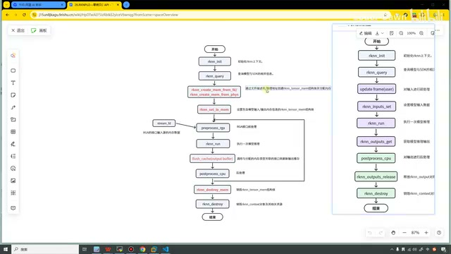

*第二种调用流程增加 from\_fd/from\_phys 创建方式与输出缓存刷新，并与通用 API 并排比较。 · [原片 09:10](https://www.bilibili.com/video/BV11DjT6uEhc/?p=27&t=550)*

和上面不同的，第一个是这个 API 不同；另外一个不同的就是，最终我们需要去调用 `flush_cache`，进行输出缓存的刷新。这里就是我们要用外部……如果说我们嵌入式学那个系统编程，在那里可能就会对这个 flush 操作比较清楚。我们可以看一下，在下面也有对它写一些描述。

就是因为我们是通过像这种 fd 的方式去申请了内存，所以在下面，如果我们不清除这个缓存，不使用这个 `flush_cache`，我们可能就会得到一些脏数据。这个我也就不再过多解释了，大家应该也都清楚。

第三个就是我们的输入、输出、权重、中间结果内存，如果我们的内存由外部分配，可以看到，它就和上面的差异会变得更大。第一步这个 API 这里，它多了一个东西，叫做 `RKNN_FLAG_MEM_ALLOC_OUTSIDE`〔按画面标志名核对〕。它就是多了这么一个标志吧。

接下来还是查询能力。因为它也是由外部分配，所以它这里其实是一样的，包括 flush 这里也是一样的。然后它在这里设置包含模型输出内存信息结构体的时候，就会更多一点。你看，它先设置权重，设置内部内存，然后再去设置 I/O 内存，就是它比上面这里更多了一点。在这里，它也是多设置了这么一个结构体。

右边这个就没用了，我就在这里把它删掉了。可以看到，在这里也有对它进行解释：它用于表示模型输入、输出、权重、中间 tensor 内存全部由用户分配。它主要有两个方面的作用，第一个就是所有内存是由用户进行分配的；第二个是可以进行内存复用。好，就是它。

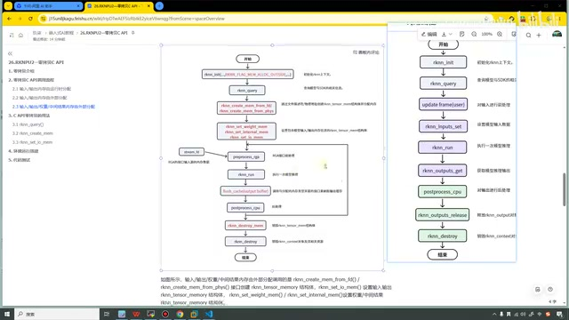

*第三种调用流程增加外部分配标志及权重、内部内存和 I/O 内存的设置。 · [原片 11:30](https://www.bilibili.com/video/BV11DjT6uEhc/?p=27&t=690)*

这些 API 特别具体的用法，里面每一个参数的说明，还是建议大家去看官方的文档。

就下载那个 RKNN-Toolkit2 工具链，里面就会包含这个文档。好，这样就把第二部分讲完了，一共有三种。这种很明显看起来也是最简单的，相比于我们通用 API，流程都是非常类似的，下面这两个就会稍微复杂一点。

## 零拷贝 API 的示例用法 · 12:33

第三部分是零拷贝 API 的示例用法。像第一个，是使用这个去查询。这个查询的时候，在上节课我们也都已经说过了，在这里大家就看看文字就可以了。

它主要是有四种情况：NCHW、NHWC，还有 NC1HWC2，还有一个是 UNDEFINED，就是这个。输出的话也是有这么几种情况。

第二个就是 `rknn_create_mem`。调用这个 API 去创建这个结构体的时候，要在推理前创建、进行设置，而且在推理后读取它的内存信息。无需对里面查询的这些 layout，还有类型进行修改的时候，就直接采用默认的这个 stride 去创建内存的大小。如果说修改了它，我们就需要按照相应的 size 去创建这个大小。

这里也举了例子，比如说，输出的数据类型是 int8，用户想要获取 float32 的，那就要修改成它的四倍。还有包括这个，也是去设置的〔画面小节标题为 `rknn_set_io_mem`〕。

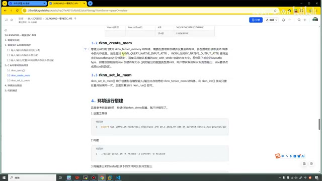

*课件中的 rknn\_create\_mem 与 rknn\_set\_io\_mem 用法说明，以及环境运行部分入口。 · [原片 13:30](https://www.bilibili.com/video/BV11DjT6uEhc/?p=27&t=810)*

在这里看这个文字，可能还有点不太清楚。

## 对照示例代码：相同的准备工作 · 14:08

我们直接就来看代码吧。我已经打开了这个代码，就是我们第 17 个代码。这些文件都和上节课是一模一样的，可能只是改了一个名字吧，别的都是一模一样的。然后也没什么特别的，就是它，我们直接来看它。

我们依旧从最上面开始看。上面是头文件，这里依旧是上节课所说的，获取系统时间的辅助函数。这里依旧是进行排序，这里依旧是打印张量信息的一个辅助函数。接下来我们重点就看这个 main 函数。

下面也是一样，就是获取一下它的变量。然后这里 `init` 同样是进行初始化，初始化的时候，还是需要传入这个上下文、模型路径，然后还有其他的一些参数。

第二步依旧是进行 `query` 的查询，包括这个，都和上节课是一样的。这些都是一样的，所以这些我们就不看了。再到这里，依旧是定义一些输入变量，然后把它进行……包括这里是判断它是什么 layout，然后进行一些判断，也和上节课是一样的。

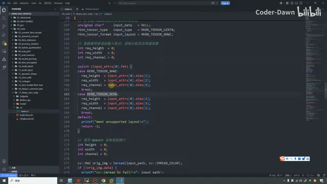

*代码中的输入 layout 判断、尺寸读取与 OpenCV 图像读取。 · [原片 15:45](https://www.bilibili.com/video/BV11DjT6uEhc/?p=27&t=945)*

包括这里也是预处理，使用 OpenCV 获取图片，然后转换格式，进行图片的缩放。这些一直到这里，所有内容都和上节课的代码是一模一样的，所以在这里我就随便说了说。然后我们过来，到这里就开始不一样了。

## 创建 NPU 内存与输入属性 · 16:11

在这里我也把注释写得很清楚，就是这是零拷贝的第一个差异点。它需要我们手动去创建 NPU 的物理内存。通用 API 不需要这一步，数据是由推理 API 内部自动搬运的。在零拷贝模式下，必须显式地调用 `rknn_create_mem`，去申请这块内存。

具体就是这个 API，它里面需要传入的参数，第一个依旧是我们的上下文，上下文是贯穿整个流程的。第二个是这个属性，它里面就是需要传入……需要把它给传进来。可以看一下，这块到底是啥。

就是我们需要强制地指定 NHWC 格式与 UINT8 类型。零拷贝模式下，NPU 仅支持 NHWC 格式的 UINT8 输入；然后 NPU 硬件会自动融合归一化和量化操作，所以输入必须是它。〔这里保留讲师对本例输入条件的原述，未扩写成其他模型或平台的通用结论。〕

所以在这里，我们就把前面的值给它复制过来，再传进来就可以了。因为我们这个 NPU 对内存有严格的要求，它会在每一行像素的末尾，可能会有这个 padding，所以我们就要使用的是这个，就是使用它。

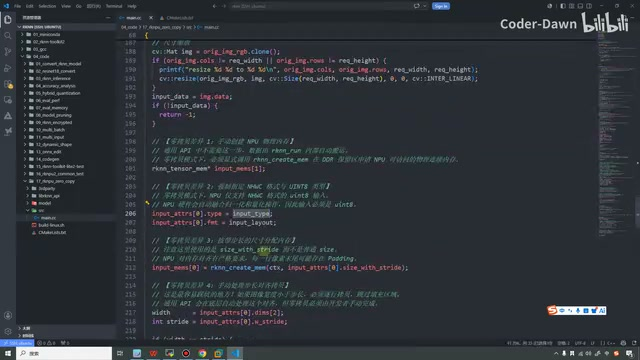

*输入属性设置与按 size\_with\_stride 创建输入内存的代码。 · [原片 17:30](https://www.bilibili.com/video/BV11DjT6uEhc/?p=27&t=1050)*

```cpp
input_attrs[0].type = input_type;
input_attrs[0].fmt = input_layout;
input_mems[0] = rknn_create_mem(ctx, input_attrs[0].size_with_stride);
```

那这就是三个差异点了。其实非要说的话，现在应该也只能算是第一个差异点，只是在这里拆得比较细，有不同的地方都标出来了，所以看上去好像差异比较多，其实也并没有这么多。好，接下来再到下面，就是第四步。

## 手动处理步长对齐、分配输出并绑定 I/O · 18:12

这个零拷贝的差异点四，就是手动处理步长对齐拷贝。这也是最容易踩坑的一个地方。如果图像的宽度小于步长，必须逐行拷贝，跳过填充区域。通用 API 会在底层自动处理对齐，但零拷贝就需要由我们开发者手动完成。

可以看到，就是这个宽度，还有这个，我们需要自己手动进行处理。如果它相等，我们直接进行一个 `memcpy`；如果它不相等，我们就需要对……包括这些它用的内容进行复制和计算，然后再把它传过来，再进行 `memcpy`。〔此处转写的“pata”无法可靠还原；画面展示源指针、目标指针及每行长度的计算。〕

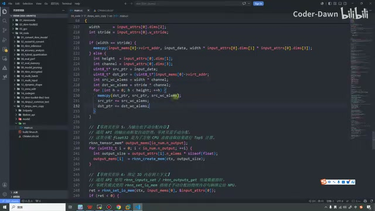

*宽度与步长相等时直接拷贝，不等时计算每行长度并逐行拷贝的代码。 · [原片 19:00](https://www.bilibili.com/video/BV11DjT6uEhc/?p=27&t=1140)*

```cpp
int width = input_attrs[0].dims[2];
int stride = input_attrs[0].w_stride;
if (width == stride) {
    memcpy(input_mems[0]->virt_addr, input_data,
           width * input_attrs[0].dims[1] * input_attrs[0].dims[3]);
} else {
    int height = input_attrs[0].dims[1];
    int channel = input_attrs[0].dims[3];
    uint8_t* src_ptr = input_data;
    uint8_t* dst_ptr = (uint8_t*)input_mems[0]->virt_addr;
    int src_wc_elems = width * channel;
    int dst_wc_elems = stride * channel;
    for (int h = 0; h < height; ++h) {
        memcpy(dst_ptr, src_ptr, src_wc_elems);
        src_ptr += src_wc_elems;
        dst_ptr += dst_wc_elems;
    }
}
```

其实也没什么特别的，就是说，需要我们自己手动分配内存，并且计算好内存的对齐格式，这是第四个差异点。

第五个差异点就是输出。不仅输入需要手动分配，输出也需要手动分配。可以看到，在这里同样定义了一个 output memory，然后在这里进行一个循环，进行一个复制的操作〔保留原述；画面循环实际展示按输出大小调用创建内存接口〕。

画面中这段分配输出的代码为：

```cpp
rknn_tensor_mem* output_mems[io_num.n_output];
for (uint32_t i = 0; i < io_num.n_output; ++i) {
    int output_size = output_attrs[i].n_elems * sizeof(float);
    output_mems[i] = rknn_create_mem(ctx, output_size);
}
```

接下来是差异点六，就是需要绑定 I/O 内存到上下文。调用的就是这个接口，我们需要先把输入绑进来，要输入的 memory，还有它的属性。接下来下面就还有输出的，把输出的也要绑定过来，这个都是一样的。

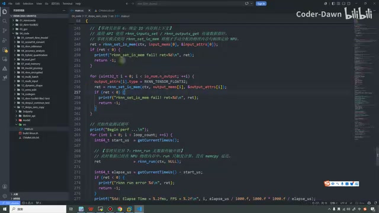

*输入、输出内存绑定，以及性能测试循环和 rknn\_run 调用。 · [原片 20:00](https://www.bilibili.com/video/BV11DjT6uEhc/?p=27&t=1200)*

```cpp
ret = rknn_set_io_mem(ctx, input_mems[0], &input_attrs[0]);
// 输出循环中可见的绑定语句：
output_attrs[i].type = RKNN_TENSOR_FLOAT32;
ret = rknn_set_io_mem(ctx, output_mems[i], &output_attrs[i]);
```

再到下面，就是我们性能的循环测试了。我们先是计算一下这个时间。

## 运行推理、读取绑定的输出与 Top5 · 20:12

然后在这里也……我看一下，我们的那个 run 函数呢？好，就在这里。就是这里，从这里开始，我们开启性能测试的循环。在这里，我们直接就调用 `rknn_run` 函数，进行推理。

推理完之后，同样调用这个辅助函数，去计算一下它的性能。把这些都计算完成之后，我们需要进行后处理。后处理其实也很简单，就是进行一个倒着的排序。

在这里需要注意的一点，就是和我们通用 API 不同的是，我们这里直接从绑定的输出内存读取结果。所以说，我们的结果就是从这里，像这个 output memory 这里，我们去进行读取。然后我们再调用这个辅助函数，把读取到的结果全部传进来。

![后处理从 output\_mems\[i\]-\>virt\_addr 取结果，并调用 TopN 辅助函数。](images/f012.jpg)

*后处理从 output\_mems\[i\]-\>virt\_addr 取结果，并调用 TopN 辅助函数。 · [原片 21:15](https://www.bilibili.com/video/BV11DjT6uEhc/?p=27&t=1275)*

```cpp
ret = rknn_run(ctx, NULL);
// 后处理部分从绑定的输出内存取地址：
float* buffer = (float*)output_mems[i]->virt_addr;
```

在这里也是特别对比一下吧。〔操作时出现一段无法可靠辨认的转写“而且 autor destroyed”，不据此补造 API 或错误，操作词未确认。〕把它关掉。你看，上节课这个通用 API 的时候，就直接……就是从这里去，你看这个 buffer，它是这样去获取的。在这里，你可以看到，它是从这里去获取。其实本质上也都差不多。

只不过在这里，就是我们自己分配了一下内存而已，然后进行一下排序。

最后就是进行内存的销毁。这里销毁内存，也是需要去使用它，显式地进行销毁，然后最终再调用它〔画面先调用 `rknn_destroy_mem`，最后调用 `rknn_destroy`〕。

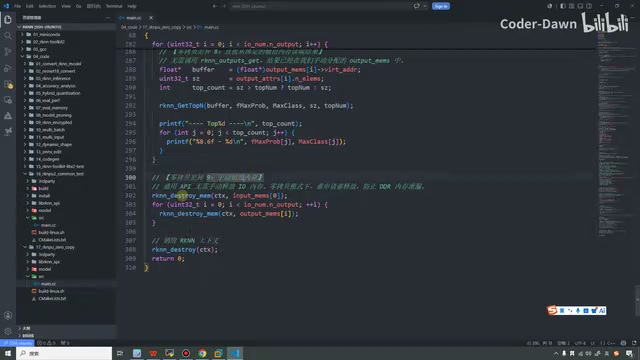

*推理结束后显式销毁输入、输出内存，最后销毁 RKNN 上下文。 · [原片 22:30](https://www.bilibili.com/video/BV11DjT6uEhc/?p=27&t=1350)*

```cpp
rknn_destroy_mem(ctx, input_mems[0]);
for (uint32_t i = 0; i < io_num.n_output; ++i) {
    rknn_destroy_mem(ctx, output_mems[i]);
}
rknn_destroy(ctx);
```

这个就是零拷贝 API 的整个代码。这样，我们把它找到这里，我们也滑到最上面，找到 main 函数，看一下，做个最简单的对比。其实这些操作都一样，再找找……可以看到，我们这样再对比一下代码。

我把它稍微缩小一点点，这边也稍微缩小一点点。在我们通用 API 中，我们是直接指向 CPU 的内存吧，所以在这里，我们直接定义一个 `rknn_input`，就是直接这样把数据做了。

然后在我们零拷贝这里，需要自己去 create 一份内存。为了 create 这个内存，我们需要去初始化，对这个结构体进行一些设置。可以看到，通用这里相比之下就会简单很多。

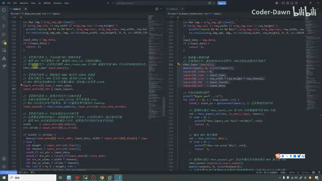

*并排对照零拷贝的手动内存创建与通用 API 的输入设置。 · [原片 24:00](https://www.bilibili.com/video/BV11DjT6uEhc/?p=27&t=1440)*

然后在这里，我们申请完这块内存之后，这块内存是有可能没对齐的。

所以还需要我们主动去进行一下对齐的操作。通用这里，它是自动进行对齐的，包括输出这里，也是我们需要进行类似的操作。

接下来就到推理部分。推理部分是比较类似的，只不过通用 API 这里，它直接就将这个……叫做这个……〔此处转写重复出现“内存之后、内存有可能没对齐、主动进行对齐”；与上文的对齐提醒一致，保留这一提醒，未据断裂词句补造新的步骤。〕那就用这个 API，将 CPU 内存拷贝到 NPU 了。

然后我们零拷贝的时候，就没有这些步骤。因为我们不需要拷贝，就是在 NPU 上面处理了，所以我们直接进行推理就可以了，推理完了之后，我们就输出结果。

在这边，推理完成之后，我们还需要把数据再从 NPU 拷贝回 CPU，所以就有了这里这些操作，就是这个操作。

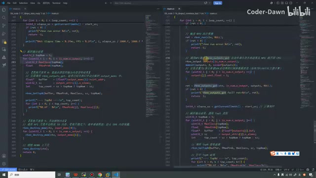

*并排对照直接推理与通用 API 的输出获取及后处理。 · [原片 25:10](https://www.bilibili.com/video/BV11DjT6uEhc/?p=27&t=1510)*

接下来都是进行这个，相当于是在做后处理，就是后处理，然后去打印这个 Top5。只不过通用 API，它是直接从这个 output 在这里获取的；然后我们零拷贝这个，其实是从我们手动分配的 output memory 里面获取的。

剩下的，最终销毁的时候，它就是需要手动去销毁这块内存。这里的话就不需要，只需要销毁这个 RKNN 的上下文就可以了。这是它们代码的一个对比。

我这样讲，也不知道大家到底有没有明白。如果大家没明白，大家拿到我的代码，再去仔细地看一看。

## 编译、复制到开发板并运行 · 26:15

然后让 AI 解释解释，应该也没什么太大的问题。好，最后我们把这个代码再跑一下就行。

我先复制一下它，然后打开虚拟机，进到这个目录下。这里需要注意，前面一定不要有这个虚拟环境，有虚拟环境的话，可能会找不到。好，在这里我先执行一下它，接着再来执行它，进行编译。

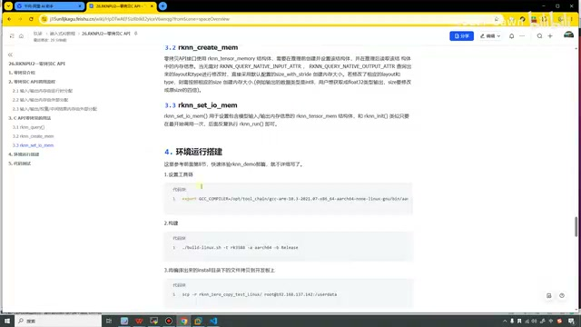

*课件中的交叉编译工具链设置、编译和复制命令；小字路径受原始画质限制。 · [原片 26:43](https://www.bilibili.com/video/BV11DjT6uEhc/?p=27&t=1603)*

画面中的编译命令：

```bash
./build-linux.sh -t rk3588 -a aarch64 -b Release
```

〔前一步为设置交叉编译工具链的 `export GCC_COMPILER=...`；原画面路径小字未逐字符可靠确认，保留截图，不补造本地安装路径。〕

好，编译得特别快。接下来我们就把它拷贝。这里编译完之后会有一个 `install` 目录，在这里面把它拷贝到开发板上。

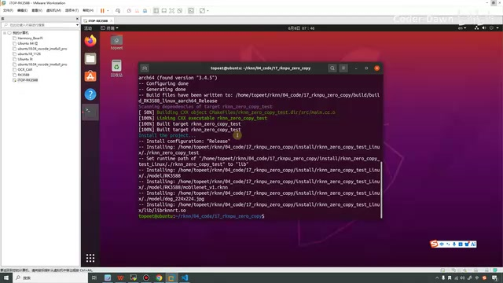

*虚拟机终端显示编译、链接与安装成功，生成 install 目录中的运行文件。 · [原片 26:50](https://www.bilibili.com/video/BV11DjT6uEhc/?p=27&t=1610)*

画面中进入安装目录后执行的复制命令：

```bash
scp -r rknn_zero_copy_test_Linux/ root@192.168.137.142:/userdata
```

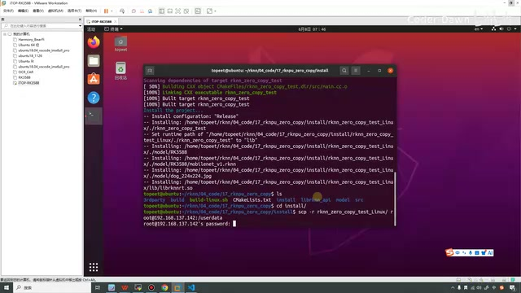

*进入 install 目录后，以 scp 复制零拷贝运行目录到开发板 /userdata。 · [原片 27:05](https://www.bilibili.com/video/BV11DjT6uEhc/?p=27&t=1625)*

好，这样就拷贝到开发板里面了。拷贝到开发板上面之后，我们就进入这个目录，然后来执行一下。第一个是可执行程序，第二个是模型，模型在这里。第三个是要推理的一张图片。可以看到，这样就把结果输出出来了，也代表我们推理成功。

```bash
cd rknn_zero_copy_test_Linux/
./rknn_zero_copy_test model/RK3588/mobilenet_v1.rknn model/dog_224x224.jpg
```

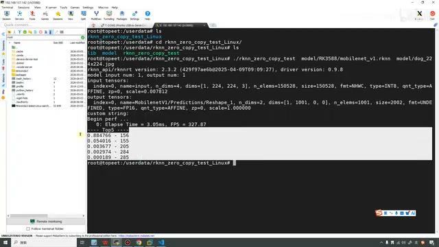

*开发板执行零拷贝示例后输出模型属性、性能和 Top5 结果。 · [原片 27:35](https://www.bilibili.com/video/BV11DjT6uEhc/?p=27&t=1655)*

可以看看，之前也没看这个打印信息，这节课我们就稍微看一下。第一行的打印信息，就是 API 的版本，是 2.3.2，然后我们的驱动版本是 0.9.8。

这一块的打印，就是我们最上面这个辅助函数做的事情，这一块，就是这个辅助函数做的事情，是通过它来进行打印的。可以看到模型的输入、输出，然后包括输入的这个类型，可以看到它的 index、它的名称，它是四维的，然后它是这么个形状、这么个大小，是这样的格式，它的类型等等，包括它的这些缩放。下面这个就是对应的输出。

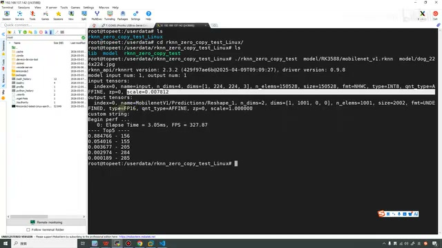

*开发板终端打印 API 2.3.2、驱动 0.9.8，以及 3.05ms、327.87 FPS 和 Top5。 · [原片 28:30](https://www.bilibili.com/video/BV11DjT6uEhc/?p=27&t=1710)*

这个就是我们计算的性能。它推理就是三毫秒，然后这个帧率是三百二十七〔画面显示 `Elapse Time = 3.05ms, FPS = 327.87`；转写“327327”为即时重复，按可见结果保留精确值〕。这个就是它的相关信息，我看下面也就没有了。

讲到这里，我们这节课也就讲完了。这个就是我们零拷贝。在真实的项目开发当中，如果说对性能要求比较高，我们就可以采用零拷贝的方式，这样会让我们的性能更好。

好，以上就是本节课的内容。最后也是感谢大家的观看，谢谢大家。
