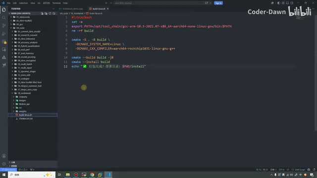
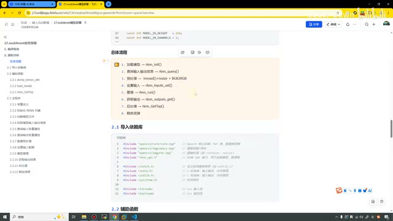
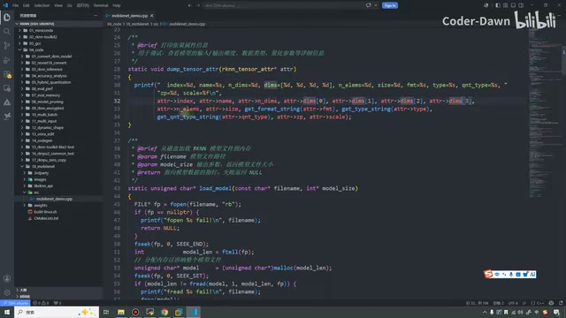
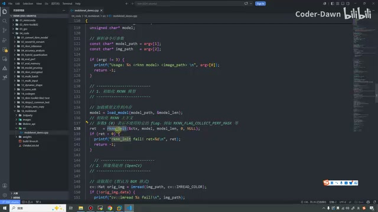
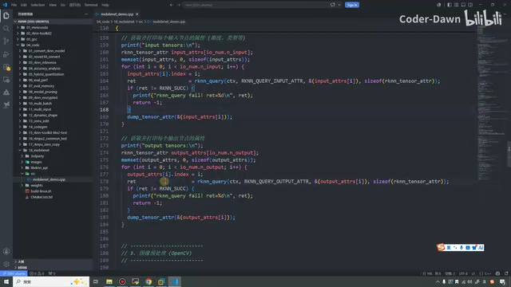
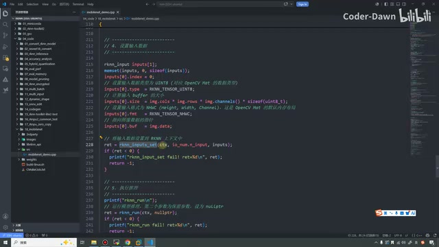
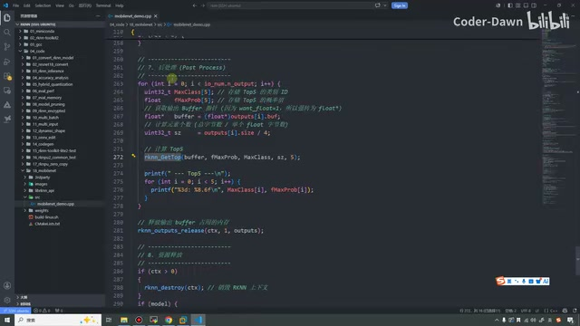
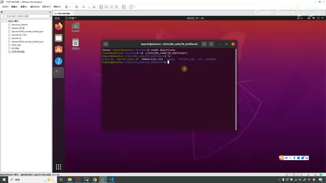
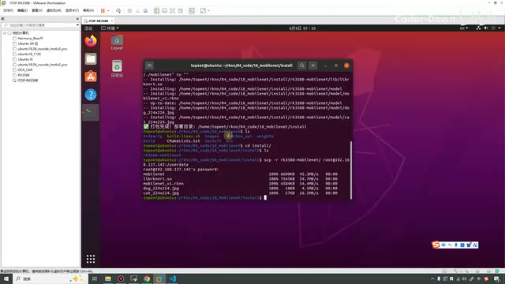
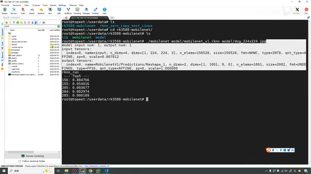

# P28｜27_mobilenet模型部署

> 来源：[B 站课程 P28](https://www.bilibili.com/video/BV11DjT6uEhc/?p=28) · 全片 19 分 57 秒
>
> 整理方式：忠实讲稿，不做摘要压缩；保留原讲述顺序、第一人称、解释与操作。仅清理无意义停顿、结巴，并补充标点与轻量小标题。代码块和终端数值为编辑据原片截图抄录。
>
> 文字来源：task 指定的原始转写原样用于准备，原始、规范化转写及审计一并保留。明显术语依画面校正，无法可靠确认的局部在正文标注。未额外声称逐句听音。
>
> 图片说明：10 张实际原片截图，640×360，小字清晰度受源分辨率限制。图注为编辑说明。浏览器 file 协议预览不可用，未进行桌面/窄屏交互验收；离线 HTML 与本地图片已生成并作结构核验。

## 进入 MobileNet 模型部署实战 · 00:00

各位同学大家好，这节课我们就来看第 27 讲，MobileNet 模型部署。

在前面的课程中，我们已经讲了很多内容了，包括瑞芯微资料的介绍，一些模型的转换，性能的评估、内存评估，以及一些基本的模型处理。再到后面，我们讲了使用 Python 在开发板上进行推理。在上节课和上上节课，我们也讲了 C 语言、C++ 的基本 API，包括通用 API 和零拷贝 API。

学完前面这些内容，我们就已经把所有的基础内容都学完了。这里需要注意，学完的是所有的基础内容。其实瑞芯微还有很多更高级的功能，像一些矩阵乘法、自定义算子等等，这些东西以后有机会我们再讲。

从这节课开始，我们就正式进入项目实战篇，或者叫模型部署实战，就是把真正的模型部署上去。其实我们前面也都已经部署过好几个模型了，总体流程也都是类似的，不过从这节课开始会更加正式，所以也是希望大家可以好好地听。

好，我将它放成一个全屏，我们来看一下。这节课主要讲两个部分：第一个是编译程序，第二个是源码分析。编译程序的话，我想一下，在这里我直接打开代码吧。包括第二部分源码分析，我们也就直接看代码就可以了。

首先是第 18 个项目的文件夹，里面同样是第三方库，

然后包括图片〔此处转写为“播出头片”，目录画面较小，具体口述词未可靠确认〕，然后我们的 RKNN API。这里放了一个权重文件，就是我们已经转化好的 RKNN 模型。src 目录下依旧是我们的程序源码，下面依旧是我们的 build 和 CMake。

在前面我说了，我个人可能不是非常喜欢用类似于 Model Zoo 的那种风格，而且我们这个东西就是针对 3588 的，所以我把那个很长的文件已经简化了，就变成这个特别简洁的。配置一下交叉工具链，如果之前有这个目录，把它删掉，然后在这里使用 CMake 来重新构建一下，这个文件就变得非常简洁了。



*简化后的 build-linux.sh：交叉工具链、CMake 构建与安装。 · [原片 02:30](https://www.bilibili.com/video/BV11DjT6uEhc/?p=28&t=150)*

画面中构建与安装的主体命令如下（编辑据截图抄录；交叉工具链的完整安装路径小字不作猜写）：

```sh
rm -rf build
cmake -S . -B build \
  -DCMAKE_SYSTEM_NAME=Linux \
  -DCMAKE_CXX_COMPILER=aarch64-rockchip1031-linux-gnu-g++
cmake --build build -j8
cmake --install build
```


下面这个 CMake 和之前几乎没什么区别，同样是配置它的一些路径，加上这些头文件、这些库和包。最后依旧是我个人增加了一个安装的配置，我觉得这样会更方便一点，都放到这个 install 里面。这个也和前面两节讲 C++ 的部分其实是一样的。

好，说完这个之后，我们就来正式地看这份代码。其实这个代码也就是遵循我们前面学习 C API 的流程。我先打开课件这里，我记得这里有一个总体流程。第一步是加载我们的模型，第二步是进行预处理，第三步是

查询输入输出的信息，然后第四步是设置输入，第五步推理，第六步是获取输出，第七步是后处理。这个和我们前面都是一样的。

其实第二步和第三步，这里的顺序可以进行交换。如果大家忘了，我们也可以再看一眼。前面是这样的：初始化、查询，然后进行预处理，进行设置输入、模型推理，然后获取输出，进行后处理，最后再释放。我们这里其实也是一样的，第二步和第三步也可以进行交换。我在这里直接把它交换吧。



*课件中的总体流程；讲师已将查询输入输出调整到预处理之前。 · [原片 05:00](https://www.bilibili.com/video/BV11DjT6uEhc/?p=28&t=300)*

## 辅助函数与张量属性 · 05:00

看完这个总体流程之后，接下来就具体看代码。同样，最上面是导入头文件，然后依旧有三个辅助函数。这个辅助函数也是和前面的辅助函数一样，就是打印模型输入输出张量的属性信息，目的是为了方便我们调试。

在前面可能没有特别具体地解释里面的参数，也有人问我这个问题。在这节课过程中，我们就把里面这些参数也给大家简单地做一个解释。

首先这个 index 是张量的索引，就是第几个输入、第几个输出。第二个是张量的名称，比如是 input 还是 output。这个就是它的维度，包括这些都是它的维度，然后这个是元素信息，

这个是 size，它的大小信息。接下来是它的格式、它的类型。这里是数据的类型，这里是量化的类型。最后这两个参数还是量化的参数，就这两个参数叫做量化参数。可以看到这个 scale 和这个 zp，就是那个零点和缩放的信息。



*dump\_tensor\_attr 与 load\_model 源码，显示张量属性及模型读取。 · [原片 06:00](https://www.bilibili.com/video/BV11DjT6uEhc/?p=28&t=360)*

看完这个函数之后，我们接下来看第二个辅助函数。第二个辅助函数的作用是从磁盘加载 RKNN 模型文件到内存中。其实它非常简单，就是调用我们这个 fopen，使用 rb 的这种形式去加载模型，也就仅此而已。当然中间会有一些我们系统编程当中使用的 API，就是查一查它的位置，然后做一做这样的设置〔此处口述具体 API 名称转写不清，保留加载流程；画面可见文件定位及读取操作〕。这个就是我们第二个辅助函数。

然后我们第三个辅助函数已经看过很多次了，其实就是进行排序，就是双重循环进行输出的排序。我们最终可能只要 Top5 的信息，这个就是我们第三个辅助函数。

## main 函数：初始化与查询 · 08:00

看完辅助函数之后，我们接下来就正式看我们的 main 函数。上面定义的是一些常量信息，就是我们写的模型期望的输入尺寸，就是这个 224、224，还有这个 3，

就是这么一个尺寸。我们的 MobileNet V1 就是 224 乘 224，再乘个 3，就是这么一个信息。

接下来这里就是我们的第一步，进行初始化。我们在初始化的时候，需要有一个上下文对象，然后需要加载模型，这里是模型的大小，就是它的长度。这两个参数我们之前也都看过了，就不需要，就把它写成 0 和 0。



*main 中的参数检查与 RKNN 模型初始化。 · [原片 08:30](https://www.bilibili.com/video/BV11DjT6uEhc/?p=28&t=510)*

然后第二步，这里我也改一下代码，把它的顺序变一下，把它改成一个 3。这个也是拨一下，这个是第二步，把刚才的代码粘在这里来。这样的话就和我们之前的流程会更加对齐、更对应。

第二步就是使用这个 query 去进行查询。查询的时候就同样进入一个结构体，代表输入输出的信息。在这里我们就没有再去查询那个版本了，查询版本之前也是为了给大家做一个演示，在这里我们用不上，也就没写了。

查询到信息之后，我们就获取并且打印每个输入节点的属性。这个就是输入节点，我们使用 memset 对它进行赋零，然后包括循环，在里面进行查询和打印。

设置完输入之后，我们接着就需要再操作输出。这里其实也总感觉有点奇怪，就是它需要统一的这个结构体，但是又需要分开进行处理。在前面也已经讲过了，大家记住这个流程，就是获取到它的信息。



*分别查询并打印输入与输出张量属性的代码。 · [原片 10:30](https://www.bilibili.com/video/BV11DjT6uEhc/?p=28&t=630)*

## 图像预处理、设置输入与推理 · 10:45

第三步就是我们获取完信息之后，就知道模型需要什么样的数据了，所以我们就可以对原本这些需要处理的图片进行预处理。

我们同样使用 OpenCV 来进行处理，用这个函数把图片加载进来，然后进行颜色空间的转换，BGR 到 RGB。接下来就是调整它的尺寸，这个操作和前面都是一模一样的，相信大家也都明白。

看完第三步之后，第四步同样依旧是我们的输入数据。输入数据要用的就是这个 API。同样第一个参数传入我们上下文的句柄，第二个就是在前面我们查到了信息，然后我们把查到的信息进行赋值，赋完值之后，传到这个函数里面来就可以了。这个就是设置输入数据。



*输入参数设置与 rknn\_run 推理调用。 · [原片 11:30](https://www.bilibili.com/video/BV11DjT6uEhc/?p=28&t=690)*

画面对应的输入设置如下（编辑据源码截图抄录）：

```cpp
rknn_input inputs[1];
memset(inputs, 0, sizeof(inputs));
inputs[0].index = 0;
inputs[0].type = RKNN_TENSOR_UINT8;
inputs[0].size = img.cols * img.rows * img.channels() * sizeof(uint8_t);
inputs[0].fmt = RKNN_TENSOR_NHWC;
inputs[0].buf = img.data;
ret = rknn_inputs_set(ctx, io_num.n_input, inputs);
ret = rknn_run(ctx, nullptr);
```


输入数据设置完之后，我们就可以进行模型推理了。模型推理就调用这个 run 函数，这个是相当简单的。推理完成之后，我们就需要获取输出结果。输出结果在获取的时候，我们同样

也是有一个 API 在这里，就是它。同样，如果希望 SDK 自动进行反量化、转换成这个类型，我们就把它设置为 1 就可以了，然后把输出的信息传过来〔画面对应 `want_float = 1`，口述的“这个类型”为浮点类型〕。

接下来我们就进行后处理。因为输出信息可能是我们一堆看不懂的向量，或者什么样的东西，然后我们在后处理的时候，就把这些数据转化为我们可以看得明白的操作。当然在这里，我们并没有那些复杂操作，我们就是对它进行一个 Top5 的排序。



*Top5 后处理与输出资源释放代码。 · [原片 13:00](https://www.bilibili.com/video/BV11DjT6uEhc/?p=28&t=780)*

后处理完成之后，我们就去释放占用的资源。释放完，这样我们就已经结束了。同样，在前面因为我们打开了这个，所以在后面我们把这个模型也释放掉。

这个就是我们整体的代码。代码和之前上节课和上上节课讲的都差不多，可以说是一样的。当然我们在这里使用的是基础的通用 API 的形式，流程就是这么几步。

看完这个代码之后，接下来要做的就是把这个代码在 Ubuntu 虚拟机里面编译一下，然后传到我们的开发板上面，进行测试就可以了。

在做这个操作之前，也想和大家提一嘴：下节课我们会对这个代码进行进一步的封装。为什么要这样做呢？虽然说这个代码好像也不难，

而且也没有那么长，但是这个代码依旧还有这么几个问题。我把这个代码滑到这里来给大家分析一下。

## 后续封装的思路 · 14:08

像这里，我们有这么多辅助函数。我们的辅助函数是不是就和模型推理其实没有直接的关系？我们是不是应该在这里创建一个文件，比如说叫辅助文件，加辅助文件目录，然后把辅助函数都塞进去？

然后再到 main 函数里面，我再滑一下，我们这里有预处理，下面还有后处理。我们预处理的部分是不是可以单独封装一个文件？后处理也单独封装一个文件。这样，我们的 main 函数里面就会变得更加清晰、更加简洁了，我们只需要走最基本的流程就可以了。

甚至可以说，我们这个 RKNN 的操作是不是也可以进一步封装？万一未来某一天，我的代码、我的模型，并不仅仅是想要跑到瑞芯微的开发板上面，我可能想要跑到全志的开发板、跑到海思的开发板上面，那我是不是把 RKNN 相关的操作也可以进行封装？最终就留下来一套最最通用的流程，那就可以了。

这个就是我们封装的思路，在这节课先和大家讲一讲。在下节课和下下节课，包括后面的课，我们都会对代码进行封装。

说完这个之后，我们就打开虚拟机，来测试一下。记住我之前说的，我们要退出这个环境，

就是先把这个虚拟环境退掉，然后我们进入我们的目录〔原转写“Moros”，画面为项目目录，口述目录名未可靠确认〕，这个是第 18 个。在这里，因为……哎呀，好，在这里我们就直接执行这个文件就可以了。



*退出虚拟环境后进入第 18 个 MobileNet 项目目录。 · [原片 16:30](https://www.bilibili.com/video/BV11DjT6uEhc/?p=28&t=990)*

这样的操作其实比我们之前前几节课那种方式，就是我说的类似于 Model Zoo 和官方原版例程的方式会更简单。我们只需要执行它，就直接全部都搞好了。

搞好之后我们看一下，会生成一个 install 的目录，我们进入这个目录。这里面就有我们编译好的文件目录，我们把它传到开发板上面。这里还是一样，大家使用什么方式传都可以，只要能传到开发板上就可以了。我们同样传到这个目录下，然后输入密码。



*编译安装完成后，将 install 内的部署目录复制到开发板。 · [原片 17:30](https://www.bilibili.com/video/BV11DjT6uEhc/?p=28&t=1050)*

画面中先运行 `conda deactivate`，进入 `~/rknn/04_code/18_mobilenet/`，执行 `./build-linux.sh`；随后进入 `install/`，把生成的 `rk3588-mobilenet/` 目录传到开发板的 `/userdata/`。（远端 IP 和完整复制命令的小字不作猜写。）


在这里我也提一下，我们现在这种方式叫做交叉编译，都是在虚拟机里面编译，然后把这个东西传到开发板上。其实像我们 3588 这种开发板，它的性能都已经很强大了，我们完全可以在开发板上进行编译。

到后面的测试中，也是因为一个特别的原因，可能在虚拟机里面交叉编译还容易出问题，然后我也会直接带着大家，在开发板上面做编译。前面这里我们就先在虚拟机里面进行交叉编译，

其实怎么编译也都无所谓，就是看大家的个人习惯嘛。

## 开发板运行与输出结果 · 18:09

这里已经编译好，也传过去了，我们就打开开发板。这里这个就是刚刚传过来的东西，我们就进入这个目录，RK3588，然后在这里来执行一下。它里面有我们的这些文件，它里面有我们的图片。



*开发板运行 MobileNet 后打印输入输出张量属性与 Top5 结果。 · [原片 19:00](https://www.bilibili.com/video/BV11DjT6uEhc/?p=28&t=1140)*

画面可辨认的运行命令与结果如下（编辑据终端截图抄录）：

```sh
./mobilenet model/mobilenet_v1.rknn model/dog_224x224.jpg
```

```text
model input num: 1, output num: 1
--- Top5 ---
156: 0.884766
155: 0.054016
205: 0.003670
284: 0.002974
285: 0.000189
```

输入属性显示 `dims=[1, 224, 224, 3]`，`n_elems=150528`、`size=150528`，格式 `NHWC`、类型 `INT8`、量化 `AFFINE`，`zp=0`、`scale=0.007812`。输出显示名称 `MobilenetV1/Predictions/Reshape_1`，维度 `[1, 1001, 0, 0]`，元素数 `1001`，大小 `2002`，类型 `FP16`。这些是原片终端显示的属性；前述请求浮点输出与这里打印的模型原始属性依原讲述保留。


可以看到，这样我们就已经推理成功了，我们的结果也都出来了。这上面就是我们刚才的信息，你看输入输出，包括这个索引、它的维度、里面的元素、它的大小、它的格式。这个就是它的量化类型，这里还有一个 AFFINE，还有一个缩放。总之这个是输入的，然后下面这个是输出的。

这些就是我们模型的基本信息，这个信息就是为了方便大家进行调试的。这里就是我们输出的结果，到这里我们就已经全部运行成功了。运行成功之后，我们这节课的内容也就讲到这里了。最后也是感谢大家的观看，谢谢大家。
