# P29｜28_mobilenet模型代码封装

> 来源：[B 站课程第 29 集](https://www.bilibili.com/video/BV11DjT6uEhc/?p=29) · 全片 35 分 15 秒
>
> 整理方式：忠实讲稿，保留第一人称讲述、原始顺序、例子、理由与操作，清理停顿和偶发结巴，不作摘要压缩。
>
> 文字依据：本地 Whisper 转写与源画面核对；10:10–11:35 使用定向本地 ASR 补充修复重复污染。原始转写、规范化审计和补充证据保存在 sources。未进行人工听音；无法可靠辨认的局部文字在正文标注。
>
> 图片说明：18 张原视频截图，原始分辨率 640×360，小字受源画质限制。图注和方括注为编辑说明，可通过原片时间链接回看。

## 为什么要封装代码 · 00:00

这节课我们来看第 28 讲，MobileNet 模型代码封装。在上节课分析完代码之后，我们也提出了这么一个问题：上节课所有代码都在一个文件当中。如果我们的业务很复杂，代码逻辑很复杂，到最后维护起来就会很混乱，包括所有的流程也都在里面。我们觉得流程上好像也有点不清晰，内容也有点多。基于这个原因，就有了这节课的内容，对它的代码进行一个封装。

其实我在这里更想说的是，对 MobileNet 这个项目、这份代码的封装，也不是特别重要。真正重要的东西是什么？就是我们封装一份代码的具体思路，我们应该怎么样把代码进行封装。选好了这个思路之后，后面不管是这个模型，或者其他模型，YOLO 模型、人脸识别模型等等，我们拿到一份代码、拿到一个模型，都可以对它做相应的处理。

好，说完这些，我们看一下这节课的内容，一共有三个部分。第一个是目录结构，就是这么个目录，在这里就不看了，一会儿在代码里面给大家解释。第二个是源码分析，一会儿也会在代码中分析。第三步就是进行编译，并且在开发板上进行测试。

简单看一眼这个文档之后，我们直接来看代码。代码我已经提前传过来了，就是第 19 个代码，`19_mobilenet`。现在将它折叠起来，打开上节课的代码，我们在这里做一个对比。

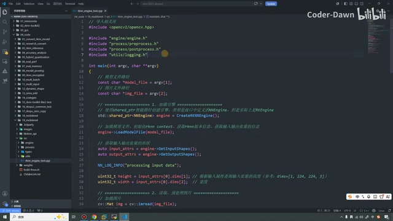

*代码目录与入口文件。 · [原片 01:48](https://www.bilibili.com/video/BV11DjT6uEhc/?p=29&t=108)*

大家应该可以看到，我们这两份代码，都是第三方库。当然，`build` 和 `install` 是已经编译好了才生成的这两个目录。都有 `images`，然后是 RKNN API 的文件、库，再有一个 `src`，然后是权重文件，最后下面两个是编译文件。从大框架上来看都是一样的，我们所有代码也都遵守这个规范。

具体点开上节课的 `src`，它里面只有一个文件，所有逻辑都写在里面。可以看到代码整体比较长，大概 300 行左右。里面包括辅助函数，我们再回忆一下，这些是辅助函数；然后包括 RKNN 的一些处理、我们的前处理，也就是预处理，包括后面的后处理，都在这一份代码里面完成。它的缺点就很明显了：业务足够复杂，或者我们想做迁移，想把它迁移到别的地方时，就会变得非常麻烦。

好，这是上节课的，我们把它直接折叠起来。这节课可以看到，一共有一、二、三、四，四个目录和一个文件。这个文件就是我们的入口文件。其实很多时候我们也把它叫做 `main.cpp`，当然在这里我叫的是这个名字〔画面为 `rknn_engine_test.cpp`〕。名字不重要，大家应该也能想到，它是一个入口文件。接下来我们看这些目录。

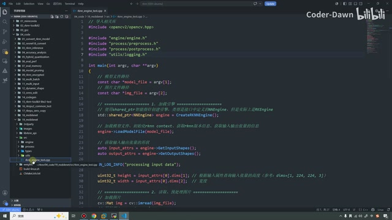

*本课拆分后的目录结构。 · [原片 03:45](https://www.bilibili.com/video/BV11DjT6uEhc/?p=29&t=225)*

## 先看各个目录的职责 · 04:02

第一个目录〔画面为 `engine`〕，它里面一共有三个文件。我们首先从宏观上了解每个文件的作用。第一个文件封装了一个引擎，封装的是一个最通用的引擎。这样就可以屏蔽硬件的差异，提供统一的推理接口。

下面这两个，RKNN 的引擎头文件和 `.cpp` 可以看成一组。有了这个引擎之后，如果想在瑞芯微的平台上做推理，就使用瑞芯微的引擎。如果现在想在海思上面做推理，这里就不叫 RKNN 了，就叫海思，叫海思引擎的 `.cpp`、`.h`〔此处讲师举例的英文文件名，转写不能可靠确认〕。这个就是为了代码迁移而做的封装。

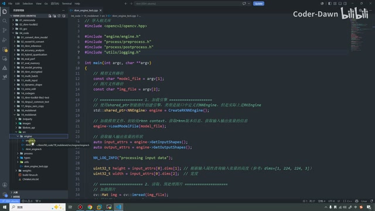

*引擎与处理模块目录。 · [原片 04:25](https://www.bilibili.com/video/BV11DjT6uEhc/?p=29&t=265)*

接下来这个目录叫 `process`。看到名字也能想到，在里面就是做一些处理。上面这一组是后处理，下面这一组就是前处理，或者叫预处理。这是这个目录的作用。

接下来目录叫 `types`，在里面我们就会封装数据，封装通用的一些类型。比如第一个文件定义的就是数据类型。我们可能涉及各种各样的数据、各种各样的结构体等等，就放在里面。下面一个，是针对出错的情况，对错误码进行封装。这个目录看完之后，我们再看下面这个目录。

我们先看这个 logging。它是日志系统。其实在一些比较成熟、比较现成的框架里面，都会有日志的功能或者日志插件，就是为了避免整个代码满屏都是 `printf`、`printf`、`printf` 这样子。所以就会有这样的日志。而且大家肯定也知道，会对日志分级别，像 INFO、WARNING 或者 DEBUG 等等，在这里我们也做了这个事情。

上面这个文件的功能，就是封装通用的、不属于任何特定业务、到处都用的一些代码处理。比如读取文件的函数、计算运行时间、做内存对齐等等，就放在这个文件里面。从目录名字也能看到，叫 `utils`，就是工具。


*入口文件中的头文件与参数。 · [原片 07:06](https://www.bilibili.com/video/BV11DjT6uEhc/?p=29&t=426)*

## 从入口函数看主流程 · 07:21

对这些目录和文件有了宏观认识之后，接下来我们看具体的代码，从入口函数看起。最上面就是导入相关的库，只不过在这里导入了很多刚才这些目录里面定义的东西。

接下来具体看代码逻辑。第一部分还是做参数的提取，因为最终执行代码的时候，我们是模型，第一个参数是模型，第二个参数是——第一个参数是可执行程序，第二个是模型，第三个是我们要处理的图片，或者说视频也可以。所以需要获取它。

接下来的流程，第一步叫加载引擎。在这里我们采用智能指针创建引擎，然后类型是在前面这里定义的。实际上它是 RK 的一个引擎，因为我们是在 RK 上做处理。

好，那我想一下，我们就在这里顺便看一看每个文件的功能。首先看这个引擎，因为代码在这里用到了，就顺便分析。可以看到，我们就从这里跳过来吧。这是一个引擎的文件，就是封装通用引擎的一个文件。在它里面其实没有太多操作，就是定义了一个类，然后在类里面全部都是虚函数，都是纯虚函数。

那纯虚函数的话，它的作用就是把它定义成一个抽象类。它不能被实例化，只能作为基类使用。为什么这么做？这是 C++ 里面的一个基本原理。比如学 C++ 时大家可能都学过这样的一个案例嘛：现在想定义各种各样的图形，我们可以做一个图形的基类，再用其他类继承它，比如说具体的长方形，或者正方形。

还有一个更好的例子：可能会定义一个动物类当基类，下面可能有狗、有猫，然后它们都可以叫，都可以吃。

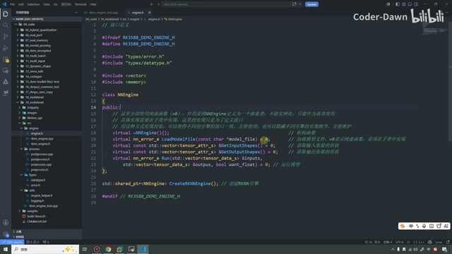

*通用推理引擎接口。 · [原片 09:10](https://www.bilibili.com/video/BV11DjT6uEhc/?p=29&t=550)*

然后狗是汪汪叫，猫是喵喵叫。大家可能都学过这样的例子，在这里就不再说了。总之，定义成一个抽象类，具体实现在子类中进行实现。这样做的好处，就是不管什么引擎，都可以继承它、去实现。

我们看具体都有哪些。首先有一个析构函数。然后，在这个类里面需要有加载模型的操作。我们不管什么引擎、不管做任何推理，都必须加载模型，所以这里有加载模型的操作。

然后我们需要获取输入的形状，也需要获取输出的形状，就是有输入，必须有输入、有输出，所以在这里也对它们做了定义。再到下面，最终这个模型，不管你是什么模型，都需要进行推理，所以就定义了一个 `Run`。这就是这个基类，然后下面就是创建一个 RKNN 的引擎，就是这一块。

〔10:10–11:35 补充文字依据源视频该范围的定向本地 ASR，并结合本帧核对“析构函数”“基类”和 `Run` 等术语。原始整课转写在 10:22–11:22 有重复污染，原文件保留在 sources，补充 ASR 另存备查；此项核对不等于人工听音。画面中的类名为 `NNEngine`，接口为 `LoadModelFile`、`GetInputShapes`、`GetOutputShapes`、`Run`，工厂声明为 `CreateRKNNEngine`。〕

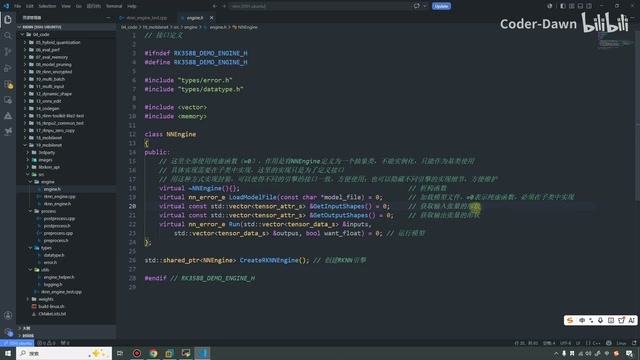

*通用引擎的纯虚函数声明。 · [原片 10:40](https://www.bilibili.com/video/BV11DjT6uEhc/?p=29&t=640)*

好，这一块看完之后，我们接着往下看。到下面就开始加载模型，通过这个引擎加载模型。加载完模型之后，我们获取输入、输出张量的形状，存到 input 属性和 output 属性里面，然后调用它进行打印。我想一下，还是在这里先看主流程，就是打印一下这个信息。

打印完信息之后，我们根据输入属性，查询张量的高度、宽度。因为最终可能需要的是 NHWC 这样的一个东西，所以需要把它的 height 和 width 都查出来。好，那总之，这个就是我们第一步的一个处理，需要加载引擎，然后再来看里面具体的操作。

里面具体的模型加载，我们也看一下，就在这个函数里面。这个函数还挺长。可以看到，那加载模型的时候，我们来看一下，在这里又调了一个加载模型的函数。我们还是先看流程：定义一个模型大小，然后加载模型。如果模型为空，就给它一些提示，把信息输出。加载完之后，在里面还是我们讲零拷贝和通用 API 时的流程。我们需要先对 RKNN 上下文进行初始化，最重要的就是这个上下文。

初始化完之后，需要进行一个 query，查询信息，包括版本信息。版本信息是非必要的，比较重要的是输入、输出的信息。这里，包括下面这里，都是这样的代码，我们之前也都看过了，其实和这里一模一样。加载模型很简单，我们再跳过来，看具体的加载模型。

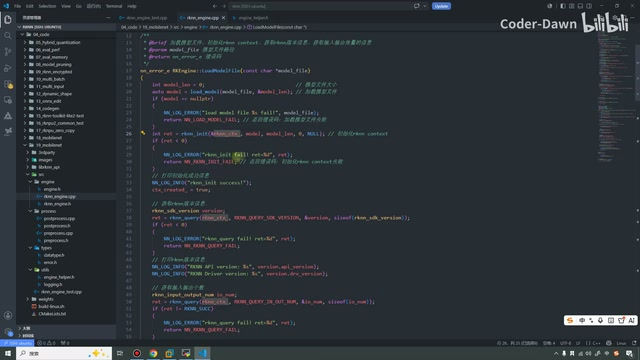

*RKNN模型加载与属性查询。 · [原片 13:35](https://www.bilibili.com/video/BV11DjT6uEhc/?p=29&t=815)*

具体加载模型，其实就是使用最原始的 C 语言里面的 `fopen` 函数。把路径传进来，然后去加载，进行定位，再算一下它的大小，最终把模型返回出来。这在前面也都讲过了，总之就是这个步骤。

好，那我们再回到这里，然后再看一下输入和输出张量形状的具体操作。获取输入张量形状，只需要把它返回就可以了；获取输出时也是一样，进行返回就可以了。好，这个看完之后，我们第一步其实就都已经看完了。

## 预处理与输入输出数据 · 15:00

接下来看第二步。第二步的话，就是我们把这个引擎设置好之后，把模型的相关信息也都已经查询到了。那接下来的话，我们就可以做一些预处理，把我们想要推理的内容，处理成模型想要的格式。

第一步依旧是加载图片，然后对它进行预处理。我们切过来看一下，这个文件就是预处理的入口。`.h` 文件很简单，只是对函数进行声明，里面是具体逻辑，同样很简单。第一步，如果它不是三通道，就直接提示错误，打印一些信息。如果是三通道的，我们就来到下面，把 BGR 转换为 RGB，然后把大小进行 resize，这样就直接 OK 了，和前面都是类似的操作。

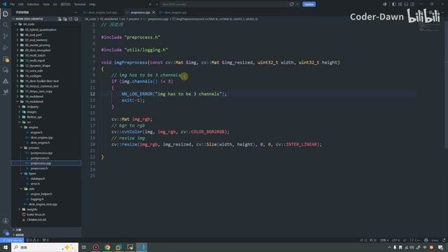

*图像预处理函数。 · [原片 15:55](https://www.bilibili.com/video/BV11DjT6uEhc/?p=29&t=955)*

好，那预处理也做完之后，接下来我们就可以设置输入和输出的一个属性了。首先看输入数据这一块，我们先把整体逻辑看完：定义一个输入数据，然后对输入数据进行各种各样的赋值。你看，它是四维的，就是前面这里举的 NHWC 这个例子，一共四维，所以写上 4。

第一个维度代表 batch，然后是高度、宽度，再是通道，把它们传过来就行。然后我们的大小就这样计算，算一算，然后我们的类型，然后我们的这个格式，都要进行设置。算完这个之后，我们就给它申请一块内存，然后把这个数据传过来，就拷贝到我们的输入里面去。然后再把它传送到 `inputs` 里面，就是定义一个集装箱，把它添加进来就可以了。

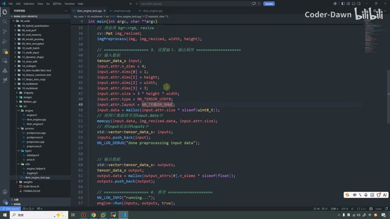

*输入张量赋值与内存拷贝。 · [原片 17:20](https://www.bilibili.com/video/BV11DjT6uEhc/?p=29&t=1040)*

输出数据这里，其实可以说是完全相同的逻辑。同样，通过它定义一个 output，再定义这个类型的 output，给它分配内存，然后把它添加过来就可以了。

这块代码可能看上去还稍微有一点难理解。那在这里的话，我想一下，想一下这块怎么给大家解释一下。它整体的逻辑，首先就是需要对输入数据进行赋值，因为前面只是查询，在这里要把真正想要的内容赋进去。赋进去之后，我们就在这里定义 input。

在这里，我们定义了这么一个 input，这个 input 的话怎么理解呢？相当于定义了一个集装箱，把输入数据放到输入数据的集装箱里面，把输出数据放在输出数据的集装箱里面，那它的话，就是这个含义。

那总之，这一块代码，它的本质含义，是在 C++、OpenCV 和 C 语言之间，建立一个内存搬运的桥梁。通过 `malloc` 手动分配内存，然后进行数据拷贝，就完成数据的格式对齐和安全交接。总之，就是设置输入输出属性这一块的功能。

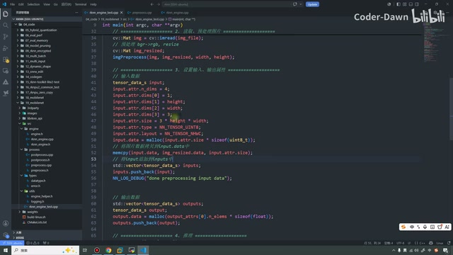

*输入与输出数据容器。 · [原片 19:30](https://www.bilibili.com/video/BV11DjT6uEhc/?p=29&t=1170)*

数据都已经设置好之后，接下来做的就是推理，推理完之后进行后处理。刚才说上面这里的时候，还有一些东西漏掉了。

首先是这个结构体，我们点过来看一下，它本质上是这个结构体。那这个结构体里面，又有这个属性和一个数据 data。data 是指向实际数据的指针，上面的是张量元信息。我们不是要查询张量，并且设置张量吗？张量里就有这些信息，好，那在这里我也都写清楚了：有张量的索引、实际维度、维度大小、元素个数、总字节数、数据类型、内存布局，然后是量化零点、量化缩放因子。这就是这个结构体的一个含义。再到下面，其实也没有别的了。

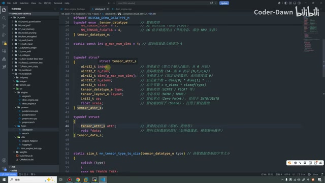

*通用张量元信息结构。 · [原片 20:35](https://www.bilibili.com/video/BV11DjT6uEhc/?p=29&t=1235)*

## 推理与通用类型转换 · 21:05

第四步是推理，就是 `Run`。我们跳过来看一下，首先检查输入输出张量的数据数量是否匹配。如果数量不匹配，就不再做处理了，一个检查输入，一个检查输出。检查完之后，就设置我们的输入。设置完就进行推理，推理其实很简单，就是这个 `rknn_run` 函数。

前面设置的时候，我们并没有用官方那个设置，在这里还多了一步。这个老是跳，就是多了一步转换。什么意思？看这里，因为刚才这个数据类型是我们自定义的，所以要把自定义的数据类型转换成 RKNN 的输入才可以。

所以，比官方原本直接调用的输入多了一个步骤，只多了一个转换。转换其实也很简单：先定义一个 input，然后将这个结构体的内存清空，设置数据节点的索引，把通用的数据类型转换成 RKNN 类型，设置数据占用的内存字节数，然后把布局格式也转换成 RKNN 的布局格式，再把数据指针指向实际内存缓冲区，就是这么几个操作。

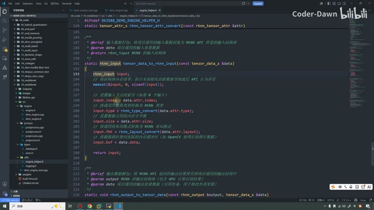

*通用输入打包为RKNN输入。 · [原片 22:35](https://www.bilibili.com/video/BV11DjT6uEhc/?p=29&t=1355)*

在这里面又有两个函数，就是将通用数据转换成 RKNN 类型。就在这里，可以看到其实很简单，在上次代码中也有。就是把这个类型转换成 RKNN 的类型，下面一样，也是转换成这个。

你看这两个函数，它们其实是相同的名字，相当于就是一个“重写”〔沿用讲师此处说法；画面实际展示同名转换函数的不同参数形式〕。大家可以看一看，就是把数据类型进行转换。其实它们都写得一样，写一个也都可以，只不过在这里还是做了区分，是这样的。

下面也是刚才那里看到的，把 RKNN 底层的张量属性转换成项目通用的张量属性。

这些也都是类似的，就是把数据复制过来、复制过去，传过来、传过去，其实就是这么一个操作。具体代码大家可以仔细去看一看。这块看完，就是我们的推理。

最后这里是一个预处理——就是后处理。后处理其实就是进行了倒序排序，就是这个函数。在这个函数里面进行倒序排序，双重 for 循环，就是一个“冒泡排序”〔此为讲师原话；截图保留了实际 `get_top` 实现，未据此改写其算法称呼〕。在这里我们先需要把数据准备好，准备好数据之后，就进行这么一个后处理。

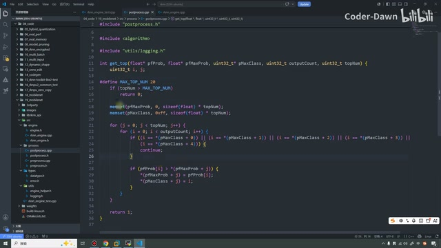

*后处理中的排序循环。 · [原片 24:50](https://www.bilibili.com/video/BV11DjT6uEhc/?p=29&t=1490)*

这就是整体的代码流程。我不知道这样讲大家能不能明白，或者可能讲得有点不清楚。最后还是带着大家再看总体流程。大家知道总体流程，里面特别细节的代码其实不重要，代码怎么都能写出来，流程比较重要。

第一步要加载引擎。通过加载引擎，就能获取模型，获取输入输出张量的形状。第二步，去读、进行预处理。第三步设置输出属性〔入口实际包含输入和输出的准备，上文已保留〕，第四步推理，第五步后处理。后处理完之后，所有操作也就完了，这就是流程。

这个代码我不知道要不要带着看一看，还是带着大家快速过一遍。这个文件刚才已经说过了。

## 再逐个文件过一遍 · 26:12

那接下来，我们就来看这个文件。我们每个文件都快速地过一下。那这个文件里面，第一个就是加载我们的模型。在里面的话，其实刚才也看了，就是用最原始的 C 语言 `fopen` 加载模型。加载完模型之后，用 init 初始化，再使用 query 进行属性查询，主要查询输入输出属性。

获取张量形状时，直接返回就可以了。然后在下面这里，是进行模型的一个推理。推理的话，刚才我们也都已经看过了，就是这个模型的一个推理，我们也都已经看过了。推理完之后需要获取输出，和之前一样。这里是析构函数，最终最下面就可以创建 RKNN 引擎。

`.h` 文件就是对函数进行声明，还有一些私有数据。这不用再看了，就是输入数据、输出数据、输入形状、输出形状，然后上下文，再是查询是否创建了。

好，那这个后处理的话，就是进行了一个返序。这个返序也很简单了。预处理是对图片进行格式转换和 resize。

数据类型这里，上面这个是张量的内存布局，NCHW、NHWC，还有其他，这里都以这种形式定义下来。第二个是数据类型，int、uint、float 等等。下面我们限制张量最大维度为 4。

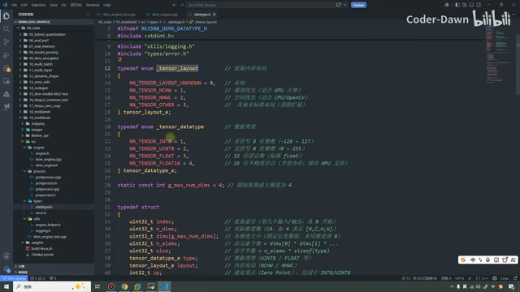

*通用数据类型与张量结构。 · [原片 28:05](https://www.bilibili.com/video/BV11DjT6uEhc/?p=29&t=1685)*

然后这个的话，就是我们这个张量相关的一个信息。下面是获取数据类型的大小，通过 `switch(type)`，如果是这个，就返回 `int8` 的大小，如果是这个就返回 `uint8`，这个返回 `uint16` 的大小〔本句沿用转写，画面枚举实际可见 INT8、UINT8、FLOAT、FLOAT16；此处口述末一类型识别存疑〕。

下面是将任意模型输入 tensor 的属性转换成 OpenCV 兼容的格式。首先判断是不是四维的，我们 OpenCV 要的是 NHWC。如果不是四维，就直接报错；如果是四维，就进行一些判断，判断变量位置是否符合，重新赋值，变成符合要求的值。然后计算内存大小，就是把它们相乘就可以了。这是数据类型。

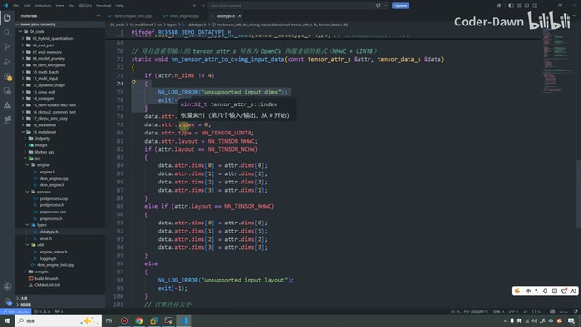

*张量布局转换函数。 · [原片 28:55](https://www.bilibili.com/video/BV11DjT6uEhc/?p=29&t=1735)*

这个 error，这里如果初始化失败了——对，成功是返回 0，加载模型失败返回 -1，初始化失败是 -2，等等。总之，针对每种情况，对错误码进行封装。

接下来是 helper 文件，和之前差不多。第一个加载模型，之前已经讲过了，这里放通用的方法。不管什么模型，都可以通过最原始的方法去打开、去加载。第二个是打印张量的信息，上节课也说过了。再这个就是布局转换。

我们将 RK 底层的布局，转换成项目自定义的，就是转换成想要的格式。就在这里，然后这个同样的，就是反过来，就是互转。下面是数据类型转换，这个也是数据类型转换。再到这里，就是属性结构的转换。

这里也是把输入数据进行了打包，把通用数据转换成 RK 需要的格式。最下面从函数名也能听出来，就是把输出结果拷贝到通用输出结构当中去，就这么一个函数。

这里面定义日志。你看，这里是 ERROR，然后有 WARNING、有 INFO、还有 DEBUG，这就是很通用的一种方式，定义有这么几个级别。

## 编译并传到开发板 · 31:35

到这里，我们已经全部看完了，把每个文件快速过了一下。过完之后，就来跑一下代码。先到 19 这个目录下，到这个目录之后，直接执行 build 就可以了。这里需要大家退出虚拟环境。

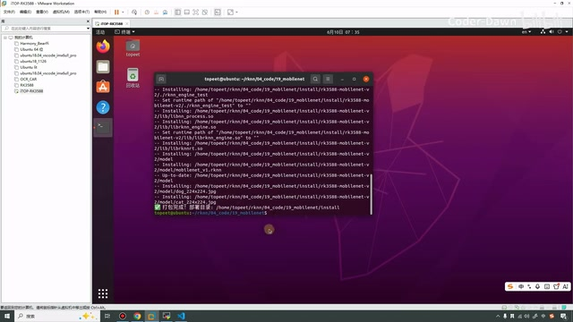

*Ubuntu 终端显示工程编译输出。 · [原片 32:00](https://www.bilibili.com/video/BV11DjT6uEhc/?p=29&t=1920)*

编译完之后就有了 `install` 目录，然后把它传到开发板上就可以了。

在这里我们再输入一下密码，传过来。传过来之后，在开发板这里就拿到了这个目录〔画面为 `rk3588-mobilenet-v2`〕，然后进入它。

同样，现在第一个是可执行文件。其实正常是需要加上这么一步的，可能有的同学也会报错。我在这里随便打开一个吧，做代码测试。我找一个，我记得，对，第一步还是需要导入一下这个库。如果不导，可能会报错。我这里是因为刚才测试的时候已经导过了，所以大家需要加这一步，不然可能找不到库。

〔画面 33:18 起可核对的命令为：〕

```sh
export LD_LIBRARY_PATH=./lib
./rknn_engine_test model/mobilenet_v1.rknn model/dog_224x224.jpg
```

然后接下来再执行，传它里面的模型、它里面的图片。可以看到，相比之前，我们做了一些打印信息。你看，初始化成功了，它的版本是 2.3.2，驱动版本是 0.9.8。

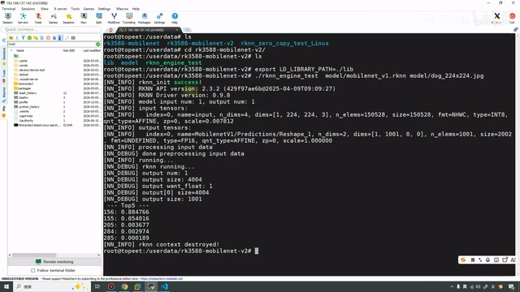

*开发板执行命令与运行日志。 · [原片 33:45](https://www.bilibili.com/video/BV11DjT6uEhc/?p=29&t=2025)*

模型输入是 1。输入 tensor 的名称、维度、形状，还有大小、格式、类型，包括缩放、零点，这些都在这里了，输出的也在这里。然后这里还有一个，下面这里就是处理输入数据，我们的输入数据已经处理完成了，然后开始进行推理。推理之后，输出数据、输出数据的大小，然后是是否 `want_float`，还有它的 size，在这里都已经输出出来。

最终的结果在这里。最后也把 context 的销毁，这些都能看得见。

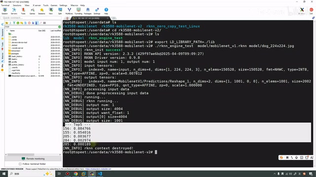

*推理结果和销毁上下文日志。 · [原片 34:50](https://www.bilibili.com/video/BV11DjT6uEhc/?p=29&t=2090)*

〔图中结果逐行显示为 `156: 0.884766`、`155: 0.054016`、`205: 0.003679`、`284: 0.002974`、`285: 0.000189`，随后是 `rknn context destroyed!`。这里保留画面显示的类别编号和分值，不额外添加未在本段讲述的类别解释。〕

通过这种方式，如果哪一步出错了，或者哪里的数据不对，我们的日志看上去也更清晰，也更容易调试。

讲到这里，这节课也就已经全部讲完了。最后也是感谢大家的观看，谢谢大家。
