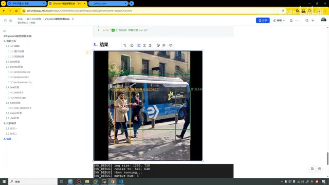
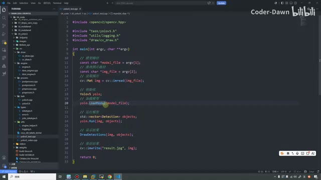
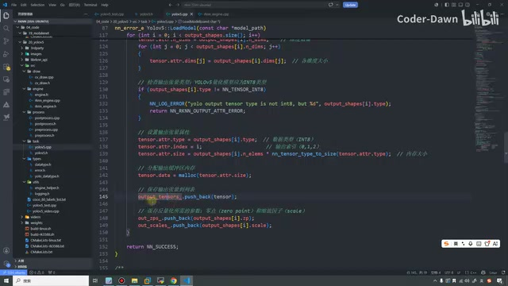
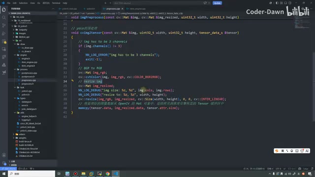
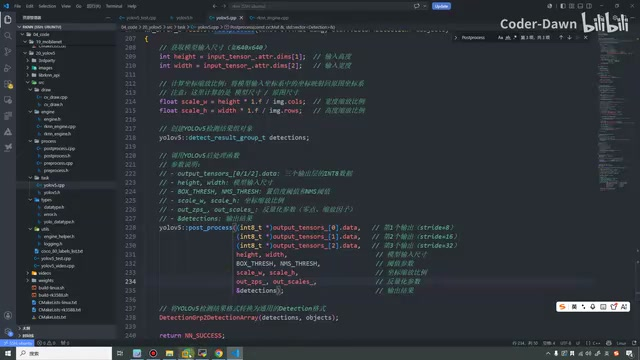
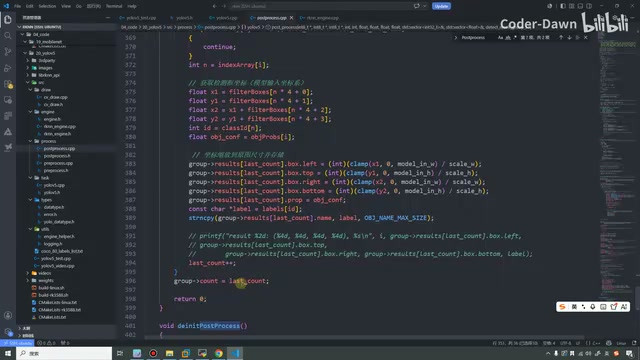
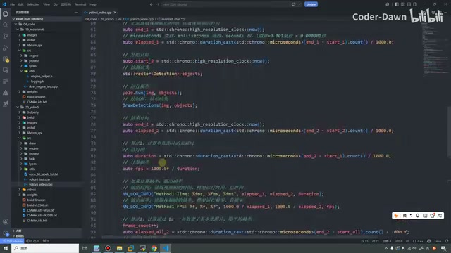
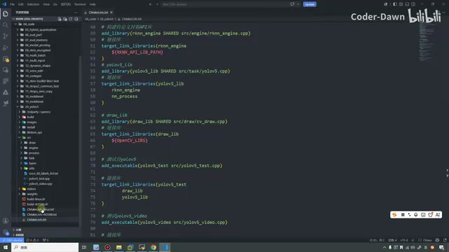
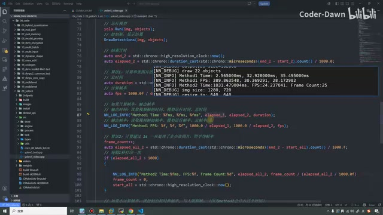
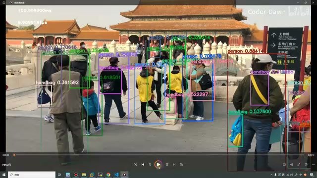

# 29｜YOLOv5模型部署实战

> P30 · 忠实整理讲稿 · 完整范围 00:00—49:39 · [原视频](https://www.bilibili.com/video/BV11DjT6uEhc/?p=30)
> 保留原讲述顺序、解释、操作、示例、重复强调与口述限定。源视频为640×360；不清楚的代码字符不补写。原始冻结转写随交付保留。

## 00:00 课程安排与结果预览

这节课我们来看第29讲，YOLO V5模型部署实战，那在上节课的话，我们已经讲过了，MobileNet的一个模型封装了，那从这节课开始，我们就正式的到YOLO系列的，一个模型部署，因为大家知道我们现在YOLO，是非常非常火的，然后在公司中，其实我们使用，也是YOLO V5，还有YOLO V8，这两个是使用的最多的，然后的话就是像YOLO V3，YOLO V11，用的也是比较多的。

所以说很有必要，带着大家看一下YOLO系列的模型，到底是怎么部署的，那它的话和前面的MobileNet，还是会有一些差别的。首先的话MobileNet的话，它比较早了，然后它整体还是比较简单的，我们YOLO系列就会稍微复杂一些，而且重要的是它很常用，所以我们就会带着大家去看，然后这节课的话，我们主要有三个部分，那第一个部分的话是源码分析，第二个是代码编译。

那其中代码编译的话会有两部分，那第一个是进行，交叉编译，就是在虚拟机上面进行一个编译，那第二个种方式的话，就是在我们开发板上面，直接进行一个编译，那这两种方式都是可以的，然后在这里会介绍两种方式，也是有一些特别原因的，那一会在代码里面再说吧，那第三个是结果，上面这个是图片检测的一个结果，下面这个是视频检测它的一个结果，那我们先这样吧。

我们先看一眼这个结果，大家留有一个印象，就是像我们的这个图片，我们可以看到就是画了一个框，在框上面贴了一个字，一个是类别，一个是它的一个，就是它的一个这个值，像这是0.76，0.79，0.82。

## 02:00 视频推理结果与模型输入输出

就是它的一个值，那下面这里是它的一个视频推理，那视频推理，可以看到原本的尺寸，resize之后的尺寸，然后开始推理了，然后一共有三个输出，然后每个输出分别是什么，然后检测，画了21个，这个对象，画了21个框，然后这里也是它的性能，它的一些推理的一些时间帧率，等等。好，那这样，大家先对这个有一个印象，有了印象之后，我们在看代码的时候，那我们也会更好理解一些。

那看完这个之后，在这里我也先带着大家，来处理我们的这个，YOLO V5的RKNN的模型，可以看到，它是有一个输入，一个input，然后有三个输出。好，这个三个输出可以看到，就是，1乘2，255，然后是20乘20，40乘40，80乘80，什么意思呢，它们就是分别用来检测，大目标，小目标，和中目标的。好，然后这个，点进去，就是我们YOLO V5，它的一个具体的一个结构，当然这个也都是已经调整和修改过后的一个结构。

那原版的它还是稍微有一些差异的。好，看完这个之后，我们就打开VS Code，我把它先全部关闭掉，然后我们这节课的代码是这个20，YOLO V5这个目录，我们先整体看目录，你看，上面是第三方库，然后这里存放着我们要推理的图片，这个是我们RKNN的API，这个是我们核心的代码文件，这个videos目录里面存放的是我们的视频文件，weights里面放的是我们的权重文件，就是这个YOLO V5。

然后下面这里有两个，刚才我也说了，我们这节课的话，我们会有两种编译方式，一种是交叉编译，一种是开发板上面编译。

> 整理注：“1乘2，255”一处转写断裂；此处讲述输出张量维度，保留255、20×20、40×40、80×80等明确数值，不拼造完整形状。

*课程先展示图片目标检测结果：框、类别和分数。 · [原片 02:00](https://www.bilibili.com/video/BV11DjT6uEhc/?p=30&t=120)*

## 04:01 两种编译方式与工程目录

那上面这个build-links就对应着交叉编译，build-rk3588就对应着在开发板上面直接进行编译，那下面这个CMake也是一样的道理，一个是在开发板上面的，一个是在虚拟机里面的，那这个是我们真正要的，只不过在这里我创建好了两个文件，就为了方便把这个代码可以直接复制过来，就这么个含义。好，好那知道这个之后，我想想那接下来的话。

我们就来看我们src，我们也回忆一下上节课，MobileNet，我们也打开src，可以看到上节课是四个目录加一个文件，那我们这节课的话是一、二、三、四，我们是六个目录加三个文件，稍微有一些差异，好我们先把上节课折叠，然后我们来一个一个看，一个不一样的地方，是这里我们新增了一个draw，这样的一个目录，刚才不是带着大家看这个结果了，我们不是会画框吗，包括我们视频。

我们也会画框，那所以说我们画框，我们把这个功能单独的封装了起来，就创建了这么一个目录，它主要就实现了就是在这个图像上绘制，我们目标检测结果的一个东西，好那这个这个引擎和我们上节课是一模一样的，啊里面的代码都没有改，里面的代码，应该是一模一样的啊，就是一个通用的引擎，然后我们RKNN去重写它里面的一个函数啊，变成我们RKNN的引擎。

好那这个目录的话，也是和之前一样，就是一个是我们的预处理，一个是我们的后处理，只不过这次我们在做后处理的时候，我们就可能会有不一样的操作了，你想一想我们这个YOLO系列，我们不是要画框吗，要写字什么什么玩意儿的。

> 整理注：脚本名的转写为“build-links”；结合两种编译用途可确认是交叉编译脚本，但不据此补写完整命令。

## 06:02 绘图、任务封装与检测数据类型

那这个就和前面的MobileNet，就会稍微的有一些差异了，好那这个task啥意思呢，task它不是哎，它的翻译的话叫做任务，那具体的含义是啥，那这里面的操作，它代表的是我们一些通用的预处理和后处理，那我们这节课我们的代码工程是YOLOv5，所以在这里我们，再进行了一层封装，就是我们把YOLOv5的操作，我们放到这里面，其实也很简单，就是加载模型，运行模型。

然后，里面还有图像的预处理推理和后处理，其实图像的预处理推理和后处理，就包含在运行模型里面。好，那这个目录的话，同样是我们的task，那这两个目录和我们之前是一样的，然后这里我们多了一个yolo的一个，这个，这样的一个数据类型，我们顺便我们就看一下，这个文件很简单，那第一个的话就是我们画框嘛，像有x，x y w h，这是我们的坐标。

然后我们的类别，然后我们的分数，然后下面就是这些的就是把，这些呃类别，像我们的类别，然后我们的名称，我们的置信度，然后我们的颜色，然后我们的这个矩形框，就放在这个结构里面，好那再下面的话是我们的utils，就是我们的这个工具函数，一个是日志，还有一个是做一些最通用的啊，这个也和之前一样，我们也带着大家复习一下，你看这里是加载模型，然后这里是打印。

然后这里就是一些数据，类型的一些互相之间的一些转换，在上节课我们也都已经看过了，好，那再到下面这个目录的话就是我们YOLO系列。

## 08:02 工具函数、类别与图片检测入口

检测，目标检测的话有80个类别啊，那这里就是他具体的类别啊，然后这个是我们，图片检测的一个入口文件，这个是我们视频检测的入口文件。好，把这些目录全部看完之后，我们都已经看了半天了，看不看完之后那接下来我们就来分析一下。首先我们来看这个图片检测的，一眼看上去大家都能体会得到，啊我们这个实在是相比上节课来讲我们的代码啊也非常的简洁啊，你看，前两个不用再说了啊就是我们的模型路径。

然后我们的图片推理的路径啊非常简单，那这里我们就加载出来一个图片啊我们要一个image，然后有了image之后，然后我们把这个yolo，这里是要注意啊，这个YOLOv5不是官方的YOLOv5，是我们自己在这里定义的，就是我们自己进行封装的，啊我们把它进行一个初始化，初始化完成之后，我们就开始加载模型，那加载模型的过程中，我们顺便就把它的输入输出都已经设置好了。

那设置好了之后，那我们就开始进行一个执行，所以我们就运行模型，运行完之后，那我们就有了这个结果，有了结果之后，我们最终再把结果保存下来，写在写到这个result.jpg这个文件。好，那这个的话就是我们整体的流程，可以看到，我们进行这样封装之后，那我们的流程会非常的简单，然后如果某一天，那我们想要去换一个模型，比如说我们现在想要换个YOLOv8。

那我们是不是继续把这个加载函数，从这跳进去，然后我们把我们的模型文件换一换，那就可以了，或者里面说不定有一些逻辑，需要修改的，就改一下就可以了，那这样的话就会非常的一个方便。

*图片检测入口：加载模型、运行模型、绘制和保存结果。 · [原片 10:00](https://www.bilibili.com/video/BV11DjT6uEhc/?p=30&t=600)*

## 10:04 模型封装的流程与加载函数

那接下来我们就具体来看一下，每个部分的代码。首先的话我们来看YOLOv5，那这里的话也和大家提前说一下，我们在看代码的时候，主要看的是它的流程，它的框架，它的思想，不会去纠结每一行代码是怎么写的，那现在都是AI时代嘛，你让AI，都能帮你写，只要你有比较清楚的思路和这个框架，啊写代码其实是最简单的事情。好，看完这个之后我们就来，看完这个之后我们就来都过来看一看。

我们到这个YOLOv5的头文件里面，我们看一下，上面的话是构造函数，构造函数，下面就是定义一些数据，然后这里核心的就是有这么几个函数，那第一个是加载模型啊，第二个是运行模型，那其中运行模型的时候，我们就是做了这么三件事，在图像的预处理，图像的推理，图像的推理，图像的推理，还有图像的后处理，那这个的话都在运行模型，这一个部，这个部署里面要一起做了。

那这里对应的也就是我们的加载模型，还有我们的运行模型，对应的就是这两步，好那我们直接来看一下，怎么加载模型的，好那加载模型，做过来之后，就是我们YOLOv5 cpp 文件，那在这里，我们看一下，就只需要传入一个参数，就是我们的，模型的一个路径就可以了，然后在里面，我们调用的是，我们封装好的这个引擎，我们调用这个引擎去进行，这个模型的一个加载的。

那这个的话，也带着大家再看一眼吧，其实我觉得这个大家应该也都，有印象的啊，就是在里面啊，加载模型嘛，然后加载完模型之后，我们进行一个，初始化，那加载模型其实就是，在这里的话。

> 整理注：“现在都是a时代码，呃你让a”按上下文整理为AI时代、让AI写代码。

## 12:05 引擎初始化与输入输出张量

他还调用了一个f open，啊就是去读写的一个操作嘛，这个其实上节课我们看过呢，好在这里我就快速的瞅一眼就行，就加载完模型之后，那我们就对用这个RKNN系列的这些，我们对他进行一个初始化，初始化之后，我们重要的就是拿到这个有价值的这个RKNN的，context，上下文，然后我们就可以进行RKNN的query，然后查询它的信息，像版本信息，输入输出的个数啊。

然后我们保存我们呃输入，然后上面是我们输入输出还有一个总的，下面的话是拿到我们的输入的，然后再拿到我们输出的，那这个的话就是我们加载模型这个步骤去做的事情，然后这一块的逻辑和我们之前也都是一样的，好那所以在这里很快就带着大家看完了，那加载完模型之后，那我们就可以就获取呃，输入张量的这个形状进行，那这个呃获取到这个张量信息之后。

我们刚才也看了，我们的这个YOLOv5，一个是一个输入三个输出的，那也在这里啊他进行了一下判断，他们是不是只有一个呃，一个输入如果是一个输入，那就进行下面的代码，那下面的代码就是将我们输入张量的属性，转换成我们opencv，所需要的这个格式，然后我们分配一下内存，然后我们再去获取一下输出的啊，然后我们输出的话，因为有三个输出。

所以我们会有一个for循环，在for循环里面进行一个操作啊，就是把我们输出的这些内容啊，就找到然后进行，先复制复制，先分配内存的进行一个分配内存，那最终的话我们也是把它放到我们这个啊，vector容器啊，就是一个动态数组里面去，那这个的话就是我们加载模型。

*加载模型时设置输出张量属性、分配内存并保存量化参数。 · [原片 14:00](https://www.bilibili.com/video/BV11DjT6uEhc/?p=30&t=840)*

## 14:05 运行模型与图像预处理

他的一个流程，好那模型加载完了之后，那我们接下来，就可以进行一个运行了，好那我们在这里我们也跳过来，可以看到在模型运行里面啊，他也是调用了三个函数，那第一个是我们的预处理，第二个是推理，第三个是后处理，那也对应的就是这里的三个文件，好我们直接来，看一下，好我们直接也可以跳过来，这里应该，哦好像我忘了那个go，back和那个那个go的快捷键了啊，我再找一下。

好好那那一会不行，那一会不行我就在这一点啊，免得跳太快大家有点看不清楚，好那我们来看就是运行模型的时候，有三个步骤，预处理推理和后处理，我们跳到预处理这里，那预处理这里，他又掉了一个函数，那这个函数的话，他有三个参数，一个是输入图像，目标的，有四个参数啊，就是目标的宽度目标的高度，还有输出的一个tensor，那这个函数在哪呢，就在我们，这个预处理里面，啊就是他。

那这个的话，就专门针对的是我们yolo的这个预处理，也是非常的简单，首先就判断它是不是三通道了，如果它是三通道的，我们再来进行啊，BGR到RGB的改，转换，然后还有一个resize啊，尺寸的一个大小，最后的话，我们把这个处理好的图像，和open cv的格式，转换成我们推理所需要的这个，tensor的这个格式，那这个这个的话，就是我们的一个预处理，在这里。

*预处理代码：检查三通道，BGR 转 RGB，缩放后复制到张量。 · [原片 15:45](https://www.bilibili.com/video/BV11DjT6uEhc/?p=30&t=945)*

## 16:05 推理接口与引擎执行

再点一下返回，好就跳回来了，我再点一下返回，好那这个的话就是预处理，就是预处理和之前都一样，就是额很简单，只不过这里多加了一步，就转换成我们这个引擎，所需要的这个tensor的格式。那接下来我们看一下这个推理，这个vscode总是这样，对有时候莫名其妙的就，就跳不过去了，好那我就直接搜索，然后跳过来，那这个是我们推理的代码，那推理代码也很简单。

那第一个就是把我们的，输入的这个，这个内容啊，就放到这个intensor，这个，这个张量里面去，然后我们直接就运行，这个模型的这个推理，然后一个是输入一个是输出，然后这个是是否是异步的，好那这个推理，我再跳过来，好那这里总是莫名其妙的有点跳不动，那跳不动的话，那我就手动的带给大家来看一下，那这个run函数的话，其实和之前一样，就，就是在刚才，在那个加载模型的时候。

我们就已经设置好了输入和输出，所以在我们进行推理的时候，我们先判断一下，他的输入输出，他的这个，这个数量是否是匹配的，如果匹配的话，那我们就开始进行进入我们的主流程，那我们就是设置我们的输入，那是这个输入设置完了之后，那我们就调用这个run，调用这个run就是进行真正的一个推理，推理结束之后，那我们就，要用这个output，我们就获取这个输出，当这个输出，我获取完了之后。

那我们这个流程也就总完了。

## 18:07 三个输出与后处理入口

那只不过因为我们的一个输出的话，那有三个输出图。所以说在这里，我们是通过一个for循环，包括上面也是，通过一个for循环来进行一个操作的，然后包括在这里个里面的话，他也问我问了我们，我们是，看我们有没有设置这个量化的一个类型，如果设置了他就，他就量化，没设置他就不量化，那这里的话也没啥，就是帮我们的这个格式，进行了一下转换，那这个的话就是我们的推理的一个，就是这么一个功能。

那接下来我们就看这个后处理，后处理的话，其实也是我们，整个流程中最复杂的，那我们来到，看一下通过吗，好在这里，那后处理的话我们看一下就是这个函数，两个参数，那第一个参数的话是原始的数目走向〔原识别，第一参数的口述名称不清〕，然后第二个参数的话就是我们输出，检测到的一个物质〔原识别，具体用词不清〕的一个列表，那在里面的话我们先获取，这个模型的，这个模型的，这个模型的，这个模型的，这个，这个模型的，一个尺寸，包括他输入的这个，还有这个wise。

然后我们进行一个缩放，就是一个缩放，缩放完了之后，我们创建一个检测的结果组的一个对象，然后在他的里面我们进，进，要进行一个处理，然后处理的时候，因为我们三个输出，所以我们要分别进行一个处理，然后我们，要传入这个输入的尺寸，然后我们的一个阈值，!哎，那在这里，大家来看一下这个阈值是什么意思，就是说，我们再进行，我打开他，再打开他，可以看到就是这幅图，是我们想要的一个效果。

> 整理注：这段源转写在“模型的尺寸”处有连续重复与停顿，保留了尺寸、缩放和三个输出的讲述；具体 width 一词识别不完整。

*后处理调用中传入三个输出、输入尺寸、阈值、缩放比例和量化参数。 · [原片 20:00](https://www.bilibili.com/video/BV11DjT6uEhc/?p=30&t=1200)*

## 20:07 NMS 去重和置信度阈值

就是我们这个人的框，就正正好好，放到了这个人，然后这个人的框正好框到了他，但是，我们实际上，我们这个模型在处理的时候，他有可能是这样的，就除了，现在下面要黄色的这个框之外，他可能还有这个框，然后他觉得，这里也有人，他这里可能还有个框，他这里可能还有一个框，他可能会有很多的一个框，但这些框，特别多之后，他其实是很乱的，不利于我们真正的去分析这个结果。

所以这个时候，我们就是，要通过这个，LU，这个NMS，我们去，进行一些计算，把这些没有的这些框，都给删掉，那删掉之后，那我们就有了，最终这个效果比较好的这个框，那这个数据哎，他怎么来设置呢，就是通过这两个，啊一个是NMS的啊，一个是我们的这个准确率的，那NMS的话，它的目的啊就是，做这个，就是画这个框嘛，去重的，然后这个准确率是什么意思呢，也就是我们的也叫置信度啊，就是你看这里其实还有铁杖〔原识别，所指不清〕，这里还有交通灯，但他并没有给交通灯也画框，为啥呢就是假设我们设置只有这个嗯，置信度45%以上我们才显示。

那可能他的一个值可能是百分之百分之三十，他觉得百分之三十的可能性，他是一个交通灯，但是我们设置了只有45%以上才显示，所以也就没有给他画框，他也就没有进行一个显示，那这是这两个值的作用，那这两个值也是定义在文件的最开始，他定义在这个文件吧，好那他，应该哦他那他定义的定义到的是我们后处理。

> 整理注：源转写“铁杖”所指对象不清，按原词标注；保留其与交通灯置信度阈值示例的关系。

## 22:10 后处理主流程与结果格式转换

这个文件的最开始我们，回过去再看啊。好，刚才，到哪去了啊就这里，好那这两个的话就是我们，坐标缩放的一个比例，然后下面是我们量化的，一个参数，那最后是输出的一个结果，那，将这个处理啊，做完之后，那我们就需要将YOLO，检测到的一个结果，转换成我们通用的一个结果的一个格式，那我们就会去调用这个函数，那我们先来看一下上面这个处理的这个函数，这个，也在这个文件里面。

我们来跳一下。好，跳一下，那在这里和刚才一样啊，就是有很多的这个参数，然后，在这里的话，我们要对标签进行一下初始化，然后我们对这个结果组把它的内存进行一下清空，然后我们存储一下检测框，置信度，还有我们类别啊，有三个vector容器，进行一个存储，然后在这里就分别对我们的不同尺寸的一个模式，进行一个处理，所以看到这里就是，获取一下变量，这个缩放。

然后我们可以把它们内存进行一下清空，然后我们存储一下，检测框，置信度，还有我们类别啊，有三个vector容器，进行一个存储，然后在这里就分别对我们的不同尺寸的一个目标，进行一个处理，所以看到这里其实就是，获取一下变量，进行一下，这个缩放，根据不同的大小进行一下缩放，缩放完了之后进行一个处理。好，那这个处理我们待会再看，我们先看主流程。

那嗯，这个处理完了之后，那我们就按照，置信度进行一个排序，那置信度排完之后，我们再对每个类别，进行一下NMS的一个处理，那我们最终再把所有的结果，进行一个整合，那整合完之后，我们就拿到了我们想要的一个结果了，那这个是他的一个核心流程，然后下面这个代码其实都很简单，我就不在这里不在带着大家看了，其实就是呃。

> 整理注：原转写在本段重复了清空内存、存储三个vector和不同尺度处理的解释；这里保留这次重复强调。

*后处理将框坐标、类别和置信度整理到结果结构中。 · [原片 24:00](https://www.bilibili.com/video/BV11DjT6uEhc/?p=30&t=1440)*

## 24:11 处理输出层与绘制检测结果

存放一下结果嘛，整理一下最终结果，那这里比较重要的就是还有一个，process，就是一个处理的一个函数，那这里的话就是处理三个输出层的一个检测结果，返回的是我们有效的检测框的一个数量，我们来看他里面具体做的事情，就是我们遍历的这个三个这个头，然后再里面我们继续进行一个遍历，那我们获取他的一个置信度，然后在这里我们其实也没什么特别的啊，就是递交了这个SINGEMOGA〔原识别，名称待核〕，他的一个处理。

然后我们就拿到了这XYWH中心点的一个坐标，好然后我们再去对他啊进行一个呃，就是对这个类别我们也进行一个计算，然后包括这里那我们有几个这个这个类，我们就遍历多少次，好那下面这里也是啊这里都是一样的，那这这些做完之后我们最后就算一下，我们到底有多少个检测框，然后把这个结果返回回去就可以了，那其实整个逻辑的话是非常清晰的。

那具体每一行的代码，那这个的话就大家就就怎么样就直接就，就大家自己看看啊就可以了，好那这个就是我们的一个处理，好我想一下那讲到这里的话，其实我们就已经讲完了，我们到这里我们就已经讲完了模型的初始化，那初始化的话呃，应该就是加载了一个模型，把输入输出进行了一个设置，然后这里进行运行模型，它就是前处理，推理和后处理，我们也已经看完了。

所以到最后一步了，倒数第二步吧就是显示这个结果，但是结果的话我们也跳过来，那这个的话就是我们显示结果的这个。

> 整理注：处理函数名按画面和后文写作process；其后“ SINGEMOGA ”疑指某激活函数，不能仅凭低清画面确认具体调用，保留原识别并标注。

## 26:12 绘图保存与首次编译

函数，那它的功能的话就是在图像上，绘制我们的目标检测结果，然后这个，image的话就是我们输入输出的一个原始的一个图像，然后这个的话就是我们检测到一个目标，目标的一个列表，然后我们对这个列表进行一个遍历啊，然后我们绘制这个矩形框，然后在矩形框的上面也写上这个文字，然后我们默认的话保留的是六位的一个小数，就这么一个简单的一个操作。

那最后的话就是保存我们的结果，保存到result.jpg，保存到这个上面，好那这样的话我们就已经看完了，所有的一个流程了，那呃看完所有流程之后，那我们接下来要做的就是把这个代码，把这个代码就是编译一下，直接在开发板上进行一个测试。好，那我们进入终端，然后我们到我们20的这个目录下，然后，就是他啊这个，我们执行一下这个，哦，他说他没有找到我们的一个交叉工具链。

那我们就先设置一下，设，但是我再看一眼，我们就从调调，直接挑一个，我们把它复制过来，哦。

## 28:13 切换 CMake 配置并传送到开发板

哦原来是这个问题啊，就是，现在的这个CMake应该是，是我们下面这个，我们把上面这个，就是Ubuntu的，复制过来，这里我记得也是应该不需要再去设置这个了，因为我，现在在这个，脚本里面也都已经，写过了，你看在这里也写过了，所以正常应该也是不需要设置，那我们现在再来重新执行，好可以看到那他现在就在编译了。好，我们查看一下编译完了之后，他就会有一个install目录。

我们查看一下，编译完了之后，他就会有一个install目录，我们同样的把这个install目录，我们先看一下，这个install目录下，他的名称叫做RK3588YOLOv5，我们把这个传送到开发板上面去，然后在install目录下面叫做，ok，然后开发板，然后我们，输入开发板的信息，好 我们等待一会，好 那这样的话就已经，传到板子上了，传在板子上。

好 我们现在就只有这么一个，内容了 就是我们3588，然后我们进入它，进入它之后我们就可以开始执行一下了，然后我们YOLOv5，然后模型里面的话，就是我们的YOLO模型，然后他里面有我们的图片，好 那这里的话，他是意思我们没有找到这个库，所以说我们，还是在这里吧。

## 30:13 库路径、图片测试与视频入口

从这里复制吧，就是我们需要先设置一下这个库，然后我们再来进行一个，执行，好 可以看到我们就已经执行成功了，执行成功之后，好 这里已经没有这个目录了，我们重新进一下，好 我们就有了这个result，可以看到他就是我们刚刚生成的，或者我把它删掉，我把它直接删掉，删掉之后我们再重新执行一下，我们在这里刷新一下，可以看到他就拿到了这个结果，继续到他。

我们打开他看一下，可以看到，那这个的话就是我们，最终检测到的一个结果，然后其实每次检测，它的这个颜色也都会发生一些变化，我们刷新一下，好 可以看到，好 可以看到，这次这个框的颜色就和刚才，就已经是不一样的了，好 那这样的话也就证明，我们这个工程是没有问题的，我们代码，这是ok的，好 那这个的话就是我们，这个图片检测的这个，一个，代码了。

那接下来的话我们就，来看一下我们的这个视频检测，那视频检测的话，其实也是同样也是非常简单的，我们，其实这个代码非要说的话，我们，他也是有再封装的一个空间呢，只不过在这里的话，我们就，没有再进行一个封装了，因为他本身也比较简单了，我们直接来看一下，前两个参数是一样的，那这里加了一个参数，就是我们是否。

*视频检测代码中的计时、模型运行和绘制结果。 · [原片 32:00](https://www.bilibili.com/video/BV11DjT6uEhc/?p=30&t=1920)*

## 32:13 读取视频、录制选项与逐帧计时

要录制这个图像，绘制这个文字，如果说我们这个参数设置了，那我们就去录录像，我们就去绘制文字，不然的话我们就不录像，也就不绘制了，好 那第一步的话，我们读取视频，我们同样采用的是opencv，然后就，使用他，就定义了一个videocapture，然后用他去，拿到这个路径，就是这个视频，就是这个视频，输入视频的这个路径就可以了，如果打开失败，就输出一些信息。

那如果打开成功的话，我们就获取他的，他的尺寸，他的帧率，就获取他的信息，那这些的话，都是opencv，的一些API，然后最终进行一个打印，那，接下来的话，这里的，我们可以对比一下，上面这个操作，其实就和他一样，就是为了拿到这个图片嘛，拿到他之后，那我们就初始化，YOLOv5的模型，然后我们去加载模型，然后我们定义一个，anvg〔标识符不清〕，定义一个wt〔标识符不清〕。

然后我们就判断，我们是不是需要写入，如果他是真的话，那我们就把，视频写进来，写到这个result.mp4里面，然后他的格式是这个，他的尺寸是这个。好，然后下面的话，就是，这个就是统计时间相关的，还有这个帧率，然后我们while true，在这个while循环里面，我们就不停的，进行一个，测试，就一直进行一个检测，那我们开始计时，start1。

然后我们拿取到这个时间，然后我们读取视频帧，然后我们，读取完视频帧之后，那我们就进行一个end1，就是，这里的话，我们就是记录，读取视频帧的一个时间，就是，你看这里，是我们读取视频帧，在他开始的时候，我们有一个时间。

> 整理注：“anvg”“wt”两个局部标识符识别不清；按原识别标注，不补写声明代码。

## 34:13 两种耗时和帧率计算方式

在他结束之后，我们有一个时间，所以，透过这两个参数，我们就能算出来，我们读取这个视频帧，花了多长的一个时间，然后那具体计算的话，就是下面这里，就他们两个一减，然后再除个1000，那这个就是，第一个值，就是我们，读取，视频帧的一个时间，然后接下来的话，我们接着计时，我们这次计时，然后我们记录的是这个，检测结果的时间。所以说在这里，我们运行到这个模型，绘制了检测结果，当绘制完之后。

我们再统计一个时间，同样的就是时间相减，所以以前，我们就可以把这个，运行的这个时间，也记录下来，好。所以说，下面就有了这个算法1，或者就是方法1，就我们计算，单张图片的总的一个，耗时的一个时间，然后我们使用这个，我们封装好的这个日志，进行一个输出，你看这个，EP1的话，就是我们读取视频帧的时间，这个是模型运行的时间，这个是总时间，那下面这个的话就是视频，读取视频，一个帧率。

然后还有这个模型，这里是这样算的，就是，读取视频帧的一个帧率，模型运行的一个帧率，还有一个，一个真实的一个帧率。好，那这是上面的一种统计，然后下面的一个统计就是，如果我们超过一秒了，就是一秒的话，我们能处理多少张图片，我们的平均帧率是多少，可以，在这里，我们就再来计算一下，就是每个一秒，就是因为它为什么不是等于一秒，就是有可能它会一点零零几秒，就不是一个整数。

所以就是我们一旦，它处理完之后，只要大于一秒，就是隔个一秒一点几秒。

## 36:15 视频代码与开发板编译的原因

我们就，计算一下，计算方法，上面也是一样的，就是这里，那最后这里的话，就是如果不计算帧率〔原识别，此处条件口述不清，保留“不”字待核〕，那我们就会，从总到〔原识别，连接词不清〕耗时和帧率，写入我们的一个视频帧，就是这里就是写内容嘛，那总结这个的话，就是我们视频的一个文件，其实代码很简单，这里有很多，而且代码都是辅助代码，只是为了计算这个耗时时间而去做的，就是，也没什么特别的，流程的话还是，去，初始化这个Yolo，V5的这个模型。

然后去运行模型，绘制这个框，然后统计结果，就还是这么个流程，好。那接下来的话，我们就把这个代码，也去在我们的开发板上测试一下，运行一下，然后这里需要注意的是什么，就是我们这个，我把上面先折叠，我们这个视频的这个代码，在我们的这个，在我们的这个虚拟机上面进行交叉编译的时候，他是编译不成功的，为什么呢，就是因为他里面有这个第三方库，然后这个第三方库，就很老的一个了。

然后这个老的这个库里面，他就没有这些，这些视频操作的这些，相关的这个open cv 的操作。所以说，如果他去进行这个视频的这个啊，他就会出错。所以说，我们直接就在开发板上面进行一个编译，那开发板上面，我们想要这个open cv 的库，我们直接啊，pip install就可以了，然后在这里，我也是直接把这个3588，定义啊，也复制到这个CMake里面了。

那接下来的话，我们就是，我想一下怎么做，就我们把这个文件，我们把这个目录传送到，开发板上面去。

> 整理注：讲者这里口述“pip install”用于取得OpenCV；保留原讲述，不将其改写成已经核验的C++安装命令。

*开发板编译所用的 CMake 文件中配置各个库和可执行目标。 · [原片 38:00](https://www.bilibili.com/video/BV11DjT6uEhc/?p=30&t=2280)*

## 38:15 传送工程并在板上执行编译

我看一下怎么传，我们直接把20，把这整个工程都传到开发板上面，然后我们在开发板上面进行一个编译，这次传的时候，我可能就会稍微慢一点，反正我们也是稍微等一下就行，然后先将它清空一下，我们看一下传完没，哦，现在已经传完了，对，那传完之后，我们就进入这个20，进入这个目录下，然后在这里，我们就是给它一个权限，可执行的一个权限，我们就的到，它可以3588〔原识别，此处操作及脚本名口述不清〕。

那接下来我们就来执行它，啊 好，那在这里，我还是觉得就这样吧，我们还是先把这个虚拟环境，退回去，虽然可能也能成功，但是还是最好把它给去掉，然后在板子上编译的话速度就会，稍微慢一点点，也还行，还行，那我们编译完之后，那我们这次我们的内容就在这个build上面，我们进入build我们瞅一眼，可以看到那这里就是我们的一个可执行文件了，就是它。

那我们接下来我们就来测试一下，就是这两个都是啊，比如说图片的，我们先来测试图片的，然后我们上面也有目录，就是，就是我们需要先，第二个参数是模型，我们找到这个权重，we，然后它下面的yolo，模型，然后我们再拿到图片。

## 40:16 图片复测与视频推理启动

那里面是bus，可以看到依旧可以进行一个推理，然后我们还是先删掉，删掉之后我们重新来，刷新一下，哦，对，那这次的话，它，得到这个图片的话，它就不在这个目录下了，我们得去，还是到这里吧。好，这个，这个，我们是这个目录。好，那我们的图片就在这里了，可以看到它也，就测试成功了，我们也可以把它删掉，把它删掉，然后我们重新来，重新来执行一下，刷新一下，它就出来了。

我们看一下，这是没问题了，哦，这个。好，那，接下来的话，我们就来测试一下视频的，那我还是直接全部重新输吧，视频的话，我们是yolo，v5，然后v0，然后同样第二个参数是我们的权重，下面的yolo模型，然后第三个的话是我们的v6，smo，那它下面有一个这个。好，可以看到那现在的话它就已经开始在进行一个推理了，只不过说我这里，我没有，我的这个板子我没有那个屏幕。

所以不好演示，但是也没关系，我一会直接写到那个文件里面给大家看，那现在的话，它就一直在进行一个推理，如果你不手动暂停的话。

> 整理注：视频文件名局部转写为“v6，smo”，无法从本段可靠还原文件名，不补写完整运行命令。

## 42:17 三组输出、检测框与性能日志

它就会直到你这个视频放完，它就会停止，那我们来看一下这些的参数。首先可以上面这个的话和之前一样，就是我们的，RKNN初始化成功了，然后我们的版本，然后我们的输入一个输入三个输出，如果大家有印象的话，应该能想到我们前面那个MobileNet的输出，一个输入一个输出，当在这里的话是一个输入三个输出，然后下面是输入的信息，输出的信息。

那这里的话就是我们推理的时候，它原本的尺寸，然后我们把它，缩放到了640x640，然后进行了RKNN的推理，然后一共有三个输出，然后这是第一个输出的信息，它的大小，它是进行了，输出的信息，它不是float的，这是int 类型的，然后从上面其实也能看得到，就是int 类型，输出的时候，然后，重新到这里啊，就是它的大小，它的类型，然后这个也是它的，就是它的这个输出的这个大小。

然后这是零是第一组的，一是第二组，二的话是第三组，然后这次的话，它画了23个框，然后这个的话，我们一会给大家演示，再演示一下，大家就能看得到了，然后这里也可以看到，就是我们读，就是我们刚才在代码中，我打开这个代码，或者这样，这样，我找一个有二的，有message2的地方，这些都是message1。好，就是这里。好，我们来看一下，message1的打印。

那第一个这个时间，就是它，那它的一个时间，可以看到，在刚才也。

## 44:17 解读单帧和时间段统计结果

上面也说了，就是它是读取，读取的，一个速度。好，然后，第二，第二个参数，到哪去了，第二个参数的话，是我们模型运行的一个，就是它得花的一个时间，第三个的话，是一个总时间，其实就是把这两个，进行，进行一个相加，就读取，我花了2.5，毫秒，推理，模型运行，我花了32毫秒，然后总共，我花了35毫秒，小数我就没算了，然后下面这里是一个帧率，就是，我们的FPS，我们读取的话，它的一个帧率，是389。

所以说，印到这么，就是，就是能走这么快，就是非常非常快，然后这里的话，就是我们的，运行的时候，它的一个，帧率是30，然后这个的话，就是我们平均的一个，就是一个帧率，就是一个，总的一个帧率，然后，下面这个，Message2这里，我们再看一下，在哪，在这。好，这里打印的，就是我们，可以看一下，在这里统计的时候，就是我们，一秒钟，我们一共进行了多少操作，那这里可以看到是，1031毫秒，就是一秒，1.031秒。

然后一秒的话，它处理了24帧，然后它，平均的话，就是，涉及到25帧，就是这是它的一个帧率，我们可以，在这里再看一下别的，我们再找第二秒，下一个Message2的，总之这个的话，可以看到它的一个，时间和帧率的话，大概就这么个样子，可以看到，在这里的话，它又达到了26帧了，就是，就这么个玩意儿。

> 整理注：原讲述把1.031秒、24帧与约25帧交错说明；保留口述数值。截图中另一个时刻显示Frame Count 25、FPS约24.24，二者不替换。

*代码画面中对照展示 Method1、Method2 的终端日志：耗时、帧率与帧数。 · [原片 44:30](https://www.bilibili.com/video/BV11DjT6uEhc/?p=30&t=2670)*

## 46:17 启用录像并播放结果视频

在这里的话，其实也都能看得到，就是，时间。好，那这个的话就是我们视频推理，然后到这里的话，我们再来演示一下，我们再看一下那个具体的视频，就刚才我们这个代码里面，我们，是可以添加，第四个参数的，就是是否录像，那我们在这里的话，录个1，对，就代表我们要录像，然后我们录像的话，我们多录一会儿，我们就把这个视频录完吧，可以录完也可以，可以录完之后，然后我们看一下这个视频，这个视频应该一共一个几十秒吧。

我们稍微等一会儿吧。好，那现在的话就已经录完了，我们看一下，也有了这个result.mp4了，那我们打开它，但它好像有点慢，我看一下，把它下载，下载到我们的，这个桌面，这个速度还行，那桌面我们来看一下，可以看到，这个的话，就是我们刚才来推理的，你看它其实就是一个，20多帧，22，23，左右，有时候能到达24，然后这个视频，也没多长时间，这个的话，就是我们，视频推理的一个结果了，我想一下，还有什么补充的地方吗。

好像也没什么了，然后这里面的话。

*录制结果视频中的行人目标框、类别、置信度和性能文字。 · [原片 48:00](https://www.bilibili.com/video/BV11DjT6uEhc/?p=30&t=2880)*

## 48:18 检测数据结构与课后运行练习

就是具体的代码，我没有带着大家一点一点去看，让大家的话，拿到这个代码，大家去分析一下，然后其实，也就只有这个文件吧，其实也就只有这个文件，没有带着大家一行一行看了，然后，别的其实也都差不多，我们也都已经看完了，没什么，特别的，这里的话是我们的一个，置信度，然后包括我们的，像一些名称了，一些类别了，这些，然后这个是我们，YOLOv5，它的一个，一些属性，都用结构体的形式，在这里定义出来。

那大家下来的话，大家自己，也看一看，就把这个代码，跑一跑，试一试，那我们的话，这节课就讲到这里了，那最后的话，就感谢大家的观看，谢谢大家，[片尾残余转写不清]。

> 验收说明：已逐张查看实际截图并核对全文和本地资源；浏览器file协议被拒绝，本次未执行浏览器桌面/窄屏、图片缩放及链接点击验收，未以其他协议或服务器绕过。
