# P31 · YOLOv26 模型部署：Windows 环境搭建与模型预测分析

> 清理后的忠实讲稿。来源为第 30 讲、视频 P31，范围 00:00–35:16.75；保留讲师现场操作、试错及原顺序。截图原始分辨率为 640×360，细字放大不会恢复细节。局部 ASR 不确定处明确标注，完整原始转写随附。

[回到视频 00:00](https://www.bilibili.com/video/BV11DjT6uEhc/?p=31&t=0)

## 从零到一的部署流程与本节范围

这节课开始，我们来看第 30 讲：YOLOv26 模型部署，从零到一版本。为什么把它叫做从零到一版本呢？眼尖的同学已经看到我们左侧的目录了。我会带着大家从 Windows 上面的环境搭建，到模型预测的测试和分析，到数据集的构建、模型训练、ONNX 模型的导出、RKNN 模型的转换，以及最后 C++ 版本的代码在开发板上面进行推理测试。整个流程都会带着大家去实现。

我们复习一下前面的课程。最开始的时候，我们讲解了好多节课的概念；接下来主要是用 Python 对模型转换、模型的性能进行一些评估和测试。然后带着大家讲了一下通用 C API 和零拷贝 C API，以及模型部署的这些案例。这些过程都是使用人家做好的模型，至少也是别人做好的 ONNX 模型，或者一个中间模型，然后我们接着去做。我们并没有从训练就开始做一套完整的。很多小伙伴可能也对怎么样从零到一做比较好奇，所以我们就来做这个从零到一的过程。

因为步骤比较多，这一讲的内容，我打算用两到三节课的时间来完成。不然时间可能会有一个多小时，一节课的时间太长，其实也有点不利于大家学习。前面几节课的时间也有点长了，因为我不是很擅长用这些剪辑工具，所以有的视频也都是无剪辑的。

[回到视频 02:02](https://www.bilibili.com/video/BV11DjT6uEhc/?p=31&t=122)

所以也就不剪了。这节课我就只完成前面两个部分：在 Windows 上面搭建我们的开发环境，以及对模型预测的命令和内容进行一个简单的分析。说完这些之后，我们就开始来实现。

## Windows 环境与 Miniconda 安装

第一个大步骤叫做 Windows 搭建环境。其实大家在 Ubuntu 或者其他环境也都是可以的，因为 Windows 可能大家使用得更多、也更熟练，我就在 Windows 上面做一个演示。

先来看 1.1，安装 Miniconda。我们打开这个网址，打开之后，这里面就有很多下载的脚本或者说 exe，有很多很多。我们怎么样选择版本呢？其实你选哪个都行，差别都不大。我个人比较喜欢使用 Python 3.8 版本和 Python 3.10 版本，所以一般就会优先下载这两个；在这两个里面，我也会优先下载更旧的 3.8 版本。所以可以直接在这里搜索 Python 38，然后这里面就会有。我们在这里面找一个 Windows 的，点击一下就可以下载了。好，我们等待一下。

下载完之后，可以看到我这里都已经下载好多个了。我们就开始点，一路点。只有这里，我还是建议大家可以换一个目录，比如选到其他盘，最好还是不放 C 盘。选了它之后，因为我这里已经有过了，那我重新点一下。

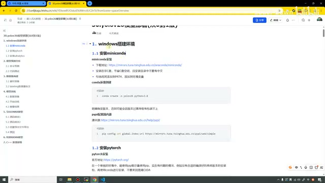

*Windows 环境安装文档与 Miniconda 安装提示 · [原片 02:30](https://www.bilibili.com/video/BV11DjT6uEhc/?p=31&t=150)*

[回到视频 04:02](https://www.bilibili.com/video/BV11DjT6uEhc/?p=31&t=242)

这个我就不点了。大家一直点 Next，下一步就可以了。其中中间有一步，这里会有几个选项，应该是有四个吧。它默认情况下，应该是给第一个和第三个打了勾；中间这个我们也打上勾，它的含义是帮我们自动添加环境变量。大概就是这么一个流程。因为我已经装好了，也就不再演示了，而且我们在前面课程的时候，其实已经装过两次这个环境了，所以在这里不再装了。

我把注意点也写在这里了：尽量安装在非 C 盘，可以节省 C 盘的空间；安装目录中不要出现中文；勾选环境变量，把它添加到 PATH。这样我们随便打开一个终端，就都可以使用了。

## 创建独立的 Conda 环境

装好之后，我们就开始创建所需要的环境。在这里我复制一下，打开一个终端。我先看一下我现在有啥，现在是有这两个，那我就再装一个。这里这个 YOLO26……这个有时候总是复制不上。或者我把这个 26 也不叫了，因为我之前有创建过这个，为了避免它可能有一些冲突，我就直接再放这个。算了，我把文档这里还是这样写上吧。

> 画面中的创建示例是 `conda create -n yolo26 python=3.8`；本次实际演示随后使用名为 `yolo` 的环境。环境命名的临场调整保留在讲述中。

[回到视频 06:04](https://www.bilibili.com/video/BV11DjT6uEhc/?p=31&t=364)

然后我们选择 yes 就行。这个创建的速度还行，挺快的。创建好了之后，我们就使用它，来激活这个环境。现在我们就在这个环境下了，可以看一下，这里面还没什么东西呢。我把窗口稍微放大一点。

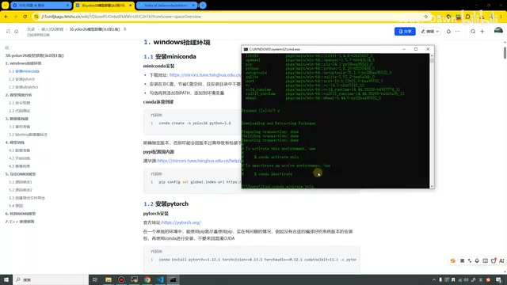

*激活新建环境后的终端 · [原片 06:30](https://www.bilibili.com/video/BV11DjT6uEhc/?p=31&t=390)*

## 配置国内镜像源与选择 PyTorch 安装方式

在安装 PyTorch 之前，我们先设置一下国内的镜像源。我们打开这个目录，这里有一个“设为默认”，通过这两条命令就可以了。我们来执行一下，第一个执行完之后，再执行第二个。好，这样就把国内镜像源设置好了。

设置好之后我们就到 1.2，安装 PyTorch。安装 PyTorch 的话，大家一定需要注意。打开它的官网之后，我们往下滑；在这里我稍微放大一点，就可以去安装了。建议大家还是点安装它的历史版本。打开历史版本之后，可以看到这里有什么 Linux only，从名字也能听得到，就是只支持 Linux。下面这些就支持 Windows，因为上面也写了 Linux and Windows。这里有 CUDA 12.6、12.8、13.0 等等。如果往下面滑……

[回到视频 08:04](https://www.bilibili.com/video/BV11DjT6uEhc/?p=31&t=484)

我滑得狠一点，你看还有 9 点几、10 点几的，就会有很多版本。我们怎么样选择版本呢？这里有一个最方便的方式：打开终端，输入 `nvidia-smi`。我把它放到最大。这里就是看我们显卡的一些信息的。

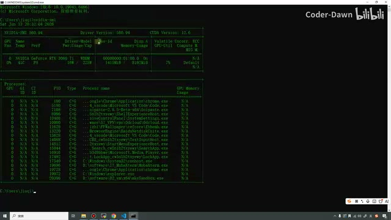

*nvidia-smi 显卡与驱动信息 · [原片 08:30](https://www.bilibili.com/video/BV11DjT6uEhc/?p=31&t=510)*

可以看到，我们的驱动版本是 560.94，CUDA 版本是 12.6，显卡是 3060 Ti，显存是 8G。这就是我电脑的信息，大家也可以打开自己的电脑，看一下自己电脑的信息。在这里我可以说一下，大家打开之后比较常见的可能是 12.6、12.8、13.1，然后可能还有 11.8；再古老的电脑，可能就会更加古老了。

知道这个之后，我们就可以在这里选择版本了。这里需要注意，我们这里写的 12.6，意思就是最高支持 12.6；如果版本低一点，它也是可以兼容的，而且兼容性其实还是特别好的。所以也是建议大家下载比较旧一点的版本。

我在这里下载的是一个特别旧的版本，是 11.3。为什么这么做？我之前使用的是一个笔记本，在笔记本上面去做，那个笔记本就比较老。当时我就下载了这个版本。经过我的测试和调查，这个版本，不管是像我们 11.8……

[回到视频 10:05](https://www.bilibili.com/video/BV11DjT6uEhc/?p=31&t=605)

然后 12.6、12.8、13.1，这个版本都是可以用的。所以在这里我就下载这个版本，也是建议大家跟我保持一样的版本，就是这个 11.3。

还有一点，也给大家看一下：可以看到我这里是 `conda install`。除了 `conda install` 之外，还有一个 `pip install`，这个怎么选？其实这两个都可以。我个人还是习惯用 `conda install`，用这个会多一点。

我复制一下，复制完之后把它关掉，继续到我们的 YOLO 环境。我把它放得稍微大一点，清一下屏，然后输入这条命令，去执行就可以了。

> 画面文档中的安装示例：`conda install pytorch=1.12.1 torchvision=0.13.1 torchaudio=0.12.1 cudatoolkit=11.3 -c pytorch`。

这里安装大家需要注意，这个包其实还是比较大的，会有好几个 G，所以安装的时候会比较慢，会一直卡在这个界面，就是 `Solving environment`。像我的电脑，大概会等待 5 分钟左右。5 分钟之后，这里会有一个 yes 或者 no，然后去安装依赖，会有这样一个过程。如果采用的是 pip 的方式，大家可以实时看到安装的进度条；时间其实也需要好几分钟，都差不多。

因为等的时间比较长，我们也就不浪费这几分钟了，我就点一下暂停。等待了几分钟之后……

[回到视频 12:05](https://www.bilibili.com/video/BV11DjT6uEhc/?p=31&t=725)

我这里终于出现这个界面了。这次等了有 4 分多钟吧。我们输入一下 y，输入之后，它就开始去安装了，我们稍微等一会。这样它已经 done 了，done 之后就证明已经安装好。我们同样可以使用 `pip list` 看一眼，看了之后发现，现在这里就有比较多的包了。

## 安装 Ultralytics：直接安装与源码安装

有了它之后，接下来我们就安装这个。因为我们要去跑 YOLO26，就去安装它。安装它有两种方法，第一个是使用 pip 直接进行；第二种方式是打开它的 GitHub，在这里通过 git，或者下载压缩包的方式。

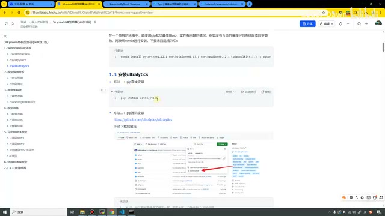

*Ultralytics 安装的两种方式 · [原片 13:00](https://www.bilibili.com/video/BV11DjT6uEhc/?p=31&t=780)*

我在这里直接采用下载压缩包，然后手动解压这种方式，方便我们去修改它的一些代码。我直接打开 E 盘，我已经下载过了。大家就在这里点一下这个，就可以了。下载得还挺快。

下载完之后，我在这里新建一个目录。上面有个 YOLO26，那这次我们就用大写的 YOLO26。嗯，有一个小写的，那我们重新起个名字吧，我们叫个 YOLO26。好。

> 文档展示的直接安装命令是 `pip install ultralytics`；源码入口在画面中为 `github.com/ultralytics/ultralytics`。

[回到视频 14:05](https://www.bilibili.com/video/BV11DjT6uEhc/?p=31&t=845)

然后我们把它放进来，放进来之后进行解压。好，这样就已经解压好了，已经有这个目录了。有了目录之后，我们还需要执行这条命令。

执行这条命令的时候，因为前面大家可能从 GitHub 下载，可能使用了魔法上网；执行这条命令的时候，我们把这个魔法关掉，不然可能会有……［这一句 ASR 尾部不清，不能确认其所说的具体报错。］

知道之后，就在这里打开 cmd，敲下去，然后直接复制这条命令。这两个窗口我们都先留着吧。我把它稍微放大一点。这个复制，我回车……总是按了 Backspace，我的键盘有点不太好用。好的，这个下载速度其实应该还行，稍微等一会。

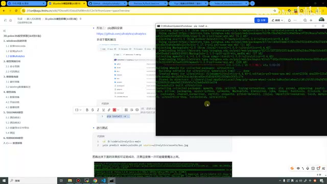

*源码目录内可编辑安装的终端输出 · [原片 15:50](https://www.bilibili.com/video/BV11DjT6uEhc/?p=31&t=950)*

到这里，出现这个 success，下面输出完、出来之后，我们就已经把它也装好了。

> 这里执行的是源码安装命令 `pip install -e .`。这一轮操作接下来发生了环境纠错，讲师随后提醒应该先激活虚拟环境。

[回到视频 16:05](https://www.bilibili.com/video/BV11DjT6uEhc/?p=31&t=965)

到这里，出现这个 success，下面输出完之后，我们就已经把它也装好了。装好之后就进入这个目录，当然在这里我们已经进入了。进入之后，我们需要激活一下环境。

哦，对，刚才我们安装这个的时候，应该也在这个虚拟环境里面进行安装。我在这里激活一下，那我们重新执行一下。这个好像……先试一下，看看可不可以。

## 第一次模型预测与自动下载权重

我们直接使用这条命令。这条命令就是去测试我们的模型，能不能进行检测。

> 画面中的测试命令：`yolo predict model=yolo26n.pt source=ultralytics/assets/bus.jpg`。

这里它先去下载了我们的 YOLO26 模型，这个速度稍微有点慢，我们稍微等一下。因为这已经 50% 多了，也还行，可以看到我们……

[回到视频 18:06](https://www.bilibili.com/video/BV11DjT6uEhc/?p=31&t=1086)

下载完模型之后，检测结果也已经出来了。你看这里，它说检测到了四个人、一辆车，然后花了这么长时间。这个图相信大家应该都很熟悉，就是有几个人，后面有个公交车的那个图。到这里就证明我们的东西都已经装好了。

## 模型预测命令的含义

装好之后，我们来看第二步，模型预测的分析。刚才我们输入了一条命令，就是这条，其实也就是下面这条命令。输入这条命令之后，我们可以再输一次，就对模型进行了检测。因为这节课叫做从零到一版，我都会详细地给大家进行介绍。

首先分析这条命令。它使用的这个东西叫 YOLO，detect 就是目标检测。它的模型是 `yolo26n.pt`。像我们在开发板上，一般就使用 n 模型和 s 模型，一般用这两个比较多。它的资源就是在这个目录下，有一个 bus 的图片。我们在这个目录……好，再新创建一个窗口，打开刚才的文件夹，在我们的 E 盘，叫做 YOLO26。打开它，右边的东西都关掉，就是在这个目录下有一个 assets，里面有一个 bus，就是我们的这个图片。

[回到视频 20:07](https://www.bilibili.com/video/BV11DjT6uEhc/?p=31&t=1207)

当然，这里还有一张。上面这里，我们去检测的就是这张 bus 的图片。这里应该是我当时目录中改了名字，我们把它也改回来，就是 bus。

来分析一下这条命令：`yolo` 就是调用 YOLO 的主程序；`detect` 是指定当前的任务类型，是我们的目标检测；当前的操作是预测，这个是模型，这个是资源图片。可以看到，上面标红的更完整一点，带了 `task`，然后 `mode` 等于它。那这两个参数可以省略，所以使用下面这个就可以了。下面表格里面，我也都写出来了。

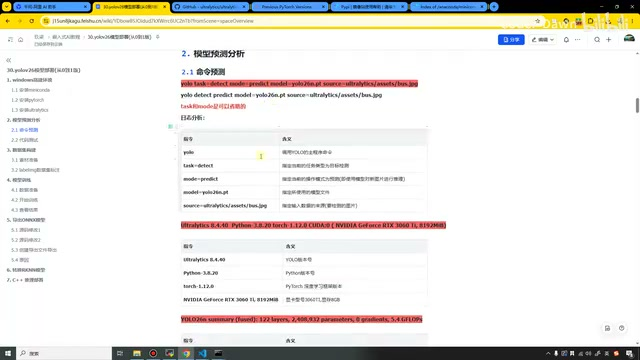

*预测命令与参数说明 · [原片 20:30](https://www.bilibili.com/video/BV11DjT6uEhc/?p=31&t=1230)*

> 画面文档给出的两种写法依次为：
> `yolo task=detect mode=predict model=yolo26n.pt source=ultralytics/assets/bus.jpg`
> `yolo detect predict model=yolo26n.pt source=ultralytics/assets/bus.jpg`

然后在这里，我把它直接这样吧，把它截下来，贴个图。

## 输出日志：先发现运行在 CPU 上

我们来看输出的第一行，就是它。这里可能有点没截全，我再重新截一下。好，看一下这条日志，它代表我们的 YOLO 版本号是 8.4.40，然后 Python 版本是 3.8.8。之前我那里是 20，我在这里也改一下，我们和过程中统一。然后 PyTorch 的版本是 2.4.1，CPU 是这么一个型号。刚才调用的是一个 CPU。

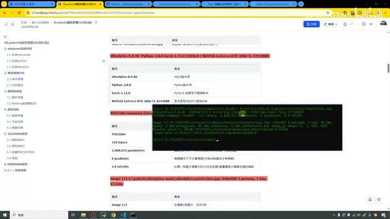

*第一次预测调用 CPU 的日志 · [原片 22:00](https://www.bilibili.com/video/BV11DjT6uEhc/?p=31&t=1320)*

[回到视频 22:09](https://www.bilibili.com/video/BV11DjT6uEhc/?p=31&t=1329)

我再看一下，那可能我们在前面安装它的时候，CUDA 可能安装得稍微有一些问题，或者电脑上面的显卡没识别到。我们再执行一下、再看一下。现在它一直都是这个，我重新打开一下。我们在这里进入 E 盘，这里有个目录，叫做 YOLO26。我没过来。［目录名原转写与定向转写均有误识；结合前后文与终端路径整理为 YOLO26。］

我们在这里复制一下，然后 cd 过来。怎么找不到这个目录呢？我们重新打开一下。先激活我们的环境，在这里重新进行一下，再看一下。这里还是调用我们的 CPU。

哦，但是我大概已经知道这个原因了。可能是因为刚才在装的时候，好像没有在这个虚拟环境里面。

[回到视频 24:10](https://www.bilibili.com/video/BV11DjT6uEhc/?p=31&t=1450)

好像是这样，我也忘了。那我再试一下，把它放大一点，我们直接再装一下，一般来说也是可以的。我们在 yolo 这个虚拟环境下面。它说 already。然后我们再来安装一下它。

安装完之后，再进行一下推理。这里它提示我们的这个东西，这个我之前也遇到过，其实就是版本不太对。我在这里也是把它修改一下，先把它卸掉，然后重新装一下，再来进行一下。

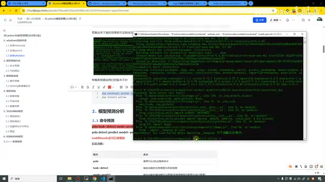

*重新安装依赖及预测测试的终端 · [原片 25:30](https://www.bilibili.com/video/BV11DjT6uEhc/?p=31&t=1530)*

> 画面文档补充的依赖修复操作为 `pip uninstall pillow`，然后 `pip install pillow`。此处保留现场重装依赖的过程，未把报错改写为其他未经确认的原因。

可以看到，这次我们就可以了。刚才应该是其中……我再清个屏重新执行一下。刚才应该是在安装这个、执行 `pip install -e .` 这个步骤的时候，我们应该没在虚拟环境里面，或者这里没在虚拟环境，应该是这里吧。所以我们要在这个虚拟环境里面……

[回到视频 26:12](https://www.bilibili.com/video/BV11DjT6uEhc/?p=31&t=1572)

那我们用的就是 GPU 了。好，重新来看一下。上面还是一样，去选取它；下面我又改回去了，可以看到现在就比较一致了。我们使用的 YOLO 版本是 8.4.40，Python 版本是 3.8.20，PyTorch 版本是 1.12.1，CUDA 的话是第一个，显卡是 3060 Ti，显存是 8G。这里表格里面也列出来了。下面有一些信息，我们不管它，直接来看这里。

## 模型结构、输入图片与推理结果

这里是 `YOLO26n summary`。YOLO26n 是这个模型的名称，后面叫做 `122 layers`，就是神经网络一共有 122 层。参数大概有 240 万 8932 个。然后 `0 gradients`，这一次我们在推理模式下是不计算梯度的。然后我们的运算速度就是 5.4 GFLOPs。

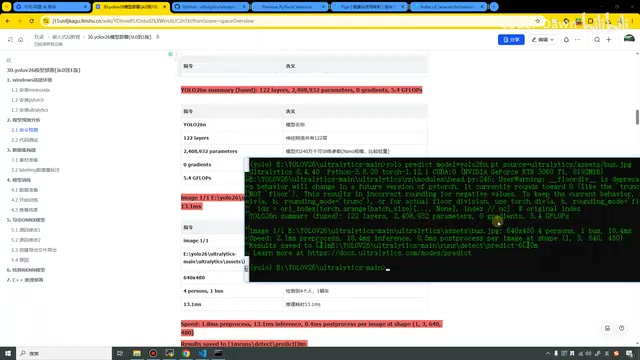

*修正后使用 CUDA 的模型结构与预测日志 · [原片 27:30](https://www.bilibili.com/video/BV11DjT6uEhc/?p=31&t=1650)*

接下来到这一行 `image`。前面很长的参数，一直到 bus 这里：`image 1/1` 代表前面的 1 是处理第一张图片，一共一张，1/1。后面到 `bus.jpg` 这里就是路径。640×480 就是模型将这个图片调整到了 640×480 的大小，然后检测到了四个人、一辆车。

> 此处“运算速度”沿用讲师表达；截图中的字段为 `5.4 GFLOPs`。

[回到视频 28:14](https://www.bilibili.com/video/BV11DjT6uEhc/?p=31&t=1694)

然后一共用了 18.4 毫秒。下面这里，使用了 2.1 毫秒进行预处理，18.4 毫秒进行推理，0.5 毫秒进行后处理。形状的话是 `(1, 3, 640, 480)`，可以看到就是 NCHW 这个形状。

最终结果保存到 E 盘，然后 YOLO26 这个目录下，有一个 detect，然后 predict，就是保存到这里。最后它也提示，如果想学习更多，可以去它的这个网站。在这里，我也都已经写出来了。

我们看一下这里的结果，它已经提示我们了。在这里有个 runs 目录，下面有一个 predict6，然后有一个 `bus.jpg`，就是这个图。我们可以看一下，是不是有一、二、三、四，有四个人、一辆车。

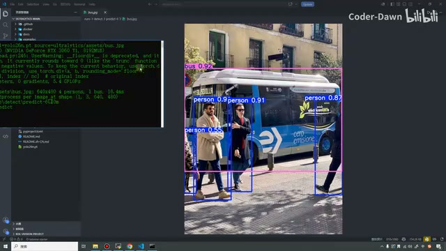

*bus.jpg 检测结果：四个人和一辆公交车 · [原片 29:30](https://www.bilibili.com/video/BV11DjT6uEhc/?p=31&t=1770)*

它模型处理的时候，大小是 640×480。在这里还是有点看不到了，看时间的话就是这些。处理这个的总时间就是 20 毫秒多一点，然后它每次的速度也不一定。我们可以再执行一下、再看一下。这次你看是 13.3 毫秒，上次是 18.4 毫秒；这里也是 1.8 毫秒，然后后处理是 0.4 毫秒，速度更快了一点。结果在这个 7 里面保存。

[回到视频 30:15](https://www.bilibili.com/video/BV11DjT6uEhc/?p=31&t=1815)

好，就是这里，结果也都是一样的。讲到这里，前两个部分就已经讲完了。这节课带着大家搭建了 Windows 环境，并且对模型预测的命令进行了分析。下一节课，我们就看第三部分和第四部分。

## 补充：使用 Python 代码预测

最后，这里还忘了一个东西。刚才我们通过命令进行测试，同样也可以通过写代码来测试。我们来试一下，在这个目录下新建一个文件，叫 `predict.py`，就是预测的意思，然后把这个复制过来。这个目录现在暂时没用了，我也直接关掉吧。

可以看到很简单：从这里导入 YOLO，然后对 YOLO 进行初始化。我们加载的是 `yolo26n` 这个模型，因为这个模型是最小的；执行的任务是检测。现在就用来检测这张图片。先拿一拿……我们也可以去检测这张图片，我 Ctrl+C 一下，然后打开终端。

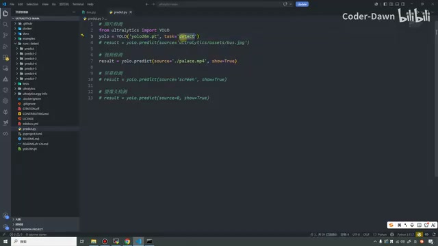

*predict.py 的图片、视频、屏幕和摄像头预测入口 · [原片 31:30](https://www.bilibili.com/video/BV11DjT6uEhc/?p=31&t=1890)*

终端的话，新建吧，打开它也行。打开它的话，我们就需要……［此处终端操作衔接语 ASR 不清。］在这里也是激活我们的虚拟环境。激活之后，直接执行就行，我们叫 Python 去执行。

> 截图可辨认的初始化与图片预测语句为：
> `from ultralytics import YOLO`
> `yolo = YOLO('yolo26n.pt', task='detect')`
> `result = yolo.predict(source='ultralytics/assets/bus.jpg')`

[回到视频 32:15](https://www.bilibili.com/video/BV11DjT6uEhc/?p=31&t=1935)

好，我们执行一下。它好像给我们报错了，看看报了什么错。我们把……［此处 ASR 的操作对象不清。］这里把它也关掉。可以看到，我们其实就已经检测成功了。你看，它说检测到了两个人，还有一个 tie。tie 是什么意思，不清楚。总之你看，它已经检测成功了。

不然我们还是改回来吧，看四个人、一辆车。再进行一下，你看这是四个人、一辆车，花费的是这个 13.7 毫秒，和我们刚才那里看到的、命令上面看到的也都是一样的。

## 视频检测

我们把它注释掉，也可以进行视频检测。把它打开，现在还没有视频，没有视频的话，我们就找一个。从桌面，到这里，从之前的代码里找一个，把它复制过来，然后再执行一下。可以看到，检测视频也是可以的，就是人，还有这个包，这个都是可以的。

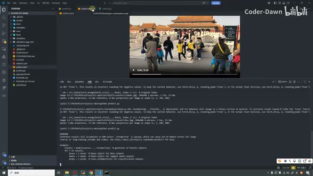

*本地视频素材与视频检测输出 · [原片 34:00](https://www.bilibili.com/video/BV11DjT6uEhc/?p=31&t=2040)*

接下来把它也注释掉，我们还有一个屏幕检测。

[回到视频 34:16](https://www.bilibili.com/video/BV11DjT6uEhc/?p=31&t=2056)

## 屏幕检测与摄像头入口

屏幕检测我们也来执行一下。你看，它现在就在检测我们的屏幕，检测到这个 laptop。然后打开这里再看，它也检测到这个网页了。好，这个赶紧给它关掉吧，有点恶心啊。

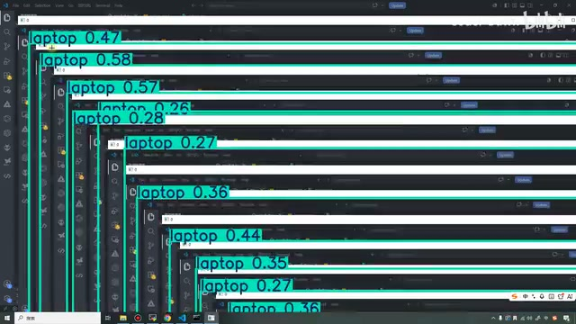

*屏幕检测窗口产生递归画面 · [原片 34:30](https://www.bilibili.com/video/BV11DjT6uEhc/?p=31&t=2070)*

最后一个是摄像头检测。摄像头检测的话，不方便演示，我也就不给大家演示了。总之就是这么简单。摄像头就是传入 0，就是默认摄像头；视频就是传入一个视频；图片就传入一个图片的路径，就可以了。

> 画面代码对应的视频输入为 `source='./palace.mp4'`，屏幕输入为 `source='screen'`，摄像头输入为 `source=0`；这些演示行同时设置了 `show=True`。

到这里，我们就把前两个部分讲完了。讲完之后，这节课的内容到这里就结束了。最后也是感谢大家观看，谢谢大家。
