# 30_yolov26模型部署(从0到1版)_数据集构建与模型训练

> P32 · 完整顺序整理讲稿（非逐字实录） · 00:00–33:14
> [原视频](https://www.bilibili.com/video/BV11DjT6uEhc/?p=32)

## 数据集构建：先准备素材

这节课我们继续来看第三十讲。上节课我们已经完成了前两步，就是 Windows 搭建环境，还有模型预测的分析。这节课继续来看第三步和第四步：第三步是数据集构建，第四步是模型训练。

我们直接来到数据集构建这里，它分成两个小步骤。第一个是素材准备，第二个是数据标注。素材可以是图片，也可以是视频。如果是图片，就可以直接进行标注；如果是视频，需要先转换为图片，再进行标注。

接下来我打开上节课的目录。刚才有一些测试代码，这些代码已经全部删掉了，现在重新来。我们先创建一个程序。起名时我先说 image，又说 video，这里实际创建的是 `video_to_img.py`，放在根目录下就行。然后把代码复制过来。

其实代码非常简单，就是创建一个目录，然后使用 OpenCV 打开视频文件。视频文件就是我们之前的那个视频。这里定义了几个变量：数量 count、number，还有步长 step。打开视频之后读取它，按照这三个字段进行计算，把视频切成图片。这段代码非常简单，接下来我们就来执行一下，还是先进入我们的环境中。

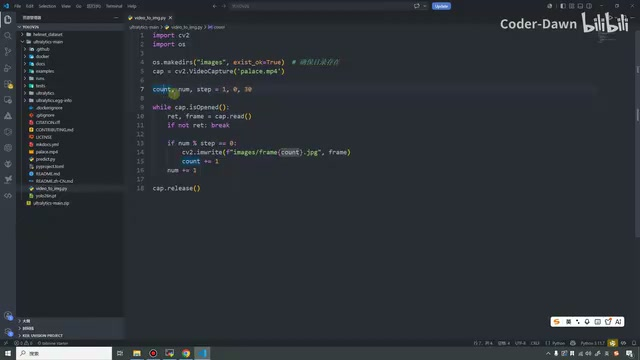

*抽帧程序 video\_to\_img.py，使用 OpenCV 读取视频并按步长保存图片。 · [原片 01:36](https://www.bilibili.com/video/BV11DjT6uEhc/?p=32&t=96)*

## 执行抽帧，打开标注工具

我们的环境是 `yolo`。进入这个环境，在里面执行 `python video_to_img.py`。可以看到，生成了一个目录，目录里面就把视频转化成了一些图片。当然，这个程序也可以有很多种写法，我在这里尽可能简单地写了，就是 18 行，代码量非常少。

接下来我们对这些图片进行标注。同样打开课件这里，第一步需要先安装这个库。我这里已经安装过了，安装完库之后就直接打开，输入 `labelImg` 就可以了。标注工具非常多，我在这里给大家介绍这个，它也是比较简单的。

上来要做的第一步，就是在这里选择数据格式。这里有这么多种格式，我们选择 YOLO，再点一下 Save。然后点 View，这里有个 Auto Save Mode，点一下它，这样就可以自动保存了。

接着在这里打开一个目录，就打开刚才生成图片的 `images` 目录。打开之后就可以进行标注。我们先选一下保存位置，我想一下，就创建在这里吧。我们创建一个目录，名字随便叫，就叫 `labels` 吧。

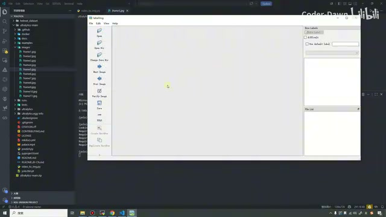

*labelImg 的 YOLO 格式与左侧目录、保存操作区。 · [原片 03:24](https://www.bilibili.com/video/BV11DjT6uEhc/?p=32&t=204)*

## 画框、设置类别并保存标签

创建好之后选择它，接下来就可以进行数据标注了。标注的时候，按住键盘上的 W，按住不放，然后用鼠标左键，就可以画这个框。我们先随便画一个，画好之后给它起个名字，也就是起个标签。比如把这个叫 `man`。然后这里这个人，我们也给她起个名字，叫 `woman`，就是以这种方式来做。

可以看到，在这里选中的话，这边也能看得到，下面也有。我再把它放大一点。你看，在这里选中的话，这边也能看得到。

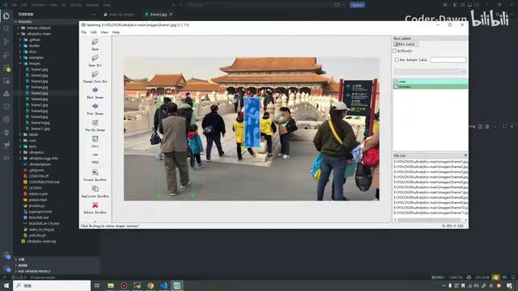

*labelImg 中已绘制的 man、woman 人物标注框。 · [原片 04:48](https://www.bilibili.com/video/BV11DjT6uEhc/?p=32&t=288)*

我们把图中每个人都这样画框，以及打上标签，这样就完成了数据标注。然后按键盘上面的 D。D 就是切换到下一张图片，并且保存上一张图片。比如在这里再随便画一个，这个小孩也是个男的，我们就这样标。

当然，我这里只是给大家做一个最基本的演示。大家真实要做的时候，就需要把每个人都标上，画好框，打上标签。我在这里只是做一个示范作品。

假设我们就这样标注。标注完之后，可以把这个关掉。关掉后我们来看一下：刚才创建了一个 `labels` 目录，里面第一个叫 `classes`，就是我们的类别，有 `man`，有 `woman`。第二个文件就是标注的第一张图片，所以这里有第一张图片的信息。这个 0 代表这里的 `man`，这个 1 代表这里第二个类别，也就是 `woman`。后面就是它的坐标，是中心点的坐标，就是这样去做的。在这里我只是作为示范，大家知道这样标就好了。

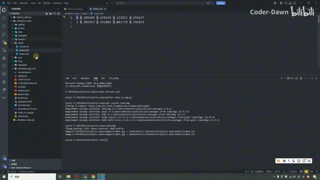

*第一张图片对应的标签文本，首列为类别编号。 · [原片 06:00](https://www.bilibili.com/video/BV11DjT6uEhc/?p=32&t=360)*

## 模型训练：准备训练集与验证集

这样，我们就完成了数据标注。数据标注完成之后，就可以进行模型训练了。模型训练这里分成三个小步骤，第一个是数据准备。

数据应该怎么准备呢？就假设刚才我们有非常非常多的图片，都已经标注好了。标注好之后，需要分成训练集和验证集。训练集和验证集的数量比，一般在 9∶1 到 8∶2 之间。意思就是，假设一共一千张图片，训练集里面就是 800 到 900 张，验证集里面就是 100 到 200 张，就是这样的一个范围。

上面是 `images`，就是我们的图片。下面是 `labels`，这个 labels 这里其实写得也不太对。labels 里面其实是图片对应的信息，我在这里也改一下，这里应该叫“标签信息”。它里面对应的，就是上面每张图片对应的信息：images 里面每张图都有它对应的标签信息。

就是 labels 里面的内容。刚才上面写得有点不太对，所以我也修改了一下。

准备好数据之后，就可以创建这些目录，进行训练。大家刚才应该也看到了，这里主要是去做头盔的预测。之前我本来在课件里面做的是一个树苗，小树苗发芽的检测。但是那个数据的图片特别少，只有 80 张，也是我自己之前标注的。因为数据量太小了，导致部署之后效果会很差。

前些天刚好在 B 站上看到人家有这么一个数据集，是魏老师那里的，我直接把这个数据集拿过来用了。

接下来，这些东西就没什么用了，我们先把它们删掉，它们就是为了刚才做演示。我们按照课件里面的步骤，先创建这样一个目录，就在根文件夹下面创建就可以了。还是一个一个创建吧，第一个创建 `datasets`，然后把这个数据集传过来。这里面有一些 cache，把它删掉。

我们来看一下这个数据集。这里面是图片，上面是训练集，训练集里面特别多，我粗略看了一眼，有两百多张。下面是验证集，里面也就是几十张吧。然后 `labels` 里面就是 labels，就是标签。

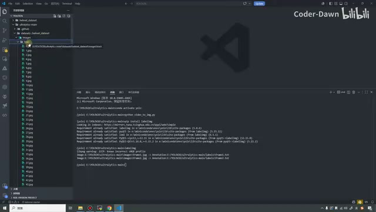

*数据集目录中分开的 images、labels 与 train、val。 · [原片 09:48](https://www.bilibili.com/video/BV11DjT6uEhc/?p=32&t=588)*

labels 里面就是标签，对应的是图片的信息。然后 `classes` 就是有没有戴头盔：0 代表戴头盔，1 代表没戴头盔。我们随便看一个，比如说这个信息。

那两个 1，就代表两个人都没戴头盔。我们来看一下，这两个人都没戴头盔。然后这个有一个人，他戴了头盔。来看，只有一个标签，它是 0，表示他戴了头盔。总之，这就是我们的数据集。

## 准备 YAML 配置文件

有了数据集之后，就可以进行训练了。但是在这里还需要准备一个文件，就是 YAML 文件。我把它剪切出来，放在根目录下。这个 YAML 文件的作用，就是告诉模型应该怎么训练、到哪里去训练。

我把内容改成这节课我电脑上的地址。第一个参数就是路径，这个 YAML 文件要指向你的数据集。我的数据集是在电脑 E 盘、YOLOV26，然后这个目录下的 datasets 目录下面，就是它。第二个是训练集，也就是这个 `train`；验证集是 `val`。然后一共有两个类别，类别名称是戴头盔和不戴头盔。

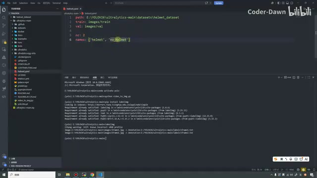

*helmet.yaml 配置中的数据路径、训练验证目录和两类名称。 · [原片 11:48](https://www.bilibili.com/video/BV11DjT6uEhc/?p=32&t=708)*

这就是 YAML 文件，也是我们必须要做的。准备好它之后，就可以开始训练了。训练有两种方式，一种是使用命令行，另一种是使用代码。

## 两种训练方式与参数

其实命令行和代码，两者的参数是一模一样的。简单看一下，这个 `yolo` 就相当于执行 YOLO 内部的工具。`task` 是检测，模式是训练，模型用的是 YOLO26 的 n 模型，数据指向这个 YAML 文件。`epochs` 是 300 轮，把图片搞成 640 的，`batch=-1` 代表自动进行分配，`workers=4` 就是多线程。

`patience=50` 是说，如果发现数据连续 50 轮性能都不再提升，我们就不训练了，也避免浪费时间。`device=0` 就证明使用第一张显卡进行训练。这就是这个命令行的作用。

下面的代码其实一模一样：先导入它，然后加载模型，在 `model.train` 里面把刚才上面的数据再写过来。这里有个注释，注释不对，我改一下。我在这里就使用这种方式吧。同样给它写个名字，先写在这里，方便大家。这个文件叫 `train.py`。我们在这里也创建这个文件，然后把代码拿过来。

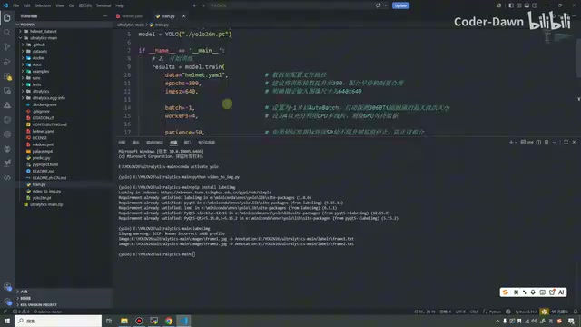

*train.py 加载 YOLO26n，并在 main 条件内调用训练。 · [原片 14:00](https://www.bilibili.com/video/BV11DjT6uEhc/?p=32&t=840)*

大家注意，如果是在 Windows，我们一定要有这个 main 函数。网上很多你看到的代码，

可能没有这个 main 函数，直接就是下面这些。直接是下面这些的话，其实是会报错的。

## 运行训练与提前停止

在这里我们执行它。可以看到，这里提示了非常多的打印信息。上面依旧是一些版本信息，然后这里是网络的一些信息，像这些参数、形状什么的。下面到这里，我们就开始训练了。一共会训练 300 轮。训练比较浪费时间，所以在这里我就先把视频暂停一下。

到这里就已经训练完了，训练完之后我们接着来讲。其实训练得挺快，好像就是几分钟，具体时间我也没看，我就刷了一下手机。我们看打印的信息：它并没有训练到 300 轮，其实只训练了 92 轮就已经停止了。

为什么会出现这种情况呢？就是因为我们前面设置了这个参数：验证集的指标如果连续 50 轮都不提升，就提前停止。为什么这样做？它都没提升了，我们训练也没什么意义，除了浪费时间，还有可能导致过拟合。所以到 92 轮的时候，就已经停止了。

下面这里也有，最好的这个 best，最好的结果是在第 42 轮，已经保存为 `best.pt`。这就是它的信息。其实训练很快，这里说 0.05 小时，

是 0.057。我算一下，0.057 小时其实就 3.5 分钟，说明我们的电脑训练这个小数据集还是挺快的。这样就已经训练好了。最后也有一些信息，这些信息稍等一会儿再看。

我们需要看一下它保存到了哪里。我看这里有没有提示，就是这个 runs。你看这里提示最后一次模型在这里，最好的模型在这里。看这里好像也没什么特别的提示了，没有就没有吧。

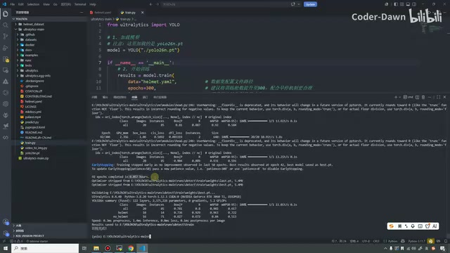

*训练结束终端，包含提前停止和 best.pt 等保存信息。 · [原片 16:12](https://www.bilibili.com/video/BV11DjT6uEhc/?p=32&t=972)*

## 先测试训练好的模型

训练完之后，这些先不看，比较重要的是我们先测试一下，看这个模型效果到底怎么样。我复制一下课件代码，来测试一下。

刚才训练应该就是这个 train 了，就是我们刚刚训练好的。这里面有模型，下面还有一堆图片，这些图片一会儿也会给大家解释，包括还有这些东西。我们先来测试。

测试的时候把它改成预测。你看，就是使用 YOLO 检测，使用这个最好的模型。然后是要检测的图片，我们先人工看一下。直接来看验证集，我们来看这个 99。

我们看一下这张图片：一共有四个头，1、2、3、4，四个头，只有一个人戴了头盔，三个人都没戴。我们来看它的结果怎么样。

现在它就在检测，我们稍微等一下。它说结果放到了 `predict12` 里面，那我们就在 12 里面看一眼。可以看到，它把这些图检测了：你看，他戴头盔了，这个没戴头盔，这个没戴头盔，还有一个头直接就没画框。

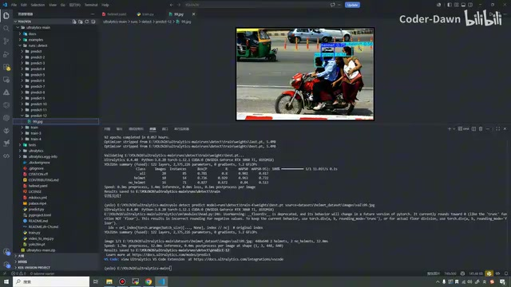

*第一张预测结果，图中可见戴与不戴头盔的检测框。 · [原片 18:40](https://www.bilibili.com/video/BV11DjT6uEhc/?p=32&t=1120)*

我们再看一张图片，来看这个 88，这个……67。这个应该检测结果还是比较好的，来看一眼。它放到 13 里面，我们看一下，这两个有头盔的都检测到了。

再找找，这个是 24，一共有六个头，都没戴头盔。我估计这个头可能也检测不出来，我们试一下。这个 24 叫 JPEG，我们点一下。它在 14 里面，好像确实，这个头也没检测出来。

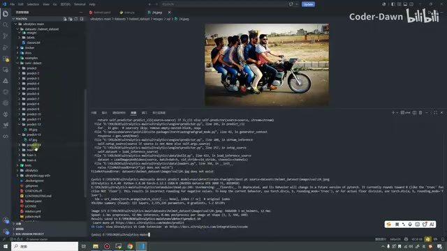

*多名骑乘者的测试原图与终端输出。 · [原片 19:38](https://www.bilibili.com/video/BV11DjT6uEhc/?p=32&t=1178)*

这里大家也不需要在意，这个准确率好像稍微差了一点，没关系。准确率差一点有好多原因。第一个原因就是图片，我们的数据集就这么大一点，只有几百张图片，所以说我们的数据集其实很小。数据集小的话，准确率就会不够好。这是第一个，也是我认为最重要的原因。第二个跟标注也有关系，我们标注的质量怎么样？

我们标注的时候，有没有把那些框都标注得清清楚楚，就是跟标注质量也有关系。

第三个也是很重要的原因，就是我们采用的是 YOLO26n，这是它最小的一个模型，也可以说是能力最差的模型，所以准确率什么的可能就会稍微差一点点。

## 查看训练输出：参数与批次图片

看完这个之后，我们来看这个东西，也是我在这里写的文件。我们就不看那个文字了，文字看着也费劲，直接来看它。

首先第一个，`args.yaml`，这个很明显，从名字也能知道，就是一个参数文件。你看，其实有这么多参数。这些参数具体的含义就不再说了。其中有一些是我们设置的，还有一些是默认的。你看，这个是线程，batch 是负一，动态的，然后 50 轮不提升就终止，包括数据和模型。下面还有非常多其他的，这些随机失活等等，这个就不看了。

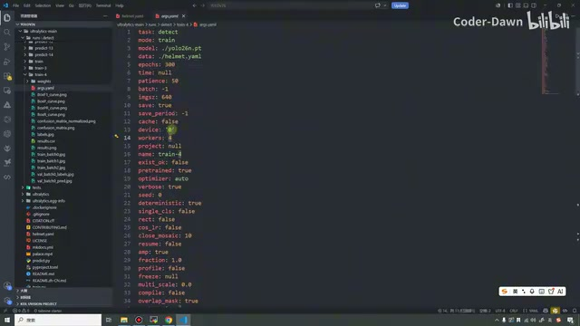

*args.yaml 中的训练参数，包括 epochs、patience、batch 和 imgsz。 · [原片 21:24](https://www.bilibili.com/video/BV11DjT6uEhc/?p=32&t=1284)*

然后看下面这些图片。我想一下怎么来看，不然我们倒着介绍吧。先看这三张图片，叫 `train_batch0`，然后 batch1、batch2。这三个是什么意思呢？就是说训练第 0 批、第 1 批、第 2 批的时候，它在里面进行了一些标注。

你看，就是这个样子。这是第 0 批，这是第 1 批，这个是第 2 批，还不错。这就是它的含义，它在这里帮我们进行了拼接。

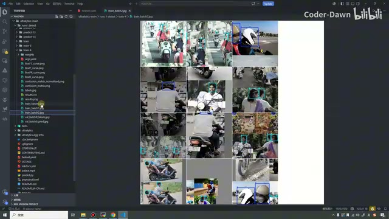

*训练批次拼接图，展示训练图片与标注框。 · [原片 22:00](https://www.bilibili.com/video/BV11DjT6uEhc/?p=32&t=1320)*

然后这两个，上面叫 `val_batch0_labels`，下面叫 `val_batch0_pred`。上面这个是什么意思？把它理解为真实值。你看，这里两个人戴着头盔，这里一个人戴头盔，然后三个人没戴，这里三个人没戴，包括每幅图都是这样的。刚才看这幅图的时候，这个小人，我们放大一点，这个人好像就没预测到。

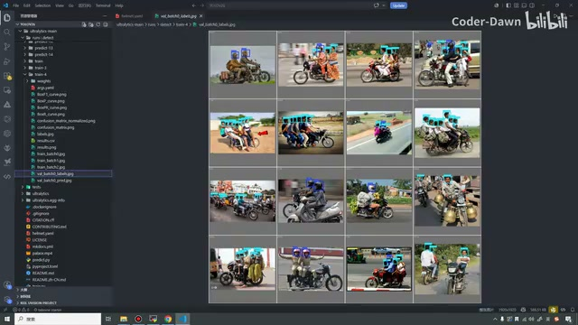

*val\_batch0\_labels 验证批次的真实标注图。 · [原片 22:48](https://www.bilibili.com/video/BV11DjT6uEhc/?p=32&t=1368)*

上面相当于真实值，这个就是预测值。我们看一下：这个人明显有头盔，它也没识别到。这里有两个人都没戴头盔，它也没有检测到，都没有画出来。这个就是预测值和真实值两张图。这样来看，好像效果不怎么样，这个也没标记到，这里也有好几个人头都没标记到。

*val\_batch0\_pred 验证批次预测图，可与真实标注比较。 · [原片 23:24](https://www.bilibili.com/video/BV11DjT6uEhc/?p=32&t=1404)*

这个可能需要改改参数，像我们的置信度、学习率等等，调整一下，效果可能就更好一点。包括轮次，我们现在可能调调这些参数、改改轮次、加一加随机失活，性能可能就会提升很多。

看完这些之后，再看这个 `results.png`。这里的图是什么意思呢？先看最左侧，就是我鼠标动的这一列，你看，这叫训练集上框的损失。

可以看到效果还是非常不错的，一路下降。损失肯定是越小越好。这是验证集上的，验证集上面效果其实不怎么样。比较好的效果，应该和训练集差不多，都长成这样，效果就比较好了。这就是框的损失。

第二组，可以看到是类别的。这个效果还不错，总体都是这样下降，验证集和训练集也差不多。第三个是 DFL，可以看到依旧是训练集效果非常不错，但是到验证集的话就稍微差一点，我们这个边缘就有点不太清楚了。比较理想的也是跟它差不多。

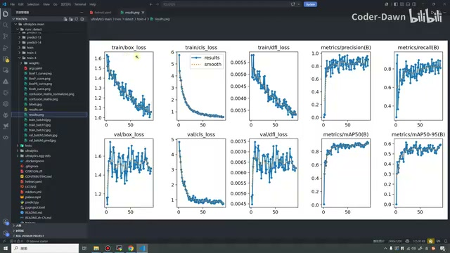

*results.png 的训练验证损失以及精确率、召回率、mAP 曲线。 · [原片 24:36](https://www.bilibili.com/video/BV11DjT6uEhc/?p=32&t=1476)*

接下来看这块的四幅图。首先这个叫精确率，就是看检测结果准不准。总体还是不错的，你看，都到 80% 以上、90% 了。这是准确率。这个是召回率，召回率就是所有的头盔里面，模型到底能找回来多少。这里也还行，最后也都是在 80% 以上，90% 左右吧。

这个叫 `mAP50`，其实是非常重要的一个指标。就是说，预测框和真实框的重叠度超过 50%，就算对。在这里，我们给了比较宽松的一种情况，可以看到效果非常不错，差不多都有百分之九十多，95 吧，九十多。这个就是严格模式下的得分，这个效果差一点，好像就 60% 吧，60% 左右。这就是这幅图片。

## 标签分布与混淆矩阵

这幅图看完之后，我们来看这个。这里原本就是一些中间的数据，我们一般也不关注它。然后这个 JPG，就是看图片的分散、离散度。可以看到，有 121 个戴头盔的，还有 287 个没戴头盔的，下面是我们的分布图，就是这个。

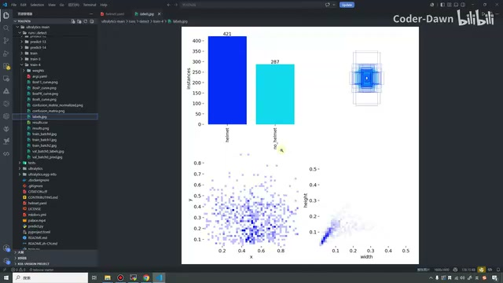

*labels.jpg 标签数量柱状图与坐标、宽高分布。 · [原片 27:06](https://www.bilibili.com/video/BV11DjT6uEhc/?p=32&t=1626)*

> 画面核对：此处柱状图的 helmet 数量实际显示为 421；上段保留原转写中的“121”，该处数字口述辨识存疑。

接下来我们看这个，也叫矩阵嘛，仔细看一下。横着的叫真实值，竖着的叫预测值。这个最好一列一列地看。

这一列是戴头盔的，一共 14 个，有 13 个预测对了，有 1 个预测成背景。第二个是没戴头盔的，只有 41 个预测对了，有 29 个都预测成背景，还有 1 个预测错了。预测错的叫错检，这个叫漏检，错检、漏检，这个才是正确的。第三个是背景，背景的话，其实一般，我不太关注这个背景。

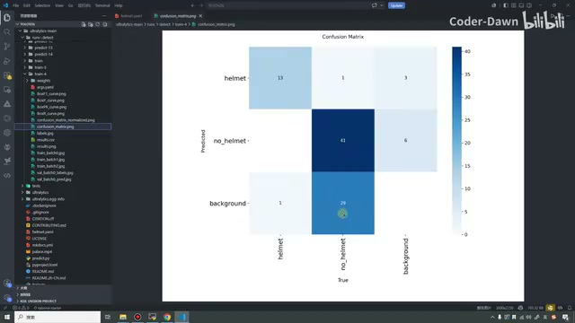

*混淆矩阵，横轴 True、纵轴 Predicted，显示正确分类与漏检计数。 · [原片 27:54](https://www.bilibili.com/video/BV11DjT6uEhc/?p=32&t=1674)*

接下来看这个归一化的。这张图看起来，其实看的方法和刚才一样，很容易看。93% 的都是正确的，这个戴头盔的并没有预测错，就都预测得很好，然后有 7% 预测成背景。

同样，没戴头盔的也是这样，差不多 1% 错了，41% 都漏了。背景其实不太关注。

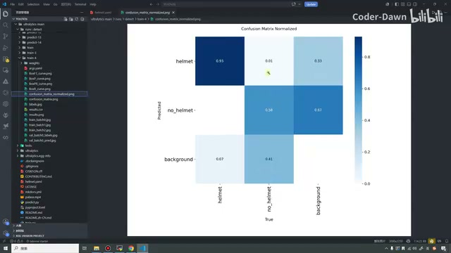

*归一化混淆矩阵，显示类别对应的比例。 · [原片 28:48](https://www.bilibili.com/video/BV11DjT6uEhc/?p=32&t=1728)*

## 召回率与置信度曲线

再到上面，你看，横坐标是置信度，纵坐标是召回率。看它的值，在这里其实写着，是一个 0.96，在这里。

这张图的含义是这样的：它叫置信度、召回率曲线图，主要反映的是找得全不全的问题。这个蓝色线表现比较好。什么意思？就是即使置信度要求 0.8，召回率依旧在一个还不错的范围内，就是这个意思。

橙色线就是，随着置信度提高，橙色线急剧下降，那就代表模型对没戴头盔的，稍微有点不自信。

总之就是这么一个意思：它对不戴头盔的敏感度比较低一点，戴头盔这个蓝色的其实还比较好。中间这个是平均值，就是所有类别的，也就是它们两个。这就是召回率、置信度曲线。

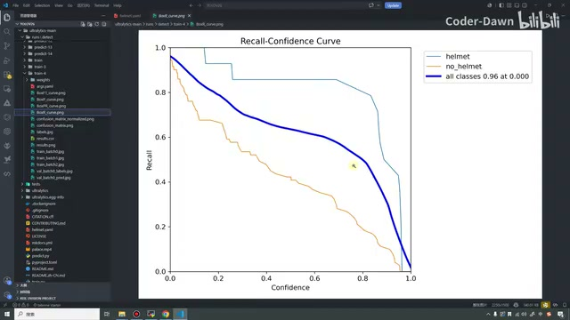

*Recall-Confidence Curve，展示两类与整体召回率随置信度的变化。 · [原片 29:50](https://www.bilibili.com/video/BV11DjT6uEhc/?p=32&t=1790)*

## 精确率与召回率曲线

这个曲线，我看一下：横坐标是召回率，纵坐标叫精确率。所以它叫精确率、召回率曲线，叫 PR。这幅图就是看 mAP 的。可以看到蓝色的是所有类别的。我们在 0.5 的时候，从这里画条线上去，它的性能大概也有 90%，九十多的样子，就是这么。这个效果非常好，就是从这里画条线，95% 吧，这就是它的含义。

> 画面核对：图例显示 helmet 0.963、no_helmet 0.840，以及 all classes 0.902 mAP@0.5；上段保留讲述者在图上比画时的估计说法。

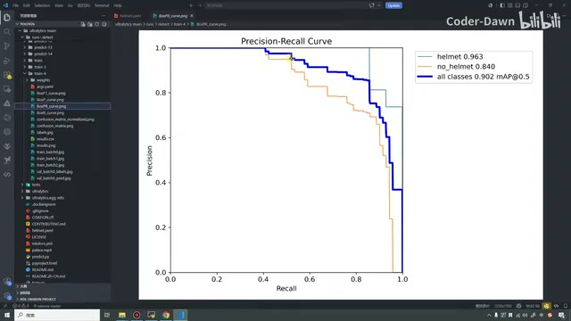

*Precision-Recall Curve，图例列出两类 AP 与整体 mAP@0.5。 · [原片 31:16](https://www.bilibili.com/video/BV11DjT6uEhc/?p=32&t=1876)*

这个也没什么，就是看看这些图，就能分析一下性能。这张图看完之后，再看这张图，就是置信度和精确率的曲线。

可以看到，当我们的值达到 0.741，这里其实也写着，这个总结到 0.741 之后，我们就达到了 100%。什么意思呢？就是说把置信度设为 0.741，它才觉得它是对的话，那这个时候就能百分之百地检测对，就是这个。总之，这幅图反映的情况，就是看误报多不多的问题。

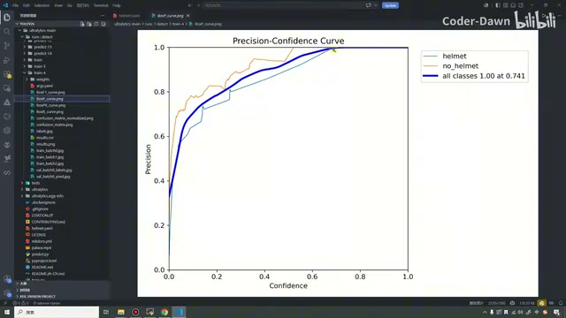

*Precision-Confidence Curve，整体曲线图例为 1.00 at 0.741。 · [原片 32:24](https://www.bilibili.com/video/BV11DjT6uEhc/?p=32&t=1944)*

## F1 分数与置信度曲线

这幅图叫 F1 分数，就是置信度曲线。可以看到，其实这幅图效果并不是特别好。你看，在这个“2.18”[此处数字辨识不确定，画面图例为 0.182]，差不多这里的时候，达到我们的最高值，就是找最佳的置信度阈值。

大概意思就是，我们值大于这个，就是大于这个值的时候，觉得……就是把它设为“0.118”[口述数字与画面 0.182 不一致，保留不确定性] 的时候，模型就是少了……[源视频于此结束，最后一句未讲完。]

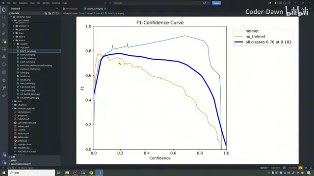

*F1-Confidence Curve，整体曲线图例为 0.78 at 0.182。 · [原片 33:00](https://www.bilibili.com/video/BV11DjT6uEhc/?p=32&t=1980)*
