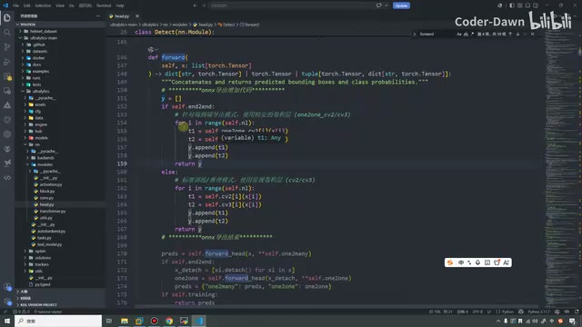
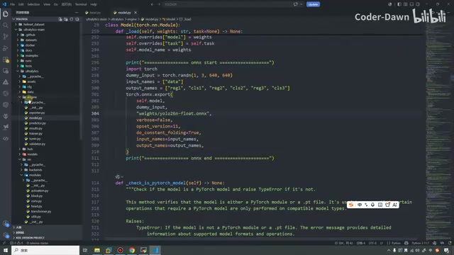
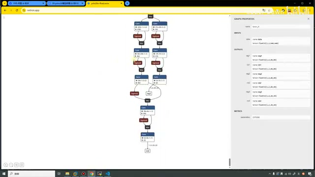
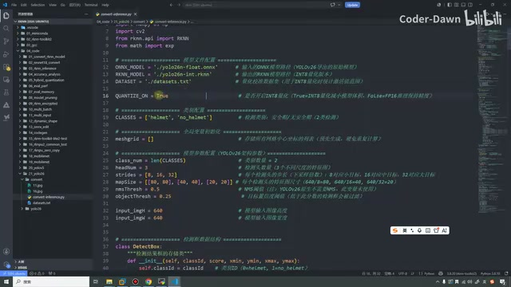
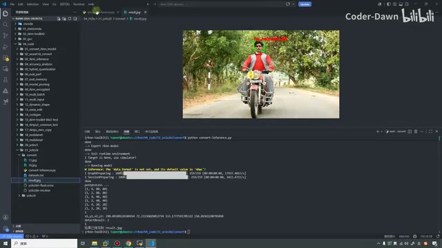
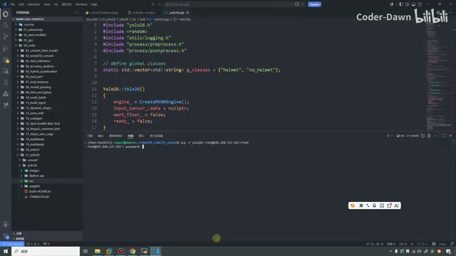
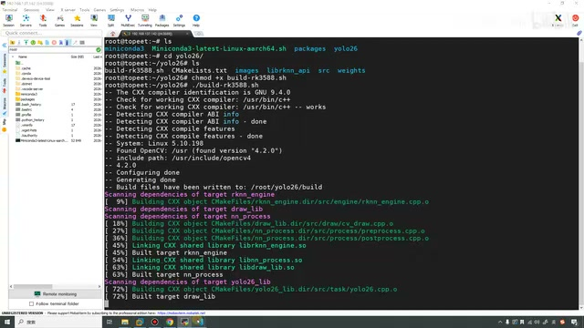
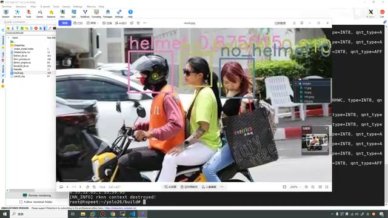
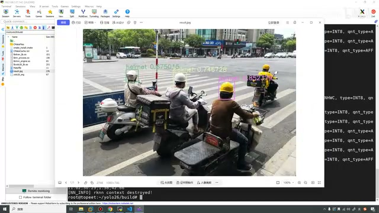

# P33｜30_yolov26模型部署(从0到1版)_导出onnx与rknn模型并板端推理

> 忠实整理讲稿；保留讲者顺序、操作和排错。源视频 00:00–24:26，P33。源画面为640×360，代码以可辨认内容为限。

[原视频 00:00](https://www.bilibili.com/video/BV11DjT6uEhc/?p=33&t=0)

## 第五步：导出 ONNX，选择源码修改方式

这节课我们继续来看第三十讲，YOLOv26 模型部署。这节课剩下五、六、七这三个步骤，都在这节课进行讲解。第五步是导出 ONNX 模型，第六步是转化为 RKNN 模型，第七步是在开发板上进行推理。我们直接来看第五步。

通过目录可以看到，这里有“源码修改一”“源码修改二”，然后创建导出文件、导出。在这里先和大家讲清楚：如果大家去网上看，整个 YOLO 系列在导出 ONNX 的时候，会有各种各样、五花八门的修改方法。我个人建议有两种修改方法。第一个是我的这种修改方式。为什么建议？因为它最简单，几乎不需要删减任何代码，只需要新增一点点代码就可以了。

还有一种方法是参考 RKNN 那个里面的一些示例代码，就是 Model Zoo。它现在已经有 YOLOv5、YOLOv8、YOLOv11 等等，我们参考他们的修改方法，来修改 YOLOv26 也是可以的。在这里我就演示这种最简单的方法。

接下来打开 VS Code。打开之后，还是上节课的这个目录。打开 `ultralytics`，点 `nn`，然后在 `nn` 里面点 `modules`，下面有一个 `head.py`。我们在里面找到这个 `forward`。

[原视频 02:01](https://www.bilibili.com/video/BV11DjT6uEhc/?p=33&t=121)

就是这一块的 `forward`，大概在 146 行左右。看一下修改了哪些东西：只是新增了它，剩下的代码都没有变。把这段代码复制过来，对齐一下。可以看到这是一个新增；新增这段代码之后，后面的代码已经变灰了，也就代表它不执行了。

*head.py 的 forward 中新增分支，后面的原有代码保留。 · [原片 03:00](https://www.bilibili.com/video/BV11DjT6uEhc/?p=33&t=180)*

这个是因为 Ultralytics、YOLOv26 这里一个是一对一，一个是一对多；有两种，一个是画框，一个是分类。这样列进来就可以了。具体代码就不带大家去看了，我们看这个代码一时半会儿也看不完，也没什么太大的意义。大家感兴趣的话，可以自己跳过来看看。在这里我就不看了。这是第一个要修改的地方，将它关掉。

第二个要修改的地方，打开它，里面有一个 `model`。在里面同样搜索这个下划线 `load`，大概是第六个，行数在 259 行左右。在这个函数的末尾，加上我们要修改的代码。可以看一下，这个代码其实就是在这里搞了一个分类的头，六个头。

> 识别说明：此处按画面确认为 `model.py` 中的 `_load`；“分类的头，六个头”保留口述，未据此扩写为模型结构结论。

[原视频 04:01](https://www.bilibili.com/video/BV11DjT6uEhc/?p=33&t=241)

然后也没有什么特别的，直接使用 `torch.onnx` 进行导出就好了。导出的时候叫这个名字，在 `weights` 下面创建了一个 YOLO26 的文件。这里就是一个数据，然后这是一个形状。

*model.py 中的 ONNX 导出代码和目标文件路径。 · [原片 04:30](https://www.bilibili.com/video/BV11DjT6uEhc/?p=33&t=270)*

> 画面补充：导出文件显示为 `weights/yolo26n-float.onnx`，输入示例的形状为 `1, 3, 640, 640`。文件名以画面为依据；不补写画面中未能清楚辨认的完整代码。

这两个修改保存好之后，就到根目录下，再创建一个导出的文件，把代码复制过来。这里要注意，我们使用的模型是之前训练好的模型。之前训练好的就在最后一次 `train` 里面，这个 `best` 就是性能最好的模型。把它也放在根目录下，和这两个文件是同一级的，不然它就找不到了。

然后打开终端，进入我们的环境。我们的环境叫做 `yolo`，然后进入这个目录。这里也不需要查看了，我们来执行一下。执行的时候会有一点点时间，稍等一会儿。可以看到它直接报错了，我看一下报什么错：`best.pt`，然后没找到它。好，那我们在这里需要这样。

> 纠错现场：讲者此时先口述“best.pt 没找到”，随后画面中的异常涉及导出目标路径 `weights/yolo26n-float.onnx`，下一步实际处理是手动创建文件夹；两者的差异保留，不把口述错误改写成一次成功执行。

[原视频 06:01](https://www.bilibili.com/video/BV11DjT6uEhc/?p=33&t=361)

我们手动创建一个文件夹，然后再来执行。这样就已经执行完了。它也提示可以使用这个工具去看一下模型的形状。在这里我们也看一眼。

我们是一个输入，然后输出的话也是……一共三组，就刚才在代码里面添加的这个形状。并且可以看到，它是 `1×3×640×640`，这里也是 80、40、20，三组的大小。我们整体看一眼这个模型，还行，这个模型看着还可以。

*Netron 中查看导出的 ONNX 结构与输入输出属性。 · [原片 07:30](https://www.bilibili.com/video/BV11DjT6uEhc/?p=33&t=450)*

> 识别说明：约 414–417 秒的输出名称口述识别不清；画面显示模型具有六个输出，和前文“三组”对应，未将不清楚的口述补成完整参数讲解。

如果后续到一些比较高级的操作，也会教大家怎么样修改这个 ONNX 模型。在这里先不做这个。这步做完之后，就已经导出 ONNX 模型了。接下来需要导出 RKNN 模型。

## 第六步：在 Ubuntu 环境转换 RKNN

我再打开我们的 Ubuntu 主机。为什么打开 Ubuntu 主机呢？

[原视频 08:02](https://www.bilibili.com/video/BV11DjT6uEhc/?p=33&t=482)

因为之前 Ubuntu 主机上面是有那个环境的。打开文件，我把代码都已经提前放好了。在这个 YOLO26 目录下面，有一个 `convert`，还有一个 `yolo26`。这个 `yolo26` 是最终要部署的代码，这个是要转换的代码。在这里先把这两个删掉，`result` 删掉。

我们看一下，这里可以随便再添加一个。这个是量化校正集，刚好有两张图片，一个戴头盔，一个不戴头盔，我也都放进来。

然后这个就是模型转换的代码。这个代码，我们随便看一眼吧。上面是头文件，这里是模型配置文件：需要的模型叫这个名称，转换后的模型叫这个名称，需要对它开启一个量化。我们一共有两类，就是有安全帽和无安全帽。这个是存储网格中心坐标的列表。在这里是模型的一些相关分数，好像阈值什么的，这个也没有用到；然后这里是大小。下面是检测框的数据结构，然后是网格、IoU 的计算。只不过 IoU 的计算也没有用到，为什么没用到呢？

*转换脚本中的模型名称、量化开关和 helmet/no\_helmet 两类配置。 · [原片 09:30](https://www.bilibili.com/video/BV11DjT6uEhc/?p=33&t=570)*

[原视频 10:03](https://www.bilibili.com/video/BV11DjT6uEhc/?p=33&t=603)

因为我们的 YOLOv26 去掉了 NMS 和 DFL，所以这个也没用到。只是因为拿别的代码改的，所以这个没删掉，删掉了也无所谓。下面就是进行置信度的降序，然后是简单的后处理，就是遍历三个检测头。像 YOLO 系列其实都比较类似，区别不是特别大。

这里就是对模型进行导出和推理。这里是之前已经看了很多遍的 RKNN 部署：创建 RKNN 对象，进行配置、加载模型、构建，然后进行导出。接下来初始化运行时环境，进行模型推理。因为这个代码已经看过很多遍了，所以这里很快带大家过一遍。在 `main` 函数里面，把这些该有的、该拿过来的东西拿过来就可以了。

好，在这里执行一下。在执行之前，这里还没有这个模型，需要先把模型搞过来。把 `weights` 下面的模型复制过来，看能不能直接复制，可以。这个模型复制过来之后，在这里我就不切 Ubuntu 了，直接在这里执行。

进入 21 的这个目录，进入 `04_code`，然后 21，再进入 `convert`，然后切换一下环境。好，我们已经到这个环境下了。

> 识别说明：此处路径中间层名称口述和画面较小，保留“21”这一口述定位，不补写未能核实的完整绝对路径。

[原视频 12:03](https://www.bilibili.com/video/BV11DjT6uEhc/?p=33&t=723)

也到这里了，我们直接执行 Python，写它就可以了。可以看到已经执行完了。执行完之后，这里导出了一个 RKNN 模型，也把刚才的结果进行了推理。你看，就是这张图片，他没有戴头盔，所以这里是 `no_helmet`。

*Ubuntu 转换脚本推理的无头盔样例，图中显示 no\_helmet。 · [原片 12:30](https://www.bilibili.com/video/BV11DjT6uEhc/?p=33&t=750)*

我们也可以换一下试一试，改成 11，也就是戴头盔的这张。再看一下，他戴了头盔，所以这里就是 `helmet`，证明他戴上头盔了。这两个步骤做完，就代表模型都已经准备好了。

## 第七步：C++ 板端推理与代码调整

接下来就是用 C++ 进行推理。这里我也没有贴代码，稍等一会儿，这节课录完之后，我写一下注意事项，再贴一下结果。我们直接过来看代码。

这个代码首先和之前都是一样的，结构也一样。这里少了第三方库，因为第三方库用到 OpenCV；我们在开发板上编译，其实不需要本地的那个 OpenCV 库了。因为那个库也不能执行那个摄像头——不是摄像头，是视频的。这里我就把它删掉，把它也删掉。把刚刚转换好的这个拿过来。

然后 `src` 目录简单看一下。这个我先关掉了，这里面的代码和之前 YOLOv5 是一模一样的，这个也是一模一样的。

[原视频 14:04](https://www.bilibili.com/video/BV11DjT6uEhc/?p=33&t=844)

像这里基本也差不多，而且其实比 YOLOv5 的代码更简单、更少，整体流程没有什么区别。这个大家自己看一下吧。然后这些和之前一模一样，这些也和之前一模一样，这个也是一模一样。

到底哪里不一样呢？一共就这两个地方。第一个是 `yolo26.cpp` 这个文件。这里需要注意，我们只有两个类别：有安全帽、没安全帽。原本这个 YOLO 有 80 个类别，所以要在这里修改。这里就只有两类，这是第一个要修改的地方。

第二个要修改的地方，在后处理的部分，这里有一个叫 class num 的，就是它。之前因为有 80 个类别，所以这里是 80；现在两个类别，就写成 2。这里一定要修改，如果不改，就会出现内存错误这些问题。

*yolo26.cpp 中的两项类别名列表。 · [原片 17:00](https://www.bilibili.com/video/BV11DjT6uEhc/?p=33&t=1020)*

> 画面核对：后处理文件显示 `class_num = 2`。另一处是 `yolo26.cpp` 的类别名列表，画面为 `helmet`、`no_helmet`；讲者口述将“类别”与“类别数”的两个修改点连着说明。

那我直接在这里补充一下我们的注意点。〔约 933–944 秒录入时的零碎口述识别不清，不据此补写代码。〕然后加速一下，这里我快速修改一下。好。

[原视频 16:10](https://www.bilibili.com/video/BV11DjT6uEhc/?p=33&t=970)

就是这个内容。其实非常简单，主要就是修改这两个。如果大家训练的是自己的模型，像我之前做的是一个发芽率检测，也是类似的，就在这里修改这两个参数，别的代码都可以通用。

修改完之后，把代码传到开发板上面。我进入上级目录，还是习惯使用 SCP，把整个目录都复制、传送过去，root，然后这里放到 root 下面。好，已经传过来了。看一下，现在已经有 `yolo26` 这个文件了。进入它，然后给这个东西权限，我们来编译一下。

这个文件里面内容也和之前一样，其实就这两行。我写成一个 shell，就是为了方便执行。如果有旧的，它会把之前的删掉，编译完成之后也会给提示。这里就已经编译完成了。编译完成之后，看一下，就有这个 `build` 目录。在里面可以用的就是它，我们来执行一下。

*开发板执行构建，终端显示各目标的编译过程。 · [原片 17:30](https://www.bilibili.com/video/BV11DjT6uEhc/?p=33&t=1050)*

第二个参数是我们的权重，然后是 YOLO……现在就只有这一个模型。

> 画面补充：终端中生成了 `yolo26_img`，权重位于项目的 `weights` 目录。未把口述“第二个参数”重新解释为另一种编号方式。

[原视频 18:13](https://www.bilibili.com/video/BV11DjT6uEhc/?p=33&t=1093)

`images` 里面放了两张图片，一个戴头盔，一个不戴头盔。我们执行一下，可以看到执行成功了。在这里刷新一下，我的图片放哪儿去了？看一眼，它放在了 `build` 目录下，我们也到这里来看一眼。这个就是戴头盔的，它识别的正确率还行。

再测试一下，先刷新。这里可以看到，每次画的框颜色也会转变，效果还可以。再来识别这个没戴头盔的。现在它说必须是三通道，我们来看一下这个 16，这里好像没有。看一眼，这里没有 16 这张图片。

> 纠错现场：终端提示 `img has to be 3 channels`。讲者随后检查输入文件，发现所指的图片尚未放入目录；讲稿保留这段排查过程，不把错误提示直接断定为图片通道格式错误。

这里我多传几个。打开之前的数据集，从里面找一下这个；再找一下多个人的吧。这里人比较多，也试一下效果。还有这个，这个也不错。

[原视频 20:13](https://www.bilibili.com/video/BV11DjT6uEhc/?p=33&t=1213)

来看一下。好，现在有 11、16、145，还有这几个。我们执行一下。这样看着有点不方便，现在是在 `build` 里。好，再看一下，这个人没有戴头盔，它也检测出来了。

刚才还有 145，我们也测试一下，看看多个人的效果怎么样。这里好像没有检测出来，145，我也忘了是哪个图片了。那我们这样，在这里连接一下开发板，然后打开文件夹。在这里再看就比较方便了。

145 是一个 JPEG 格式的图片。这次就执行好了，看一下效果。可以看到效果其实还不错，这个戴头盔的，这两个没戴头盔的，它也都检测出来了。

*145 图片的多人检测结果，绘有 helmet 和 no\_helmet 框。 · [原片 22:00](https://www.bilibili.com/video/BV11DjT6uEhc/?p=33&t=1320)*

还有 238，我们也看一眼效果。238 是 JPEG。这个戴头盔，这个戴头盔，这个戴头盔，这个戴头盔……

> 画面核对：145 的多人员结果中分别绘出 `helmet` 与 `no_helmet` 框。前一次尝试中后缀使用有误，讲者在查看文件后改按 JPEG 图片执行。

[原视频 22:22](https://www.bilibili.com/video/BV11DjT6uEhc/?p=33&t=1342)

然后这个，它就没有检测出来。总体效果其实还行。可能它的置信度什么的都比较低，所以没有检测出来，这个可以调一调。包括我们的模型用的也是 n 模型。总之这个效果是可以实现的。到这里整个 YOLOv26 模型部署就讲完了。

*238 图片的多目标检测结果，讲者随后指出存在漏检。 · [原片 22:30](https://www.bilibili.com/video/BV11DjT6uEhc/?p=33&t=1350)*

## 回顾整个部署流程

最后回顾一下，其实整个流程非常简单、清楚。搭建开发环境，在 Windows 上装 Miniconda，然后安装 PyTorch、安装 Ultralytics，在里面测试一下有没有装好。

装好之后，就可以创建数据集。数据集有图片标注，也有视频转换为图片再进行标注，这些方法都给大家演示了。接下来进行模型训练。训练的时候，首先对数据做一个处理，就是准备好数据集，它里面的图片按这个比例放置。接下来写一个非常简单的代码，就可以训练了。

这个就是站在巨人的肩膀上，我们不需要从里面去训练特别特别多的东西，只需要做很少的一部分操作就可以了。这些东西做完之后，就导出 ONNX 模型。导出方法有很多，这里是其中一种最简单的方式。然后导出 RKNN 模型，最后再进行 C++ 的板端推理。板端推理和之前 YOLOv5 也都是一样的。

到这里这节课就学完了。最后也是感谢大家观看。

[原视频 24:23](https://www.bilibili.com/video/BV11DjT6uEhc/?p=33&t=1463)

> 尾声识别说明：1463.70–1466.08 秒的 ASR 仅为“varios”，无法确认为讲课内容，保留原始转写供核查，不据此补写告别语。
