# P34｜31_yolov8模型部署（优化加速版）

> 来源：[哔哩哔哩 P34](https://www.bilibili.com/video/BV11DjT6uEhc/?p=34) · 原片范围 00:00–41:51。以下为保留原讲述顺序的清理式完整讲稿；〔〕为编辑说明。源画面为640×360，截图支持操作定位，不保证微小代码可辨。

## 课程安排与原版导出准备

[从 00:00 回看原视频](https://www.bilibili.com/video/BV11DjT6uEhc/?p=34&t=0)

这节课我们来看第 31 讲：YOLOv8 模型部署，优化加速版。什么叫优化加速版呢？在前面两讲中，我们讲了 YOLOv26 和 YOLOv5，但是它们的帧率很低，在推理视频的时候差不多都只有二十多帧。在我们一些要求比较高的场合，其实是达不到要求的，所以我们就会通过各种各样的优化方法，去提升它的性能。

这节课我们主要从两个方面讲解。第一个是 YOLOv8 原版测试，第二个就是加速优化测试，我们来对比原版的和加速过后的。在原版测试这里，一开始我就写了一个注意事项：这节课会用到的东西特别多。大家不要担心，这些东西我都会在目录中，就是在网盘中给大家提供。

接下来我们来看原版测试。一样是比较熟悉的三个步骤：获取 ONNX 模型，转换为 RKNN 模型，然后在开发板上部署和推理。

这里我打开第一个终端，这个终端是 Windows 这边的终端。目录也可以给大家看一下：上节课叫 YOLOv26，这节课就是 YOLOv8，它们在同一个目录下。这里依旧和上节课一样，需要对这个类、这里的 Model 进行修改。这也是我个人用得最多的，因为这种修改方法最简单。而且这个并没有统一的标准，只要能达到我们最后的效果，就都是 OK 的。修改完之后——

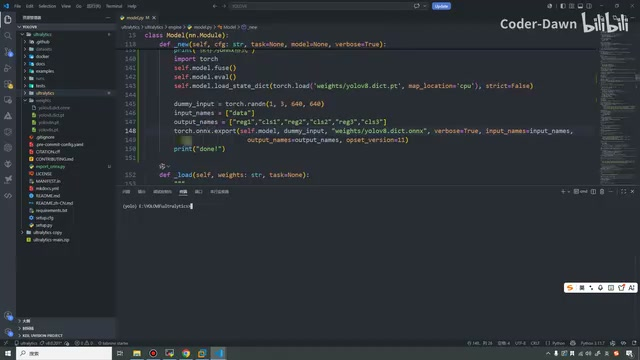

*Model 类中导出模型的代码画面 · [原片 02:00](https://www.bilibili.com/video/BV11DjT6uEhc/?p=34&t=120)*

## 导出 ONNX 与查看转换脚本

[从 02:01 回看原视频](https://www.bilibili.com/video/BV11DjT6uEhc/?p=34&t=121)

我们就在这里写了一个导出的文件。接下来进行导出，我先把之前的 ONNX 都删掉，然后重新生成。我们稍等一会儿。可以看到，现在已经生成好了，这个 ONNX 模型就有了。有了它，1.1“获取 ONNX 模型”就已经 OK 了。

有了这个模型之后，我们需要把它转换成 RKNN 模型。这里我已经把它挪过来了，和刚才生成的是一样的，大家也不用担心我这个是假的。就是为了方便，我已经拿过来了。这里我把之前的也清空一下。清空之后，执行这个转换程序，就可以把 ONNX 模型转换为 RKNN 模型。

那不然还是这样吧，我还是删掉，还是从这里复制过来吧，刚才在这里。好，这样就复制过来了。复制过来之后，我们简单地先看一眼代码。

首先上面是引入头文件，然后这里是原始模型、转换后的模型，以及是否要量化。因为如果转换为 float，就不需要量化，所以这里是 false。然后这是 YOLO 的八十个类别，接下来是三个头、网格大小、NMS 的阈值，另外一个是置信度阈值。这里是图片大小——

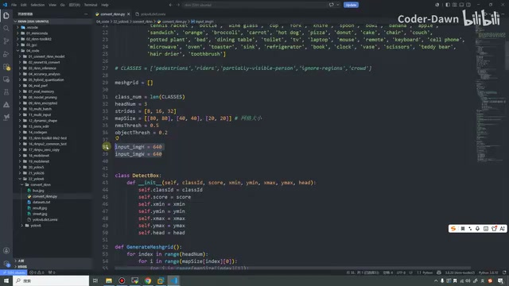

*转换脚本中的类别、网格与输入尺寸设置 · [原片 04:00](https://www.bilibili.com/video/BV11DjT6uEhc/?p=34&t=240)*

## NMS、后处理和 RKNN 导出流程

[从 04:02 回看原视频](https://www.bilibili.com/video/BV11DjT6uEhc/?p=34&t=242)

640×640。这里做了一个检测框的类，和之前都是一样的。唯一不同的地方，就是之前在 YOLOv26 的 NMS 当中，我们并没有真的进行 IoU 操作，因为 YOLOv26 去掉了 NMS，所以在它那个函数里面，我们只是进行了排序。而 YOLOv8 是需要的，所以这里真的就把它用了进来，这是一个不同的地方。

接下来是后处理。后处理也和之前一样，遍历每个头、遍历网格，然后计算置信度。置信度大于阈值，就进行后续处理，然后计算坐标，最终画一下。这就是我们的后处理。

后处理做完之后，第二个大函数就是导出 RKNN 模型，并且进行推理。这个和前面学的东西是一模一样的，相信大家应该非常熟悉了，因为前面已经看过特别多次了，这里就直接快速过一下。

首先初始化 RKNN 对象，然后进行配置，加载 ONNX 模型，再进行 build 构建。也就是用这个参数来确定是否是量化模型。现在上面是 false，所以它是非量化的。然后导出 RKNN 模型、初始化运行时环境，再进行模型推理。这就是第二个大函数。

接下来是 main 函数，在这里面做一下验证。首先准备一张图片，对这张图片进行简单的操作，就是 resize 和 BGR 到 RGB 的转换，然后增加一个维度，就开始——

## 修正文件名，生成 float 与量化模型

[从 06:03 回看原视频](https://www.bilibili.com/video/BV11DjT6uEhc/?p=34&t=363)

导出和推理。下面这里就是绘制检测框。也是先拿输出的列表，进行后处理，然后打印结果，包括最后也输出一下。这里贴上它的文字，最后把它写入文件，写到 result 里面。现在我把 result 也删掉，接下来执行一下。

它报错了。就是这个错，它说找不到这个文件。这里是这样的：上面原始模型叫 yolov8s，但是这里叫 yolov8，所以需要把名字改成 yolov8s，这样就 OK 了。再执行一下，可以看到 float 类型就转换出来了。

接下来把量化模型也转换一下。转换量化模型，就是把它改成 true 就好了，然后把名字改一改。量化模型也拿到了。拿到之后，1.2 这个步骤就做完了。在这里我也写了一下，我们会分别生成，这里会有一个 IoU 的具体使用。

接下来就是 1.3，进行测试。同样的，我在这里也打开了一个 VS Code。上节课是 YOLOv26，这节课是 YOLOv8，也和它在同一个目录、同一级下面。我也搞了一个目录，把代码挪了过来。挪过来之后——

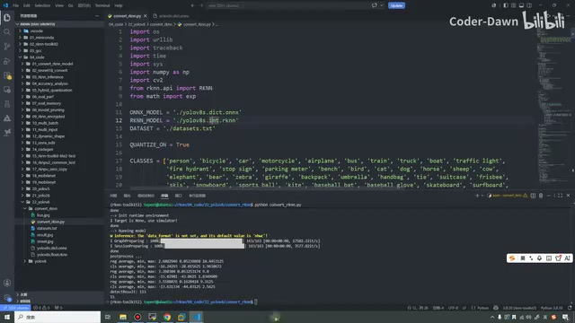

*量化开关打开后的转换输出 · [原片 07:20](https://www.bilibili.com/video/BV11DjT6uEhc/?p=34&t=440)*

## 传模型到开发板并构建

[从 08:03 回看原视频](https://www.bilibili.com/video/BV11DjT6uEhc/?p=34&t=483)

我们把这两个删掉，用刚才生成的换掉。〔此处转写“我们乱跳”不清，按随后替换模型的操作理解。〕我把刚才生成的这两个复制过来，但是复制失败了，有时候就会有这样的问题。我们就直接这样传过来。这个命令我也讲过，就是用 SCP，把模型传到开发板这个路径下面。

传完之后，就拿到了这两个模型。拿到之后开始测试。这里所有代码都在，但我们现在做的是基础测试，其他代码还用不到。不用这些优化的地方，其他代码和之前是一样的，所以我们就不看代码了，直接来测试。

这里需要注意，编译脚本和之前有点不一样，上面加了这两行。加它们的原因，是后面优化时加了一个多线程、线程池的方式，不加它就找不到这个库。现在也不用关心，只是我提前和大家说一说。

接下来也打开测试里面的环境，把这个虚拟环境退掉。我们就在这个目录下，进入 YOLOv8，然后在这里执行。等它进行构建。本来我习惯在原来的终端里跑开发板代码——

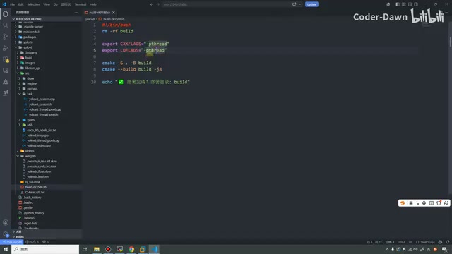

*构建脚本增加 pthread 相关设置 · [原片 09:23](https://www.bilibili.com/video/BV11DjT6uEhc/?p=34&t=563)*

## 开发板图片推理与视频测试准备

[从 10:11 回看原视频](https://www.bilibili.com/video/BV11DjT6uEhc/?p=34&t=611)

但是为了以后测试、改代码比较方便，我也在 VS Code 里面操作。大家一定要分清楚，这个是我们 3588 的终端。现在已经构建成功，也生成了 build 目录。我也不知道它在哪儿，好，在这里。

接下来测试一下，先清空。build 里面和 YOLOv26 其实一样，找到这个 yolov8，第二个参数是权重。我们先测试这个模型，再来测试图片。〔此处图片路径的转写不清，具体输入以源画面为准。〕这样就测试完成了，给我们生成了一个 result。我们来看一下，这就是它测试的结果。

除了这个，也可以测试 INT 的这个。把它关掉，可以看到这是 INT 这次生成的。那不然这样，把它删掉，重新进行。可以看到又重新生成了，框的颜色也变了，说明这确实是刚刚生成的。这就是第一步，YOLOv8 原版的测试。

这里我们还有一个忘了测试，就是测试一下视频，来看一下视频怎么样。这里是 yolov8，然后是 video——

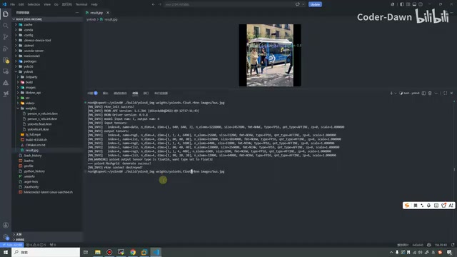

*开发板上的图片检测结果 · [原片 11:23](https://www.bilibili.com/video/BV11DjT6uEhc/?p=34&t=683)*

## 原版视频帧率对比

[从 12:11 回看原视频](https://www.bilibili.com/video/BV11DjT6uEhc/?p=34&t=731)

依旧是刚才的权重。我们先来看 float 类型。〔输入过程中有一句转写“里面有个饼银”不清。〕这样就已经开始测试了。来看 Method1 和 Method2，我在这里截张图，贴在这里，大家可以看鼠标这里。

可以看到，我们其实就是两帧左右——说错了，什么两帧，七帧！就是七点七几帧，七八帧的样子。下面 Method2，是一秒钟，一秒钟也就是七帧到八帧。这就是 float 非量化模型的帧率。

我们把它关掉，再来测试 INT。同样的，我随便找一个有 Method2 的地方截张图，这里有。我把它放大一点，可以看到就是十六帧、十七帧的样子，说明量化模型性能确实更好，跑得更快。可以看到十六帧、十六帧，不管是算法一还是算法二，都是十六帧。

我把它关掉，把这个也关掉。关掉之后，整个第一步就已经全部看完了，就是 YOLOv8 的原版测试。接下来来看第二步——

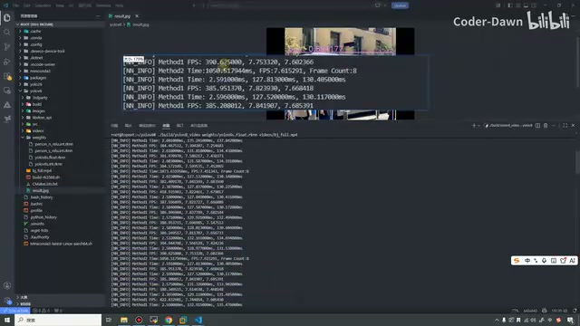

*原版 float 视频测试的 Method1、Method2 输出 · [原片 12:43](https://www.bilibili.com/video/BV11DjT6uEhc/?p=34&t=763)*

## Letterbox 的原理与示意图纠正

[从 14:11 回看原视频](https://www.bilibili.com/video/BV11DjT6uEhc/?p=34&t=851)

第二步，我把对应代码的部分也都会给大家讲一下。首先是 2.0，叫 Letterbox。Letterbox 是什么意思呢？之前对图片进行预处理时，我们只是做了 resize 操作。大家知道，resize 其实就是暴力地把图片拉缩，可能大家在电脑上也改过一些图片，暴力拉缩就会变形。变形其实就不利于整个推理、不利于检测，所以这里采用 Letterbox 方法。

它具体怎么做呢？它就是保持图像原始的宽高比，起到的作用就是防止物体变形。然后把它搞到这里，你看，是不是加了这些黑框？就是计算原图和目标尺寸图的比例，选择较小的比例进行等比缩放。缩放完，因为可能占不满，所以用黑色——一般都会用黑色——进行填充，让图像居中，最后到我们需要的尺寸上就可以了。

这就是 Letterbox 和 resize 的操作。不过这个图好像还有点不太对：原始图片是这样，Letterbox 到这里其实就已经结束了。这里这个箭头画得有点不太对。那不然我这样……我这样也擦不掉。〔最后一句原转写不清，画面正在修改示意图。〕

## 更正示意图，查看 Letterbox 代码

[从 16:11 回看原视频](https://www.bilibili.com/video/BV11DjT6uEhc/?p=34&t=971)

我可以这样。好，我重新改了一下，把它贴过来。左边的箭头应该要保留。我们看，这个是原始图片，这个是 Letterbox，相当于加了个黑框；resize 则是暴力拉缩。这就是两种方法的不同，Letterbox 这种方法对检测更有利。这就是第一点。

我们也在代码中看一眼。我先把这个关掉，对应代码在预处理部分。之前就是这个 image to tensor，现在变成 Letterbox。我们也看一眼，有 OpenCV，还有 RGA 版本，那我们看 OpenCV 的就可以了。

Letterbox 首先判断通道，然后拿到图片的宽和高，把相关宽高初始化为零。然后开始算，看它比较胖，还是比较瘦高，就是两种情况。拿到之后，去计算要填充的，再进行填充。这里也有示意图，这是源图，这是目标图，就是这样填充，用的也是 OpenCV 里面的函数。这就是 Letterbox 进行的操作。之前——

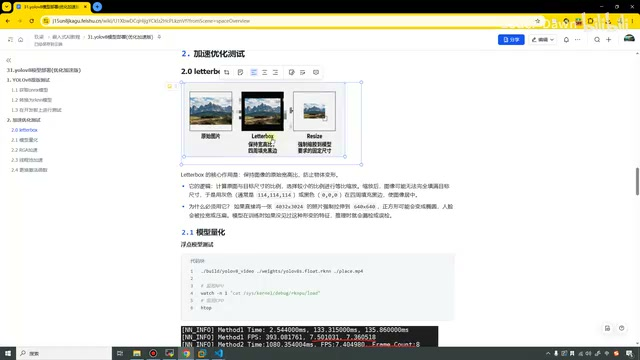

*纠正后的 Letterbox 与 resize 示意图 · [原片 16:53](https://www.bilibili.com/video/BV11DjT6uEhc/?p=34&t=1013)*

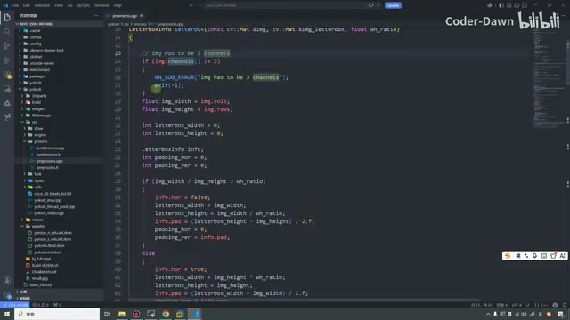

*OpenCV Letterbox 的尺寸与填充计算 · [原片 17:33](https://www.bilibili.com/video/BV11DjT6uEhc/?p=34&t=1053)*

## 量化效果与 NPU、CPU 监测

[从 18:12 回看原视频](https://www.bilibili.com/video/BV11DjT6uEhc/?p=34&t=1092)

就是进行 BGR 转换和强制的 resize，这是和之前不同的地方。下面 RGA 版本其实也一样，只不过用 RGA 的库，方法、思路和上面一模一样。

看完这个之后，这一步其实也没什么测试的，因为刚才测试时，代码中已经包含了这个部分。接下来才是真正要优化的。第一个优化的地方就是把模型量化，其实刚才都已经看过了：不量化时帧率是七点七到八帧，量化后是十六到十七帧。

这里是什么意思呢？我们也监测了一下 NPU。那这样，我把它也监测一下，放在开发板上这样监测，顺便也监测 CPU。现在看到 CPU 很空；没有进行推理的时候，三个核心都是零。

接下来在这里执行一下。首先这个是量化类型，来看一下，它差不多占到百分之五十三、五十四、五十五，就是五十多一点。CPU 其实占得也不多，只有这一点。这是量化的。再把它关掉，看一下 float 非量化的。其实都差不多，可以看到非量化好像稍微高一点点——

## RGA 加速的异常与当前限制

[从 20:12 回看原视频](https://www.bilibili.com/video/BV11DjT6uEhc/?p=34&t=1212)

五十三、五十五、五十七，但是总体差不多，没差多少。CPU 这块也差不多，好像也是稍微多一点点，但是没差多少，基本上没什么区别。我们关掉它，这样就给大家演示完模型量化了。

第二个，2.2 这里是 RGA 加速。但是经过实测，我把版本都升到最新版本了，而这个代码比较旧。我也拿了一个较新的 RGA 库，它还是会报异步异常。这个我还没来得及处理。大家感兴趣，可以去测试、调试一下。我告诉大家代码在哪一块。

在 YOLOv8 这里，现在开启的是 OpenCV 预处理；如果把下面打开，就是使用 RGA 预处理。预处理就是这一块，RGA 版本的 Letterbox，还有 RGA 版本的 resize。总之就是这么一个东西。

经过测试，异步现在校验得更严格，需要加一个文件描述符，还需要显式加异步或者同步标记。总之就是这样。而且我测试 RGA，其实和 OpenCV 没差多少，也可能是因为我们就推理一个简单的东西，导致没有差很多。

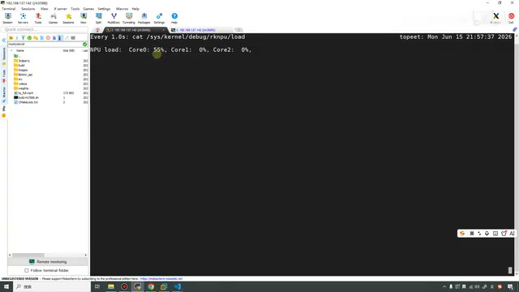

*float 测试时查看 NPU 核心负载 · [原片 20:13](https://www.bilibili.com/video/BV11DjT6uEhc/?p=34&t=1213)*

## 线程池结构与程序入口

[从 22:12 回看原视频](https://www.bilibili.com/video/BV11DjT6uEhc/?p=34&t=1332)

这个留给大家调试，我就不再演示了。接下来是非常重要、一定要去做的：线程池加速。

简单讲一下，我们 RK3588 有三个核心，支持三个核心一起合作，也支持两个核心合作，也支持一个核心工作，可以使用线程池进行加速。线程池是一种常见的并发编程模型，主要用于管理和复用线程，提高多线程的性能和效率。

主要就是有一个线程 A，读取视频流；有一个线程 C，进行推流或者写入文件，也就是拿到结果后的处理；线程 B 就在这里开启线程，进行推理，以及预处理、后处理这些操作。这就是线程池工作的原理。这里这些文字我们也都不看了，工作线程一般都叫 Worker。

接下来过一眼代码。首先是这个入口文件，我们直接从 main 函数开始看吧。前两个参数大家都知道，第三个参数是线程池数量的参数。接下来实例化线程池，然后读取视频，再启动这个取结果的线程，拿到结果。

读取视频和拿到结果，我们都可以看一下。这会儿好像跳不过来，我就直接打开上面。读取视频帧的线程，主要做这么个工作：第一步读取视频——

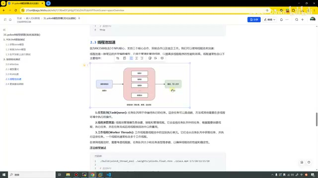

*线程池的读取、工作线程和结果处理示意 · [原片 22:53](https://www.bilibili.com/video/BV11DjT6uEhc/?p=34&t=1373)*

## 读取视频、取结果与线程池接口

[从 24:14 回看原视频](https://www.bilibili.com/video/BV11DjT6uEhc/?p=34&t=1454)

读取视频之后，获取视频尺寸和帧率，输出打印信息。接下来就是 while true，不停地读取视频。最后提交任务，使用线程池里面定义的这个函数去提交，这就是读取的效果。

取结果和之前类似，我们看一下这个函数。在开始的时候搞一个时间，开始操作之后，这一块获取图片结果。获取完、结果没有问题后，在这里计算一秒钟处理了多少张图片。这里也找一个时间，两个时间相减、相除，最终就计算出帧率了。

这个和 YOLOv26 时看的那个东西——YOLOv5，我也忘了——其实是一样的。这个操作执行完成，就关掉所有线程。总体流程就是这样，也就是图里说的：一个线程读取，一个线程拿结果，还有线程做处理。

做处理这块怎么体现呢？主要在这里。先看一眼头文件，上面定义一些变量，我们主要看函数。setup 是初始化，这个是任务提交。下面一个是获取检测框，还有一个是获取结果，顺便把图片绘制了——

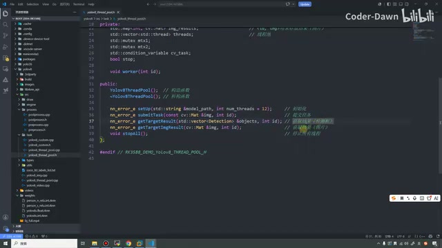

*线程池头文件中的接口 · [原片 26:12](https://www.bilibili.com/video/BV11DjT6uEhc/?p=34&t=1572)*

## 线程池初始化、worker 与任务提交

[从 26:16 回看原视频](https://www.bilibili.com/video/BV11DjT6uEhc/?p=34&t=1576)

最后这个就是停止所有线程。上面是参数，包括用到的锁、条件变量。这个在多线程操作中几乎百分之百会用——还是百分之九十九点九吧。然后这里定义线程池。map 容器用来存放结果，这个 result 也用来存放结果，上面是检测框，下面是图片。这个是 YOLOv8 的实例，上面用来存放任务，用了一个队列。

接下来简单过一眼代码。首先是初始化，遍历一下到底有多少线程，有多少就开启多少线程进行处理。在线程里面加载模型，放在 YOLOv8 实例里面，就是这么一个操作。里面也插入这个参数，worker 就是真正工作的。

线程里面也可以看一下：只要没有 stop，就一直执行。里面获取模型实例、获取模型任务，然后运行模型，调用的就是 run 函数，最后保存结果。

下面任务提交这个函数也非常简单，在这里加了一个判断：任务队列里的任务大于十个，就等待一下，避免内存占用过多。包括下面这个 notify_one，这其实就是生产者、消费者模式，一个线程生产，一个线程消费，对应到这里就是这两个线程。

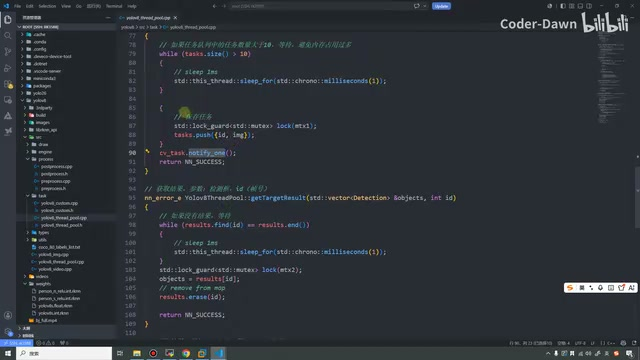

*任务提交及结果获取相关代码 · [原片 28:12](https://www.bilibili.com/video/BV11DjT6uEhc/?p=34&t=1692)*

## 结果获取和单线程测试

[从 28:18 回看原视频](https://www.bilibili.com/video/BV11DjT6uEhc/?p=34&t=1698)

这里获取检测结果也是一样：没有结果就等待，有结果就取。这个是获取结果图片，还有一个是检测框。图片和上面也一样，这里是检测框，这里是图片，两者基本上没什么太大区别。最后针对线程，把它关掉，通知一下就可以了。

这就是整体代码流程，大家下来再仔细研究代码。看完之后，我们直接测试。我先清空，同样在 build 下面，这个是 YOLOv8 的 thread pool，然后是 YOLO 权重。我们先来看一下这个模型。〔此处口述“量化”，后文明确本轮是 float，画面中的权重也为 float，保留这处口述差异。〕依旧是这个视频。〔视频路径输入时有一句转写不清。〕

这里看开启多少个线程，首先填一个 1，就是开启一个线程。可以看一下，帧率是六七帧、七八帧的样子。再等它运行一会儿，运行时也来看一下 NPU，也就百分之六十不到。CPU 也占得不太多。接下来关掉它，刚才只开了一个线程，现在来开启——

## 增加线程数及 float 模型瓶颈

[从 30:19 回看原视频](https://www.bilibili.com/video/BV11DjT6uEhc/?p=34&t=1819)

五个。开启五个后，可以看到帧率明显提升，现在变成二十一帧、三十帧，就是二三十帧了。再监测一下，可以看到三个核心都开始工作了，八十八、七十三、六十七，还有空间。CPU 这块也明显比刚才多了不少。

把它也关掉，直接拉满，来十五个。但是大家有没有发现，即使开启十五个线程，帧率好像提升也不多，现在三十多，到三十八，可能就是三十多。再看一下，三个核心差不多快占满，都是九十多；CPU 也又增加一点。

我们再增大一下，比如来到十九个。可以看到，十九个线程后帧率并没有多少提升，还是三十到三十八之间，说明能力可能也就到这里了。包括这里，三个核心刚才都到九十七了；CPU 又多一点点，百分之五十多。大概就是这样。

这个是 float 模型。接下来看 INT 模型，先开启一个，还是和之前一样，十六帧、十七帧，只有一个核心在工作。〔此处转写出现短句重复碎片，无法据此恢复额外讲述。〕然后也直接把它拉满——

## 量化模型多线程测试与激活函数

[从 32:21 回看原视频](https://www.bilibili.com/video/BV11DjT6uEhc/?p=34&t=1941)

直接来到十五个。十五个线程，可以看到已经达到八十帧左右，中间七十八、八十一、八十六，就是八十帧左右。看一下三个核心，差不多平均也到九十了，CPU 这个也到七十五了。十九，我们试着再增大一点，搞到十九个线程。

可以看到，十九个线程之后，性能其实没有多少提升，也就是八十帧左右，总体是八十帧。再来看，三个核心也是九十多，这里 CPU 也是七十多，差不多就是这样。

这就是多线程。可以看到，多线程是真的有用，而且提升真的非常非常大。这也是我们 3588 这种，可能更高的板子，它有三个核心的优势。

最后一个步骤就是更换激活函数。这个其实非常麻烦，这里我给大家讲解一下，就不再带大家去做了，直接进行测试。我们 YOLO 系列使用 SiLU 函数运算，但是经过实测，其实用 ReLU 激活函数性能更好。稍微了解机器学习、深度学习的大家都知道，ReLU 用得非常非常多。下面是它的一张图，这个 ReLU 的性能也更好——

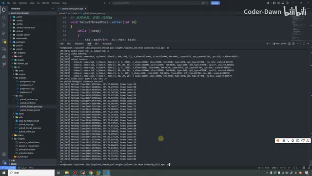

*量化模型多线程运行的终端输出 · [原片 32:55](https://www.bilibili.com/video/BV11DjT6uEhc/?p=34&t=1975)*

## 替换激活函数、重训和导出

[从 34:21 回看原视频](https://www.bilibili.com/video/BV11DjT6uEhc/?p=34&t=2061)

如果更换激活函数，模型需要从头训练，再重新导出 ONNX，重新转换为 RKNN 模型，要进行全链路的操作，非常耗费时间。这个我就不再做了，给大家讲应该怎么做。

首先在之前 Windows 下面的文件中找到它，更换激活函数。在 nn、modules 里面有一个 conv.py，把这里 SiLU 改成 ReLU，大概就在这个位置。就是它，把 SiLU 注释掉，把下面这个打开，这样就把激活函数更换了。其实只进行了这一个操作，别的操作都没有做。

改完之后，需要从头训练模型。这里注意，和 YOLOv26 不同：之前加载的是预训练模型，这里就不要再加载它了，直接训练就可以。这里是训练的一些参数。训练完成之后，就得到了这个 ONNX 模型。〔此处按口述保留；前文已经明确还需导出 ONNX，不应把这句话理解成训练直接输出 ONNX。〕

拿到 ONNX 模型，再导出 RKNN 模型，然后测试。步骤和刚才一样，就不做了。这个代码也是我从网上找来调试的。这里我把这两个东西拿过来，一个是 n 模型，一个是 s 模型，是重新训练过后的模型。因为这两个模型在训练时只有五个类别——

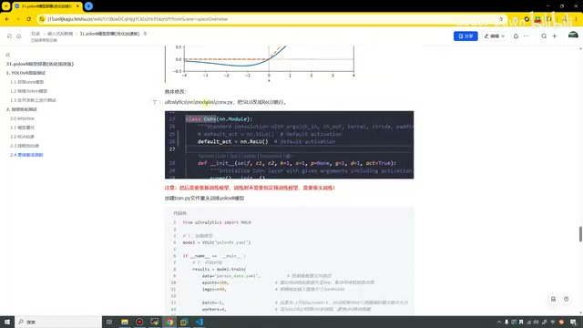

*更换激活函数所在的 conv.py 示例 · [原片 34:55](https://www.bilibili.com/video/BV11DjT6uEhc/?p=34&t=2095)*

## 五类别适配及 s 模型测试

[从 36:22 回看原视频](https://www.bilibili.com/video/BV11DjT6uEhc/?p=34&t=2182)

所以代码也要相应修改。第一个修改的就是这里：原本是八十个分类，这里改成五个分类就可以。还有一个需要修改的是后处理，原本也是八十个类别，也改成五个类别，这是需要去修改的。

修改完之后，再来编译一下。可能还有点多了，直接来编译吧。编译完，再来测试，主要就是更换模型。〔测试命令输入时此处转写不清，具体以画面为准。〕

先测试大一点的 s 模型，线程就先这样，开一个。这次发现，即使只开一个，也达到二十多帧。之前如果没记错，好像是十六到十七帧，现在是二十多帧。

把它关掉，试一下开启十五个线程。十五个线程直接达到九十多帧，一百帧也出来了，就是九十多帧。平均也有——

## s、n 模型性能和资源占用

[从 38:22 回看原视频](https://www.bilibili.com/video/BV11DjT6uEhc/?p=34&t=2302)

九十五到一百之间吧，差不多。再试一下，开到十九个，我们差不多已经到一百帧左右。来看一下，三个核心基本拉满了，CPU 也快拉满了。这是十九个线程。

再增大一点，改成二十一个。改成二十一个后，发现性能好像没什么提升了。再看一下，也和刚才差不多，说明性能瓶颈就在这里，甚至十九个线程的时候性能好像还更好一点。再看一眼，好像也差不多。总体就是这样，一百帧左右，接近一百帧，这是 s 模型。

再来看 n 模型，就是更小的模型。先看一个线程。〔此处参数口述的原转写为“122是3”，无法确认，不补写具体数值。〕现在 n 模型一个线程也是三十多帧，明显比刚才好了一点。这个核心反而占得比较少，只有三十多，CPU 这里也不多。

接下来拉满，看十五个线程：一百一十帧、一百二十六帧、一百三十三帧，已经达到一百二十帧以上。再来看一下，好像 CPU 已经快不行了，NPU 这里其实还挺少。可以看到还挺少，只有六十、五十、三十多——

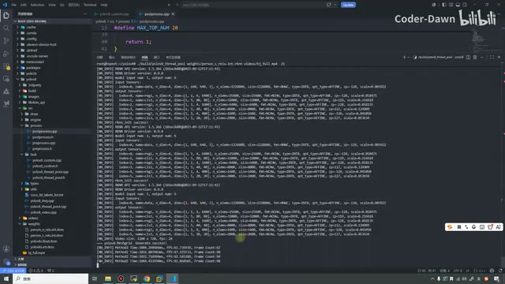

*s 模型多线程测试输出 · [原片 38:55](https://www.bilibili.com/video/BV11DjT6uEhc/?p=34&t=2335)*

## n 模型瓶颈与课程收尾

[从 40:22 回看原视频](https://www.bilibili.com/video/BV11DjT6uEhc/?p=34&t=2422)

帧率也就到这个瓶颈了，好像没什么能提升的地方。再试着改到十九，一百三十二。十九个线程好像又提升了一点点，平均值好像又高了一点点，还是一百二十到一百三十帧左右。那我把它也关掉。

到这里，优化方式都已经讲完了。其中 RGA 没有和大家讲，因为有一些问题，我也还没来得及调试。

总之，一定要做的是线程池加速和模型量化。在瑞芯微的这个板子上，量化模型的性能明显远超过非量化模型，差不多提升一倍。更换激活函数也是比较建议做的，提升也很大。像 Letterbox，我也觉得这个代码一定要做，免得检测时出现一些错误情况。

讲完这些，这节课也就讲完了。最后也感谢大家观看，谢谢大家。

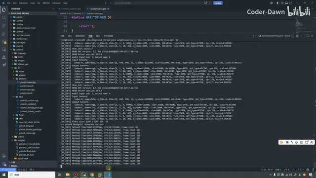

*n 模型多线程性能测试输出 · [原片 40:55](https://www.bilibili.com/video/BV11DjT6uEhc/?p=34&t=2455)*
