# P35 · 32_Deepseek_Qwen大模型部署

> 清理式忠实图文讲稿，按原课顺序保留讲述；来源为课程第35分P，原片时间00:00–19:33。
> 源视频为640×360，截图细字受原始分辨率限制。个别未清原词在邻近处标注。

## RKLLM 基本介绍

大家好，欢迎来到我们课程的最后一讲，第32讲：DeepSeek、Qwen 大模型部署。也是恭喜大家，马上就要大功告成了。这节课我们分成三个部分：第一个是 RKLLM 的基本介绍，第二个是搭建开发环境，第三个是具体的模型部署。我们一个一个来看。

看到这幅图，大家有没有一种似曾相识的感觉？在最前面我们学习模型转换的时候，也有一张类似的图，甚至结构和形状画的都是一样的。我们来看这个大模型的图：左侧是 Hugging Face 上的一些模型，像我们的 Llama、Qwen 等等；中间是我们的大模型工具链，它的作用就是把我们的常规模型转换成 RK 的大模型。最后再使用我们的运行时库、驱动、硬件，基于这一套进行模型部署、模型推理。这就是它的基本介绍。

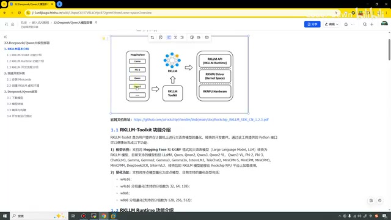

*RKLLM 工具链与运行时、驱动、NPU硬件的关系 · [原片 00:48](https://www.bilibili.com/video/BV11DjT6uEhc/?p=35&t=48)*

### RKLLM-Toolkit 功能介绍

接下来我们逐个来看比较核心的几个部分。第一个是 RKLLM-Toolkit 功能介绍。这个工具也和前面那个工具的功能类似，它最重要的，第一个就是进行模型转换，其中支持这么多种模型；第二个是可以进行量化。量化就包括这几个格式：W4A16、W8A8，还有这两个主要可以支持的分组数。这就是它的功能，主要就是转换和量化。

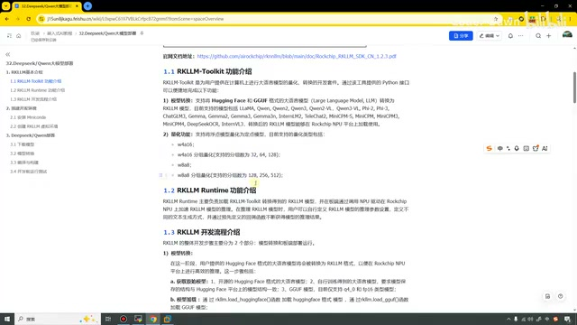

*RKLLM-Toolkit 模型转换与量化功能以及 Runtime 说明 · [原片 01:48](https://www.bilibili.com/video/BV11DjT6uEhc/?p=35&t=108)*

### RKLLM Runtime 功能介绍

RKLLM Runtime 就是我们的运行时库。

它负责加载我们的 RKLLM 模型，在开发板上通过调用 NPU 驱动，在 RK 的 NPU 上加速我们 RK 大模型的推理。这就是运行时库的基本介绍。

### RKLLM 开发流程介绍

第三个就是 RKLLM 的开发流程介绍。主要有两个大流程：第一个是模型转换，第二个是板端部署。这个和我们前面学的那些是一模一样的。

在模型转换这一块，我们就需要先获取原始模型，然后再进行模型加载，再进行量化，最后进行模型导出。就非常熟悉了。如果再看到这里，可以看到获取原始模型，我们就去下载就行了；加载模型，同样用的是 load 这个 API，只不过这里我们 load 的是 Hugging Face 而已；量化依旧是 build；导出的时候依旧是 export。这个和之前其实都一样。

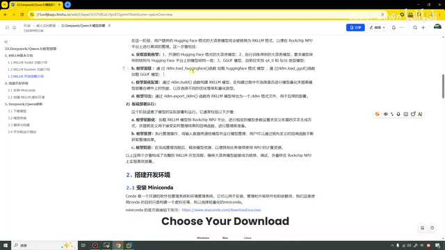

*模型转换和板端部署两条流程 · [原片 03:00](https://www.bilibili.com/video/BV11DjT6uEhc/?p=35&t=180)*

第二个是板端部署。板端部署，我们就是同样加载 RKLLM 模型到 NPU 平台。在前面进行部署的时候，我们是不是也是有一个 init 这样的函数，然后再进行 query、查询操作，然后设置输入、设置输出，就是 set input、set output，然后我们就可以进行推理？推理完成之后，就可以获取结果，之前的流程是这样的。在这里其实也是类似的，最后就把资源进行释放，和前面学的都一样。这就是基本介绍。

## 搭建开发环境

### 安装 Miniconda

第二点，我们来看怎么搭建开发环境。同样的，我们需要安装一个 Miniconda。

这个已经安过很多次了，就不再演示了。按照这个步骤进行安装就可以了。

### 创建 RKLLM 虚拟环境

安装完之后，我们再为它创建一个虚拟环境。在这里建议大家是 Python 3.10 版本，或者 3.12 也可以，就是最低是 3.10。如果你的 Python 版本过低，后面在运行的时候，它会直接提示你版本过低，不让你进行安装。

接下来这个步骤，我也演示一下。在这里我就创建一个 `rkllm2`，然后输入一个 yes。创建好了之后，就把它激活。好，已经到这里了，到这里之后我们再去安装它就可以了。

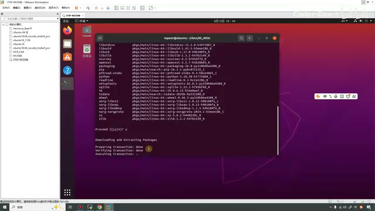

*创建 rkllm2 环境时的安装完成提示 · [原片 05:00](https://www.bilibili.com/video/BV11DjT6uEhc/?p=35&t=300)*

这里我们需要注意，也和之前一样，我们就得去这个目录。在这里我已经放好了，就是这个目录下面。我们看一下，到 `rkllm`，然后到 `rkllm-toolkit`。这里面有一个 packages，不然我把它复制过来，好吧？它是里面有个……把它复制到当前目录。好，我们需要进入这个目录里面。

然后在里面再进行执行。在这里我也写一下，我们需要 `cd`，然后到这个 packages，再执行它，等待一会就可以了。这个速度好像也不是特别快，那就稍微再等待一会，我们继续看下面的内容。

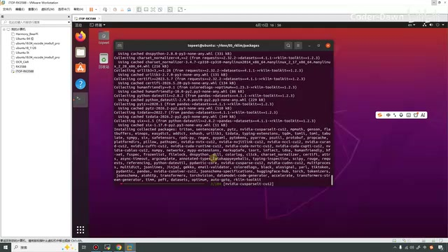

*进入 packages 后执行工具包安装，终端正在处理依赖 · [原片 06:48](https://www.bilibili.com/video/BV11DjT6uEhc/?p=35&t=408)*

## DeepSeek / Qwen 部署

### 下载模型

下面我们就需要下载我们的模型。官方这个模型使用命令去下载，你有很大的概率会下载失败，所以这里建议大家直接去魔搭社区。

在这里可以看到拥有这个模型，DeepSeek-R1。进入这个页面之后，我们直接点击“下载模型”，它就会提示我们需要先安装它。安装好了之后，我们就可以下载这个模型了。下载模型，这两个我都试过，都可以，就是上面这个或者下面这个都是可以的，也就对应着我们这里的部署。

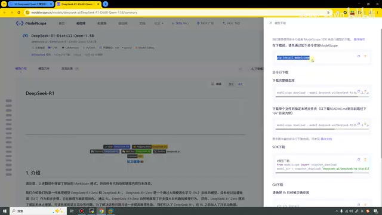

*魔搭 DeepSeek 模型页面的下载模型侧栏 · [原片 07:36](https://www.bilibili.com/video/BV11DjT6uEhc/?p=35&t=456)*

如果大家想做其他的模型，那也可以点到首页，首页会有模型库，大家在这里找一找其他的模型。但是要注意，我们不要找太大的模型。我们这开发板的资源也是有限的，像我的这个型号应该是 8G，8 加64吧，好像是这样，所以……

最大就是搞个7B就差不多了。大家可以根据自己板子的型号去选择。这里就是下载模型，模型我已经下载好了。

### 模型转换

下载完模型之后，我们就需要进行模型转换。我先看一下，它也已经搞完了，那我们就再退出来。

模型转换是这么一个步骤：首先就在这个 `rknn-llm-main`，这个就是官方的 LLM 仓库，我把它都下载下来了。里面在工具链下面有 examples，然后有 `custom_demo`，就是把这个 demo 复制到和模型同一级的目录，然后再去执行，就是执行这个代码就可以了。在这里我还是跟上面的结果保持一致，然后执行它。执行完之后，我们修改一下这个，就是需要把这个路径修改为自己模型存放的路径，最后再进行导出。

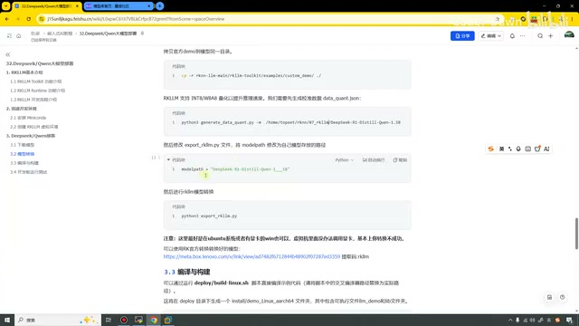

*模型转换文档：custom\_demo、模型路径和导出步骤 · [原片 09:36](https://www.bilibili.com/video/BV11DjT6uEhc/?p=35&t=576)*

这里我写好了注意点，就是最好在有显卡的 Ubuntu 系统，或者有显卡的 Windows 系统下进行转换。虚拟机里面没有办法调用这个显卡，基本上转换失败的概率很大，因为转换的时候速度其实特别慢。我这里用的也是一个虚拟机，所以这台电脑之前我也试了，没有转换成功；我在另外一台电脑上是成功的。

但是大家也不用担心，RK 官方也给我们提供好了转换好的模型。

我们直接打开它，从这里去下载就好了。这里是各个版本，它加了个1.3，结果里面是空的，那我们就下载这里了。我们是3588，这里有 Qwen 4B，有 DeepSeek OCR，然后有2B。里面有两个，下面这个是视觉的，上面这个就是完整的，我们下载上面这个就可以。可以看到下面这个也很小，下面只有800兆，上面有两个G。

我也看了一下，DeepSeek 的话是三个G。为了方便，我就直接下载了 Qwen 的这个2B，它会稍微小一点。

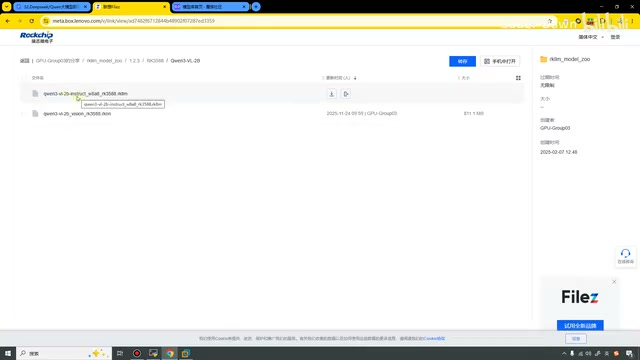

*RK3588 Qwen3-VL-2B 目录中的模型文件 · [原片 10:48](https://www.bilibili.com/video/BV11DjT6uEhc/?p=35&t=648)*

### 编译与构建

把这个模型下载好了之后，或者说我们通过上面的步骤进行转换，都是一样的。做好之后，我们就可以进行编译构建了。接下来我也演示一下，也是到这个目录下，然后这里，进入……它里面有个，还是到这里吧，这里是 deploy。我们就到这里。哦，它好像不在这里，那我再找一找，我们看看，我突然忘记它在哪里了。

在这一个，然后到这个 RKLLM API。对，这里到 deploy，我们进入。在这里我之前已经编译过了，那我先把这个 install 目录删掉。

这里我们需要注意，有一个地方需要修改，就是这个 `build-linux.sh`。我给大家说一下修改哪里：就是在这里，我们需要把 GCC 的交叉编译工具改成我们自己的。之前我有试过用 export 导出，但是当时没成功；直接在这里面修改就可以了。

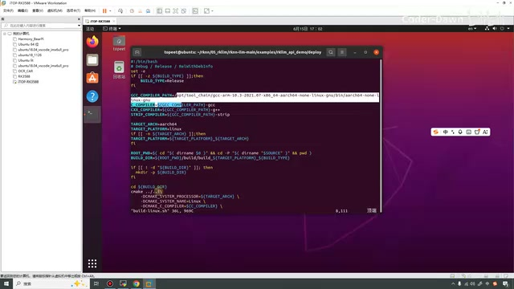

*build-linux.sh 中 GCC\_COMPILER\_PATH 的修改位置 · [原片 13:12](https://www.bilibili.com/video/BV11DjT6uEhc/?p=35&t=792)*

把它修改好之后，我们就可以进行构建了，直接执行就可以了。好，它已经执行成功了，只是速度特别快，快到我都以为执行失败了。然后就有这个 install 目录，和之前的都是类似的。我们把这个目录看一眼，这里就有我们的可执行程序，还有我们的库，把它传送到开发板上就可以了。

同样的，我使用 scp 命令，然后把它传过去。

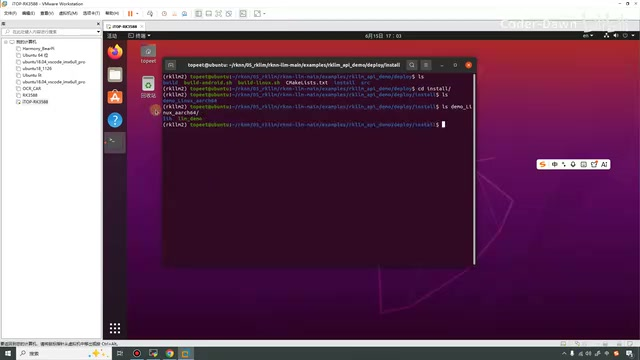

*构建产物中的 llm\_demo 与 lib · [原片 14:00](https://www.bilibili.com/video/BV11DjT6uEhc/?p=35&t=840)*

然后就传到 root 吧。好，我们再进入开发板这里，直接 `ls` 一下，这个就是我们刚刚传过来的。里面就和刚才上面看的一样，有着 lib 库，还有这个可执行程序。但是我们现在还没有转换好的模型，刚才我们不是已经下载了吗？把下载的模型拿过来用就可以了。

我在之前测试的时候，在这份代码里面已经保存了一个了，再给大家看一下。当时保存的是这个 Qwen，所以说把这个模型复制过来就可以了。

然后把它下面的 Qwen 模型复制到 demo 里面。这个用 `mv` 移动也行。我们进入这里，可以看到现在就有了可执行程序，也有了模型，然后也有了库。接下来就来执行一下。

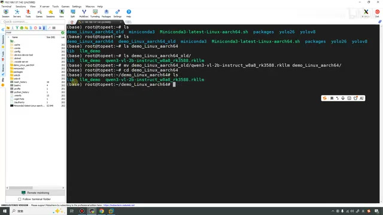

*板端 demo\_linux\_aarch64 目录中已放入模型、程序和库 · [原片 15:36](https://www.bilibili.com/video/BV11DjT6uEhc/?p=35&t=936)*

### 开发板运行测试

在这里，步骤都已经做完了，接下来就到这一块，在开发板上进行运行测试。这里也写了一下，由于加载我们的大模型会打开很多文件，而默认情况下，每个进程可以打开的文件数是有限制的，所以我们输入一下它，限制一下我们的文件描述符。我们也输入一下。接下来导出一下这个库，然后我们就可以执行这个程序了。

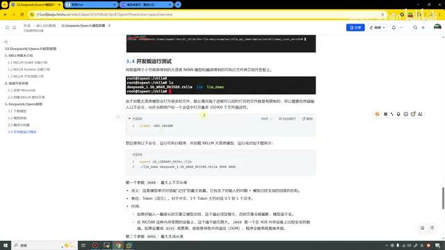

*开发板测试文档中的文件描述符限制和库路径设置 · [原片 16:12](https://www.bilibili.com/video/BV11DjT6uEhc/?p=35&t=972)*

就是执行这个模型。这里执行的方法，第一个参数是可执行程序，第二个是模型，然后第三个、第四个是2048和4096。2048的含义是最大的上下文长度，4096代表最大的生成长度，在这里有具体写。

好，来测试一下：第一个是可执行程序，第二个是模型路径，第三个是2048、上下文，第四个是输出长度4096。让它放下来。

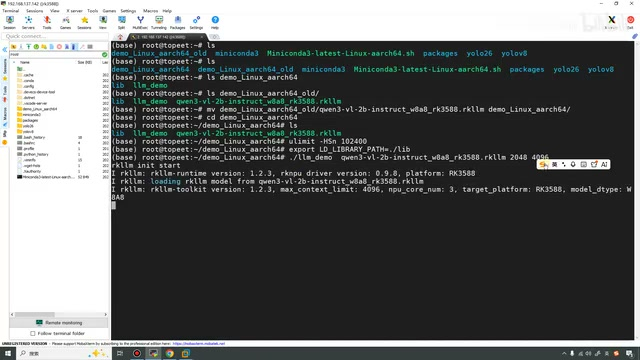

*板端启动 llm\_demo，加载 Qwen 模型 · [原片 17:12](https://www.bilibili.com/video/BV11DjT6uEhc/?p=35&t=1032)*

可以看到，现在出现这个界面，就代表我们已经执行成功了。它有两个预置的问题，就是预置的“一凸凸凸凹”[此处口述原词未清；画面预置问题开头为“现有一笼子，里面有鸡和兔子若干只”]，还有“28个小朋友”什么的。我们输入0和1，就可以测试这个。我们输一下，你看，输入1之后，它现在就在测试这个东西了。但是输出速度会稍微慢一点，我们就稍微等一下。

你看，它已经把所有的过程给我们分析了，跟我们在网页版使用 Qwen、DeepSeek 都是差不多的，就是这样。

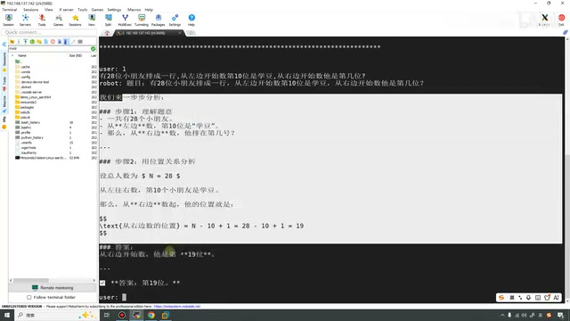

*预置28个小朋友问题的推理过程与答案 · [原片 18:00](https://www.bilibili.com/video/BV11DjT6uEhc/?p=35&t=1080)*

我们再问它一个问题：“你是谁？”然后它也可以告诉我们，它是通义千问，然后怎么怎么，说了一大堆话。我们再问它一个问题：“9.10和9.9谁大？”我们再来看一下这个古老的问题。

它现在还可以，还比较聪明，能判断出来这个9.10小于9.9。在非常古老的时候，它可能都识别不出来。

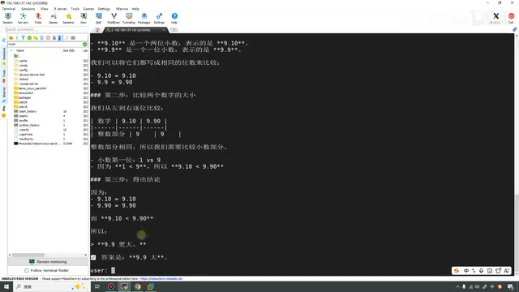

*9.10 与9.9比较问题的模型输出 · [原片 19:00](https://www.bilibili.com/video/BV11DjT6uEhc/?p=35&t=1140)*

好，经过这几个测试，我们也已经把模型部署到了开发板上。讲到这里，这节课就讲完了。这节课讲完，我们整个嵌入式 AI 入门的篇也已经讲完了。最后也是感谢大家观看，希望大家可以一键三连支持一下 UP 主。在这里也是谢谢大家，再见，再见。
