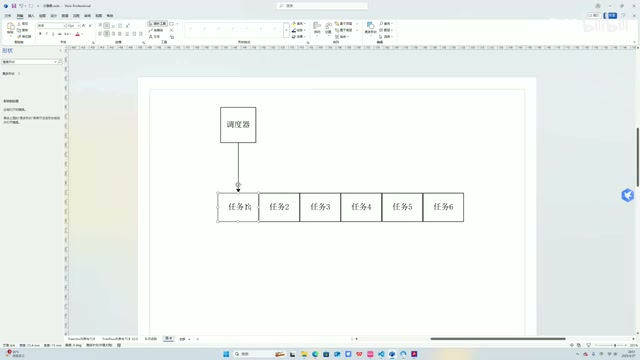
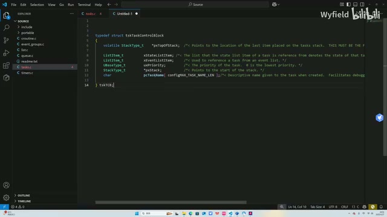
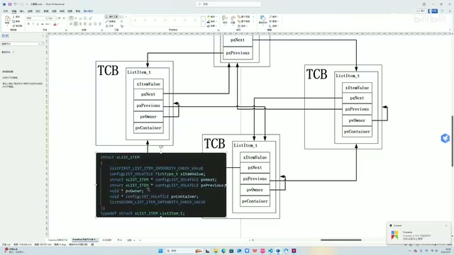
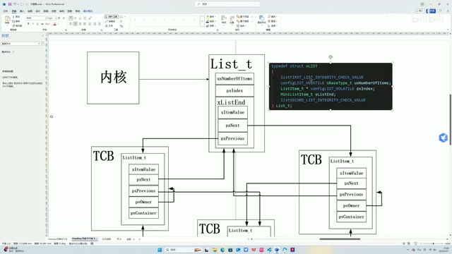
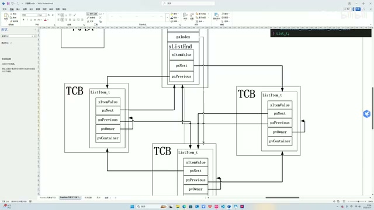
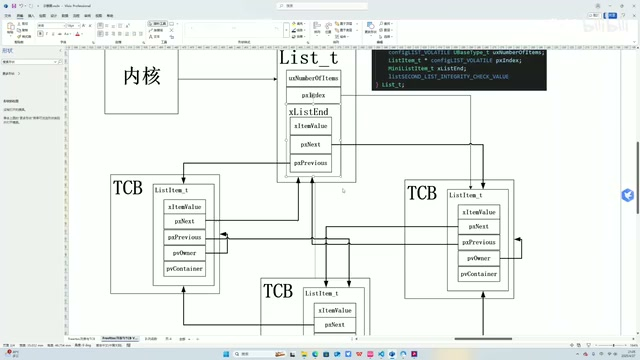

# FreeRTOS 源码详解 P01：列表–概述

> 忠实整理讲稿；来源 P01，00:00—09:54。保留讲者原有解释和示例。原始画面为640×360，小字清晰度受源分辨率限制。

## 为什么从列表开始

大家好，这个视频主要带着大家一起来读一下 FreeRTOS 的源码。这是第一个视频，打算从列表这个软件模块开始。

那为什么要从列表开始呢？就不得不说内核里面很重要的一个数据结构，就是 TCB，任务控制块。我们所有的任务，为什么可以周期性地轮询执行呢？我们首先有一个任务列表。假如全局现在有六个任务，处在 ready、可调用的状态，调度器可以理解成有一根指针。第一个调度周期，它指向任务一，把任务一里面相关的函数拿出来执行，执行一个任务周期，假设是一毫秒。

*调度器与六个任务的简图 · [原片 01:00](https://www.bilibili.com/video/BV1fmL6ziEhA/?p=1&t=60)*

一毫秒执行完了，到第二个调度周期，这个指针加加，任务二；第三个周期，任务三，就是这样轮询、这样循环。所以说，这就是列表。我们 FreeRTOS 的任务调度高度依赖于列表，因为它依赖这个列表的轮询调用，所以非常重要。FreeRTOS 的核心功能就是任务调度，任务调度又依赖于列表，所以很有必要先从列表开始讲。

## 任务以什么实体放进列表

为什么要讲 TCB 呢？我们这个示意图把任务放进去，那它是以什么样的实体放进去的呢？就是任务控制块。换句话说，把那个简图变得复杂化，就是这样。

## TCB 中的栈、名称、优先级和列表项

这是 TCB，这就是一个 TCB 的数据结构。这个结构体，第一个成员是栈顶，然后这个成员是栈。这两个成员跟函数调用有关系。任务所执行的轮询 task 函数的指针，是存在栈里面的。同时，这些中间变量、寄存器的值，我们任务切入切出时的现场保存，都是存在栈里面的。

*TCB 的精简结构体：栈顶、列表项、优先级、栈和任务名 · [原片 03:00](https://www.bilibili.com/video/BV1fmL6ziEhA/?p=1&t=180)*

调度器通过 TCB 找到相应的栈，依赖这个栈顶指针，找到相应的栈、相应的函数、相应的变量，来实现任务调度。这两个是任务调度相关的。

然后这个是方便于我们调试的一个字符串，可以说是这个任务的名字。这个是任务的优先级，一样也是存在 TCB 里面。然后这两个就是今天要讲的重点了，顾名思义，名字叫列表项。TCB 之所以能放在列表里面，就高度依赖这样的列表项。

## 把列表项的数据结构放进示意图

然后我们看一下列表项的数据结构。这是列表项的数据结构，把它粘到这个示意图里，这边对比着看。

## 列表项的取值和前后指针

第一个成员就是 xItemValue，就是这个列表项的取值。根据不同的列表，它的值是不一样的。比如说我们的状态列表，ready 状态列表，这个列表项的值代表我们这个任务的优先级。比如在 delay 状态的列表里面，这个值代表这个任务解除阻塞状态的时间点。这是列表项的值。

然后 pxNext 和 pxPrevious，就是列表里面的前驱和后继指针。

## 通过 pvOwner 找到 TCB

pvOwner 是这个列表项的拥有者，一般指向一个 TCB。因为列表项作为一个锚点，锚在这个列表上，我们如何通过列表访问 TCB 呢？就要依赖这个指针。列表项的这个指针会始终指向包含自己的 TCB，方便我们在调度器里面找到 TCB，进行任务切换。

*列表项结构与 TCB 之间的连接关系 · [原片 05:00](https://www.bilibili.com/video/BV1fmL6ziEhA/?p=1&t=300)*

## 通过 pvContainer 判断所属列表

pvContainer，学名叫容器，也就是说，这个列表项是在哪一个列表里面的。我们 FreeRTOS 里面的列表有很多，有 ready 列表、delay 列表、挂起列表，很多很多的列表。具体可以通过访问这个 pvContainer，看看它在哪个列表里面，就可以知道当前这个任务所处的状态。

比如说通过这个访问，发现我们在一个 ready 列表里面，就知道这个任务现在处于 ready 状态了。这是 pvContainer 的作用。这是列表项，列表项讲完了，就要讲列表头。

## 列表头就像部门负责人

我们这个列表是这样一个示意图。内核源码，包括其他函数模块，访问列表的时候，通常都是直接访问列表头。它就像企业里面一个部门，列表头相当于对外的总负责人，这些列表项是这个部门手底下的一些员工。老板、领导找手底下员工，通常都是找负责人，通过负责人去传达，可以这样进行类比。

这是列表头。我们来看一下列表头的数据结构是什么样的，在这里，我们也进行一个对比，跟左边这个相对应。

## uxNumberOfItems：列表项数量

第一个叫 uxNumberOfItems，就是我们这个列表现在有几个列表项。比如现在举的这个例子，一共是一、二、三，是吧？如果访问这个列表的这个成员，它就会是三。

*列表头 List\_t 与三个 TCB 的示意关系 · [原片 07:00](https://www.bilibili.com/video/BV1fmL6ziEhA/?p=1&t=420)*

## pxIndex：轮询访问的指针

然后是 pxIndex，它也是一个列表项的指针。它起到什么作用呢？就刚才我说的这张图，调度器作为这个指针，其实就是 pxIndex，充当这个指针的作用。

举个例子，第一个调度周期，它可能指向一个它，把箭头标一下，是指向一个它。它是指向列表项的嘛，不能指向 TCB，要指向列表项。然后我们通过这样一条路径：先找到列表项，通过 pvOwner 找到 TCB，通过 TCB 找到栈，通过栈找到函数指针，以及函数变量，还有寄存器的值。

## 恢复现场，并进入下一个调度周期

恢复现场之后，执行一个调度周期的这个任务，OK。然后第二个调度周期同样，执行完之后，我们会让 pxIndex 加加，它会指向下一个。指向下一个，同样还是这条路、还是这条路径：通过 index 到列表项，通过 pvOwner 到 TCB，通过 TCB 到栈，结合栈指针各方面，我们把函数指针拿出来进行执行。

*pxIndex 与列表项、TCB 的访问关系 · [原片 08:30](https://www.bilibili.com/video/BV1fmL6ziEhA/?p=1&t=510)*

pxIndex 不停地这样加加、轮询调度，就这样使得函数列表里面函数的轮询调度可以完成。这是 pxIndex 的作用。

## 列表尾 xListEnd

接下来就是这个数据结构，叫列表尾。列表尾在源码里面也有定义，这是我们的列表尾。它其实也是一种特制的列表项，但是它只有前驱、后继，还有它实际上的值，没有 pvOwner 和 pvContainer，这就是区别。

*列表头中的 xListEnd 与普通列表项的字段对照 · [原片 09:30](https://www.bilibili.com/video/BV1fmL6ziEhA/?p=1&t=570)*

至于为什么没有这两个，后面会说。所以很好理解，pvContainer，pvOwner 我们说了是指向 TCB 的，但是我们这 xListEnd 尾结点不包含在 TCB 里面，它是列表头的一员，对吧？这个是列表。
