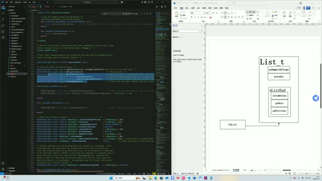
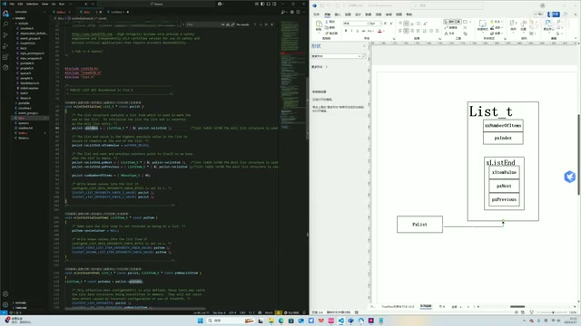
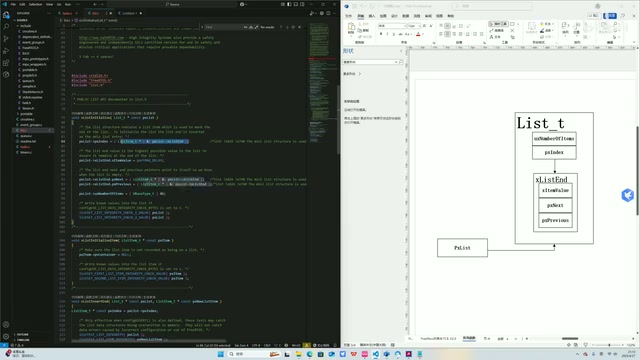
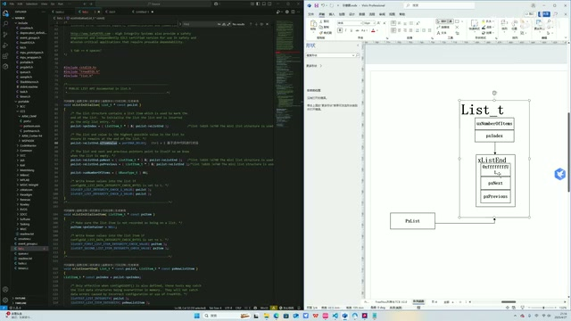
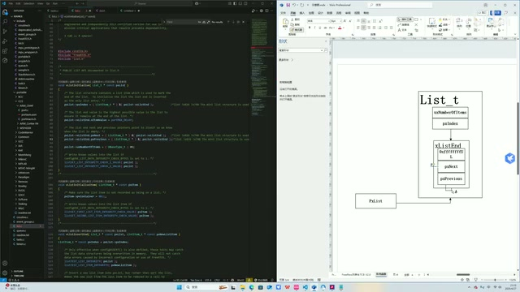
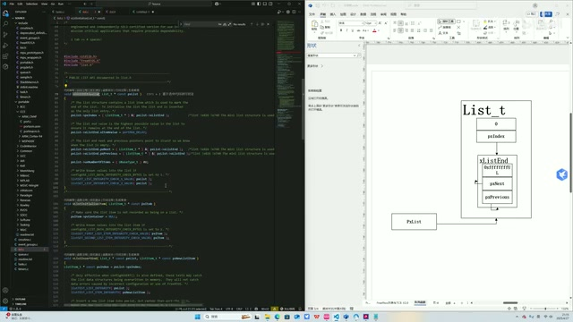

# P02 列表–初始化

> 原视频：[FreeRTOS 源码详解 P02](https://www.bilibili.com/video/BV1fmL6ziEhA/?p=2) · 源时间 00:00–05:28。以下为按原序整理的忠实图文讲稿。

## 从列表模块到内核任务列表（00:00）

OK，然后列表大致的数据结构，以及它的整体架构，给大家简介完了。接下来就开始讲这个 List 的软件模块，`list.c`。一共是有核心的四个函数，有初始化、插入和删除。这个模块其实不难，非常简单，代码量也不多。如果有这个数据结构基础的话，其实还是很好听懂的。

首先来讲初始化，列表初始化的一个函数。在 `tasks.c` 里面，这个 FreeRTOS 内核里面，定义了一些静态的全局的列表。这个看名字是处于 ready 状态，就绪态的任务列表；这两个是处于延时阻塞、delay 态的状态列表；然后这个是挂起状态的状态列表。

*tasks.c 中的任务状态列表与右侧 List\_t 示意图 · [原片 01:00](https://www.bilibili.com/video/BV1fmL6ziEhA/?p=2&t=60)*

我们 FreeRTOS 所有任务之间的状态切换，以及任务的调度，都是我们调度器围绕着这几个列表展开的。所以说，学好列表，对于我们理解后面的内核其他的源码，是至关重要的。

## 列表初始化与传入的列表头（01:12）

首先是看一个 list initialise，列表初始化。这个在我们调度器，内核调度器开始的时候会被调用。然后我们这几个列表，这几个列表头，它们的指针，都会作为函数的参数，作为这样一个 `pxList` 指针传进来。至于这个在哪调用的，可以自己查，可以自己看源码，我们后面也会讲的。

然后我们的思路是跟着旁边这个示意图，一步步地去画这个状态。首先我们这个 `pxList` 传回来——传进来，它会指向一个列表头。这列表头可以是这几个列表里面的任意一个，就是这样一个状态。

*pxList 指向 List\_t 列表头的初始示意 · [原片 02:00](https://www.bilibili.com/video/BV1fmL6ziEhA/?p=2&t=120)*

## 第一步：pxIndex 指向 xListEnd（02:02）

然后我们看第一步，是 `pxIndex` 等于我们这个列表头的 `xListEnd`。我们来把它画上：这是 `pxIndex`，然后它会指向我们这样一个 end。OK，指向 end。这是我们第一步，函数第一步，这一行。

*pxIndex 指向内嵌的 xListEnd · [原片 02:30](https://www.bilibili.com/video/BV1fmL6ziEhA/?p=2&t=150)*

## 第二步：列表尾的 xItemValue 取最大值（02:29）

第二行，是我们这样一个 end 点这个 `xItemValue`，等于 `portMAX_DELAY`，就是这一项，等于 0xff……。

> 整理注：这里口述将十六进制值简称为“ff”，后文明确说的是 32 位最大值；画面示意图写的是一串 f。保留这个讲解含义，不把口头简称当作仅 8 位的精确常量。

为什么初始化的时候，我们这样一个 `xListEnd` 要是 ff 呢？因为它是这样一个数据结构，我们这一项，它是一个 32 位，32 位的数。然后我们是取一个 32 位的最大值。

因为多数情况下，我们这个列表会是一个顺序列表，就是它里面所有的成员都是升序排列的。那它既然顾名思义，它这是这个列表项的一个 end，那它这个值——它既然是一个升序排列的表，那它 end 这个值是这个数据结构的最大值，它是没有问题的。因为它是最后一个嘛，它又是升序，它取一个最大值，这是一个非常自然的操作。

*xListEnd 值的位置已写入一串 f · [原片 03:30](https://www.bilibili.com/video/BV1fmL6ziEhA/?p=2&t=210)*

## 第三步：pxNext 指向列表尾自己（03:34）

OK，下一步的话，就是 `pxNext` 等于它自己，对吧？`pxNext` 等于这个 `pxList`，取指针，取过来取到 end，就这个。在初始化的时候，我们 next 是指向列表尾的，因为没有成员嘛。画一下，指向这样一个列表尾。

*xListEnd 的 next 回指列表尾的连线 · [原片 04:10](https://www.bilibili.com/video/BV1fmL6ziEhA/?p=2&t=250)*

其实这也是非常自然的，对吧？因为我们这是一个具有 end 的环形表。初始化的时候，这个环形列表上没有任何成员，那么这个 end，它既是第一个成员，也是最后一个成员。所以它的 next 是它自己，它的 previous 是它自己，这很自然。

## 第四步：pxPrevious 也指向自己（04:22）

所以下一步的话，我们 previous 也是它自己，也是指向它自己，跟 next 一样。OK。

*next 与 previous 都回指 xListEnd 的连线 · [原片 04:40](https://www.bilibili.com/video/BV1fmL6ziEhA/?p=2&t=280)*

## 第五步：列表成员数置零（04:41）

下一步，是 number of items 等于 0。也就是这个，我们的列表成员是 0。这是废话，对吧？刚初始化的时候，一个成员没有，非常正常。OK。

*成员计数已置为 0 的完整初始化状态 · [原片 05:00](https://www.bilibili.com/video/BV1fmL6ziEhA/?p=2&t=300)*

那这个 initialise，初始化这样一个函数，很简单，我们读完了。同时把它状态画过来。

## 转到 insert 函数（05:04）

接下来我们来讲这个 insert，先讲 insert 函数吧。这个比较简单，大家自己看，它就一行，是吧？我们来讲一下第二个函数，这个函数，这个 list insert 这样一个函数。

> 整理注：末段“这个比较简单……它就一行”时，画面滚到列表项初始化附近，随后转向插入函数；讲者没有在这一段口述那一行的具体字段。视频在转入 `list insert` 处结束，最后的词片识别为“东西”，语义不完整，未据此补写下一讲内容。

> 画面说明：原视频为 640×360，完整截图保留源码与右侧示意图的关系；源码细小文字与常量的 f 个数不能作为逐字抄录依据。本稿按口述保留 32 位、升序及最大值的说法。桌面/窄屏布局、图片放大与时间链接的浏览器交互未测试：当前会话的 file 协议预览已被拒绝，未绕过限制。
