# P03 任务切换

> 清理后的忠实图文讲稿 · 全片 00:00–53:50.68 · [原视频 P03](https://www.bilibili.com/video/BV1fmL6ziEhA/?p=3)
>
> 按原讲述顺序保留例子、解释、重复演示、限定与纠错；方括号式〔整理说明〕与图注为编辑标注。以冻结转写、真实视频画面及两段补充本地 ASR 相互核对，不称人工听音逐字稿。原片 640×338，小字以可读证据为限。原片的技术主张按讲者表述保留。
>
> 浏览器 file 协议已被拒绝，未绕过；桌面/窄屏布局、缩放交互和时间链接点击未实际测试，离线资源与链接格式另做结构验证。

## 任务切换与就绪列表

大家好，经过前面的学习，我们对 FreeRTOS 的列表相关的知识点有了一些了解。今天我们来学习任务切换相关的源码。任务切换，我认为是 FreeRTOS 源码里面相对来说最难理解，或者说最抽象的一个部分。原因在于，里面会用到一些汇编语言，然后会涉及一些芯片内核，比如 STM32 的 ARM 内核相关的知识。如果之前没有接触过，听起来会相对觉得不熟悉，所以这节课大家以听听为主。

经过这些学习，我们知道 tasks.c 里面会有一些全局列表。之前也说了，处于不同状态下的任务，会挂载在不同的列表下。比如处于阻塞态的，会挂载在 DelayedTaskList 下；处于 Pending 的，就是讲到的挂起态，会在 PendingReadyList 里面〔此处保留讲者对状态的表述〕。可以通过内核执行调度的、处于就绪态的任务，会挂载在 ReadyList 里面。

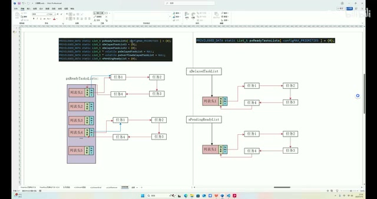

*就绪列表数组与阻塞、Pending 列表示意 · [原片 01:15](https://www.bilibili.com/video/BV1fmL6ziEhA/?p=3&t=75)*

可以看到，ReadyList 实际上是一个列表数组，原因在于我们的任务优先级。以这个图为例，比如列表头 1 这一项，里面挂载的就是所有任务优先级为 1 的任务；4 挂载的就是 4，以此类推。如果要改优先级，从操作角度来说，就是在 FreeRTOSConfig 文件里面，想增加或者减少，改这个宏就行了。〔画面源码中列表数组的上限为 `configMAX_PRIORITIES`。〕

现在来讲相关源码。任务切换的流程，首先会基于一个系统心跳周期，也就是我们的 SysTick Handler。SysTick 是一个心跳周期，我们会执行一次。在这个心跳周期里面，会干两件事情。

第一个，会去检查 DelayedTaskList，看看有没有哪些任务，现在已经到达阻塞解除的状态。如果可以解除阻塞，内核会把这个任务搬到 Ready 列表里面，让它来执行。

第二个，检查完是否有任务解除阻塞之后，就会开始——注意，是选取优先级最高的任务来执行。举个例子，比如我们这个图，列表头 1，假设说 1 是优先级最高，这里面有任务，就会只执行优先级为 1 的任务，下面就不会执行了。这个执行，之前也说了，它有一个 index 指针，会加加，指向下一个，执行任务 2；在下一个心跳周期执行任务 3，这样一个轮流的调度。

现在直接来看。首先找到系统的 SysTick 中断。刚才说了，它是每一个心跳周期执行一次。FreeRTOS 源码把 SysTick 的中断函数用宏定义管理起来了，所以在 port.c 里面，画面函数是 `xPortSysTickHandler`。

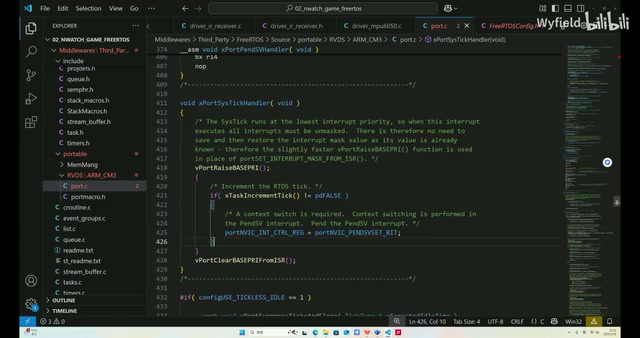

*port.c 中的 SysTick Handler 与 xTaskIncrementTick 调用 · [原片 03:31](https://www.bilibili.com/video/BV1fmL6ziEhA/?p=3&t=211)*

在 SysTick 里面做的事情不多。首先，这两个是中断的处理，就是一个原子化操作：先把中断关了，防止任务切换的时候被别的中断打断，导致整个系统都乱套了，所以这两个操作是关中断。

然后这个操作，画面是 `xTaskIncrementTick()`，就是刚才说的这么长一串：会看看 DelayList 有哪些任务的阻塞时间到了，到了之后把它搬到这里面，供后面的任务调度。这块我会放到后面，讲队列的时候再讲，这边先不讲。这里主要是讲任务切换、汇编相关的函数。

看这一行，画面是 `portNVIC_INT_CTRL_REG = portNVIC_PENDSVSET_BIT;`，就是调用 PendSV 函数。这个是 M3 内核，因为我是以 STM32F103C8T6 为例。内核里面的任务切换，是发生在 PendSV 函数里面，不是在 SysTick 这个函数里面做的。至于为什么要在 PendSV 里面调用，我后面会讲。

所以就是调用 PendSV，然后去找 PendSV。这个就是 PendSV，我们所有任务的切换、现场的保存，还有旧任务、新任务的现场恢复，都是在这个里面执行的。看这么多汇编，其实这些汇编都不难，等会儿会带着大家一行行讲。

## CPU、寄存器与函数执行

讲之前，先做一些基础知识的简单介绍。我们 ARM 芯片的内部，可以简单理解成由运算器和寄存器两个部分组成。写好的代码经过编译后生成机器码，会存到 Flash 里面。

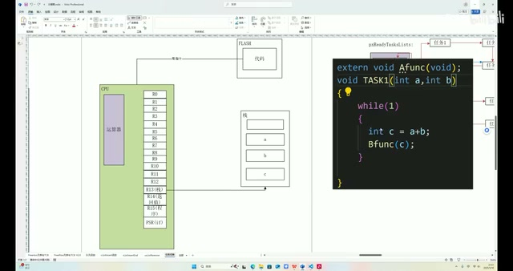

*CPU、寄存器、Flash 和 a 加 b 的任务示例 · [原片 05:45](https://www.bilibili.com/video/BV1fmL6ziEhA/?p=3&t=345)*

假设 ARM 在执行这样一个函数，它会先从 Flash 里面取指令，也就是说把 `int c = a + b` 这一行代码的机器码取出来，它就知道自己要干什么了，然后就执行 a 加 b 等于 c 这样一个动作。CPU 里面是怎么动作的呢？a 的话，它会用 R0 存 a，然后会用 R1 存 b。现在两个数都放在这里了，CPU 会调用运算器。程序所有的运算，都是运算器一个人来完成。它会拿着这两个寄存器的值算出一个 c，然后把这个值找一个寄存器存起来，假设存到 R3 里面。下一步，会把 R3 里面寄存器的值扔给 Bfunc。大致是这样一个逻辑。

那么问题来了。假设 `int c = a + b` 执行完，我这个 Task 切出去了，切到 Task B。我希望过一会儿，Task B 执行完，Task A，或者 Task E〔任务名的字母识别未完全确定〕能执行了，它切回来，执行效果还跟切出去时一样。需要保存什么呢？很简单，我们得保存 c，对吧？因为想要效果一样，至少一定要保证给下一个函数的传参一样。现在 c 存在哪？存在 R3 里，也就是说 R3 需要保存。

〔原片约 07:32–09:24 再次演示同一例子，按原顺序保留；画面变化与补充本地 ASR 均支持这次重复。〕

假设 ARM 在执行这样一个函数，它会先从 Flash 里面取指令，也就是说把 `int c = a + b` 这一行代码的机器码取出来，它就知道自己要干什么了，然后去执行 a 加 b 等于 c 这样一个动作。CPU 里面怎么动作呢？它会用 R0 存 a，然后用 R1 存 b。

现在两个数都放在这里了，CPU 会调用运算器。程序所有的运算，都是运算器一个人完成。它会拿着寄存器这两个值算出一个 c，再找个寄存器存起来，假设存到 R3 里面。下一步，把 R3 里面寄存器的值扔给 Bfunc，大致是这样一个逻辑。

问题来了。假设 `int c = a + b` 执行完，Task 切出去了，切到 Task B。我希望过一会儿 Task B 执行完，Task A，或者 Task E〔任务名的字母识别未完全确定〕能执行了，它切回来，这个执行效果还跟切出去一样。需要保存什么呢？很简单，要保存 c。因为想要效果一样，至少一定要保证给下一个函数的传参一样。现在 c 存在 R3 里，也就是说 R3 需要保存。

所以 R3 要存，对吧？那么 R4 存不存，R5 存不存呢？从当前这个例子来看，不需要存。因为只有 R3 存了个 c，如果不存，会影响后面的执行。R4、R5 没有存什么有意义的东西，所以可以不存。

假设现在这个函数稍微复杂一点，是 Task 2 这样一个形式，它有一个局部变量 d，这个局部变量 d 也会作为传参给一个函数来执行。

按照刚才的逻辑，d 假如存在 R4 里面，对吧？也是经过运算器，调用 R3 和 R0 相加〔源转写为“RA”，画面示例为 `d = c + a`；寄存器读法按图中 a 的 R0 标注核对〕，算出一个值给 R4 存。

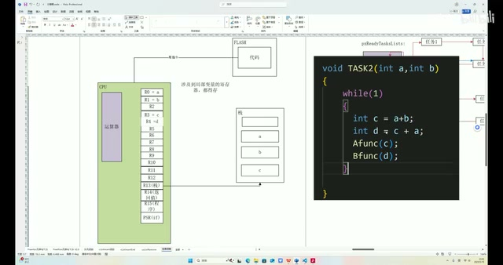

*Task 2 增加 d，图中 R3、R4 对应局部变量 · [原片 10:25](https://www.bilibili.com/video/BV1fmL6ziEhA/?p=3&t=625)*

假如还是我们这个程序，从这里被切出去了，我们希望它被切回来之后，顺下去继续执行的效果和没切出去一样，那么是不是 d 也得存？所以 R4 也得存。也就是说，哪些寄存器存，哪些不存，是根据实际情况而定的。

FreeRTOS 的任务切换函数就一套，所以干脆都存了。也就是说，涉及局部变量的寄存器都得存：运行过程中产生的一些局部变量，会存到某些寄存器里面，负责存这些局部变量的寄存器，都得作为一个现场保存起来，切回来的时候再恢复进来。

这些寄存器是哪些？也就是 R0 到 R12，从这里到这里，它们这几个全都是负责存局部变量的。任务被切出去的时候，这几个寄存器都得存，回来的时候再恢复。所以 R0 到 R12，这 13 个首先是需要存的。

还有哪些要存呢？举个例子，假如现在这个 Task 不只是三个局部变量，它有 15 个局部变量，多出 o、p 这两个，它们也是这个函数的传参，那这两个放在哪呢？答案是放在栈里面。程序检测到这个函数的局部变量比较多，多出来的这两个，它会有一根指针指向我们的栈。这个是栈顶，栈顶下面都是空的，上面是已存入、已被占用的部分。

这根栈指针会指向栈顶，我们存东西会通过这根指针标记可以存到哪。〔讲者口头此处说“PC 指针”，视频黄字纠正：“这里是 SP 指针，不是 PC，up 口误了”；以下栈指针统一按视频纠正写作 SP，保留这次纠错。〕

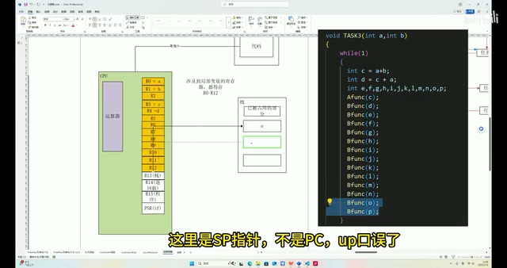

*额外局部变量 o、p 的栈示意，黄字纠正 SP 与 PC 口误 · [原片 13:20](https://www.bilibili.com/video/BV1fmL6ziEhA/?p=3&t=800)*

检测到这个函数的局部变量超过 13 个了，就会通过栈存多出来的这两个局部变量。首先去找栈顶，发现栈顶指针指在这儿，就把 o 存进去。然后还有一个 p，对吧？会把栈指针加加，然后把 p 也存到栈顶。

函数执行到这里的时候，就会从 o、p 这两个地方取。比如执行到这儿，栈顶指针退一个，退到这儿，把 o 拿出来扔给 Bfunc；然后这个指针会再加加，把 p 再拿出来放给 Bfunc。

所以假设我们这个 Task，在 Bfunc 这一行被切出去了，我们希望它切回来的时候，继续执行的效果跟没切出去一样，那么 o、p 这两个值不能丢。首先要知道，栈里面的值大可放心，是不会被动的。原因在于 FreeRTOS 每一个 Task 都有独立的栈区域，所以不用担心栈里面这个值会被改。

我们唯一需要记录的，就是栈顶指针的值。因为函数切出去再切回来之后，还得拿着这根指针，比如退一个，取出来给函数；再加一个，取出来给函数。这根 SP 指针得指对。假如指得不对，指到这里了，还是执行退一个，拿出来给 Bfunc，那这一行应该传 o，结果退了一个，传的是 p，效果就不对了。所以需要存一下这根指针，栈顶指针也得存。我们标记一下，栈顶指针也得存。〔口头“PC”依视频黄字纠正为 SP。〕

## LR 保存函数返回地址

然后就是 LR 指针。LR 指针是保存返回值的〔这里讲者接着用例子解释的是返回地址，保留其用词并标明〕。还是拿刚才这个 Task 举例，假如这是 Bfunc，读一个 IO 口，再发出去，再返回。

因为 C 语言的函数，在整个工程的任何地方都有可能被调用，所以肯定不能显式地返回。以这里为例，假如在这儿第 177 行〔源转写“117”，画面调用行是 177〕调用了 Bfunc，我们希望进去之后，返回到第 179 行。那怎么做呢？会在调用之前，把第 179 行——不，179，就 180 吧，因为 C 语言空行不算——把第 180 行放到哪里？放到 LR 指针里面，LR 寄存器里面。〔讲者在定位行号时改口，按最后确定的 180 行保留。〕

然后调用这个函数，执行 return 语句的时候，编译生成的汇编，其实读到 return 所生成的汇编语句，就是跳转到 LR 指针所指向的地方，或者说跳转到 LR 所保存的地址上。

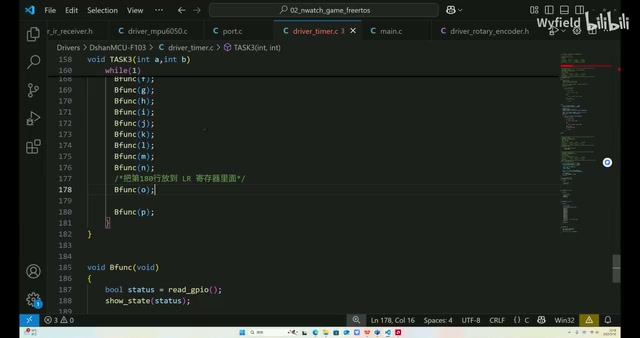

*调用 Bfunc 前把第 180 行返回位置存入 LR 的注释 · [原片 17:35](https://www.bilibili.com/video/BV1fmL6ziEhA/?p=3&t=1055)*

假设这个 Task 执行到这里，跑到 Bfunc 里面执行，还没跳出来，任务就被切走了。我们还是那个思路，希望切走后再切回来，接下来执行的动作要跟没切出去的时候一样。那么在这里面，LR 寄存器这个返回值肯定要保存，因为不然这边执行，跳到别的地方，就回不来这里了，整个程序就乱套了。所以 LR 得保存，LR 也得存。

## PC 与 PSR 也要保存

R15 是程序指针。CPU 一行行执行程序，都是有一根指针指着的。比如先指到 166 行，执行完了再加加，167 行，执行完再加加。我们要切出去、切回来，比如 166 行执行完，A 被切出去了，回来之后肯定要执行 167 行。在切出去那一瞬间，PC 指针是指向 167 行的，切回来还想继续执行 167 行，那 PC 指针得还回来，所以得存，PC 指针也得存。

然后 PSR 要存。PSR 就是存 if 的结果的。假设是这样一个 Task C，读一个 IO 口的状态，根据 IO 口状态跳到相应的分支。if 执行完，这个执行出来的结果就会存到 PSR 里面，CPU 会读 PSR 的值，决定跳到这儿，还是跳到这儿。

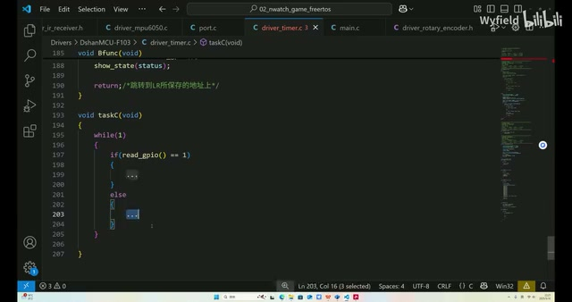

*Task C 读取 IO 状态并进入 if 或 else 分支 · [原片 19:30](https://www.bilibili.com/video/BV1fmL6ziEhA/?p=3&t=1170)*

还是这样一个思路，比完之后，还没跳分支，Task 在任务切换时被切走了。假如原本应该跳到这里，我们切回来之后，还得让它跳到这里继续执行，总不能跳到另一个地方，那样就不对了。我们要切出去再切回来，接着执行跟没切出去一样。这个值存在 PSR 里面，要保证还跳到这里，所以 PSR 的值也得存。

所以现在所有这些寄存器，一共多少个？16 加 1，一共 17 个寄存器都得存。所以其实任务切换，每一个 SysTick 周期触发任务切换，比如从这个任务跳到那个任务，任务 3 切成任务 4，说白了，就是把任务 3 的这 17 个寄存器存到栈里面，然后读任务 4 的栈，找到这 17 个寄存器所在的栈里面的位置，恢复到寄存器里面，就完成一次任务切换。

PendSV 函数其实就是在干这样一个事情：17 个寄存器的存，然后把另一个任务的 17 个寄存器恢复，就完成这样一个任务切换。

## 逐行看 PendSV：取得当前栈顶和 TCB

PendSV 函数第一行是 `mrs r0, psp`。这行什么意思？其实就是 SP 指针的值，指针指向的地址，复制给 R0。就是把右边这个寄存器里的值给到左边，SP 值给 R0。

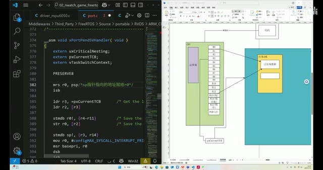

*PendSV 取 PSP 到 R0 的指令与当前任务栈顶示意 · [原片 21:45](https://www.bilibili.com/video/BV1fmL6ziEhA/?p=3&t=1305)*

汇编的话，我也是搜这些，百度，还有 DeepSeek，一行行了解。没有必要深究，咱就是了解一下。我们程序运行过程中，当前的栈指针，也就是 SP 指针，假如现在执行任务 A，肯定指向任务 A 的栈里面，因为它一直在执行，是一个压栈、弹栈的过程。现在 PSP，就是栈指针，假如指向它，把它的值赋给 R0，其实就是 R0 也指向这个栈顶。

这一行是跟中断相关的，这个不用管。下一行，我们知道前面已经说了，FreeRTOS 里面有一个 pxCurrentTCB 指针，全局指针。其实就是说，现在当前正在执行哪个 Task，这个指针就指向谁。这个就是 pxCurrentTCB，现在指向正在执行的任务，也就是 Task A 的任务控制块。

`ldr r3, =pxCurrentTCB` 这一行，就是把右边、等号后面这个值的地址给 R3。注意，不是让 R3 跟它指向同一个地方，而是把这个指针的地址再给 R3。也就是说，现在 R3 相当于是个二级指针一样，指向的是 pxCurrentTCB 的地址，不要混淆了。

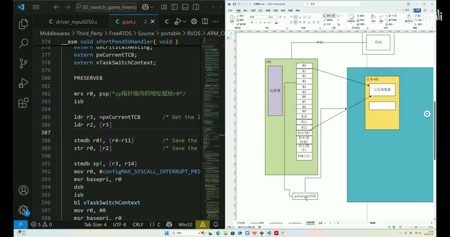

*R3 指向 pxCurrentTCB 地址的示意与 LDR 指令 · [原片 23:30](https://www.bilibili.com/video/BV1fmL6ziEhA/?p=3&t=1410)*

也就是说，让 R3 保存这个 px 指针的地址。其实写一个伪代码，用 C 来写，相当于什么呢？相当于是 uint32，因为 STM32，32 位，它的寄存器也是 32 位，所以是 uint32_t。R3 等于什么？等于 pxCurrentTCB 这个指针的指针，就相当于这个，这是伪代码。

然后下一行是什么意思呢？写个伪代码大家就懂了，画面是 `ldr r2, [r3]`，相当于是 `R2 = *R3`，就这个意思。同样是 LDR 指令，如果是等号，就是它后面的地址给前面的；如果是方括号，就是后面的解引用给前面的。

用伪代码写，也就是现在相当于 R2 指向当前正在执行的任务的 TCB。R2 和 pxCurrentTCB 的指向一样。我们让它指，R2 现在指向执行任务。

接着往下看。这行在干什么呢？R4 到 R11，这边有个 R0，也就是说现在要把 R4 到 R11 的值压到栈里面。

那么栈顶是从哪开始压呢？从 R0 开始压。也就是说，R0 现在指向栈顶，我们标记了栈顶，根据 R0 所标记的栈顶，把这 11 减 4，一共 8 个寄存器压到栈里。

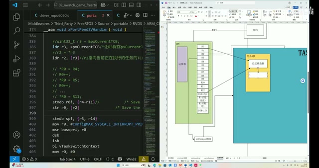

*R4–R11 压栈伪代码与更新的 R0 栈顶 · [原片 27:28](https://www.bilibili.com/video/BV1fmL6ziEhA/?p=3&t=1648)*

其实写伪代码，相当于 `*R0 = R4`，然后 `R0++`；`*R0 = R5`，R0 再加加，然后再一路往下，直到 `*R0 = R11`。写成伪代码就是这样，把 R4 到 R11 压栈。

我们压栈，R0 一路加加，一共加了 8 次，现在指向这儿了。同时前面存了 R4 到 R11。〔此处保留讲者的示意伪代码及“加加”说法；画面真实指令是 `stmdb r0!, {r4-r11}`，不将示意过程改写成另外一套讲解。〕

接着往下看。下一行是 store register，就是把 R0 寄存器的值，保存到 R2 所代表的地址上。写成伪代码，就是 `*R2 = R0`，就这个意思。

现在看 R2 指向什么？R2 是不是指向当前正在执行任务的 TCB？TCB 里面有什么，我们看一下。TCB 的地址解引用，取第一个 32 位的数，其实就是它，pxTopOfStack，就是栈顶。

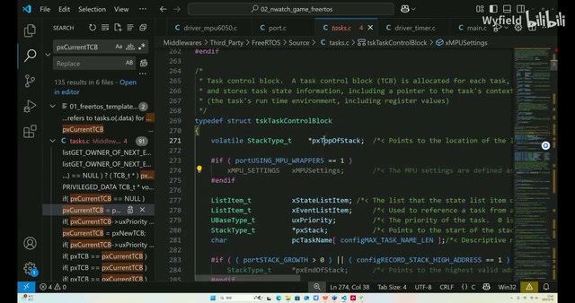

*TCB 结构首成员 pxTopOfStack 的源码 · [原片 28:58](https://www.bilibili.com/video/BV1fmL6ziEhA/?p=3&t=1738)*

这个逻辑其实很简单。刚才 R0 已经更新过了，栈顶的位置，其实因为存了 R4 到 R11，也被更新过。所以我们要把这个新的、更新过的栈顶存到 TCB 里面，也就是 pxTopOfStack 等于 R0，等于存完 R4 到 R11 寄存器之后，栈的新栈顶，把它放到 TCB 里面。

这个值等于 R0，对吧？这一行就在干这样一件事。

## 保存主栈中的 R3 和 R14

看下一行。这行是把 R3 和 R14 这两个——注意，不是 R3 到 R14。前面 R4 到 R11 中间是杠，这里是逗号，那就存两个。把 R3 和 R14 存到哪？存到主栈指针所指向的位置。

什么叫主栈指针？这块说起来其实很复杂，涉及 ARM 架构底层的一些知识，但不要怕。只需要知道，STM32 里面其实栈指针有两个，一个是程序在运行时正常的栈，它还有一个主栈。只需要知道这个就行了，STM32 里面有两个栈。

它这里用 SP，实际上是在调主栈指针。前面是 PSP，在中断里面用 PSP，指的就是用这个里面的栈；如果不加 P，直接 SP，就是主栈。至于为什么有两个栈，这个很复杂，我也不太清楚，只知道有两个栈就行了。

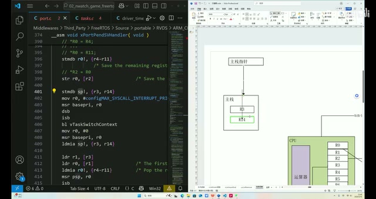

*主栈保存 R3、R14 与 stmdb sp 指令 · [原片 32:00](https://www.bilibili.com/video/BV1fmL6ziEhA/?p=3&t=1920)*

现在就是 R3 和 R14 存到主栈里面，这是 R3、R14，现在存到这里面，主栈指针也指着它。这是存过去的，这就不改了。〔此处转写数次识别成 R4；根据本段开头明确的两个寄存器、指令 `stmdb sp!, {r3, r14}` 和画面 R14 标签校正。〕

然后为什么要存到这个，主栈里面？首先这些中间的先删掉。这四行是关中断，给它删了；这两个是开中断，这六行我们都不看。

为什么要存 R3 和 R14？因为要调用函数了，调用 vTaskSwitchContext，这个切换上下文的函数。而只要调用函数，这个函数就有可能改变寄存器的值。R3 和 R14 这两个寄存器后面会用，为了防止这个函数改变这两个寄存器的值，导致后面的程序效果不达预期，就在调用之前，把 R3 和 R14 这两个函数——不好意思，这两个寄存器的值先保存到主栈里面。函数调用完成后，再从主栈里面把这两个寄存器恢复，保证后面继续执行的函数能达到预期，就是这样一个原因。

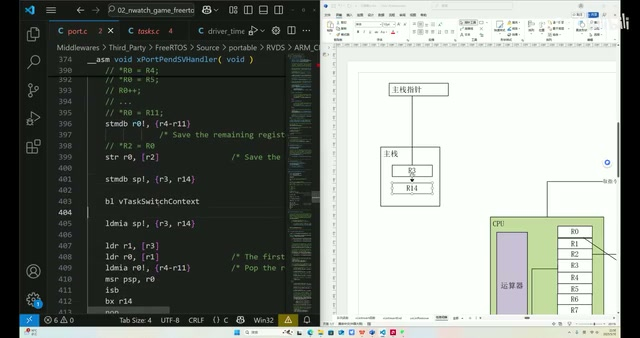

*调用 vTaskSwitchContext 前保存、调用后恢复 R3 与 R14 · [原片 33:17](https://www.bilibili.com/video/BV1fmL6ziEhA/?p=3&t=1997)*

然后来看上下文切换函数在干什么。搜索一下，就是这个函数。这个函数是 C 写的。首先这一行，是在看调度器的状态：当前是不是在挂起。如果当前调度器处于挂起态，就不进行切换。整个调度器都挂起了，不应该切换。

所以首先这个分支，如果调度器没有挂起，就继续往下走。这些都不用看，都是空的宏定义，都是自己实现的。

其实最重要的就是这个函数，我们看名字，`taskSELECT_HIGHEST_PRIORITY_TASK()`，叫选择最高优先级的 Task，选择当前优先级最高的 Task。它选出来之后，怎么告诉你呢？就是选出这个 Task，让 pxCurrentTCB 这个指针去指，就是在干这样一件事。

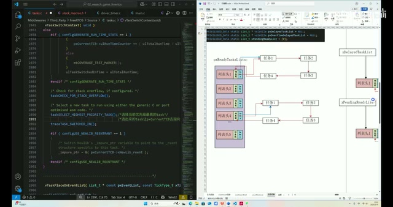

*最高优先级任务选择与就绪列表指针示意 · [原片 35:55](https://www.bilibili.com/video/BV1fmL6ziEhA/?p=3&t=2155)*

也就是说，在这样一个数组里面，会先看这么多列表，非空列表里面谁在最上面，就是谁的优先级最高。然后 index 指针加加，就找到下一个应该切换的 Task。把这个 Task 的 TCB，让 pxCurrentTCB 这个指针去指。调度器用这个指针，就知道我要执行哪个函数了。

看一下这个函数是怎么实现的。

首先这是一个宏函数。看这个宏，首先去获取当前全局谁的优先级最高，或者说最高优先级是几。根据这个变量，知道是几了，就去相应的列表找，把这个数拿过来。

然后这一行是确认一下：这个全局变量没骗我。假如现在拿到的全局变量是 2，跑到列表头 2，发现这是空的，那全局变量骗我了，所以再减减，一直减到找到一个非空列表，里面有任务，我可以开始执行了。这个 while 循环就在干这个事情。

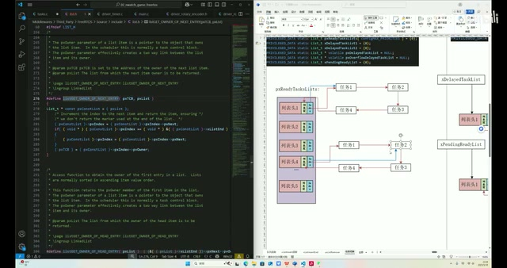

*listGET\_OWNER\_OF\_NEXT\_ENTRY 的 index 前移和 owner 取得 · [原片 37:43](https://www.bilibili.com/video/BV1fmL6ziEhA/?p=3&t=2263)*

然后这一行，`listGET_OWNER_OF_NEXT_ENTRY`，就是获取这个列表里面的第一个任务。说白了，就是 index 指针先加加，加加之后把这个任务返回去，返给 pxCurrentTCB 来指，这就是这一行的事情。这个大家自己看一下，就是 index 加加之后，根据里面的数据结构，找到相关的 TCB，给 pxCurrentTCB 来指。然后再更新一下这个全局变量。

所以说，这个函数执行到这里，pxCurrentTCB，已经指向我们即将切换到的新任务了。我们退出来，程序进行到这里，这个指针已经指向什么呢？指向即将上位的新任务。

## 恢复新任务的栈与寄存器

刚才说了，这个函数有可能改变 R3、R14 的值，所以把这两个寄存器恢复一下，后面要用。

接着，这个是 load register，R1，然后方括号 R3，画面是 `ldr r1, [r3]`。刚才说 R3 相当于是取地址，所以这一行写成伪代码就是 `R1 = *R3`。R3 现在指向谁？是不是指向 pxCurrentTCB？取它这个地址里面的值，现在相当于 R1 和 pxCurrentTCB 所指向的地址一样。

但是 pxCurrentTCB 现在指向谁？刚才已经说了，通过执行这个函数，pxCurrentTCB 现在指向即将上位的新任务。我们把这个画一下，即将上位的新任务，我们叫 Task B 吧，Task B 的 TCB。现在经过这个函数，这个指针已经指向新任务了，要切的任务。那是不是 R1 现在也指向我们要切的新任务？这一行也说完了。

然后这一行，其实跟上一行的指令一样，也是 LDR 指令，画面是 `ldr r0, [r1]`。同理可得，就是 `R0 = *R1`。R1 解引用之后，把这个值给 R0。刚才已经说了，TCB 解引用，取第一个 uint32，就是它，是栈顶。也就是即将切过来的新任务的栈顶，给 R1——给 R0，是 R0 保存新任务的栈顶。〔保留讲者由 R1 改口为 R0 的纠正。〕

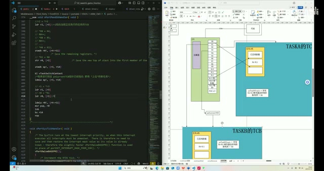

*新任务 TCB、栈顶和 R0 的恢复示意 · [原片 41:50](https://www.bilibili.com/video/BV1fmL6ziEhA/?p=3&t=2510)*

下一行，就是把 R4——说错了，现在下一行就是在恢复这个值。

恢复到 R4 至 R11 这 8 个寄存器里面，画面指令是 `ldmia r0!, {r4-r11}`。因为刚才看旧任务切出去的时候，会把 R4 到 R11 保存到栈里面。新切过来的任务，在上一次被切出去之前，栈顶也存的是它上一次被切出去那个时刻 R4 到 R11 寄存器的值。

现在恢复现场，就得把它恢复到寄存器里面。又因为刚才 R0 已经指向新任务的栈顶了，也就是说，从 R0 去取 8 个寄存器、8 个 uint32 的值，分别给到 R4 到 R11。新任务栈里面取 R4 到 R11 的值。

所以程序进行到这儿，R4 到 R11 的值实际上已经被恢复了，对吧？这几个寄存器的值，R4 到 R11，这几个就标黄。R4 被恢复了，R4 到 R11，所以 R5、R6、R7、R8，这几个全被恢复了，恢复成即将切过来的新任务的寄存器。

接着往下看。这一行，就是把右边寄存器的值给到左边，也就是把 R0 寄存器的值赋给 SP 指针。因为接下来要执行新任务了，然而栈指针还是指向旧任务的栈顶，所以非常自然地，要把它改成新任务的栈顶。刚好前面这个操作，R0 保存了新任务栈顶，把 R0 赋给 SP，所以现在 SP 指针就指向新任务栈顶，这个 SP 指针当前也算现场恢复了。〔这里的具体指令是 `msr psp, r0`，讲者以 SP 泛指当前任务栈指针。〕

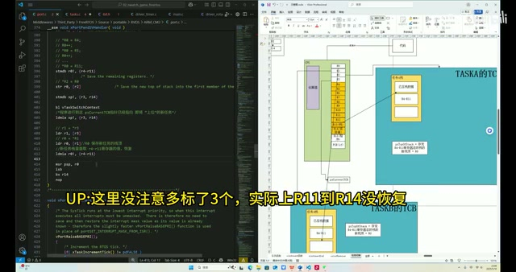

*寄存器恢复标黄图与原片黄字纠错：此处多标了 3 个 · [原片 44:38](https://www.bilibili.com/video/BV1fmL6ziEhA/?p=3&t=2678)*

〔视频黄字纠错：“UP：这里没注意多标了3个，实际上R11到R14没恢复”。这里按画面原文保留纠错字幕；它与口头的 R4–R11 范围在 R11 处并不完全一致，不替讲者静默改字。〕

把这个标示一下。程序进行到这儿，发现 PendSV 函数好像到底了。有没有感觉少了点什么？标黄的是现在已经保存了的寄存器，那没有标黄的难道就不存了吗？就是 R0 到 R3、R12、R14、R15，还有 PSR。前面已经说了，每一个寄存器都有保存的必要，否则会出问题，所以它们一定被保存了，但是在 PendSV 里面没有看到保存的地方。

实际上是单片机硬件自动保存的，我们打开这个，《Cortex-M3 权威指南》，这是 ARM 官方出的一个手册。我们 F103C8T6 就是 M3 内核。翻到第九章，有一个“中断的具体行为”，往下，重点关注这一行：响应异常的第一个行动。响应异常，我们的 PendSV，包括所有的中断函数，就是异常。

第一个行动，就是自动保存现场的必要部分，依次把 PSR、PC、LR、R12，以及 R3 到 R0，一共 8 个，就是我们缺的这 8 个，自动压入适当的堆栈中。原来是这个原因。

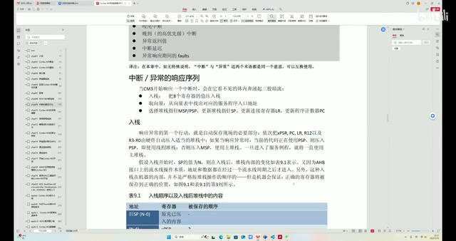

*手册中异常响应的自动入栈说明 · [原片 47:00](https://www.bilibili.com/video/BV1fmL6ziEhA/?p=3&t=2820)*

也就是说，这个函数进来的时候，刚才已经在这边画了 R4 到 R11，在存它之前，其实我们善良的单片机硬件已经把这几个自动压入堆栈中了，硬件自动完成。PSR、PC，然后 LR、R12，然后 R3 到 R0，自动已经压入堆栈中了。

那么这些没有标黄的，现在可以标黄了，硬件已经帮我们解决了。所以从保存现场这个角度来说，该保存的已经都保存了，保存现场逻辑上就没有漏洞了。那么恢复呢？其实也是硬件帮我们恢复。

看恢复的时候，也是只恢复了 R4 到 R11，标黄代表恢复。标白的是什么时候被恢复？还是要看 ARM 手册，还是第九章，刚才是入栈、响应，现在要看返回。重点看这一行，出栈：“在启动了中断返回序列后”。

什么是启动中断返回序列？就是在中断里面 return，这是返回。然后调用这个 `bx r14`，刚才也说了，R14 是返回值指针，`bx r14` 其实就相当于是 return，也算中断返回序列启动了。

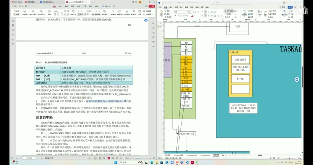

*手册的中断返回与出栈说明，以及任务栈示意 · [原片 49:53](https://www.bilibili.com/video/BV1fmL6ziEhA/?p=3&t=2993)*

然后就——不是我们，是硬件。硬件将先前压入栈中的寄存器在这里恢复，内部的出栈顺序与入栈时相对应，堆栈指针也改回去。

也就是说，入栈的时候，硬件帮我们按照这个顺序，把这 8 个寄存器自动压到栈里。恢复的时候，硬件也是按照相同顺序恢复回去。换句话说，新任务在上一轮作为旧任务被切出的时候，其实硬件也是帮它把这些寄存器存到它的栈里面，已经存到栈里面了。

然后调用 `bx r14` 之后，R4 到 R11 已经恢复过，SP 指针在这里已经恢复过。恢复的同时，SP 指针也是往上跳。这恢复了，就把它删掉，跳到这儿。

调用 `bx r14`，这些寄存器也就按照压入时的顺序，依次恢复给寄存器——说错了，是栈里面这些值，依次恢复给这些寄存器。这下就完成了一次任务切换。

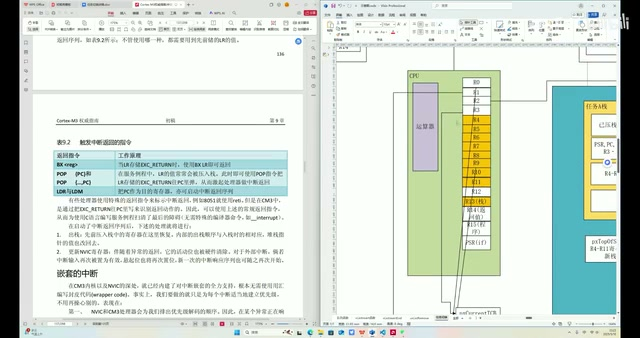

*手册的硬件出栈说明与已恢复寄存器的标示 · [原片 51:23](https://www.bilibili.com/video/BV1fmL6ziEhA/?p=3&t=3083)*

## 本节回顾与讨论

本节视频，首先讲了这几个全局的 list、列表的具体功能。然后结合之前学过的列表知识，从宏观角度讲任务切换的大致流程，就是 pxIndex 的遍历，然后取出来，从 3 到 4 这件事，任务切换。

这件任务切换需要执行的保存现场和恢复现场，涉及哪些寄存器？答案是这些，R0 到 PSR，一共 17 个寄存器，都得保存。然后，为什么都得保存，我们也举了一些例子进行说明。每一个都有保存的必要，否则会出问题。

然后对着汇编，一步步推演旧任务的这些寄存器，如何被保存到栈里面，以及新任务的寄存器如何从栈里恢复到寄存器里面继续执行。〔结尾此处寄存器范围的转写为“20到27”，识别不可靠；沿用讲者前文已经明确的“17 个寄存器”这一指代，不补造新的范围。〕

里面涉及很多汇编，甚至深入到了 ARM 架构。ARM 上 FreeRTOS 任务切换的编写，用到了硬件特性，使性能得到了提升。

整体来说，这一节还是比较抽象，可能看起来也比较吃力。因为现在已经很少有人去写汇编了，看起来容易发懵。也欢迎大家积极指出视频里的错误，因为这里很大部分都是基于我的个人理解，去查手册。所以欢迎大家在评论区讨论，或者私信我。本节视频就到这里，谢谢。
