# P04 阻塞延时

> 讲稿范围：P04，00:00–38:51.62；保留原讲述顺序与口吻的清理稿。图片为原视频 640×360 截图。讲者把节拍与毫秒对应使用的表述照原文保留；代码条件及示意数字差异在局部整理注中说明。

## 先回顾：什么是阻塞延时

大家好啊，上节课给大家介绍了一下 FreeRTOS 任务切换的内部机制。今天我们来讲一下 FreeRTOS 的另一个非常重要的内部机制，就是阻塞延时。

首先简单回顾一下什么是阻塞延时。假设现在全局有 Task1、Task2、Task3，一共三个任务在执行。Task1 执行了一段时间，然后调用了 `vTaskDelay` 这个阻塞延时的接口，就会出现一个效果：Task1 进行到这里，它会延时 1000 个时钟周期，或者叫 1000 毫秒。注意，在这个延时过程中，Task1 是不会执行的。也就是说，在这 1000 毫秒之内，只有 Task2 和 Task3 在执行。

用行话来说，就是 Task1 调用这个接口，把自己阻塞了。它不参与 CPU 的资源分配，不参与调度器的调度，叫阻塞延时，把自己阻塞了。OK。

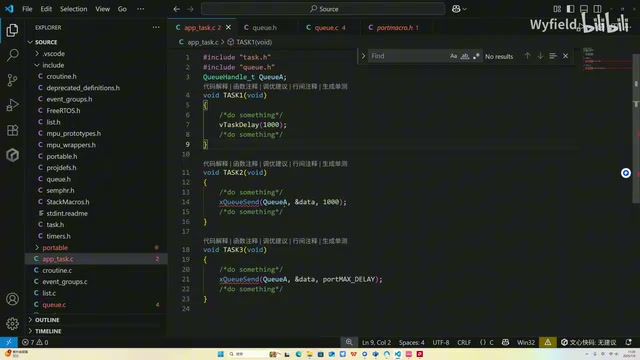

*三个任务的示例：vTaskDelay(1000)、xQueueSend 的 1000 与 portMAX\_DELAY 参数。 · [原片 01:30](https://www.bilibili.com/video/BV1fmL6ziEhA/?p=4&t=90)*

还有第二种场景。比如说我们用队列的时候，要往某一个队列里面发数据，假如是往队列 A 里面发数据。如果队列 A 现在已经满了，那就发不进去了。于是我们可以给它传第三个参数，假如传的也是 1000，起到的效果就是：我这个没有发进去，我愿意等，我可以等 1000 毫秒。

在这 1000 毫秒之内，如果有其他任务把队列里面的数据拿走了，换句话说，就是队列不满了，那我就可以接着往里面发。同样，也是在这 1000 毫秒的等待过程中，这个 Task2 不抢占 CPU 的任何资源。

然后第三个场景，也是往队列里面发消息、发数据。区别在于，它传的第三个参数是 RTOS 里面自己定义的一个宏 `portMAX_DELAY`，它是这个 uint32 的，把它变成全 F，然后是 max delay，字面意思就是最大延时。

产生的效果就是：如果我发的时候，这个队列满了，发不进去数据，第三个参数传的是 `portMAX_DELAY`，那么我就可以一直等，没有上限地等，就一直等到队列不满，其他任务把队列里面的数据拿走了，我再发。同时，在这个一直等的过程中，Task3 一直不参与调度器的任务调度，一直不抢占 CPU 的资源。

所以这个就是阻塞延时。延时是它的一个基本特性，它还有普通延时不具备的特点：在延时过程中，这个 Task 不参与 CPU 调度，就是非常节省资源。这就是阻塞延时大致的外特性。

## 为什么说它是 RTOS 的“第二灵魂”

如果说任务调度是 RTOS 的灵魂，那么阻塞延时应该是 RTOS 的第二灵魂。因为如果没有阻塞延时，假设用一个普通延时，这三个任务的优先级都是一样的，调度器对相同优先级任务的资源分配都是公平的。

所以假设我们在 Task1 调用普通延时，假设是那种循环减减的延时。在减减 1000 次的过程中，就会出现一个事情：短短的 1000 毫秒之内，调度器一直在往 Task2 和 Task3 里面切。又因为调度器对任务的资源分配是公平的，所以这个 1000 毫秒其实是 3000 毫秒，因为你有三分之二的时间会切出去，那就不符合预期了。

这样，如果没有阻塞延时，整个带操作系统的软件编写起来会非常麻烦。假设你现在想实现 1000 毫秒的延时，因为全局有三个任务，有三分之二的时间是往外切的，你就得手动把它改成这种 333，还得自己计算。万一再加一个任务 Task4，你这里又得改，所以非常麻烦。

现在有了阻塞延时的机制，就不存在这个问题了，是吧？你传参传多少就延时多少。所以我个人看来，阻塞延时是 RTOS 的第二灵魂，是非常妙的一个东西。

## ready、pending 和 delay 列表

好的，我们接下来开始讲它的内部机制。前面讲列表和任务调度的时候就介绍过，RTOS 全局主要有三个全局列表：ready 列表，就是所有处于就绪态、可以让调度器去执行的任务，都会放到 ready 列表里。然后 pending 列表是挂起，所有挂起的任务会放到 pending 列表里。delay 列表就是我们今天的主角，所有进入阻塞延时态的任务，全都会挂载到延时列表里。

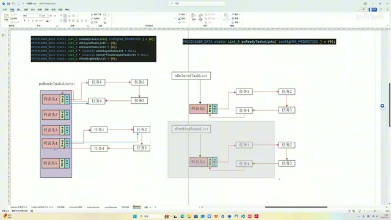

*讲者在文档中展示按优先级排列的 ready 列表，以及 delay、pending 列表。 · [原片 06:00](https://www.bilibili.com/video/BV1fmL6ziEhA/?p=4&t=360)*

我们以 `vTaskDelay` 为例。看这一行，就是把 current task，也就是当前正在执行的任务（`pxCurrentTCB` 指向的任务），给它放到 delay 列表里。因为这函数既然能执行到这里，那肯定是从当前正在执行的任务进来的。

所以假设 Task1 是当前在执行的任务，然后调用到 `vTaskDelay`，那当前的 current task 肯定就指的是我 Task1，也就是把 Task1 放到 delay 列表里面。

我们上节课在讲任务切换的时候也说了，任务切换是通过 SysTick 的中断来触发的。SysTick 中断主要是两个步骤，第二个步骤是我们上节课说的，调用 PendSV 来切换寄存器的上下文。在它切换之前，它在做什么事情呢？我们看，就是 `xTaskIncrementTick()` 这个函数，一会儿要重点讲。现在来大致概括一下。

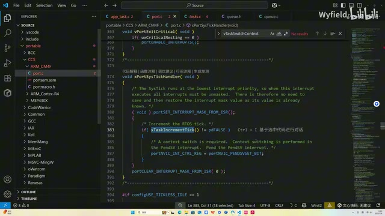

*SysTick 处理函数先调用 xTaskIncrementTick，再根据返回值触发 PendSV。 · [原片 07:30](https://www.bilibili.com/video/BV1fmL6ziEhA/?p=4&t=450)*

其实这个函数做的事情，就是实时去观察处于 delayed task 列表下的哪一个任务，现在它的超时时间已经到了。如果已经到了，那么调度器就把这个任务根据它的优先级，放到 ready 列表的相应成员下。这个函数就在干这个事情。

所以整个流程就是放入 delay 列表，以及从 delay 列表拿出来，到 ready 列表进行执行，这两个大的步骤。我们分别就这两个步骤进行讲解。先讲放入 delay 列表的过程，它是怎么放的呢？

## 列表项里的数值：解除阻塞的时间点

我们之前说过，TCB 挂载到列表上，它有列表结构体，列表结构体天然就具备一个 item，对吧？前面说的这个 item，它存的是一个数字。当任务处于 delay 列表时，这个数字的意义就是阻塞时间点、解除阻塞的时间点。这是什么意思呢？

假设是这样的，整个 FreeRTOS 有一个全局变量，叫 `xTickCount`。`xTickCount`，这是一个全局变量。这个变量的意义呢，就好比是 FreeRTOS 内部的一个钟表。它每一个节拍周期会加一，有点像我们平时用的时钟一样：时钟每过一秒钟，秒针会走一。FreeRTOS 用的钟就是这个变量，每过一个时钟周期，这个变量加加。

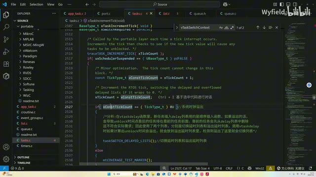

*xTaskIncrementTick 中从 xTickCount 计算新节拍值，并检查加一后是否为 0。 · [原片 09:00](https://www.bilibili.com/video/BV1fmL6ziEhA/?p=4&t=540)*

假设上电之后，已经一千个时钟周期了。我们某一个任务，比如说 TaskA，调用了 `vTaskDelay` 这个函数，传参是一千。也就是说，基于当前时间点，一千个时钟周期之后，请你帮我把我唤醒。

这就是一个示意图。因为这个变量是 uint32 的，所以最多是 `0xffffffff`，八个 F，对吧？我们调用的时候，时间点是上电后一千个时钟周期。我希望它一千个时钟周期后唤醒，那是不是一千加一千就是两千？也就是说，请你在上电后的时钟周期到达两千的时候，把我唤醒。那唤醒时间点就是两千。OK，我们这边做一个标注。好。

这边计算出来之后，第一步是计算，第二步就是把 TCB 相应列表项里面的 item 成员，这个数字，把它填成唤醒时间点，对不对？假如说现在是任务一，刚才我们已经计算过了，它是一千加一千，是两千。OK，那就是两千，然后插入 delay 列表里面。

前面讲列表的时候，我们也说过了，列表是一个顺序表，所以就是插前面。好吧，我们来做一下这个操作。好，我们做一个箭头的指向。OK。所以这样，调用 `vTaskDelay` 和其他阻塞延时函数，就会产生这样一个效果。

放进去之后，调度器每一次系统节拍周期就会检查。它是怎么检查呢？它检查 delay 列表，从头开始检查。因为我们是顺序表，最靠头的肯定是解除阻塞时间最早的，所以从头开始检查。

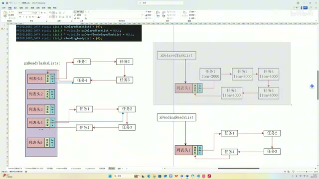

*任务一的 Item=2000 排在 delay 列表前面，后面依次示意 3000、4000。 · [原片 12:00](https://www.bilibili.com/video/BV1fmL6ziEhA/?p=4&t=720)*

假设这个 1000 毫秒执行了一段时间，当前可能是 2005 毫秒。因为事无绝对，操作系统不像定时器，它里面比较复杂，不会那么精确，不一定会完美地卡到 2000。它可能是，比如说 2002 吧，现在系统时钟周期，就是全局时间，现在是 2002。

它会从 delay 列表里面拿出来第一个，看这个 item 项，发现现在都 2002 了，而它要我最早 2000 就开始唤醒它。现在 2002 大于 2000，那我调度器赶紧把它唤醒。然后根据它的 TCB，之前说的 TCB 里面有个成员是 priority，这边没有画，它有个成员是 priority，就是标记它的优先级。假如现在优先级是 1，它就把它拿到这个里面，调度器在里面执行。主要就是这样一个流程。

当然，每次不一定只唤醒一个。因为事无绝对，假如我们下一个任务，刚巧它是 2001，现在 2002 了。它把这个唤醒，还会接着往下找，发现 2001 也比我 2002 小，它会把任务二也给唤醒。然后接着找，发现任务三已经比我大了。又因为整个列表是顺序表，后面的一定比前面的大，它这个都比我大了，后面就没必要看了。所以如果是刚才那种情况，就是唤醒两个任务。OK，这就是调度器大致唤醒的流程。

## 从 vTaskDelay 进入源码

好，我们现在就开始讲代码。从 `vTaskDelay` 这个函数讲起，这个参数就是延时的时长。首先这里做了一个判定，你这个时长至少得是 1 吧？太小了没有意义，然后就直接跳出去。然后大于 1 的话就会来到这里。

> 整理注：此处保留讲者“至少是 1”“大于 1”的口头说法；画面实际条件为 `xTicksToDelay > (TickType_t) 0U`，见下图。

这里做一个原子化操作：我在把任务放到 delay 列表的过程中，你就不要往外切了，否则会出现一些问题。所以它在这里调用 `vTaskSuspendAll()`，把别的任务都挂起了，然后在这里通过 `xTaskResumeAll()` 再打开，使中间这一段操作是原子化的。OK。

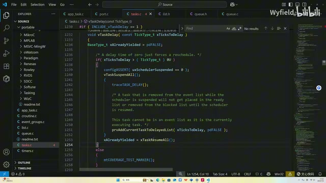

*vTaskDelay 的非零延时分支：暂停调度、加入延时列表、恢复调度。 · [原片 15:00](https://www.bilibili.com/video/BV1fmL6ziEhA/?p=4&t=900)*

然后 `prvAddCurrentTaskToDelayedList(xTicksToDelay, pdFALSE)` 这个函数就是核心。看字面意思，就是把当前 Task，也就是调用这个 `vTaskDelay` 函数的 Task，把这个任务加到一个 delay 列表里面。我们看一下它是怎么实现的，首先它在这边，这个操作，这个函数我们最早也讲了，叫列表项移除函数。就是用 `uxListRemove(&pxCurrentTCB->xStateListItem)`，把当前任务的 TCB，从 ready 状态列表里面给它移出来。看官方的注释也看得出来。移出来之后，我们准备把它往 delay 列表里面放。OK，第一步是先移出来。

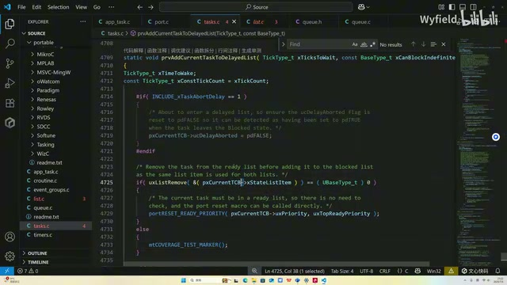

*prvAddCurrentTaskToDelayedList 先用 uxListRemove 移除当前任务的 xStateListItem。 · [原片 15:24](https://www.bilibili.com/video/BV1fmL6ziEhA/?p=4&t=924)*

然后这是一个条件预编译，有两个分支，两个分支都差不多，我们选底下这个分支来讲。它这边就是在计算该任务阻塞解除时间点的值了。

我们前面也说了，你看这个变量 `xConstTickCount`，这个变量是从全局变量 `xTickCount` 里面获取的。前面讲了，这个全局变量就相当于 FreeRTOS 的钟表一样，像秒针一样，每一个心跳周期都加一。现在就赋给这个。然后 `xTicksToWait` 是我们的传参，就是传进来我们要延时多久。`xTimeToWake = xConstTickCount + xTicksToWait`，当前时间加上延时时间，就是这个时间点嘛。OK，这块很好理解。

然后这一步 `listSET_LIST_ITEM_VALUE(&pxCurrentTCB->xStateListItem, xTimeToWake)`，就是把算出来的时间点放到 TCB 的列表项，作为它的 item。前面也说了，当我们的任务存在 delay 列表时，它的这些列表项，其实代表的就是解除阻塞状态的时间点。我们现在算出来了，要把它放到 TCB 里面，放完之后，后面才会放到 delay 列表里面。OK，这就在干这样一个事情。

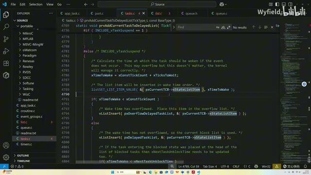

*计算 xTimeToWake、写入 xStateListItem，并按溢出判断选择插入的延时列表。 · [原片 16:30](https://www.bilibili.com/video/BV1fmL6ziEhA/?p=4&t=990)*

然后看这边有两个分支。有一个分支，就是我计算出来的时间点，如果比当前时间点的数值小（`xTimeToWake < xConstTickCount`），就来到这里，否则就来到这里。这有点意思了。

## 如果唤醒时间发生溢出，会怎么样

我们举个例子，前面举的是常规例子。假设是这种情况呢？系统运行起来有一段时间了，然后才调用这个函数。假设是任务 W 调用 `vTaskDelay`，希望延时 2000 毫秒。调用函数的时间点，是全局时钟最大值减 1000。OK。

最大值减 1000，再加 2000，毫无疑问会溢出，到这个 1000 了，对不对？刚才说过，算出来之后，会放到 delayed task 里面，而且是顺序放入。现在任务 W 的唤醒时间点，刚才也算了是 1000，往里面放的时候，顺序放入。

好，假设原本列表是这样一个情况，那它就会放到第一个了，对吧？它就会放到第一个。

放到第一个之后，现在系统继续去执行，下一个时钟周期就是最大值减 999，对吧？现在调度器开始来判断了。它从头拿过来，发现最大值减 999 肯定大于 1000，那它就会认为任务 W 应该被唤醒了，就去唤醒任务 W。但实际上，这不符合我们的预期，对不对？

我们希望从加入时间点后 2000 个时钟周期，这个任务才被唤醒。但刚才也推演过了，如果是之前那样一个逻辑，它可能下一个时钟周期，一个时钟周期就被唤醒了。这显然不符合我们的预期。

> 整理注：这里的“最大值减 1000，再加 2000 得到 1000”保留讲者与图中的示意数值；若严格按 32 位无符号整数和 `0xffffffff` 计算，结果会差一个计数。这里没有据此改写讲者的推演。

## 两个延时列表：当前与溢出后备用

那么 FreeRTOS 是怎么解决这个问题的？它有两个 delay 列表。之前我们也看，这边是存放全局列表的代码区域，你也可以看到，有 `xDelayedTaskList1` 和 `xDelayedTaskList2`，有两个。它是通过这两个延时列表，来解决刚才说的那个问题的。

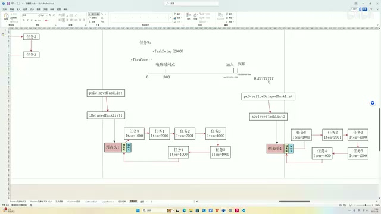

*双延时列表及两个指针的示意，任务 W 用于演示计数溢出问题。 · [原片 19:30](https://www.bilibili.com/video/BV1fmL6ziEhA/?p=4&t=1170)*

首先它有两个指针，第一个是 `pxDelayedTaskList`。这个指针指向哪，我们调度器判断哪些任务需要解除阻塞态，就会看哪个列表。还有一个指针叫 overflow，叫溢出延时列表 `pxOverflowDelayedTaskList`。

就是这个指针指向哪，当我们在这里计算阻塞解除时间点，如果判断到是溢出，它就会把这个任务放过去。就是第二天，对吧？比如我 11 点的时候加入，希望延时两个小时，那就是第二天凌晨一点。用我们现实生活来举例，就是跨日子了。

如果检测出加入时间点加上唤醒时长，会是第二天、跨日的话，它就把算出来这个阻塞解除时间点的任务，放到这个指针所指向的列表里。这就不会存在这个问题了。

也就是说，刚才这种情况，任务 W 不会被放到 `pxDelayedTaskList` 所指向的列表，而会放到 `pxOverflowDelayedTaskList` 所指向的列表，也就是当前这个状态。这就不会出现刚才那样的问题：这个时间点再加一，是最大值减 999 的时候，它就判断后面的，刚才那个任务就不会被异常唤醒了。

那么这个任务加入到第二个列表，它是什么时候被唤醒的呢？我们这个调度器是在 SysTick 里面，每一次心跳周期都会加加。比如我们到全 F、最大值了，再加加的时候会加成 0。那么通过加成 0，就可以知道现在已经溢出了。或者用现实例子来说，就是现在是第二天了。

这个时候，就把这两个指针所指向的列表进行互换。也就是说，这个列表指针指向它，另一个列表指针指向它，进行了互换。跨天之后，第二天每一次系统心跳周期，调度器现在通过这一个列表，看看这里的任务哪些需要解除阻塞。那么任务 W 在第二天的 1000 点，就会正常解除阻塞状态。

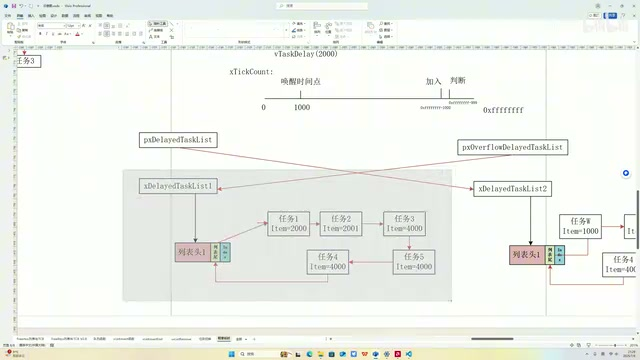

*跨越计数回绕后，两个延时列表指针的连线已交叉互换。 · [原片 22:30](https://www.bilibili.com/video/BV1fmL6ziEhA/?p=4&t=1350)*

同时，如果还是遇到刚才这个情况，前一天调度器使用的那个列表，就作为第二天的后备列表。换句话说，这两个列表现在是一个上一休一的状态。OK。

其实刚才这个逻辑说完，这一块其实就在干这个事情：首先，算出来的时间点小于当天时间，也就是第二天要唤醒，那么通过 `vListInsert`，把 `pxCurrentTCB->xStateListItem` 放到刚才说的 overflow 指针所指向的列表里面。否则，也是用 `vListInsert`，就是正常这个 `pxDelayedTaskList` 指针所指向的列表，这边就在干这样一个事情。

## xNextTaskUnblockTime：先判断是否值得检查列表

然后这个分支在干什么事情呢？它有一个机制，也是一个全局变量 `xNextTaskUnblockTime`，字面意思是下一次、下一个任务解除阻塞时间，也就是下一次有任务需要被唤醒的时间点。它用一个全局变量来记录，就这个全局变量。

它这样搞是什么意思呢？每当任务要被唤醒的时候，或者说调度器检查 delay 列表的时候，会首先看这个变量。如果这个变量的值，现在小于等于 `xTickCount` 这个全局变量，也就是小于当天时间的时候，我才会去检查列表。否则我就不检查，不浪费时间了，相当于在上面先做一个判断。

所以这个变量是怎么被更新的呢？假设我现在当天时间还是 1000，然后我有一个函数，对吧，我有一个任务，它使用了这样一个函数，希望阻塞 3000 个时钟周期。那么就是 4000，算出来是 4000。我们算出来，然后这个新任务，任务 X，它是 4000，会把它加到这样一个列表里面。

然后它会拿这个新加入的任务和这个变量比，哪个小。如果新任务的时间点小，或者说早于这个，那就把它更新（`xTimeToWake < xNextTaskUnblockTime` 时，将 `xNextTaskUnblockTime` 赋成 `xTimeToWake`）。举个例子，像这种情况，它就不会更新，对吧？

还有一种情况，假如有一个任务是这样调用的，500 毫秒。那么现在算出来，任务 Y 的解除阻塞时间是 1500，是吧？OK，它放到前面。它看到新加入的是 1500，早于这个 1900，就会把它更新。

> 整理注：讲者此处口述“1900”；此前图中原先的 `xNextTaskUnblockTime` 显示为 2000，随后改为 1500。保留该口述数值差异，比较关系仍按讲者原序呈现。

后面调度器每次检查列表，有没有任务要被唤醒的时候，先看一下这个变量。比如是 1200 的时候，它先判断，1500 大于 1200，这个列表看都不看。只有到 1500，发现这个是大于等于了，才会去看，就是这么一个逻辑。所以这个分支就在干这个事情。

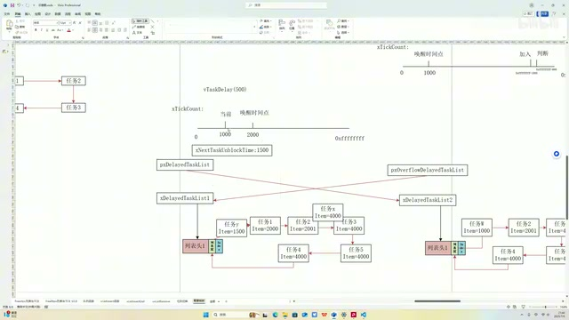

*任务 Y 的唤醒时间 1500 排到列表前面，xNextTaskUnblockTime 更新为 1500。 · [原片 25:30](https://www.bilibili.com/video/BV1fmL6ziEhA/?p=4&t=1530)*

## xTaskIncrementTick：从 delay 回到 ready

把任务加到列表的逻辑，我们已经讲完了。下面讲如何从 delay 列表里面拿出来，拿到 ready 列表里面。

之前说了，SysTick 是系统心跳中断，它干两件事情：第一个是触发 PendSV 来切换任务；切换任务之前，会检查 delay 列表，看看哪些任务需要唤醒，再把它放到 delay 列表里面，就是这个函数在干。我们来看它如何实现。

> 整理注：上句“放到 delay 列表”按口述保留；本段开头和后续实际演示均为从 delay 移出、加入 ready。

首先通过 `uxSchedulerSuspended == (UBaseType_t) pdFALSE` 检查一下调度器是否开启，如果开启，再进行下一步判断。然后这两行就等价于 `xTickCount++`。前面说了，`xTickCount` 就像 FreeRTOS 的时钟一样，每一个心跳周期像秒针一样往后加一，就在干这个事情。OK。

我看的时候也都加了中文注释。然后这里在干什么呢？之前说过，delay 列表有两个，一个是调度器负责检查的列表，还有一个就是后备列表。当新加入的需要阻塞的任务跨日子了，我会加到这个后备列表里。然后它每次，就是这个时钟溢出，换句话说，举个生活例子，到半夜、午夜零点的时候，就会切换列表。OK，这边就是在干这样一个事情。

假设上一个周期是 `0xffffffff`，这个周期加一，它溢出了，加到 0 了（`xConstTickCount == (TickType_t) 0U`），就知道跨日子了，现在是第二天了，就通过 `taskSWITCH_DELAYED_LISTS()` 把两个列表进行交换。这边交换是标准三段式，用了一个中间指针：它先赋给它，它再指向它，它再从它拿回来它。标准三段式交换，就不多赘述了。

然后这边是一个全局变量 `xNumOfOverflows`，就是溢出了几次，加加。这个变量目前来说不重要，不讲。然后这个是在更新前面说的那个全局变量 `xNextTaskUnblockTime`，标记下一次需要有任务解除阻塞，或者被唤醒的时间点。

现在换列表了，你得重新看一下，毕竟列表换了嘛。因为上一天的 unblock time 肯定是很大的值，比如可能是 `0xffffffff`，一堆 F，然后可能减个 5、减个 10 这种。现在是新的一天，这个时间肯定要更新，就会调用 `prvResetNextTaskUnblockTime()` 更新一下。

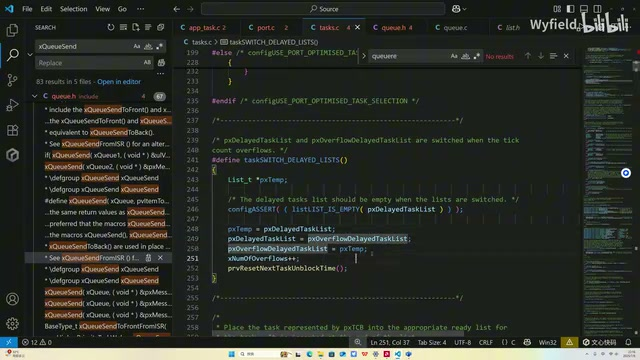

*taskSWITCH\_DELAYED\_LISTS 宏：临时指针交换、溢出次数加一、重设下一次唤醒时间。 · [原片 27:50](https://www.bilibili.com/video/BV1fmL6ziEhA/?p=4&t=1670)*

它怎么更新呢？首先，如果第二天都没有任务需要唤醒，那么 `xNextTaskUnblockTime` 就赋成 `portMAX_DELAY`，这是一个最大值，第二天没有任务要被唤醒。如果第二天 delay 列表不空，也就是有任务要被唤醒，它就把第一个拿出来。因为这是顺序排列的，把列表第一个拿出来，再赋给这个变量，就这么简单。OK，然后我们退出去。

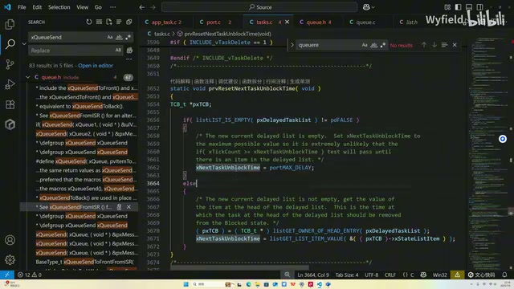

*prvResetNextTaskUnblockTime：列表为空取 portMAX\_DELAY，否则取列表头任务的项值。 · [原片 29:00](https://www.bilibili.com/video/BV1fmL6ziEhA/?p=4&t=1740)*

现在已经完成了全局时钟的加加，和两个 delay 列表切换的判定。接着往下看。这里首先是一个判定，这个是当前时间，这个是前面说的变量，就是最早一次有任务要解除阻塞、被唤醒的时间点。我进行判断，如果 `xConstTickCount >= xNextTaskUnblockTime` 这个判断都过不去，就不浪费时间看列表，这是一个逻辑。

如果能通过，就说明确定有任务现在要我去唤醒，然后我就进来。进来之后首先是 `for (;;)`，无限循环。这个分支我们先不看，最后再说。第一次进来，肯定来到这个分支。首先通过 `listGET_OWNER_OF_HEAD_ENTRY(pxDelayedTaskList)` 把 delay 列表中的第一个成员取出来，然后把它的这个值，就是 delay 列表中的 item，代表的是时间点，通过 `listGET_LIST_ITEM_VALUE(&pxTCB->xStateListItem)` 把这个时间点取出来，放在 `xItemValue` 中。然后这个也不看，你第一次进来不会跳到这里，我们最后再说。

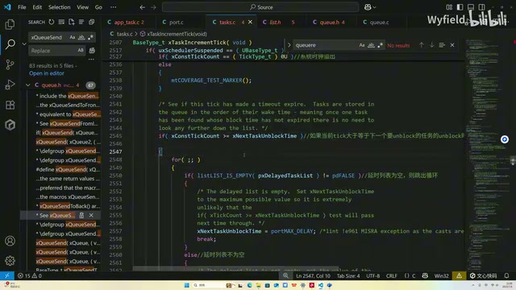

*到达 xNextTaskUnblockTime 后进入 for 循环；空列表分支设置最大值并 break。 · [原片 30:00](https://www.bilibili.com/video/BV1fmL6ziEhA/?p=4&t=1800)*

现在取出来之后，就来到这里。这里在干一个事情：这个任务现在取出来了，而且处于 delay 列表，我们要把它放到 ready 列表，肯定得先把它从 delay 列表里面拿出来啊。这个函数我们也讲过无数次了，就是通过 `uxListRemove` 来拿出来。OK，现在已经从 delay 列表拿出来了。

## 为什么还要从队列等待事件列表中移除

好，下一步这个分支在干什么？后面讲队列的时候会说，现在先简单说一下。这个是队列结构体的定义，可以看到里面有两个列表，一个是等待发送 `xTasksWaitingToSend`，一个是等待接收 `xTasksWaitingToReceive`。

举个例子，现在调用前面说的 send 函数，想发一个数据到队列里面。但是如果队列满了，我发不进去，对吧？第三个参数是 1000，意思是我可以等你 1000 毫秒。这 1000 毫秒之内，如果有人把队列里面的数据拿一个走，就是不是满的，那我就可以发，对吧？我就会再把它发进去。

但是这 1000 毫秒过了，我也就不等了。后面有人再拿走，跟我没关系，我不会把数据发进来。其实就是这样一个逻辑。

队列怎么做呢？还是举这个例子，某个任务调用 send 函数，发现满了。OK，发现满了之后，队列就把调用 send 函数的那个 Task，放到 waiting to send 这个列表里面，把它往里面放。这个放也是根据优先级放，优先级高的放前面。

一旦有任务或者中断调用 receive 接口，把数据拿走，让它不满了，队列相关的函数就会从这个列表里面找第一个，把它唤醒，把它放到 ready 列表里面，让它能够执行。第一个，因为它放到这个列表里面，它的 item 代表的是优先级，又是顺序放的，所以第一个任务的优先级肯定最高，就先把第一个拿出来。OK。

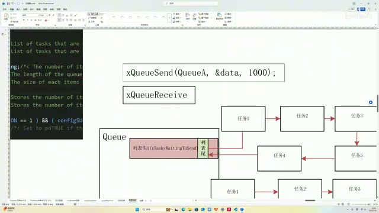

*队列等待发送列表与 xQueueSend、xQueueReceive 之间的示意关系。 · [原片 33:00](https://www.bilibili.com/video/BV1fmL6ziEhA/?p=4&t=1980)*

回过头来，刚才说如何实现“1000 毫秒时间到了，我就不等了”呢？其实就是时间到了之后，我把我这个任务从这个列表里面拿出来。因为你唤醒是从这里面找我的，我现在从里面出来，你就找不到我了。OK，那就实现了时间到了，我也就不管了，你也别唤醒我。这就是在干这么一个事情。

TCB 里面有两个列表项，一个是 `xStateListItem`，state 的列表项，就是当前这个任务是哪个状态，可能是 ready、delay。然后另一个 `xEventListItem` 列表项，就是通过它挂在不同队列的这个里面，等待事件嘛。OK。

所以从队列的等待事件列表里面删，你要传这个进去。这边先通过 `listLIST_ITEM_CONTAINER(&pxTCB->xEventListItem) != NULL` 判断，然后传这个 `xEventListItem` 给 `uxListRemove`，把它从这里面移出来。OK，移出来之后，就是调用 `prvAddTaskToReadyList(pxTCB)` 加入 ready 列表，等待调度器。如果你的优先级当前是全局最高的，你就能执行了。其实这个也就讲完了。OK。

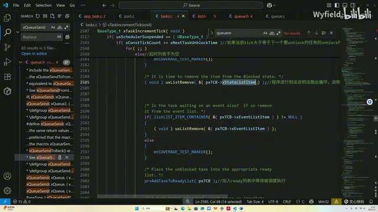

*到期任务先移除 xStateListItem，若仍在事件列表则移除 xEventListItem，再加入 ready 列表。 · [原片 33:30](https://www.bilibili.com/video/BV1fmL6ziEhA/?p=4&t=2010)*

## 一次不一定只唤醒一个：继续循环与退出条件

前面也说了，每次唤醒不一定是一个，是吧？首先是这个 unblock time 判定通过之后，还是举刚才那个例子，假如现在时间是 2002。进来之后，拿第一个，2002 大于 2000，唤醒，唤醒就把它放到 ready 列表里面。

然后这个时候，不会只唤醒一个，会接着往后看，对吧？发现这个也小于 2002，把它也唤醒；2001 小于 2002，把它也唤醒。然后接着往后看，发现这个 4000 大于 2002，就说明不唤醒了。

又因为列表是顺序的，我这个都比它大了，后面肯定不会小于它，后面就不看了，直接跳出判定逻辑。这个是如何实现的呢？刚才说了，这里有循环，对吧？

首先就两种情况。第一个，有没有可能列表里面就三个，我把这三个全都从 delay 列表删了，删着删着删完了，是不是也该跳出去了？后面都没有了。所以如果删完，就进到这里，因为是循环嘛，你把 delay 列表删成空了（`listLIST_IS_EMPTY(pxDelayedTaskList) != pdFALSE`），那这个时候肯定要 `break`。OK。

然后这个判定，就是因为这个 unblock time。我们前面说了，在这里不是会把整个列表第一个成员拿出来吗？对吧？假设上一轮判断 2002 大于 2000，这个也删了，这个已经删了，那这个时候拿的是哪个？我们拿的是列表第一个成员，因为刚才那个已经被删了，拿的是一个 2000 啊。所以拿出来，把它的阻塞时间点跟当前进行判定。判着判着，这两个都删了，然后到这里，从头里面拿，拿出来的其实就是任务三了，对吧？

把它的 item 读出来，这个时候是 4000。然后这里再做一层判定，4000 肯定大于当前的 2002。那么这就说明后面也不再看了，说明应该跳出判定。后面的任务，因为是顺序表嘛，不可能是需要我来唤醒的，在这里进行一个 `break`。OK。

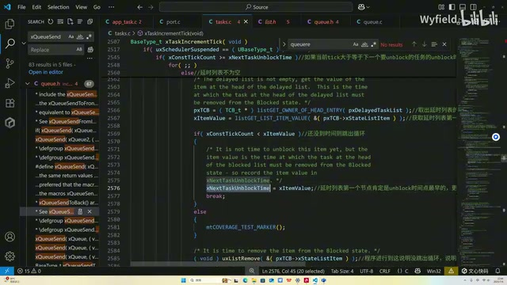

*列表头时间 xItemValue 尚未到达时，更新 xNextTaskUnblockTime 并退出循环。 · [原片 36:00](https://www.bilibili.com/video/BV1fmL6ziEhA/?p=4&t=2160)*

> 整理注：讲者反复删除列表头的演示按原序保留；上文第二个到期值曾写作 2001，这里又口述“2000”。画面代码在 `xConstTickCount < xItemValue` 时先将 `xNextTaskUnblockTime = xItemValue`，再 `break`。

## 今天的两部分，以及队列发送的共同入口

那么今天就讲了两个部分，就是阻塞延时的机制。主要就是：你要延时的时候，把它放到 delay 列表里面；算出一个解除阻塞状态的时间点，把这个算出来，放到 delay 列表里面。然后调度器每次心跳周期顺序地查这个列表，看看哪个任务需要被唤醒，再给它放到 ready 列表里面，大致就这么一个逻辑。

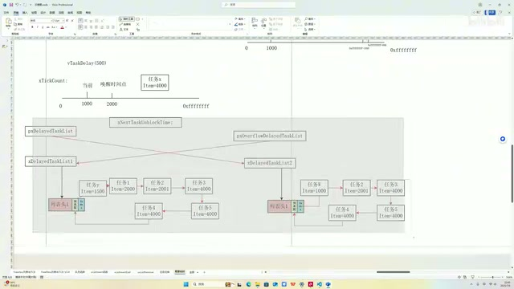

*讲者最后回到时间轴与双延时列表示意，回顾加入和唤醒两部分。 · [原片 37:30](https://www.bilibili.com/video/BV1fmL6ziEhA/?p=4&t=2250)*

前面也提到了，触发阻塞有两种形式。第一个是 `vTaskDelay`，核心其实是调用 `prvAddCurrentTaskToDelayedList` 这个函数，对吧？前面说过了。还有一种形式，就是 `xQueueSend` 也可以触发阻塞，其实 `xQueueSend` 也是在用这个函数。

我们简单看一下，`xQueueSend` 是宏函数，调用的是 `xQueueGenericSend`。这边会有一系列判定，后面讲队列的时候再说。如果判定要加入这个阻塞延时，我们就来到这里，来到这里会发现，这个 `vTaskPlaceOnEventList` 函数，其实也是在调用 `prvAddCurrentTaskToDelayedList`。

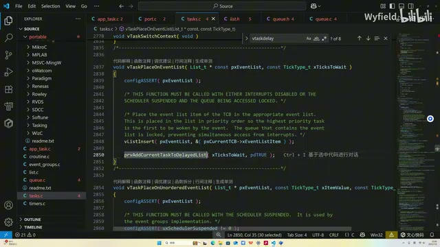

*vTaskPlaceOnEventList 将任务放入事件列表，再调用 prvAddCurrentTaskToDelayedList。 · [原片 38:36](https://www.bilibili.com/video/BV1fmL6ziEhA/?p=4&t=2316)*

所以队列和 `vTaskDelay` 触发阻塞，它的内部机制本质上都一样。好，今天 FreeRTOS 阻塞延时相关的代码，就和大家分享完了，谢谢大家的观看。

> 尾部记录：2331.48 秒附近最后一个 ASR 片段为“ja 上??”，无法辨认为有效讲述；未据此补写内容。
