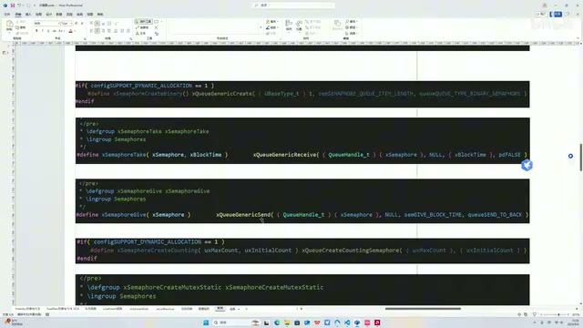
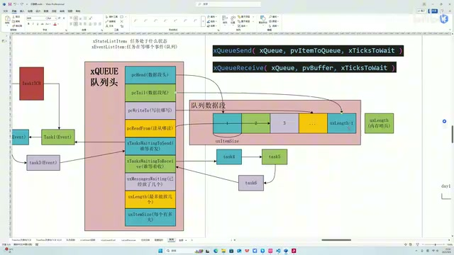
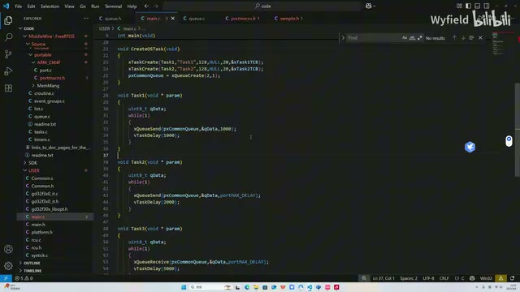
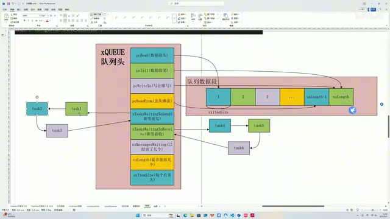
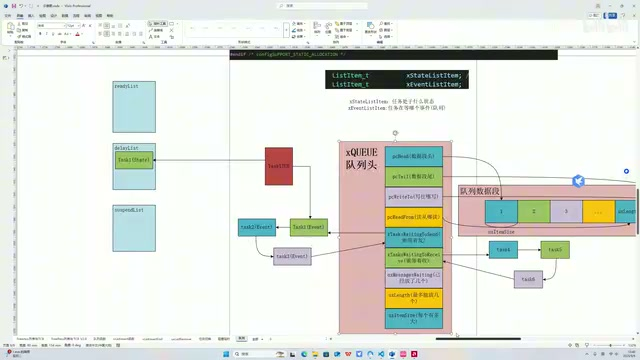
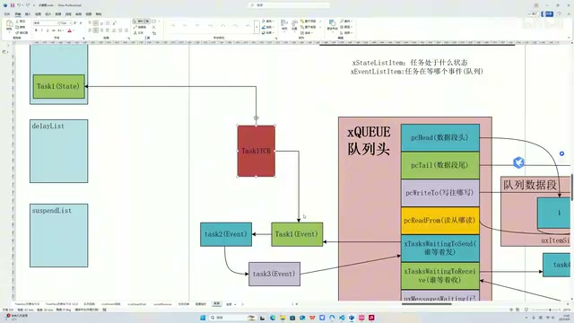
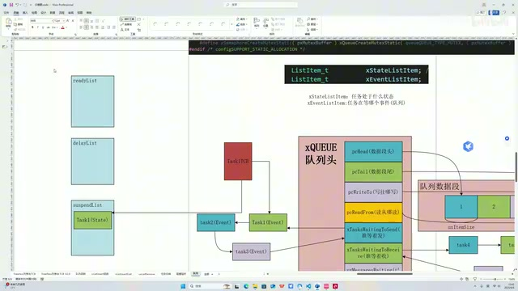
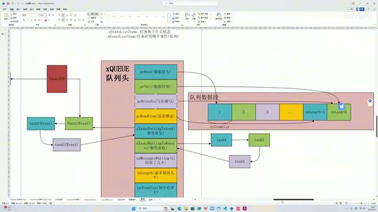
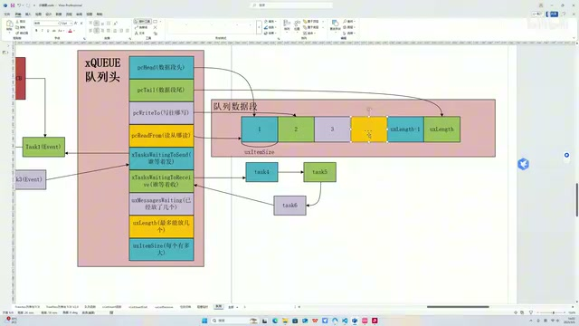

# FreeRTOS P05｜队列-概述

> 来源：[BV1fmL6ziEhA · P05](https://www.bilibili.com/video/BV1fmL6ziEhA/?p=5)；范围 00:00–19:03.817。以下为保留原序、口吻和解释的整理稿。

## 队列与信号量的底层关系（00:00）

大家好，今天开始带着大家阅读队列相关的代码。我们在开发过程中应该都会使用到队列，核心就是这三个函数，分别是 create、send 和 receive。这三个函数分别实现了队列的创建、发送和接收这三个基本功能。

同时我们也会用到信号量，二值信号量、计数信号量，还有互斥量一些相关的功能。这边我也进行了一个截图。比如说，你看我们这个二值信号量，其实它底层就是在用队列相关的函数。包括二值信号量的创建，是基于队列的创建函数来创建的。二值信号量的发送、接收，take，其实就是基于我们上面说到的队列相关的 receive 函数来实现的；以及信号量的 give，其实就是利用队列的 send 功能来实现的。

*信号量 take、give 与队列函数的宏映射 · [原片 01:00](https://www.bilibili.com/video/BV1fmL6ziEhA/?p=5&t=60)*

包括我们的计数信号量，还有 mutex，对吧，互斥量，其实底层都是队列。所以说，你队列也明白了，队列的底层机制明白了，信号量、互斥量，以及后面我们会学到的队列集，它的底层机制其实我们也顺带着明白了。所以说，阅读队列相关的源码，这个行为它的收益是很高的，因为你懂了一个，其余的三四个你都懂了。OK，那我们接下来就开始源码的阅读吧。

## 队列头和四个指针（01:47）

在阅读代码之前，首先要对队列这个数据结构有一个宏观的了解。和前面所说的列表一样，队列也是由一个头和一个数据段所组成的。队列头的定义是在源码的这个地方，是 xQUEUE，是这个数据结构。

这个数据结构内部的成员，我先把不重要的给它剔除了，然后核心也就是这个数据结构。我把它放在这个地方了，画在这个地方了，一共是九个，下面我们一个个来讲。

第一个是 pcHead，这是一个指针。我也用中文做了标识，它是指向数据段的头。第二个成员也是一个指针，叫 pcTail。

按照思维惯性，我一开始，反正我看的时候，我是惯性地认为这个指针所指向的，就和 pcHead 对应嘛，它可能指向的是整个数据段最后一块内存区域。但实际上不是的，它往后又偏移了一个。它实际上指向的是整个数据段最后的那块内存，再往后偏移一个，是这一块。换句话说，pcTail 指针所指向的内存，它并不属于队列。因为你看这个图里面，粉色的才是属于队列的区域，然后这块我特意把它画到外面来了，就想表明这个结论。这块大家脑子里面要有印象，不然等会看源码的时候容易卡住、犯迷糊。我也是被卡过，然后再回头看，才发现了这个结论。

*队列头四个指针和数据段边界示意 · [原片 03:00](https://www.bilibili.com/video/BV1fmL6ziEhA/?p=5&t=180)*

紧接着，还是两个指针，也是两个对应的指针。第一个指针叫 pcWriteTo，我也用中文做了一个标注，就是“写往哪写”。我们调用 queue send 函数的时候，基本上内核源码就是查这个指针，它指向哪，我们就把数据写到哪。

与之对应的就是 pcReadFrom，是“读往哪读”嘛。同理，我们调用 queue receive 函数的时候，内核源码是查询这个指针，它指向哪，

内核源码就把哪的数据扔给用户来使用。这一共是四个指针。

> 编者注：这里保留讲者对读指针的概述；pcReadFrom 的具体读取与移动顺序，本节尚未展开源码。截图小字受原片 640×360 分辨率限制。

## 谁等着发，谁等着收（04:09）

紧接着就是两个列表，分别是 waiting to send 和 waiting to receive。我也做了标识，分别就是“谁等着发”和“谁等着收”。

应用场景是这样的：假设说我们有 task 调用了 queue send 函数，然后它 send 失败了，原因在于队列中已经满了，没有空位再给它放数据进来，所以就算 send 失败。同时，它调用这个函数的第三个参数，等待时间的这个参数不为 0，而是 1000，就说明它愿意等 1000 个时钟周期。

*task1 的 1000 等待参数与 task2 的 portMAX\_DELAY · [原片 05:00](https://www.bilibili.com/video/BV1fmL6ziEhA/?p=5&t=300)*

那么在这 1000 个时钟周期内，如果有别的 task 调用了 receive 函数，它把这个数据拿出来，使得队列中有空位了，这个时候内核源码就会去看有没有 task 等着去发，如果有的话就会拿出来。假设刚好 task1 优先级比较高，它就是能被拿出来，同时也是 1000 毫秒、1000 个时钟周期之内，那它就能执行了。

其实同样的，如果你第三个参数传的是内核源码内部给的这样一个宏，就是 max 这个宏的话，那么它就是可以永远地等，而不是说只等 1000 毫秒了。就是在整个操作系统的运行生命周期之内，我都愿意等，一直等到队列里面有空位了，

> 编者注：画面中的宏为 portMAX_DELAY。讲者在本节交替使用“1000 毫秒”和“1000 个时钟周期”，此处保留其口述，未将两者静默换算。

同时我的优先级也让这个机会轮到我了，那我这个 task2 才可以执行。

同理，receive 也是一样的逻辑。假设说 task3 想 receive，它想拿资源，而队列里面的资源已经被拿光了，是 0 了。同理，你第三个参数传的不是 0，可能是数字，或者说是一个 max，那就取决于这个参数来决定等待时间。一旦有别的 task 用 send 函数，把资源传到队列里，我这个 task3 如果优先级够的话，能轮到我，那我就被唤醒了。

刚才说源码根据优先级去查询等待的这些 task，同时把它唤醒，它就是基于我刚才说的这两个列表。我们等着去发和等着去收的 task，都是基于列表项挂载在这个环形列表上，同时它是按照优先级来排列的。也就是说，优先级高的排在前面，优先级低的排在后面。

假设说我们现在盯着 to send 这个来看，一旦有 task 调用了 receive 函数，把数据拿走了，也就是说至少有一个空位了，那这时候就会检查它这个列表项。它检查的方式就是用一个指针遍历，遍历是从第一个开始遍历的。一旦有，那就把它拿出去，让它执行，

*队列头的等待发送和等待接收列表及任务连接 · [原片 08:00](https://www.bilibili.com/video/BV1fmL6ziEhA/?p=5&t=480)*

对吧，让它执行。又因为是按照优先级来排列的嘛，所以排前面的肯定是先执行。同理，receive 这个列表项也是，一旦有 task 调用 send 函数，把资源放到队列里面，那它至少有一个资源了，那么内核源码就会看这个列表项，一个指针指向第一个往下遍历。如果这个列表项非空，就把第一个 task 唤醒。OK，这就是这两个列表项的作用。

## 第三个参数与 TCB 的两个列表项（08:42）

我们前面也说了，当我们调用 receive 和 send 函数失败的时候，等待时间是取决于第三个参数。如果是 0 就不等；如果非 0，是个数字，那就等相应数字的时钟周期；如果传的是 max，那我们是永远地进行一个等待。这个具体是怎么实现的呢？我们来分情况讨论吧。

首先，如果传的是一个数字，假如说传的是 1000 吧，就是只等 1000 个时钟周期。在这 1000 个时钟周期之内，你要是有别的 task receive 了，有空位了，你告诉我，我来给你发进去。如果超过 1000 个时钟周期，你再有空位，跟我也没关系，我也就不等了。

那这个是如何实现的呢？它是这样的，我们前面讲列表的时候也说到了，就是一个 TCB，它里面有列表项，而且有两个列表项。一个叫 state，状态列表；第二个叫 event，事件列表。这个状态列表呢，

它就标注了当前相应的任务，比如说 task1，它的 state 列表就是标注了当前任务处于一个什么状态。比如说，这个是放在 ready 列表下，那我们就知道它是一个 ready，随时可以被调用。如果处于 delay 列表下，那我们就知道，这就是我们上节课所说的处于一个阻塞，到点被唤醒。那如果处于 suspend 挂起列表，它就不是到点被唤醒，它只有是别的任务，或者别的地方调用函数，才能把它从 suspend 挂起列表里面拿出来，否则它就一直无法被执行。OK。

*task1 状态列表项位于 delayList，事件项连接队列等待列表 · [原片 12:00](https://www.bilibili.com/video/BV1fmL6ziEhA/?p=5&t=720)*

那如果就是我们刚才这个情况，我们调用一个 send 函数——我们以 send 函数为例，receive 是一样的——我们调用 send 函数，第三个参数是 1000，然后失败了。这个时候，相应调用这个、发送失败的任务，它的 state 状态，传的如果是数字、不是 max 的话，它就会把 state 状态变为一个 delay 状态，也就是我们上节课讲的阻塞延时的状态。

同时，它会把这个 TCB 的 event 列表项，给它放到你相应发送失败的那个队列的队列头下的 to send 这个列表下。OK，就处于这个状态。

好，这个时候也要分两种情况讨论。情况一：1000 毫秒时间到，同时在这 1000 毫秒之内，没有别的任务去调用 receive 函数，让它有空位。也就是，我等 1000 毫秒，而且我也没等到，从现在开始我不等了。

## 等待超时以后，两个列表项怎样移出（12:04）

这个是如何实现呢？这个就要结合我们上节课所讲的阻塞延时了。我们上节课就说了，对吧，调度器每一个时钟周期，它会检查 delay 列表下的所有这样的任务。它把这个任务相应预设的解除阻塞时间点，和当前的时间点进行对比，对不对？如果当前时间大于等于所预设的时间，那我就要唤醒它了，对不对？这个我们复习一下。

OK，好，1000 毫秒到了，调度器发现你也只等 1000 毫秒，那这个时候已经大于等于 1000 毫秒了，我首先把它拿出来，调度器把它拿出来。拿到哪呢？又是我们上节课说的，拿到 ready 列表下，对不对，让它随时可以处于一个被调用的状态。那究竟它会不会被调用，这个取决于 task1 它本身的优先级，它自己争不争气。优先级高就能被执行，优先级低它就等着，这个时候调度器就不管了。

OK，这是第一步，它把 state 的状态从 delay 移到 ready。第二步呢，我们上节课也讲了，它把 event list 也拿出来，把 task1 TCB 的 event 列表项，从它所在的列表里面删除。OK。

*task1 状态项移至 readyList 的图示 · [原片 13:30](https://www.bilibili.com/video/BV1fmL6ziEhA/?p=5&t=810)*

那么后续，假设说 1000 毫秒之后，就是 1500 毫秒的时候，有任务调用了 receive 函数，这个时候调度器就会把 task2 唤醒了。那 task1，它已经不在这个列表里面了，它也不等了。OK，这是第一种情况，好不好？就是说，发送失败，同时第三个参数是数字，不是 max。

好，我们来讲第二种情况，就是传 max 的时候。

## 永久等待与 suspend 列表（14:04）

调度器是怎么做的呢？发现它 send 失败了，同时第三个参数是 max 的，它是把它的 state 状态放到 suspend 列表下，OK，就是挂起列表下。

suspend 列表就不存在我们上节课说的调度器周期性检测的这样一个逻辑了。调度器周期检测 delay 列表，用我们现实生活中的例子举例，就是“到点把我唤醒”：我订个闹钟，第二天几点的时候把我唤醒。但 suspend 列表不一样，它是一个长眠不醒的状态，除非别的 task 调用函数把它拿出来，它才能继续去执行。

所以，它上来如果传的是 max 的话，就把这个任务放到 suspend 列表下，所以就不会存在前面说的到了相应的时间，它被唤醒了这样一个现象。因为如果出现那个现象的话，就不符合我们让它永久等的预期了，对不对？所以就放到这。

它放在这，又不存在那个定期解除状态的机制，所以主要是 event 这个列表项，它就永远存在于 waiting to send 这个列表下了。OK，它就可以实现一个永久等。

*永久等待时 task1 状态项位于 suspendList · [原片 15:00](https://www.bilibili.com/video/BV1fmL6ziEhA/?p=5&t=900)*

然后，它什么时候被拿出来呢？那就简单了，对吧，就是外部有别的 task，或者别的地方一直调用 receive 函数，让它有空位。然后我们前面说的，有个指针来遍历嘛，如果它刚好是第一个，那么第一次别的地方 receive，它就能被唤醒，那就被删除。那如果它不是第一个，就是往后遍历嘛，要多来几次，然后就到它了，它就被唤醒，就可以执行了。OK，但是被唤醒的时候，无非就是把它，

从 event 的列表下给它删了，对吧，同时把它放到 ready 列表下，让它能执行。OK，就是这样一个逻辑。

## 已经放了几个：计数与指针移动（16:16）

接下来三个成员，就是三个数了，这个好理解。首先是 messages waiting，这是个变量。我用大白话翻译一下，就是说“已经放了几个”嘛。这个就简单，每次比如说你调用 send 函数往里面发，那这个变量就加加呗。然后如果调用 receive 函数，就是拿嘛，拿走、拿成功了，那这个变量就减减。用这个变量，直接读这个变量，你就知道当前这个队列里面有几个成员了。

然后每次发成功的时候，你这个指针也会加加，这个是很自然的。因为我们就像去食堂打饭排队一样，排肯定是排后面。我们前面也说了，这个指针指哪就往哪放，现在通过这个指针把它放到这了，那肯定要加加嘛，空位在下一个。然后是它加加、指针加加，再来一个，它再加加，指针再加加，对吧，就是这样一个流程。这个变量就标示了放了几个。

*数据段、写入指针与 uxMessagesWaiting 计数成员 · [原片 17:00](https://www.bilibili.com/video/BV1fmL6ziEhA/?p=5&t=1020)*

同理，receive 成功了，那也是这个 read from 指针。首先是这个变量减减，然后 read from 指针也往后加加一个，对吧。再来一个再减减，然后指针再加加、再加加。所以从数值上，我们也可以做一个推论：从数值上，这个变量是不是就等于这个指针所指向的地址，减去这个指针所指向的地址，再加一啊，对吧？OK，这个变量就说完了。

> 编者注：图中计数成员为 uxMessagesWaiting。这里保留讲者“地址相减再加一”的口述推论；口述未明确两次“这个指针”的符号，也未在本节解释环形回绕等细节，故不补造公式。

下一个变量就是 uxLength，就是整个数据段的容量，就是最多能放几个。

比如说，像这边也标识了嘛，这是我们的数据段，它的一个长度，这是第一个，一直往后，最后一个就是 uxLength，这个很简单。

然后下一个变量就是 uxItemSize，就是“每个有多大”。就是每个成员以字节为单位的尺寸嘛。这边也标识了，就是它有多大，那它就多少个字节，然后每个成员都是一样的。OK。

*数据段长度 uxLength 与单项尺寸 uxItemSize 标注 · [原片 18:30](https://www.bilibili.com/video/BV1fmL6ziEhA/?p=5&t=1110)*

所以从宏观来描述队列这个数据结构，刚才也就描述完了。基本上队列相关的一些操作，刚才都口述完了，就这么点东西。接下来我们就来阅读代码，把我刚才讲的那些逻辑、那些事情，和代码里面一些细节上的操作对应起来，就 OK 了。OK，那我们就开始看代码吧。
