# P06 队列-创建

> 来源：FreeRTOS 源码详解，第 6 讲；全片 00:00–18:09。按原序整理的忠实图文讲稿。
> 截图原始分辨率为 640×360；代码细字受源片清晰度限制。文中“清掉”沿用讲者对重置计数和队列状态的说法。

## 00:00 从创建宏到存储空间的大小

先从创建的函数开始说起。我们通常情况下是使用内核为我们提供的一个宏函数 `xQueueCreate`。这个宏函数，其实底层也是在调用 `.c` 里面的一个函数。它的第一个参数是 length，也就是这个变量——最多能放几个，这个由用户来定义。第二个参数是 size，就是这个变量，每一个有多大，这个也由我们调用者来定义。

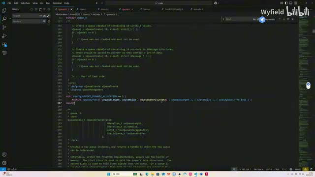

*xQueueCreate 宏将容量、单项尺寸和基础队列类型交给 xQueueGenericCreate。 · [原片 00:12](https://www.bilibili.com/video/BV1fmL6ziEhA/?p=6&t=12)*

然后调用的这个 `.c` 里的函数 `xQueueGenericCreate`，第一个参数就是长度，换句话说就是容量；第二个参数是尺寸；第三个参数，因为是一个常规的队列，所以我们统一传 0。然后看一下里面是怎么做的。

首先对这个尺寸做一个判断：如果尺寸是 0 的话，那么这个变量 `xQueueSizeInBytes` 就是 0；如果尺寸不为 0 的话，这个变量就是容量乘以尺寸。那么问题来了，这个变量是啥呀？这个变量是不是就是队列数据段的一个以字节为单位的长度呀？size 本身是 0，那无论里面有多少个，那都是 0；size 不为 0，那就拿应有的长度乘以每一个的尺寸，就是得到了整个队列数据段以字节为单位的长度。

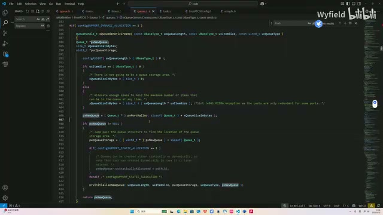

*xQueueGenericCreate 中的存储字节数计算、pvPortMalloc 和 NULL 判断。 · [原片 01:36](https://www.bilibili.com/video/BV1fmL6ziEhA/?p=6&t=96)*

好，紧接着它调用了一个 malloc 函数（画面中为 `pvPortMalloc`）。malloc 函数大家应该都熟悉吧？我们给它一个参数，参数所代表的是我们所需的内存、以字节为单位的一个数量，然后它就会返回一个指针给我们。这个指针所指向的区域，就是申请好的那块内存。

## 02:02 分配内存，定位队列存储区

只不过 FreeRTOS 它自己实现了一个堆的管理函数，自己实现了一个 malloc，实现得还挺好的，后面我也会带着大家进行分享。

那 malloc 成功了之后，我们对这个指针进行一个空指针的判断。如果是 NULL 的话，肯定是不能对它进行使用的；如果分配成功，就是非 NULL，我们进行进一步的处理。

这个变量也是一个指针，看它的名字，就是队列存储。这个变量所指向的位置，就是队列存储区的开头。也就是它所指向的即将是这个位置，就是这个位置：这是存储段，这是第一个成员，它会指向这儿。那如何让它指向这儿呢？

我们刚才所申请的这个 new queue（`pxNewQueue`），就这个指针，给大家画一下。刚才是通过 malloc，然后它为我们分配了一大块内存，供我们队列进行使用。这个内存传来的一个地址，我们用这个指针去承接。画一下，那么指向的是不是就是这一块区域？因为 `pcHead` 本身就是队列头的第一个成员，所以它指向的就是这样一块区域。

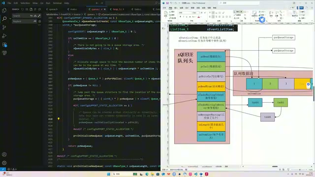

*队列头与紧随其后的存储区；pucQueueStorage 指向数据段开头。 · [原片 04:00](https://www.bilibili.com/video/BV1fmL6ziEhA/?p=6&t=240)*

那么我们想让这个 `pucQueueStorage` 指向 storage 区、存储区，是不是就是这个指针加上整个队列头的尺寸，就实现了？那这边就是这么做的，让这个存储区的指针指向这个指针，加上队列头的尺寸，那就是这儿。OK，那现在这个 storage 指针，就指向的是存储区的一个开头。

## 04:15 先预测初始化函数会做什么

紧随其后就是一个函数。这个函数我们先看它的字面意思，就是初始化新队列（`prvInitialiseNewQueue`）。它的参数是 length，容量；size，尺寸；然后存储区的地址，然后新队列的地址，以及我们固定传进来的一个 0。OK，看字面意思就知道，它要初始化这个队列了。

那么我们先不看这个函数，我们来预测一下，来猜一下这个函数会实现哪些东西。其实这个函数我们自己都能写，有了前面的一个思路，其实它无非就是：首先是这个 `pcHead`，`pcHead` 前面也说了，它是要指向一个数据段头。这个数据段头指针，我们刚才也看了，它在函数调用的时候都传进来了，无非就是 `pcHead` 等于传进来的这个形参嘛。这很简单，那就指向它。

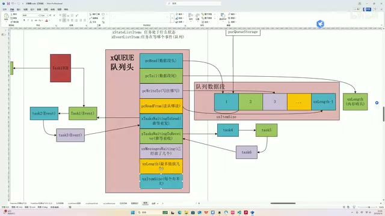

*预测 pcHead、pcTail 以及读写指针初始化时使用的队列结构示意。 · [原片 05:36](https://www.bilibili.com/video/BV1fmL6ziEhA/?p=6&t=336)*

然后我们要让 `pcTail` 指向这个紧挨着队列头的后一块区域。那么很简单，我们来写，肯定是 `pcTail` 等于这个 `pcHead`，再加上容量乘尺寸，那不就指过去了吗？这个都是初中数学了。

然后就是这个 `pcWriteTo`。我们根据实际的需求，有可能这个 `pcWriteTo`，我们让它一个初始状态，可能指向这个第一个，有可能，对不对？那这个 `pcReadFrom`，有可能是指向最后一个，对不对？`read from` 肯定要在 `write to` 前面。或许是这样弄的，我们等会进一步验证。

紧接着这两个列表，我们可以大胆地猜测：那是不是就是调用我们第一节课就讲过的那个列表初始化函数呀？我们有一个列表初始化函数，对不对？通过这个初始化函数，让这两个列表进入一个初始的状态，让它们不挂载任何的 task 成员。同时，它内部的那些列表项、那些变量，该是几，该是 0、该是 1，对不对？

紧接着这三个变量。第一个变量 `uxMessagesWaiting` 就是已经放了几个，那这个太好猜了。我们来实现，肯定是让它变成 0 呀，对不对？那 `uxLength`，`uxLength` 刚才也看了，是 initialize 这个函数的一个形参，直接赋值就行了。包括这个 `uxItemSize`，也是形参，直接赋值就行了。

所以，其实有了前面的一个思路的讲解，这个函数我们不看，我们自己来写都行，对不对？那我们现在来看一下，它实际的一个实现，跟我们的预测有多大区别。

## 07:20 普通队列的 pcHead、容量和尺寸

这个函数在这儿，首先是个判断，如果 size 是 0 的话，是这样的。什么情况下 size 会是 0 呢？就是说，当我们把这个队列用作信号量，还有互斥量的时候，这个 size 会是 0。我们先讲最简单的一个队列，最基础的一个队列；等后面讲到信号量和互斥量的时候，我们再来理这个逻辑。所以如果用普通队列的话，肯定是走这个分支。

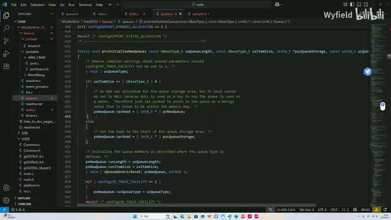

*prvInitialiseNewQueue 中按 uxItemSize 分支，普通队列使用传入的存储地址。 · [原片 07:48](https://www.bilibili.com/video/BV1fmL6ziEhA/?p=6&t=468)*

这是不是我们刚才就猜到的一个事情啊？就是我们这个 `pcHead`，对吧？我们这个 `pcHead`，我们会对它进行一个赋值，对吧？我们会对它进行一个赋值，让这个 `pcHead` 指向我们刚才所计算出来的一个存储区。OK，进行赋值，这边就是在干这个事情。传进来的参数，是这个存储区的首地址，我们现在让 `pcHead` 跟它指向一样的地方。OK，所以 `pcHead` 就初始化完毕。

然后，就是我们刚才也猜到的一个事情，就是下面这两个：最多能放几个，以及每个有多大。这个作为用户所定义的形参，我们直接赋值。好，那现在这三个已经好了，接下来是这六个，看看怎么对它进行初始化。

## 08:48 进入 xQueueGenericReset，初始化数据指针和计数

可以看到，它是调用了这样一个 generic reset 函数 `xQueueGenericReset`，这个函数我们点进去看。首先这一进来，这就是我们刚才已经预判到的一个事情，对不对？就是这个数据段尾的指针，是我们在 `pcHead` 头的基础上进行一个加，加上来之后对它进行赋值。那具体加多少呢？是不是就是 length 乘 size？我们看，现在就在做这样一个事情：就是这个数据段头，然后加上我们刚才说的那个乘积，那就是整个数据段尾，就用这个指针来标示出来了。

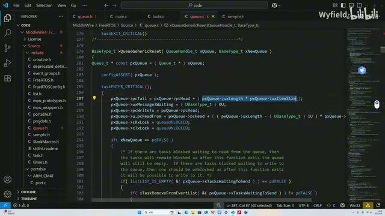

*xQueueGenericReset 初始化尾地址、消息计数和读写指针。 · [原片 09:24](https://www.bilibili.com/video/BV1fmL6ziEhA/?p=6&t=564)*

然后就是这个变量。这个变量我们刚才也说了，对吧？肯定是已经放了几个嘛，一个新的队列肯定是放 0 个，那我们把这个变量 `uxMessagesWaiting` 赋值成一个 0。

然后就是这个 `writeTo`，就是写的时候所用的指针，以及读的时候所用的指针，进行一个初始化。我们看到这边这两行，是把这个 `writeTo` 指针，就是初始化的时候，`writeTo` 指针就是指向整个数据段的一个头，就和这个 head 指针的指向是一样的。我这边也画下来了，指向这儿。然后包括这个尾指针，通过这一行，就是使得它指向整个数据段的尾，最后一个成员。那初始状态是这样的。至于为什么要这样，后面我们在分析 send 和 receive 函数的时候，来进行一个推演。OK，我们只知道初始化现在是这样的。

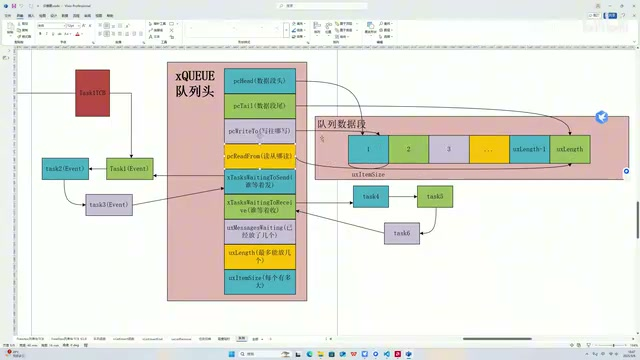

*初始化后的读写位置示意：写指针在头部，读指针在最后一个成员。 · [原片 10:24](https://www.bilibili.com/video/BV1fmL6ziEhA/?p=6&t=624)*

## 10:35 新建和重置，走不同的分支

OK，然后我们就说了，剩余其实需要初始化的也就是这两个了。这两个我们刚才也说了，就是调用列表里面的初始化函数，让这两个队列项——列表项，达到一个初始状态。这两个函数是我们第一节课的时候就讲过的，也就是在这里。

可以看到，想要让这两个列表得到一个初始化，是需要经过这个判断的。什么时候会进入到这里呢？我们看，这儿有一个分支，取决于整个函数调用时的第二个参数。如果是 false 就会来到这儿；如果是 true，我们就会来到这样一个分支。可以看到，我们队列在建立的时候，我们队列在建立的时候，是统一传的一个 true。也就是在创建队列的时候，是统一来到这个分支。

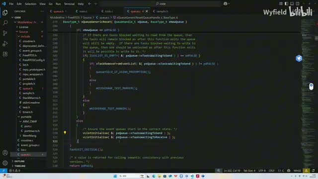

*xNewQueue 分支：新队列对两个事件列表调用 vListInitialise。 · [原片 11:00](https://www.bilibili.com/video/BV1fmL6ziEhA/?p=6&t=660)*

那什么时候会来到这个分支呢？进到这个分支，无非就是第二个参数 false。然后我们全局搜一下，什么时候会 false。在这儿，就是说，调用这个队列 reset 函数 `xQueueReset` 的时候，第二个参数肯定是 false。

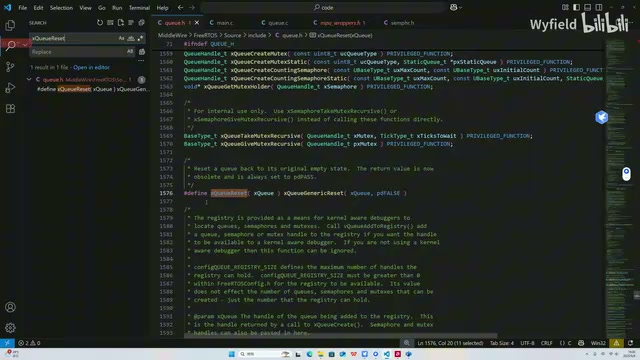

*xQueueReset 宏调用 xQueueGenericReset，第二个参数为 pdFALSE。 · [原片 12:00](https://www.bilibili.com/video/BV1fmL6ziEhA/?p=6&t=720)*

这个函数是做什么用的呢？这个函数其实也是 FreeRTOS 留给我们用的一个函数。就是在这个操作系统里，你的队列已经创建好了，并且也运行了一段时间了，这个时候你因为种种原因想要 reset，想要重置这个队列的时候，就可以用这个函数。你用这个函数，就会到达我们刚才说的这个分支。

## 12:24 重置时为什么只唤醒等待发送的任务

这个分支是在干什么事情呢？可以看到，它是在做一个判断。我们这个队列里不是有两个核心的列表吗？一个是 waiting to send（`xTasksWaitingToSend`），一个是 waiting to receive（`xTasksWaitingToReceive`），这两个列表。它是对 waiting to send 的列表做一个判断：如果这个列表里面是有项的，也就是说有任务在等着去往里面发，如果有的话，它会在这个列表里面拿出第一个，也就是优先级最高的这个任务，然后把它放到 ready 列表里面，是就绪态，让它进行执行。

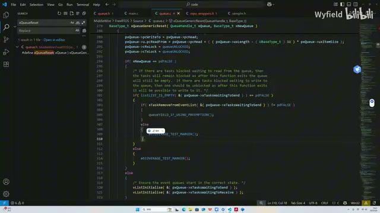

*重置已有队列时检查等待发送列表，并调用 xTaskRemoveFromEventList。 · [原片 13:00](https://www.bilibili.com/video/BV1fmL6ziEhA/?p=6&t=780)*

这里面就有一些有意思的地方了。其实我看的时候，就产生了两个问题：首先，为什么要做这个操作？第二，为什么只对 waiting to send 的列表做这个操作，而 receive 列表不做这个操作呢？这里面就有一个很有意思的逻辑了。

首先有这么一个问题：这个 receive 列表，它里面的 task 当前应不应该被唤醒？答案是否定的。为什么呢？因为你在这前面重置，重置的操作就是相当于把队列里面的数据段、数据成员全部都给清掉了，因为这个变量现在都是零了嘛。所以也就是说，当前你调用了这个函数、用这个函数 reset 之后，这个队列里面现在是一个成员也没有了。因为已经没有东西了，那既然没有东西，肯定也 receive 不了啊，对吧？你第一次 receive 的时候，你某个 task 第一次 receive 的时候，这里面没东西，你拿不到；那你 reset 一下，把它都变成零了，你还是拿不到啊。所以 receive 当前是不应该被唤醒的，因此就不做这个操作。

那为什么 waiting to send 这个列表里面的成员要被唤醒呢？首先就问这么一个问题，它应不应该被唤醒？答案是应该。因为你把队列里面的数据段都清空了呀，里面有空间了，自然应该有东西能发进来。

那么我们前面也说了呀，把 waiting to send 这个列表里面的第一个成员，让它进入 ready 状态、让它执行的这样一个操作，是什么事情来驱动它呢？答案是，有别的 task 对这个队列进行 receive 的操作，同时这个操作成功了，就会驱动内核来检查这个列表，从而取出成员，取出这个任务来进行执行。

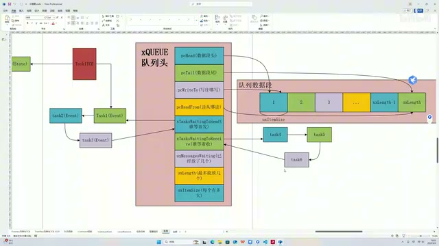

*讲者以队列结构和两组等待列表解释重置后发送任务的唤醒。 · [原片 15:00](https://www.bilibili.com/video/BV1fmL6ziEhA/?p=6&t=900)*

我们刚才也说了呀，你现在队列里面的成员都被清掉了，都是零呀，那不可能有其他的任务 receive 成功啊，里面都没东西了。这个事情就是个死结了，就卡死了呀。首先，你 send 列表里面的任务应该拿出来执行，但是驱动它拿出来执行的这件事情是不成立的，多米诺骨牌的第一块没法推下来。

因此，就是在这里面，内核里面推了一把：它是主动把 waiting to send 列表里面的成员，第一个拿出来执行，从而推动后面的事情执行，让这个队列的运行行为照常进行。所以要做这样一个操作。OK。

## 16:07 返回初始化函数，补看类型标识

所以整个队列的 reset 也结束了，然后我们往上跳。到此为止，其实我们之前讲的这九个最重要的成员都被初始化了。这个图不是初始化状态啊，因为我们前面说了，这个列表项现在都是初始状态，应该没有 task 挂载在上面的。我这边就不删了，大家心里面知道就行。

然后往下，其实就是不重要的。像这个成员就没有被我画在这个图里面，因为这种就不是很重要。说一嘴啊，这个 `ucQueueType` 就是队列类型的一个标识符。我们用这个宏来创建队列的时候，就是最传统、最普通的队列，就传的是零，然后这个数就会是一个零。

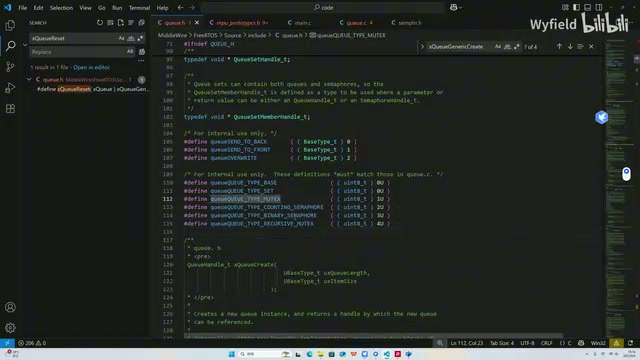

*queue.h 中的队列类型宏：基础队列、队列集、互斥量和信号量类型。 · [原片 17:12](https://www.bilibili.com/video/BV1fmL6ziEhA/?p=6&t=1032)*

它这是一个宏嘛，这个宏有很多种数字的可能性。零的话就是基础队列，你看这个，也有可能是队列集；一的话就是互斥量，二的话是计数型信号量，三是二值信号量，四是递归互斥量。我们现在就讲这个基础队列嘛，所以就是零。

然后包括这个，就是说，我们如果涉及到把队列作为队列集的话，就要把这个进行一个赋值，好不好？我们现在都是讲基础队列，这个暂时不说；后面讲到的话，我们再跳进来把这个分支讲一下。

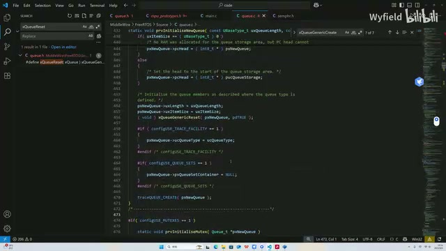

*prvInitialiseNewQueue 后半段的类型标识及队列集容器赋值。 · [原片 17:36](https://www.bilibili.com/video/BV1fmL6ziEhA/?p=6&t=1056)*

OK，那这个 initialize，队列的初始化函数也执行完了。我们得到了一个干净的、初始的队列，可以供我们来使用了。所以至此为止，其实这个队列的初始化就结束了，接下来我们就可以开始使用它了。我们接下来讲它的 send 和 receive 函数，看看是如何对它进行一个收发操作的。
