# P07 队列—发送

> 来源：[FreeRTOS 源码详解 P07](https://www.bilibili.com/video/BV1fmL6ziEhA/?p=7)，原视频 00:00–30:19.966。按原序整理的完整忠实图文讲稿；校注与图注为编辑说明。
> 原视频为640×360，源码小字清晰度受限；保留讲述中的限定、例子和重复强调，不推补无法辨认的源码。

## 发送函数的参数与循环

我们首先来讲发送的函数。发送的话，我们一般还是用这个宏函数 `xQueueSend`，然后它再调用 `xQueueGenericSend`。这三个参数分别是队列头的一个指针，指向它；然后这个指针指向一个数据，它所指向的地方，就是我们即将发到队列里面的数据；然后这个 `xTicksToWait`，就是我们前面讲的等待时间：你愿意等多久。

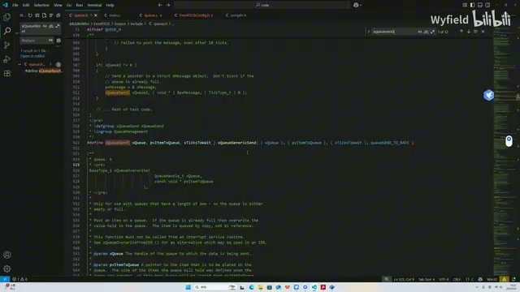

*发送宏与通用发送函数的参数入口 · [原片 00:30](https://www.bilibili.com/video/BV1fmL6ziEhA/?p=7&t=30)*

我们看一下这个函数在里面是怎么操作的。首先这是断言。然后在这儿，首先看，这是个死循环。好不好？大家脑子里面要有一个印象，这边已经看到了，这是个死循环。好，进入这个循环之后，我们往下跑。首先在这儿做判断：如果当前队列里面的这个成员——`uxMessagesWaiting`，就是已经放了几个，现在已经放了这么多；那么这个成员是啥？我们前面说了，最多能放几个，也就是 `uxLength`。那是什么意思？就是队列还不满，这个队列现在还有空间。这是第一个条件，它可以进来，就是说我们可以正常放了，是不是？

如果第二种情况是啥呢？说白了，如果我们这个队列已经满了，但是又有人想放东西进来，那么我们可以走第二个条件，这个后门，让它可以强行放。那就是这个宏，如果这个参数传进来是一个 `queueOVERWRITE`，就是覆写、强行写。如果是这个参数，它就一定能写。那我们看，我们调用这个函数的时候，调用 `xQueueSend` 函数的时候，它传进来的是啥？

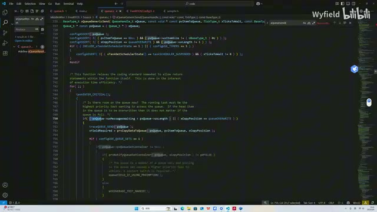

*队列未满或覆写时进入写入分支 · [原片 01:30](https://www.bilibili.com/video/BV1fmL6ziEhA/?p=7&t=90)*

## 尾插、覆写和头插的入口

它传进来的应该就是 `queueSEND_TO_BACK`，不是覆写的。就是它这个函数，是一个对队列进行常规写入的函数。我们学过数据结构，就知道常规写入，它就应该放后面，所以就是传这个 `queueSEND_TO_BACK`。

那什么时候会这个 `queueOVERWRITE` 呢？我们来搜一下。就在这儿，它就会传一个 `queueOVERWRITE`。就是这个 FreeRTOS 也给我们提供了函数 `xQueueOverwrite`。可能是有一些数据，你一定想要写进去，那就可以调用这个函数。这一般是一些特殊情况吧，正常一般不会这么用的，反正我不咋用。

然后可以看到，它还有一个模式：`queueSEND_TO_BACK`，然后这个覆写、强行写，以及 `queueSEND_TO_FRONT`。就是我们队列可以尾插，也可以头插。如果你传这个 front 的话，就是头插，我们把这个数据放到第一个，就插队。照理说应该也会预留这个 front 函数。对，在这儿，也给了我们这样一个函数 `xQueueSendToFront`。我们如果想把它强行放到前面，这个也可以。

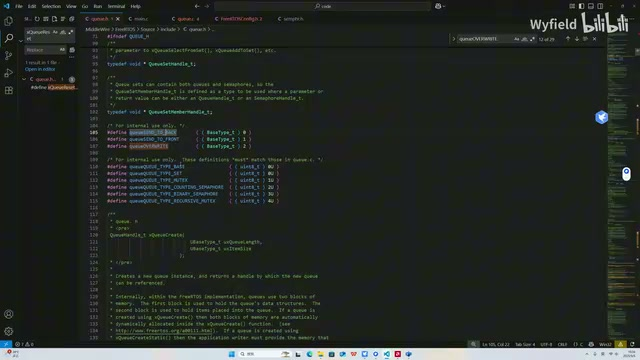

*队列尾插、头插和覆写的宏定义 · [原片 03:00](https://www.bilibili.com/video/BV1fmL6ziEhA/?p=7&t=180)*

OK，我们继续来看。如果是覆写、强行写的话，也能写。写的话，这个宏是空的，不用管。首先是这个函数，字面意思就是说 copy data to queue，我们把这个数据，现在又传到这个队列里面了。这是指针、队列指针，以及这个位置：你是覆写，还是写后面，还是写前面。我们跳进来，看这个 `prvCopyDataToQueue` 函数它是怎么干的。

首先这个函数，先识别一下：你这个队列是一个常规的队列，还是用作信号量或者互斥量？之前也强调过，如果是信号量或者互斥量的话，这个 size，也就是 `uxItemSize`，会是 0 的。

## 常规队列的尾插：拷贝后移动写指针

这边也可以看到，我们这个互斥量相关的内容，如果走这个分支，它会处理一些互斥量相关的内容。其实信号量也是走这个分支，只不过它没有多余的逻辑。我们先讲这个最常规的队列，这边就先不涉及。

如果是常规的队列，这个分支是在判断一下：你要写入的位置是尾插还是头插。如果是尾插，走这个分支；如果是头插，会走这个分支。我们先来看尾插。我们来照着这个图来理解。

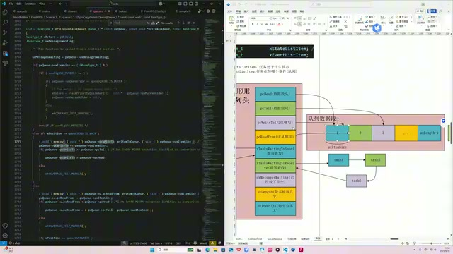

*尾插数据拷贝、写指针与队列数据区 · [原片 05:30](https://www.bilibili.com/video/BV1fmL6ziEhA/?p=7&t=330)*

首先是一个 `memcpy`，这个函数大家应该都熟悉了。它第二个参数是数据的源头，该指针指向数据的源头；第一个参数，这个指针指向的是数据的一个目标。然后我们把用户传过来的指针为目标，把数据给它扔到这个 `pcWriteTo` 所标记的一个地方。然后 size 是尺寸，以字节为单位的尺寸。就实现了一个用户通过传参，把想写的数据写到这个队列里面。

> 校注：冻结转写前句为“用户传过来的指针为目标”，与紧邻的“第二个参数是源头”表述不一致；画面中用户数据指针位于 `memcpy` 第二参数，写入目标是 `pcWriteTo`。这里保留该句，并标明源转写与画面的不一致，未据此改写讲者主张。

也就是说，假设进来的时候，这个 `pcWriteTo` 指向这儿，那经过了这一行函数，现在用户想写过来的数据，已经写到这个 1 的位置上了。接下来就是一个指针的自增。写完了自增，这是很自然的，因为下一次再调用，要写到这个位置上。这个函数每次写成功一次，那 `pcWriteTo` 指针自然都要自增一下。那就每次自增：写完了自增，写完了自增，写完了自增。那假设我们这一次调用，是写到了这个位置，那它再自增，就会增到这个地方。

## 哨兵边界与头插使用的指针

我们前面也说了，这是一个内存哨兵，这个地方并不属于队列。同时，你肯定也不能溢出。这个数据段，它是一个环形的，但是在实际的内存排布上，它也是顺着排的呀。所以我们要人为地判断一下，此时此刻这个 `pcWriteTo`——注意，因为它不属于这个数据段，是一个哨兵，所以我们判断的是大于等于。对不对？你看这边判断的是大于等于，等于它也不行。

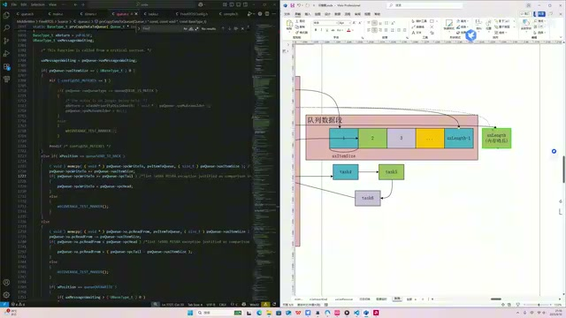

*尾端哨兵位置与写指针回到队列头 · [原片 07:00](https://www.bilibili.com/video/BV1fmL6ziEhA/?p=7&t=420)*

那如果这个 tail 指向的是……不好意思，假如说我们这个 `pcTail` 指向的是合法的数据区域，那就是大于，对吧？但我们现在内核的做法，是让 tail 指向非法的区域，所以要比一个大于等于。那大于等于它的话，这又是一个环形的，所以要回到头啊。回到头就是等于 `pcHead`。我们让它回到头，好，这就回到头了。这就是一个尾插的逻辑。

我们接下来看头插。头插的话，和尾插基本上逻辑也差不多，也是用一个 `memcpy` 函数，第二个参数是用户传来的一个指针，只不过第一个参数是 `pcReadFrom` 指针了。因为整个队列，它物理上的头尾，是由 `pcHead` 和 `pcTail` 所标注的；它逻辑上的头尾，是这个 `pcWriteTo` 和 `pcReadFrom` 来标注的。

我们假设现在来写入，进来的时候，这个 `pcReadFrom` 指针指向的是 2。经过了这一行函数，用户通过传值调用想要写的一个数据，已经写到了这个编号为 2 的位置上。紧接着，我们前面说了，尾插的话，是 `pcWriteTo` 往后退一个；那 `pcReadFrom` 的话，就是写完之后，这个指针往前进一个。

## 头插的回绕，以及覆写的计数处理

就像我们去商场吃饭排队一样，如果新来的人排到后面，那肯定是队伍往后增长呀；如果是一个人在前面插队，VIP 来了，那肯定队伍是往前多一个。好不好？那就这样类比地进行一个理解。

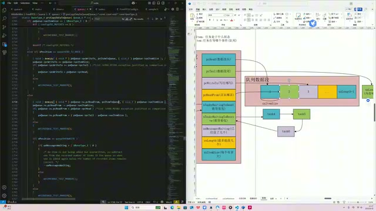

*头插使用读指针，图中显示其逻辑位置 · [原片 08:00](https://www.bilibili.com/video/BV1fmL6ziEhA/?p=7&t=480)*

紧接着，也像前面尾插一样，要判一下有没有越界。假设我们此次调用，这个 `pcReadFrom` 指针指向的是 1 的位置，那么它再退一个，就退到队列头上了，那肯定不行。因为它在物理逻辑上是一个环形的，那肯定得退到这儿呀。这儿，那就是 pcTail 减一……pcTail 减一、size。好不好？就指到这儿。

> 校注：冻结转写此处包含“pcTail 减一”的不清表述，以上保留停顿和修正形式。画面中的回绕赋值为 `pcTail - uxItemSize`，即最后一个数据项的位置；不要把口头停顿读成另加一个减一运算。

OK，那这个尾插也说完了。然后尾插并没有完全说完，你看 read、write、overwrite，覆写也是走着这个……不好意思，覆写也是走着这个头插的分支。也就是说，我们只要对某一个队列进行覆写，那统一都是头插，不能尾插。

如果是覆写的话，要多一个什么逻辑呢？可以看在这边，它做了一个 `uxMessagesWaiting` 这个变量的减减。因为覆写的话，我们是替换掉数据段中的某一个成员。替换的话，它是这个走一个来一个，进行一个替换，这个队列成员的成员总数并没有增加。而我们看这里，这个函数只要调用了，统一在这里都会做一个加加。这边既然统一固定做一个加，那特殊情况的话，这边要提前进行一个减，才能把这个加抵消。

## 发送成功后，唤醒等待接收的任务

这样一抵消，才能实现这个覆写，成员总数不增加的这样一个需求。好，那我们这个函数也就说完了，还是比较简单的。

现在我们想拷贝的数据，已经跑到这个队列里面了。然后接着看它在干什么。它这边是在检测这个 waiting to receive。前面我们也说了，你现在发成功了，你这个数据已经发成功了，因为这个分支是正常发的分支，已经发成功了。那这个时候，你得看一下是否有任务在等着收；如果在等着收，你要把它给唤醒。这边就在干这个事情。

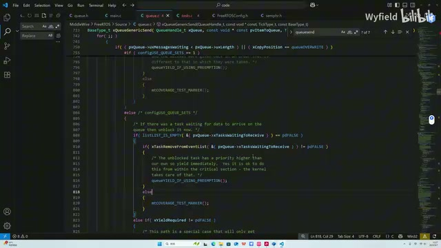

*等待接收列表与唤醒任务的源码分支 · [原片 11:30](https://www.bilibili.com/video/BV1fmL6ziEhA/?p=7&t=690)*

它检测这个 `xTasksWaitingToReceive` 的列表。这个列表里面，就存着等待着去收的任务的 TCB。然后检测一下，它是否是空的。如果非空，就说明里面有成员，就说明有任务正在等着收这个队列。然后这个就是把它唤醒。

这个函数 `xTaskRemoveFromEventList` 做的事情，就是把这个列表里面的第一个成员，也就是优先级最大的——虽然说是它嘛，Task4 是第一个成员，那么 Task4 优先级就是最高的。因为这个列表，我们对它插入的时候，也是按照优先级的顺序来排的，就是优先级最高的排到第一个。所以它现在是把优先级最高的取出来，也就是第一个取出来，然后放到这个 ready 列表里面，让它执行。这边是取出来，然后放进去执行，这个函数就是在干这个事情。

## 队列已满：零等待返回，首次等待记录时间

然后这个判定的话，就是跟互斥量有关。你看这个注释也说了，这个涉及到一个互斥量的优先级反转。等到后面讲到互斥量的时候，我们再来说。

那现在一个正常插入，队列的正常插入，而且插成功的这样一个分支，就给大家说完了。接下来就来讲：如果队列已经满了，你没法成功，这个内核是怎么处理的？这个参数 `xTicksToWait` 是传进来的等待时间，如果是零的话，就不等了，所以就直接 return；如果非零的话，就是往下走。

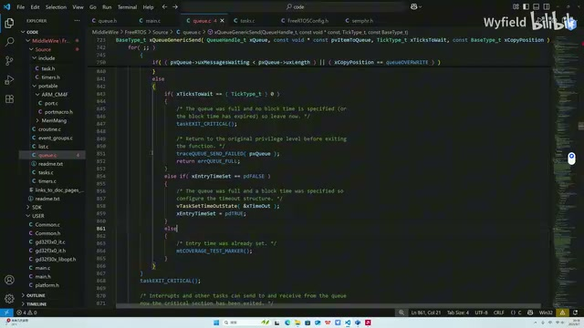

*队列满后，首次进入等待分支记录时间 · [原片 13:30](https://www.bilibili.com/video/BV1fmL6ziEhA/?p=7&t=810)*

然后这里是一个变量 `xEntryTimeSet`。可以看到这个分支，它就是只进来一次。如果我们看到这个分支的话，它就是只进来一次，它就是只进来一次。因为你看，这是一个局部变量，然后我们前面也强调了，这是一个循环。意思就是说，在这个死循环的一个过程中，这个分支只进来一次。因为这个变量，初始是一个零，初始是零。它第一次进来，检测到零，来了之后就变成一了。后续循环再走到这，它也不会再进来。也就是说，这个分支里面的事情，现在只干一次。

那它是在干个什么事呢？我们先看一下，它这个传参是啥。这个字面意思就是 timeout，跟时间相关的一个数据类型。然后它这边是一个结构体 `TimeOut_t`：第一个就是 `xOverflowCount`，就是溢出的计数器；第二个字面意思就是 time on entering，就是我进入的一个时间点 `xTimeOnEntering`。好，然后我们往下看，这个函数，拿着这个结构体在干什么事情呢？这边就涉及到，把当前这个，就是我们前面所说的 FreeRTOS，它的一个全局变量，就是我们这个有一个 count 加加。

## 时间快照与提前退出临界区

它是 32 位的一个变量，那它每溢出一次，这个变量就会加一。换句话说，就是整个操作系统，它上线之后，它溢出的次数。如果类比一下，就可以类比成：现在是第几天嘛，一个日期。

然后 `xTickCount` 是我们上节课的老朋友了，就是一个时钟。那就是把调用这个函数时的，哪一天的哪一次时钟周期，把当前的一个日期给它记录下来，可以这么类比地去理解。

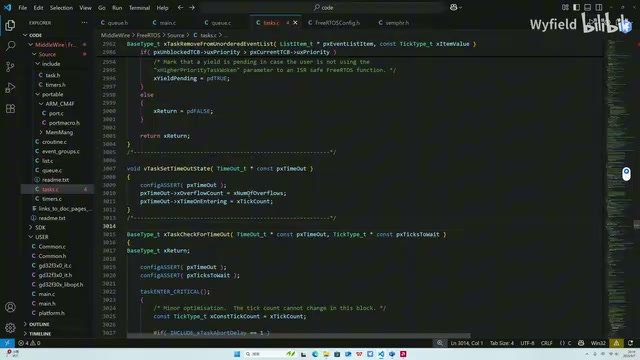

*时间快照记录溢出计数和当前 tick · [原片 14:30](https://www.bilibili.com/video/BV1fmL6ziEhA/?p=7&t=870)*

也就是说，现在如果队列是满的，发不进来了，那首先会干一些这个事情。干完了之后，它会干什么呢？我们接着往下看。接下来就是一个退出临界区的操作。我们也可以看到，这个函数里面的临界区段，是从这结束。那从什么时候开始的呢？看什么时候 enter 的。我们往上拉一拉，是在这 enter 的，就是从这开始进入临界区，也就是说把中断关了。

关中断的目的，就是因为我们的任务切换，之前说的，它也是基于一个 SysTick 触发 PendSV 嘛。那现在把这个所有的中断都屏蔽了，也就是说，在这个区间内，把这个任务切换的机制关掉。好，那在这边打开了。那么问题就来了：为什么在这打开呢？大多数的 RTOS 函数，大家可以看一下，临界区都是进入函数的时候进入，一直到函数的最后它才退出。那这为什么提早在这打开了呢？之前也强调了一点，就是之前我也强调了嘛，

> 校注：上段“把所有的中断都屏蔽了”为讲者原有概括，保留其论述口吻。此处没有展开移植端对中断优先级屏蔽范围的限定。

## 为什么不能在临界区里一直等

这是一个死循环，这是一个死循环。那这个死循环什么时候会退出呢？我们从这往下拉，看它什么时候 return。这里会 return，这个 return 的条件是啥？是这个分支。这个分支是啥？就是写成功了。OK，我写成功了，我会 return，跳出这个死循环。

还有哪边会 return？这边会 return。这个分支是啥？就是虽然我这个发送数据发送失败了，但是我传来的参数是零。也就是说，我发送失败了，我也就不等了。也就是说，要么发送成功，要么发送失败且这个参数是零的情况下，它才会 return。

那么还有一种常见的情况，就是我愿意等，我给了它一定的等待时间，同时它也没有发送成功。那这个时候就不 return 了呀，这两个 return 都进不来。那不就是在这个死循环里面卡死了吗？这个事情肯定是不能接受的。

假设你有一个优先级比较低的任务，请求了一个 send。它又愿意等，但是队列里面又没有空间，导致它没有发进去。前面又因为已经让它进入了临界区，把这个任务切换给屏蔽了，那岂不是这个低优先级任务写不进来，就一直卡在这了吗？高优先级的任务也永远无法执行了呀。为了避免这种情况的发生，在这就要把整个操作系统的状态，从临界区里面退出来，让这个系统可以继续地进行一个调度。好，现在这个临界区退出了，那么其他的任务开始进入一个调度状态。

## 代码相邻，两次执行之间的时间却不固定

在这，它又把所有的任务给挂起了。也就是它这边退出了临界区，紧接着又让操作系统进入一个无法进行调度的状态。那这是为啥？你为啥刚退，要让它能调度了呀？它只是在代码上紧挨着，那实际上运行的过程中，很有可能在这边就开始调度，一直到这关闭调度，有可能是很长的时间。

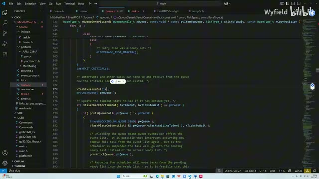

*退出临界区后，画面可见 vTaskSuspendAll、prvLockQueue 与超时检查 · [原片 19:00](https://www.bilibili.com/video/BV1fmL6ziEhA/?p=7&t=1140)*

假如优先级比当前这个任务高的任务比较多，那有可能一两秒都有可能呀。所以这中间这段时间是不确定的。也有可能是，你没发成功的这个任务，优先级本身比较高，调度器打开之后，别的任务也不能被调度，那就迅速来到这，也是有可能的。好吧，所以这中间这一大段的时间是不固定的。

然后这边是一个判定。这个 if、else 是在干嘛呢？是这样一个逻辑：前面我们也说了，这边退出了临界区，然后这边再打开。这退出临界区，一直执行到这，中间的时间是不固定的。别看代码就这么几行，时间是不固定的。如果优先级高的任务很多，一秒两秒都是有可能的。

假设某一个任务，你使用这个函数，你传的参数，你愿意让这个任务等待一秒。这边退出临界区之后，结果优先级比我高的任务比较多，在这边时间比较长，已经两秒过去了。那两秒过去了，你只能等一秒，这个时候就应该直接 return 了呀，不能做进一步的逻辑判断了，得迅速地退出去，才能符合我们这个用户的预期。那这边就是在做一个判定。

## 检查超时：无限等待和跨越计数周期

这个函数 `xTaskCheckForTimeOut` 的调用，就是在判定是否已经超时了。也就是说，如果这个时间比较短，来到这的时候还没有超时，那么就来到这个分支下，进行进一步的逻辑判定。如果退出临界区之后，优先级高的任务比较多，过去的时间比较久，那这个判定就过不去了，就会来到这个分支。这个分支在干嘛？就 return 呗，就退出去了。所以这个大的 if、else，就是在进行一步是否超时的判定。这个函数，就是在判定这个事情。

我们看一下这个函数。第一个参数，就是这个结构体，就是前面我说的，只会进来一次的这个分支下，通过这个结构体，来记录这个函数被调用时的一个时间点。第二个传参，就是用户愿意让它等待的一个时间。我们看它是怎么做的。

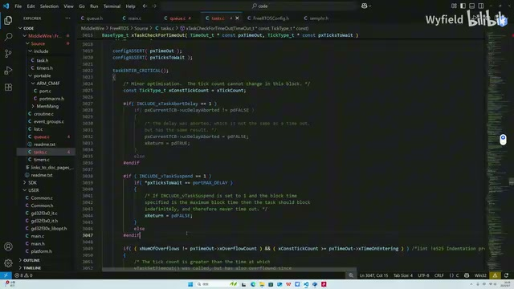

*超时检查中无限等待和溢出计数的条件 · [原片 21:30](https://www.bilibili.com/video/BV1fmL6ziEhA/?p=7&t=1290)*

这块逻辑其实很简单。首先是这个判定，判定一下你是否传的是 max。我们前面也说了，如果传 `portMAX_DELAY`，就是一直等。如果允许你一直等的话，那么肯定就没有超时嘛，你是无限等的，所以直接就返回 false 了。否则就进行进一步的判定。如果不是 max，就要判定是否超时了。

那这个分支就是 overflow：当前的一个 overflow 的计数，也就是日，和我这个函数被调用时的日不一样；并且，当前的一个分钟，大于等于我调用时的一个分钟，那就肯定是超时了。

一定要返回 true。

## 用“跨日”图理解必然超时的分支

这是什么意思呢？我们来看这张图吧。假设我们发生了 overflow 的事件，就是跨日子了，那么那个 count 加加了。刚才说的这个分支，其实就是落到这个地方，就是这地方时间点嘛。整整一天，就是加了这个 max delay。

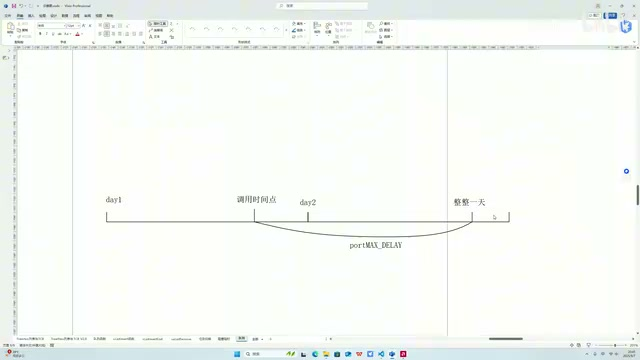

*跨日示意图：调用时间点与完整计数周期 · [原片 22:30](https://www.bilibili.com/video/BV1fmL6ziEhA/?p=7&t=1350)*

然后我这个函数，所接受的参数最大就是 max delay。发现此时此刻判定的时间点已经在这了，已经比 max 还要大了。那我们这个函数最大就传 max，就让它永远阻塞，不可能传比 max 还要大的数啊，那肯定是超时了。所以这个分支就是这样的。

你看，overflow，进入时的一个时间点，不等于当前的时间点。假设当前时间点在这嘛，那它的 `xOverflowCount` 是 2 了。我调用时间点，前面用那个结构体记录下来是 1 嘛，这个不一样，就满足了。第二个，就是当前的一个秒嘛，或者说分钟，大于我进入时的一个分钟。调用时是在这个分钟上，那我现在在这个分钟上，它大于它了，就是它被调用到现在，已经过了一天有余了，是吧？我们是不支持传比 max delay 还大的一个时间的，那这边肯定就超时了。所以返回一个 true 出去，让它 return。

第二种情况，就是当前此时此刻判定的一个时间，落在它到它之间了。那就做一个常规的判定，拿这个时间点减去这个时间点就行了。如果减出来还小于它，就说明此时此刻依然还没有达到这个时间。

## 更新剩余等待时间，再确认队列是否仍满

我们把这个，因为这是一个传参调用，传的是指针，那我们就把那个时间进行一个刷新。比如你愿意等 1000 毫秒，现在过去了 800 毫秒，那还剩 200 毫秒。这边减一下，重新赋给它，以及把此时此刻的时间再记录一下。因为我们这个函数，可别忘了，之前也一再强调，这是个循环，它有可能多次进来的。所以这边如果没有超时，就顺带把它再更新一下。

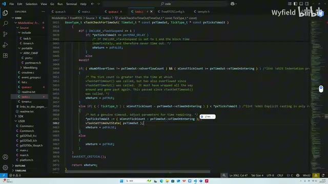

*未超时分支减少剩余等待时间并更新时间快照 · [原片 24:30](https://www.bilibili.com/video/BV1fmL6ziEhA/?p=7&t=1470)*

那也就是没有超时，在这也会返回一个 false。否则就是超时了，返回 true 出去，让它 return。这边就 OK 了。如果超时了，刚才也就说了，直接 return。那如果没有超时，它是干啥的？这又是一个 if、else。

首先看这个，它是在判定它是否还满。如果就是双重否定，那就是如果这个是 true 的话，也就是依然还满的话。意思就是说，你之前发失败了，你现在还满，你依然是失败了，那还是放不进去。又因为此时此刻还没有超时，那这个时候就把你放到相应的列表里面，这边就在干这个事情。

首先，把你这个任务放到这个 `xTasksWaitingToSend` 列表里面。你没发成功嘛，然后现在此时此刻，也没有超出你愿意等的那个时间，那你就排队去吧。如果有别的任务来收，有空位了，你再发，我通知你。这是我们前面讲的逻辑，那就把它放到 waiting to send 的列表里面。OK，这边就是把它放到 waiting to send 的列表。你看这 list 函数嘛，我们第一节课就说了，进行一个嵌入，进行一个 insert，把它放进去。然后这个呢，是把它放到一个 delay 列表里面。

## 同时进入状态列表；不满时回到循环重试

我们前面也说了，大篇幅来介绍了，就是它到点把它唤醒，是基于一个状态列表来干的呀。这里面，就是根据你的这个 `xTicksToWait` 来传参。如果你传的是 max，就可以把你放到这个挂起列表里面，前面也讲了。如果传的不是 max，是数的话，那就算一个解除阻塞的时间点，然后放到 delay 列表里面，对不对？这就是我们上一节课，那个阻塞延时相关的内容了。

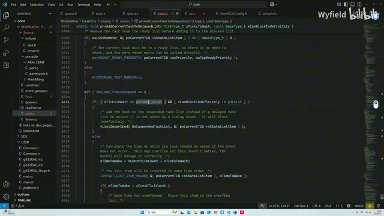

*按等待时间进入挂起或延时状态列表 · [原片 27:00](https://www.bilibili.com/video/BV1fmL6ziEhA/?p=7&t=1620)*

你看这边，就是简单了。对，你看，如果是 max，就把它放到这个 suspend，挂起列表里面，对不对？那如果不是的话，就把它放到这个 delay 列表里面，对不对？还有这 overflow，就是后备的那个 delay 列表，我们上节课也是介绍过了，这边不再赘述了。

好，那就是如果还没超时，同时我再确认一下，确实是放不进去了，那就让它等着，让它去排队了。这边就在干这个事情。那如果没有超时，这边不满了，也就是有空位了，这边是干嘛？这边写的是 try again，就再试一次。

也就是说，因为你这边都判定完了嘛，你来了之后，你这行执行完了之后，是直接跳出来的。跳出来干嘛？是不是跑到这个循环，跑到这个循环头，又开始了，再判断一次，对不对？然后 try again，来这边就进行一次判定。

它这个判定，有没有可能失败？是有可能的。因为刚才这个逻辑，我们来理一下，就是我还没有超时，我准备走的时候，我回头看了一眼，发现有空位了呀，我可以再试一次。

## 重试仍可能被更高优先级任务抢先

那你此时此刻，还没有被放到 waiting to send 的列表里面。有没有可能就是说，好不容易刚有一个空位，结果这个 queue，这个队列，它的 waiting to send 里面已经有成员了，有成员在等着。同时，它第一个成员的优先级，比你此时此刻调用这个函数的任务的优先级，走到这儿的那个任务的优先级要高。那肯定是它优先抢到资源。

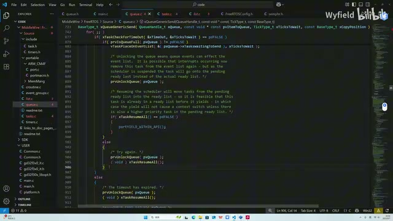

*try again 分支中可见 prvUnlockQueue、xTaskResumeAll，随后回到循环尝试 · [原片 29:00](https://www.bilibili.com/video/BV1fmL6ziEhA/?p=7&t=1740)*

所以你虽然此时此刻在这儿判定有空位了，这边也说了，这是 try again，尝试一下。你从这儿走到这儿，走到这儿，走到这儿，这一大段中间，是有可能被 waiting to send 里面正在排队的、优先级更高的任务给抢掉的。所以这个判定，是有可能会过不去的。你过不去的话，就会接着走刚才这个分支。

所以也就是为什么这个也就进来一次，对吧？你就是如果一直卡在这个循环里面，就不能多次进来。然后包括这个时间的判定，有可能出现一种极端情况：比如某个任务愿意等一秒，那在这一秒内，它不停地出现“没有超时，但是走的时候看一眼，发现有资源”，然后上去 try again，然后被优先级更高的给抢了，又失败了，又反复地来到这边。是有可能出现这种情况的。

在这个无限的循环中，把你的耐心耗完了。也就是说，你愿意等一秒，而这一秒，是反复地循环，把这个时间耗完了，就走这个分支，就正常一个退出。所以这个 send 的逻辑，基本上，这边就说完了。
