# FreeRTOS 源码详解 P08：队列接收

> 原视频：[队列-接收 · P08](https://www.bilibili.com/video/BV1fmL6ziEhA/?p=8)。范围 00:00–14:44.914；按原顺序整理的完整图文讲稿。仅清理停顿、口吃和不增义的紧邻碎片，保留片内再次讲解。截图为原片真实画面。

## 从队列复制数据（00:00）

这个 Send 函数看懂了，Receive 就很简单了。然后我们来过一下，看它是怎么实现的。首先也是像 Send 一样，它是在一个死循环里面去弄的。然后这边是进入了一个临界区，在这先关断一个任务的调度。然后这边判断一下 `uxMessagesWaiting`，也就是说此时此刻队列里面的成员量是否大于零。大于零就能拿了呀，对吧？本来就是为了拿，里面有资源了。然后这个变量记录一下，这个等会再说。

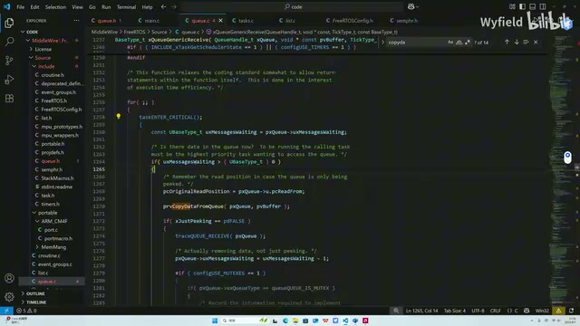

*xQueueGenericReceive 在循环及临界区内检查队列消息数量。 · [原片 00:20](https://www.bilibili.com/video/BV1fmL6ziEhA/?p=8&t=20)*

然后这边是 `prvCopyDataFromQueue`。我们刚才看 Send 代码的时候，它使用的函数是 CopyDataToQueue，然后我们这个是反过来的，对吧？我们是从队列里面拿数据。然后这个是承接这个数据的一个指针 `pvBuffer`，这个是队列的指针 `pxQueue`。然后我们来理一下，这边也是很简单的。

这边再看一下，就是是否是这个信号量和互斥量。如果不是的话就正常拿资源。然后进来之后，它首先是这个 `pcReadFrom` 指针加加，对吧？ReadFrom 指针加加，这个就是先加再拷贝。假说应该是在这儿吧，然后它是先加，然后再拷贝，那就加加，对吧？

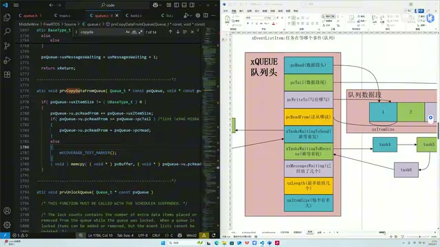

*读取代码与队列结构图并列，展示 pcReadFrom 的位置。 · [原片 01:20](https://www.bilibili.com/video/BV1fmL6ziEhA/?p=8&t=80)*

加了之后，然后把这个新的地方的数据，就是加加后的这个指针所指向的位置，然后通过 `memcpy` 函数，来传给我们用户所设定好的、用来承接这个队列新数据的一个地址。这也是非常简单。然后这个 size，对吧？

就跟这个 Send 是一样的。然后这边的话就是多一个，前面也是一个说烂的逻辑：如果你这个函数调用的时候，ReadFrom 指向这儿的，ReadFrom 指向这儿的，那如果是加加加到下一个，那是加到这个哨兵上来。这个哨兵是不属于队列的，对吧？它是队列这个申请的内存外的一块资源。

其实这样放比较好，我移一下，这样放。对，这样放就清晰了，更加清晰了，对吧？这 `pcTail` 所指向的根本就不属于队列，是个哨兵。那大于等于它了，那肯定不能读这上面的数据啊！这上面的数据，这属于谁都不知道。那你这个加加，你的目的肯定是转到第一个，那就赋到第一个呗，OK。

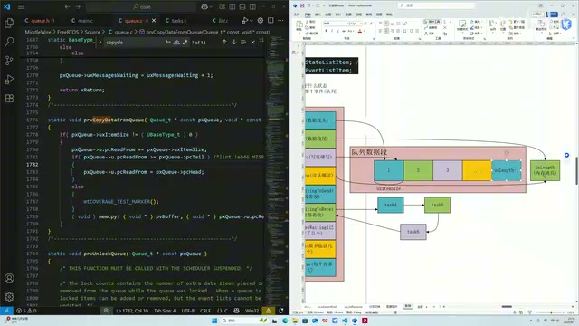

*队列示意图中 pcTail 指向数据区域之外的哨兵位置。 · [原片 02:50](https://www.bilibili.com/video/BV1fmL6ziEhA/?p=8&t=170)*

然后这边赋值，这块就实现了把这个队列里面的数据拷到用户所规定的指针里面，好不好？这边就说完了。

## Just Peeking：只是看一下（03:10）

然后这个判定是啥呢？你看这个 Just Peeking，这个翻译过来就是“我只看一下”，对吧？我只看一下。意思就是说，我此时此刻不是想要从这个队列里面拿出去，我只是想看一下队列里面有没有数据了。

那这个，也就是这个参传的是 true 的话，它就是一个 Peeking 逻辑；否则的话，就是常规一个读的逻辑。我们先把常规读的逻辑看完吧。那如果不是 Peeking，就是我确确实实是想从这个队列里面拿数据，那就正常，我们刚才已经读了，读过来了。然后因为你是读了一个嘛，那你这个变量肯定要减一啊。

你的资源量，你要记账啊！你资源出货了，你的货量要减一，对不对？然后就是很常规的，也是强调过很多遍的一个逻辑，对吧？你 Receive 成功了，你有空位了，有人等着发呢，是吧？你就看一下是否是有人等着发，如果是的话，我就正常把它唤醒，放到 Ready 列表里面，对不对？很简单了。

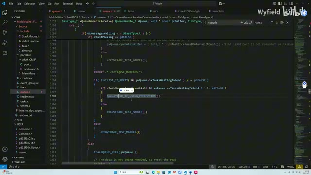

*常规接收分支检查等待发送任务的事件列表。 · [原片 04:20](https://www.bilibili.com/video/BV1fmL6ziEhA/?p=8&t=260)*

那这个 else 是啥？这个 else 就是 Peeking。就是如果你只是想看一下的话，首先你这个指针不能往后加加了，对吧？你只是看一下。那这个刚才也是留的这个坑吧，说这个变量在开头的时候记录了读数据之前的指针的，Read 指针的一个初始位置，对吧？

那经过了这个函数，刚才也说了，这个 Read 指针会往后加加的。那你既然只是看一下，就不能往后加加。那这个地方就存储着进来时的 ReadFrom 指针的指向，所以再把它赋回去就行了。

然后同时因为你不是读嘛，就是看一下，你就少一个这个步骤，对吧？前面如果不是仅看一下，确实要读，就会减一；那你仅仅是要 Peeking 一下，想瞥一眼、看一下，你就没有那个逻辑。

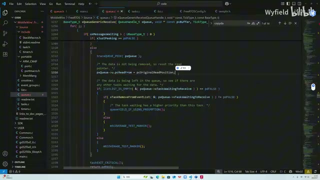

*Peeking 分支把 pcReadFrom 恢复为原读位置，再检查等待接收列表。 · [原片 05:30](https://www.bilibili.com/video/BV1fmL6ziEhA/?p=8&t=330)*

然后这块的话是在干啥呢？就是说，我只是看一下，因为这个分支进来的一个大条件，就是里面有资源。那里面有资源的话，如果此时此刻队列有资源，同时还有人等着去 Receive，那其实这个 Receive 里面的这个 Task 应该要被唤醒，对吧？那你既然 Peeking 了一下，你看到里面有资源了，那你就顺带地也帮忙看一下，是否有人等着收呢？反正里面有资源了，如果有的话，你帮我也把它唤醒一下就行了。就是顺带帮个忙嘛，就这么理解，瞥一眼看。

好，然后我们再看一下，是什么时候会进到这个 Peeking 逻辑呢？因为我们如果正常 Receive 的话，这统一是 false，就不是 Peeking。那我们什么时候 Peeking？我们搜一下，`xQueuePeek`，对吧？这个 FreeRTOS 为我们预留了，想看一下的话，你就传这个，它帮你传成 true 了。

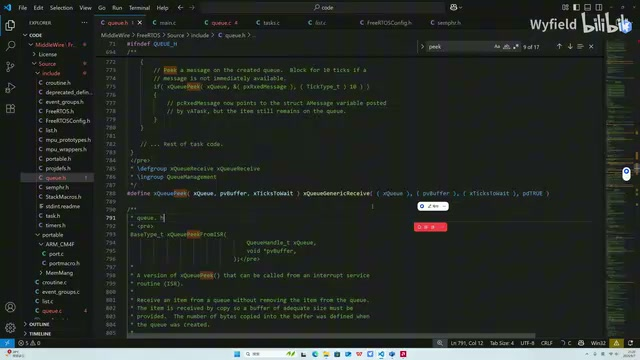

*queue.h 中的 xQueuePeek 宏将最后一个参数传为 pdTRUE。 · [原片 06:50](https://www.bilibili.com/video/BV1fmL6ziEhA/?p=8&t=410)*

然后你通常用的话，相当于看一下，然后会用这个返回值，如果有的话进行进一步的逻辑。你通常用的话，相当于看一下，然后会用这个返回值，如果有的话进行进一步的逻辑。同时它还会辅助你，对吧？刚才也说了，同时会辅助你。如果有的话，它帮你推一把，它帮你个忙，它看有没有人在等着拿，有的话帮你唤醒一下。

## 接收失败：等待、记时与退出临界区（07:21）

好，那如果就是 Receive 函数，正常收能收成功的逻辑，这边也给大家理完了。那如果 Receive 失败呢？如果 Receive 失败，无非就是小于等于零呗，没有资源。那这块逻辑跟 Send 是一模一样。首先如果你不愿意等，直接 return；如果你愿意等的话，为了防止后面这个死循环超时，我得把进来时的这个时间给它记录一下。

那记录一下，而且是只进来一次嘛。这个变量初始是 false，进来一次变成 true，后面再也不进来了。记录一下当前时间。然后这边退出临界区，对吧？为啥？因为前面也说了，对吧？如果是低优先级的任务在 Receive，如果不退出临界区，这又是个死循环，那么就卡在这个低优先级任务里面一直死循环。那高优先级任务没法执行，那肯定是不行的，对吧？所以这一大块，就是给优先级更高的任务机会，让它们执行。然后在这边就再次挂起，进行进一步的判断。

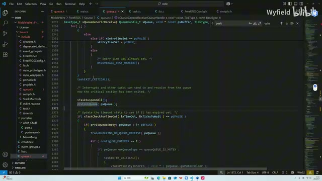

*退出临界区后调用 vTaskSuspendAll，并继续检查超时。 · [原片 08:20](https://www.bilibili.com/video/BV1fmL6ziEhA/?p=8&t=500)*

然后这边是判断时间嘛，对吧？你进来时的一个时间和当前的时间，配合上你愿意等的时间做一个判定，看看有没有超时。如果是没有超时，再判定一下：这个没有超时，我准备把你放到这个 Ready to Receive 的这个列表里面了，你放之前我再看一下。确确实实，如果是空的，如果是空的，里面啥资源没有，我就正常把你放到 Ready to Receive 的列表里面。

如果突然冒出来一个资源，就是能拿了。这边补充一下：你在上面的时候判定里面是没有资源，你在这个时候有资源了，那是为什么呀？那就是因为你这边退出临界区了呗，对吧？你别的任务可能，优先级更高的任务，把资源放进来，对吧？你这个时候可以尝试去抢了，所以叫 Try Again，对不对？

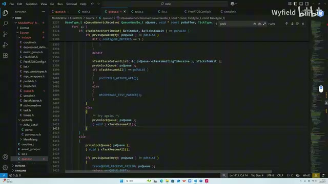

*等待接收分支及 Try Again 分支位于超时判定内部。 · [原片 09:40](https://www.bilibili.com/video/BV1fmL6ziEhA/?p=8&t=580)*

然后你从这跳出来，然后走到这儿，到循环上去抢。好，这边再抢，那这个时候就看你自己的本事了，对吧？那如果你在下面的时候是有资源的，然后从下面来到这儿，这个时间段内，这个 Ready to Receive 这个列表里面，它有任务优先级比你高，它这个能执行了，然后把它抢走了，也是有可能的。那你就要继续去循环了，对不对？如果能抢成功就抢成功了。

然后这里就是超时了呗，对吧？你一直被抢，然后一直出不去，抢着抢着就超时了。就是你一直在上面，你准备拿的时候被抢走了，你优先级低，一直被戏耍。耍着耍着，这个时间到了，你就也就正常 return 出去了。

同时呢，它 return 出去之前，对吧，它还不甘心。它正式走出去之前，它还会再看一眼，对吧？确定我要准备走了，我再看一下，我确定是空的、没有资源，我再退出去。如果有资源，我就再抢一轮，对吧？那这个 Receive 的逻辑，其实在有 Send 的基础上，很快地就理清楚了。

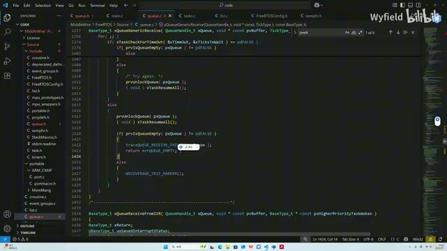

*超时分支在返回 errQUEUE\_EMPTY 前再次检查队列是否为空。 · [原片 10:50](https://www.bilibili.com/video/BV1fmL6ziEhA/?p=8&t=650)*

## 再看一遍接收失败分支（11:02）

那如果 Receive 失败呢？如果 Receive 失败，无非就是小于等于零呗，没有资源。那这块逻辑跟 Send 是一模一样。首先如果你不愿意等，直接 return；如果你愿意等的话，为了防止后面这个死循环超时，我得把进来时的这个时间给它记录一下。

那就是，而且是只进来一次嘛。这个变量初始是 false，进来一次变成 true，后面再也不进来了。记录一下当前时间。然后这边退出临界区，对吧？为啥？因为前面也说了，对吧？如果是低优先级的任务在 Receive，如果不退出临界区，这又是个死循环，那么就卡在这个低优先级任务里面一直死循环。那高优先级任务没法执行，那肯定是不行的，对吧？然后，所以这一大块，就是给优先级更高的任务机会，让它们执行。然后在这边就再次挂起，进行进一步的判断。然后这边是判断时间嘛，对吧？你进来时的一个时间和当前的时间，配合上你愿意等的时间做一个判定，看看有没有超时。如果是没有超时，再判定一下：这个没有超时，我准备把你放到这个 Ready to Receive 的这个列表里面了，你放之前我再看一下。确确实实，如果是空的，如果是空的，里面啥资源没有，我就正常把你放到 Ready to Receive 的列表里面。

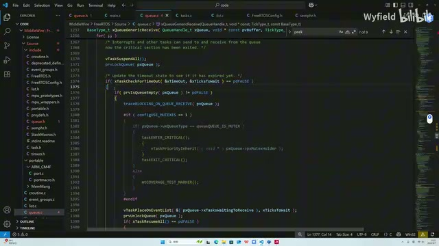

*再次讲解未超时且队列为空时的等待分支。 · [原片 12:30](https://www.bilibili.com/video/BV1fmL6ziEhA/?p=8&t=750)*

如果突然冒出来一个资源，就是能拿了。这边补充一下：你在上面的时候判定里面是没有资源，你在这个时候有资源了，那是为什么呀？那就是因为你这边退出临界区了呗。你别的任务可能，优先级更高的任务，把资源放进来，对吧？你这个时候可以尝试去抢了，所以叫 Try Again，对不对？

然后你从这跳出来，走到这，到循环上去抢。好，这边再抢，那这个时候就看你自己的本事了，对吧？那如果你在下面的时候是有资源的，然后从下面来到这儿，这个时间段内，这个 Ready to Receive 的这个列表里面，它有任务优先级比你高，它这个能执行了，然后把它抢走了，也是有可能的。那你就要继续去循环了，对不对？如果能抢成功就抢成功了。

然后这里就是超时了呗。你一直被抢，然后一直出不去，抢着抢着就超时了。好，就是你一直在上面，你准备拿的时候被抢走了，你优先级低，一直被戏耍。耍着耍着，这个时间到了，你就也就正常 return 出去了。同时呢，它 return 出去之前，对吧，它还不甘心。它正式走出去之前，它还会再看一眼，对吧？确定我要准备走了，我再看一下，我确定是空的，没有资源，我再退出去。如果有资源，我就再抢一轮，对吧？

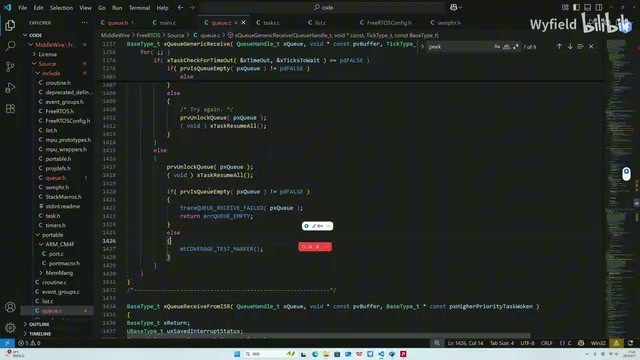

*末段再次展示超时后最终检查空队列并返回的分支。 · [原片 14:30](https://www.bilibili.com/video/BV1fmL6ziEhA/?p=8&t=870)*

那这个 Receive 的逻辑，其实在有 Send 的基础上，很快地就理清楚了。

> 末尾 14:43.58 的识别文本为“这个贴影”，只剩不完整语音片段，未据此补写技术内容。原识别记录保留在 sources。
