# 互斥量｜FreeRTOS 源码详解 P09

> 清理式忠实讲稿，保留讲述顺序与讲者主张。原片范围 00:00–31:00.870，[来源 P09](https://www.bilibili.com/video/BV1fmL6ziEhA/?p=9)。
> 原视频640×360，代码小字局部不清；正文仅清理可由上下文及画面确认的识别错误，不据模糊截图补造代码。设备名、讲者特殊表述在相邻位置标注。浏览器file协议受限，桌面与窄屏布局及图片缩放、时间链接交互未实测。

## 从信号量看队列的特殊情况

> [原片 00:00](https://www.bilibili.com/video/BV1fmL6ziEhA/?p=9&t=0)

我们来介绍一下互斥量的内部机制。互斥量实际上是一种高级的信号量，而信号量又是特殊的队列，所以我们先简单地介绍一下信号量。

信号量前面也说了，它是特殊的队列。它特殊在哪呢？特殊在它的 size——每个有多大——这个 size 是 0。也就是说，它没有数据段。它就是这样一个情况：没有数据段，其他的都和队列是一样的。

这边我们也来看一下，这是创建二值信号量的一个宏函数。我们创建二值信号量就用这个函数，也可以看到它的底层，就是在调用这个通用的队列创建函数。二值信号量的 length，也就是传进去的第一个参数，是 1；然后它的 size 是 0，第二个参数是 0。这也就印证了我们刚才说的：它的 size 是 0。

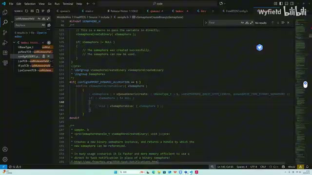

*二值信号量创建宏及底层队列创建调用（原视频640×360，小字局部不清，截图用于定位原画面） · [原片 01:00](https://www.bilibili.com/video/BV1fmL6ziEhA/?p=9&t=60)*

包括信号量的放入与取出，其实底层都是用队列的函数。这边要往信号量里放，底层也是调用队列通用的 Send 函数。你看它第一个参数，本质上就是个队列的头节点；第二个参数是一个指针。当我们把它用作队列的时候，它指向的是我们要传到队列里面的数据。但是因为信号量没有数据段，我们传 NULL 就行了，内核帮我们传好了。然后包括它的一个 Take，从这个信号量里面取东西，底层也是在调用队列的函数，这个我们之前都讲到了。同样的，用来接收队列里面数据的指针也是 NULL。当它用作信号量时，我们这些传的都是 0。

它内部的细节就不讲了，因为这个 Generic Receive 函数上节课也都说得很清楚了。大家感兴趣的话，可以把信号量这个特殊情况自己看一下。

## 共用 I²C 时的互斥

> [原片 02:33](https://www.bilibili.com/video/BV1fmL6ziEhA/?p=9&t=153)

二值信号量的作用，我们主要是用来同步。假设说 Task A 和 Task B，它们都会使用同一个 I²C。Task A 可能是用来驱动屏幕的，Task B 可能是用来给这个设备写数据的〔此处设备名识别不清，原转写为“一方”，不据此补定型号〕。因为 I²C 的时序要求很高，它在写的时候，肯定是不能给别的任务打断的。

当多个线程共用同一个有限资源的时候，就要用到互斥，对吧？互斥，就是某个比较紧张的资源有一个人在使用的时候，其他几个进程不能使用。这就是互斥的“斥”，互相排斥。

假设 Task A 首先抢到了 I²C，它就会在这边把二值信号量拿过来。前面也说了，二值信号量的 length 最多只能放 1。初始的话，后面也会说，它在创建的时候会变成一个 1。这边 Take 拿过来之后，就会从 1 变成 0。

取到了之后，因为取成功了，就可以正常进行，在这边使用 I²C，可以驱动屏幕。那 Task B 呢？假如说它走到这里来，

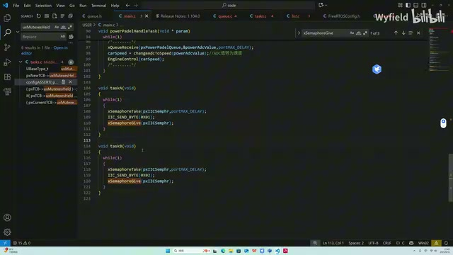

*Task A、Task B 中 Take、I2C 操作与 Give 的示例（原视频640×360，小字局部不清，截图用于定位原画面） · [原片 04:00](https://www.bilibili.com/video/BV1fmL6ziEhA/?p=9&t=240)*

此时 Task A 还在用 I²C。因为这个二值信号量，或者说这个队列，它的 Messages Waiting 已经从 1 变成 0 了，那它这里就写失败了。写失败了，它就阻塞了，进入这个 Waiting to Send 的列表下，乖乖等着。〔讲者此处的“写失败／Waiting to Send”按原讲述保留。〕

一直要等到 Task A 把 I²C 使用完毕之后，再调用这个信号量 Give，把 I²C 的使用权限、这个信号量还过去之后，它才能够唤醒，然后再继续使用 I²C，发送它想要发送的数据。所以，这就是二值信号量的一个作用：互斥。

## 为什么还需要互斥量：优先级反转

> [原片 04:46](https://www.bilibili.com/video/BV1fmL6ziEhA/?p=9&t=286)

那么，我们还有互斥量。既然二值信号量已经可以实现互斥的功能了，那我们为什么还要互斥量呢？大家应该也都听过，其中涉及到一个优先级反转的问题。简单来复习一下什么是优先级反转。

我们假设一种情况：Task B 优先抢到了 I²C，现在资源在 Task B 这里。紧接着它来到这里，开始使用 I²C。使用到一半，这时候有一个 Task C 插进来了，它开始执行了。Task C 可能执行的时间比较长，同时它的优先级又比 Task B 要高。

这就导致 Task B 会卡在这里。因为 Task C 的优先级比它高，Task B 一直没有执行的机会，这边的 I²C 它就用不完。它用不完，那 Task A 就一直卡在这，没法被唤醒了。

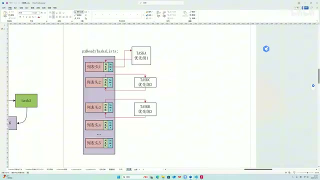

*A、C、B 三个任务的就绪优先级示意（原视频640×360，小字局部不清，截图用于定位原画面） · [原片 06:00](https://www.bilibili.com/video/BV1fmL6ziEhA/?p=9&t=360)*

那么这时候就遇到一个问题了：Task A 的执行，竟然要看 Task C 的心情。

也就是说，优先级低的 Task C，它的存在竟然把优先级更高的 Task A 给阻塞了。这个就是“下克上”的一种行为。这就是使用二值信号量来做互斥机制的这样一个缺陷。

所以这时候就引入了一个互斥量，一个更高级的二值信号量，来解决这个问题。互斥量解决这个问题的方法，是采用一个优先级继承的机制。

## 优先级继承与归还后的恢复

> [原片 06:24](https://www.bilibili.com/video/BV1fmL6ziEhA/?p=9&t=384)

什么是优先级继承呢？就是现在 Task B 占有这个互斥资源，或者用刚才的例子来举例，就是占有那个 I²C。然后 Task A 想要用这个 Queue Receive 函数，去获取互斥量资源。

由于这个互斥量现在被 Task B 所持有，所以 Task A 对互斥量的获取操作肯定是失败的。一旦失败，内核这里就会比对 Task A 和 Task B 两个任务的优先级。

一旦内核检测到当前持有这个互斥量的任务，也就是 Task B，它的优先级比想要获取这个互斥量而不成功的任务的优先级要低，那么它就会临时对 Task B——就是当前持有这个互斥量的任务——进行一个提拔，把它的优先级提上来，提到跟想获取互斥量而不成功的这个任务的优先级一样。

也就是这样一个情况：内核发现 Task A 拿互斥量拿不到，B 的优先级又比 A 要低。为了防止出现刚才那个“下克上”，也就是优先级反转的缺陷，它就把 Task B 提拔到和 Task A 一样的位置了。那就保证 Task B 可以执行，对不对？可以快速地、赶快执行完，把 I²C 释放完，然后让 Task A 来用。

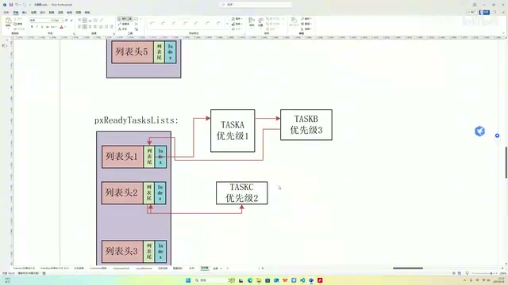

*Task B 被临时放到 Task A 所在优先级的示意（原视频640×360，小字局部不清，截图用于定位原画面） · [原片 08:24](https://www.bilibili.com/video/BV1fmL6ziEhA/?p=9&t=504)*

同理，你既然把它临时提拔上来了，那等这个互斥量用完了之后，这一切肯定要回归正常。Task B 肯定要回到它该回去的位置。因此，在 Task B 归还互斥量，也就是调用 Queue Send 函数成功的时候，就会把它当前的优先级和这个任务被创建时，也就是一出生的初始优先级，进行一个对比。一旦不一样，就让它当前的优先级和初始优先级一致，也就是又回到了这个状态。大致就是这样一个逻辑。

我们刚才也说了，优先级继承就是两句话：当获取互斥量不成功时，优先级反转，对吧？让优先级更低、同时又占有资源的那个人升官，临时升官，让他能快速用完这个资源再还给我。第二个，当发送互斥量成功时，就是有任务把互斥量归还回去，它要优先级恢复。它检测一下自己现在是不是被临时升官了，如果是临时升官了，就要回到过去的位置。

那么在技术细节上，它是怎么实现的呢？一旦我们把 Mutex，就是互斥量的那个宏定义打开，有两个结构体会因此发生一些变化。

## TCB 与队列头增加、复用的字段

> [原片 10:07](https://www.bilibili.com/video/BV1fmL6ziEhA/?p=9&t=607)

首先是 TCB 这个结构体，它会多出两个成员。一个叫 Base Priority（`uxBasePriority`），直译过来就是基本优先级，也就是这个任务被创建时的优先级。第二个是 uxMutexesHeld，代表这个 TCB 所代表的任务，持有了几个互斥量。

然后队列头这个结构体，它的变化是：首先它的 size 是 0，对吧？互斥量本质上还是信号量，只是高级一点，它肯定是没有数据段的。再一个，它的 length 是 1。1 代表这个资源能用，0 代表这个资源不能用，它是一个二值状态，所以 length 是 1。

再一个，初始化的时候，你调用 Mutex Create 函数，就是来创建一个互斥量的时候，这个 Messages Waiting（`uxMessagesWaiting`）——就是已经放了几个的这个变量——它是 1。初始的时候，这个资源是谁都能用的，代表有资源。

然后我们前面讲到 pcHead 和 pcTail，代表数据段头和数据段尾。互斥量都没有数据段，所以这两个就另有他用。pcTail 不再表示数据尾了，它会指向一个 TCB。它所指向的 TCB，就是当前占有这个互斥量的任务；这个 TCB 所代表的，就是当前占有这个互斥量的任务。我们通过查询这根指针，就能找到当前这个互斥量是被谁、被哪个任务所占有。

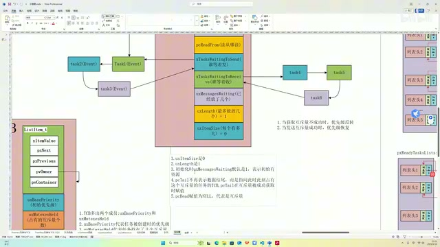

*队列头、TCB 与持有者关系的结构图（原视频640×360，小字局部不清，截图用于定位原画面） · [原片 11:00](https://www.bilibili.com/video/BV1fmL6ziEhA/?p=9&t=660)*

如果它谁都没指，是一个 NULL，就代表谁都不占有它。然后 pcHead 也不指向任何地方；pcTail 指向 NULL，pcHead 指向 NULL，就代表是互斥量。源码里面都是通过把 pcHead 和 NULL 进行对比，来判断它是不是互斥量的。

所以刚才就说了，互斥量高级的地方在于它有一个优先级继承。优先级继承进一步说，就是这两个特质。实现这两个特质，内部有一些技术细节，主要就是 TCB 和 Queue 这两个数据结构上的区别。同时等会儿我们看源码，源码里面也会有一些不同。总体来说，技术细节都列出来了，接下来就去源码里把这些都印证一下、都找出来。

## 从创建函数印证初始化

> [原片 13:22](https://www.bilibili.com/video/BV1fmL6ziEhA/?p=9&t=802)

然后我们来看互斥量的创建函数。它还是在调用队列的创建来完成的。首先 length 是 1，代表要么有、要么无：0 是无，1 是有。然后 size 是 0，对吧？它是一个没有数据段的队列，不需要数据段。这就是第一点。把这两个 1 和 0 传进去，这两个特性就实现了。

然后这边是互斥量的初始化函数，看它干了啥。就是这里，Mutex Holder（`pxMutexHolder`）。这个 Holder 是谁？我们来看一下。Holder 是个宏，它就是 Tail，数据段尾。我们刚才说了，这个尾如果指向某个地方，它所指向的地方就会是一个 TCB，然后这个 TCB 就是当前持有互斥量的任务。

初始化的时候，这个互斥量谁都不属于，肯定是空，对吧？然后这个 Queue Type（`uxQueueType`），它是谁？它也是个宏，它是 Head，对吧？这边也说了，Head 要赋值为 NULL，那我就给这个宏，它也是 NULL。后面的代码就会查这个 pcHead，来确定它是不是互斥量。

然后这里，当我们这个互斥量作为一个递归型互斥量的时候，这个变量会用到。其实我们互斥量懂了，递归型互斥量就很简单。

然后就是对这一点：往互斥量里面发了一个数据，就是印证第三点。它往里面发了一个东西，那么此时 Messages Waiting，就是当前有几个的这个变量，就不是零了。发了一个就是一，代表一开始这个资源是有的，是一个有的状态，谁都可以持有。初始化这一块，就大致带大家看了一下。

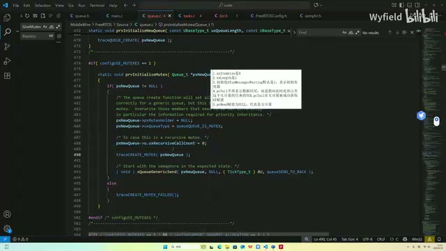

*互斥量初始化函数中的持有者、类型与初始发送（原视频640×360，小字局部不清，截图用于定位原画面） · [原片 14:48](https://www.bilibili.com/video/BV1fmL6ziEhA/?p=9&t=888)*

## 任务创建时的两个初值

> [原片 15:25](https://www.bilibili.com/video/BV1fmL6ziEhA/?p=9&t=925)

然后就是这几个点，TCB 里面相关的一些特性。是从 Task Create 开始，这个函数还没给大家讲，我打算放最后讲。等一切讲完了，我们来看看第一个任务是怎么跑起来的。

就给大家找一下吧，在这，在初始化这里。好，在这，你看，这个是个宏。一旦把这个宏开关打开，就是有互斥量了，需要用到互斥量了。那这边是 Base Priority，对吧？它代表任务被创建时的优先级，所以创建的时候就把它进行赋值。然后这个变量代表持有了几个互斥量，你刚创建的时候肯定啥都没有，那肯定是零。这个特性也讲完了。

## Task B 成功取得互斥量

> [原片 16:30](https://www.bilibili.com/video/BV1fmL6ziEhA/?p=9&t=990)

然后我们就模拟一下刚才说的 A、B、C 这三个任务的情况，对着源码，把技术细节捋一下。首先肯定是 Task B 调用这个 Queue Receive 函数成功了。调用成功，就来到这。

基本上的区别，首先这里有一个：因为我们的 size 是 0，所以就不存在什么 memcpy 传输数据的事情，直接就跳出来。其他这边都一模一样。

然后你是用作互斥量的时候，这个 Peeking（`xJustPeeking`）肯定是 False。你不能只看一下，必须拿走，所以肯定是走这个分支。唯一的区别就在这，多一些操作。

你看这个 Mutex 宏打开之后，它首先就会判断 Head 是不是 NULL。就是这里，截个图，就这里判断一下 Head 是不是 NULL。pcHead 赋值为 NULL，代表是互斥量。现在判断确实是互斥量，就会来到这里。

这里是在做一个什么事呢？首先，让这个 Tail 指针——因为 Tail 指针会指向此时此刻占有互斥量任务的 TCB——就把 pcTail 指针的指向改一下。同时还会干啥呢？同时还会让这个 Mutexes Held 变量，就是代表任务持有了几个互斥量的变量，让相应 TCB 里面这个变量再加加。因为你成功持有了，所持有的互斥量肯定要自增。

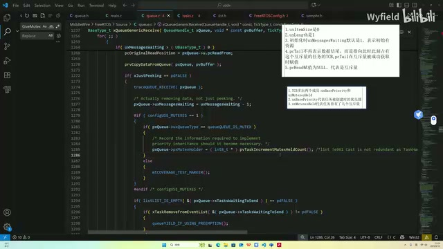

*获取成功后的互斥量专用分支（原视频640×360，小字局部不清，截图用于定位原画面） · [原片 18:00](https://www.bilibili.com/video/BV1fmL6ziEhA/?p=9&t=1080)*

现在某个任务调用这个 Queue Receive 函数成功了，而且来到这里，那它肯定是 Current TCB，对吧？不然也不会来到这里，肯定是现在正在执行的任务。所以这里，就是 Current 任务的一个 TCB，这边的变量做一个加加，代表我现在又多持有了一个互斥量。

也就是这个：假如以刚才的情况为例，这是 Task B 的 TCB，那它就是 1，就加加了。然后这返回去的是一个指针，就是 Task B 的地址。那么我们就让互斥量的 Tail 指向 Task B，这已经指向了。既然它要指向它，我们后续通过这个指针，就能知道当前是 Task B 在拿着这个互斥量了。

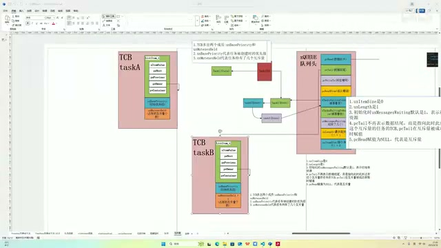

*pcTail 指向持有者 Task B 的图解（原视频640×360，小字局部不清，截图用于定位原画面） · [原片 19:00](https://www.bilibili.com/video/BV1fmL6ziEhA/?p=9&t=1140)*

## Task A 获取失败后进入继承路径

> [原片 19:20](https://www.bilibili.com/video/BV1fmL6ziEhA/?p=9&t=1160)

Task B 现在拿成功了，此时此刻它在用 I²C，还没用完、没释放。就是说 Task A 过来了。Task A 调用 Queue Receive 函数，发现失败了，它要做一个优先级的继承。我们看它是怎么做的。

失败了，那我们直接往下走。这边都讲过了，很熟悉了，这个分支跳过去，来到这。当这个宏被打开的时候，这里会做一个区分。首先也是判断一下 Head 指针：如果是 NULL，就确认是互斥量，然后进行一个优先级继承。

这个是判断一下人家传进来的是啥。Holder，就是 Tail，是吧？传进来的是 Tail。前面也说了，Tail 指向的肯定是当前占有互斥量的任务的 TCB，好不好？首先再判断一下它是不是 NULL，如果不是 NULL，就说明它指向某个 TCB。

## 事件列表项的优先级与事件组例外

> [原片 20:14](https://www.bilibili.com/video/BV1fmL6ziEhA/?p=9&t=1214)

然后接着来做。这个 pxTCB 所指向的，就是 Mutex Holder，就是传进来的，也就是当前持有这个互斥量的任务的 TCB。把它的优先级拿出来，和我们当前想拿互斥量而不成功的任务的优先级进行对比。如果发现它小于它，也就是这种情况：当前拿到的是 B，B 的优先级小于 A，就进行下一步判断。

它首先是想这样，肯定是要调用这一步的：Set Item Value，把 Event List 里面列表项的一个成员替换成 A，把它替换成 Task A 的一个优先级。这里就在干这个事情。

不过它在干之前，多了一层判断。它判断这个值的某一个位，是不是 1。这个是为啥呢？后面讲事件组的时候会给大家介绍：如果这个判定过不去，说明当前这个 TCB 的 Event List 是在事件组排队的。如果在事件组排队，就不能把 Event List 里面所代表的优先级变掉，否则会有问题。

如果不用事件组，那就能放下来，就把 Event List 的优先级变一下。Event List 这边再复习一下，前面也说了，各种各样的任务在各种队列里面排队的时候，是让 Event List 的列表项替它去排队的。然后 Event List 这个列表项里面的值，它就代表优先级。

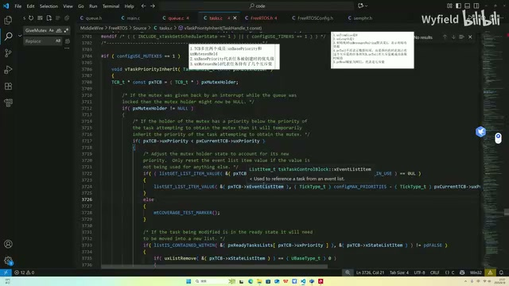

*继承函数对事件列表项值及标志位的判断（原视频640×360，小字局部不清，截图用于定位原画面） · [原片 21:36](https://www.bilibili.com/video/BV1fmL6ziEhA/?p=9&t=1296)*

所以你如果想实现优先级继承，如果不把这个任务用于事件组的时候，那肯定 Event List 也要改。帮它排队的那个所代表的优先级，也要相应升高。不然你只把 TCB 里面的优先级改了，但它排队始终排不过去，也一直在死等，对吧？把优先级更高的也给阻塞了。

## 就绪状态与非就绪状态的两条分支

> [原片 22:38](https://www.bilibili.com/video/BV1fmL6ziEhA/?p=9&t=1358)

然后这一层判定，就是两个分支。判定 State List，就是当前持有这个互斥量的任务，它是否处于 Ready 状态，是否处于 Ready List 下。这个宏函数就在判断这件事，就这一行：它的 container 是否是这个 Ready List。

如果处于 Ready 列表下，就先拿出来，再赋值，再干这个事情。如果在 Ready 列表下，把它从 Ready 列表里面拿出来，然后再改优先级，这边就进行一个赋值。如果不在 Ready 列表下，就直接赋值。

这样就完成了一个优先级继承，对吧？Task B 的 TCB 里面的优先级，以及替它去各个队列里排队的这个 Event List 的优先级，都变得跟 A 一样了。那就能执行了。Task B 得到了提拔，能执行了。

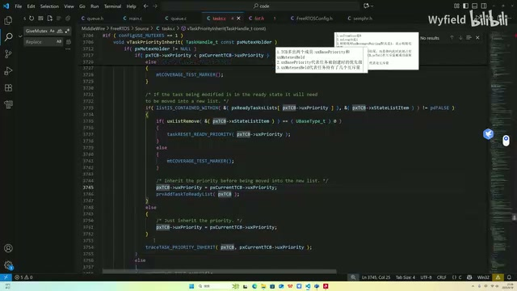

*优先级继承中就绪列表成员判断与分支（原视频640×360，小字局部不清，截图用于定位原画面） · [原片 23:36](https://www.bilibili.com/video/BV1fmL6ziEhA/?p=9&t=1416)*

它执行了一段时间，把 I²C 用完了，就往里还了，也就是调用 Queue Send 函数，发送互斥量。发送成功之后，就会优先级恢复。看一下它是咋恢复的。

## 归还路径为什么还要检查 Head

> [原片 24:23](https://www.bilibili.com/video/BV1fmL6ziEhA/?p=9&t=1463)

在这，这是 Queue Send 函数。你发送成功了，就会来到这边，有区别的就在这。这里照例检查一下 pcHead 是否是 NULL。

简单说一下，为啥要看这个？因为这个 Item Size 是 0 的时候，有两种情况：第一种是互斥量，还有信号量的时候，也是 0。那信号量的时候，这个指针就不是 NULL。它不需要优先级恢复，也不用优先级继承这些机制，所以这边做一个判断。

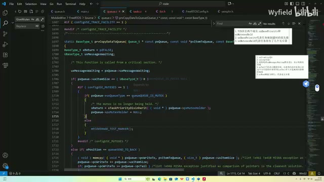

*发送路径中 size 与互斥量类型判断（原视频640×360，小字局部不清，截图用于定位原画面） · [原片 25:00](https://www.bilibili.com/video/BV1fmL6ziEhA/?p=9&t=1500)*

然后我们看优先级恢复是怎么实现的。pxTCB 就是指向当前持有互斥量的任务，那其实就是 Task B，其实就是 Current TCB，对不对？只是现在它把我还回去了。还我的人肯定也是持有我的人，这个还，是 Current TCB 才能还；那持有我的，肯定也是 Current TCB。

你看这边，还有一个断言判断：持有这个互斥量的，肯定要是 Current TCB 才行。然后也就是 Task B 开始还了。

首先这个变量要减减吧？代表持有了几个互斥量的变量，要减减，它就减成零了，是吧？还了一个，要减一个，这个很自然。然后这边会做一个判断，确认是啥呢？就是我当前的优先级，不等于我一出生时的优先级，那说明我是被临时提拔的。我现在就要进行一个优先级恢复，就是回到我该去的地方。好，这个判断先不看，我们最后再来看。

首先，我此时此刻既然能还这个互斥量，那肯定是在一个 Ready 列表下。那我不仅要还互斥量，还要回到初始位置。我现在在这，要回到这，肯定要先从当前所在的 Ready 列表里面离开，对不对？就是在这，List Remove，让自己离开。

然后就是让自己当前的优先级，等于初始时的优先级，这就返回去了。前面也说了，Event List 就是替它去队列里面排队的列表项。在继承的时候，这个优先级也变了。现在优先级还回去了，替它排队的那个人也不能在这狐假虎威了，是吧？也要把这个优先级给它恢复回去，就是在这。

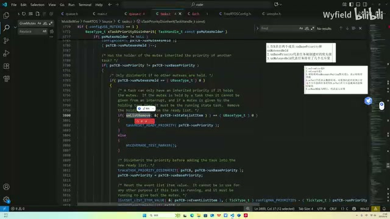

*恢复基本优先级和事件列表项值的源码（原视频640×360，小字局部不清，截图用于定位原画面） · [原片 27:00](https://www.bilibili.com/video/BV1fmL6ziEhA/?p=9&t=1620)*

好，这就说完了。你看这样一下，优先级继承其实都结束了——不好意思，优先级恢复也都 OK 了。其实整个逻辑也就说完了。

## 为什么必须等 Mutexes Held 减到 0

> [原片 27:44](https://www.bilibili.com/video/BV1fmL6ziEhA/?p=9&t=1664)

然后最后再补讲一下：为什么要判定这个 Mutexes Held 等于 0 呢？这个其实也很简单，想象有一种这样的情况。假设有一个 Task，Task B、C……假设有个 Task E 吧。Task E 优先级不高，但是拿到的资源很多。比如说它把 I²C、串口、SPI，或者什么 Flash，还有各种应用层的一些东西都拿到手了。这个时候，我假设说这个 7 想用它，想用 I²C 了，就是这个 Task D 想用 I²C 了。但现在 I²C 在 Task E 手上，那就会把 Task E 临时提拔到它这。

过了一会儿，Task C 想用串口了，串口也在 Task E 这，那就会临时把它提拔到这。结果 A 到 C 这些所有的任务，所想用的互斥资源，全都在 Task E 手上。刚才的步骤就重复了很多次，直到最后 Task E 就有可能跑到最高优先级上。

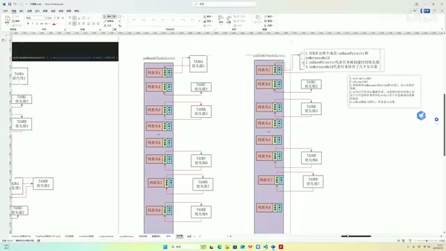

*多个等待任务与 Task E 持有多个资源的示意（原视频640×360，小字局部不清，截图用于定位原画面） · [原片 29:36](https://www.bilibili.com/video/BV1fmL6ziEhA/?p=9&t=1776)*

也就是说，它会持有很多任务——它会持有很多互斥量。它这个 Held，因为每次拿到一个互斥量，就会加加；同时持有了很多，那这个值也很大，比如说是 80。

为什么要有刚才那个判断呢？刚才我们是在还 I²C。你不能说还了一个，就立马回去。你立马回去，那中间这些咋办？中间这些还想用串口，还想用 SPI，你这直接回去了，还是会出现优先级反转这样一个问题。

所以就要判断一下。因为每还一个会减减，那就是你如果是 10，肯定要还 10 次，减减 10 次。要确保你所有的都还出去了，再回到你一开始的优先级。所以这里减减之后，这边再判断一下。好，那其实整个互斥量，这些细节也讲完了。有了队列的基础，其实这些都是队列的变体，讲起来、理解起来也是非常轻松的，因为有前置知识了。

好，本节课把这个互斥量，从信号量开始，引入了优先级反转这样一个问题；然后又引入了我们的互斥量，介绍了一下互斥量解决优先级反转问题的方式，就是这两个方式。同时在源码上面，把这些技术细节都解释清楚了。

好，那这个互斥量的讲解就说完了。

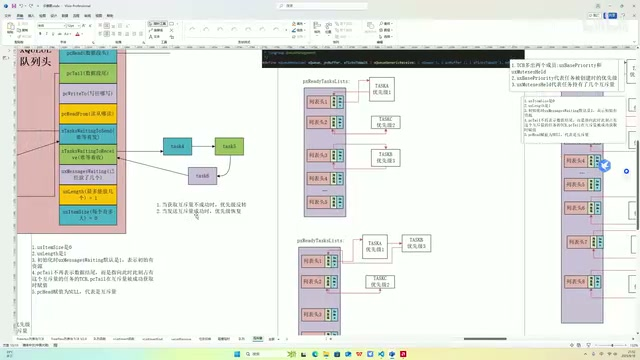

*课程结尾回到互斥量结构与继承、恢复关系图（原视频640×360，小字局部不清，截图用于定位原画面） · [原片 30:48](https://www.bilibili.com/video/BV1fmL6ziEhA/?p=9&t=1848)*
