# FreeRTOS P10｜队列集

> 整理方式：忠实清理讲稿，保留原讲述顺序、第一人称、推理、条件、例子、强调与现场纠错。来源：[B站原课 P10](https://www.bilibili.com/video/BV1fmL6ziEhA/?p=10)，范围 00:00–26:37。
> 图像均为原视频截图；源分辨率640×360，代码细字局部不清，正文不凭截图补造完整源码。1105–1165秒结合定向本地ASR处理重复识别，保留口误纠正；冻结转写另附。

## 队列集的数据段与归属指针

我们接着来讲队列集。和互斥量、信号量一样，队列集也是一个特殊的队列。特殊之处在于队列集所存储的这个数据段：数据段所存储的是指向队列头的指针。我们之前说，信号量和互斥量是不带数据段的，但是队列集具备数据段。

同时，当你在代码里面打开队列集功能时，具体来说就是打开这个宏定义，把 `configQUEUE_SETS` 设为1，在编译的时候，队列头里面也会多出一个指针。如果某个队列受到某个队列集的集中管理，那么这个指针就会指向它所属的队列集的队列头。比如说，现在这个队列，或者说这个信号量，它受到这个队列集的管理，那它的这个指针就会指向它所属的队列集的队列头。

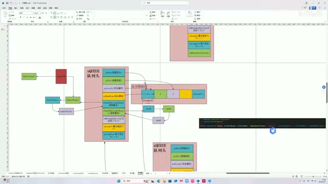

*队列集与成员队列的队列头、数据段和归属指针（原视频640×360，代码小字以正文讲述为准） · [原片 00:10](https://www.bilibili.com/video/BV1fmL6ziEhA/?p=10&t=10)*

我们在队列集创建完成后，一般会调用一个函数，把这个队列头——说错了，把队列加入到队列集的管理。其实就是让队列的这个指针，指向它所属的那个队列集的队列头。具体来说就是这个函数。我们一旦调用这个函数，第一个参数是队列的句柄，第二个参数是队列集的句柄，那它底层就会这样干，很简单：把这个指针指向它。

经过这样一个操作，我们这个新的队列就受到这个队列集的管理。当我们调用 queue send，或者 queue send from ISR，就是在中断里面用的这个函数，往某个受队列集管理的队列里面写东西时，由于这个函数，你看，传参是队列头。假设说，我们要往这个队列里面写东西，那第一个参数就是它。源码的底层，内部就会根据这个指针，找到管理这个队列的队列集，就顺着它找到它。

如果某个 task 因为队列集空而进入了阻塞，那就和队列一样，因为它空而进入阻塞的任务，肯定会挂载在这个 waiting to receive 的列表里。那么源码就会顺着这个方向，从这儿找到这儿，然后从这儿找到这儿，把任务拿出来唤醒。这一块其实和队列逻辑一模一样。所以，队列集其实就是对多个队列进行集中管理的一种手段、一种实现载体。再次强调一下，它的底层还是队列，它是特殊的队列。

## 四个按键的应用场景

接下来是这样的，我模拟了一种应用场景，我们将通过这个场景来对源码进行详解。这个场景是这样的：假设说我们的电路、我们的板子上有四个按键，分别是上下左右四个键。我们的目的、我们的任务，是根据按键的键值来执行相应的动作。

我们首先创建四个信号量和一个任务。任务被创建之后就可以执行了，对不对？在任务的开始，我们先创建一个容量为4的队列集，来承载这四个队列。这个参数传过去的就是个数，受队列集所管理的队列的个数，我们传的是4。紧接着，我们要用这个 Add to Set 函数，把这四个队列都放入到这个队列集里，或者说，让这四个队列都受队列集的管理。前面也讲到，其实底层就是让这个指针指一下，对不对？等会儿也带着大家看。

然后这个 task 就跑起来了。首先是 while 循环，while 循环一开始，队列集的初始状态肯定是空的。在执行这个函数的时候，它的底层也是队列的 receive 函数嘛。那初始的话，队列集这个队列是空的，第二个参数又是这个 portMAX_DELAY。所以和队列一样，这个任务，就是我们这个按键按下 handler 的 task，它就被阻塞了，永久不执行了。OK。

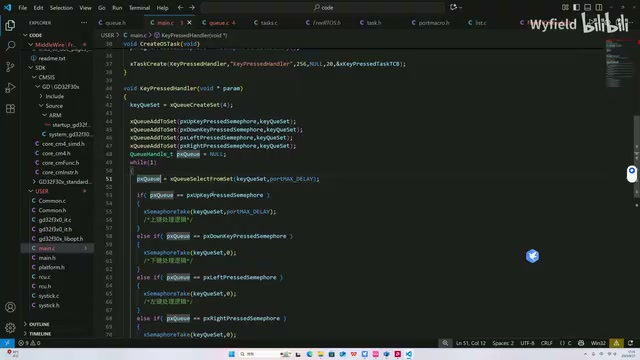

*按键任务在循环中等待队列集，并按返回句柄进入分支（原视频640×360，代码小字以正文讲述为准） · [原片 04:30](https://www.bilibili.com/video/BV1fmL6ziEhA/?p=10&t=270)*

那过了一会儿，按键按下，我们跳入到这个外部中断的函数。在中断里面，我们读取这四个按键 IO 口的键值，然后根据按键的 IO 口定义，来识别是哪个按键被按下而触发的中断。那我们写这个信号量。

假设说这个按键按下，我们写信号量。信号量被写入之后，顺着刚才讲的，信号量传进去，顺着这条路径来到这儿，然后来到 waiting to receive 的这个列表。第一个成员就是我们刚才放进去的，源码把我们这个 pressed handler 的 task 放进去了。刚才它被永久阻塞了，那这个任务在这儿就得到了唤醒，继续执行。队列集通过这个读取，就这个函数，它的返回值返回的是什么呢？

就是队列集里排在第一个的这个队列的指针。我们通过判断这个指针，和这个句柄进行一个对比，就可以知道是哪个按键被按下。我们把这个 take，就是把这个队列，上键按下的队列，从队列集里面 take 掉之后，做一个相应的处理。整个逻辑大概就是这样。

这边有一个细节：有没有可能，我们通过这个分支判断了，就是这边被唤醒了，进来，在到达这个 take 这一步之前，任务切出去了，那别的任务把这个信号量给它拿走了，导致这边就拿不到了，从而进入了一个永久的阻塞？然后别的按键按下时，因为是阻塞在这里嘛，所以也没反应了。有没有可能会有这种情况发生呢？答案是有的，所以不要这么用。

就是，只要某个队列或者信号量被队列集所管理，那么我们就只通过队列集来获取，不要在别的任务里面获取它了。

以上就是这个模拟出来的应用场景流程的具体描述。下面我们顺着刚才所讲的流程，来详解源码，了解内部机制。首先来看资源：我们有一个队列集，这个是队列集的句柄；我们还有一个任务，这个任务是用来跑这个队列集的，或者说，这个队列集是跑在这个任务上的；我们还有四个信号量，或者说四个特殊的队列，来分别传递四个按键被按下的事件的这样一个信号。

## 从创建到加入管理

你看，up、down，上下左右四个键，每一个信号量分别代表某个键被按下。首先是队列集的创建（`xQueueCreateSet`），底层也是队列。在这里，length 通过我们的传参被赋值为了4，因为一共四个按键吧，上下左右。同时 item size 也是4，因为我们是32位芯片，指针的尺寸、它的 size 统一是4个字节。其他的初始化动作和队列一模一样，所以这边我也画好了，对不对？这个 length 是4，size 也是4，那我们这个队列集就创建完了。

紧接着，就是将四个已经创建好的队列划给队列集进行管理（`xQueueAddToSet`）。我们来看一下，第一个分支是在判断这个队列之前是否已经加入到过某个队列集里面了。如果已经加过了，就不能再换了，不能再换队列集来管理它了。第二个分支是在判断这个队列里面是否已经有数据了，如果有的话，也不能加入队列集。

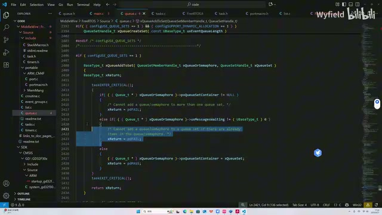

*加入队列集前的归属与已有消息检查（原视频640×360，代码小字以正文讲述为准） · [原片 09:20](https://www.bilibili.com/video/BV1fmL6ziEhA/?p=10&t=560)*

如果两个检查都通过了，就来到这一步：我们让队列的队列头，让这个指针指向这个队列集的队列头。然后通过这个指针，我们就能识别这个队列是归哪个队列集来管。这边就在干，让它这个指针指向 queue set。好，那我们加也加进去了，然后就开始死循环了。第一步是执行从队列集里获取的这个函数，第一个参数是这个队列集的指针，第二个参数就是 delay max 的这个宏。我们往下看一下，可以看到，底层就是在调用这个 queue generic receive（`xQueueGenericReceive`）的函数。这个函数我们已经很熟悉了。由于初始的话，队列集肯定是空的，初始化的时候这个 messages waiting 是零，那源码就会把我们这个任务放到这个 suspended 列表、挂起列表里面，从而进入一个永久阻塞的状态。

## 中断写入与队列锁

好，过了一会儿，按键按下，跳入中断。假设是这个往上，上键按下了，我们会调用这个 from ISR 函数。这个函数其实就是我们已经讲过的 queue send 那个函数的中断版本，区别在于没有延时的机制，因为中断需要快进快出。

然后我们往下跳，往下跳。这个信号量一上来，它肯定是空的嘛，就是 messages waiting 是零。所以我们肯定是可以——这个 length 是4嘛——所以我们肯定可以进入这个分支。首先就是常规的 messages waiting 这个变量自增，然后又是一个分支判断。这个分支在判断啥？锁，对吧，队列是否上锁。

就是队列里面，之前一直没有说到，我带大家看一下。队列的队列头里面，这个结构体里面，有两个变量，一个叫 `cRxLock`（rx lock），一个叫 `cTxLock`（tx lock），分别是接收锁和发送锁。所以我们先重点来讲讲这个锁的逻辑，再回到刚才接着说。首先我们要看一下，这两个变量是在哪里使用的，也就是说，

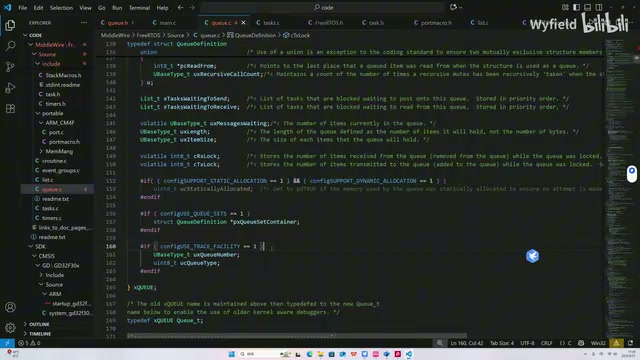

*队列头中的接收锁与发送锁字段（原视频640×360，代码小字以正文讲述为准） · [原片 12:00](https://www.bilibili.com/video/BV1fmL6ziEhA/?p=10&t=720)*

> 识别说明：此处冻结转写把中断函数识别为“Qreceive from isr”，随后讲者称其为 send 的中断版本；画面在信号量发送分支。本稿保留其发送语境。此处“length是4”为讲者原说，未以编者判断改写为其他容量。

队列是在什么时候上锁，又是在什么时候解锁的。我们来看一下，是在这儿，这个 lock queue 函数，就是叫锁队列，这是一个宏函数。看看在哪儿用的，是在这儿用的。可以看出，是在队列的 send，还有 receive 函数，主要是在这两个地方去使用。

我们以这个 send 函数为例，是在这儿锁上的。那什么时候解锁呢？unlock 是在这儿，又是在这里解锁的。也就是说，队列锁的状态集中在这么一小段里面。那么在中间这一段里面，这个逻辑是什么样的，做了什么事情呢？

主要就是说，前面讲队列源码的时候也说了，我们在某个 task 里面调用这个 queue send 函数，向队列里发送数据失败了，那我们就需要把调用这个 queue send 函数的 task，放入到这个队列的 waiting to send 列表里面，对吧，大家应该还记得。那我们就需要把这个 task 放入到这个队列的 waiting to send 列表里面，对吧？

正式放入这个 waiting to send 列表的这个过程里，就是决定要放，但是还没有正式放进去的这个过程里面，我们把这个队列锁上，就中间这一段。那么为什么要这么做呢？我们来分析一下。

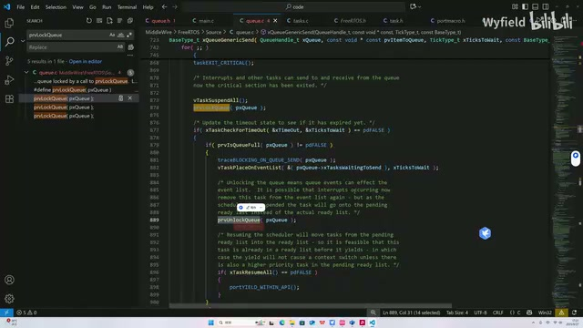

*发送失败后挂入等待列表前的上锁与解锁位置（原视频640×360，代码小字以正文讲述为准） · [原片 13:30](https://www.bilibili.com/video/BV1fmL6ziEhA/?p=10&t=810)*

首先我们思考一个问题：就是在锁上与解锁之间的这个时间段内，这个任务会不会被打断？会的。如果不会被打断，是不需要锁的。那么会被谁来打断？肯定不是别的任务，因为这边把任务都挂起了，别的任务是不会执行的。

只有中断会打断它。那我们就来研究一下，如果被中断打断了，又没有锁，会有什么问题呢？

假设说，我们把某个 send 不成功的 task 放入这个等待列表之前，假设是 task3 吧，然后突然一个中断进来，把这个放入过程给它打断了。就还没有完全放进来，在半路的时候被打断了。同时，这个中断会 receive 这个队列嘛。在 receive 队列的时候，会把 waiting to send 列表已有的第一个任务唤醒。

在这个例子里面，假设说中断 receive 成功了，它唤醒的会是谁呀？它唤醒的会是 task4，因为现在 task4 排在第一个嘛。如果我们 task3 的优先级很高，它如果放成功了，会放在第一个，但是因为它还没有来得及跑到第一个，导致 task4 先被唤醒了。那就说明，优先级低的一个任务被唤醒了，这个事情就不对了。

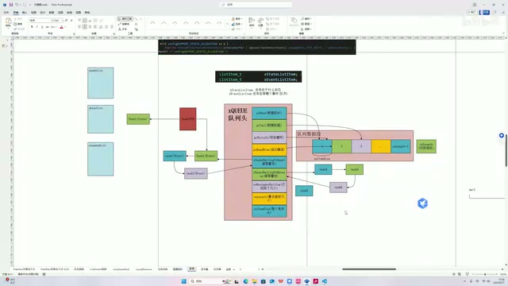

*task3尚未入列时，已有task4位于等待链表前端的示意（原视频640×360，代码小字以正文讲述为准） · [原片 15:00](https://www.bilibili.com/video/BV1fmL6ziEhA/?p=10&t=900)*

假设说那个 task3，比如说你搞汽车什么的，是一些很紧急的任务，那不重要的任务先被唤醒了，结果紧急的没被唤醒，这个就不对了，就会出问题。为了规避这个情况，我们加入了一个锁的机制。具体是怎么做的呢？

锁的机制是这样的：它们在中断里面 receive 的时候，如果 receive 成功了，会看一下这个锁的变量，看一眼这个队列里面锁的变量。如果没锁，那我们就正常唤醒，我们把这个 waiting to send 列表里面的任务给它唤醒。如果锁了的话，我们就不唤醒，而是将某一个变量自增，让它加1。这个变量是用来记录队列在上锁阶段被成功 receive，而因为锁上没有成功唤醒的次数。

当队列解锁的时候，我们调用这个 unlock 来解锁，内核源码会读这个变量。这个变量是几，我们就从 waiting to send 列表中唤醒几个任务。这块逻辑应该是好理解的，对吧？

比如说，我们这个 task 即将要放入它之前，task3 是 send 的，是吧？不好意思，说错了。task3，我们要把它放入之前，这个时候有中断进来，而且有三个中断进来，每一个中断都调用这个 receive 函数，把这个队列里面的东西拿走，假如说是三次。OK。

好，我们现在是锁的状态，那 task3 正式放进来之后要解锁呀。它就会读刚才那个变量，因为每次 receive 成功，发现你锁上了，它就会加加嘛。现在这个变量等于3，源码看到这个变量等于3，就会从这个 waiting to send 的列表里面拿三个，分别是 task3、task1、task2，把它拿走。这个就是符合我们这样一个预期的。

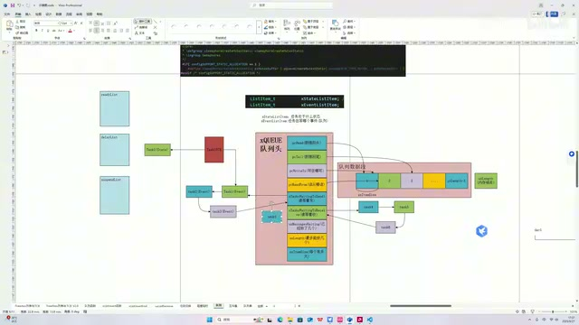

*三个中断接收后，等待任务入列与解锁的演示（原视频640×360，代码小字以正文讲述为准） · [原片 17:20](https://www.bilibili.com/video/BV1fmL6ziEhA/?p=10&t=1040)*

我们看一下代码，还是回到刚才，以 send 为例。现在首先在这儿，对不对？这个队列已经锁上了，它俩都是0。然后某个 task 调用 send 不成功，因为队列里面满了，所以现在准备要放到这个队列的 waiting to send 列表里面了。好，这个时候还没放进去之前，一个中断进来了，把这个过程打断了。同时，这个中断要从队列里面拿数据，拿数据就是在这个函数，对不对？这个用法大家肯定都知道，在中断里面 receive 或者 send 队列，肯定要使用这个带 from ISR 后缀的函数。

我们往下来看，首先来到这儿，就是能往里面发了，然后正常拷贝数据，messages waiting 这个变量减减，代表这个已有的成员减1，对不对？然后在这边判断一下，如果是 unlocked，-1 就代表没有锁，我们就正常走这个分支，正常接收，并且从这个 waiting to receive 列表里面——不好意思，就正常从这个 waiting to send 列表里面去唤醒任务，对不对？如果锁了咋办？锁了，我们会来到这里，让这个 rx lock 变量自增。刚才说有个变量会自增，源码其实就是用的锁的这个变量。

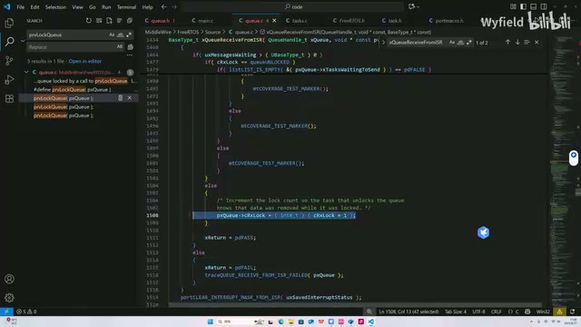

*接收中断路径中rx lock的递增位置（原视频640×360，代码小字以正文讲述为准） · [原片 19:30](https://www.bilibili.com/video/BV1fmL6ziEhA/?p=10&t=1170)*

所以这个变量有三种作用、三种情况。如果是-1，就代表没有锁，unlocked；如果锁了，那就是0，0代表上锁状态；如果既不是-1，也不是0，是大于0的，通过读这个变量，就知道我们某一个队列在上锁阶段有多少个数据被取走了。

OK，所以这个变量就进行一个加1。好，刚才那个就结束了。然后我们这个队列就来到这边，进入一个解锁的逻辑。我们看看解锁是在干什么事情。

这就是我们刚才说的，如果锁的变量大于0，它会读这个变量，大于0说明在锁阶段，有这个 tx，那就有数据被发进来。同时，它在这里也会判断一下 rx，rx 如果大于0，说明是在队列被锁的阶段有数据被拿走。

这个 tx 就是放进来几个，那么我们就会基于这个循环，从 waiting to receive 列表里面唤醒几个任务。同理，这个 rx lock 变量是几，那么我们就会在 waiting to send，就是几，就说明多出来几个空位了嘛，我们就会从 waiting to send 列表里面唤醒几个任务。

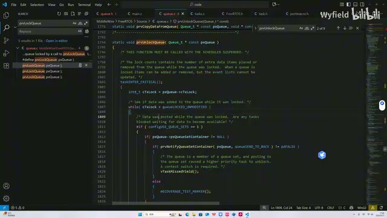

*解锁代码按计数处理等待任务，包含队列集分支（原视频640×360，代码小字以正文讲述为准） · [原片 21:00](https://www.bilibili.com/video/BV1fmL6ziEhA/?p=10&t=1260)*

那就是在这儿，因为这是我们等会儿会讲到的，还是跟队列集有关。如果某一个队列没有受队列集管理，我们通过这个循环，刚才说的，从这个 waiting to receive 列表里面去拿任务，每次拿一个。然后基于这个循环进行一个减减，对不对？一直要减到零嘛。比如说3的话，就会减三次，每次在这儿唤醒一个任务，然后变量减减。整个循环结束，就会有三个任务从 waiting to receive 列表里面被唤醒。最终，这边是零了之后，要把它变成一个非上锁的状态、一个解锁状态，那就把它赋值为一个负一，这个也是同理的。好，锁的机制就讲完了，然后我们回到队列集。

## 通知队列集，再唤醒按键任务

刚才我们讲到了这里，对不对？它检查了一下锁嘛。如果没有锁，我们就往里面去放。如果现在能放了，这个队列没有被队列集所管理，我们就正常把这个队列里面的任务给它唤醒了。如果被队列集管理了，那我们会来到这里，通知队列集容器的这样一个函数（`prvNotifyQueueSetContainer`）。我们看看它在干什么。

如果已有的成员，里面指针的个数少于上限，我们就进来。现在队列集里面一个都没有，肯定可以进来。那接下来是拷贝数据。注意啊，这里拷贝的是要加入这个、受队列集管理的这个队列的指针。其实就是这样，画个图。

现在这个队列，假设这个是上键被按下信号量的那个队列，它进来以后，进入刚才那个判断，从这儿，这个链路找到这儿，然后通过这儿找到这儿，让这个指针指向它，就是这样一个路径。好，那队列集的第一个数据段，它就是一个指向上键这个信号量句柄的指针。OK。

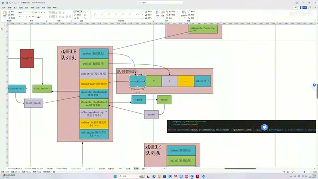

*成员队列通过归属指针找到队列集，队列集数据段保存成员指针（原视频640×360，代码小字以正文讲述为准） · [原片 23:40](https://www.bilibili.com/video/BV1fmL6ziEhA/?p=10&t=1420)*

然后我们回到代码，这边它也有一个锁的机制嘛，因为队列集也是队列，它也会存在一个锁的机制。如果有 task 因为等待队列集而被唤醒，那我们就正常唤醒。

在我们的例子里，就是这个嘛，就一开始在这儿读了一下而进入阻塞的这个 key pressed handler 任务。现在按键被按下，然后信号量被写入，队列集也在刚才这个地方被唤醒了，remove from event list，这都是我们讲过的，对吧？

最后再强调一下，我们的数据链路是这个中断里调用这个 send 函数，或者其他地方调用 send 函数，然后通过这儿，基于这根指针找到这儿，基于这个列表找到这儿，把 key pressed handler 被阻塞的这个 task 给它唤醒，然后就把这个任务放到 ready 列表里面，它就能执行了。

它被唤醒了，之前是卡在这儿的，对吧？上键按下就来到这儿了。它从这儿返回来的，就是第一个数据段的值嘛。它这个形象的表示就是一个箭头指到这儿，其实本质上就是存了个地址，就是上键这个信号量，它的队列头的地址存到里面，现在把它返回来，对不对？

然后和这个上键我们创建时的句柄进行对比。这个句柄本质上也是它的一个地址，是个指针值，那比出来是相等的。我们把这个信号量 take 走，是吧？这个 take 函数就跟那个 receive 一模一样了。拿走之后，我们再做进一步处理。你如果做游戏机，比如说你上键，就是什么，就是里面的人物往前跑，类似于实现我们自己的逻辑就行了。

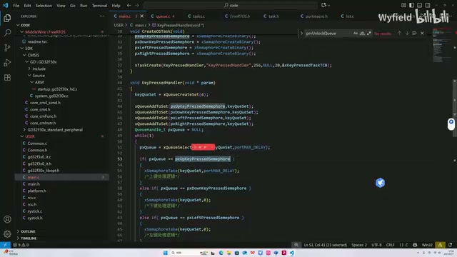

*任务取得成员句柄，与按键信号量句柄比较后进入处理分支（原视频640×360，代码小字以正文讲述为准） · [原片 25:30](https://www.bilibili.com/video/BV1fmL6ziEhA/?p=10&t=1530)*

那么我们就顺着这个应用场景，把队列集的源码给讲完了。我们从队列集的数据结构出发，了解到了队列集本质上是一个特殊的队列，紧接着基于我们模拟出来的四个按键应用场景，详细介绍了队列集从创建、加入管理，以及被唤醒的全流程。同时，我们也对队列锁的机制有了一个较为详细的了解。那么本次队列集的介绍就到这里了，谢谢大家的观看。
