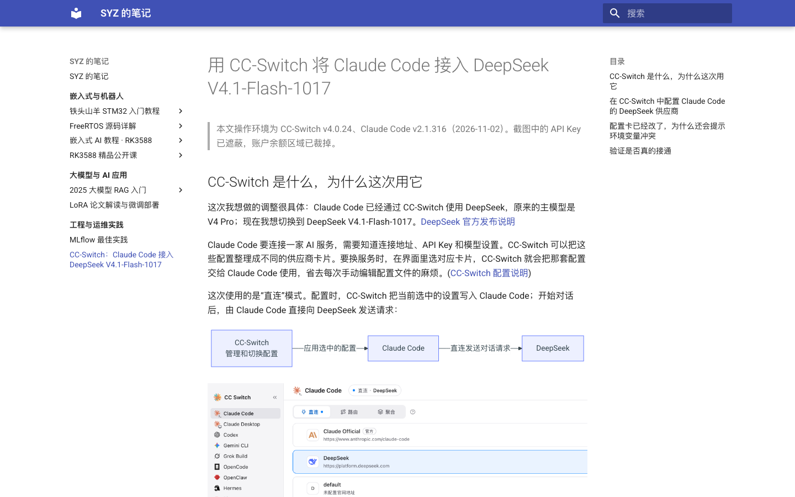

# 用 MkDocs Material 和 GitHub Pages 发布 Markdown 笔记

## 从本地笔记到浏览器页面

课程笔记和技术文章主要以 Markdown 保存在 Obsidian 中。随着内容积累，除了在笔记软件里编辑和检索，也逐渐需要一种适合通过浏览器阅读和分享的呈现方式。Obsidian 的预览足以支持日常写作，但页面样式不适合作为对外展示的网站；如果逐篇手工维护 HTML 和样式，又会增加大量重复工作。

因此，这个实践关注的是如何沿用 Markdown 内容，在本地生成并检查网页，再把确认后的静态站点发布到网上。重点放在生成与托管的工作流设计，以及如何避免为每篇笔记单独维护网页文件。

## 拆分网页生成与网站托管

要让一批 Markdown 笔记变成可访问的网站，需要解决两件事：先把 Markdown 转成浏览器能显示的网页，再把生成后的网页放到读者能够访问的位置。在这套方案里，MkDocs 负责前一件事，GitHub Pages 负责后一件事。Material 是 MkDocs 使用的主题，影响导航的呈现方式、页面布局和配色；GitHub Actions 则负责在内容推送后自动重新构建和发布。

内容仍按 Markdown 文件和图片维护。MkDocs 构建时读取这些内容、导航结构和站点配置，输出一套静态网页文件。由于这是静态站点，托管端只需提供生成后的 HTML、CSS、JavaScript 和图片；不需要另行搭建应用服务器。主题和内容分开配置，换主题时通常不必重写正文，但要检查扩展和样式的兼容性。GitHub Pages 支持从仓库分支或 GitHub Actions 发布静态网站。[GitHub Pages 概览](https://docs.github.com/en/pages/getting-started-with-github-pages/what-is-github-pages)；[配置发布源](https://docs.github.com/en/pages/getting-started-with-github-pages/configuring-a-publishing-source-for-your-github-pages-site)

GitBook 将内容编辑、Git 同步、在线预览和发布整合在一个托管服务里；这套工作流则把 Markdown 放在仓库中，由 MkDocs 生成网站，再由 Pages 托管。GitBook 也支持 Git 同步、变更预览和主题设置。[GitBook Git Sync](https://gitbook.com/docs/guides/editing-and-publishing/documentation/import-or-migrate-your-content-to-gitbook-with-git-sync)；[GitBook 主题设置](https://gitbook.com/docs/guides/customizing-your-site/how-to-customize-your-sites-theme)

这套项目选择 MkDocs 的主要原因，是需要把本地预览作为发布前的固定步骤，并希望通过构建配置控制页面外观和渲染方式。GitBook 提供在线编辑和预览，但对本地优先的工作流来说不够直接，使用体验也偏慢。这是本次项目的实际感受，不代表 GitBook 缺少预览、同步或主题定制能力。

发布前的本地检查是这套流程中的验收点；确认后推送到发布分支，GitHub Actions 再安装构建依赖、生成网站并更新 Pages。构建配置集中管理主题、Markdown 扩展和站点选项；工作流配置管理触发分支和发布步骤。MkDocs 官方也建议部署前先通过本地预览或构建检查生成结果。[MkDocs 部署说明](https://www.mkdocs.org/user-guide/deploying-your-docs/)

重复性工作由配置和脚本承担。主题、站点地址和 Markdown 扩展写在 YAML 配置中；分支触发条件、依赖安装和发布步骤写在 GitHub Actions 工作流中。原有笔记已经有 GitBook 导航目录，因此增加了一个转换步骤，把它转成 MkDocs 能使用的导航，避免为同一批页面维护两套目录。

迁移先从一篇 CC-Switch 文章开始，用它确认主题、导航和截图的呈现效果；单篇验证通过后，再把整本笔记纳入同一站点。这个顺序先验证页面效果，再扩大构建范围，最后由同一套配置和发布流程处理全部内容。

当前使用的 Material for MkDocs 已宣布于 2027 年 5 月 5 日结束上游维护，因此后续需要关注主题兼容性，并在需要时评估迁移。[Material for MkDocs Changelog](https://squidfunk.github.io/mkdocs-material/changelog/)

*图 1：同一篇 CC-Switch 文章的本地预览。*

*图 2：文章发布到 GitHub Pages 后的页面，截图与本地预览采用相同视口尺寸。*

## 从本地预览到线上发布

以后发布新文章，可以按这个顺序操作：

1. 用 Markdown 完成正文和配图。
2. 在本地预览网站，检查文章页面与导航；修改后重新预览，直到确认效果。
3. 将确认后的修改推送到发布分支，由 GitHub Actions 构建网站，再通过 Pages 链接访问。

本地预览负责发布前验收，Actions 和 Pages 负责重复的构建与托管工作；日常写作不需要手工生成 HTML。

本项目的笔记站已发布在 [GitHub Pages](https://shangyizhou.github.io/syz-notes/)。发布前应确认文章和配图适合公开访问。图 1 和图 2 展示同一篇文章在本地预览和 Pages 上的效果，便于对照渲染结果。
