# Linux 性能分析入门与实战

> 讲者：张亚（挖坑的张师傅）；来源：[Bilibili BV1pS4y1M7Zc · P1](https://www.bilibili.com/video/BV1pS4y1M7Zc/?p=1)；范围：完整单集 00:00–80:44。
> 按原顺序整理的完整忠实讲稿，保留讲者解释、示例、互动与限定；不是逐字速记。中文 ASR 原件随附。截图来自源视频 640×360，源码与图表小字清晰度受原片限制。编校疑点在相邻位置单列，不构成外部事实核验。

## 00:00 本次分享的内容与边界

今天分享的主题就是 Linux 性能剖析的方法。为什么会想来讲这个呢？其实我们在日常工作过程中，很多同学都会遇到类似的问题：比如线上的服务器 CPU 跑满了，或者他的进程时不时就会偶然被系统杀掉了；还有做压测的时候，很多时候压测上不去。这个时候我都会帮忙做一些分析和调试，所以也积累了比较多这一块性能分析的方法。今天我就想做一个简单的分享，把一些我觉得比较重要的知识跟大家说一说。

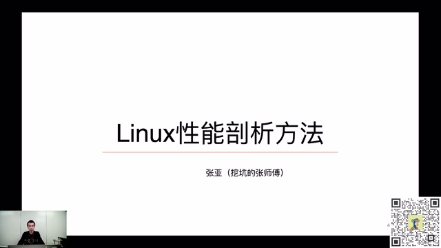

*开场课件：Linux 性能剖析方法与讲者张亚 · [原片 00:12](https://www.bilibili.com/video/BV1pS4y1M7Zc/?t=12)*

Linux 性能剖析这个话题其实非常庞大，完全不太可能在一次分享里面把它讲清楚，所以今天会有一些侧重点。今天分享的主要内容分为五个部分。

第一部分，我会讲一下我们常说的 Linux 性能的三驾马车，或者性能分析的铁三角：CPU、内存和 I/O 之间的关系，它们之间是怎么样互相影响的。第二部分，我会讲一下进程、线程相关的事情，因为进程、线程与 CPU 调度、CPU 性能直接相关。我也会简单介绍 On-CPU、Off-CPU 火焰图生成的原理。因为前天的分享里面，我有专门做一个主题，讲火焰图生成的方法，这边主要讲 CPU 相关火焰图的生成方法和使用例子。

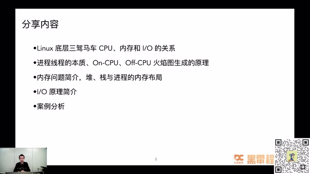

*本次分享的五部分内容 · [原片 01:40](https://www.bilibili.com/video/BV1pS4y1M7Zc/?t=100)*

第三部分会讲我们的老大难问题——内存。程序正常写的话，其实想把 CPU 跑满还挺难出现的，但是内存泄漏、内存占用过高，基本上是每个程序员都会遇到的问题。我们会讲一讲，在内存分析这一块需要掌握哪些基础知识、有哪些基本概念，让我们再去分析性能问题的时候有一些基本了解。

第四部分，我讲一下文件 I/O 的相关原理。因为很多数据都需要落盘，都需要读写文件，它的性能会直接影响程序性能，我们也会介绍 I/O 怎么影响程序性能。最后会介绍我之前处理过的一个案例：之前压测 Nginx 百万长连接时，一个 OOM 的问题。我也会讲在其中怎么综合运用工具或者方法定位问题，最终把它解决掉。

今天分享什么，不会分享什么？我会主要着重于 Linux 底层原理、使用的工具背后的实现方式，以及分析问题的基本思路。网上有很多讲 Linux 性能分析的文章都在讲命令怎么使用。今天我不会去讲命令参数怎么用、怎么看命令输出的格式，因为网上已经有很多相关的文章介绍了。今天主要想讲背后的工作方法、工作思路，让你切换不同工具，或者换一个新工具的时候，能够知道它底层到底在做什么事情。

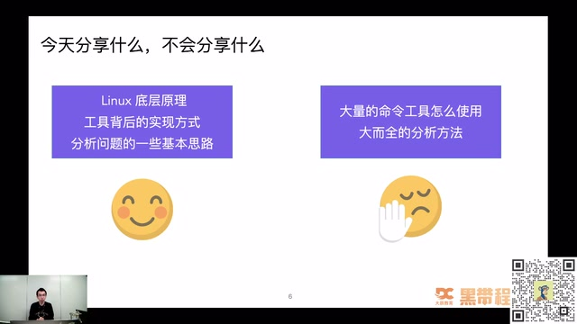

*分享范围：底层原理、工具实现与分析思路 · [原片 03:00](https://www.bilibili.com/video/BV1pS4y1M7Zc/?t=180)*

## 03:36 Linux 底层的三驾马车

接下来进入第一个部分，就是 Linux 底层的三驾马车。首先做一个简单的选择题：下面哪些被称为 Linux 性能的三驾马车？课件给出的选项是 CPU、调度系统、内存、I/O、内核。大家如果知道答案，可以在评论区刷一波。我看到已经有同学写出一些答案了。


我看有人说 CPU、I/O 和内存，有些人说 CPU、内存、I/O，对，都说的是 1、3、4。其实还是挺厉害的，没有选调度系统，也没有选内核，这两个是比较容易混淆的概念。其实我们说 Linux 性能三驾马车，或者 Linux 性能核心的铁三角，说的就是 CPU、内存和 I/O。

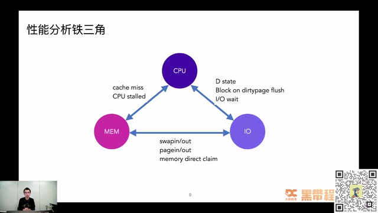

*CPU、内存和 I/O 的性能分析铁三角 · [原片 05:00](https://www.bilibili.com/video/BV1pS4y1M7Zc/?t=300)*

它们之间的关系错综复杂。CPU 的性能会影响内存，内存又会影响 I/O，I/O 和 CPU 之间又有错综复杂的关系。它们之间的关系是什么样的呢？比如遇到有问题的磁盘，或者读写文件出现严重问题的时候，会出现一个叫 D 状态的进程。D 状态的进程会严重影响 CPU 的一个叫 load average 的东西。之前的一篇掘金文章里面专门讲过，为什么 D 状态的进程会导致系统的 load average 飙升。有时候还会阻塞在 dirty page flush 到磁盘的过程上。

CPU 和内存之间的关系也非常密切。比如想要 CPU 性能非常好，cache miss，还有 CPU stalled 的情况怎么样解决，也是我们写代码、想写非常高性能的库或者中间件时需要考虑的事情。内存与 I/O 的关系会更加紧密一些。我们经常说读写文件，实际上是在读写内存，后面也会讲为什么这样说。其实你读写文件，只是在写内存而已。它们之间交换的关系，就会导致很多内存和 I/O 引起的性能瓶颈。

Linux 性能分析需要全栈的能力，仅会几条命令远远不够。比如排查 CPU 你会用 top，或者用观察上下文切换的命令，或者能够看到一个进程占用多少内存，其实光会使用这些命令远远不够。命令里面输出的内容有很多种，你怎么样区分这些输出，把它们转化成真正解决问题时需要的参数呢？性能分析需要全栈的能力，光会使用命令不够；只有对 Linux 本身的底层原理非常了解，你才有可能学好性能分析。如果掌握了命令，但是不知道怎么看输出结果，其实不可能真正解决一个性能问题。

左边这张图是性能分析大师 Brendan Gregg 画的。它可以明确地告诉我们，排查什么问题的时候需要用什么命令，比如文件相关的性能问题、CPU、Socket 分别需要用什么。这是非常好的一个图，大家可以作为方向图，排查问题的时候参考。但是最重要的还是掌握 Linux 底层原理，知道出现性能问题应该怎么样处理。

这就是性能分析的祖师爷 Brendan Gregg 写的《性能之巅》。如果你想在性能分析这个领域里有一些研究，这本书基本上是必看不可的一本书。

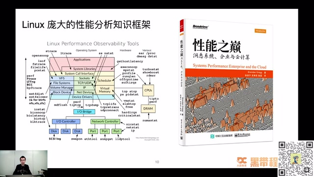

*Linux 性能观测工具知识框架与《性能之巅》 · [原片 07:48](https://www.bilibili.com/video/BV1pS4y1M7Zc/?t=468)*

## 07:50 CPU 知识：进程与线程到底是什么

第二部分，我们接下来讲 Linux 性能三驾马车之一，CPU 相关的知识。首先问一下大家：大家理解中的进程、线程到底是什么？


基本上没有人不会使用 ps 这个命令。在服务器上输入一下 `ps aux`，就可以看到操作系统上现在跑了哪些进程，进程 ID 是多少，内存占用多少，CPU 使用率是多少，开始时间是多少，启动命令是什么样的。种种情况我们都可以通过 ps 命令看出来。但真正回想起来，大家觉得一个进程，在操作系统里面到底代表什么样的东西呢？

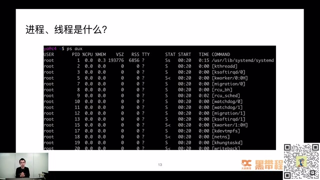

*ps aux 输出中的进程与内核线程 · [原片 09:00](https://www.bilibili.com/video/BV1pS4y1M7Zc/?t=540)*

我也来说说自己的理解。如果让我自己实现进程这样一种数据结构，我想，肯定要用一个结构体来表示它所有的状态。比如它用到的 CPU，至少要有 CPU 相关的属性；操作系统一定要记录这个进程使用了多少内存。我要对这个进程做内存限制的时候，如果连这个数据都没有，肯定限制不了它。还有什么？还要知道这个进程由谁启动，是 root 用户，还是普通用户；还需要知道这个进程什么时候开始；还需要进程的状态，它属于 running 状态，还是僵尸状态，还是其他状态。

我们写软件的都知道，要表达一种状态，或者一个东西——这里说进程，它也是个东西嘛——我们就要定义一个数据结构，或者定义一个结构体来表示它。等一下会看到进程在内核中真正表示的是什么。有了这个直观感觉，也可以比较好地理解我们之前在学校背过的一句话：进程是资源的封装单位。这句话其实背得很熟，真正理解的时候，等一下就会看到它到底代表什么意思。在讲那一部分之前，我们先看一下进程和线程到底怎么样创建。

CPU 这个章节里面，大家可以问问自己，这些问题是不是真的了解：比如前面讲的进程、线程在内核中的本质区别到底是什么？大家都说进程是比较重量级的东西，线程是一个比较轻量级的进程，这里的重量级、轻量级到底指什么？调度算法有两种不同情况，一种是普通进程，一种是实时进程，它们的调度算法、优先级或者策略有什么不一样？

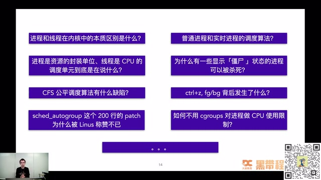

*进程、线程和调度相关问题 · [原片 11:00](https://www.bilibili.com/video/BV1pS4y1M7Zc/?t=660)*

我们还知道普通进程在 Linux 上使用一个叫 CFS 的公平调度算法，它有哪些缺陷？排查问题经常碰到僵尸进程，网上都说僵尸进程不能被杀死，因为你不能杀死一个已经死掉的人。那么，为什么一些命令里面显示是僵尸状态的进程，我还是能用 kill 命令杀掉？这也是可以带着思考的问题。

经常在命令行里面按下 Ctrl+Z、fg、bg，把一个进程放到后台、前台，真正背后发生了什么？对 Linux 感兴趣的话，还可以看到一个很神奇的 patch，叫 sched_autogroup。这个 patch 大概只有 200 行左右，却被 Linus 称赞不已，说是一个天才的 patch，到底里面做了什么？感兴趣的话，在后面的课程里面也可以看到。然后我们还会看到 cgroups，它也是可以做 CPU 使用限制的，到底怎么实现？这些都是 CPU 这个章节里面需要着重理解的问题。

### 12:15 进程和线程是怎么创建的

接下来先看我觉得比较重要的概念：进程和线程的本质区别到底是什么？为了搞清楚这个问题，我们就看进程到底怎么创建。只有知道它怎么出生，才知道它最初创建的形态是什么样的。

创建进程，在 Linux 里面用了一个函数叫 `fork`。fork 其实只是 glibc 里面的函数，glibc 最终调用的是 `clone` 系统调用。用 strace 命令看这个函数执行，大家可以看到执行的是 clone。里面传了什么？需要注意一个参数，就是 `flags`，也就是传过去的一些标记位。这里面比较有作用的是 `SIGCHLD` 这个 flag，可以看到没有其他额外的一些 flag。

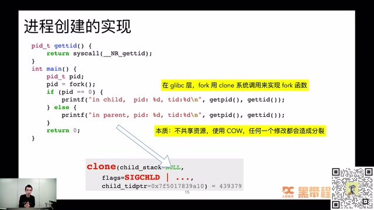

*fork 创建进程与 clone 系统调用 · [原片 13:00](https://www.bilibili.com/video/BV1pS4y1M7Zc/?t=780)*

它的本质是什么？这里提前剧透一下：不共享资源，使用一个叫 Copy on Write 的机制，任何一次修改都会造成分裂。什么叫分裂？等一下讲线程，大家就知道什么是分裂、什么是不分裂。

线程创建看起来相对简单一点。比如用 glibc 里面的 `pthread_create`，或者 Java 里面 `new` 一个 `Thread`，都可以创建线程。用 strace 命令看，会发现同样是用 clone 系统调用实现的。有什么不一样呢？传的 flag 不一样，这时候多了很多：`CLONE_VM`、`CLONE_FS`、`CLONE_FILES`、`CLONE_SIGHAND`、`CLONE_THREAD`。

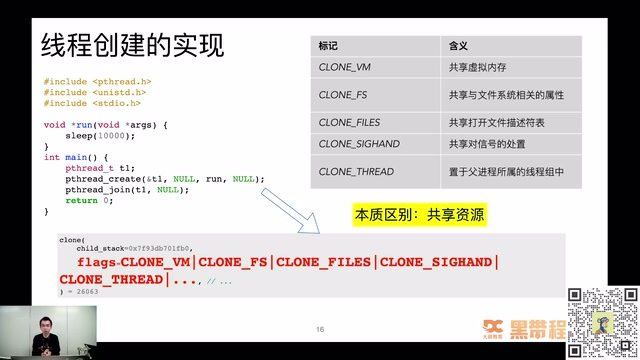

*pthread\_create 与资源共享 flags · [原片 14:24](https://www.bilibili.com/video/BV1pS4y1M7Zc/?t=864)*

它们是什么意思？比如 CLONE_VM 叫共享父进程的虚拟内存，CLONE_FS 共享与文件系统相关的属性，CLONE_FILES 表示共享打开的文件描述符列表。通过对比可以看到，进程创建和线程创建最终走到同一个地方，都到 clone 系统调用，只是传的一些参数不一样，这些参数影响了后面的行为。线程创建的本质是共享资源：共享内存，共享打开文件列表，共享信号处理。进程因为是资源的封装单位，一定要做到资源隔离；如果资源不隔离，就不能称为进程。这就是进程和线程本质上的区别和联系。

总结前面的两点：进程和线程创建其实殊途同归，虽然走的是 glibc 里面不同的函数，一个叫 fork，一个叫 pthread_create，最终走到 clone 系统调用，再调到内核里的 `sys_clone`，最后调到 `_do_fork()` 函数。虽然看起来进程和线程行为相差非常大，但底层实际上非常接近。

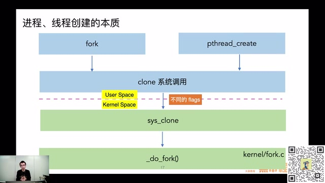

*fork 和 pthread\_create 在内核中的共同调用路径 · [原片 15:24](https://www.bilibili.com/video/BV1pS4y1M7Zc/?t=924)*

### 15:38 资源复制与共享

接下来看资源共享这一块的区别。都说进程是资源的封装单位，是不是说两个进程之间资源完全没关系？其实也不是，它用了比较取巧的方式，叫 Copy on Write。如果不对子进程或者父进程里面做写入，其实用的是同一份数据，这样可以减少拷贝，可以减少很多时间。比如 Redis 做备份的时候，其实也会创建一个进程。想一下，如果要把它所有内存拷贝一份，耗时会非常长；如果通过 Copy on Write 只拷贝有变化的部分，整体速度就会好很多。

线程简单很多，所有的共享嘛。A 线程可以改 B 线程内存里的数据，A 线程可以读写 B 线程打开的文件。这些都是线程资源共享的机制，导致它们行为上的差异。

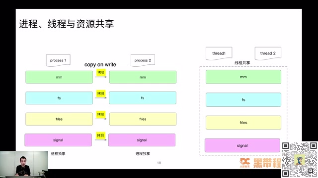

*进程复制与线程共享资源的对比 · [原片 16:24](https://www.bilibili.com/video/BV1pS4y1M7Zc/?t=984)*

接下来讲最核心的部分：进程和线程本质区别是什么？其实在内核里面，都是叫 `task_struct` 的东西。我们都说差别很大，一个是资源封装单位，一个是 CPU 调度基本单元，其实在内核那里，它们都是一样的，都是 task_struct，只是里面一些 field 不一样。

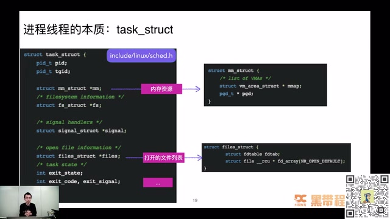

*task\_struct 关联内存、文件和信号资源 · [原片 17:24](https://www.bilibili.com/video/BV1pS4y1M7Zc/?t=1044)*

比如刚提到进程是资源封装单位，可以看到里面有什么。如果自己实现，其实也会写出类似结构。需要知道它的 ID 是什么，这样 ps 里面才可以看到；还要知道内存资源是什么，需要申请多少内存，申请内存的虚拟地址空间在哪里；还要知道打开文件列表有哪些。

知道这个概念后，再理解进程调度或者线程调度就非常清楚。很多书籍最终都会说，这个地方不特别区分进程和线程，下面都以“进程”同时表示进程和线程，其实说的就是这件事。研究调度的话，它们是同一个东西；研究资源方面的不同，它们就有点不一样。

### 18:21 进程 ID 怎么分配

接下来讲之前有同学问过我的一个问题，当时觉得挺有意思，大家也想一想：进程 ID 的生成规则是什么样的？比如现在生成一个进程，或者命令行执行 `ls`，其实要创建一个进程执行 ls，它的进程号怎么生成？这里列了三个答案，大家选一选：随机找一个可用的；复用最近刚终止的进程；顺序增长，增长到最大回绕。知道答案的可以把 1、2、3 扣在评论区。

看到有小伙伴提交答案了。有人写了 3，还有其他不同答案吗？大家都写 3 了，也有人写 2。其实我想重点说一下 2 和 3 这两个事情，当时我以为会选用 2 这种模式。还有人选 4 的，觉得有不同的答案是吧？其实答案是 3，顺序增长，增长到最大以后回绕。

当时有同事问我的时候，我主观感觉是肯定会找一个最近刚终止的进程，这样最方便嘛，可以快速地做一个缓存，把前面刚终止的进程号塞到缓存列表、队列里面，用的时候直接从队列里面 pop 一个出来就好了。


真正研究的时候，发现不是这样子，而且有挺多有意思的东西。它是顺序增长，增长到最后最大以后回绕。为什么这样呢？当时想了很久，后来终于想明白，其实是为了防止一些混淆。

比如做了一个监控系统，这时候进程 1024 映射到 Nginx，结果它挂掉了，又起了一个 MySQL 进程，用到 Nginx 刚挂掉那个进程的 ID。1024 之前表示 Nginx，很短时间就切成 MySQL，这时候监控系统统计可能造成比较混乱的现象。所以采用的策略，是尽可能让进程号短时间内不重复，除非没有办法。顺序增长，增长到最大以后回绕到最小，再从最小开始往上长，这样短时间重复的概率比较小，除非进程不停销毁、创建。

这个策略有个比较厉害的名字，叫“延迟重用”。原则说起来非常简单：按顺序依次递增分配，从最小一直分配到最大，到了最大就回绕；使用一个位图，快速判断进程号、PID 有没有被分配。比如这时候要分配 1024，不能遍历整个列表判断是否已经分配过，这里用了 bitmap 数据结构来表示 ID 是否已经被分配。

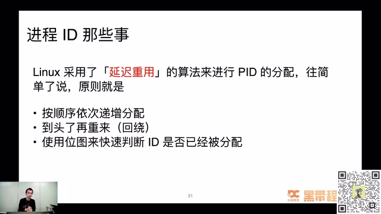

*PID 延迟重用的分配规则 · [原片 21:36](https://www.bilibili.com/video/BV1pS4y1M7Zc/?t=1296)*

位图也在很多场景里用来提高效率，比如很多 OLAP 系统，用位图做去重或者相关加速运算。

既然说增长到最大以后回绕，这个头到底是多少？这就是进程 ID 最大值。我在自己的虚拟机上试了一下，有一个 `kernel.pid_max` 参数决定它。在我的系统上最大值是 32768。因为进程号从 0 开始，所以有效进程 ID 其实是 0 到 32767。

```shell
sysctl -a | grep pid_max
# kernel.pid_max = 32768
```

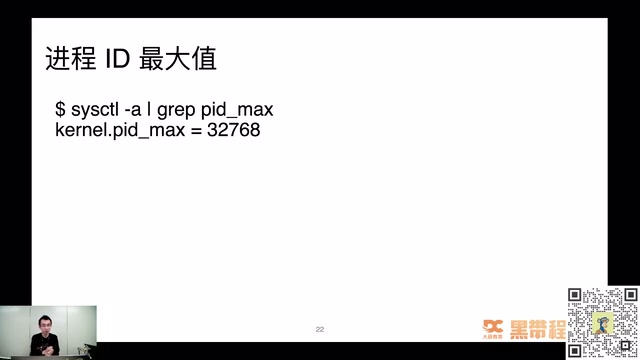

*sysctl 查询 kernel.pid\_max · [原片 22:48](https://www.bilibili.com/video/BV1pS4y1M7Zc/?t=1368)*

最小是多少？是不是到了 32767 以后，直接从 0 开始找？当时我以为也是从 0 开始遍历，看 0 有没有占用，1 有没有占用，2 有没有占用，一直到找到第一个可用的为止。后来发现，我还是太年轻了。

所以当时写了代码实测。代码非常简单，就是在一个 while 循环里面不停 fork 进程，总共循环 32768 次，把整个生成 PID 过程中出现的最大 ID、最小 ID 都记下来。比较惊喜地发现，max 肯定对得上，一定是刚刚说的 32767 这个最大值；但最小值居然一次也没有小于 300。当时还是比较奇怪，大家有没有想到为什么这个地方有限制，不管运行多少次，都没有小于 300？知道原因可以在评论区刷一波，我等一下大家。这个问题算程序员里面很难的问题吗？发挥大家想象力吧，其实这个问题不算难。


我觉得这是设计上一个取巧的东西。因为比较小的进程 PID 已经被系统进程占用，而且那些进程是常驻的，所以遍历那些比较小的进程 ID，绝大概率是失败的，一定已经分配过。因此它取了一个值叫 300，在内核选项里配置。用户进程最小从 300 这里开始分配，省掉前面跟系统进程冲突的过程。

这里为什么是 303？因为我机器上 301、302 都已经被一些用户进程占用了，所以不管怎么跑，都从 303 开始。如果你的 301、302 没被占用，其实应该有可能跑出 min 等于 301。

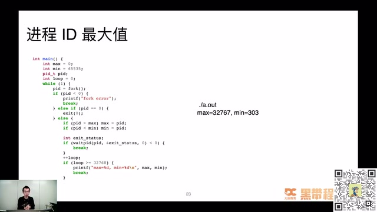

*循环 fork、waitpid 测试 PID 最大最小值 · [原片 24:48](https://www.bilibili.com/video/BV1pS4y1M7Zc/?t=1488)*

大家有没有觉得操作系统实现这些地方挺有意思？虽然好像没有什么用，但我觉得这点小技巧、小心思挺有意思。通过这些简单的用户代码，就能知道操作系统底层是怎么玩的。做技术最重要的是找到自己的乐趣所在。我可能花不到 30 秒就能把代码敲出来，跑一下就知道原来是这样，有些意外发现；不用看代码，也能找到比较有意思的东西。最终比如 min 等于 300 这个界限值怎么来的，还是要看内核代码，因为不能靠猜。

### 25:55 聊聊 CPU 火焰图

接下来聊一下前天讲过的比较大的话题，CPU 火焰图。很多人用过，在实际过程中了解过，或者看到别人用过。我觉得火焰图是非常伟大的发明，从形态上看，像一颗跳动的火苗，是程序员界比较有意思的东西。

问一下：火焰图到底是谁发明的？这里四个选项，Brendan Gregg、Linus、Russ Cox、红孩儿。不会有人选红孩儿吧？等一下大家，看谁答对。有人选 1、有人选 2、有人选 3，选 3 的应该写 Go 语言吧，选 2 的可能被 Linus 大名的光环笼罩了。其实就是前面介绍的《性能之巅》作者 Brendan Gregg 发明的，肯定不是红孩儿，这是搞笑的。第二、第三虽然都是业界超级大牛，但不是火焰图这个地方的贡献者。

说到火焰图，经常混合两个概念：有些代码在 CPU 上执行，有些其实释放了 CPU，在等待执行权，比如等锁、等 I/O、等定时器。这两部分都会严重影响性能，它们之间关系是什么样的，要通过什么火焰图分析？这也是接下来讲的内容。

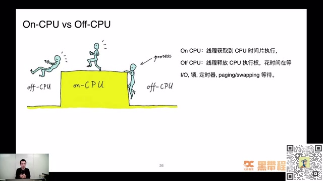

*On-CPU 与 Off-CPU 的区别 · [原片 28:00](https://www.bilibili.com/video/BV1pS4y1M7Zc/?t=1680)*

为了讲清楚火焰图，先写一个简单的例子，是非常简单的一段 C 代码。


首先说明，这里已经禁用内联优化。函数非常短，但没有内联到函数里面，是把优化选项调低了。这个程序其实就做一个事情，不停空转，只是空转分了几个阶段。在 `while (1)` 的 main 函数里面，for 循环空转 30 万次；A 函数空转 15 万次，其中 10 万次由它自己完成，5 万次由它调用的 D 函数完成；B 函数空转 20 万次，C 函数空转 35 万次。直观上，就能得到它们在一段时间内运行的次数。

main 的 for 循环大概占 30%，main 里面的 for 循环、A、B、C 函数加起来总共是 100，各自比例就是各自现在 for 循环的次数。如果对它做火焰图，做出来就是图中看到的样子：C 占 35%，B 占 20%，A 占 15%，它调用 D，D 占 5%。

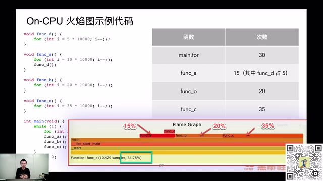

*循环示例与 On-CPU 火焰图占比 · [原片 30:00](https://www.bilibili.com/video/BV1pS4y1M7Zc/?t=1800)*

火焰图怎么看？分横轴和纵轴看。横轴每一个方块表示一个函数，宽度可以近似理解为函数执行时间。其实不能等价于执行时间，它只是采样过程中出现的次数，我们只能近似理解为执行时间。纵轴表示调用栈，最顶层是最顶层的调用栈，最下面是最底层的调用栈；上面的函数都是下面函数的子调用。

所以可以看到 D 被 A 调用，A 被 main 调用，main 还不是整个文件的入口，它还被 glibc 里面的 `__libc_start_main` 函数调用，再往上还有被 `_start` 函数调用的过程。通过这张图，可以直观看到程序有哪些方法在执行，这些方法耗掉 CPU 的比例大概怎么样。这样有全局概念，知道调用关系，也知道做性能优化从哪些地方入手。比如图里面让你优化，可能首先选择 C 函数，因为它在最顶层，又比较宽，这就是可以先着重解决的性能问题。

### 31:03 火焰图生成的三个步骤

之前很多同学问，火焰图看起来好神奇，到底怎么生成？我之前也是一知半解，只觉得有工具可以生成，何必知道里面做什么？后来实际使用、研究了一下，觉得挺神奇：怎么就知道一段时间内程序整体宏观的情况？后来发现 Brendan Gregg 的文章说生成有三个步骤。

第一步是采集堆栈，有很多方法，比如 perf、SystemTap、sample-bt 都可以。第二步是折叠堆栈，等一下会看到“折叠”什么意思。第三步是把折叠的堆栈最终生成火焰图。我们分三步详细看看，每一步到底做什么。比如第一步，采集堆栈……

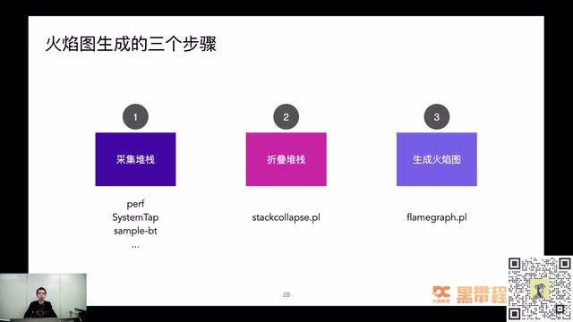

*火焰图生成的三个步骤 · [原片 31:48](https://www.bilibili.com/video/BV1pS4y1M7Zc/?t=1908)*


采集堆栈这里用的工具叫 sample-bt，是我们的春哥大神、OpenResty 作者章亦春的工具，底层使用 SystemTap 实现。这个工具包装了 SystemTap，把 SystemTap 的一些探针包装起来，实现火焰图性能采集工具。等一下看里面采集的脚本到底是什么样。

先看最终输出的内容，把它导向 `tmp.bt` 文件，里面存的就是现在看到的内容。这里其实只有两个东西：一个是函数调用栈，比如 `_start` 调用 `__libc_start_main`，再调用 main，main 又调用 func_c，这就是完整调用栈；除了调用栈，还要知道这个栈在采样周期里面出现的次数，这地方出现 8282 次。下面那个调用栈，_start 调用 __libc_start_main，再调 main，出现 6227 次。这就是采集堆栈这一步完成的事。后面也会看到 Off-CPU 火焰图采集堆栈其实类似，也是要采到堆栈和执行次数。

```shell
./sample-bt -p your_pid -t 30 -u > tmp.bt
cat tmp.bt
```

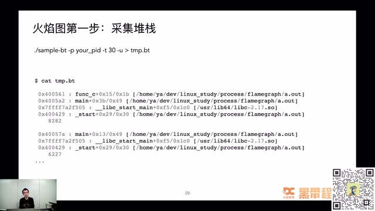

*sample-bt 采集与原始调用栈 · [原片 33:00](https://www.bilibili.com/video/BV1pS4y1M7Zc/?t=1980)*

到了第二步就容易理解。前面采到的堆栈是多行，不便于进一步文本处理，这地方做了“折叠”。折叠就是把一个很高的东西拍扁，叫 fold。处理过程很清楚，把刚刚多级的函数调用栈变成一行，中间一个空格，左边是调用栈，右边是调用次数。

```shell
git clone https://github.com/brendangregg/FlameGraph
cd FlameGraph
./stackcollapse-stap.pl tmp.bt > stap_unfolded.out
cat stap_unfolded.out
```

经过这样处理，就知道每个函数在整个采样周期出现的次数。比如这个例子，简单分析就知道 main 出现大概 3 万次，A 函数大概 4500 次左右。同样可以算出整个调用比例，就能画出前面说的火焰图。

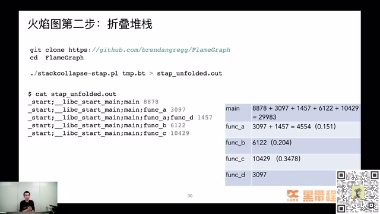

*stackcollapse-stap.pl 折叠堆栈及统计 · [原片 34:12](https://www.bilibili.com/video/BV1pS4y1M7Zc/?t=2052)*

第三步是纯图片操作，把折叠过的堆栈生成 SVG 图片。如果不喜欢用这个 Perl 脚本，也可以自己写，其实比较容易。经过这一步，就生成非常漂亮的火焰图。

```shell
./flamegraph.pl stap_unfolded.out > stap-out.svg
```

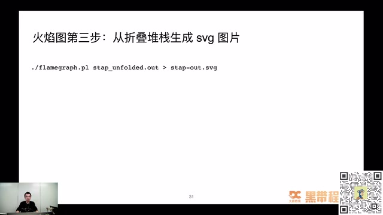

*flamegraph.pl 从折叠堆栈生成 SVG · [原片 35:00](https://www.bilibili.com/video/BV1pS4y1M7Zc/?t=2100)*

这里提一个问题：前面的火焰图，颜色都是红色或者橘色，都是暖色系，为什么 On-CPU 火焰图要是暖色系？知道答案，或者有自己理解，可以在评论区刷一刷。我们继续讲下面内容，看看捕获堆栈怎么做。

我们需要的内容就是堆栈和它出现的次数。SystemTap 这里写了一个回调触发器，叫 `timer.profile`，是在每个 CPU 上周期触发的定时器。我的电脑是双核虚拟机，每个核一秒钟触发 1000 次左右。里面其实就做一件事：每次 timer.profile 调用，也就是一秒 1000 次这样的频率，记录当前 CPU 上执行的调用栈是什么，把它记录到一个数组里面，你也可以理解为 HashMap。


同时把次数记录下来，等到 30 秒时间到了，把一个 `quit` 变量置为 1。置为 1 以后，在 for 循环里面，把调用堆栈和执行次数打印出来，就拿到第一步的原始数据，也就是调用堆栈信息。

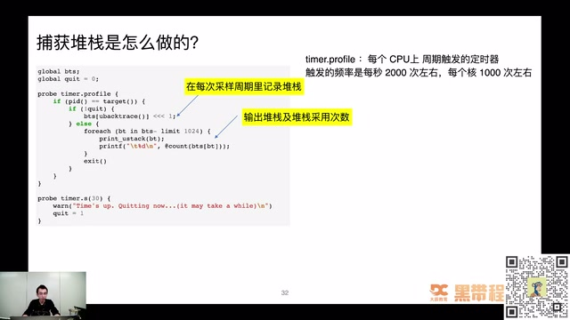

*timer.profile 周期采样用户堆栈 · [原片 36:12](https://www.bilibili.com/video/BV1pS4y1M7Zc/?t=2172)*

前面讲的都是 On-CPU 火焰图，大家从介绍的内容应该知道它怎么工作了。刚刚看到有人说暖色更好看，还有人说更能凸显 CPU 很忙。其实应该说 On-CPU 火焰图就是会疯狂耗 CPU，CPU 很热嘛，所以用暖色系表示。等一下看 Off-CPU，它这时候不耗 CPU，不耗 CPU 就是冷色系，这是后面会讲到的内容。

### 37:18 Off-CPU：程序为什么没有执行

我们解决过很多 CPU 跑满、CPU 占用率很高的问题，其实相对容易解决，大部分是代码 bug，比如死循环，或者一个很大的 for 循环里面做的事情非常少。往往性能上不去、压测的一些性能问题，其实都是 Off-CPU 这块出了一些问题。

比如拿不到 mutex 锁，花大量时间等锁；等待 I/O、网络事件完成；内存不足，需要在进程执行的上下文里面直接回收内存。还有，因为用了完全公平调度算法，很可能程序被调度出执行器，过很久才调度回来，中间这段时间程序都处于没有执行的状态。

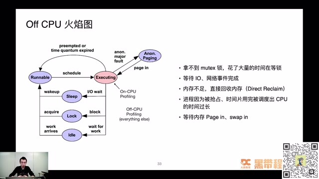

*Off-CPU 的等待状态和成因 · [原片 37:48](https://www.bilibili.com/video/BV1pS4y1M7Zc/?t=2268)*

提个问题：Off-CPU 火焰图一般分析什么问题？延迟、吞吐量、CPU 100% 占用，还是内存泄漏？知道答案可以在评论区刷一刷，看谁比较好地答对，等五秒。看到一些小伙伴新进来，小助理同步一下：今晚主题是 Linux 性能剖析入门与实战，关于性能剖析入门和实战的部分，刚刚张师傅提出的问题，大家可以把答案写在评论区。

怎么各个答案都有，1、2、3、4 都有，好像 4 比较多。这是很容易混淆的答案，还是说多选题？这是单选题。我看很多人已经选错了，终于上了我的当。其实 Off-CPU 火焰图分析的是延迟。大家先想为什么，等一下还没有想明白，我再详细讲。这些答案应该选延迟，也就是 1。

说 Off-CPU 火焰图，这里也写了一个简单的例子。什么叫 Off-CPU 火焰图？


刚刚说等待、阻塞，可能听起来挺迷糊。这里又写了非常简单的 C 代码，里面就是做两个阻塞等待：一个叫 `epoll_wait`，阻塞等待 20 毫秒返回；再调 `usleep`，睡眠 30 毫秒返回。从直观感觉就可以看到，main 函数就是等 20 毫秒，再睡 30 毫秒，再执行，循环等待。如果生成 Off-CPU 火焰图，就长下面这样，usleep 占 60%，epoll_wait 占 40%，符合我们的认知，表示整个采样周期里面让出 CPU 的比例。

> 编校：此处时长按课件代码 `epoll_wait(..., 20)`、`usleep(30 * 1000)` 记为毫秒；口述与 ASR 中部分“秒”混用，原始转写另存。

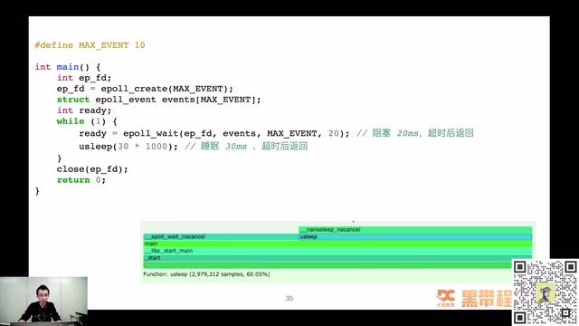

*epoll\_wait、usleep 示例及 Off-CPU 火焰图 · [原片 41:00](https://www.bilibili.com/video/BV1pS4y1M7Zc/?t=2460)*

很多人问，On-CPU 能理解，就是 CPU 正在跑的内容；Off-CPU 怎么采到？你都已经让出 CPU，怎么拿堆栈、拿信息？这也是当时我觉得神奇的地方。所以研究了一下 sample-bt 生成的 SystemTap 脚本，精简后代码就是这样，非常简单，注入两个事件，一个 `scheduler.cpu_on`，一个 `scheduler.cpu_off`。

记录线程失去 CPU 的时间点，等进程或者线程再次拿到 CPU 执行权时，把时间差记录出来。失去 CPU 的时间点记下来，拿到 CPU 的时间点又记下来，中间 gap 就是 Off-CPU 时间。用了 HashMap 结构，key 是进程 ID 或者线程 ID。比如采样周期是 5 秒，5 秒到了就把退出循环的变量 quit 设成 1，这时候遍历数组，把所有堆栈打印出来。

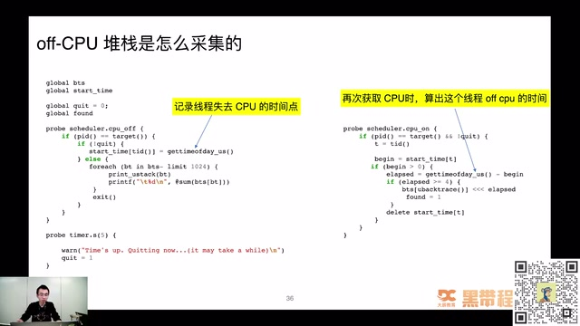

*在调出与调入 CPU 时计算 Off-CPU 时间 · [原片 42:36](https://www.bilibili.com/video/BV1pS4y1M7Zc/?t=2556)*

我们觉得 Off-CPU 火焰图很高端，很难理解到底怎么做；其实真正沉下心研究章亦春工具里最终生成的 SystemTap 脚本是什么样子，就非常理解 Off-CPU 火焰图到底做什么，也能理解程序行为。它因为让出 CPU，没有拿到执行权，中间到底过多久，就能通过脚本统计。就算不做火焰图，做进程调度之间的延迟，也可以用这个方法。

SystemTap 这个工具，很多同学跟我说使用门槛高，不知道怎么用，网上资料少，怎么解决？没有什么特别好的办法，因为这块门槛确实高。如果有 SystemTap 使用问题，或者不知道采样点怎么注入，可以私底下联系，有问题随时讨论。

### 43:47 上下文切换究竟切换什么

讲 CPU 性能问题，还经常讲 CPU 上下文切换。到底切换什么？之前很多同学背操作系统课，这块背得很熟：切换内存空间，切换寄存器。其实这个地方看一下内核代码，就非常清楚。核心做上下文切换的函数叫 `context_switch`。里面做了进程虚拟内存的切换，因为也要区分是不是同一个进程。如果线程之间切换，其实不用切换虚拟地址空间。接下来还会切换寄存器和内核栈。

做的事也很简单，切一下进程页表的 `pgd`，把它装到 `CR3` 寄存器。代码非常简单，却让我们更直观地理解进程、线程的上下文切换到底切换什么。最终 `switch_to` 是调用汇编代码实现的，里面做了一些寄存器切换相关的事。

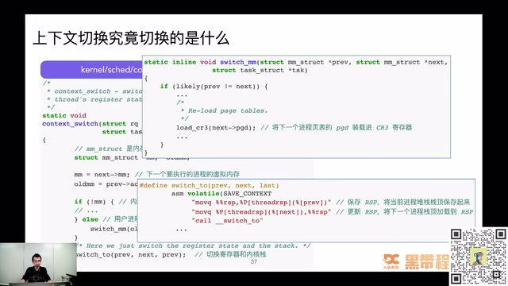

*context\_switch：地址空间、寄存器和栈的切换 · [原片 45:12](https://www.bilibili.com/video/BV1pS4y1M7Zc/?t=2712)*

## 45:07 内存篇

第三部分是内存。内存真是程序员老大难问题，也是我日常工作解决过的问题里面，出现频率最高的一种类型。内存泄漏、内存占用过高、OOM 被系统杀掉，隔一段时间不同类型系统就会出现，比如 C/C++ 应用、JVM 应用，都可能在特定情况下出问题。

怎么样真正理解内存，从操作系统角度看，内存到底怎么用？作为开发，怎么样用好内存，知道里面怎么实现，对接下来的代码生涯至关重要。可以说学好了内存，在很多计算机领域里，就可以把很多东西学得非常好。

内存关联知识非常庞大。我把自己以前写的一些文章内容做成词云，可以看到里面有很多，比如 SystemTap、buddy 算法、VSS、overcommit、内存碎片、虚拟内存、PGD、PSS、brk，概念非常多。怎么样从错综复杂的概念里面找到清晰的学习脉络，真正把内存问题搞清楚，也是我一直思考的问题。这次只能介绍皮毛，告诉大家内存里面有什么可能比较好玩的东西，藏在你现在正常运行的代码后面。

弄清楚内存原理，可以帮助解决很多问题。比如 Go 为什么原生支持函数多返回值，为什么 Go 的 1.17 版本开始支持寄存器传参，Go 1.18 支持 ARM 平台基于寄存器传参，逃逸分析怎么做？比如 Go 默认内存管理策略，为什么从 `MADV_FREE` 改回 `MADV_DONTNEED`？这个策略其实改了好几次。清楚内存原理，就知道为什么改来改去，各方案有什么优缺点。

> 编校：Go 版本号在 ASR 中识别为“1.7”“1.8”，此处按紧邻“寄存器传参”的语境记作 1.17、1.18；课件未显示版本号，保留原始 ASR 供回听核对。

对内存比较了解，还可以分析 Java 程序老大难的堆外内存问题。比如用了 Netty 或原生库，出现堆外内存泄漏、很难排查时，怎么分析？还有 C/C++ 写的程序，比如 Nginx、MySQL，出现内存暴涨，或者现在用了百度的 Doris，有时候也出现 OOM 问题，这时候如何分析，用什么思路？

### 48:20 进程内存布局

先看一个进程内存的关系。一个进程在 Linux 上，常见的可执行文件格式是 ELF，比如 Go 打包的可执行文件，或者其他可执行文件，很多都是 ELF 文件。这是一个静态文件，真正运行时，操作系统把它映射到内存空间，也就是虚拟地址空间。

用 `pmap -x pid` 可以看到这个进程、程序的内存布局。简单理解可以分几个部分：Stack 栈区向下生长，Memory Mapping 区域，Heap 堆区向上生长，还有代码段、数据段，都是核心运行数据区域。

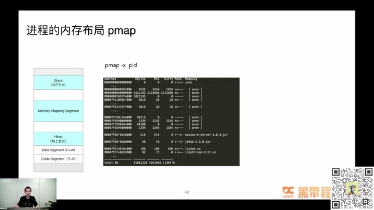

*pmap -x 与进程虚拟内存布局 · [原片 48:48](https://www.bilibili.com/video/BV1pS4y1M7Zc/?t=2928)*

比如 Java 进程，内存都被谁耗走了？这是我以前面试喜欢问的问题。虽然写 Java，但不能只放在 Java 这个编程语言的概念上。Java 进程耗费内存非常多，常见的堆内存之外，还有栈内存、Metaspace；要做 GC，本身就要记录很多信息，追踪哪些内存申请、哪些释放；还有 Direct Buffer、C/C++ Native 消耗，以及 malloc 分配内存时自己本身需要使用内存。

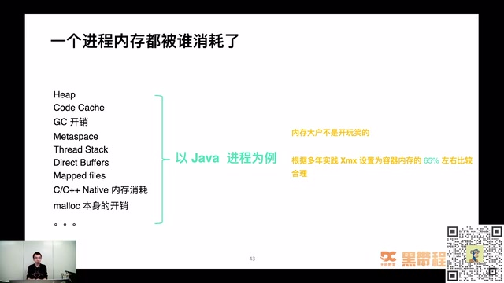

*Java 进程中堆及堆外内存的组成 · [原片 50:00](https://www.bilibili.com/video/BV1pS4y1M7Zc/?t=3000)*

怎么样分析 Java 这样复杂的程序，内存消耗到哪里？如果了解前面这些概念，比如进程内存分布，就会更加有把握。

### 50:22 Linux 线程栈有多大

做一个小测试：大家知不知道 Linux 的线程栈大小是多少？知道的可以在评论区说一下。有人选 1，一兆，有人选 2，两兆，有人选 3，八兆。到底是多少？没人选两 K 吗？好像没有。其实默认线程栈大小是八兆。怎么确认我没有胡扯？可以用 strace 命令看，这是跟踪系统调用非常有用的命令。

在 `pthread_create` 的时候，会申请一片内存，大小是 `8392704 = 8 * 1024 * 1024 + 4096`。除了八兆，还多了一个 4K 区域。4K 是做什么的？当时研究这个问题研究了一个下午，实在没想明白，说好八兆就八兆，为什么还要多 4K，这 4K 怎么来？折磨了我一个下午，翻了很多资料，看到 glibc 代码才找到。

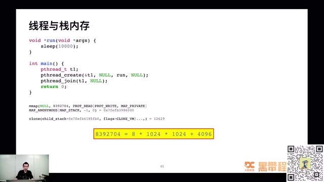

*pthread 创建线程时 mmap 分配栈空间 · [原片 51:36](https://www.bilibili.com/video/BV1pS4y1M7Zc/?t=3096)*

Linux pthread 栈内存有八兆栈，加 4K 的 guard 区域。这个 guard 区域是防止栈越界的一个比较初级手段。4K 区域不可读、不可写、不可执行。只要指针访问这个区域，不管读、写还是执行，都会直接抛出段错误。这样叫 fail fast，让程序快速失败。不会改了另外一个线程的数据，好久后跑崩、跑飞，出现重大行为异常，才知道是栈越界导致。当然，如果直接越过 4K guard 区域，跳过去访问、改写其他线程栈内存，这时候操作系统也没办法保佑你，只能自求多福。程序崩溃还算最好的情况，只跑出一些非常异常行为的时候，那就很恐怖。

这里空口无凭，能不能用实践例子证明？刚刚说 pmap 可以看到进程栈内存分布，也能看到真正有八兆可读可写空间，加上 4K 不可读不可写区域。创建很多线程，就很规律排列成八兆加 4K、八兆加 4K、八兆加 4K。这是理论结合实践，看到真正这样，书上或者别人写的东西诚不欺我。

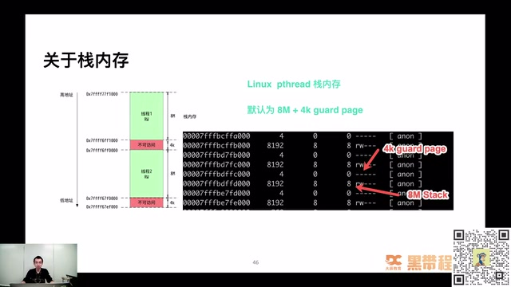

*8M 线程栈和 4K guard page · [原片 53:36](https://www.bilibili.com/video/BV1pS4y1M7Zc/?t=3216)*

### 53:46 Java 的线程栈又有多大

再问一个经常面试问的问题：Java 默认线程栈大小多少？刚刚问的是 Linux 默认线程栈大小，那么 Java 呢？有没有 Java 学得比较好的，可以看一看，答案打在评论区，不知道也可以盲猜，看运气好不好。

有人选 3，八兆。如果八兆，我就不会问这个问题，跟前面答案一样了。有人说 1，回答 1 是对的。有人说 2K，还有选 4 的，2K 不对。Java 线程栈默认大小是一兆，可以改。怎么样确认？Java 实现更复杂一些，没有使用 Linux 默认栈内存分配八兆，而是用一兆，并在里面做特殊区分，分成 Yellow 区域和 Red 区域：8K Yellow，4K Red。

有什么不一样？代码栈溢出到 Yellow 区域，会把它捕获，触发 Java 层面的栈溢出异常。当然，如果程序确实有问题，直接越到红色 Red 区域，JVM 也没办法，会直接 core dump 掉。

这也空口无凭，怎么说你对？也拿实际例子看。运行很多线程，可以看到有一个 1016 和一个 12 组合在一起。为什么不是 1014 而是 1016？8K 的 guard 区域呢？


其实属于那一兆里面，但 pmap 会合并相同权限的内存区块，把 8K 和 4K 合在一起，变成 12K。所以看到 1016K 可读可写区域，这是栈内存；再有 12K 不可读、不可写、不可执行区域，是防止栈越界的，里面又分 4K 和 8K 两个东西。下次用 pmap 看 Java 程序，发现很多 1016 和 12 的区域，可以大胆猜这块是栈内存，不用再怀疑。

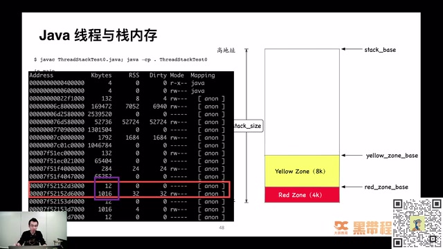

*Java 线程栈的 Yellow Zone、Red Zone 与 pmap · [原片 56:24](https://www.bilibili.com/video/BV1pS4y1M7Zc/?t=3384)*

### 57:02 堆内存与分配器

前面讲栈内存，往往栈内存占用过高还是很少，更多是堆内存。用户空间里，默认是 glibc 提供的 `malloc`、`free` 函数申请。也可以替换实现，用其他内存分配器，或者自己实现策略，绕过系统这一层，完全没问题。

malloc、free 只是 libc 里的函数，压根不是系统调用。为什么不直接用系统调用实现，应用程序还要调 libc 这一层 malloc/free？想到的可以在评论区刷一刷。glibc、libc 这一层其实是内存“二道贩子”，是操作系统提供的用户态编程工具。

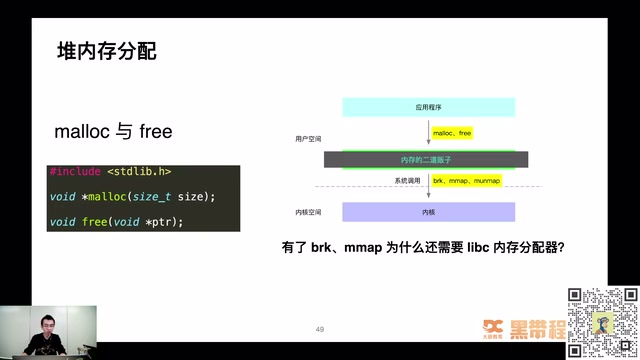

*malloc、free 和 brk、mmap 的分层 · [原片 58:12](https://www.bilibili.com/video/BV1pS4y1M7Zc/?t=3492)*

内存申请大部分非常小，它先申请大块，再切割零售给上面应用，做了内存二道贩子。这样减少系统调用频率，因为系统调用代价比较高。如果内存提前分配好，在用户态直接通过简单指针偏移就能分配内存，效率会大大提高。

Linux 常用内存分配器有哪些？这里列比较常用的。第一个 dlmalloc，现在用得非常少。最多的是中间这个，Linux 默认内存分配器 ptmalloc，基于 Doug Lea 开发的 dlmalloc 库，只不过增加多线程支持，使它在多线程情况下也比较高效分配内存。当然这是默认分配器，大厂看不上，比如 Facebook 搞了 jemalloc，Google 搞了 tcmalloc，这两个库都很高效。

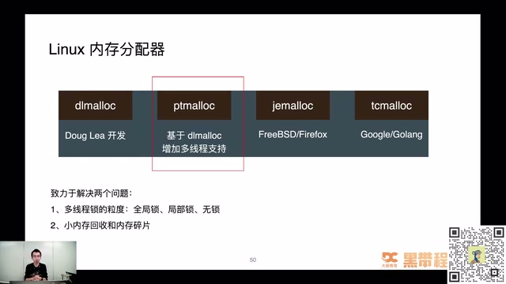

*Linux 中常见内存分配器及其关注的问题 · [原片 59:24](https://www.bilibili.com/video/BV1pS4y1M7Zc/?t=3564)*

它们都致力于解决两个问题：多线程下锁的粒度，是分配内存时竞争全局锁，还是局部锁，还是过程中无锁；第二是小内存回收和内存碎片问题。内存碎片在 ptmalloc 这里非常明显。很多时候 Java 占用内存很高，不一定真的内存泄漏，很可能因为内存碎片导致内存无法回收，所以整个进程占用非常高。之前在线上环境替换过，发现换成 jemalloc 后，内存碎片好非常多，内存占用降低非常多。

前面说 libc 里做了内存二道贩子，做了一个模拟堆，做的就是切割零售。其实零售非常好理解。


先申请一大块，就跟切猪肉一样，有人来买，就切一块给他。这里先申请一个 64 兆区域，不可读、不可写、不可执行，因为还没有被任何人申请过。如果有人申请，调一个叫 `mprotect` 的系统调用，把这个区域权限改成可读可写，这样就能被使用；剩下区域还是不可读不可写不可执行，属于接下来可以分配的部分。

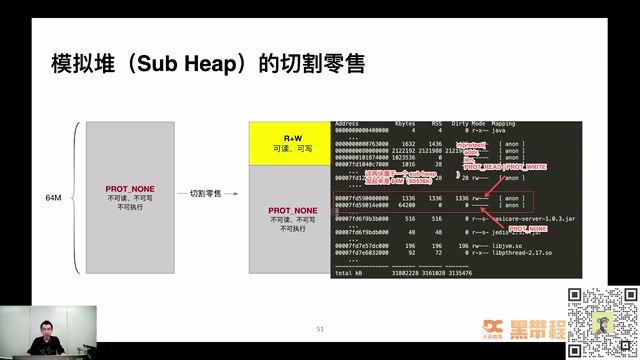

*64M Sub Heap、mprotect 与 PROT\_NONE 区域 · [原片 01:01:12](https://www.bilibili.com/video/BV1pS4y1M7Zc/?t=3672)*

拿线上实际例子看，红框里一块 64200，一块 1336，这两个区域属于一个叫 Sub Heap、模拟堆的地方。1336 这块权限可读可写，已经被切割零售；剩下接近 63 兆、64200 这个区域，不可读不可写不可执行，是还没切割零售的部分。

这个 64 兆有特殊含义，在很多性能问题上都会遇到 Linux “迷之 64 兆”问题，很多文章出现过。我写过一篇，就是图里最下面“一次 Java 进程 OOM 的排查分析”，是之前遇到的问题，当时整理怎么解决，就跟 64 兆区域有关。如果只是了解 Java 堆内存的排查工具，很难解决不常见却非常重要的问题。感兴趣可以去掘金或者我们的公众号，看这边怎么介绍 64 兆问题。接下来继续内容。

## 62:32 内存与 I/O

第四部分，就是 Linux 三驾马车第三个部分，I/O。程序做持久化、数据写入读写，一定遇到 I/O 问题，接下来详细看。这又有一个小测试：Linux 读写文件有哪几种模式？知道答案在评论区刷一刷，等五秒。已经有人发了，有选 1、有选 2。我没有说是单选还是多选，有可能多选，大家可以继续发。

答案其实是 1 和 2，称为 Buffered I/O 和 Direct I/O，等一下详细讲。选 2 的可能漏掉第一个。从大的角度看，Linux I/O 模式只有两种，一个 Buffered I/O，一个 Direct I/O。Memory-Mapped I/O 也是 Buffered I/O 其中一种类型。

Buffered I/O 和 Memory-Mapped I/O 指什么？用户进程把文件数据写到 Page Cache 就返回，没有真正落到磁盘，只写了内存。Page Cache 是内核层的一块内存空间，写完就返回，速度非常快。


所以经常担心读写文件很慢，其实也是常见误解。如果内存足够大，写文件就是写内存，速度跟写内存几乎没有太大差异。当然，如果内存非常捉襟见肘，那就是另一回事。

另一种模式 Direct I/O，不使用操作系统提供的 Page Cache。很多人觉得操作系统 Page Cache 策略太垃圾，很多非常牛的人写中间件、写数据库，都直接绕过 Page Cache，由应用程序自己维护 cache，这也比较常见。但写业务代码，这块用得少，除非做非常高性能场景，比如实现 MySQL 存储引擎、高性能缓存系统，可以用 Direct I/O。

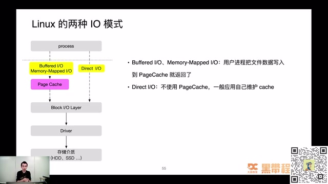

*Buffered I/O 与 Direct I/O 的路径 · [原片 01:04:24](https://www.bilibili.com/video/BV1pS4y1M7Zc/?t=3864)*

Buffered I/O 读写文件，其实是读写内存，读写的就是 Page Cache，由操作系统决定什么时候把 Page Cache 刷回磁盘。这非常关键。大家可以理解，磁盘文件是不是有点像落盘的 MySQL？Page Cache 有没有像 Redis？前面应用有没有像业务服务？里面就是做了缓存。缓存带来什么问题？数据会不会一致？大家一定会想到，经常问 Redis 和数据库怎么保持数据一致，其实这里一样有这个问题。

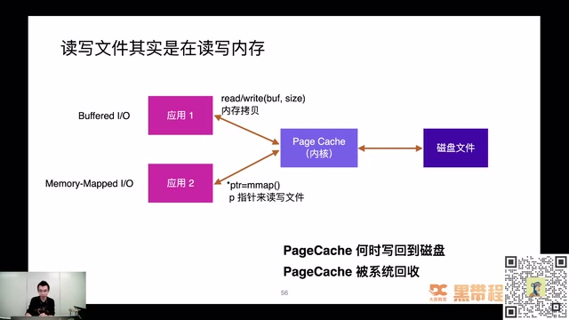

*read/write、mmap 与内核 Page Cache · [原片 01:06:24](https://www.bilibili.com/video/BV1pS4y1M7Zc/?t=3984)*

这个问题还算比较容易解决，看它几个维度。有两个比较大问题：什么时候写回磁盘，有些 Page Cache 可以被系统回收，什么时候回收？Page Cache 脏页写回有两种策略，一种主动写回：应用程序主动调 `fsync`，把脏页写回磁盘。如果应用觉得当前内容重要，一定要落盘才返回，就调 fsync 同步脏页。

如果应用对文件最终是否落盘没有极度敏感，就放心交内核处理，由内核线程刷新脏页。刷新也有不同维度，从大层面分时间和空间。时间维度，什么时候写回；空间维度，假设时间设得不合适，堆积非常多，一旦系统宕机、断电，丢失数据就非常多。所以也有空间维度，脏页累积多少，或者脏页率到多少，一定要写回磁盘。

就这两个维度，非常好理解，不能等太久，也不能等脏页太多，直观理解就是这两个。参数怎么配不用记，用到再查，有这个概念就行。课件的时间参数是 `dirty_expire_centisecs`、`dirty_writeback_centisecs`，空间参数是 `dirty_background_ratio`、`dirty_ratio`。

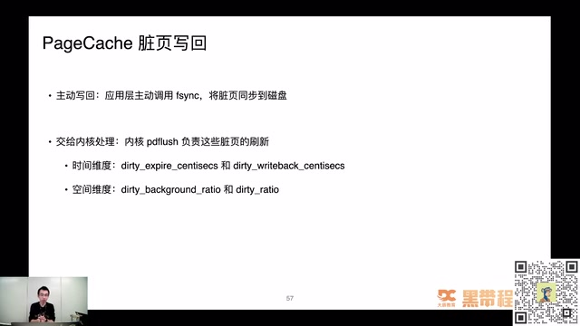

*Page Cache 脏页写回的时间与空间参数 · [原片 01:07:36](https://www.bilibili.com/video/BV1pS4y1M7Zc/?t=4056)*

### 67:46 Redis AOF 文件写入

Redis AOF 文件写入也有这个问题。是不是每次写入都要落盘？有参数可配，叫 `appendfsync`，三个选项。`always` 就是每次写操作执行一次 fsync，是最安全、当然也是性能最弱的方式。如果配 always，Redis 性能会受到严重影响。还有 `everysec`，每秒调一次 fsync，这样保证最坏情况下只丢一秒数据。`no` 就是前面提到直接交给操作系统的刷新线程处理。这三个怎么选，可以结合实际情况。我们一般配 everysec 比较多，每秒刷一次盘，既不会每次写都同步导致性能问题，也不会交操作系统而不放心。

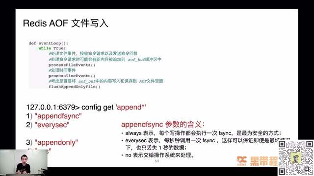

*Redis AOF 写入与 appendfsync 配置 · [原片 01:08:48](https://www.bilibili.com/video/BV1pS4y1M7Zc/?t=4128)*

### 68:49 Page Cache 回收带来的性能问题

Page Cache 回收也带来性能问题，比如直接内存回收，内存严重不足时要回收，会在进程执行的上下文里做，阻塞整个进程执行。假设正执行业务代码，应用响应时间就变非常长。还有脏页堆积过多，会带来 Load 飙升。

直接内存回收到底什么东西？有几步：申请内存，触发 page fault，里面找有没有内存；有就没有延迟，直接返回。如果没有可用内存，会先启动后台回收。如果后台回收速度足够快，也没有延迟，直接返回内存。如果回收仍慢、内存不够，就会阻塞应用上下文，直接执行内存回收，也就是 Direct Reclaim，带来巨大延迟。

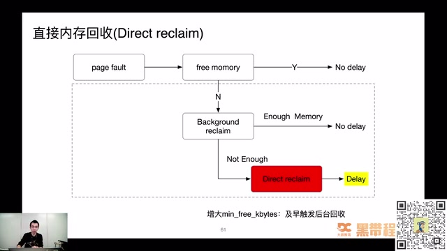

*后台回收不足时触发 Direct Reclaim · [原片 01:10:36](https://www.bilibili.com/video/BV1pS4y1M7Zc/?t=4236)*

想解决也没特别好办法，有个土办法，增大 `min_free_kbytes`，及早触发后台回收，这样真正用到时，内存相对充足。后面系列课也可能详细讲配置及对程序行为的影响。

脏页堆积过多也会带来 Load 飙升。比如申请内存，回收内存，把脏页写回 I/O；如果刚好是很慢的 I/O 设备，甚至设备是网络设备，整个写回过程会让系统 load、看到的 load average 飙升。

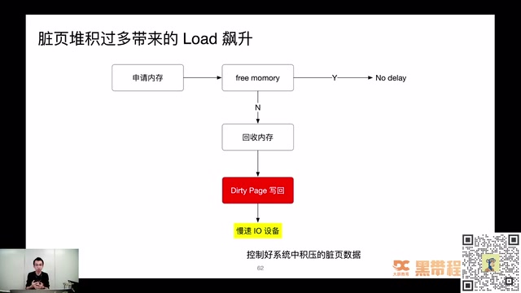

*脏页积压、慢 I/O 与 Load 升高 · [原片 01:11:00](https://www.bilibili.com/video/BV1pS4y1M7Zc/?t=4260)*

## 70:58 案例：百万长连接压测中的 Nginx OOM

接下来详细讲以前解决的一个性能分析问题。我觉得稍微复杂一些，综合用到网络、内存命令和背后原理，还做了一些实验。之前专门写过掘金文章详细讲产生过程，这里讲怎么出现，当时什么背景。

背景是做 IM 压测。大家知道 IM 用保持长连接，这里测试要支持百万长连接。有很多台 JMeter 服务器，还有四台 32 核、128G 的 Nginx 服务器。当 JMeter 开始发量，可以看到黄色那条线，就是 Nginx 内存，蹭蹭往上涨，涨到最高值、128G 左右就被系统杀掉，出现 OOM，进程被杀掉。然后又重复这个过程，又蹭蹭往上涨，涨到 128G 又被杀掉。这时候压测压根起不来，因为花很多钱搭了比较好的压测环境，也买了很多台机器作为 JMeter 压测发起端，钱按小时算，但性能问题一直没有解决，所以帮忙分析到底怎么产生。

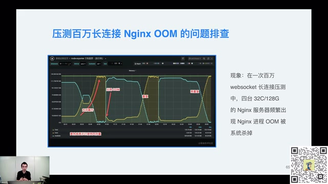

*百万 WebSocket 长连接压测中的 Nginx OOM · [原片 01:12:24](https://www.bilibili.com/video/BV1pS4y1M7Zc/?t=4344)*

调用方式非常简单：JMeter 这一端调 Nginx 接口，接口跟后端做数据交互。

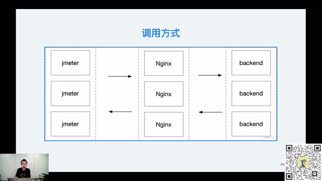

*JMeter、Nginx 与后端的调用关系 · [原片 01:13:12](https://www.bilibili.com/video/BV1pS4y1M7Zc/?t=4392)*

首先初步确定问题方向。在 Nginx 服务器端用 `ss -nt`，发现 `Send-Q` 堆积很大。然后抓包，在 JMeter 这一端也抓了包，发现大量零窗口。零窗口大家应该清楚是什么事情。这就可以初步分析，有较多消息堆积在中转 Nginx，要么 Nginx 发得太慢，要么 JMeter 收得很慢。

因为是内存相关问题，当时用 pmap 初步看 worker 进程内存分布，找到内存占用很大的区域，大概几百兆。把内存 dump 出来查看内容，发现大量请求和响应 body 堆在内存。从原理上说不应该，Nginx 只是做 proxy、请求代理，为什么大量请求响应都堆在这？当时百思不得其解。

后来想，会不会上下游收发速度不一样？比如 JMeter 收包很慢，Nginx 后端却发得很快，数据都堆在 Nginx。这一定有参数可以配置，想到 `proxy_buffers`。服务器上这个参数从其他配置拷来，设得很大，是 `proxy_buffers 64 16M;`，也就是 64 个 16 兆区域做 proxy buffers，乘起来等于一个 G。

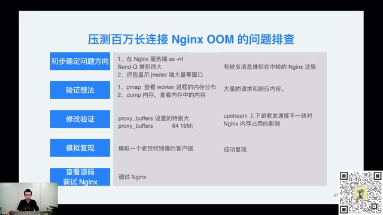

*Nginx OOM 的逐步排查和验证 · [原片 01:14:36](https://www.bilibili.com/video/BV1pS4y1M7Zc/?t=4476)*

是不是这个值设得特别大，上下游收发速度不一致导致 Nginx 内存占用？光猜没用，就写代码复现。用 Go 写很简单的 client，发 GET 请求到 Nginx，后端返回 `demo.mp4` 文件，大概 450 兆。client 收包这一端自己写个“小水管”，每秒才收几个字节，模拟收包很慢的客户端。

client 发请求到 Nginx，Nginx 把请求透传后端，后端知道有人要 450 兆数据，就蹭蹭往 Nginx 发。Nginx 内存足够大，就直接接收，不会说“你发慢点”，网络也 OK。但收到后堆在自己内存，client 这个小水管收得很慢，所以 Nginx 内存一下增加 450 兆左右，模拟复现了这种情况。马上修改，把 proxy buffers 调小，调得很小，再实验，马上解决了。

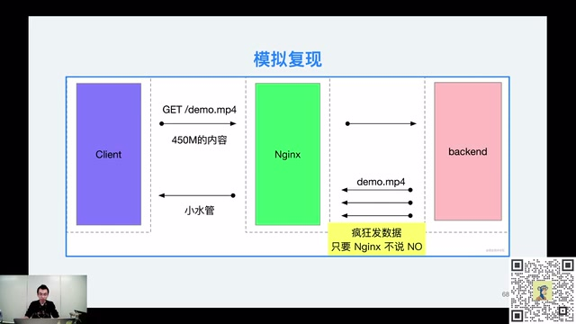

*慢客户端与快速后端的复现结构 · [原片 01:16:36](https://www.bilibili.com/video/BV1pS4y1M7Zc/?t=4596)*

解决以后还没完。要搞清楚一个问题，不能只看官方文档，要看参数到底怎么实现。所以调试 Nginx 源码。Mac 上非常容易搭 Nginx 调试环境，可以用 `CLion`，也是 JetBrains 旗下工具，就可以很好地调试刚刚说的 proxy buffers 到底怎么做。

可以看到，真的有请求过来，会分配 16 兆内存空间。红框区域里面，proxy buffer 大小是 16 兆，总共个数 64。这里判断已经分配个数有没有大于 64，没有就继续分配。从这个例子，知道 Nginx 行为确实如我们所料：proxy buffers 设置不合理，跟后端之间传输很快、带宽几乎无限制，而客户端收包很慢，会导致内存飙升。

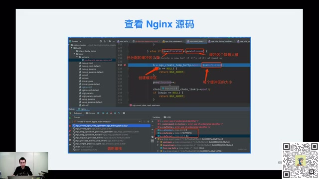

*Nginx 源码中的缓冲区分配与调试 · [原片 01:17:24](https://www.bilibili.com/video/BV1pS4y1M7Zc/?t=4644)*

把参数调整后再压测，就再没出现 OOM，内存占用很长时间非常稳定。当然，还要解决 JMeter 收包慢，这是另一个话题。比如线程数量过多，线程切换代价过高，是后面解决的问题。

这里例子介绍差不多。用到了什么？其实几个工具。首先知道网络相关知识，因为 Nginx、后端、客户端都通过网络通信。不知道任何情况，可以先抓包、看网络连接，看有没有端倪。知道大概情况、有初步排查方向后，用 pmap 看内存分布，看内存到底存什么，进一步确认排查方向。接下来做实验，先解决；如果确实解决，再看源码，是不是如我们所料，进一步巩固这块内容。

### 79:03 分享结束、下期预告与答疑

到这里整个分享结束。预告下周三话题，CPU 性能分析。下一次会实际做实验演示，比如生成火焰图，排查 CPU 跑满，刚刚说的 CFS 调度问题，到时候实际翻车演示。想看翻车过程，到时来直播间围观，我会实际操作命令，演示怎么看性能问题、怎么分析。

对黑马程序员出品感兴趣，可以添加小助手，获得更多课程，以及接下来直播相关信息。好，谢谢大家关注。现在是答疑时间，今晚分享里面，大家对知识点、讲解方式或者案例有想提问的，可以现场写在评论区，待会张师傅会看问题，逐一解答。还有最后一轮抽奖环节。

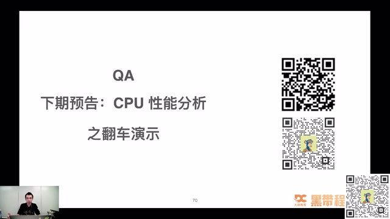

*QA 与下一期 CPU 性能分析预告 · [原片 01:20:00](https://www.bilibili.com/video/BV1pS4y1M7Zc/?t=4800)*

> 片尾说明：本视频的口述到约 80:31 结束，最后约 13 秒保留静态 QA 页且已无音轨；所提供视频未包含后续逐题答疑内容。
